# Famille 1 · La conversation, écrite et parlée

Un message de CrOliX à Natsume et sa réponse, par chaque surface : le panneau du core (téléphone, bureau), le
terminal, la fenêtre de Lun'Luxuria reliée (à l'écrit et à la voix). La famille couvre ce que le core assemble pour
répondre, l'appel au fournisseur du modèle, le flux de la réponse, les outils que Natsume appelle seule, la coupure,
le retrait, la file, les réponses partielles ou en erreur, et ce qui reste écrit après un tour.

Lu sur `origin/main` : le core à `dc130d9`, Lun'Luxuria à `8afe402`. Rien n'est rejoué : ni serveur, ni test.
Le core est décrit par son comportement ; ses références sont dans l'annexe privée, sous les mêmes identifiants.
Les routes du core citées ici sont celles que le code public de Lun'Luxuria appelle.

Hors de cette famille : la demande confiée à un poste (famille 2), le geste sur une carte (famille 3), la présence
et la parole que Natsume prend d'elle-même (famille 8), plusieurs surfaces en même temps (famille 9), la pause et
les plafonds (famille 10), les pannes (famille 11), l'appairage (famille 12), Lun'Luxuria seule (famille 13).

| Id | Scénario | En une ligne |
|---|---|---|
| S1.1 | Écrire à Natsume depuis le panneau | Le cas nominal : un message, une réponse au fil de l'eau |
| S1.2 | Assembler le tour et appeler le fournisseur du modèle | Ce que le core met dans la demande, et ce qui revient |
| S1.3 | Écrire dans un sujet | Un fil à part, sans perception ni carte |
| S1.4 | Deux messages coup sur coup | Le panneau retient, le core répond dans l'ordre |
| S1.5 | Écrire depuis le terminal | La ligne de commande du core |
| S1.6 | Écrire dans le fil de Lun'Luxuria | Un message écrit, une réponse dite |
| S1.7 | Le tour parlé | Écoute, transcription, envoi, réponse dite phrase par phrase |
| S1.8 | L'émotion par phrase | Une émotion écrite par le modèle, portée à côté du texte |
| S1.9 | Envoyer à une pause, puis retirer | Un fragment part avant la fin de la phrase, et se retire |
| S1.10 | Une phrase qui n'est pas pour elle | Bruit ou phrase écartée : rien ne quitte le poste |
| S1.11 | Parler par-dessus sa réponse | Elle se tait ; coupée si c'était pour elle, reprise sinon |
| S1.12 | Faire taire | Le bouton, ou la sourdine pendant qu'elle parle |
| S1.13 | Reparler avant d'avoir entendu la réponse | La réponse en route est retenue, puis dite ou oubliée |
| S1.14 | Le service voix en défaut | Transcription ou synthèse en échec |
| S1.15 | La réponse qui ne vient pas, vue de Lun'Luxuria | Tour parlé : garde de 60 s ; flux coupé et réponse en erreur, écrit ou parlé |
| S1.16 | Relire sa journée | L'outil de relecture, puis un second appel au modèle |
| S1.17 | Lire une carte | La carte relue chez son poste, montrée telle quelle |
| S1.18 | Trancher une carte par un message | Le code vérifie les mots de CrOliX, phrase fixe |
| S1.19 | Dire « annule » | Phrase fixe, sans modèle ni coût |
| S1.20 | Confier une demande à un poste | Le côté conversation de la délégation |
| S1.21 | La conversation non configurée | Aucun appel, la raison en réponse |
| S1.22 | Clé refusée ou crédit épuisé | Une porte de cinq minutes |
| S1.23 | Fournisseur injoignable ou flux cassé | Réponse en erreur, ou partielle |
| S1.24 | Réponse refusée, vide, ou historique refusé | Trois fins sans réponse entière |
| S1.25 | Plafond atteint | La conversation s'arrête jusqu'à l'heure dite |
| S1.26 | Le client part, le core redémarre | La réponse continue ; une réponse en attente passe en erreur |
| S1.27 | Ce qui reste d'un tour | Ce qui s'écrit, et ce que la nuit en fait |
| S1.28 | Un outil appelé sans avoir été offert | Phrase fixe du code, sans second appel ni trace |

Les participants des diagrammes : CrOliX, le panneau (l'interface web du core), le core, le fournisseur du modèle,
Lun'Luxuria (la fenêtre du desktop), le service voix local de Lun'Luxuria, un poste.

---

### S1.1 · Écrire à Natsume depuis le panneau

- **Déclencheur** : CrOliX tape un message dans le champ « Écrire à Natsume » et valide (Entrée, ou le bouton).
- **Acteurs** : CrOliX, le panneau, le core, le fournisseur du modèle.
- **Avant** : l'appareil est appairé (famille 12). Le champ est ouvert : le panneau le remplace par une raison
  quand le core ne répond plus, quand la clé du modèle est absente ou refusée, ou quand un plafond est atteint.
  Une pause manuelle ne ferme pas le champ.

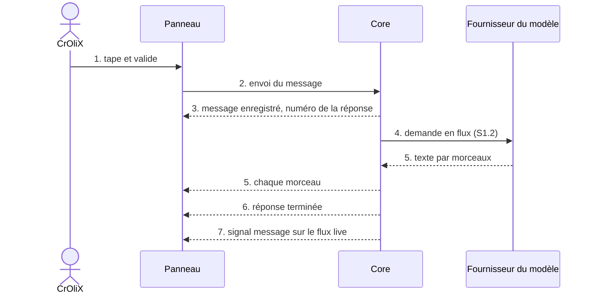

| # | De → vers | Par quoi | Ce qui circule | Retour |
|---|---|---|---|---|
| 1 | CrOliX → panneau | le champ | le texte ; Maj+Entrée fait un retour à la ligne | le champ se vide, la colonne s'ouvre |
| 2 | Panneau → core | envoi d'un message dans le fil affiché | le texte (1 à 8 000 signes), la surface (`mobile` sous 768 px de large, sinon `desktop`). Pas de demande de parole | un flux d'événements, ouvert jusqu'à la fin de la réponse |
| 3 | Core → panneau | le flux de la réponse | le message de CrOliX tel qu'enregistré (numéro, heure, jour), puis le numéro de la réponse à venir | — |
| 4 | Core → fournisseur | appel en flux | voir S1.2 | texte par morceaux, puis l'usage |
| 5 | Core → panneau | le flux de la réponse | chaque morceau de texte, dans l'ordre | — |
| 6 | Core → panneau | fin du flux | la réponse enregistrée : texte, état, modèle, jetons, coût ; les délais mesurés (attente en file, premier mot) | le flux se ferme |
| 7 | Core → tous les écrans ouverts | flux live | « un message a changé » : le fil, le numéro. Émis deux fois : à l'arrivée du message de CrOliX, à la fin de la réponse | chaque écran relit le fil (famille 9) |

- **Ce que CrOliX voit, et où** : dans la colonne de Natsume (bureau) ou la feuille « Natsume » (téléphone), sa
  bulle, puis une bulle « Natsume écrit… » qui se remplit au fil de l'eau ; l'heure s'affiche sous la bulle une fois
  la réponse finie.
- **Ce qui s'écrit** : deux messages dans le fil (le sien, la réponse), rangés au jour de Natsume (de 5 h à 5 h) ;
  le coût de l'appel dans les dépenses, avec les jetons relus du cache et le délai du premier mot ; l'état de la clé
  et du crédit du fournisseur ; un compteur du jour si la réponse contient des formules d'agent par défaut.
- **Qui décide** : le code du panneau choisit la surface, d'après la largeur de la fenêtre. Le code du core valide
  le message et l'ordre de passage. Le modèle écrit la réponse.
- **Erreurs et cas limites** :
  - Texte de plus de 8 000 signes : le core refuse ; le panneau affiche le motif du core et rend le texte au champ.
  - Fil inconnu : refus ; le panneau affiche « Le message n'est pas parti. » et rend le texte au champ.
  - Réseau coupé avant l'envoi : « Natsume est injoignable. », le texte revient dans le champ.
  - Jeton refusé : le panneau demande d'appairer de nouveau (famille 12).
  - Réponse en erreur : la bulle porte la raison en rouge (S1.21 à S1.25).
- **Écart avec les décisions** : aucun connu.
- **Non vérifié** : le texte de la ligne d'état de Natsume pendant la réponse ; d'où le panneau tient l'état de la
  clé qu'il lit pour fermer le champ.

### S1.2 · Assembler le tour et appeler le fournisseur du modèle

- **Déclencheur** : le tour d'un message arrive en tête de la file de son fil.
- **Acteurs** : le core, le fournisseur du modèle.
- **Avant** : la conversation est configurée, aucun plafond n'est atteint, le fournisseur n'est pas derrière sa
  porte de refus (S1.21, S1.22, S1.25). Tout ce qui suit se lit dans la base du core : composer la demande
  n'appelle aucun poste.

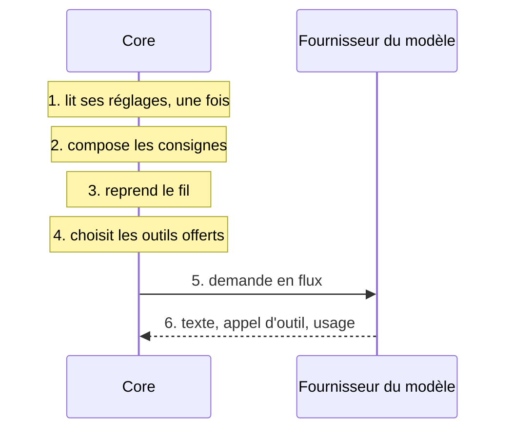

| # | De → vers | Par quoi | Ce qui circule | Retour |
|---|---|---|---|---|
| 1 | Core (lecture) | ses réglages | le fournisseur, le modèle, le nombre maximal de jetons de sortie (800 par défaut) : lus une fois, valables pour tout le tour | — |
| 2 | Core (lecture) | la base | les consignes, dans cet ordre : le socle et le tempérament ; les règles des outils ; la date du jour (calendrier de Paris) ; le contexte chaud le plus récent, daté ; l'heure ; « ce que tu perçois » (fil principal seulement) ; les souvenirs rappelés | — |
| 3 | Core (lecture) | la base | le fil : les messages réussis seulement. Fil principal : depuis 5 h, plus les six derniers d'avant. Au plus 40 messages et 24 000 signes, données d'outil comprises | — |
| 4 | Core (calcul) | — | les outils offerts : relire sa journée (toujours) ; déléguer (si un poste relié et connecté a un rôle connu) ; lire une carte (fil principal) ; trancher une carte (fil principal, et seulement si le message porte un mot de geste ou un choix d'une carte en attente) | — |
| 5 | Core → fournisseur | appel en flux, sans relance | le modèle, les tours (consignes, fil, message), le plafond de sortie, les outils, le réglage de raisonnement du modèle | — |
| 6 | Fournisseur → core | le flux | des morceaux de texte, des appels d'outil, puis l'usage : jetons d'entrée, de sortie, relus du cache, écrits au cache ; et si la réponse a été tronquée | — |

- **Ce que CrOliX voit, et où** : rien de cette étape, sinon la bulle « Natsume écrit… ».
- **Ce qui s'écrit** : rien avant la fin de l'appel. L'heure de la dernière tentative est gardée en mémoire vive.
- **Qui décide** :
  - Le code décide de tout ce qui entre dans la demande. « Ce que tu perçois » tient en 1 500 signes au plus et
    liste, du plus important au moins important : les urgences non vues, les cartes à trancher avec leur repère,
    l'issue des gestes du jour, l'humeur, la présence au poste, le temps depuis le dernier message, les cartes en
    attente depuis trois jours, l'activité tardive de la veille, le nombre de messages du jour, les messages
    sortis du contexte.
  - Le code rappelle au plus cinq souvenirs : ceux qui partagent le plus de mots avec le message de CrOliX, sans
    aucun appel au modèle.
  - Le code insère une ligne de temps écoulé entre deux messages séparés de plus de vingt minutes.
  - Le modèle choisit de répondre ou d'appeler un outil. S'il en appelle plusieurs, seul le premier est exécuté.
- **Erreurs et cas limites** :
  - Une réponse passée par un outil est rejouée en deux ou trois tours : ses mots d'avant l'appel avec l'appel
    lui-même (un seul tour), le résultat coupé à 800 signes, puis ses mots d'après le résultat, sauf quand le
    résultat était toute la réponse (sans second appel). Cela vaut seulement si l'outil est encore offert, si ses
    arguments se lisent comme un objet et si le texte n'a pas été réécrit depuis (une coupure efface ces données) ;
    sinon la réponse repart comme son seul texte.
  - Une réponse en erreur, partielle ou coupée avant le premier mot n'est jamais rejouée au modèle.
  - La lettre du matin et une carte lue repartent au modèle comme de la donnée, jamais comme une consigne.
  - La perception illisible ne coûte pas la réponse : le tour part sans elle.
  - Dans un sujet : pas de perception, pas d'outil de carte, les 40 derniers messages (S1.3).
- **Écart avec les décisions** : T30 (la date dite au modèle suit le calendrier, le fil et la perception suivent
  le jour de 5 h). T8 (du poste, le modèle ne connaît qu'un rôle en une ligne). Direction « prérequis » : la
  consigne dit de ne jamais demander de confirmation avant de déléguer.
- **Non vérifié** : la composition du contexte chaud et l'écriture des souvenirs (famille 6) ; le calcul de la
  présence et de la file des cartes lues ici (familles 8 et 3). Les appels d'outil arrivent-ils entiers chez les
  deux fournisseurs ? Chez l'un, ils sont abandonnés quand la réponse est tronquée ; le module de l'autre n'a pas
  été lu sur ce point.

### S1.3 · Écrire dans un sujet

- **Déclencheur** : CrOliX ouvre un sujet par sa pastille, sous le fil, puis écrit.
- **Acteurs** : CrOliX, le panneau, le core, le fournisseur du modèle.
- **Avant** : le sujet existe. Dans le code lu, seul le terminal en crée un (S1.5) : le panneau liste les sujets et
  les ouvre, il n'a aucun geste pour en créer.

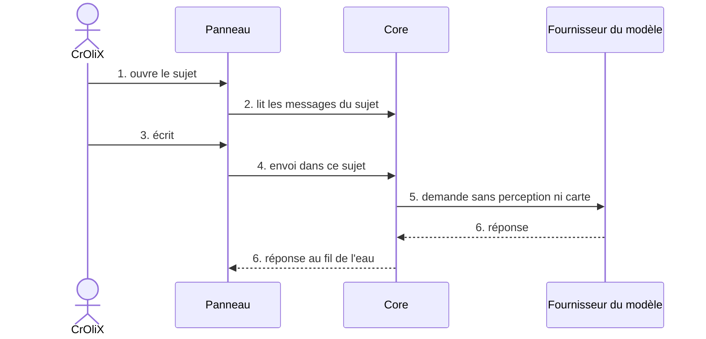

| # | De → vers | Par quoi | Ce qui circule | Retour |
|---|---|---|---|---|
| 1 | CrOliX → panneau | la pastille du sujet | — | le titre du sujet remplace « Fil du jour » |
| 2 | Panneau → core | lecture du fil | l'identifiant du sujet | les 50 derniers messages, du plus ancien au plus récent |
| 3-4 | Panneau → core | envoi d'un message | comme S1.1, dans ce sujet | comme S1.1 |
| 5 | Core → fournisseur | appel en flux | comme S1.2, sans « ce que tu perçois », sans outil de carte, avec les 40 derniers messages du sujet (pas de reprise à 5 h) | — |
| 6 | Core → panneau | le flux de la réponse | comme S1.1 | — |

- **Ce que CrOliX voit, et où** : le sujet à la place du fil du jour ; une flèche ramène au fil du jour.
- **Ce qui s'écrit** : les messages, dans le sujet ; le coût.
- **Qui décide** : CrOliX choisit le fil. Le code du core fait tourner chaque fil dans sa propre file : un sujet
  et le fil principal répondent en même temps.
- **Erreurs et cas limites** :
  - Un sujet quitte la liste quand tous ses jours ont été traités par la nuit. Un sujet vide reste dans la liste,
    mais la nuit le supprime une fois qu'il est plus ancien que le jour qu'elle vient de couvrir.
  - Une carte ne se tranche pas depuis un sujet ; « annule » y marche (S1.19).
  - Le rappel des souvenirs et l'outil de relecture restent offerts dans un sujet.
  - L'outil de délégation reste offert dans un sujet quand un poste est connecté. La délégation s'y joue comme en
    S1.20, avec une différence : aucune carte n'y devient « la carte dont on parle ».
- **Écart avec les décisions** : aucun connu.
- **Non vérifié** : rien.

### S1.4 · Deux messages coup sur coup

- **Déclencheur** : CrOliX valide un second message alors que la réponse au premier n'est pas finie.
- **Acteurs** : CrOliX, le panneau, le core, le fournisseur du modèle.
- **Avant** : une réponse est en cours dans le fil.

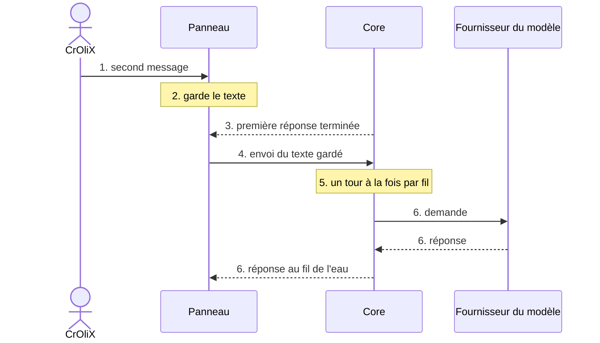

| # | De → vers | Par quoi | Ce qui circule | Retour |
|---|---|---|---|---|
| 1 | CrOliX → panneau | le champ | le texte | — |
| 2 | Panneau (seul) | — | le texte est gardé ; un troisième s'y ajoute, séparé par un retour à la ligne | « Natsume répond encore : l'envoi attend. » sous le champ |
| 3 | Core → panneau | fin du flux | la première réponse | — |
| 4 | Panneau → core | envoi d'un message | les textes gardés, en un seul message, dans le fil où ils ont été tapés | comme S1.1 |
| 5 | Core (seul) | sa file | chaque fil répond à un message à la fois, dans l'ordre d'arrivée ; une réponse en file ne voit pas les messages arrivés après elle | — |
| 6 | Core → fournisseur, puis panneau | comme S1.1 | — | — |

- **Ce que CrOliX voit, et où** : la ligne « l'envoi attend », puis son message et la réponse, à la suite.
- **Ce qui s'écrit** : un seul message pour les textes gardés par le panneau.
- **Qui décide** : le panneau retient ; le core ordonne. Une autre surface (Lun'Luxuria, le terminal, un second
  appareil) ne retient rien : son message entre dans la file du core, et attend là.
- **Erreurs et cas limites** :
  - « annule », « annule ça », « annule le », « annule la » ne sont pas retenus : ils partent tout de suite, à côté
    de la réponse en cours (S1.19).
  - Deux messages de CrOliX à la suite, sans réponse réussie entre eux, partent au modèle comme deux tours
    distincts, dans l'ordre.
  - Si l'envoi du premier échoue, le panneau rend au champ le premier texte et le texte gardé.
  - Une réponse coupée pendant qu'elle attend dans la file ne lance aucun appel au modèle.
- **Écart avec les décisions** : aucune décision ne porte dessus. Écart interne : le panneau laisse passer quatre
  formes d'« annule », le core en reconnaît neuf (dont « annule tout » et « non, annule »). Les cinq autres
  attendent donc la fin de la réponse en cours, alors qu'un geste n'est tenu que cinq secondes.
- **Non vérifié** : rien.

### S1.5 · Écrire depuis le terminal

- **Déclencheur** : CrOliX lance la conversation en terminal du core, puis tape une ligne.
- **Acteurs** : CrOliX, le terminal (un client du core, livré avec lui), le core, le fournisseur du modèle.
- **Avant** : le core tourne et le terminal le joint. Au premier lancement, le terminal demande un code
  d'appairage et garde son jeton dans un fichier local (famille 12).

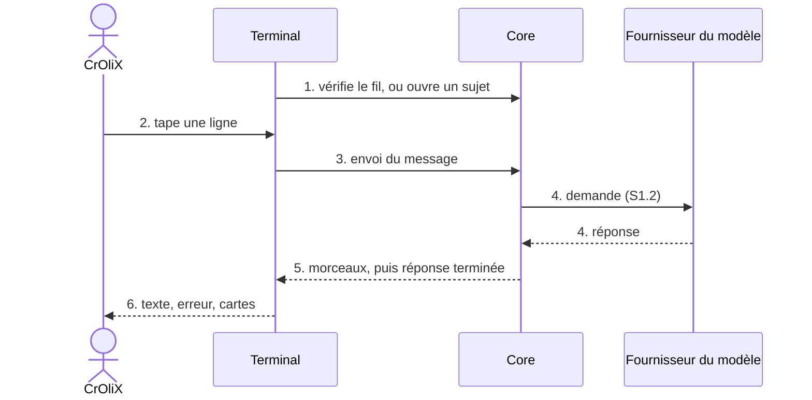

| # | De → vers | Par quoi | Ce qui circule | Retour |
|---|---|---|---|---|
| 1 | Terminal → core | lecture du fil, ou création d'un sujet | le fil visé (le principal par défaut), ou un titre de sujet (1 à 120 signes) | « Fil principal. » ou « Sujet « … » ouvert » |
| 2 | CrOliX → terminal | l'invite « Toi : » | une ligne | — |
| 3 | Terminal → core | envoi d'un message | le texte, la surface `cli` | le même flux que S1.1 |
| 4 | Core → fournisseur | appel en flux | voir S1.2 | — |
| 5 | Core → terminal | le flux de la réponse | les morceaux, puis la réponse enregistrée | — |
| 6 | Terminal → CrOliX | l'écran | « Natsume : » et le texte au fil de l'eau | — |

- **Ce que CrOliX voit, et où** : dans le terminal seulement. Une réponse en erreur : « Natsume ne peut pas
  répondre : » et la raison. Une réponse partielle : « (Réponse coupée : …) ». Une carte préparée par un poste :
  son titre, ses lignes, et « [v] valider · [r] refuser · [Entrée] plus tard ».
- **Ce qui s'écrit** : comme S1.1, avec la surface « terminal ».
- **Qui décide** : CrOliX, pour chaque carte montrée. Le geste part au core, qui le relaie (famille 3).
- **Erreurs et cas limites** :
  - Flux interrompu avant la fin : « (Flux interrompu avant la fin de la réponse.) », puis le terminal relit le
    dernier message du fil ; s'il n'y est pas encore, « La réponse continue côté core : elle sera dans le fil. »
  - Jeton révoqué : le terminal l'efface et redemande un code.
  - Core injoignable pendant la conversation : le message d'erreur s'affiche et la conversation reste ouverte. Au
    lancement (le fil ou le sujet ne s'ouvre pas), le terminal affiche l'erreur et s'arrête.
  - Une phrase fixe du core (S1.18, S1.19) remplace ce qui a défilé : le terminal réaffiche le texte enregistré.
  - Deux commandes locales : lister les cartes en attente, et sortir.
- **Écart avec les décisions** : aucun connu.
- **Non vérifié** : le geste sur une carte depuis le terminal n'est lu que jusqu'à son appel au core (famille 3).

### S1.6 · Écrire dans le fil de Lun'Luxuria

- **Déclencheur** : CrOliX ouvre « le fil » dans la fenêtre de Lun'Luxuria, tape dans « Lui écrire », valide.
- **Acteurs** : CrOliX, Lun'Luxuria, le core, le fournisseur du modèle, le service voix local.
- **Avant** : Lun'Luxuria est reliée et appairée ; elle n'est pas en sourdine (le champ est alors désactivé :
  « En sourdine. Sortir de la sourdine pour lui écrire. »).

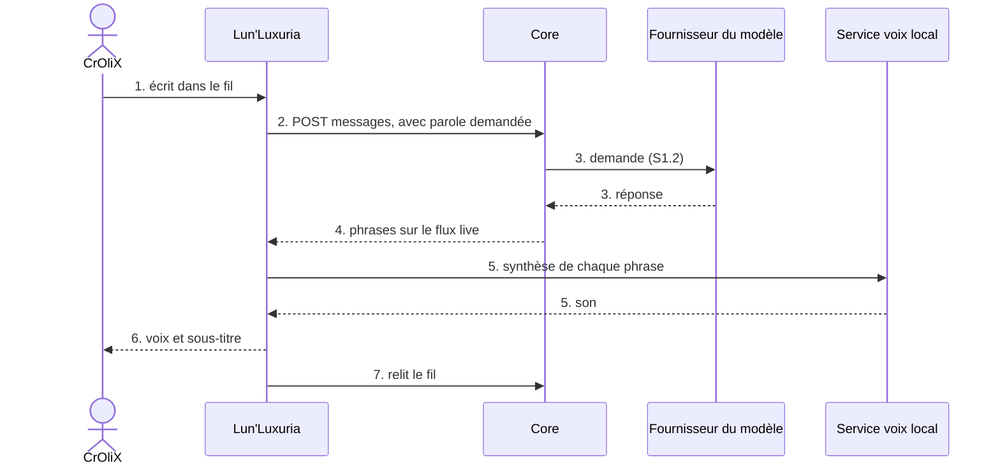

| # | De → vers | Par quoi | Ce qui circule | Retour |
|---|---|---|---|---|
| 1 | CrOliX → Lun'Luxuria | le champ « Lui écrire » (Lun'Luxuria, `src/Fil.svelte:20-25`) | le texte | le champ se vide |
| 2 | Lun'Luxuria → core | `POST /api/threads/main/messages` (Lun'Luxuria, `src/core.ts:93-97`, `src/conversation.ts:648-656`) | `text`, `speak: true`, `surface: 'desktop'`. Pas de `confidence` | le flux `user`, `reply`, `delta`, `done` |
| 3 | Core → fournisseur | appel en flux | voir S1.2, avec les règles d'une réponse dite (S1.7, S1.8) | — |
| 4 | Core → Lun'Luxuria | `GET /api/live` (Lun'Luxuria, `src/core.ts:124-142`) | `speech` par phrase, puis `speech-end` (S1.7) | — |
| 5 | Lun'Luxuria → service voix | `POST /voix/tts` (Lun'Luxuria, `src/voice.ts:29-36`) | `text` | le son de la phrase |
| 6 | Lun'Luxuria → CrOliX | haut-parleur, écran | la voix, le sous-titre | — |
| 7 | Lun'Luxuria → core | `GET /api/threads/main/messages?limit=50` (Lun'Luxuria, `src/core.ts:118-121`) | — | les 50 derniers messages du fil principal |

- **Ce que CrOliX voit, et où** : dans le fil de Lun'Luxuria, son message et la réponse, avec l'heure ; la réponse
  est aussi dite. Le panneau du core, s'il est ouvert, relit le fil (famille 9).
- **Ce qui s'écrit** : comme S1.1, avec la surface « bureau ». Lun'Luxuria n'écrit que dans le fil principal.
- **Qui décide** : Lun'Luxuria demande toujours la parole (`speak: true`), écrit ou parlé.
- **Erreurs et cas limites** :
  - Avant d'envoyer, Lun'Luxuria annonce de nouveau la présence si CrOliX était absent, et attend ce retour trois
    secondes au plus (Lun'Luxuria, `src/session.svelte.ts:441-456`, `727-746`).
  - Réponse en erreur : sa raison s'affiche à l'écran et y reste (Lun'Luxuria, `src/conversation.ts:652-655`).
  - Serveur non joint, ou réponse 5xx : le message s'affiche, et s'efface quand le serveur répond de nouveau.
  - Sourdine posée pendant l'attente : rien ne part.
  - Jeton refusé par le serveur (réponse 401 à l'envoi, à la lecture du fil ou au flux live) : voir S1.7.
- **Écart avec les décisions** : aucun connu.
- **Non vérifié** : rien.

### S1.7 · Le tour parlé

- **Déclencheur** : CrOliX dit une phrase devant le micro de Lun'Luxuria.
- **Acteurs** : CrOliX, Lun'Luxuria, son service voix local, le core, le fournisseur du modèle.
- **Avant** : Lun'Luxuria est reliée et appairée, le micro est ouvert, la sourdine est levée, aucune autre
  application ne tient le micro, la présence est annoncée (famille 8). L'audio ne quitte jamais le poste.

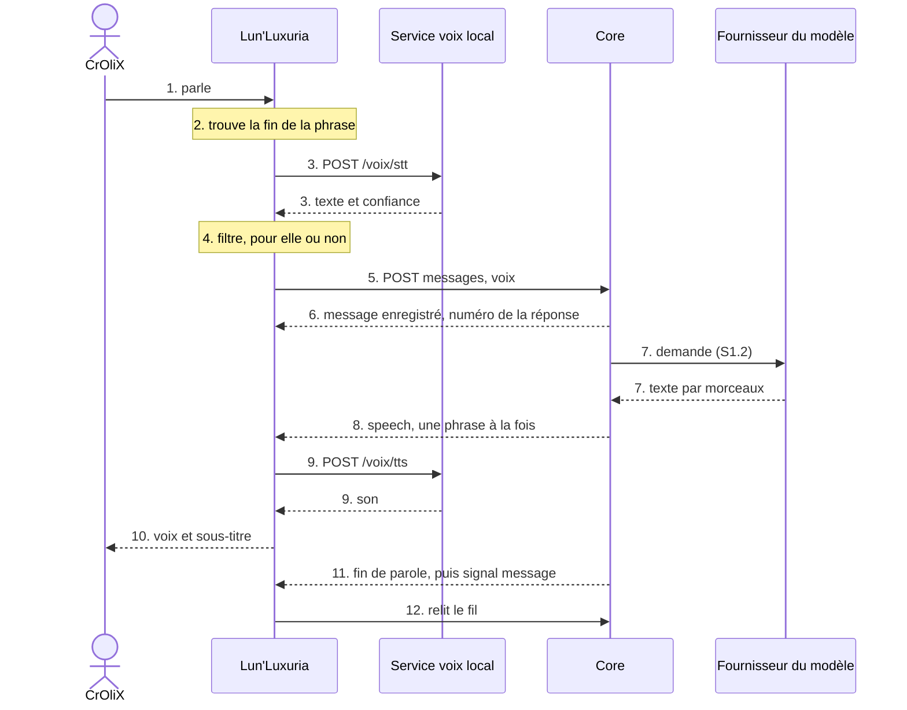

| # | De → vers | Par quoi | Ce qui circule | Retour |
|---|---|---|---|---|
| 1 | CrOliX → Lun'Luxuria | le micro | des trames de son de 32 ms | — |
| 2 | Lun'Luxuria (seule) | la détection de voix, puis la fin de phrase (Lun'Luxuria, `src/listen/endpoint.ts:88-135`) | début, voix tenue 400 ms, pause de 160 ms, fin après 700 ms de silence | — |
| 3 | Lun'Luxuria → service voix | `POST /voix/stt` (Lun'Luxuria, `src/voice.ts:14-27`) | le son de la phrase | `text`, `confidence` |
| 4 | Lun'Luxuria (seule) | le filtre (Lun'Luxuria, `src/listen/filter.ts:43-56`) | le texte, la disposition de la fenêtre, la touche tenue, l'heure de sa dernière parole | pour elle, bruit, ou écartée |
| 5 | Lun'Luxuria → core | `POST /api/threads/main/messages` (Lun'Luxuria, `src/core.ts:93-97`, `src/conversation.ts:525`) | `text` (la transcription), `speak: true`, `surface: 'voice'`, `confidence` | le flux de la réponse |
| 6 | Core → Lun'Luxuria | ce flux | `user` (le message enregistré, son numéro), `reply` (le numéro de la réponse) | — |
| 7 | Core → fournisseur | appel en flux | voir S1.2, plus les règles d'une réponse dite : une phrase d'attente avant de déléguer, l'émotion par phrase (S1.8) | — |
| 8 | Core → Lun'Luxuria | `GET /api/live` | `speech` : `id` (la réponse), `n` (le rang), `text` (la phrase, sans mise en forme ni repère de carte, secrets masqués), `why: 'reply'`, `emotion` si elle n'est pas neutre | — |
| 9 | Lun'Luxuria → service voix | `POST /voix/tts` | `text` : la phrase seule | le son, et sa fréquence |
| 10 | Lun'Luxuria → CrOliX | haut-parleur, écran | la voix ; le sous-titre de la phrase | — |
| 11 | Core → Lun'Luxuria | `GET /api/live`, puis fin du flux de l'étape 5 | `speech-end` (`id`, `why`) ; `done` (la réponse enregistrée, ses délais) ; `message` (le fil a changé) | — |
| 12 | Lun'Luxuria → core | `GET /api/threads/main/messages?limit=50` | — | le fil |

- **Ce que CrOliX voit, et où** : dans la fenêtre de Lun'Luxuria, l'état (elle écoute, réfléchit, parle), le
  sous-titre de chaque phrase (il reste quatre secondes après la dernière), le fil s'il est ouvert. Le panneau du
  core relit le fil au signal `message` (famille 9).
- **Ce qui s'écrit** : au core, comme S1.1, avec la surface « voix » ; le texte enregistré garde sa mise en forme,
  la parole la perd. La confiance de la transcription n'est pas enregistrée. Chez Lun'Luxuria : le déroulé du
  tour et les vingt dernières latences, en mémoire seulement.
- **Qui décide** :
  - Le code de Lun'Luxuria décide de la fin de la phrase et si elle est « pour elle » : filtre coupé pour cette
    disposition, touche tenue, nom dit (à deux lettres près), ou moins de 15 s après sa dernière parole.
  - Le code du core découpe la réponse en phrases : la première peut s'arrêter à une virgule, pour que le premier
    son vienne plus tôt.
  - Le modèle écrit le texte. Lun'Luxuria décide de dire : en sourdine, une réponse n'est pas dite.
- **Erreurs et cas limites** :
  - Les `delta` du flux de l'étape 5 ne servent pas à la voix : Lun'Luxuria ne dit que les `speech`.
  - Lun'Luxuria synthétise une phrase à la fois, la suivante pendant que la précédente joue.
  - Une phrase arrivée après le `speech-end` de sa réponse est ignorée.
  - Liaison live perdue : la voix s'arrête, Lun'Luxuria retente toutes les trois secondes.
  - Présence à rétablir (retour d'absence) : le message attend ce retour, trois secondes au plus.
  - Phrase de plus de 30 s sans pause : la fin de phrase se déclenche d'elle-même, que la voix ait cessé ou non
    (Lun'Luxuria, `src/listen/endpoint.ts:25`, `128-136`). La phrase part à la transcription comme une phrase
    finie, ou devient un bruit si elle compte moins de 250 ms de voix.
  - Jeton refusé par le serveur (réponse 401 à un envoi, à une lecture du fil ou au flux live) : Lun'Luxuria efface
    son jeton (seulement s'il n'a pas été remplacé entre-temps par un autre onglet), garde le motif « Ce poste n'est
    plus reconnu par le serveur : entre un nouveau code d'appairage. » et recharge la page ; l'accueil revient avec
    ce motif et demande un code (Lun'Luxuria, `src/core.ts:42-44`, `131`, `src/session.svelte.ts:266-278`). Le flux
    live ne retente pas après un 401. Voir la famille 12.
  - Le reste : S1.9 à S1.15.
- **Écart avec les décisions** : le core n'apprend jamais « dit » : seulement une coupure. La sourdine est lue aux
  deux endroits.
- **Non vérifié** : l'intérieur du service voix local (`voix/service.py`), lu seulement par ses deux routes ; la
  détection de voix par le modèle local. Ces deux écarts correspondent-ils aux trous T4 et T11 de la carte du
  27/11, qui n'a pas été relue ?

### S1.8 · L'émotion par phrase

- **Déclencheur** : une réponse dite (S1.6, S1.7), quand la liste des émotions de l'instance en compte plus d'une.
- **Acteurs** : le core, le fournisseur du modèle, Lun'Luxuria.
- **Avant** : la liste des émotions est une donnée de l'instance ; le code ne garde que le neutre. Avec le neutre
  seul, rien de ce scénario ne se joue.

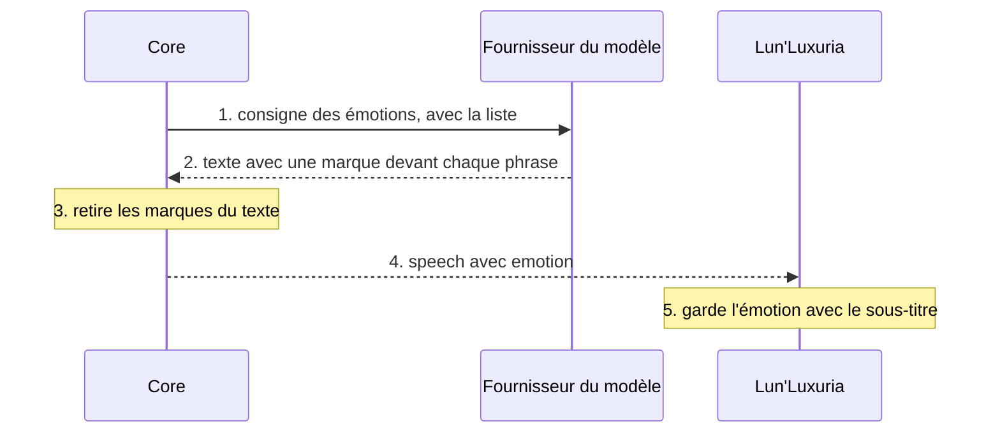

| # | De → vers | Par quoi | Ce qui circule | Retour |
|---|---|---|---|---|
| 1 | Core → fournisseur | les consignes | la règle : devant chaque phrase, entre accolades, un mot de la liste ; la liste (identifiant, façon de parler) | — |
| 2 | Fournisseur → core | le flux | le texte, avec ses marques | — |
| 3 | Core (seul) | le flux | les marques sortent du texte : elles ne sont ni dites, ni affichées, ni enregistrées. Une marque inconnue vaut le neutre | — |
| 4 | Core → Lun'Luxuria | `GET /api/live` | `speech.emotion` : l'identifiant, absent pour le neutre. Une émotion nouvelle ferme la phrase en cours | — |
| 5 | Lun'Luxuria (seule) | `emotionOf` (Lun'Luxuria, `src/brain.ts:10-11`), puis le sous-titre (`src/speech/speaker.ts:225`) | l'identifiant, gardé s'il a la forme d'un identifiant | — |

- **Ce que CrOliX voit, et où** : rien. L'émotion est tenue dans l'état de la fenêtre avec le sous-titre
  (Lun'Luxuria, `src/session.svelte.ts:95-96`, `478`), « jamais montrée », et aucun écran ne la lit.
- **Ce qui s'écrit** : rien. L'émotion n'est gardée ni au core ni chez Lun'Luxuria.
- **Qui décide** : le modèle choisit l'émotion ; le code ne reconnaît que celles de la liste.
- **Erreurs et cas limites** :
  - Une phrase fixe ou le texte d'un outil, sans modèle derrière : la voix revient au neutre.
  - Liste illisible ou sans entrée valide : le neutre seul, signalé une fois au journal technique du core.
  - Une réponse écrite (panneau, terminal) ne reçoit ni la règle ni le retrait des marques.
- **Écart avec les décisions** : la synthèse ne reçoit que le texte (Lun'Luxuria, `src/voice.ts:29-30`).
  L'émotion voyage avec le sous-titre, mais elle n'est pas affichée non plus.
- **Non vérifié** : la liste réelle de l'instance (une donnée, non lue). Cet écart est-il le trou T22 de la carte du
  27/11, qui n'a pas été relue ?

### S1.9 · Envoyer à une pause, puis retirer

- **Déclencheur** : CrOliX marque une pause de 160 ms au milieu d'une phrase, puis continue.
- **Acteurs** : CrOliX, Lun'Luxuria, son service voix local, le core, le fournisseur du modèle.
- **Avant** : le réglage « envoyer à la première pause » est actif (le défaut) ; CrOliX n'est pas noté absent ;
  la phrase a moins de dix secondes et moins de trois essais.

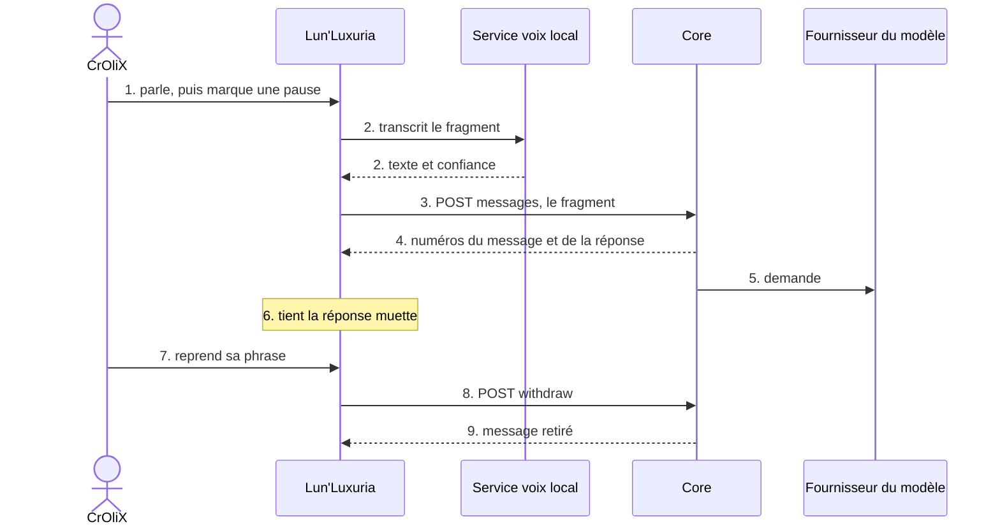

| # | De → vers | Par quoi | Ce qui circule | Retour |
|---|---|---|---|---|
| 1-2 | Lun'Luxuria → service voix | `POST /voix/stt` | le son jusqu'à la pause | `text`, `confidence` |
| 3 | Lun'Luxuria → core | `POST /api/threads/main/messages` | comme S1.7 : le core ne sait pas que c'est un fragment | le flux |
| 4 | Core → Lun'Luxuria | le flux | `user` (numéro du message), `reply` (numéro de la réponse) | — |
| 5 | Core → fournisseur | appel en flux | voir S1.2 | — |
| 6 | Lun'Luxuria (seule) | sa voix (Lun'Luxuria, `src/conversation.ts:592`) | la réponse est tenue : prête, muette | — |
| 7 | CrOliX → Lun'Luxuria | le micro | la voix reprend (Lun'Luxuria, `src/conversation.ts:249-251`) | — |
| 8 | Lun'Luxuria → core | `POST /api/threads/main/messages/{id}/withdraw` (Lun'Luxuria, `src/core.ts:114-116`) | le numéro du message de CrOliX. Pas de corps | le message, vidé |
| 9 | Core (seul) | — | l'appel au modèle s'arrête, aucun outil ne tourne après ; le fragment est vidé, et sa réponse aussi, sauf si elle porte déjà des cartes préparées par un poste : elle reste alors entière dans le fil, avec ses cartes ; un geste tenu par ce tour est annulé | signal `message` sur le flux live |

- **Ce que CrOliX voit, et où** : rien du fragment. Vidés, le message et sa réponse ne s'affichent dans aucun fil
  (sauf une réponse qui portait déjà des cartes préparées : elle reste, avec ses cartes).
- **Ce qui s'écrit** : les deux messages restent en base, vides et marqués partiels, jamais rejoués au modèle. Ce
  que l'appel interrompu avait déjà produit est compté dans les dépenses.
- **Qui décide** : le code de Lun'Luxuria, sur le son seul. Si la phrase s'arrête là, le fragment devient la phrase :
  la réponse tenue sort tout de suite (Lun'Luxuria, `src/conversation.ts:628-645`).
- **Erreurs et cas limites** :
  - Le fragment ne passe pas le filtre : rien n'est envoyé ; la phrase entière sera jugée à sa fin.
  - Le retrait arrive avant le numéro du message : il part dès que le flux donne ce numéro.
  - Retrait refusé ou non joint : « Retrait non transmis : … » à l'écran de Lun'Luxuria.
  - Un clic fait au même moment sur une carte n'est pas annulé par le retrait : seul un geste tenu en conversation
    l'est.
  - Le retrait vise un message de CrOliX ; sur un message de Natsume ou un numéro inconnu, le core refuse.
- **Écart avec les décisions** : aucun connu.
- **Non vérifié** : rien.

### S1.10 · Une phrase qui n'est pas pour elle

- **Déclencheur** : un son, ou une phrase dite à quelqu'un d'autre, devant le micro ouvert.
- **Acteurs** : CrOliX, Lun'Luxuria, son service voix local.
- **Avant** : le micro est ouvert ; le filtre est actif pour la disposition en cours (par défaut : en petit mode,
  pas en scène).

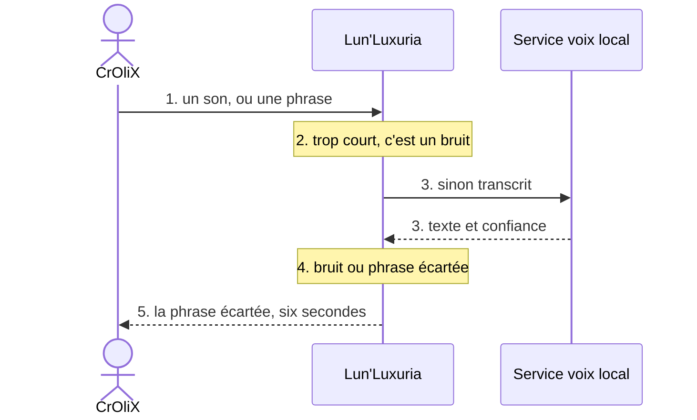

| # | De → vers | Par quoi | Ce qui circule | Retour |
|---|---|---|---|---|
| 1-2 | Lun'Luxuria (seule) | la fin de phrase | moins de 250 ms de voix : un bruit, rien n'est transcrit | — |
| 3 | Lun'Luxuria → service voix | `POST /voix/stt` | le son | `text`, `confidence` |
| 4 | Lun'Luxuria (seule) | le filtre (Lun'Luxuria, `src/listen/filter.ts:33-56`) | un texte sans lettre, ou une formule que la transcription invente sur du silence : bruit. Sinon, sans touche, sans nom, hors des 15 s : écartée | — |
| 5 | Lun'Luxuria → CrOliX | l'écran | le texte écarté, si la trace des phrases écartées est active | — |

- **Ce que CrOliX voit, et où** : la phrase écartée, six secondes, dans la fenêtre. Rien pour un bruit.
- **Ce qui s'écrit** : rien. Le texte d'une phrase écartée n'entre pas dans le déroulé du tour.
- **Qui décide** : le code de Lun'Luxuria. Le core ne reçoit rien : ni le texte, ni le fait qu'une phrase a été
  écartée.
- **Erreurs et cas limites** :
  - Une réponse en cours, suspendue par ce son, reprend (S1.11) ; une réponse retenue sort (S1.13).
  - En sourdine, rien n'est capté ; une phrase transcrite pendant que la sourdine tombe ne part pas.
- **Écart avec les décisions** : aucun connu.
- **Non vérifié** : rien.

### S1.11 · Parler par-dessus sa réponse

- **Déclencheur** : CrOliX parle plus de 400 ms pendant que Natsume dit une réponse.
- **Acteurs** : CrOliX, Lun'Luxuria, son service voix local, le core, le fournisseur du modèle.
- **Avant** : la coupure par la voix est active (le défaut, en mode immédiat).

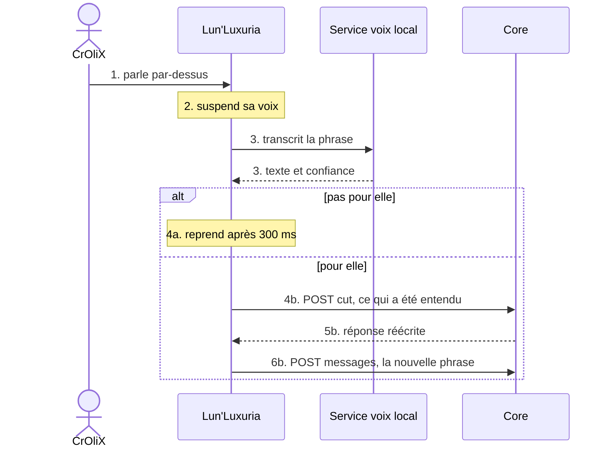

| # | De → vers | Par quoi | Ce qui circule | Retour |
|---|---|---|---|---|
| 1-2 | Lun'Luxuria (seule) | sa voix (Lun'Luxuria, `src/speech/speaker.ts:257-273`) | le son s'arrête tout de suite ; en mode doux, la phrase en cours finit | — |
| 3 | Lun'Luxuria → service voix | `POST /voix/stt` | la phrase de CrOliX | `text`, `confidence` |
| 4a | Lun'Luxuria (seule) | `resume` (Lun'Luxuria, `src/conversation.ts:323-336`) | la phrase interrompue est redite depuis son début | — |
| 4b | Lun'Luxuria → core | `POST /api/threads/main/messages/{id}/cut` (Lun'Luxuria, `src/core.ts:107-112`, `src/conversation.ts:372-375`) | `said` : les phrases entendues en entier, plus la part entendue de la phrase interrompue | la réponse, réécrite |
| 5b | Core (seul) | — | réponse en cours : l'appel au modèle s'arrête, la parole aussi, aucun outil ne tourne après. Réponse finie : son texte est remplacé. Reste ce qui a été entendu, suivi de « (coupée ici) » | signal `message` sur le flux live |
| 6b | Lun'Luxuria → core | `POST /api/threads/main/messages` | la nouvelle phrase (S1.7) | — |

- **Ce que CrOliX voit, et où** : le sous-titre disparaît à la coupure. Dans le fil, la réponse s'arrête à ce qu'il
  a entendu, suivie de « (coupée ici) ».
- **Ce qui s'écrit** : la réponse réécrite ; ses données d'outil sont effacées du même coup. Ce qui avait défilé
  avant la coupure est compté dans les dépenses.
- **Qui décide** : Lun'Luxuria mesure ce qui a été entendu : la part d'une phrase interrompue est un nombre de
  mots, au prorata du son joué (`src/speech/speaker.ts:56-59`). Le core la croit, sans autre preuve.
- **Erreurs et cas limites** :
  - Rien d'entendu (`said` vide) : la réponse est vidée et ne s'affiche plus ; un geste qu'elle tenait est annulé.
  - Tout entendu, et la réponse déjà finie : pas de marque. Si la réponse était encore en cours (ou attendait dans la
    file) au moment de la coupure, la marque « (coupée ici) » est toujours ajoutée, même si tout ce qui avait été dit
    a été entendu.
  - Réponse qui portait des cartes préparées par un poste, coupée avant le résultat : le message reste entier,
    avec ses cartes ; sinon Natsume redemanderait au poste.
  - Le modèle lit la marque dans ses anciens tours ; s'il la réécrit, le core la retire du flux.
  - La coupure vise un message de Natsume qui n'est pas en erreur ; sinon le core refuse.
  - Coupure non jointe : « Coupure non transmise : … » à l'écran de Lun'Luxuria.
- **Écart avec les décisions** : la coupure est le seul retour de Lun'Luxuria sur ce qui a été dit.
- **Non vérifié** : la justesse du prorata (une mesure, à faire sur le desktop). Cet écart est-il le trou T4 de la
  carte du 27/11, qui n'a pas été relue ?

### S1.12 · Faire taire

- **Déclencheur** : CrOliX clique « Faire taire » (le bouton n'existe que pendant qu'elle parle ou qu'un
  sous-titre muet s'affiche), ou met la sourdine pendant qu'elle parle.
- **Acteurs** : CrOliX, Lun'Luxuria, le core.
- **Avant** : une réponse est en train d'être dite ou lue.

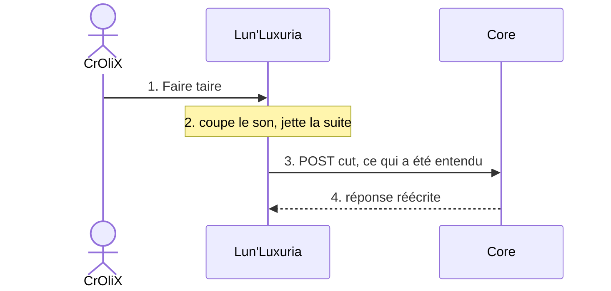

| # | De → vers | Par quoi | Ce qui circule | Retour |
|---|---|---|---|---|
| 1 | CrOliX → Lun'Luxuria | le bouton (Lun'Luxuria, `src/Scene.svelte:167-169`) | — | — |
| 2 | Lun'Luxuria (seule) | `stop` (Lun'Luxuria, `src/speech/speaker.ts:317-341`) | le son s'arrête ; toutes les réponses en attente de voix sont jetées | le sous-titre s'efface |
| 3 | Lun'Luxuria → core | `POST /api/threads/main/messages/{id}/cut` (Lun'Luxuria, `src/conversation.ts:676-683`) | `said` : ce qui a été entendu de la réponse en cours | — |
| 4 | Core (seul) | — | comme S1.11, étape 5b | signal `message` |

- **Ce que CrOliX voit, et où** : le silence, le sous-titre effacé ; dans le fil, la réponse marquée « (coupée ici) ».
- **Ce qui s'écrit** : comme S1.11.
- **Qui décide** : CrOliX.
- **Erreurs et cas limites** :
  - Sourdine : le même arrêt, puis la sourdine (famille 8) ; un fragment en attente est retiré (S1.9).
  - Liaison live perdue : la voix s'arrête d'elle-même, sans qu'une coupure parte au core.
  - Seule la réponse en cours est signalée au core ; les autres réponses jetées restent entières dans le fil.
- **Écart avec les décisions** : aucun connu.
- **Non vérifié** : rien.

### S1.13 · Reparler avant d'avoir entendu la réponse

- **Déclencheur** : CrOliX parle plus de 400 ms alors que la réponse à sa phrase précédente n'a pas encore sonné.
- **Acteurs** : CrOliX, Lun'Luxuria, son service voix local, le core.
- **Avant** : une phrase est partie, sa réponse est en route ; la coupure par la voix est active.

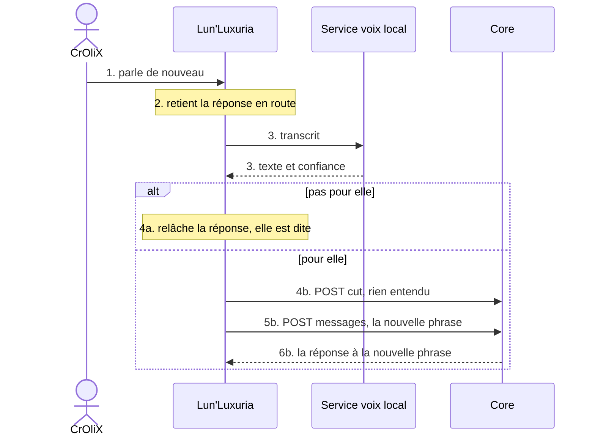

| # | De → vers | Par quoi | Ce qui circule | Retour |
|---|---|---|---|---|
| 1-2 | Lun'Luxuria (seule) | `#holdBack` (Lun'Luxuria, `src/conversation.ts:308-315`) | la réponse en route est retenue, muette | — |
| 3 | Lun'Luxuria → service voix | `POST /voix/stt` | la nouvelle phrase | `text`, `confidence` |
| 4a | Lun'Luxuria (seule) | `#letGo` (Lun'Luxuria, `src/conversation.ts:323-356`) | la réponse retenue sort | — |
| 4b | Lun'Luxuria → core | `POST /api/threads/main/messages/{id}/cut` (Lun'Luxuria, `src/conversation.ts:399-405`) | `said: ''` : rien n'a été entendu de la réponse retenue | la réponse, vidée |
| 5b | Lun'Luxuria → core | `POST /api/threads/main/messages` | la nouvelle phrase | — |
| 6b | Core → Lun'Luxuria | la file du fil, puis le flux live | le tour coupé finit sans rien, le suivant démarre aussitôt | `speech` de la nouvelle réponse |

- **Ce que CrOliX voit, et où** : une seule réponse, à sa dernière phrase. Dans le fil, ses deux messages restent ;
  la réponse oubliée n'apparaît pas.
- **Ce qui s'écrit** : la réponse oubliée reste en base, vide. Le modèle relit les deux phrases de CrOliX au tour
  suivant, et aucun des mots que personne n'a entendus.
- **Qui décide** : le code de Lun'Luxuria, sur le verdict du filtre pour la nouvelle phrase.
- **Erreurs et cas limites** :
  - Une toux : la réponse retenue sort après le verdict « bruit ».
  - La réponse oubliée tenait un geste de carte : il est annulé (« tu as 5 secondes » n'a pas été entendu).
  - La réponse oubliée portait des cartes préparées par un poste : elle reste entière dans le fil.
- **Écart avec les décisions** : aucun connu.
- **Non vérifié** : les enchaînements à trois phrases ou plus, lus dans le code, non suivis cas par cas.

### S1.14 · Le service voix en défaut

- **Déclencheur** : le service voix local ne transcrit pas en 20 s, ou ne synthétise pas en 5 s, ou ne répond plus.
- **Acteurs** : CrOliX, Lun'Luxuria, son service voix local, le core.
- **Avant** : un tour parlé est en cours (S1.7).

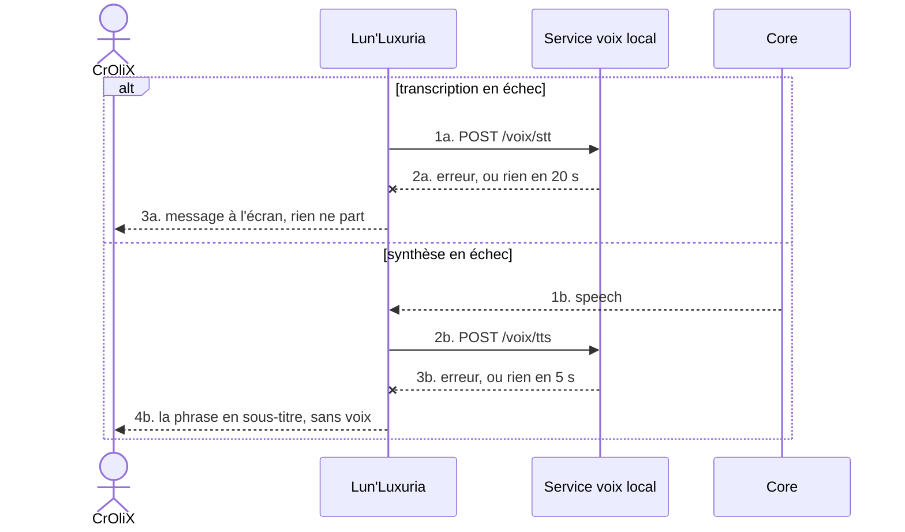

| # | De → vers | Par quoi | Ce qui circule | Retour |
|---|---|---|---|---|
| 1a-2a | Lun'Luxuria → service voix | `POST /voix/stt` (Lun'Luxuria, `src/conversation.ts:432-442`) | le son | une erreur, ou rien avant la garde de 20 s |
| 3a | Lun'Luxuria → CrOliX | l'écran | « Ta phrase n'a pas pu être transcrite : » et le motif | — |
| 1b-3b | Lun'Luxuria → service voix | `POST /voix/tts` (Lun'Luxuria, `src/speech/speaker.ts:162-187`) | `text` | une erreur, ou rien avant la garde de 5 s |
| 4b | Lun'Luxuria → CrOliX | l'écran | la phrase en sous-titre muet, le temps de la lire (1,5 s au moins, 60 ms par signe) ; « Sa voix n'a pas pu dire une phrase : » et le motif | — |

- **Ce que CrOliX voit, et où** : le message d'échec dans la fenêtre. Si le service ne répond plus du tout :
  « Le service voix ne répond plus. », une fois par panne, effacé quand il répond de nouveau.
- **Ce qui s'écrit** : rien de plus. La réponse est entière dans le fil, qu'elle ait été dite ou non.
- **Qui décide** : le code de Lun'Luxuria. Elle interroge le service toutes les trois secondes.
- **Erreurs et cas limites** :
  - Transcription en échec : la phrase est perdue ; rien n'est renvoyé plus tard.
  - Le modèle local de détection de voix ne se charge pas : le niveau sonore le remplace, l'écran le dit.
  - Le micro ne s'ouvre pas : « Le micro n'a pas pu s'ouvrir : » et le motif.
- **Écart avec les décisions** : rien de ces pannes ne part au core. Le core tient la réponse pour dite.
- **Non vérifié** : l'intérieur du service voix. Cet écart est-il le trou T25 de la carte du 27/11, qui n'a pas été
  relue ?

### S1.15 · La réponse qui ne vient pas, vue de Lun'Luxuria

- **Déclencheur** : une phrase est partie ; ni la première phrase de la réponse ni sa fin n'arrivent.
- **Acteurs** : CrOliX, Lun'Luxuria, le core.
- **Avant** : une phrase dite a été envoyée (S1.7). La garde de 60 s et la coupure qu'elle envoie ne valent que pour
  le tour parlé ; un message écrit dans le fil de Lun'Luxuria (S1.6) n'a pas de garde : seuls la réponse en erreur
  et le flux cassé y affichent un message (Lun'Luxuria, `src/conversation.ts:507-508`, `647-656`).

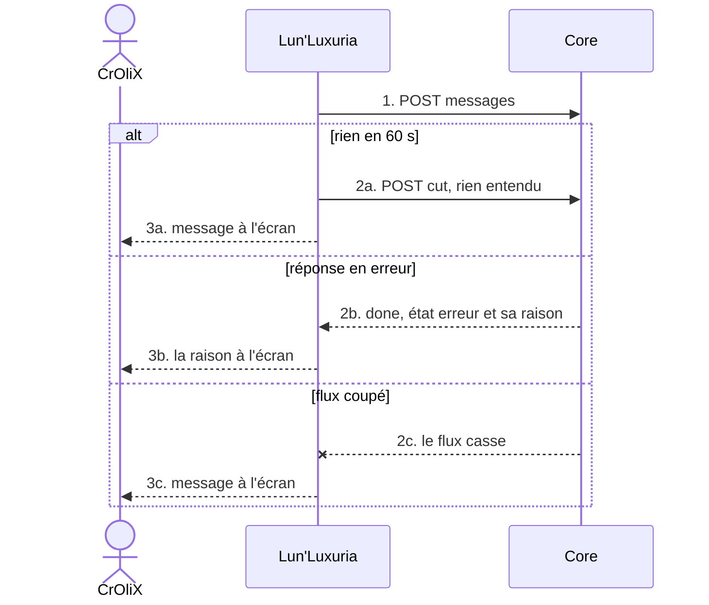

| # | De → vers | Par quoi | Ce qui circule | Retour |
|---|---|---|---|---|
| 1 | Lun'Luxuria → core | `POST /api/threads/main/messages` | la phrase | — |
| 2a | Lun'Luxuria → core | `POST /api/threads/main/messages/{id}/cut` (Lun'Luxuria, `src/conversation.ts:564-572`) | `said: ''`, si le numéro de la réponse est connu | la réponse, vidée |
| 3a | Lun'Luxuria → CrOliX | l'écran | « Sa réponse n'est pas venue : aucune phrase en 60 s » ; ce qui arrive ensuite est jeté | — |
| 2b | Core → Lun'Luxuria | `done` | le message en erreur : `status: 'error'`, `error` (Lun'Luxuria, `src/conversation.ts:593-600`) | — |
| 3b | Lun'Luxuria → CrOliX | l'écran | la raison donnée par le core, telle quelle | — |
| 2c-3c | Lun'Luxuria → CrOliX | l'écran | « Sa réponse n'est pas venue : » et le motif | — |

- **Ce que CrOliX voit, et où** : le message dans la fenêtre. Après une phrase dite, une raison qui contient
  « plafond » met la fenêtre dans son état « plafond atteint » (Lun'Luxuria, `src/session.svelte.ts:321-324`).
- **Ce qui s'écrit** : au core, la réponse en erreur, ou la réponse vidée par la coupure. Le message de CrOliX
  reste dans le fil.
- **Qui décide** : le code de Lun'Luxuria tient la garde de 60 s ; elle court de l'envoi à la première phrase.
- **Erreurs et cas limites** :
  - Le flux casse après que le core a fini la réponse : rien n'est dit en échec, les phrases viennent par le live.
  - Un message d'échec lié au serveur s'efface quand le serveur répond de nouveau (un battement de présence, le
    flux live revenu) ; un refus du core reste à l'écran jusqu'à la prochaine réponse dite.
  - Rien n'est renvoyé de soi-même : CrOliX redit sa phrase.
  - L'échec n'est dit qu'une fois, et seulement si la phrase de CrOliX s'est bien terminée dessus.
- **Écart avec les décisions** : la garde coupe l'attente de Lun'Luxuria, puis demande au core d'oublier la
  réponse ; un outil déjà parti chez un poste n'est pas rappelé.
- **Non vérifié** : rien n'est rejoué ; les délais sont lus dans le code. Cet écart est-il le trou T6 de la carte du
  27/11, qui n'a pas été relue ?

### S1.16 · Relire sa journée

- **Déclencheur** : CrOliX demande une information précise, dite ou reçue plus tôt, que le contexte de Natsume ne
  contient plus ; le modèle appelle l'outil de relecture. Exemple inventé : « C'était à quelle heure, le rappel
  du garage ? ».
- **Acteurs** : CrOliX, une surface (panneau, terminal ou Lun'Luxuria), le core, le fournisseur du modèle.
- **Avant** : aucun : l'outil est toujours offert, dans tous les fils.

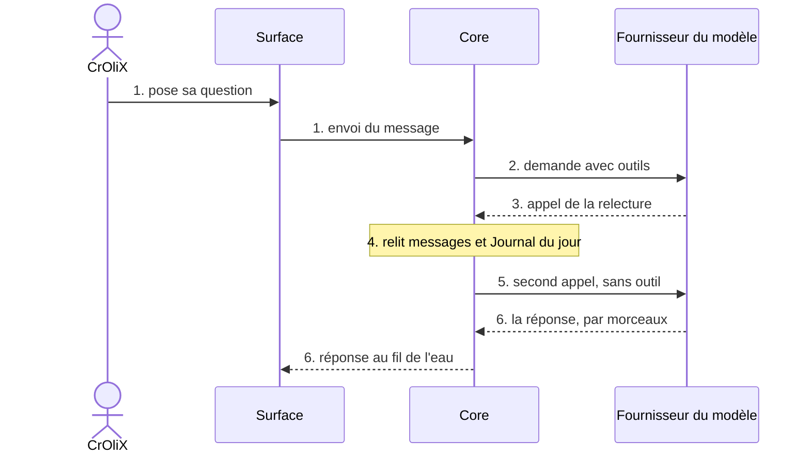

| # | De → vers | Par quoi | Ce qui circule | Retour |
|---|---|---|---|---|
| 1 | Surface → core | envoi d'un message | comme S1.1, S1.5 ou S1.7 | — |
| 2 | Core → fournisseur | appel en flux | voir S1.2 | — |
| 3 | Fournisseur → core | appel d'outil | une requête (des mots) ; un jour, facultatif, au format année-mois-jour | — |
| 4 | Core (lecture) | la base | les messages réussis de ce jour, tous fils confondus, sauf la question ; les lignes du Journal de ce jour. Les lignes qui portent le plus de mots de la requête d'abord, puis le mot le plus rare, puis les plus récentes. Au plus 20 lignes, 4 000 signes, 1 000 par ligne | heure, origine (CrOliX, elle, le Journal et son poste), texte |
| 5 | Core → fournisseur | second appel, sans outil | le socle, le contexte, le fil sans ses tours d'outil, ses propres mots du premier appel, puis les lignes relues, données comme de la donnée | — |
| 6 | Fournisseur → core → surface | le flux | la réponse, à sa façon, à la suite de ce qu'elle avait déjà dit | — |

- **Ce que CrOliX voit, et où** : une seule réponse, dans la même bulle. Rien ne dit qu'une relecture a eu lieu.
- **Ce qui s'écrit** : la réponse, avec la somme des jetons et du coût des deux appels ; deux lignes de dépenses ;
  les données de l'outil (la requête, les lignes relues coupées à 800 signes), pour rejouer ce tour au modèle.
- **Qui décide** : le modèle décide de relire et choisit les mots. Le code choisit les lignes, sans modèle.
- **Erreurs et cas limites** :
  - Jour illisible, ou date d'aujourd'hui : le jour de Natsume en cours (avant 5 h, c'est celui de la veille).
  - Requête sans mot de trois lettres ou plus : les lignes les plus récentes du jour.
  - Arguments illisibles, relecture en échec, ou second appel en échec, vide ou tronqué : la phrase fixe
    « La journée n'a pas pu être relue. »
  - Second appel qui envoie des mots, puis casse, se fait tronquer ou refuser : ces mots sont déjà partis vers la
    surface (et vers la voix pour une réponse dite), puis le code ajoute la phrase fixe. Ne s'écrivent que les mots
    du premier appel et la phrase fixe : les mots du second appel, déjà vus ou entendus, ne sont pas gardés. Ils
    sont tout de même facturés.
  - Plafond atteint entre les deux appels : pas de second appel, la même phrase fixe.
  - Un jour déjà purgé par la nuit n'a plus ses messages : seul le Journal répond.
- **Écart avec les décisions** : T30 : « aujourd'hui » suit le jour de 5 h, la date dite au modèle suit le
  calendrier ; le code rattrape l'écart pour la date du jour seulement.
- **Non vérifié** : rien.

### S1.17 · Lire une carte

- **Déclencheur** : CrOliX demande à voir une carte précise ; le modèle appelle l'outil de lecture avec le repère
  de la carte (un code court que Natsume lit dans « ce que tu perçois »).
- **Acteurs** : CrOliX, une surface, le core, le fournisseur du modèle, le poste de la carte.
- **Avant** : fil principal seulement ; le poste est relié, la carte est dans la file du core.

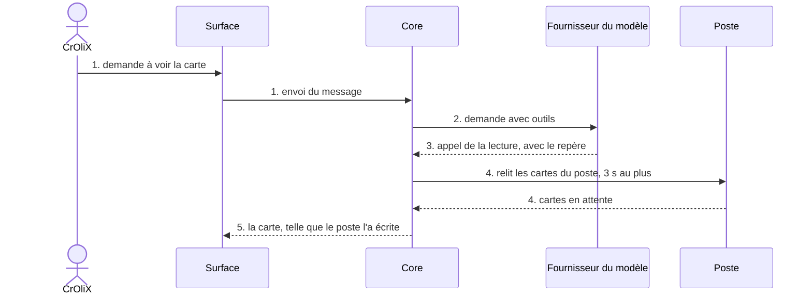

| # | De → vers | Par quoi | Ce qui circule | Retour |
|---|---|---|---|---|
| 1-2 | comme S1.16 | — | — | — |
| 3 | Fournisseur → core | appel d'outil | le repère de la carte | — |
| 4 | Core → poste | la lecture des cartes du contrat `/lun/v1` (famille 3) | — | les cartes en attente ; passé trois secondes, le core répond avec sa dernière lecture |
| 5 | Core → surface | le flux | le titre et le poste, les lignes, les champs et leurs valeurs, la raison, les choix ; une ligne de plus si la carte envoie (« Pour celle-ci, dis « envoie », ou valide-la sur la carte. ») ou si elle est en lecture seule | — |

- **Ce que CrOliX voit, et où** : le texte de la carte dans la bulle de Natsume, après la phrase qu'elle a pu dire
  avant. À la voix, la carte est dite sur le ton neutre.
- **Ce qui s'écrit** : la réponse, marquée comme une carte lue : au tour suivant elle repart au modèle comme de la
  donnée. La carte devient « la carte dont on parle », pour trente minutes ou jusqu'au message suivant, avec une
  empreinte de ce qui a été montré.
- **Qui décide** : le modèle décide de lire. Le code montre le texte du poste tel quel : pas de second appel, le
  modèle ne le réécrit pas.
- **Erreurs et cas limites** :
  - Carte tranchée, tenue ou absente : « Celle-là est déjà tranchée. »
  - Repère illisible, ou erreur du core pendant la lecture : « Cette carte n'a pas pu être relue. » Si c'est la
    relecture chez le poste qui échoue (ou dépasse trois secondes), le core montre la carte telle qu'il l'a lue en
    dernier.
  - Dans un sujet, l'outil n'est pas offert.
- **Écart avec les décisions** : une carte tout juste préparée peut ne pas être encore connue du core.
- **Non vérifié** : la construction de la file et la relecture du poste (famille 3). Cet écart est-il le trou T18 de
  la carte du 27/11, qui n'a pas été relue ?

### S1.18 · Trancher une carte par un message

Le geste lui-même (tenue de cinq secondes, relais au poste, issue) est décrit en famille 3. Ici : ce que la
conversation en fait.

- **Déclencheur** : CrOliX écrit ou dit un geste : « valide », « oui », « refuse », « envoie », ou un choix
  proposé par une carte.
- **Acteurs** : CrOliX, une surface, le core, le fournisseur du modèle.
- **Avant** : fil principal ; au moins un poste relié. L'outil n'est offert au modèle que si le message porte un
  mot de geste ou un choix d'une carte en attente.

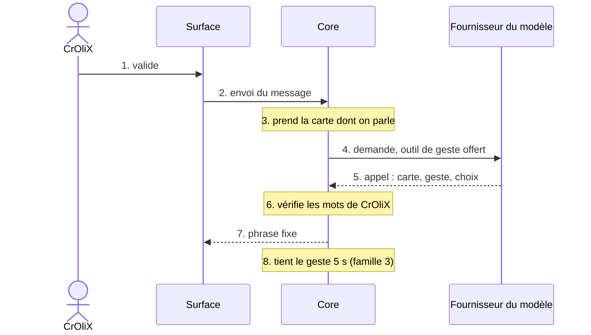

| # | De → vers | Par quoi | Ce qui circule | Retour |
|---|---|---|---|---|
| 1-2 | Surface → core | envoi d'un message | le texte ; à la voix, la confiance de la transcription. Pas d'identifiant de carte | — |
| 3 | Core (seul) | à la réception | la carte dont on parle est lue, puis oubliée : elle ne vaut que pour ce message | — |
| 4 | Core → fournisseur | appel en flux | voir S1.2 ; la consigne nomme la carte qui vient d'être montrée | — |
| 5 | Fournisseur → core | appel d'outil | le repère (facultatif : sinon la carte dont on parle), le geste (accepter, refuser), le choix (facultatif) | — |
| 6 | Core (seul) | le code | les arguments du modèle sont des affirmations ; seuls les mots du message décident : 12 mots au plus, pas de point d'interrogation, pas de négation, le geste en tête, et la carte désignée (celle dont on parle, son repère, ou deux mots de son titre) | — |
| 7 | Core → surface | le flux | « C'est noté : » et le titre, « Tu as 5 secondes pour dire annule. » ; ou « Refusée : … » | — |
| 8 | Core → poste | après cinq secondes | voir famille 3 | — |

- **Ce que CrOliX voit, et où** : la phrase fixe dans la bulle ; ce que le modèle a pu écrire à côté de l'appel
  n'est pas gardé. La carte quitte À trancher (famille 3).
- **Ce qui s'écrit** : la réponse ; le geste tenu ; une ligne au Journal pour un geste ignoré (« Geste ignoré »,
  sans un mot du message).
- **Qui décide** : le code, sur les mots de CrOliX seuls. Le modèle ne fait que désigner.
- **Erreurs et cas limites** :
  - À la voix, sans confiance transmise, ou sous 0,7 : rien n'est tranché.
  - Mots insuffisants : « Rien n'est tranché. Pour trancher : voir la carte, puis oui ou non, ou la trancher à
    l'écran. » ; si le modèle a nommé une carte en attente, elle est montrée, avec « Pour la trancher : valide ou
    refuse. »
  - Carte qui envoie : seul « envoie » passe, et sur la carte dont on parle ; un « oui » rend l'indice
    « Pour celle-ci, dis « envoie », ou valide-la sur la carte. »
  - Carte changée depuis sa lecture : « Cette carte a changé depuis sa lecture : à relire avant de trancher. »
  - Carte déjà tranchée : « Celle-là est déjà tranchée. » ; en lecture seule, ou à choix sans choix : sa phrase.
  - Plusieurs cartes demandées d'un coup : le modèle doit répondre que cela se fait une par une.
- **Écart avec les décisions** : « C'est noté » est dit avant l'effet ; l'issue ne revient pas dans le fil.
  F1 (le geste ignoré écrit sa propre ligne au Journal, sans lien avec la carte).
- **Non vérifié** : la tenue, le relais et l'issue du geste (famille 3). Le premier écart est-il le trou T2 de la
  carte du 27/11, qui n'a pas été relue ?

### S1.19 · Dire « annule »

- **Déclencheur** : CrOliX écrit ou dit exactement « annule », « annule ça », « annule le », « annule la »,
  « non, annule » (et ses variantes), ou « annule tout ».
- **Acteurs** : CrOliX, une surface, le core.
- **Avant** : un geste est tenu (S1.18, ou un clic), ou vient de partir.

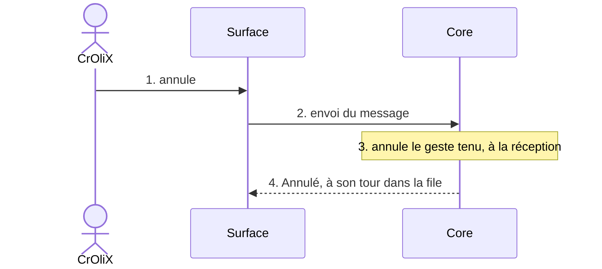

| # | De → vers | Par quoi | Ce qui circule | Retour |
|---|---|---|---|---|
| 1-2 | Surface → core | envoi d'un message | le texte | — |
| 3 | Core (seul) | à la réception, avant la file | le dernier geste tenu est annulé ; avec « annule tout », tous | — |
| 4 | Core → surface | le flux | « Annulé. » ; ou « Trop tard, c'est parti. » si un geste est parti dans les trente dernières secondes | — |

- **Ce que CrOliX voit, et où** : la phrase fixe dans le fil ; la carte revient dans À trancher (famille 3).
- **Ce qui s'écrit** : les deux messages ; l'état du geste. Aucun coût.
- **Qui décide** : le code. Aucun appel au modèle : cela marche sans clé, plafond atteint, dans un sujet, et à la
  voix quelle que soit la confiance.
- **Erreurs et cas limites** :
  - La phrase attend son tour dans la file, mais l'annulation est faite dès la réception.
  - Un tour devant, encore en cours, peut tenir un geste après la réception : le code regarde de nouveau à son tour.
  - Rien de tenu et rien de parti récemment, ou une phrase qui dit plus que « annule » : le message va au modèle.
- **Écart avec les décisions** : voir S1.4 pour l'écart entre le panneau et le core sur les formes reconnues.
- **Non vérifié** : l'annulation elle-même (famille 3).

### S1.20 · Confier une demande à un poste

La délégation est décrite en famille 2. Ici : ce que la conversation en montre et en garde.

- **Déclencheur** : le message de CrOliX relève d'un poste (mail, agenda, tâches ; noter, chercher dans la
  bibliothèque) ; le modèle appelle l'outil de délégation.
- **Acteurs** : CrOliX, une surface, le core, le fournisseur du modèle, le poste.
- **Avant** : le poste est relié et connecté ; son plafond du jour, s'il en a un, n'est pas atteint.

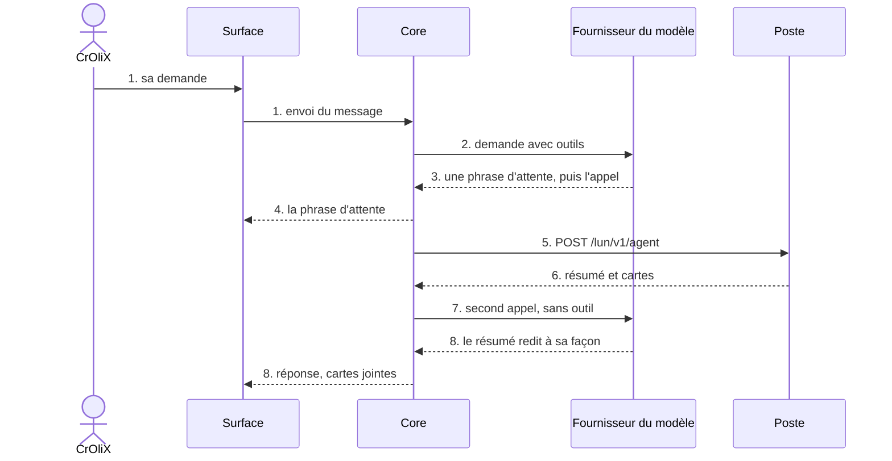

| # | De → vers | Par quoi | Ce qui circule | Retour |
|---|---|---|---|---|
| 1-2 | comme S1.16 | — | — | — |
| 3 | Fournisseur → core | texte, puis appel d'outil | le poste visé ; la demande, réécrite par le modèle (4 000 signes au plus) | — |
| 4 | Core → surface | le flux ; à la voix, la phrase part tout de suite | la phrase d'attente (demandée par la consigne pour une réponse dite seulement) | — |
| 5 | Core → poste | `POST /lun/v1/agent` | `request` : la demande réécrite ; ses secrets masqués quand elle va à la bibliothèque. Rien d'autre | voir famille 2 |
| 6 | Poste → core | la réponse | `summary`, `cards[]`, `cost` | — |
| 7 | Core → fournisseur | second appel, sans outil | le résumé, donné comme de la donnée, à redire en entier (noms, dates, montants, urgences) | — |
| 8 | Core → surface | le flux, puis la fin | les mots de Natsume ; les cartes préparées, jointes à la réponse ; le poste, sur l'événement de fin seulement | — |

- **Ce que CrOliX voit, et où** : dans le panneau, la réponse, l'étiquette « Confié à » avec le poste et l'heure,
  et chaque carte réduite à son type, son poste, son heure, son titre et un bouton « Voir dans À trancher » (ou
  « Tranchée »). La carte ne porte aucun geste dans le fil. Dans le fil de Lun'Luxuria, le texte seul.
- **Ce qui s'écrit** : la réponse et ses cartes ; la trace de la délégation (demande, issue, durée, coût, résumé
  d'origine) ; les données de l'outil, avec le résumé du poste coupé à 800 signes et masqué. Si une seule carte
  est préparée, elle devient « la carte dont on parle ».
- **Qui décide** : le modèle choisit le poste et écrit la demande. Le code n'exécute que le premier appel d'outil.
- **Erreurs et cas limites** :
  - Poste injoignable, délai dépassé (120 s par défaut, réglable par poste), réponse illisible : « <poste>
    injoignable : <raison>. Rien n'a été fait. », dit tel quel, sans second appel.
  - Plafond du poste atteint : « Plafond de <poste> atteint : rien ne lui est confié jusqu'à 05:00. »
  - Second appel en échec, vide ou tronqué : le résumé du poste est montré tel quel. S'il avait déjà envoyé des mots
    avant de casser, ceux-ci sont partis vers la surface mais ne sont pas gardés (même cas qu'en S1.16).
  - Résumé vide : pas de second appel.
  - L'étiquette « Confié à » n'est pas enregistrée : elle n'existe que sur l'écran qui a envoyé le message, et
    disparaît à la relecture du fil.
  - Coupée avant d'avoir entendu le résultat, alors que des cartes sont prêtes : S1.11.
- **Écart avec les décisions** : le poste ne reçoit qu'une phrase. Le résumé d'origine n'est lu par aucun écran,
  mais le modèle du core le relit aux tours suivants, dans la limite de 800 signes.
  Direction « prérequis » : la consigne interdit de demander une confirmation avant de déléguer.
- **Non vérifié** : tout ce qui se passe chez le poste (famille 2) ; l'usage que le Journal fait de la trace. Ces
  deux écarts sont-ils les trous T7 et T21 de la carte du 27/11, qui n'a pas été relue ?

### S1.21 · La conversation non configurée

- **Déclencheur** : au démarrage du core, ou à un message, la configuration du modèle est incomplète.
- **Acteurs** : CrOliX, une surface, le core.
- **Avant** : une de ces raisons : fournisseur inconnu, clé absente, réglage du fournisseur invalide, prix inconnu
  pour le modèle choisi, réglage de raisonnement manquant pour ce modèle, plafond de sortie invalide.

```mermaid
sequenceDiagram
    actor C as CrOliX
    participant P as Surface
    participant N as Core
    C->>P: 1. écrit
    P->>N: 2. envoi du message
    Note over N: 3. relit sa configuration
    N-->>P: 4. réponse en erreur, avec la raison
```

| # | De → vers | Par quoi | Ce qui circule | Retour |
|---|---|---|---|---|
| 1-2 | Surface → core | envoi d'un message | comme S1.1 | — |
| 3 | Core (seul) | à chaque message | la configuration est relue : un réglage changé depuis le dernier message est vu ici | — |
| 4 | Core → surface | le flux | la réponse en erreur : « Conversation non configurée : » et la raison, qui nomme le réglage en cause | — |

- **Ce que CrOliX voit, et où** : la raison en rouge dans la bulle ; dans le panneau, le champ est remplacé par
  « Ajoute d'abord la clé du modèle. » quand la clé manque. Dans Lun'Luxuria, la raison s'affiche à l'écran.
- **Ce qui s'écrit** : son message et la réponse en erreur ; la raison dans la santé du core ; un événement du
  core à chaque changement d'état, gardé d'un redémarrage à l'autre (famille 11).
- **Qui décide** : le code. Le fournisseur n'est jamais appelé.
- **Erreurs et cas limites** :
  - Une clé enregistrée depuis l'Atelier rouvre la conversation sans redémarrage.
  - « annule » marche quand même (S1.19).
- **Écart avec les décisions** : aucun connu.
- **Non vérifié** : le chemin de l'événement jusqu'à la notification (famille 11) ; l'écran de la clé (Atelier).
  L'événement qui dit l'arrêt est-il bien rangé « à prévenir », et celui du retour « journal » ? Le code émet une
  importance « normal » puis « log » ; la table qui les traduit en ces mots n'a pas été lue.

### S1.22 · Clé refusée ou crédit épuisé

- **Déclencheur** : le fournisseur refuse la clé, ou dit que le crédit est épuisé.
- **Acteurs** : CrOliX, une surface, le core, le fournisseur du modèle.
- **Avant** : la conversation est configurée.

```mermaid
sequenceDiagram
    actor C as CrOliX
    participant P as Surface
    participant N as Core
    participant M as Fournisseur du modèle
    C->>P: 1. écrit
    P->>N: 1. envoi du message
    N->>M: 2. demande
    M--xN: 3. clé refusée, ou crédit épuisé
    N-->>P: 4. réponse en erreur
    C->>P: 5. réécrit dans les cinq minutes
    P->>N: 5. envoi du message
    N-->>P: 6. la même erreur, sans appel
```

| # | De → vers | Par quoi | Ce qui circule | Retour |
|---|---|---|---|---|
| 1-2 | comme S1.1 | — | — | — |
| 3 | Fournisseur → core | la réponse à l'appel | un refus de la clé, ou un refus pour crédit | — |
| 4 | Core → surface | le flux | « Clé <fournisseur> refusée », ou « Crédit <fournisseur> épuisé » | — |
| 5-6 | Surface → core → surface | envoi d'un message | pendant cinq minutes, chaque message reçoit la même erreur sans que le fournisseur soit appelé | — |

- **Ce que CrOliX voit, et où** : la raison dans la bulle. Dans le panneau, une clé refusée remplace le champ par
  « Clé refusée : Natsume ne peut pas répondre. ». Un crédit épuisé ne ferme pas le champ : chaque message reçoit la
  réponse en erreur « Crédit … épuisé ».
- **Ce qui s'écrit** : les messages ; la raison dans la santé du core ; l'état de la clé et du crédit, avec un
  événement par changement d'état (famille 11).
- **Qui décide** : le code. Passé cinq minutes, le message suivant retente ; un appel réussi lève le refus.
- **Erreurs et cas limites** :
  - Une nouvelle clé de ce fournisseur lève la porte tout de suite ; la clé d'un autre fournisseur, non.
  - Le refus arrive après des mots déjà produits : la réponse est partielle, avec la raison (S1.23).
  - Le refus d'un fournisseur ne retient pas un autre fournisseur mis en service entre-temps.
- **Écart avec les décisions** : aucun connu.
- **Non vérifié** : ce que chaque fournisseur renvoie réellement (lu dans la traduction que le core en fait).

### S1.23 · Fournisseur injoignable ou flux cassé

- **Déclencheur** : le fournisseur ne répond pas (réseau, délai de 60 s, erreur de son côté), ou le flux casse au
  milieu de la réponse.
- **Acteurs** : CrOliX, une surface, le core, le fournisseur du modèle.
- **Avant** : la conversation est configurée.

```mermaid
sequenceDiagram
    actor C as CrOliX
    participant P as Surface
    participant N as Core
    participant M as Fournisseur du modèle
    C->>P: 1. écrit
    P->>N: 1. envoi du message
    N->>M: 2. demande
    alt aucun mot reçu
        M--xN: 3a. échec
        N-->>P: 4a. réponse en erreur
    else des mots déjà reçus
        M-->>N: 3b. début du texte
        N-->>P: 3b. morceaux
        M--xN: 4b. le flux casse
        N-->>P: 5b. réponse partielle
    end
```

| # | De → vers | Par quoi | Ce qui circule | Retour |
|---|---|---|---|---|
| 1-2 | comme S1.1 | — | — | — |
| 3a-4a | Core → surface | le flux | la réponse en erreur : « <fournisseur> injoignable pour le moment, réessaie dans un instant. » | — |
| 3b-5b | Core → surface | le flux | la réponse partielle : le texte reçu, et la raison « Réponse coupée en cours de route » | — |

- **Ce que CrOliX voit, et où** : dans le panneau, une erreur s'affiche en rouge ; une réponse partielle montre son
  texte, sans sa raison. Dans le fil de Lun'Luxuria, de même. Le terminal ajoute « (Réponse coupée : …) ».
  À la voix, les phrases déjà parties ont été dites ; la parole se clôt normalement.
- **Ce qui s'écrit** : la réponse, en erreur ou partielle ; pour une partielle, le coût de ce qui a été produit
  (estimé à quatre signes par jeton si le fournisseur n'a pas donné l'usage) ; « <fournisseur> injoignable » dans
  la santé du core.
- **Qui décide** : le code. Pas de porte ici : chaque message retente. Aucune relance automatique : CrOliX réécrit.
- **Erreurs et cas limites** :
  - Ni l'erreur ni la partielle ne repartent au modèle aux tours suivants.
  - Un appel réussi efface « injoignable » de la santé.
  - Une erreur interne du core pendant la réponse : « Erreur interne du core pendant la réponse ».
- **Écart avec les décisions** : aucun connu.
- **Non vérifié** : un flux qui se fige sans casser. Un commentaire du code dit que, chez l'un des deux
  fournisseurs, le délai de 60 s ne couvre que l'attente des en-têtes ; rien de lu ne coupe alors l'attente du core,
  sinon une coupure venue de Lun'Luxuria (S1.15). Non rejoué.

### S1.24 · Réponse refusée, vide, ou historique refusé

- **Déclencheur** : le modèle refuse la demande ; ou il atteint sa limite de sortie avant le premier mot ; ou le
  fournisseur refuse la demande (refus de requête, code 400) alors qu'elle rejouait des tours d'outil.
- **Acteurs** : CrOliX, une surface, le core, le fournisseur du modèle.
- **Avant** : la conversation est configurée.

```mermaid
sequenceDiagram
    participant P as Surface
    participant N as Core
    participant M as Fournisseur du modèle
    P->>N: 1. envoi du message
    N->>M: 2. demande
    alt le modèle refuse
        M--xN: 3a. refus
        N-->>P: 4a. réponse en erreur
    else limite atteinte sans un mot
        M-->>N: 3b. fin tronquée, vide
        N-->>P: 4b. réponse en erreur
    else demande refusée avec les tours d'outil
        M--xN: 3c. refus de la demande
        N->>M: 4c. la même, sans les tours d'outil
        M-->>N: 5c. réponse
        N-->>P: 5c. réponse au fil de l'eau
    end
```

| # | De → vers | Par quoi | Ce qui circule | Retour |
|---|---|---|---|---|
| 1-2 | comme S1.1 | — | — | — |
| 3a-4a | Core → surface | le flux | « Réponse refusée par le modèle » ; le fournisseur marche : ni porte, ni santé dégradée | — |
| 3b-4b | Core → surface | le flux | « Réponse vide : limite de sortie atteinte avant le premier mot » | — |
| 3c-5c | Core → fournisseur | un second essai, une seule fois | le fil rejoué comme du texte seul, sans appel ni résultat d'outil | la réponse |

- **Ce que CrOliX voit, et où** : la raison dans la bulle (cas a et b) ; rien de particulier (cas c).
- **Ce qui s'écrit** : la réponse en erreur, avec le coût de l'appel (un refus et une réponse vide sont payés) ;
  pour le cas c, un événement de palier « journal », une fois par jour de Natsume, avec le motif masqué.
- **Qui décide** : le modèle refuse ; le code retente sans les tours d'outil.
- **Erreurs et cas limites** :
  - Une réponse tronquée qui a des mots reste une réponse réussie, telle qu'elle est.
  - Un refus après des mots : réponse partielle, avec la raison.
  - Le second essai du cas c ne se fait que si aucun mot n'est encore venu.
  - Le code ne vérifie pas que les tours d'outil sont la cause : tout refus de requête de ce genre, avant le premier
    mot, relance une fois la demande sans eux.
- **Écart avec les décisions** : aucun connu.
- **Non vérifié** : rien n'est rejoué contre un vrai fournisseur.

### S1.25 · Plafond atteint

Le calcul des plafonds et la pause sont décrits en famille 10. Ici : ce que la conversation répond.

- **Déclencheur** : CrOliX écrit ou parle alors que le plafond du jour ou du mois est atteint.
- **Acteurs** : CrOliX, une surface, le core.
- **Avant** : un plafond du jour ou du mois est atteint.

```mermaid
sequenceDiagram
    actor C as CrOliX
    participant P as Surface
    participant N as Core
    C->>P: 1. écrit ou parle
    P->>N: 2. envoi du message
    Note over N: 3. plafond atteint
    N-->>P: 4. réponse en erreur, avec l'heure du retour
```

| # | De → vers | Par quoi | Ce qui circule | Retour |
|---|---|---|---|---|
| 1-2 | Surface → core | envoi d'un message | comme S1.1 ou S1.7 | — |
| 3 | Core (seul) | avant tout appel | la dépense du jour et du mois, contre les plafonds | — |
| 4 | Core → surface | le flux | « Plafond du jour atteint : Natsume répond à nouveau à <heure>. », ou « Plafond du mois atteint : Natsume répond à nouveau le 1er <mois>. » | — |

- **Ce que CrOliX voit, et où** : dans le panneau, le champ est remplacé : il ne peut plus écrire. Dans
  Lun'Luxuria, la phrase s'affiche. La fenêtre passe dans son état « plafond atteint » seulement après une phrase
  dite ; après un message écrit dans son fil, la phrase s'affiche sans changer l'état.
- **Ce qui s'écrit** : son message et la réponse en erreur, quand le message est parti malgré tout (voix, terminal).
- **Qui décide** : le code. Le dépassement est borné à une réponse : le plafond se vérifie avant chaque appel.
- **Erreurs et cas limites** :
  - Une pause manuelle ne ferme pas la conversation : seul un plafond le fait.
  - « annule » marche quand même (S1.19).
  - Plafond atteint entre les deux appels d'un tour à outil : pas de second appel, le texte de l'outil est gardé.
- **Écart avec les décisions** : aucun connu. T14 relève de la famille 10.
- **Non vérifié** : le calcul de la dépense et l'heure de retour (famille 10). Le panneau écrit-il, à la place du
  champ, la même phrase que le core ? Pour le plafond du mois, le core dit « le 1er <mois> » et le panneau compose
  la sienne d'après une date longue sans jour de la semaine : le format n'a pas été lu. Un réglage « au plafond :
  pause » conditionne-t-il la pause de plafond ? Le code lit l'état de la pause, le réglage n'a pas été lu (famille
  10).

### S1.26 · Le client part, le core redémarre

- **Déclencheur** : la surface perd sa connexion pendant une réponse ; ou le core s'arrête pendant une réponse.
- **Acteurs** : CrOliX, une surface, le core.
- **Avant** : une réponse est en cours.

```mermaid
sequenceDiagram
    actor C as CrOliX
    participant P as Surface
    participant N as Core
    alt la surface part
        P--xN: 1a. le flux se ferme
        Note over N: 2a. la réponse continue et s'enregistre
        P->>N: 3a. au retour, relit le fil
    else le core redémarre
        Note over N: 1b. au démarrage, marque les réponses en attente
        P->>N: 2b. relit le fil
        N-->>P: 3b. la réponse en erreur
    end
```

| # | De → vers | Par quoi | Ce qui circule | Retour |
|---|---|---|---|---|
| 1a-2a | Core (seul) | — | la réponse est produite et enregistrée, que quelqu'un l'écoute ou non | — |
| 3a | Surface → core | lecture du fil | — | le fil, avec la réponse si elle est finie |
| 1b | Core (seul) | au démarrage | toute réponse restée en attente passe en erreur : « Réponse interrompue par un redémarrage du core » | — |
| 2b-3b | Surface → core | lecture du fil | — | le fil |

- **Ce que CrOliX voit, et où** : dans le panneau, le flux live se rouvre toutes les deux secondes, et le fil est
  relu à sa réouverture. Dans le terminal : S1.5. Dans Lun'Luxuria : S1.15.
- **Ce qui s'écrit** : la réponse entière (cas a) ; la réponse en erreur (cas b).
- **Qui décide** : le code. Rien n'est relancé : CrOliX réécrit s'il veut une réponse.
- **Erreurs et cas limites** :
  - À un arrêt propre, le core attend la fin des réponses en cours, dix secondes au plus.
  - Si l'écriture du flux échoue côté core, la réponse enregistrée est envoyée en fin de flux quand c'est possible,
    jamais une erreur brute.
  - Message déjà enregistré : le renvoyer fait un doublon dans le fil.
- **Écart avec les décisions** : aucun connu.
- **Non vérifié** : ce que le navigateur fait d'un flux coupé en cours de réponse. Le panneau affiche-t-il alors
  « Natsume est injoignable. » en rendant son texte au champ (le navigateur lèverait une erreur à la lecture), ou
  un flux qui se termine sans erreur est-il pris pour un envoi réussi ? Lu dans le code du panneau, non rejoué.

### S1.27 · Ce qui reste d'un tour

- **Déclencheur** : la fin d'un tour, quelle que soit la surface ; puis la nuit.
- **Acteurs** : le core.
- **Avant** : un tour vient de finir.

```mermaid
sequenceDiagram
    participant N as Core
    participant P as Écrans ouverts
    Note over N: 1. enregistre la réponse et son coût
    Note over N: 2. note la clé, le crédit, les formules
    N-->>P: 3. signal message sur le flux live
    Note over N: 4. la nuit relit le jour (famille 6)
    Note over N: 5. le jour quitte le fil
```

| # | De → vers | Par quoi | Ce qui circule | Retour |
|---|---|---|---|---|
| 1 | Core (écriture) | la base | la réponse : texte, état, raison, modèle, jetons, coût, cartes relayées, données d'outil ; une ligne de dépenses par appel au modèle | — |
| 2 | Core (écriture) | la base | l'état de la clé et du crédit du fournisseur ; le compte du jour des formules d'agent par défaut | — |
| 3 | Core → écrans ouverts | flux live | « un message a changé » : le fil, le numéro | chaque écran relit (famille 9) |
| 4 | Core (routine) | la nuit | elle relit le jour et en garde des souvenirs (famille 6) | — |
| 5 | Core (seul) | après la nuit | un jour traité ne s'affiche plus dans le fil ; il est supprimé plus tard, sauf les six derniers messages réussis du fil principal et le dernier message de CrOliX | — |

- **Ce que CrOliX voit, et où** : le fil du jour ; les jours traités par la nuit n'y sont plus.
- **Ce qui s'écrit** : après un tour, rien dans les souvenirs : seule la nuit en écrit. Un tour simple n'écrit rien
  au Journal. Selon le tour, s'ajoutent : la trace d'une délégation (S1.20), la carte dont on parle (S1.17, S1.20),
  un geste tenu ou une ligne « Geste ignoré » (S1.18). L'humeur n'est jamais gardée : elle se recalcule à chaque
  tour.
- **Qui décide** : le code.
- **Erreurs et cas limites** :
  - Les délais mesurés d'une réponse (file, premier mot, poste, second mot) partent avec l'événement de fin et ne
    sont pas gardés avec le message ; seul le délai du premier mot est gardé, sur la ligne de dépenses.
  - Une écriture annexe en échec (clé, formules, trace, carte dont on parle) ne coûte pas la réponse.
  - Une réponse vidée (coupée avant le premier mot, retirée) reste en base mais ne s'affiche nulle part.
- **Écart avec les décisions** : F1 : la conversation n'écrit rien au Journal ; la demande d'une action n'y a donc
  pas d'étape « demandé ».
- **Non vérifié** : la nuit, les souvenirs, le portrait, le tempérament (famille 6) : lus seulement pour savoir
  qu'un tour n'y écrit pas.

### S1.28 · Un outil appelé sans avoir été offert

- **Déclencheur** : le modèle appelle un outil absent de la liste du tour : par exemple la lecture d'une carte dans
  un sujet, ou un nom d'outil inconnu.
- **Acteurs** : le core, le fournisseur du modèle, une surface.
- **Avant** : un tour est en cours ; l'outil appelé n'est pas dans la liste offerte (S1.2).

```mermaid
sequenceDiagram
    participant P as Surface
    participant N as Core
    participant M as Fournisseur du modèle
    N->>M: 1. demande avec ses outils (S1.2)
    M-->>N: 2. appel d'un outil absent de la liste
    Note over N: 3. aucune condition ne le retient
    Note over N: 4. lecture de l'appel : échec
    N-->>P: 5. phrase fixe, rien n'a été fait
```

| # | De → vers | Par quoi | Ce qui circule | Retour |
|---|---|---|---|---|
| 1 | Core → fournisseur | appel en flux | voir S1.2 | — |
| 2 | Fournisseur → core | appel d'outil | un nom d'outil et ses arguments | — |
| 3 | Core (seul) | le choix de l'outil | relecture, lecture de carte (si offerte), geste (si offert), sinon délégation : faute de condition qui le retienne, l'appel tombe dans la délégation | — |
| 4 | Core (seul) | la lecture de l'appel de délégation | ce n'est pas l'outil de délégation, ou le poste visé n'est pas offert : appel inutilisable | — |
| 5 | Core → surface | le flux | « <poste> injoignable : demande illisible. Rien n'a été fait. » ; le poste est celui que les arguments nomment (40 signes au plus), sinon « le poste » | — |

- **Ce que CrOliX voit, et où** : la phrase fixe dans la bulle, comme réponse. Pas d'étiquette « Confié à ».
- **Ce qui s'écrit** : la réponse ; une ligne du journal technique du core. Aucune trace de délégation. Pas de second
  appel au modèle : le coût est celui du premier appel.
- **Qui décide** : le code. Les mots du modèle qui précédaient l'appel ne sont pas gardés : la phrase fixe les
  remplace.
- **Erreurs et cas limites** :
  - Aucun poste n'est contacté : rien ne part vers un satellite.
  - L'outil de geste appelé sans être offert, sur le fil principal, passe quand même par la vérification des mots de
    CrOliX (S1.18) : c'est le code qui répond, jamais le modèle.
- **Écart avec les décisions** : aucun connu.
- **Non vérifié** : le cas d'un outil de geste appelé dans un sujet n'est lu que dans l'ordre des conditions, non
  suivi jusqu'au bout.
