# Famille 2 · La demande confiée à un poste et sa carte

De la phrase de CrOliX jusqu'à la carte rendue. Le modèle du core choisit de confier la demande à un poste ; le
core appelle l'agent du poste par `POST /lun/v1/agent` ; l'agent lit, répond ou prépare une carte ; le core redit
le résultat, relaie la carte, écrit au Journal et compte le coût. Lun'Acedia et Lun'Avaritia sont décrits à part
quand leur flux diffère. La famille couvre aussi l'action directe (`GET /lun/v1/actions`,
`POST /lun/v1/actions/:name`). La décision sur la carte est dans la famille 3.

Relevé sur `origin/main` le 27/11/2026 : Lun'Acedia `40c293f`, Lun'Avaritia `bd6f7cf`. Les exemples sont inventés.

| Id | Titre | En une ligne |
|---|---|---|
| S2.1 | Confier une action à Lun'Acedia : une carte | Le cas nominal, champ par champ, de la phrase à la carte relayée. |
| S2.2 | Demander une lecture à Lun'Acedia : aucune carte | L'agent lit et répond ; rien n'attend CrOliX. |
| S2.3 | Une demande, plusieurs cartes | Plusieurs écritures dans un tour : plusieurs cartes, aucune carte courante. |
| S2.4 | Répondre à un mail : la carte qui envoie | Un brouillon de réponse, marqué `sends`, qui ne part jamais seul. |
| S2.5 | Demande incomplète ou ambiguë : la question de l'agent | Date, agenda, expéditeur : qui tranche, et par où passe une question. |
| S2.6 | « Note ça » : confier une note à Lun'Avaritia | La note devient des brouillons de fiches, rendus en cartes. |
| S2.7 | Interroger la bibliothèque : aucune carte | L'agent cherche et lit des fiches ; il rend des références. |
| S2.8 | La carte à options de Lun'Avaritia | Une note fait naître une question (contradiction, doublon) avec deux réponses. |
| S2.9 | Demande dite à voix haute : la phrase d'attente | Natsume dit une phrase avant d'appeler le poste, puis le résultat. |
| S2.10 | Le poste est en pause | Pause locale : réponse normale « en pause ». Pause du core : l'agent répond. |
| S2.11 | L'agent du poste ne peut pas travailler | Pas de modèle, plafond du poste, fournisseur en panne : une phrase, zéro carte. |
| S2.12 | Plafond du jour d'un poste, tenu par le core | Le core ne confie rien : aucune requête ne part. |
| S2.13 | Délai dépassé | Le poste ne répond pas à temps : « Rien n'a été fait », sans certitude. |
| S2.14 | Poste injoignable ou liaison à refaire | Le poste n'est pas offert au modèle, ou tombe pendant l'appel. |
| S2.15 | Appel ou réponse illisible | L'appel d'outil du modèle, ou la réponse du poste, ne se lit pas. |
| S2.16 | Le core ne peut pas redire le résultat | Second appel du modèle en échec : le résumé du poste est montré tel quel. |
| S2.17 | Lire le catalogue d'un poste | `GET /lun/v1/actions` : la liste des actions et leur schéma. |
| S2.18 | Invoquer une action directe | `POST /lun/v1/actions/:name` : sans agent, sans carte, sans Journal. |

Renvois : trancher la carte rendue, voir la famille 3 ; « C'est fait » sur une échéance (une délégation à
Lun'Avaritia lancée par un geste), voir la famille 5 ; le lot de la nuit (`brain.ingest`) et le bilan
(`day.digest`), voir la famille 6 ; l'agent d'un satellite utilisé depuis son propre écran, voir la famille 13.

---

### S2.1 · Confier une action à Lun'Acedia : une carte

- **Déclencheur** : CrOliX écrit dans le panneau une action sur le mail, l'agenda ou les tâches. Exemple inventé :
  « Mets un déjeuner avec Camille jeudi à 12 h 30 ».
- **Acteurs** : CrOliX, le panneau, le core, le fournisseur du modèle du core, Lun'Acedia, le fournisseur du modèle
  de Lun'Acedia. Google n'est appelé que si l'agent lit d'abord (une recherche de mail) ; préparer une carte
  n'appelle pas Google.
- **Avant** : Lun'Acedia est relié et son flux d'événements est ouvert côté core ; la conversation du core a un
  modèle réglé et aucun plafond n'est atteint ; l'agent de Lun'Acedia a un modèle choisi et reste sous son plafond
  du jour (1 $ par défaut, Lun'Acedia, `server/src/pina/store.ts:169-177`).

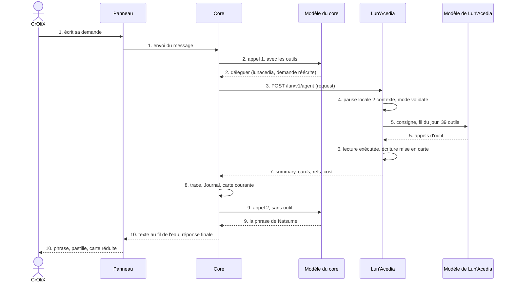

| # | De → vers | Par quoi | Ce qui circule | Retour |
|---|---|---|---|---|
| 1 | Panneau → core | envoi d'un message dans le fil | le texte (1 à 8 000 signes), la surface (`mobile`, `desktop`, `voice`, `cli`) ; en option la confiance de l'écoute et « à dire à voix haute » | un flux : le message enregistré, l'identifiant de la réponse, puis le texte par morceaux, puis la réponse finale |
| 2 | Core → fournisseur de son modèle | appel 1 | la consigne (qui est Natsume, la règle des postes joignables, son contexte, sa situation), le fil du jour, les outils : délégation (deux champs : le poste, pris dans la liste des postes joignables ; la demande, 1 à 4 000 signes), relecture de sa journée, lecture d'une carte (dans le fil du jour seulement, pas dans un sujet), et trancher une carte seulement si le message de CrOliX peut être un geste | un texte éventuel et un appel de l'outil de délégation : le poste `lunacedia`, la demande réécrite |
| 3 | Core → Lun'Acedia | `POST /lun/v1/agent`, jeton du core en `Authorization: Bearer` | `request` : la demande réécrite par le modèle du core, et rien d'autre. Absents : `context`, la phrase de CrOliX, la date du core, un identifiant de fil ou de message, l'agenda ou l'adresse visés | voir l'étape 7 ; le core attend au plus le délai réglé pour ce poste (120 s par défaut) |
| 4 | Lun'Acedia (code) | contrôle d'entrée | corps validé (`request` 1 à 4 000 signes, `context` facultatif à clés connues) ; pause locale → voir S2.10 ; sinon contexte par défaut `screen: 'mail'`, mode `validate` forcé ; la demande entre dans le fil du jour de l'agent | 400 si le corps est invalide |
| 5 | Lun'Acedia → fournisseur de son modèle | un appel du modèle à la fois, 8 appels au plus | la consigne (nom et ton de l'agent, bloc de personnage, règles, date et heure de Paris à l'horloge de Lun'Acedia, « l'utilisateur regarde la boîte mail », « aucun mail n'est ouvert », boîtes et étiquettes, consignes de CrOliX), tout le fil du jour, les 39 actions du catalogue comme outils | un texte et des appels d'outil |
| 6 | Lun'Acedia (code) | exécution des appels d'outil | une lecture s'exécute et son résultat retourne au modèle ; une écriture ou une suppression devient une carte en attente (action, entrée validée par le schéma, effet) et le tour s'arrête | — |
| 7 | Lun'Acedia → core | réponse 200 | `summary` : le texte du dernier message de l'agent dans ce tour (peut être vide) ; `cards` : les cartes nées dans ce tour (`id`, `action`, `effect`, `kind`, `title`, `lines`, `status: pending`, `at`, parfois `link`, `sends`, `error`) ; `refs` : toujours `[]` ; `cost` : `{ currency: 'USD', amount }`, la dépense du jour de l'agent après moins avant | — |
| 8 | Core (code) | contrôle et traces | la forme de la réponse (un `summary` texte, des `cards` avec un `id`) ; une trace de la délégation ; une entrée au Journal ; si une seule carte et fil du jour, elle devient la carte dont on parle | — |
| 9 | Core → fournisseur de son modèle | appel 2, sans outil, raisonnement coupé | le résumé du poste, donné comme de la donnée, avec la consigne de tout redire (noms, dates, montants, urgences) sans rien inventer, et de dire que les cartes attendent sa validation | la phrase de Natsume |
| 10 | Core → panneau | fin du flux | le texte par morceaux ; la réponse finale : texte, cartes relayées (le poste et la carte entière), modèle, jetons et coût des deux appels ; sur ce seul flux, le poste sollicité et quatre durées (non enregistrés) | — |

- **Ce que CrOliX voit, et où** : dans la conversation du panneau, « Natsume écrit… », puis la phrase de Natsume ;
  sous elle, la pastille « Confié à Lun'Acedia, HH:MM » (sur l'appareil qui a envoyé le message seulement) et une
  carte réduite : son type (`kind`), le poste, l'heure et le titre. Tant que la file du panneau n'a pas relu la
  carte, elle porte le badge « Tranchée » à la place du bouton ; le bouton « Voir dans À trancher » n'apparaît qu'une
  fois la carte lue dans la file. Aucun des deux postes ne signale une carte née d'une délégation, et le core ne
  relit pas le poste après une délégation : la carte n'est relue qu'au passage suivant, toutes les 2 minutes. Au
  Journal, filtre
  « Confiés », une entrée. Dans l'écran de Lun'Acedia, le panneau de son agent montre la demande réécrite comme une
  bulle de CrOliX, la réponse de l'agent et la carte avec ses gestes (Lun'Acedia,
  `views/src/lib/pina/Thread.svelte:34-51`).
- **Ce qui s'écrit** : au core, le message de CrOliX ; la réponse (texte, cartes, coût, et l'appel d'outil avec son
  résultat coupé à 800 signes, secrets masqués, pour le rejeu) ; la trace de la délégation (demande masquée et
  coupée à 200 signes, poste, origine « conversation », issue « faite », coût annoncé par le poste, résumé brut
  masqué jusqu'à 4 000 signes, durée) ; l'entrée du Journal (titre : la demande ; « depuis la conversation » ; issue
  « fait » ; coût ; étapes « Confié à Lun'Acedia. » puis « Carte rendue : <titre>. ») ; deux lignes de coût du
  modèle du core ; la carte courante, pour 30 minutes. Chez Lun'Acedia, les messages du fil du jour (la demande avec
  son contexte et son mode, les réponses, les résultats d'outil), la carte en attente, une ligne de coût par appel
  du modèle (Lun'Acedia, `server/src/pina/agent.ts:310-316`, `:388-395`, `:420-429`).
- **Qui décide** : confier ou non, à quel poste, avec quels mots : le modèle du core. Ce que la demande veut dire,
  quelle date, quel agenda, quels outils : le modèle de Lun'Acedia. Lecture exécutée, écriture mise en carte : le
  code de Lun'Acedia ; la délégation force le mode `validate`, même si l'agent est réglé sur « immédiat »
  (`server/src/pina/agent.ts:430`, `server/src/contract/routes.ts:390`). La phrase dite : le modèle du core. CrOliX
  ne décide rien ici.
- **Erreurs et cas limites** :
  - une suppression (`event.delete`, `task.delete`, `draft.delete`, `rule.delete`) est toujours une carte ;
  - le modèle appelle un outil sans écrire de texte : `summary` est vide, le core ne fait pas d'appel 2, la réponse
    ne porte que les cartes (et la phrase dite avant, s'il y en a une) ;
  - le modèle du core appelle deux outils dans la même réponse : seul le premier est exécuté ;
  - une autre demande de l'agent de Lun'Acedia est en cours : la délégation attend son tour, un tour à la fois par
    jour (`server/src/pina/agent.ts:287-296`) ;
  - outil inconnu, arguments illisibles ou refusés par le schéma : l'erreur retourne au modèle de Lun'Acedia, le
    tour continue (`server/src/pina/agent.ts:413-418`) ;
  - demande faite dans un sujet (hors fil du jour) : même flux, sans carte courante ;
  - la carte réduite affiche donc « Tranchée » avant la première lecture du poste, alors qu'elle est en attente
    (déduit du code du panneau, pas observé) ;
  - les cartes d'un jour passé expirent chez Lun'Acedia (`server/src/pina/agent.ts:200-202`) ;
  - demande confiée juste avant minuit (heure de Paris) et finie après : l'agent fixe le jour au départ, mais la
    route relit le fil et les cartes du jour courant après le tour. Retour : `summary: ''` et `cards: []`, alors que
    les cartes existent chez Lun'Acedia, datées de la veille. Le coût, calculé sur la dépense du nouveau jour moins
    l'ancien total, peut être négatif. Le core trace « faite », ne fait pas d'appel 2 (résumé vide) et ne relaie
    aucune carte ; les cartes de la veille expirent ensuite (Lun'Acedia, `server/src/pina/agent.ts:302-317` et
    `:177-184`, `server/src/contract/routes.ts:388-402`).
- **Écart avec les décisions** : T7 (seul `request` part), T8 (le modèle du core ne connaît du poste qu'un rôle en
  une ligne), T10 (deux modèles lisent la date, chacun à son horloge), T18 (carte inconnue de la file jusqu'à la
  lecture suivante), T21 (le résumé brut est gardé, aucun écran ne le lit). F1 : la délégation a son entrée au
  Journal, la carte tranchée en aura une autre (famille 3). Direction « prérequis » : la consigne du core lui
  interdit de demander une confirmation avant de confier.
- **Non vérifié** : l'affichage de l'entrée du Journal ; le code des adaptateurs de fournisseur ; l'effet réel du
  badge « Tranchée » à l'écran. Question ouverte : quand le panneau rafraîchit-il sa file après le passage du core
  (signal en direct ou à la demande) ? Le délai vu par CrOliX peut dépasser les 2 minutes du passage.

### S2.2 · Demander une lecture à Lun'Acedia : aucune carte

- **Déclencheur** : CrOliX demande une information du mail, de l'agenda ou des tâches. Exemple inventé : « Qu'est-ce
  que j'ai demain matin ? ».
- **Acteurs** : CrOliX, le panneau, le core, les deux fournisseurs de modèle, Lun'Acedia ; Google pour une recherche
  ou une lecture de mail (l'agenda se lit dans le cache de Lun'Acedia).
- **Avant** : comme S2.1.

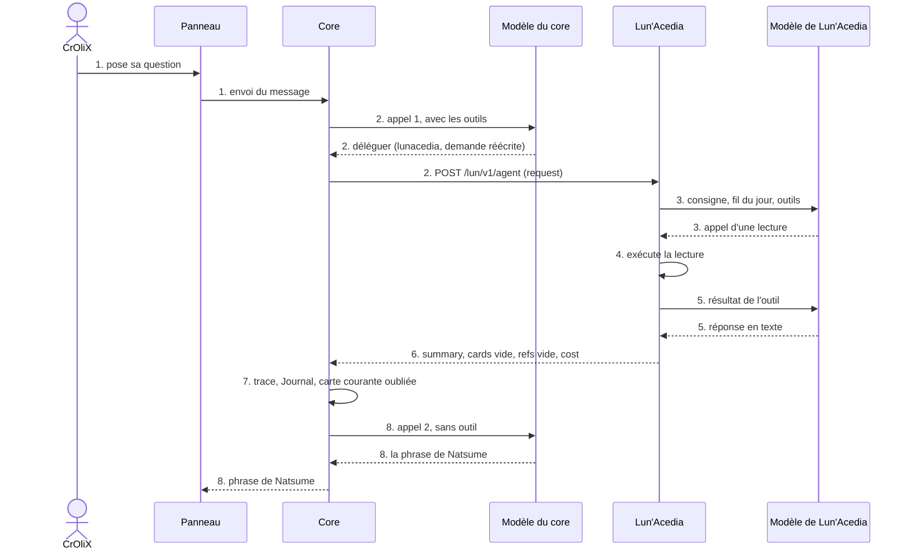

| # | De → vers | Par quoi | Ce qui circule | Retour |
|---|---|---|---|---|
| 1 | Panneau → core | envoi d'un message | le texte, la surface | le flux de la réponse |
| 2 | Core → Lun'Acedia | `POST /lun/v1/agent` | `request` (la demande réécrite, après l'appel 1 du modèle du core) | voir 6 |
| 3 | Lun'Acedia → son modèle | appel | consigne, fil du jour, outils | un appel d'outil de lecture (`agenda.list`, `mail.search`, `mail.read`, `mail.list`, `task.list`, `calendar.list`…) |
| 4 | Lun'Acedia (code) | exécution immédiate | l'entrée validée par le schéma de l'action | le résultat, ou l'erreur en texte |
| 5 | Lun'Acedia → son modèle | appel suivant | le résultat de l'outil en JSON | un texte, sans appel d'outil : le tour est fini |
| 6 | Lun'Acedia → core | réponse 200 | `summary` : la réponse de l'agent ; `cards: []` ; `refs: []` ; `cost` | — |
| 7 | Core (code) | traces | trace « faite », entrée au Journal sans étape de carte ; dans le fil du jour, la carte courante est oubliée | — |
| 8 | Core → panneau | appel 2 du modèle puis fin du flux | la phrase de Natsume, sans carte | — |

- **Ce que CrOliX voit, et où** : la phrase de Natsume et la pastille « Confié à Lun'Acedia » dans la conversation.
  Rien dans À trancher. Une entrée au Journal. Dans l'écran de Lun'Acedia, la demande et la réponse dans le fil de
  l'agent ; les lectures et leurs résultats n'y sont pas montrés.
- **Ce qui s'écrit** : comme S2.1, sans carte : la trace, l'entrée du Journal (« Confié à Lun'Acedia. »), les coûts.
- **Qui décide** : le modèle de Lun'Acedia choisit les lectures ; le code les exécute sans carte
  (`server/src/pina/agent.ts:419`) ; le modèle du core redit.
- **Erreurs et cas limites** :
  - le modèle du core a pour consigne de garder les noms, les dates, les montants et les urgences ; rien ne le
    vérifie ;
  - le contenu d'un mail est une donnée pour l'agent : s'il demande d'agir, l'agent ne le fait pas et le signale
    (`server/src/pina/prompt.ts:67`) ;
  - 8 appels du modèle sans réponse : `summary` vaut « Arrêt : trop d'allers-retours pour cette demande… »
    (`server/src/pina/agent.ts:53-54`, `:375`) ;
  - réponse vide du modèle : `summary` vaut « Aucune réponse claire à cette demande. À reformuler. » ;
  - `refs` reste vide chez Lun'Acedia, et le core ne lit `refs` chez aucun poste.
- **Écart avec les décisions** : T7, T8, T21. Un résumé de la journée, lui, ne se confie pas : la consigne du core
  le fait répondre depuis ce qu'il perçoit.
- **Non vérifié** : ce que chaque lecture appelle chez Google.

### S2.3 · Une demande, plusieurs cartes

- **Déclencheur** : une demande qui demande plusieurs écritures. Exemple inventé : « Archive les deux mails de la
  mutuelle et crée une tâche pour envoyer le justificatif ».
- **Acteurs** : comme S2.1.
- **Avant** : comme S2.1.

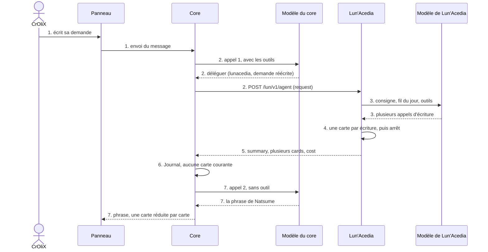

| # | De → vers | Par quoi | Ce qui circule | Retour |
|---|---|---|---|---|
| 1 | Panneau → core | envoi d'un message | le texte, la surface | le flux de la réponse |
| 2 | Core → Lun'Acedia | `POST /lun/v1/agent` | `request`, écrite par le modèle du core à son appel 1 | voir 5 |
| 3 | Lun'Acedia → son modèle | appel | consigne, fil du jour, outils | plusieurs appels d'outil dans la même réponse |
| 4 | Lun'Acedia (code) | traitement de chaque appel | chaque écriture devient une carte ; les lectures de la même réponse s'exécutent ; dès qu'une carte attend, le tour s'arrête après le dernier appel | — |
| 5 | Lun'Acedia → core | réponse 200 | `summary`, `cards` : toutes les cartes du tour, `refs: []`, `cost` | — |
| 6 | Core (code) | traces | une étape « Carte rendue : <titre>. » par carte au Journal ; aucune carte courante (il y en a plusieurs) | — |
| 7 | Core → panneau | appel 2 du modèle puis fin du flux | la phrase de Natsume et toutes les cartes relayées | — |

- **Ce que CrOliX voit, et où** : une carte réduite par carte dans la conversation. Dans À trancher, à la lecture
  suivante, des cartes seules, ou une pile quand plusieurs cartes ont le même type et le même titre. Dans l'écran de
  Lun'Acedia, les cartes du tour avec « Tout valider ».
- **Ce qui s'écrit** : comme S2.1, avec une carte et une étape de Journal par écriture.
- **Qui décide** : le modèle de Lun'Acedia découpe la demande en actions ; le code fait une carte par action.
- **Erreurs et cas limites** :
  - CrOliX dit ensuite « valide » sans nommer de carte : aucune carte courante n'a été retenue (famille 3) ;
  - le tour de l'agent ne reprend que quand toutes les cartes du tour sont tranchées
    (`server/src/pina/agent.ts:320-339`) ; ce qu'il écrit alors reste chez Lun'Acedia ;
  - une demande qui vise deux postes à la fois : le modèle du core ne peut en servir qu'un par réponse (S2.1).
- **Écart avec les décisions** : T1 (la phrase de reprise reste chez le poste), T12 (ce qui se valide ensemble),
  T18. F1 : une entrée de délégation, puis une entrée par carte tranchée.
- **Non vérifié** : la mise en pile exacte côté file (famille 3).

### S2.4 · Répondre à un mail : la carte qui envoie

- **Déclencheur** : CrOliX demande une réponse à un mail. Exemple inventé : « Réponds à l'agence que mardi me va ».
- **Acteurs** : CrOliX, le panneau, le core, les deux fournisseurs de modèle, Lun'Acedia, Google (recherche et
  lecture du mail d'origine).
- **Avant** : comme S2.1 ; Google est configuré chez Lun'Acedia.

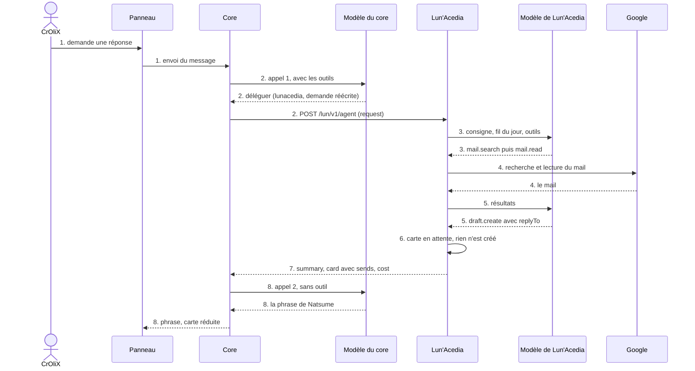

| # | De → vers | Par quoi | Ce qui circule | Retour |
|---|---|---|---|---|
| 1 | Panneau → core | envoi d'un message | le texte, la surface | le flux de la réponse |
| 2 | Core → Lun'Acedia | `POST /lun/v1/agent` | `request`, écrite par le modèle du core à son appel 1 | voir 7 |
| 3 | Lun'Acedia → son modèle | appel | consigne, fil du jour, outils | des lectures : `mail.search` (`q`, `max`), `mail.read` (`id`) |
| 4 | Lun'Acedia → Google | lectures du mail | la recherche, l'identifiant du mail | les résumés, puis en-têtes et texte |
| 5 | Lun'Acedia → son modèle | appel suivant | les résultats | `draft.create` : `to`, `cc`, `subject`, `text`, `replyTo` (l'identifiant du mail d'origine). Pas de champ d'expéditeur |
| 6 | Lun'Acedia (code) | mise en carte | l'entrée validée du brouillon | une carte en attente ; aucun brouillon n'existe encore chez Google |
| 7 | Lun'Acedia → core | réponse 200 | `summary` ; une carte `action: 'draft.create'`, `kind: 'Brouillon de réponse'`, `sends: true`, `title` et `lines` masqués de leurs secrets ; `cost` | — |
| 8 | Core → panneau | appel 2 du modèle puis fin du flux | la phrase de Natsume et la carte relayée | — |

- **Ce que CrOliX voit, et où** : la carte réduite « Brouillon de réponse » dans la conversation ; dans À trancher,
  une carte seule, jamais en pile, qui demande le mot « envoie » ou un clic (famille 3). Dans l'écran de Lun'Acedia,
  la carte de brouillon dans le fil de l'agent.
- **Ce qui s'écrit** : comme S2.1. Aucun brouillon chez Google avant la décision.
- **Qui décide** : le modèle de Lun'Acedia choisit le mail d'origine et écrit le texte. Le code pose `sends` sur un
  `draft.create` qui porte `replyTo`, et seulement là (`server/src/contract/routes.ts:61-63`). Le modèle ne passe
  aucun champ d'expéditeur (`server/src/contract/catalog.ts:394`).
- **Erreurs et cas limites** :
  - valider la carte crée le brouillon, rien ne part : le catalogue n'a aucune action d'envoi
    (`server/src/contract/catalog.ts:387`) ;
  - un nouveau mail (sans `replyTo`) donne une carte « Brouillon » sans `sends` ;
  - le mail d'origine est introuvable : l'erreur retourne au modèle, qui le dit dans `summary` ;
  - Google non configuré : l'outil échoue, « Google n'est pas configuré sur ce serveur », dit par le modèle.
- **Écart avec les décisions** : F6 (l'envoi d'un brouillon depuis Natsume n'existe pas : la carte marquée `sends`
  ne fait que créer le brouillon ; l'envoi se fait dans l'écran de Lun'Acedia). T9 (pas de choix de l'expéditeur).
- **Non vérifié** : le détail des appels à Google derrière `mail.search` et `mail.read`. Question ouverte : quelle
  adresse d'envoi le code prend-il à la création du brouillon (l'appel de choix de l'expéditeur par défaut n'a pas
  été lu, seule la description du champ le dit) ?

### S2.5 · Demande incomplète ou ambiguë : la question de l'agent

- **Déclencheur** : la demande de CrOliX ne dit pas tout (quel jour, quel agenda, quel mail, quel expéditeur).
  Exemple inventé : « Décale le rendez-vous avec le dentiste ».
- **Acteurs** : CrOliX, le panneau, le core, les deux fournisseurs de modèle, Lun'Acedia.
- **Avant** : comme S2.1.

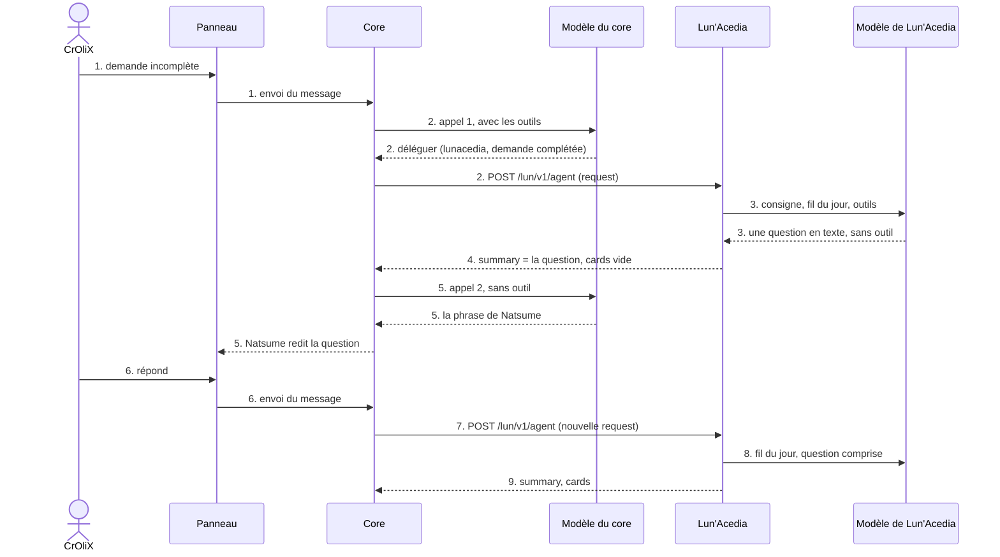

| # | De → vers | Par quoi | Ce qui circule | Retour |
|---|---|---|---|---|
| 1 | Panneau → core | envoi d'un message | le texte, la surface | le flux de la réponse |
| 2 | Core → Lun'Acedia | `POST /lun/v1/agent` | `request` : le modèle du core doit écrire une demande « complète et autonome » ; ce qui manque dans la phrase de CrOliX est donc comblé par lui, ou laissé tel quel | voir 4 |
| 3 | Lun'Acedia → son modèle | appel | consigne, fil du jour, outils | soit des lectures pour trouver (S2.2), soit un texte qui pose une question |
| 4 | Lun'Acedia → core | réponse 200 | `summary` : la question ; `cards: []` ; `cost`. Aucun champ ne dit « une réponse est attendue » | — |
| 5 | Core → panneau | appel 2 du modèle, fin du flux | la question, redite par Natsume | — |
| 6 | Panneau → core | envoi d'un message | la réponse de CrOliX | le flux de la réponse |
| 7 | Core → Lun'Acedia | `POST /lun/v1/agent` | une nouvelle `request`, réécrite par le modèle du core depuis son propre fil ; aucun lien avec la demande précédente | voir 9 |
| 8 | Lun'Acedia → son modèle | appel | tout le fil du jour : sa propre question et la nouvelle demande s'y suivent | des appels d'outil |
| 9 | Lun'Acedia → core | réponse 200 | `summary`, `cards`, `cost` | — |

- **Ce que CrOliX voit, et où** : dans la conversation, la question redite par Natsume, comme une réponse ordinaire ;
  deux entrées au Journal (une par délégation), toutes deux « fait ». Dans l'écran de Lun'Acedia, les deux
  demandes et la question dans le fil de l'agent.
- **Ce qui s'écrit** : deux traces de délégation et deux entrées de Journal ; chez Lun'Acedia, les messages du fil.
- **Qui décide** :
  - la date : le modèle du core l'écrit dans la demande (il connaît le jour et l'heure de Paris), puis le modèle de
    Lun'Acedia la relit à sa propre horloge (`server/src/pina/prompt.ts:47-51`, `:70`) ;
  - l'agenda : le modèle de Lun'Acedia ; s'il ne donne pas `calendarId`, le code prend l'agenda principal
    (`server/src/contract/catalog.ts:293`) ; la consigne de l'agent ne dit rien de ce choix ;
  - l'expéditeur d'un mail : personne (S2.4) ;
  - « ce mail » : la consigne dit à l'agent de demander lequel quand aucun mail n'est ouvert, ce qui est toujours
    le cas d'une délégation (`server/src/pina/prompt.ts:19-23`, `server/src/contract/routes.ts:389`) ;
  - poser une question plutôt qu'agir : le modèle du poste seul. Le modèle du core, lui, a pour consigne de ne
    jamais demander de confirmation avant de confier.
- **Erreurs et cas limites** :
  - la question arrive avec une carte dans le même tour : elle est dans `summary`, sous la même réserve ;
  - la question vient après la décision sur la carte : elle reste dans le fil de Lun'Acedia (famille 3) ;
  - chez Lun'Avaritia, l'agent ne garde rien d'un appel à l'autre : la réponse de CrOliX repart sans la question
    (`server/src/contract/routes.ts:220`, Lun'Avaritia : aucun historique n'est passé).
- **Écart avec les décisions** : direction « prérequis » (rien ne demande ce qui manque avant de lancer ; une
  ambiguïté est tranchée par un modèle, pas renvoyée à CrOliX par le code). T7, T8, T9, T10.
- **Non vérifié** : la fréquence réelle des questions ; rien n'a été joué contre un vrai modèle. Question ouverte : le
  modèle du core redit-il toujours la question du poste, sachant que sa consigne cite les noms, les dates, les
  montants et les urgences, et lui dit aussi de tout redire « à sa façon mais au complet » ?

### S2.6 · « Note ça » : confier une note à Lun'Avaritia

- **Déclencheur** : CrOliX dit « note ça » ou « note que… ». Exemple inventé : « Note que Bastien change de poste
  le 3 février ».
- **Acteurs** : CrOliX, le panneau, le core, le fournisseur du modèle du core, Lun'Avaritia, le fournisseur de ses
  modèles (un usage « agent », un usage « tri »).
- **Avant** : Lun'Avaritia est relié ; un modèle est choisi pour l'agent et pour le tri ; son plafond mensuel (5 $
  par défaut, Lun'Avaritia, `server/src/brain/settings.ts:15-22`) n'est pas atteint.

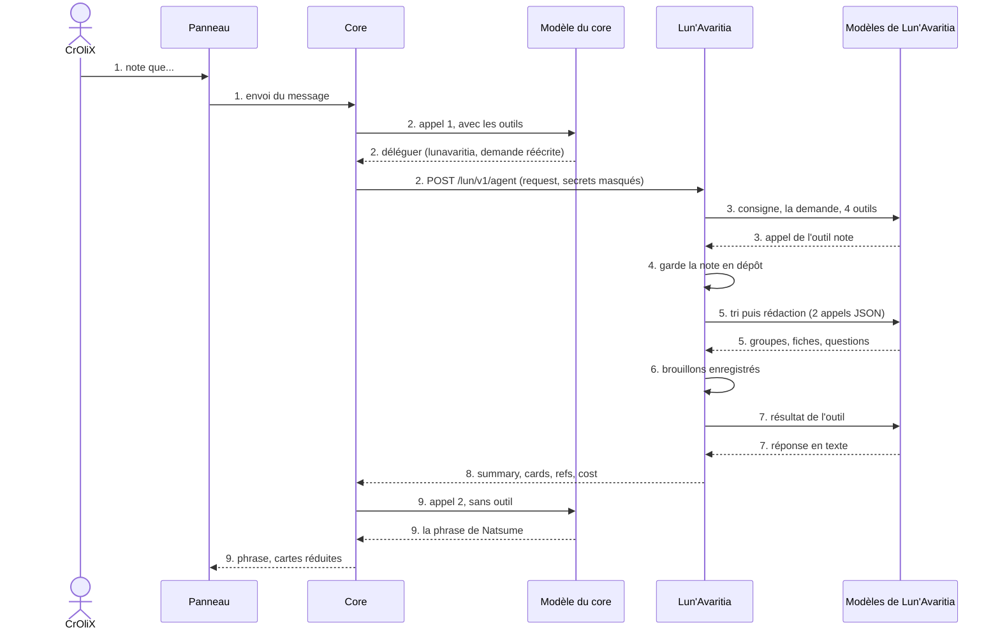

| # | De → vers | Par quoi | Ce qui circule | Retour |
|---|---|---|---|---|
| 1 | Panneau → core | envoi d'un message | le texte, la surface | le flux de la réponse |
| 2 | Core → Lun'Avaritia | `POST /lun/v1/agent` | `request` : la demande réécrite, dont le core masque d'abord les secrets (clés, jetons, IBAN, carte bancaire, numéro de sécurité sociale, et la valeur dite après « mot de passe », « code… », « passeport » ou « carte d'identité »). Pas de `context` | voir 8 |
| 3 | Lun'Avaritia → son modèle (agent) | appel, 6 appels au plus | la consigne (nom, ton, règles, date du jour), la demande seule (aucun historique), 4 outils : `brain_search`, `brain_read`, `brain_neighbors`, `note` | l'appel de `note` avec `text` (1 à 20 000 signes) |
| 4 | Lun'Avaritia (code) | dépôt de la note | le texte, gardé comme un dépôt nommé « note » | rien pour le modèle à ce stade : le dépôt est écrit, puis le tri tourne (étapes 5 et 6) |
| 5 | Lun'Avaritia → ses modèles | deux appels JSON : le tri, puis la rédaction ; une réponse invalide est redemandée une fois | au tri : les types de fiches, les fiches candidates, l'observation ; à la rédaction : les groupes, les observations datées, les doublons probables | des groupes ; puis par groupe une synthèse, des faits (avec échéance éventuelle), des liens ; et des questions |
| 6 | Lun'Avaritia (code) | écriture | un brouillon par fiche, un par question (5 au plus, jamais deux fois la même) ; une ligne « dernier traitement » | le nombre de brouillons |
| 7 | Lun'Avaritia → son modèle (agent) | appel suivant | `{ drafts: n }` | un texte ; la consigne lui fait dire que ce sont des brouillons à valider |
| 8 | Lun'Avaritia → core | réponse 200 | `summary` ; `cards` : tous les brouillons nés depuis le début de l'appel (`id`, `action: 'brain.fiche'`, `effect: 'write'`, `title`, `lines`, `status`, `at`, `link`, `kind`) ; `refs` : les fiches lues dans ce tour (`type: 'fiche'`, `id`, `title`) ; `cost` : la dépense du mois après moins avant | — |
| 9 | Core → panneau | traces, appel 2 du modèle, fin du flux | comme S2.1 : la phrase de Natsume et les cartes relayées | — |

- **Ce que CrOliX voit, et où** : dans la conversation, la phrase de Natsume, la pastille « Confié à Lun'Avaritia »
  et une carte réduite par brouillon (« Nouvelle fiche » ou « Fiche enrichie »). Dans À trancher, les cartes à la
  lecture suivante. Au Journal, une entrée.
- **Ce qui s'écrit** : au core, comme S2.1. Chez Lun'Avaritia : le dépôt « note », les brouillons, la ligne du
  dernier traitement, les lignes de coût (usages « agent » et « tri »). Rien n'entre dans une fiche avant la
  décision de CrOliX.
- **Qui décide** : le modèle du core choisit Lun'Avaritia (sa consigne : tout « note ça » ou « note que » y va, même
  quand la phrase parle d'une chose à faire). Le modèle de l'agent choisit d'appeler `note` et avec quel texte. Le
  tri et la rédaction décident des fiches, des faits, des échéances ; le code fait un seul groupe par fiche et
  trouve les doublons probables (`server/src/brain/process.ts:401-434`).
- **Erreurs et cas limites** :
  - plafond mensuel atteint, pas de modèle, fournisseur en panne pendant la note : la note reste dans Dépôts sans
    traitement, l'outil rend une erreur que le modèle redit (`server/src/brain/inputs.ts:16-37`) ;
  - réponse invalide deux fois : « Réponse invalide du tri, deux fois… », rendue au modèle ;
  - une observation jugée sans intérêt n'entre dans aucun groupe : zéro brouillon. Restent la note, gardée dans
    Dépôts, et une ligne « dernier traitement » à 0 brouillon. Le modèle de l'agent reçoit `{ drafts: 0 }` ;
  - un lot de la nuit traité au même moment : ses brouillons et son coût peuvent se mêler à la réponse, qui compte
    par différence (`server/src/brain/agent.ts:155-165`) ;
  - Lun'Avaritia hors d'atteinte : la consigne du core interdit de confier « note ça » à un autre poste ;
  - `refs` n'est pas lu par le core : rien ne les montre.
- **Écart avec les décisions** : T7, T14 (plafond du poste indépendant de celui du core), T18, T21, T28 (au-delà de
  15 brouillons, `GET /lun/v1/cards` ne rend pas tout ; la réponse de l'agent, elle, rend tout). F1.
- **Non vérifié** : les écrans de Lun'Avaritia (seul le serveur a été lu). Questions ouvertes : la note apparaît-elle
  dans Dépôts, et les brouillons dans À valider ? La bulle de son agent montre-t-elle quelque chose de cet échange ?

### S2.7 · Interroger la bibliothèque : aucune carte

- **Déclencheur** : CrOliX pose une question sur ce qui a été noté, une fiche, une personne, un projet. Exemple
  inventé : « Qu'est-ce qu'on sait sur le projet Lanterne ? ».
- **Acteurs** : CrOliX, le panneau, le core, les deux fournisseurs de modèle, Lun'Avaritia.
- **Avant** : comme S2.6 (le modèle « agent » suffit).

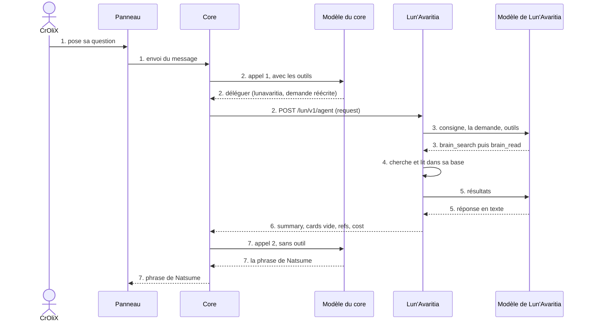

| # | De → vers | Par quoi | Ce qui circule | Retour |
|---|---|---|---|---|
| 1 | Panneau → core | envoi d'un message | le texte, la surface | le flux de la réponse |
| 2 | Core → Lun'Avaritia | `POST /lun/v1/agent` | `request`, secrets masqués | voir 6 |
| 3 | Lun'Avaritia → son modèle | appel | consigne, la demande, 4 outils | `brain_search` (`query`, `limit` ≤ 20), `brain_read` (`id`), `brain_neighbors` (`id`) |
| 4 | Lun'Avaritia (code) | lectures locales | — | extraits de 300 signes ; une fiche : titre, type, synthèse (4 000 signes au plus), faits actifs sourcés, liens |
| 5 | Lun'Avaritia → son modèle | appel suivant | les résultats | un texte, qui cite les fiches par leur titre |
| 6 | Lun'Avaritia → core | réponse 200 | `summary` ; `cards: []` ; `refs` : une entrée par fiche lue par `brain_read` ; `cost` | — |
| 7 | Core → panneau | traces, appel 2, fin du flux | la phrase de Natsume ; `refs` n'est ni gardé ni montré | — |

- **Ce que CrOliX voit, et où** : la phrase de Natsume et la pastille dans la conversation ; une entrée au Journal.
  Rien dans l'écran de Lun'Avaritia.
- **Ce qui s'écrit** : au core, la trace, le Journal, les coûts. Chez Lun'Avaritia, les lignes de coût seulement.
- **Qui décide** : le modèle de Lun'Avaritia choisit quoi chercher et lire ; sa consigne lui interdit de répondre
  hors des fiches (`server/src/brain/prompt.ts:39-43`).
- **Erreurs et cas limites** :
  - une fiche fusionnée renvoie la fiche gardée (`server/src/brain/agent.ts:55-61`, `:86-101`) ;
  - fiche inconnue : l'erreur retourne au modèle ;
  - 6 appels du modèle sans réponse : « Je me suis arrêté : trop d'allers-retours… », après le dernier texte s'il y en a un ;
  - rien dans les fiches : la consigne du core lui fait dire qu'il n'a rien retrouvé.
- **Écart avec les décisions** : T7, T21. Les `refs` rendus ne servent à rien côté core.
- **Non vérifié** : rien de plus.

### S2.8 · La carte à options de Lun'Avaritia

- **Déclencheur** : une note confiée (S2.6) vise une fiche existante dont deux faits actifs, déjà présents, se
  contredisent ; ou le code trouve une fiche au titre proche de la fiche visée, et le modèle de rédaction confirme le
  doublon. Exemple inventé : « Note que Bastien est joignable le matin » alors que la fiche de Bastien porte deux
  faits actifs qui se contredisent (« joignable le matin » et « injoignable avant midi »).
- **Acteurs** : comme S2.6.
- **Avant** : comme S2.6 ; la fiche visée existe déjà.

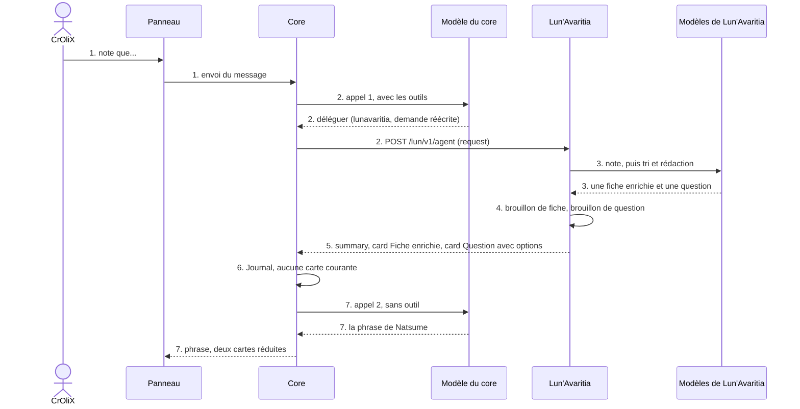

| # | De → vers | Par quoi | Ce qui circule | Retour |
|---|---|---|---|---|
| 1 | Panneau → core | envoi d'un message | le texte, la surface | le flux de la réponse |
| 2 | Core → Lun'Avaritia | `POST /lun/v1/agent` | `request`, secrets masqués | voir 5 |
| 3 | Lun'Avaritia → ses modèles | l'agent appelle `note` ; tri et rédaction | à la rédaction : la fiche existante avec ses faits actifs, les doublons probables trouvés par le code | la fiche enrichie, et une question : `contradiction` (la fiche, le fait à garder, le fait à barrer, la raison) ou `doublon` (la fiche à garder, celle à fusionner, la raison) |
| 4 | Lun'Avaritia (code) | contrôle et écriture | une contradiction ne vise que des faits actifs connus ; un doublon ne vise qu'une paire proposée par le code | deux brouillons |
| 5 | Lun'Avaritia → core | réponse 200 | deux cartes. La question : `action: 'brain.contradiction'` ou `'brain.doublon'`, `kind: 'Question'`, `reason`, `options` : deux textes (les deux faits, ou les deux titres de fiche). Titre : « Contradiction sur la fiche : … » ou « Doublon probable : … et … ». `lines` : pour une contradiction « Garder : <fait> » et « Barrer : <fait> » ; pour un doublon « Garder la fiche : <titre> » et « Fusionner dedans : <titre> ». Une fiche qui change un fait ne pose pas de question : sa carte « Fiche enrichie » porte une ligne « Remplace : <ancien> → <nouveau> » | — |
| 6 | Core (code) | traces | deux étapes « Carte rendue » ; pas de carte courante | — |
| 7 | Core → panneau | appel 2 du modèle puis fin du flux | la phrase de Natsume et les deux cartes | — |

- **Ce que CrOliX voit, et où** : deux cartes réduites ; celle de la question porte le type « Question ». Dans À
  trancher, elle reste seule (jamais en pile) et propose ses choix (famille 3). Dans la file des brouillons en
  attente de Lun'Avaritia (À valider, et `GET /lun/v1/cards`), passent d'abord les contradictions et les fiches qui
  remplacent un fait, puis les doublons, puis le reste ; le tout est coupé au plafond de brouillons, 15 par défaut
  (`server/src/brain/drafts.ts:144-157`, `server/src/brain/routes.ts:68`, `server/src/contract/routes.ts:177-179`).
- **Ce qui s'écrit** : comme S2.6, plus le brouillon de la question.
- **Qui décide** : le modèle de rédaction propose la question ; le code la borne (5 au plus, contradictions
  d'abord, jamais une question déjà posée, `server/src/brain/process.ts:370-375`, `:442-447`).
- **Erreurs et cas limites** :
  - une question déjà posée, en attente ou tranchée, ne revient pas, sans trace ;
  - une contradiction sur un fait barré ou inconnu, ou un doublon qui n'est pas une paire proposée par le code : la
    rédaction est refusée comme invalide (`server/src/brain/process.ts:200-206`) ;
  - chez Lun'Acedia, aucune carte n'a d'`options` : une réponse y est refusée
    (Lun'Acedia, `server/src/contract/routes.ts:356-357`) ;
  - une proposition de tri de Lun'Acedia porte des `fields` à corriger, mais elle ne naît pas d'une délégation
    (famille 4).
- **Écart avec les décisions** : T18, T28. F1.
- **Non vérifié** : la réponse à la carte (famille 3).

### S2.9 · Demande dite à voix haute : la phrase d'attente

- **Déclencheur** : CrOliX dit sa demande à Lun'Luxuria, qui l'envoie au core avec « à dire à voix haute ».
- **Acteurs** : CrOliX, Lun'Luxuria, le core, le fournisseur du modèle du core, un poste.
- **Avant** : comme S2.1 ; au moins un poste est joignable. Le transport de la voix est dans la famille 8.

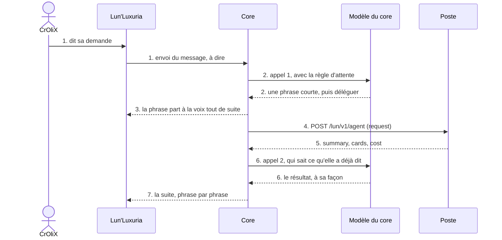

| # | De → vers | Par quoi | Ce qui circule | Retour |
|---|---|---|---|---|
| 1 | Lun'Luxuria → core | envoi d'un message | le texte entendu, la surface `voice`, la confiance, « à dire » | le flux de la réponse |
| 2 | Core → son modèle | appel 1 | en plus de S2.1 : la règle d'attente (une seule phrase très courte avant de confier, sans annoncer de résultat) et la règle des émotions | une phrase, puis l'appel de délégation dans la même réponse |
| 3 | Core → Lun'Luxuria | flux des paroles | la phrase d'attente, poussée à la voix avant l'appel du poste | — |
| 4 | Core → poste | `POST /lun/v1/agent` | `request` | voir 5 |
| 5 | Poste → core | réponse 200 | `summary`, `cards`, `refs`, `cost` | — |
| 6 | Core → son modèle | appel 2, sans outil | le fil, la phrase d'attente comme déjà dite, puis le résumé du poste | la suite |
| 7 | Core → Lun'Luxuria | flux des paroles | les phrases, chacune avec son émotion | — |

- **Ce que CrOliX voit, et où** : il entend la phrase d'attente, un silence pendant le travail du poste, puis le
  résultat. Dans le panneau, la réponse en deux paragraphes et les cartes réduites.
- **Ce qui s'écrit** : comme S2.1 ; la réponse garde la phrase d'attente à part du résultat.
- **Qui décide** : le modèle du core dit ou non la phrase d'attente ; le code ne la force pas.
- **Erreurs et cas limites** :
  - CrOliX coupe pendant que le poste travaille : le poste finit, ses cartes sont gardées, la réponse enregistrée
    est ce qu'il a entendu suivi du résumé du poste ;
  - coupure une fois le tour fini, la voix encore sur la phrase d'attente : le résultat reste aussi ;
  - coupure sans carte préparée : la réponse est réduite à ce qui a été entendu, marquée « (coupée ici) » ;
  - échec de la délégation : la phrase d'échec est dite sur le ton neutre, sans appel 2.
- **Écart avec les décisions** : T4 (le core ne sait pas ce qui a été dit, hors coupure), T22.
- **Non vérifié** : le côté Lun'Luxuria (famille 8) ; rien n'a été entendu.

### S2.10 · Le poste est en pause

- **Déclencheur** : CrOliX confie une demande à un poste en pause.
- **Acteurs** : CrOliX, le panneau, le core, le fournisseur du modèle du core, le poste.
- **Avant** : le poste est relié et son flux d'événements est ouvert. Il porte une pause locale (posée dans son
  écran, ou par `POST /lun/v1/pause` sans auteur) ou une pause du core (`by: 'core'`).

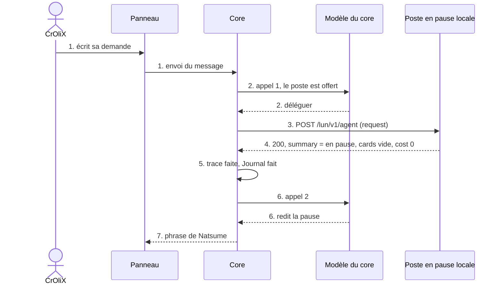

| # | De → vers | Par quoi | Ce qui circule | Retour |
|---|---|---|---|---|
| 1 | Panneau → core | envoi d'un message | le texte, la surface | le flux de la réponse |
| 2 | Core → son modèle | appel 1 | le poste en pause est offert comme un poste en service : seul le lien compte | l'appel de délégation |
| 3 | Core → poste | `POST /lun/v1/agent` | `request` | voir 4 |
| 4 | Poste → core | réponse 200, sans appel de modèle | Lun'Acedia : `summary` « Acedia est en pause : rien ne se fait tant qu'elle n'est pas reprise. » ; Lun'Avaritia : « Avaritia est en pause : je ne fais rien tant qu'elle n'est pas reprise. » ; `cards: []`, `refs: []`, `cost.amount: 0` | — |
| 5 | Core (code) | traces | une réponse lisible : issue « faite », entrée du Journal « fait » | — |
| 6 | Core → son modèle | appel 2 | la phrase de pause, comme résultat à redire | la phrase de Natsume |
| 7 | Core → panneau | fin du flux | la phrase, sans carte | — |

- **Ce que CrOliX voit, et où** : Natsume dit que le poste est en pause ; la pastille « Confié à… » ; une entrée
  « fait » au Journal. Chez Lun'Acedia, rien n'entre dans le fil de l'agent.
- **Ce qui s'écrit** : au core, la trace et le Journal comme pour une demande réussie. Chez le poste, rien.
- **Qui décide** : le code du poste, sur l'auteur de la pause : seule la pause locale ferme l'agent
  (Lun'Acedia, `server/src/contract/routes.ts:387` ; Lun'Avaritia, `server/src/contract/routes.ts:213-219`). Quand
  les deux pauses sont posées, la locale l'emporte (`server/src/contract/state.ts:19-31` dans les deux dépôts).
- **Erreurs et cas limites** :
  - pause du core seule : l'agent répond normalement, cartes comprises (Lun'Acedia,
    `server/src/contract/agent.test.ts:90-104`) ;
  - les actions directes ne regardent pas la pause dans leur route (S2.18) ;
  - le core classe un poste en pause locale « muet » pour l'état des postes, mais la conversation ne lit pas cet
    état : elle ne regarde que le lien.
- **Écart avec les décisions** : T13 (deux pauses de force inégale), T19 (un poste en pause locale est offert au
  modèle). F1 : le Journal dit « fait » pour une demande que le poste a refusée.
- **Non vérifié** : l'effet de la pause du core sur la conversation elle-même (famille 10).

### S2.11 · L'agent du poste ne peut pas travailler

- **Déclencheur** : une demande confiée à un poste dont l'agent n'a pas de modèle, a atteint son plafond, ou dont
  le fournisseur refuse ou ne répond pas.
- **Acteurs** : CrOliX, le panneau, le core, le poste, le fournisseur du modèle du poste.
- **Avant** : le poste est relié, sans pause locale.

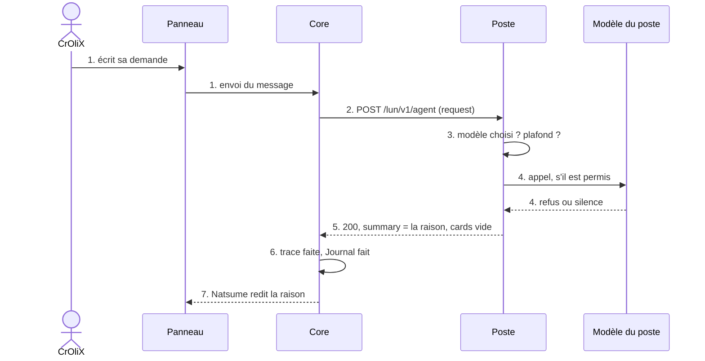

| # | De → vers | Par quoi | Ce qui circule | Retour |
|---|---|---|---|---|
| 1 | Panneau → core | envoi d'un message | le texte, la surface | le flux de la réponse |
| 2 | Core → poste | `POST /lun/v1/agent` | `request` | voir 5 |
| 3 | Poste (code) | contrôles avant chaque appel du modèle | Lun'Acedia : un modèle choisi, la dépense du jour de l'agent sous son plafond ; Lun'Avaritia : un modèle « agent », la dépense du mois sous le plafond mensuel | une phrase fixe si le contrôle échoue |
| 4 | Poste → son modèle | appel | consigne, fil, outils | une erreur : clé refusée, crédit épuisé, indisponible, réponse illisible |
| 5 | Poste → core | réponse 200 | `summary` : la phrase fixe du poste. Chez Lun'Acedia : « Aucun modèle choisi pour l'agent… », « Plafond de dépense du jour atteint… », « Le fournisseur d'IA refuse la clé… », « Plus de crédit… », « …ne répond pas pour le moment… », « …réponse illisible… ». Chez Lun'Avaritia, d'autres mots : « Plafond de coût mensuel atteint : je ne peux pas répondre avant le mois prochain, ou relève-le. », « Le fournisseur d'IA refuse la clé : à vérifier dans Réglages. », « Plus de crédit chez le fournisseur d'IA. », « …Réessaie dans un instant. » ; `cards` : celles déjà nées dans le tour ; `cost` | — |
| 6 | Core (code) | traces | issue « faite », Journal « fait » | — |
| 7 | Core → panneau | appel 2, fin du flux | la raison, redite par Natsume | — |

- **Ce que CrOliX voit, et où** : Natsume redit la raison, qui nomme les Réglages du poste ; une entrée « fait » au
  Journal. Dans l'écran de Lun'Acedia, la phrase est dans le fil de l'agent, avec « Ouvrir les Réglages ».
- **Ce qui s'écrit** : au core, comme une demande réussie. Chez Lun'Acedia, la demande et la phrase dans le fil ;
  une clé refusée est notée et émet l'événement `key.invalid` (`server/src/llm/keys.ts:224-236`). Chez
  Lun'Avaritia, une clé refusée ou un crédit épuisé changent sa santé (`server/src/brain/process.ts:61-69`).
- **Qui décide** : le code du poste (Lun'Acedia, `server/src/pina/agent.ts:358`, `:376`, `:380-385` ;
  Lun'Avaritia, `server/src/brain/agent.ts:166-167`, `:215-236`).
- **Erreurs et cas limites** :
  - le plafond de Lun'Avaritia tombe au milieu du tour : `summary` porte le dernier texte de l'agent, puis la phrase
    du plafond ;
  - ces phrases sont écrites pour l'écran du poste (« à régler dans Réglages › Fournisseurs d'IA ») ; le modèle du
    core les redit telles qu'il les comprend ;
  - une erreur qui n'est pas du fournisseur fait échouer la route (500) : voir S2.15 ;
  - la phrase d'attente déjà écrite par le modèle du core avant l'appel n'est pas effacée par cet échec : la réponse
    enregistrée porte ce texte, un séparateur, puis la phrase fixe d'échec de la délégation (voir S2.9). Même chose
    pour S2.12, S2.13, S2.14 et S2.15 : une délégation qui échoue ne pose jamais de résultat « exact » qui effacerait
    ce texte.
- **Écart avec les décisions** : T14, T24 (le plafond de Lun'Avaritia atteint ne remonte que par cette phrase). F1 :
  « fait » au Journal pour une demande non servie.
- **Non vérifié** : la suite de l'événement `key.invalid` côté core (famille 11).

### S2.12 · Plafond du jour d'un poste, tenu par le core

- **Déclencheur** : CrOliX confie une demande à un poste dont le plafond du jour, réglé dans le core, est atteint.
- **Acteurs** : CrOliX, le panneau, le core, le fournisseur du modèle du core. Le poste n'est pas appelé.
- **Avant** : un plafond du jour est réglé pour ce poste dans le core (aucun par défaut) ; la dépense du jour du
  poste, lue par le core dans `GET /lun/v1/costs`, l'atteint.

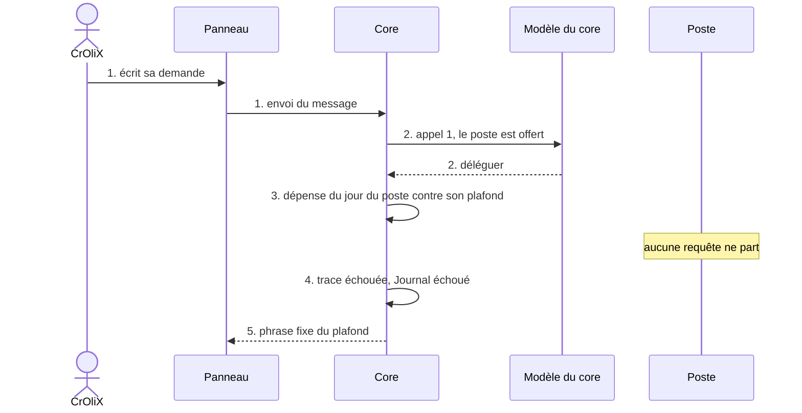

| # | De → vers | Par quoi | Ce qui circule | Retour |
|---|---|---|---|---|
| 1 | Panneau → core | envoi d'un message | le texte, la surface | le flux de la réponse |
| 2 | Core → son modèle | appel 1 | le poste est offert : le plafond n'est pas regardé à ce moment | l'appel de délégation |
| 3 | Core (code) | contrôle avant l'envoi | la dernière dépense du jour lue chez le poste (zéro si la lecture date d'un autre jour) contre le plafond du poste | refus |
| 4 | Core (code) | traces | issue « échouée » ; Journal : « Confié à <poste>. » puis « Échec. » | — |
| 5 | Core → panneau | fin du flux, sans appel 2 | « Plafond de <nom du poste> atteint : rien ne lui est confié jusqu'à 05:00. » | — |

- **Ce que CrOliX voit, et où** : la phrase fixe dans la conversation, et la pastille « Confié à… » bien que rien
  ne soit parti ; une entrée « Échoué » au Journal.
- **Ce qui s'écrit** : la trace « échouée », l'entrée du Journal, le coût de l'appel 1 du modèle.
- **Qui décide** : le code du core, sur la dernière dépense du jour qu'il a lue chez le poste.
- **Erreurs et cas limites** :
  - le plafond du core lui-même (jour ou mois) : ni modèle ni poste ne sont appelés, la réponse est en erreur avec
    « Plafond du jour atteint : Natsume répond à nouveau à HH:MM. » (famille 10) ;
  - ce plafond s'ajoute à celui que le poste tient pour son agent (S2.11) : trois plafonds peuvent jouer.
- **Écart avec les décisions** : T14 (plafonds indépendants). F1 : « Confié à » écrit pour une demande non envoyée.
- **Non vérifié** : l'écran où ce plafond se règle (famille 10). Question ouverte : quel âge peut avoir le chiffre
  de dépense quand les lectures du poste échouent ? Le code ne borne que le jour de la lecture, pas son âge.

### S2.13 · Délai dépassé

- **Déclencheur** : le poste ne répond pas à `POST /lun/v1/agent` dans le délai réglé.
- **Acteurs** : CrOliX, le panneau, le core, le poste.
- **Avant** : le poste est relié ; son délai de réponse est un réglage du core par poste (120 s par défaut).

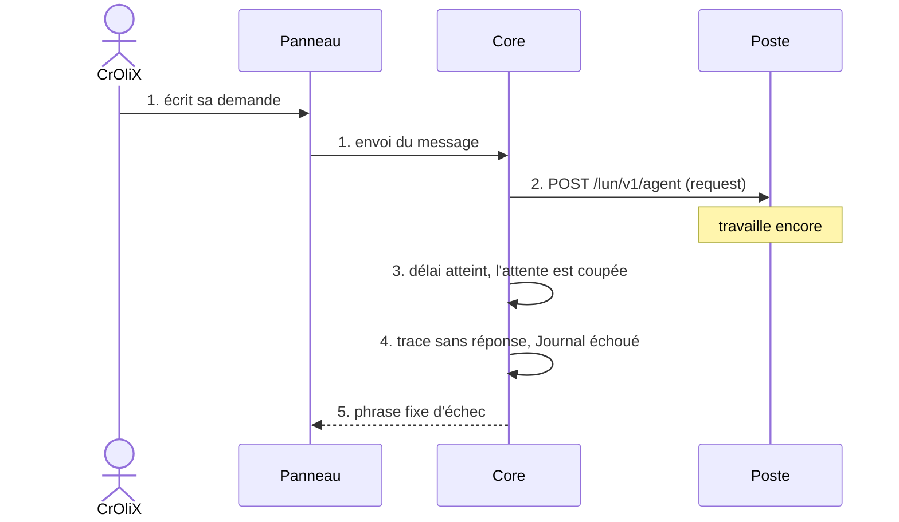

| # | De → vers | Par quoi | Ce qui circule | Retour |
|---|---|---|---|---|
| 1 | Panneau → core | envoi d'un message | le texte, la surface | le flux de la réponse |
| 2 | Core → poste | `POST /lun/v1/agent` | `request` | aucun dans le délai |
| 3 | Core (code) | abandon de la requête | — | — |
| 4 | Core (code) | traces | issue « sans réponse », durée ; Journal : « Confié à <poste>. » puis « <poste> n'a pas répondu. », issue « échoué » | — |
| 5 | Core → panneau | fin du flux, sans appel 2 | « lunacedia injoignable : délai dépassé. Rien n'a été fait. » (le poste y est nommé par son identifiant) | — |

- **Ce que CrOliX voit, et où** : la phrase fixe et la pastille dans la conversation ; une entrée « Échoué » au
  Journal. Si le poste a fini quand même, ses cartes arrivent dans À trancher à la lecture suivante, sans lien
  avec la demande.
- **Ce qui s'écrit** : au core, la trace et le Journal. Chez le poste, ce qu'il a fait.
- **Qui décide** : le code du core coupe son attente ; rien ne dit au poste d'arrêter.
- **Erreurs et cas limites** :
  - « Rien n'a été fait » peut être faux : le délai coupe l'attente du core, pas le travail du poste (déduit) ;
  - CrOliX redemande : le poste peut préparer une seconde carte pour la même chose ;
  - chez Lun'Acedia, une demande attend derrière un tour en cours de l'agent : ce temps compte dans le délai.
- **Écart avec les décisions** : T6. F1 (le Journal ne sera pas corrigé si le poste a fini).
- **Non vérifié** : ce que fait le serveur du poste quand le core ferme la connexion ; non joué.

### S2.14 · Poste injoignable ou liaison à refaire

- **Déclencheur** : CrOliX demande une chose qui relève d'un poste que le core ne joint pas.
- **Acteurs** : CrOliX, le panneau, le core, le fournisseur du modèle du core, le poste (absent).
- **Avant** : le flux d'événements du poste n'est pas ouvert côté core (poste arrêté, réseau, jeton refusé), ou il
  tombe pendant l'appel.

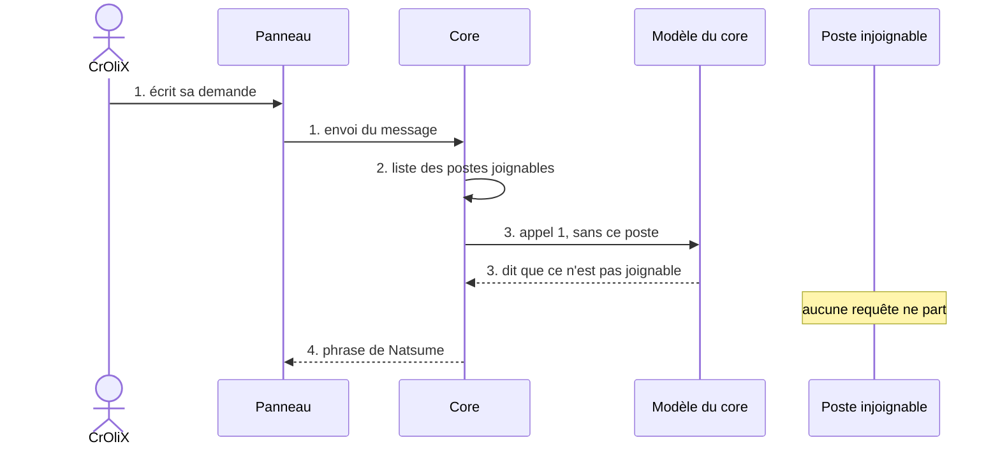

| # | De → vers | Par quoi | Ce qui circule | Retour |
|---|---|---|---|---|
| 1 | Panneau → core | envoi d'un message | le texte, la surface | le flux de la réponse |
| 2 | Core (code) | choix des postes offerts | un poste est offert s'il a un rôle connu du core et si son flux d'événements est ouvert | — |
| 3 | Core → son modèle | appel 1 | l'outil de délégation ne propose pas ce poste (ou n'existe pas, si aucun poste n'est joignable) ; la consigne dit que ce domaine n'est pas joignable, qu'il ne se confie à aucun autre poste, qu'il faut le dire et ne pas prétendre agir | un texte |
| 4 | Core → panneau | fin du flux | la phrase de Natsume | — |

- **Ce que CrOliX voit, et où** : Natsume dit que le mail, l'agenda et les tâches (ou la mémoire et les fiches) ne
  sont pas joignables. Pas de pastille, rien au Journal pour cette demande.
- **Ce qui s'écrit** : le message et la réponse ; le coût de l'appel 1. Aucune trace de délégation.
- **Qui décide** : le code du core retire le poste ; le modèle écrit la phrase.
- **Erreurs et cas limites** :
  - le poste tombe entre la consigne et l'appel : « lunacedia injoignable : injoignable. Rien n'a été fait. »,
    trace « échouée », Journal « Échec. » ;
  - le poste refuse le jeton du core (401) : « … injoignable : liaison à refaire. Rien n'a été fait. » ;
  - le modèle vise quand même un poste non offert : l'appel est illisible (S2.15) ;
  - un poste relié mais sans rôle connu du core n'est jamais offert ;
  - le core ne vérifie pas que le poste annonce un agent : le client note que `POST /lun/v1/agent` ne vaut que si la
    santé du poste dit `agent: true`, mais la liste des postes offerts ne regarde que le rôle et le lien. Un poste
    relié sans agent serait offert, et l'appel finirait en erreur (S2.15). Sans effet aujourd'hui : les deux postes
    servent la route.
- **Écart avec les décisions** : aucun connu. La santé des postes est dans la famille 12, les pannes dans la 11.
- **Non vérifié** : la reprise du flux d'événements (famille 12). Question ouverte : quand le jeton gardé par le core
  est illisible, le poste est-il encore offert au modèle (flux ouvert, sans client), ou le flux ne s'ouvre-t-il
  pas, ce qui le retire de la liste ?
### S2.15 · Appel ou réponse illisible

- **Déclencheur** : le modèle du core écrit un appel de délégation que le code ne peut pas lire, ou le poste rend
  une réponse que le core ne peut pas lire.
- **Acteurs** : CrOliX, le panneau, le core, le fournisseur du modèle du core, le poste.
- **Avant** : comme S2.1.

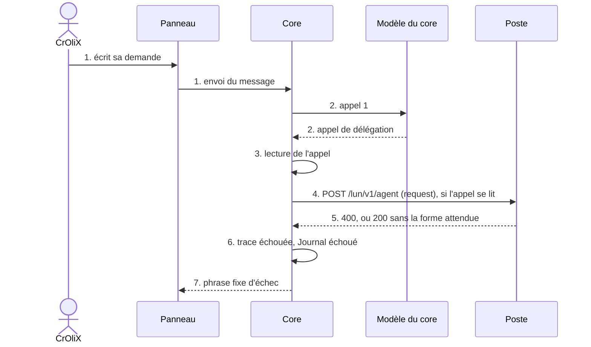

| # | De → vers | Par quoi | Ce qui circule | Retour |
|---|---|---|---|---|
| 1 | Panneau → core | envoi d'un message | le texte, la surface | le flux de la réponse |
| 2 | Core → son modèle | appel 1 | comme S2.1 | un appel d'outil |
| 3 | Core (code) | lecture de l'appel | l'outil appelé doit être celui de la délégation ; ses arguments doivent être du JSON, sans champ en trop, viser un poste offert et porter une demande de 1 à 4 000 signes, espaces de bord retirés. Tout autre outil, ni relecture, ni lecture de carte, ni trancher quand il est permis, prend aussi ce chemin : un outil inventé, ou trancher sans être offert hors du fil du jour | sinon : « <poste visé> injoignable : demande illisible. Rien n'a été fait. », sans requête, sans trace, sans Journal, sans pastille |
| 4 | Core → poste | `POST /lun/v1/agent` | `request` | voir 5 |
| 5 | Poste → core | réponse | 400 `{ error }` si le corps est refusé par le schéma ; 500 `{ error: <message> }` si la route du poste lève une erreur qui n'est pas du fournisseur (les deux postes ont un gestionnaire d'erreur qui répond ainsi) ; ou 200 dont le corps n'a pas un `summary` texte et des `cards` avec `id` | — |
| 6 | Core (code) | traces | issue « échouée » ; Journal « Échec. » | — |
| 7 | Core → panneau | fin du flux, sans appel 2 | « … injoignable : <message d'erreur du poste>. Rien n'a été fait. », ou « … : réponse illisible. … », ou « … : erreur inattendue. … » | — |

- **Ce que CrOliX voit, et où** : une phrase fixe d'échec dans la conversation ; une entrée « Échoué » au Journal,
  sauf quand l'appel d'outil lui-même est illisible (rien n'est alors tracé).
- **Ce qui s'écrit** : la réponse, les coûts du modèle, et selon le cas la trace et l'entrée du Journal.
- **Qui décide** : le code du core, à la frontière : il ne montre et ne garde que ce qu'il a su lire.
- **Erreurs et cas limites** :
  - erreur interne de l'agent du poste (500) : une erreur de base pendant le tour, ou, chez Lun'Avaritia, une erreur
    levée par l'ajout de la note hors erreur de saisie. Le core trace « échouée », écrit « Échec. » au Journal et
    montre « <id du poste> injoignable : <message>. Rien n'a été fait. ». Chez Lun'Acedia, la demande et les
    messages déjà écrits restent dans le fil du jour (Lun'Acedia, `server/src/app.ts:154`,
    `server/src/pina/agent.ts:381` ; Lun'Avaritia, `server/src/app.ts:146`, `server/src/brain/agent.ts:205-209`,
    `:233`) ;
  - un `context` à clé inconnue serait refusé en 400 par Lun'Acedia (`server/src/contract/routes.ts:43-46`) ; le
    core n'en envoie pas ;
  - chez Lun'Avaritia, un `context` libre est accepté : 20 clés au plus, valeurs de 2 000 signes au plus
    (`server/src/brain/agent.ts:110-116`) ;
  - le modèle met la demande dans un message sans appeler l'outil : aucune délégation, sa phrase est la réponse ;
  - une carte rendue sans `id` texte rend toute la réponse illisible.
- **Écart avec les décisions** : aucun connu.
- **Non vérifié** : les messages d'erreur exacts du schéma, tels qu'ils seraient montrés.

### S2.16 · Le core ne peut pas redire le résultat

- **Déclencheur** : le poste a répondu, mais l'appel 2 du modèle du core échoue, est refusé, est vide, ou n'est pas
  permis (plafond du core atteint entre les deux appels).
- **Acteurs** : CrOliX, le panneau, le core, le fournisseur du modèle du core, le poste.
- **Avant** : comme S2.1.

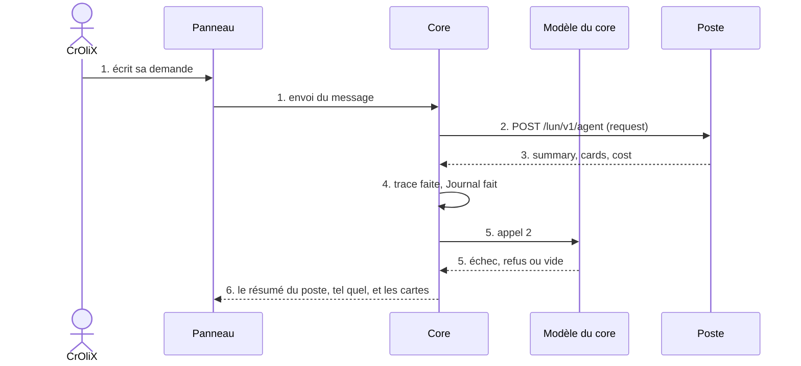

| # | De → vers | Par quoi | Ce qui circule | Retour |
|---|---|---|---|---|
| 1 | Panneau → core | envoi d'un message | le texte, la surface | le flux de la réponse |
| 2 | Core → poste | `POST /lun/v1/agent` | `request` | voir 3 |
| 3 | Poste → core | réponse 200 | `summary`, `cards`, `refs`, `cost` | — |
| 4 | Core (code) | traces | issue « faite », Journal, carte courante | — |
| 5 | Core → son modèle | appel 2 | le résumé à redire | une erreur, un refus, un texte vide ou tronqué ; ou pas d'appel du tout si le plafond du core est atteint |
| 6 | Core → panneau | fin du flux | la réponse enregistrée garde le `summary` du poste, mot pour mot, et non des mots de Natsume ; les cartes relayées | — |

- **Ce que CrOliX voit, et où** : le texte de l'agent du poste dans la bulle de Natsume, avec les cartes. À la voix,
  il est dit sur le ton neutre.
- **Ce qui s'écrit** : la réponse avec le résumé du poste ; les cartes ; le coût de ce qui a été consommé ; une clé
  refusée à l'appel 2 est retenue comme à l'appel 1.
- **Qui décide** : le code du core : rien de ce qui se passe à l'appel 2 ne doit coûter le tour ni les cartes.
- **Erreurs et cas limites** :
  - `summary` vide : aucun appel 2 n'est tenté (S2.1) ;
  - le résumé du poste est rejoué au modèle, aux tours suivants, comme un résultat d'outil coupé à 800 signes.
- **Écart avec les décisions** : aucun connu.
- **Non vérifié** : le rejeu exact de ce tour dans les réponses suivantes (famille 1). Question ouverte : si l'appel 2
  échoue après quelques mots déjà poussés au flux, CrOliX voit-il ces mots puis le résumé du poste à l'écran ?

### S2.17 · Lire le catalogue d'un poste

- **Déclencheur** : un client du contrat demande au poste la liste de ses actions.
- **Acteurs** : le client (le core, ou une application du core par son relais), le poste.
- **Avant** : le client a un jeton valide du poste.

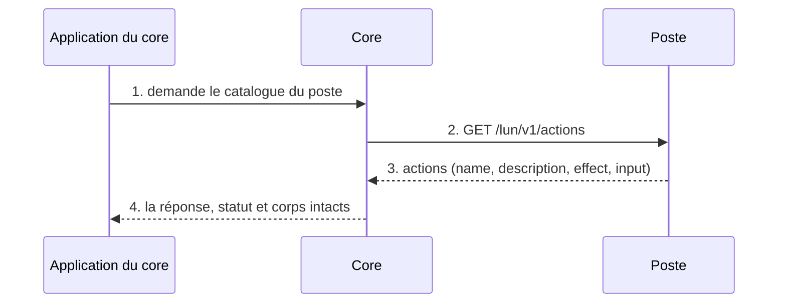

| # | De → vers | Par quoi | Ce qui circule | Retour |
|---|---|---|---|---|
| 1 | Application → core | relais du catalogue d'un poste | l'identifiant du poste | voir 4 |
| 2 | Core → poste | `GET /lun/v1/actions`, jeton du core | rien | voir 3 |
| 3 | Poste → core | réponse 200 | `actions` : pour chacune `name`, `description`, `effect` (`read`, `write`, `delete`), `input` (le schéma JSON de son entrée) | — |
| 4 | Core → application | relais | le statut et le corps du poste, intacts | 404 si le poste est inconnu du core ; 502 s'il est injoignable, s'il refuse le jeton, ou si le jeton gardé est illisible |

- **Ce que CrOliX voit, et où** : rien. Aucun écran du panneau n'appelle ce relais (cherché, pas trouvé).
- **Ce qui s'écrit** : rien.
- **Qui décide** : personne. Lun'Acedia sert 39 actions (13 lectures, 22 écritures, 4 suppressions ;
  `server/src/contract/catalog.ts:210-635`) ; Lun'Avaritia en sert 6 : `brain.ingest` (écriture), `brain.search`,
  `brain.read`, `brain.due`, `brain.neighbors`, `day.digest` (`server/src/contract/catalog.ts:16-64`).
- **Erreurs et cas limites** :
  - jeton absent, invalide ou révoqué : 401 `{ error }` (les deux dépôts, `requireToken`) ;
  - le modèle du core ne reçoit jamais ce catalogue : il ne connaît d'un poste qu'un rôle en une ligne ;
  - chez Lun'Acedia, le même catalogue est la liste d'outils de son agent (`server/src/pina/agent.ts:361`) ; chez
    Lun'Avaritia, l'agent a ses 4 outils à lui, et `note` n'est pas une action du catalogue.
- **Écart avec les décisions** : T8.
- **Non vérifié** : un appelant de ce relais hors du core ; aucun n'a été trouvé dans le panneau ni dans
  Lun'Luxuria.

### S2.18 · Invoquer une action directe

- **Déclencheur** : le core appelle une action du catalogue sans passer par l'agent : une lecture périodique, la
  nuit, ou une application du core par son relais.
- **Acteurs** : le core, le poste ; Google derrière certaines actions de Lun'Acedia.
- **Avant** : le core a un jeton valide du poste.

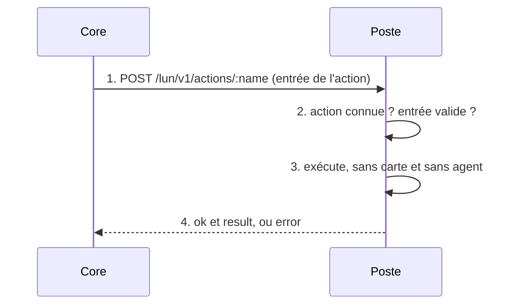

| # | De → vers | Par quoi | Ce qui circule | Retour |
|---|---|---|---|---|
| 1 | Core → poste | `POST /lun/v1/actions/:name`, jeton du core | le corps JSON : l'entrée de l'action (vide = `{}`) | voir 4 |
| 2 | Poste (code) | contrôles | le nom de l'action, puis le corps contre le schéma de l'action | 404 `{ error: 'Action inconnue : <nom>' }` ; 400 `{ error }` (JSON invalide, schéma, ou entrée qui n'a pas de sens) |
| 3 | Poste (code) | exécution | la même fonction que l'écran du poste ; une écriture s'exécute tout de suite : pas de carte, pas de mode | — |
| 4 | Poste → core | réponse | 200 `{ ok: true, result }` ; 200 `{ ok: false, error }` pour un échec métier ; 503 `{ error }` pour un service dégradé | — |

- **Ce que CrOliX voit, et où** : rien de direct. Il voit ce que le core fait du résultat : les échéances et
  l'agenda que montre le panneau (`brain.due`, `agenda.list`), la nuit et sa lettre du matin (`day.digest`), les
  cartes de fiches nées du lot (`brain.ingest`). Voir les familles 5, 6 et 7.
- **Ce qui s'écrit** : au core, rien pour l'appel lui-même : ni trace de délégation ni entrée de Journal. Chez le
  poste, ce que l'action écrit (une écriture de mail de Lun'Acedia entre dans son journal du tri).
- **Qui décide** : le code du core choisit l'action et son entrée ; aucun modèle. Les actions que le core appelle
  aujourd'hui : `agenda.list` (lecture périodique de Lun'Acedia), `brain.due` (lecture périodique et Bureau),
  `brain.search` (contexte de Natsume), `day.digest` et `brain.ingest` (la nuit).
- **Erreurs et cas limites** :
  - la route ne regarde pas la pause, ni locale ni du core (Lun'Acedia, `server/src/contract/routes.ts:407-425` ;
    Lun'Avaritia, `:225-243`) ; Lun'Acedia l'écrit : une action demandée par le core est un geste demandé
    (`server/src/contract/catalog.ts:82-85`) ;
  - le 503 est prévu par les deux routes, mais aucune action ne lève aujourd'hui l'erreur « dégradé » ;
  - Lun'Avaritia refuse un corps de plus de 25 Mo par 413 (`server/src/contract/routes.ts:29-32`) ;
  - le relais du core pour ses applications rend le statut et le corps intacts ; 400 si le corps n'est pas du JSON,
    404 poste inconnu, 502 poste injoignable ou jeton refusé ; aucun écran du panneau ne l'appelle ;
  - une écriture directe (`mail.trash`, `event.create`…) passerait sans carte : le core n'en appelle aucune
    aujourd'hui, hors `brain.ingest`.
- **Écart avec les décisions** : F7 (reliée ou non, une action directe applique les règles du poste, sans carte ni
  droit de Natsume) ; T3 (`brain.ingest` rend un accusé de réception, pas le sort du lot, famille 6).
- **Non vérifié** : la fonction métier derrière chacune des 39 actions de Lun'Acedia (pause, appels à Google).
