# Famille 3 · Trancher une carte

Cette famille couvre tout ce qui se passe entre une carte en attente et son issue : valider, refuser, corriger,
choisir une option, annuler. Elle le suit par chaque lieu : le Bureau et À trancher (à la main), la conversation
du core, la voix par Lun'Luxuria, l'écran du poste lui-même, la validation groupée. Elle vaut pour Lun'Acedia et
pour Lun'Avaritia. Elle décrit le code d'`origin/main`, rien n'a été rejoué : ce qui est déduit est dit « déduit ».

La naissance d'une carte (famille 2), le tri qui produit une proposition (famille 4) et la présence qui porte la
voix (famille 8) sont ailleurs.

| Id | Titre | En une ligne |
|---|---|---|
| S3.1 | Valider ou refuser une carte à la main | Le geste part du panneau, le core le tient 5 s, puis le relaie au poste |
| S3.2 | Ce que Lun'Acedia fait d'une carte de son agent | Exécution, relance de son modèle, carte rendue, signal éventuel |
| S3.3 | Trancher une proposition de tri depuis le core | Valider, refuser ou corriger la boîte et les étiquettes |
| S3.4 | Trancher une carte de Lun'Avaritia depuis le core | Fiche, import, question à deux options, autre réponse |
| S3.5 | La carte qui envoie | « Créer le brouillon » à la main, le mot « envoie » exigé en conversation |
| S3.6 | Annuler dans les 5 secondes, à la main | « Annuler » du toast ou Ctrl Z ; trop tard après le délai |
| S3.7 | Valider ensemble, et la pile de cartes de même nom | Un seul geste, une suite d'appels au poste |
| S3.8 | Lire une carte dans la conversation | L'outil de lecture, la carte dont on parle, la carte réduite |
| S3.9 | Trancher dans la conversation écrite | Les mots de CrOliX vérifiés par le code, une phrase fixe en retour |
| S3.10 | Trancher à la voix | La phrase part de Lun'Luxuria comme une autre, avec sa confiance |
| S3.11 | Le geste que les mots ne portent pas | Rien n'est tranché : phrase fixe, carte montrée, ou indice « envoie » |
| S3.12 | Annuler par la parole, ou par une coupure | « annule », « annule tout », réponse coupée, début de phrase retiré |
| S3.13 | La carte déjà tranchée ailleurs | Deux appareils, ou le poste a décidé entre-temps |
| S3.14 | La carte disparue ou expirée | Inconnue du poste, expirée au changement de jour, sortie de la liste |
| S3.15 | L'exécution échoue chez le poste | Carte « échouée » rendue par Lun'Acedia, refus motivé de Lun'Avaritia |
| S3.16 | Le poste est muet ou injoignable | Lecture seule avant le geste, silence au moment du relais |
| S3.17 | Le core redémarre pendant un geste | Geste en retard relayé au démarrage, geste interrompu repris |
| S3.18 | Trancher une proposition dans l'écran de Lun'Acedia | Les routes de l'écran n'émettent rien vers le core ; il relit le poste |
| S3.19 | Trancher une carte de l'agent dans l'écran de Lun'Acedia | Valider, modifier, refuser, annuler après coup |
| S3.20 | Trancher un brouillon dans l'écran de Lun'Avaritia | Même route que le core ; refus rattrapable 30 s |
| S3.21 | Les autres gestes tenus : Vu, C'est fait, Plus tard | Même attente de 5 s, mais pas des cartes : renvois |

---

### S3.1 · Valider ou refuser une carte à la main

- **Déclencheur** : CrOliX clique « Valider » ou « Refuser » sur une carte dépliée, ou tape V ou R sur la rangée
  choisie, dans le Bureau (au bureau) ou dans À trancher (au téléphone).
- **Acteurs** : CrOliX, le panneau, le core, le poste qui possède la carte.
- **Avant** : la carte est « en attente » dans la dernière lecture du poste par le core ; le poste est relié, sa
  lecture a moins de 5 minutes ; la carte n'a ni options ni envoi (voir S3.4 et S3.5).

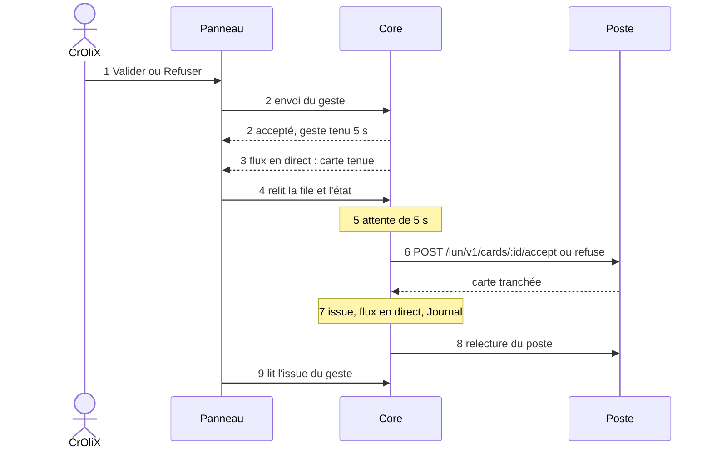

| # | De → vers | Par quoi | Ce qui circule | Retour |
|---|---|---|---|---|
| 1 | CrOliX → panneau | clic, ou touche V / R | la rangée choisie | la rangée quitte l'écran aussitôt |
| 2 | Panneau → core | envoi du geste | une liste d'éléments (le poste, l'identifiant de la carte, `accept` ou `refuse`) et le lieu d'origine (bureau ou À trancher) | « accepté » : le numéro du geste et l'heure où il partira (maintenant + 5 s) |
| 3 | Core → tous les panneaux ouverts | flux en direct | « carte », le poste, l'identifiant, l'état « tenue » | chaque onglet relit la file et l'état |
| 4 | Panneau → core | lecture de la file et de l'état | rien | la file sans la carte, les compteurs diminués |
| 5 | Core | minuterie | rien : le geste attend 5 s, annulable (S3.6) | aucun |
| 6 | Core → poste | `POST /lun/v1/cards/:id/accept` ou `/refuse` | corps `{}` ; le jeton du core. Pas le lieu d'origine, pas l'appareil, pas de clé d'unicité. Attente bornée à 15 s | `{ card }` : la carte avec son `status` (`done` ou `refused`) |
| 7 | Core | écritures | l'issue de l'élément (« ok ») ; sur le flux en direct « carte » avec l'état « ok » ; une étape au Journal | chaque onglet relit la file |
| 8 | Core → poste | une passe de lecture | santé, cartes en attente, coûts du jour, coûts du mois, puis agenda (Lun'Acedia) ou échéances (Lun'Avaritia) | la liste des cartes sans celle-ci |
| 9 | Panneau → core | lecture du geste | le numéro du geste ; d'abord 0,5 s après l'échéance, puis chaque seconde, 20 fois au plus | l'état du geste (« relayé ») et l'issue de chaque élément |

- **Ce que CrOliX voit, et où** :
  - Panneau, Bureau ou À trancher : la rangée disparaît dès le clic ; un toast « Validée : *titre*. » ou
    « Refusée : *titre*. » avec « Annuler » pendant 5 s ; le compteur de la file baisse tout de suite.
  - Autres onglets et appareils : la carte disparaît de leur file à l'étape 3, sans toast.
  - Conversation : une carte réduite relayée plus tôt affiche « Tranchée » dès que la file ne la tient plus,
    donc dès l'étape 3, avant que le poste ait agi (S3.8).
  - Journal : une étape sur l'entrée de la carte, « Validée depuis la file. » ou « Refusée depuis la file. ».
  - Fenêtre de Lun'Luxuria : rien.
- **Ce qui s'écrit** :
  - Côté core : le geste tenu, avec la carte telle qu'elle était lue, son origine et, à la fin, son issue ;
    l'étape au Journal, écrite après la réponse du poste ; une entrée de type « carte » est créée si la carte
    n'en avait pas.
  - Côté poste : voir S3.2 (agent de Lun'Acedia), S3.3 (proposition de tri), S3.4 (Lun'Avaritia).
  - Compteurs : la file cache la carte tant que le geste est tenu ou en cours, puis jusqu'à la première lecture
    du poste postérieure au relais, 24 heures au plus.
- **Qui décide** :
  - CrOliX décide le geste.
  - Le code du core vérifie, à la réception, que la carte est dans la file, pas en lecture seule, et que le geste
    lui convient ; il ne rappelle pas le poste pour cela.
  - Le code du poste décide si la carte est encore en attente au moment du relais, et exécute.
- **Erreurs et cas limites** :
  - Geste illisible (corps mal formé, même carte deux fois) : refusé, « Geste illisible. » sur la rangée.
  - Carte absente de la file : refus « Déjà tranchée ailleurs. » (S3.13).
  - Carte en lecture seule : refus « Carte en lecture seule. » ; à l'écran les boutons sont déjà grisés (S3.16).
  - Carte à options validée sans réponse : refus « Une question attend une réponse. » (S3.4).
  - Le panneau ne joint plus le core : aucun geste ne part, toast « Natsume est injoignable : lecture seule. ».
  - Double appui (V deux fois, bouton puis V) : un seul geste part, le panneau écarte le second.
  - Le relais dure plus de 20 s : le panneau cesse d'attendre l'issue ; la lecture suivante dit où en est le geste.
  - L'écriture au Journal échoue : le geste reste relayé, l'échec va au journal technique du core.
  - Le lieu d'origine reçu (bureau ou À trancher) est gardé avec le geste ; l'étape du Journal écrit
    « depuis la file » dans les deux cas.
  - La pause du core n'est lue nulle part dans le relais des gestes : un geste part aussi pendant une pause.
- **Écart avec les décisions** :
  - F1 : la carte a sa propre entrée au Journal, distincte de celle de la demande confiée ; l'étape dit
    « depuis la file », pas « depuis le Bureau » ; « validé » et « fait » sont une seule étape, écrite après
    la réponse du poste.
  - T2 : l'issue ne revient pas dans la conversation ; elle n'est donnée à Natsume qu'au tour suivant, dans ce
    qu'elle perçoit.
  - T17 : la carte est cachée dès le geste, avant que le poste ait décidé.
- **Non vérifié** : l'affichage de l'entrée dans l'écran du Journal ; que deviennent les notifications déjà
  parties pour cette carte (famille 4) ? l'effet d'une pause sur le poste au moment du relais (famille 10).

---

### S3.2 · Ce que Lun'Acedia fait d'une carte de son agent

- **Déclencheur** : le core relaie `accept` ou `refuse` sur une carte née de l'agent de Lun'Acedia
  (identifiant numérique), étape 6 de S3.1.
- **Acteurs** : le core, Lun'Acedia, Google (selon l'action), le fournisseur du modèle de Lun'Acedia.
- **Avant** : la carte existe, elle est du jour, en attente, et son action n'est pas déjà en cours.

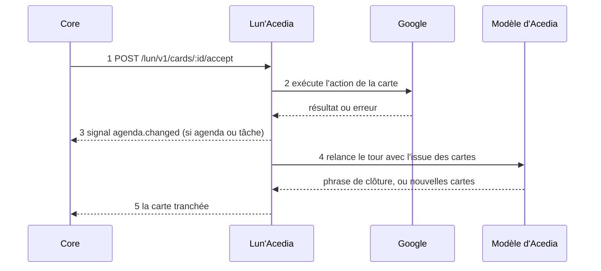

| # | De → vers | Par quoi | Ce qui circule | Retour |
|---|---|---|---|---|
| 1 | Core → Lun'Acedia | `POST /lun/v1/cards/:id/accept` (ou `/refuse`, sans corps lu) | `{}` depuis le core. Le contrat d'Acedia accepte aussi `input` (« Modifier »), que le core n'envoie jamais ici | voir 5 |
| 2 | Lun'Acedia → Google | l'action du catalogue portée par la carte | l'entrée gardée sur la carte | le résultat, gardé sur la carte avec son action inverse ; ou l'erreur |
| 3 | Lun'Acedia → core | événement poussé `agenda.changed`, importance `log` | `{ changes: 1 }` ; seulement quand l'action écrit dans l'agenda ou les tâches | le core relit le poste 50 ms après le dernier signal |
| 4 | Lun'Acedia → son modèle | relance du tour d'agent | le fil du jour, avec l'issue de chaque carte du tour ; seulement quand plus aucune carte du tour n'attend | un message de l'agent, gardé dans le fil d'Acedia ; parfois d'autres cartes |
| 5 | Lun'Acedia → core | réponse HTTP 200 | `{ card }` : `status` `done`, `refused` ou `failed`, `error` si échec | le core écrit l'issue (S3.1, étape 7) |

- **Ce que CrOliX voit, et où** : dans l'écran de Lun'Acedia, la carte passe à « fait » dans le fil de son agent,
  avec « Annuler » quand l'action a un inverse, et la phrase de clôture de l'agent. Dans le panneau du core :
  rien de cette phrase.
- **Ce qui s'écrit** : chez Lun'Acedia, le statut de la carte, son résultat, son inverse, le message de l'agent,
  le coût de l'appel au modèle (compté à son agent). Un geste sur un mail fait par la carte est marqué au journal
  d'Acedia comme venant de l'agent.
- **Qui décide** : le code d'Acedia décide si la carte se tranche encore (jour, statut, exécution en cours) ; le
  modèle d'Acedia décide de ce qu'il dit ou propose après ; personne ne le lit côté core.
- **Erreurs et cas limites** :
  - Refus : aucune action ne s'exécute ; la carte passe à `refused` ; le modèle est relancé de la même façon et
    apprend que la carte est refusée.
  - La relance du modèle échoue : l'erreur est écrite au journal technique d'Acedia, la carte est rendue comme
    tranchée (Lun'Acedia, `server/src/contract/routes.ts:332-344`).
  - La carte vient de la détection de conflits d'agenda (tour 0) : aucun modèle n'est relancé
    (Lun'Acedia, `server/src/pina/agent.ts:323`).
  - La réponse au core attend la fin de la relance du modèle. Si elle dépasse 15 s, le core conclut « n'a pas
    répondu, rien n'a été fait » alors que l'action est faite (déduit, S3.16).
  - Plafond du jour de l'agent atteint, clé refusée, fournisseur absent : la relance écrit une phrase fixe dans
    le fil d'Acedia, sans effet sur la carte rendue (Lun'Acedia, `server/src/pina/agent.ts:358`, `:376`, `:384`).
- **Écart avec les décisions** : T1 (la phrase de clôture reste chez le poste) ; T6.
- **Non vérifié** : ce que chaque action du catalogue fait chez Google (familles 4 et 5) ; si une pause posée
  dans Lun'Acedia change le traitement d'un `accept` ; si le signal de l'étape 3, qui part avant la réponse de
  l'étape 5, peut faire écrire au Journal du core « Tranchée dans Lun'Acedia. » avant « Validée depuis la
  file. » sur la même entrée (cela dépend du délai du flux contre la durée de la relance du modèle ; rien n'a
  été rejoué).

Références : Lun'Acedia, `server/src/contract/routes.ts:331-379`, `server/src/pina/agent.ts:106-136`,
`:169-197`, `:320-340`, `server/src/agenda/calendar.ts:306-311`, `server/src/agenda/tasks.ts:195-200`.

---

### S3.3 · Trancher une proposition de tri depuis le core

- **Déclencheur** : CrOliX valide, refuse ou corrige, dans le panneau, une carte « Proposition de tri » de
  Lun'Acedia (identifiant `mail:<id du mail>`).
- **Acteurs** : CrOliX, le panneau, le core, Lun'Acedia, Gmail.
- **Avant** : la proposition attend et le mail est encore en boîte de réception ; la carte porte ses champs
  (`fields`) : « Étiquettes » (plusieurs choix) toujours, et « Boîte » (un choix, corbeille et spam compris)
  seulement quand la proposition nomme une boîte. Sans elle, une correction qui envoie `box` reçoit 400
  « Champ inconnu : box » (Lun'Acedia, `server/src/contract/routes.ts:84-98`, `:131`).

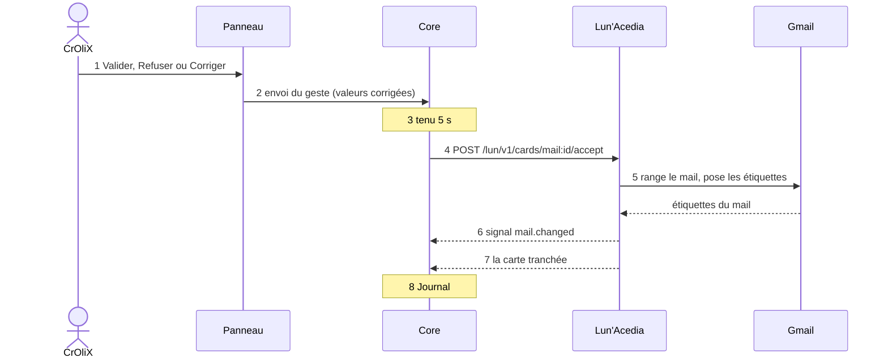

| # | De → vers | Par quoi | Ce qui circule | Retour |
|---|---|---|---|---|
| 1 | CrOliX → panneau | la carte dépliée | pour une correction : la boîte et les étiquettes choisies | toast « Validée », « Refusée » ou « Corrigée : *titre*. » |
| 2 | Panneau → core | envoi du geste | l'élément, avec pour une correction les valeurs par nom de champ (`box`, `tags`) | « accepté », numéro du geste |
| 3 | Core | minuterie | le core borne la forme des valeurs, pas leur sens | aucun |
| 4 | Core → Lun'Acedia | `POST /lun/v1/cards/mail:<id>/accept` ou `/refuse` | `{}` pour valider ou refuser ; `{ values: { box: [...], tags: [...] } }` pour corriger, jamais avec `input` | voir 7 |
| 5 | Lun'Acedia → Gmail | déplacement et étiquettes | valider : la boîte et les étiquettes proposées ; corriger : exactement celles reçues ; refuser : une relecture du mail seulement | les étiquettes après le geste |
| 6 | Lun'Acedia → core | événement poussé `mail.changed`, importance `log` | `{ added: [], changed: [id], removed: [] }` | le core relit le poste |
| 7 | Lun'Acedia → core | réponse HTTP 200 | `{ card }` avec `status` `done` ou `refused` | le core écrit l'issue |
| 8 | Core | Journal | « Validée », « Refusée » ou « Corrigée (Boîte : … ; Étiquettes : …) », suivi de « depuis la file. » | aucun |

- **Ce que CrOliX voit, et où** : panneau : la rangée part, toast avec « Annuler » ; Journal du core : l'étape, avec
  pour une correction le nom des champs et le libellé des choix. Écran de Lun'Acedia : le mail quitte
  « À valider » (ses écrans se rechargent sur le signal de l'étape 6) et son journal gagne une ligne
  annulable.
- **Ce qui s'écrit** : chez Lun'Acedia, le statut de la proposition (acceptée, corrigée, refusée), un exemple
  pour le tri à venir (valider, corriger), une ligne de son journal au nom de CrOliX. Chez Gmail, les
  étiquettes. Au core, l'issue du geste et l'étape du Journal.
- **Qui décide** : CrOliX ; le code d'Acedia vérifie chaque valeur contre les choix de la carte ; valeurs égales
  à la proposition, il valide au lieu de corriger (Lun'Acedia, `server/src/contract/routes.ts:160-164`).
- **Erreurs et cas limites** :
  - Champ inconnu, choix hors de la liste, boîte sans choix unique : 400 avec le motif, qui devient la raison de
    l'échec sur la rangée (Lun'Acedia, `server/src/contract/routes.ts:128-137`).
  - `input` envoyé à une proposition : 400 « Une proposition se corrige par values ».
  - Proposition déjà traitée, ou mail sorti de la boîte de réception : 409 « Cette carte n'est plus en
    attente » ; le core note « conflit » (S3.13).
  - Un autre geste est en cours sur ce mail : 409 « Un geste est déjà en cours sur ce mail ».
  - Gmail échoue : l'erreur sort en 500 ; le core la traite comme un silence et écrit « Lun'Acedia n'a pas
    répondu, rien n'a été fait. » (Lun'Acedia, `server/src/app.ts:154` ; S3.16).
  - Refus : Lun'Acedia relit le mail chez Gmail. S'il n'est plus en boîte de réception, ou s'il est en corbeille
    ou en spam : 409 « Ce mail n'est plus en boîte de réception », que le core note « conflit » (toast « Déjà
    tranchée ailleurs. »). Si Gmail ne trouve plus le mail : 404 avec un message vide, que le core traite comme
    un silence (Lun'Acedia, `server/src/triage/pipeline.ts:460-475`, `server/src/contract/routes.ts:179-182`).
  - Google n'est pas configuré chez Lun'Acedia : tout geste sur une proposition reçoit 400 « Google n'est pas
    configuré sur ce serveur » ; la carte revient avec cette raison et « Réessayer » (Lun'Acedia,
    `server/src/contract/routes.ts:143-146`, `:180-181`).
  - Une carte corrigée part toujours seule : jamais dans un lot, jamais sur une pile (S3.7).
  - La ligne du journal d'Acedia peut être annulée dans son écran : la proposition redevient « en attente », la
    carte revient dans la file du core à sa lecture suivante, et l'entrée du Journal du core reste « tranchée »
    (déduit ; Lun'Acedia, `server/src/triage/journal.ts:168-172`).
- **Écart avec les décisions** : aucun connu.
- **Non vérifié** : si la relecture déclenchée par le signal de l'étape 6 peut écrire « Tranchée dans
  Lun'Acedia. » avant l'étape du geste (même question qu'en S3.2) ; le détail des appels à Gmail ;
  la création de règle « retenir l'expéditeur », que la carte du
  contrat ne porte pas.

Références : Lun'Acedia, `server/src/contract/routes.ts:79-116`, `:149-185`, `:346-378`,
`server/src/triage/pipeline.ts:450-528`.

---

### S3.4 · Trancher une carte de Lun'Avaritia depuis le core

- **Déclencheur** : CrOliX valide ou refuse une fiche ou un import, ou répond à une question (contradiction,
  doublon), dans le panneau.
- **Acteurs** : CrOliX, le panneau, le core, Lun'Avaritia.
- **Avant** : le brouillon est en attente et figure parmi ceux que Lun'Avaritia sert (15 au plus par défaut, un
  réglage du poste). Une question porte deux `options` ; une carte à options reste seule dans la file.

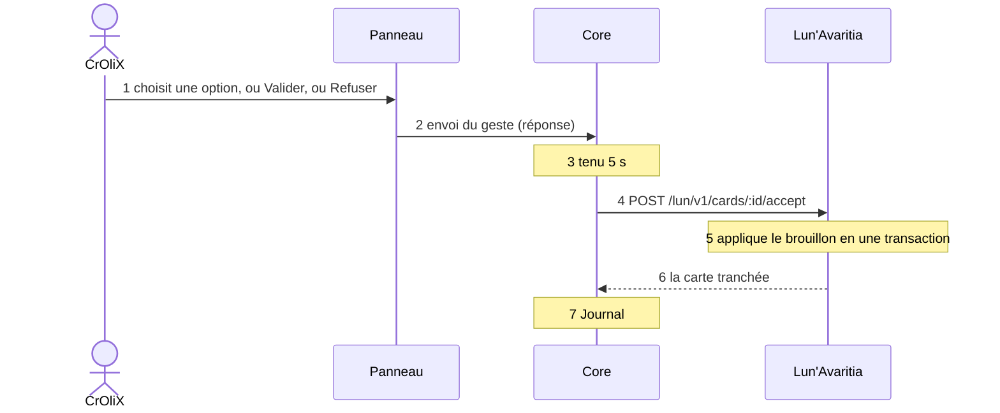

| # | De → vers | Par quoi | Ce qui circule | Retour |
|---|---|---|---|---|
| 1 | CrOliX → panneau | bouton d'option, champ « Autre réponse », Valider ou Refuser | la réponse choisie ou tapée | toast « Réponse donnée : *réponse*. », « Validée » ou « Refusée » |
| 2 | Panneau → core | envoi du geste | l'élément et, pour une question, la réponse (1 à 500 caractères) | « accepté » ; refus si une question est validée sans réponse |
| 3 | Core | minuterie | rien | aucun |
| 4 | Core → Lun'Avaritia | `POST /lun/v1/cards/:id/accept` ou `/refuse` | `{}` ou `{ input: { answer } }` | voir 6 |
| 5 | Lun'Avaritia | écriture locale | fiche créée ou enrichie, faits ajoutés ou barrés, liens, fusion de deux fiches, import | tout ou rien : une erreur annule tout et laisse le brouillon en attente |
| 6 | Lun'Avaritia → core | réponse HTTP 200 | `{ card }` avec `status` `done` ou `refused` | le core écrit l'issue |
| 7 | Core | Journal | « Validée », « Refusée » ou « Réponse donnée : *réponse* », suivi de « depuis la file. » | aucun |

- **Ce que CrOliX voit, et où** : panneau : la carte d'une question est en ton « attention », sans bouton
  « Refuser » ; ses deux options sont des boutons, plus un champ « Autre réponse ». Journal du core : l'étape.
  Écran de Lun'Avaritia : le brouillon quitte « À valider » à son prochain chargement.
- **Ce qui s'écrit** : chez Lun'Avaritia, le brouillon passe à « fait » ou « refusé » avec sa date de décision ;
  la bibliothèque change (fiches, faits, liens). Au core, l'issue et l'étape.
- **Qui décide** : CrOliX. Le code d'Avaritia traduit la réponse : la première option garde le brouillon tel
  quel, la seconde inverse les deux côtés ; pour une contradiction, toute autre réponse devient un fait nouveau
  qui remplace les deux (Lun'Avaritia, `server/src/brain/drafts.ts:373-386`, `:255-259`).
- **Erreurs et cas limites** :
  - Autre réponse sur un doublon : 400 « Choisis l'une des deux fiches. » ; la raison s'affiche sur la rangée et
    la carte reste en attente.
  - Fait déjà barré, fiche absente ou déjà fusionnée : 400 avec le motif ; rien n'est écrit (S3.15).
  - Brouillon déjà traité : 409 « Carte déjà traitée » (S3.13) ; brouillon inconnu : 404 « Carte inconnue ».
  - Aucun signal ne part de Lun'Avaritia après le geste : le core relit lui-même le poste (S3.1, étape 8).
  - Lun'Avaritia ignore sans erreur un champ `values` (son schéma ne le connaît pas) ; le core n'en envoie
    qu'aux cartes qui portent des `fields`, et aucune carte d'Avaritia n'en porte.
  - Par la conversation ou la voix, « refuse » passe sur une question ; à l'écran du core, aucun bouton ne le
    propose.
- **Écart avec les décisions** : T28 (au-delà de 15 brouillons, le reste ne se tranche que dans l'écran de
  Lun'Avaritia) ; sinon aucun connu.
- **Non vérifié** : si une pause de Lun'Avaritia change le traitement d'un `accept`.

Références : Lun'Avaritia, `server/src/contract/routes.ts:36`, `:174-208`, `server/src/brain/drafts.ts:145-158`,
`:281-328`, `:364-450`.

---

### S3.5 · La carte qui envoie

- **Déclencheur** : CrOliX tranche une carte marquée `sends`. Aujourd'hui une seule carte l'est : la réponse à un
  mail préparée par l'agent de Lun'Acedia (action `draft.create` avec un mail d'origine).
- **Acteurs** : CrOliX, le panneau ou la conversation, le core, Lun'Acedia, Gmail.
- **Avant** : la carte attend ; elle reste seule dans la file (ni pile ni lot).

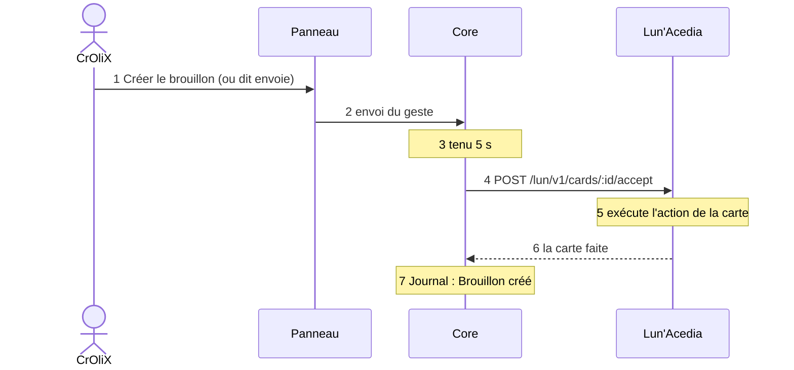

| # | De → vers | Par quoi | Ce qui circule | Retour |
|---|---|---|---|---|
| 1 | CrOliX → panneau | bouton « Créer le brouillon » (à la place de « Valider ») ; la touche V ne fait rien sur cette carte | la rangée | toast « Brouillon créé : *titre*. » |
| 2 | Panneau → core | envoi du geste | l'élément, `accept` | « accepté » |
| 3 | Core | minuterie | rien | aucun |
| 4 | Core → Lun'Acedia | `POST /lun/v1/cards/:id/accept` | `{}` | voir 6 |
| 5 | Lun'Acedia → Gmail | action `draft.create` | l'entrée de la carte | le résultat de l'action, gardé sur la carte |
| 6 | Lun'Acedia → core | réponse HTTP 200 | `{ card }` | issue « ok » |
| 7 | Core | Journal | « Brouillon créé depuis la file. » (ou « depuis la conversation. », « à la voix. ») | aucun |

- **Ce que CrOliX voit, et où** : panneau : le bouton dit « Créer le brouillon » et un lien « Modifier dans
  Lun'Acedia » ouvre le poste. Conversation : la carte lue se termine par « Pour celle-ci, dis « envoie », ou
  valide-la sur la carte. ». Le brouillon lui-même ne se voit et ne s'envoie que dans l'écran de Lun'Acedia.
- **Ce qui s'écrit** : chez Lun'Acedia, la carte faite et le résultat de l'action ; au core, l'étape.
- **Qui décide** : CrOliX seul. En conversation, le code du core exige un mot d'envoi dans son message
  (« envoie », « envoyer », « crée le brouillon », « fais le brouillon ») et que la carte soit celle qui vient de
  lui être montrée ; un « oui » seul ne suffit pas (S3.11).
- **Erreurs et cas limites** :
  - « Oui » sur cette carte : rien n'est tranché, phrase fixe d'indice, la carte reste celle dont on parle pour
    le message suivant.
  - « Oui, j'envoie » ou « tu peux envoyer » : rien n'est tranché ; la réponse est la même phrase d'indice
    (« Pour celle-ci, dis « envoie »… ») et une ligne « Geste ignoré » au Journal, mais la carte ne reste pas la
    carte courante.
  - Le mot d'envoi suivi du titre de la carte : refusé ; après « envoie », seuls des mots de remplissage passent.
- **Écart avec les décisions** : F6 (la carte annonce un envoi alors que la valider crée un brouillon ; aucune
  carte d'envoi n'existe ; l'envoi oblige à ouvrir Lun'Acedia).
- **Non vérifié** : ce que fait l'action `draft.create` : valider crée-t-il seulement un brouillon chez Gmail,
  sans qu'aucun mail ne parte ? Et l'envoi dans l'écran de Lun'Acedia (famille 4).

Références : Lun'Acedia, `server/src/contract/routes.ts:61-63`.

---

### S3.6 · Annuler dans les 5 secondes, à la main

- **Déclencheur** : CrOliX clique « Annuler » sur le toast du geste, ou fait Ctrl Z, avant la fin des 5 s.
- **Acteurs** : CrOliX, le panneau, le core. Aucun poste.
- **Avant** : un geste est tenu et son délai n'est pas écoulé.

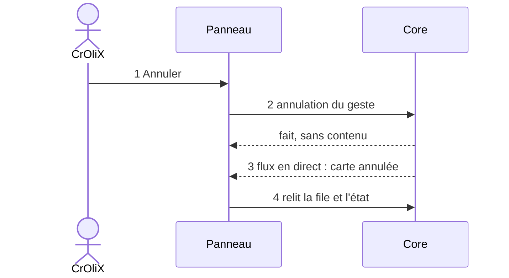

| # | De → vers | Par quoi | Ce qui circule | Retour |
|---|---|---|---|---|
| 1 | CrOliX → panneau | « Annuler » du toast, ou Ctrl Z | le toast en cours | le toast part |
| 2 | Panneau → core | annulation | le numéro du geste | succès sans contenu ; le core arrête la minuterie |
| 3 | Core → tous les panneaux | flux en direct | pour chaque carte du geste : le poste, l'identifiant, l'état « annulée » | chaque onglet relit |
| 4 | Panneau → core | lecture de la file | rien | la carte est revenue, les compteurs remontent |

- **Ce que CrOliX voit, et où** : la carte revient à sa place dans la file, sur tous les appareils. Rien au
  Journal, rien chez le poste.
- **Ce qui s'écrit** : le geste passe à « annulé » côté core. Aucune ligne au Journal, aucun appel au poste.
- **Qui décide** : CrOliX ; le code du core refuse l'annulation dès que le délai est écoulé ou que le relais a
  pris le geste.
- **Erreurs et cas limites** :
  - Délai écoulé : refus « Trop tard pour annuler. », affiché à la place du toast.
  - Geste déjà annulé (par la conversation, par exemple) : l'annulation réussit sans rien publier de plus.
  - Numéro inconnu : « Geste inconnu ».
  - Un nouveau toast annulable remplace le précédent : l'« Annuler » du geste précédent n'est plus offert, ce
    geste devient définitif.
  - Un lot ou une pile s'annule d'un bloc : toutes ses cartes reviennent.
  - Après le relais, le core n'offre aucun retour. Un retour n'existe que dans l'écran du poste : « Annuler »
    d'une carte faite de l'agent d'Acedia, annulation d'une ligne du journal d'Acedia, refus de Lun'Avaritia
    rattrapable 30 s (S3.18 à S3.20). Le core n'en est pas prévenu.
- **Écart avec les décisions** : aucun connu.
- **Non vérifié** : Rien.

---

### S3.7 · Valider ensemble, et la pile de cartes de même nom

- **Déclencheur** : CrOliX ouvre « Valider les N cartes » en tête du groupe d'un poste, décoche ce qu'il veut
  garder à trancher, puis valide ; ou il tranche une pile (« Valider celle-ci », « Valider les deux »,
  « Refuser les deux »).
- **Acteurs** : CrOliX, le panneau, le core, un seul poste.
- **Avant** : pour le lot, au moins deux cartes « groupables » du même poste : une carte d'écriture, sans envoi,
  sans options, d'un poste relié qui parle le contrat 1.4 ou plus. Une pile réunit les cartes du même poste qui
  ont le même genre et le même titre.

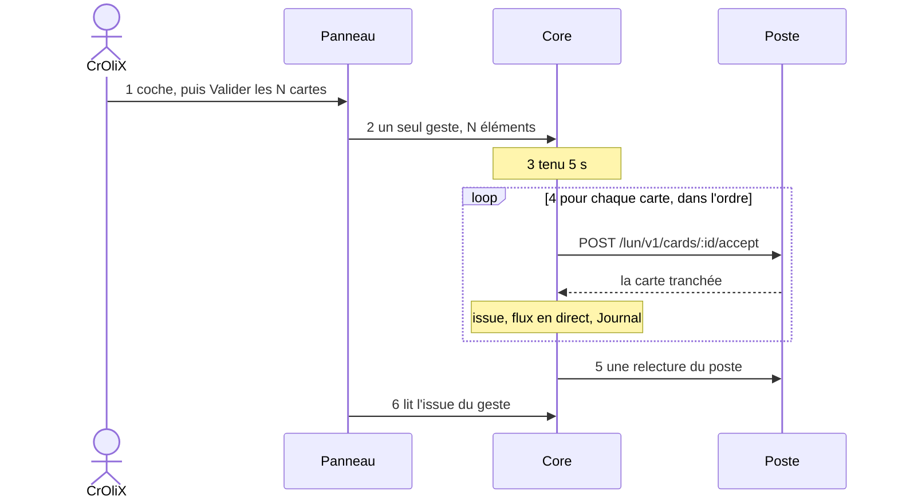

| # | De → vers | Par quoi | Ce qui circule | Retour |
|---|---|---|---|---|
| 1 | CrOliX → panneau | la feuille « Valider ensemble » | les cartes cochées (toutes cochées à l'ouverture) | un seul toast « N *nom* validées. » : le nom est celui du genre commun des cartes quand c'est un nom féminin connu (fiche, tâche, note), sinon « cartes » (« 3 fiches validées. », « 1 carte validée. ») |
| 2 | Panneau → core | envoi du geste | jusqu'à 50 éléments ; lot : tous `accept` ; pile : toutes ses cartes, chacune `accept` ou `refuse` | « accepté », un seul numéro de geste |
| 3 | Core | minuterie | rien | aucun |
| 4 | Core → poste | `POST /lun/v1/cards/:id/accept` (ou `/refuse`), une carte après l'autre | `{}` à chaque fois ; pas de route de groupe | `{ card }` ; chaque élément est réglé juste après son appel |
| 5 | Core → poste | une passe de lecture | comme S3.1, étape 8, une seule fois pour le geste | les cartes restantes |
| 6 | Panneau → core | lecture du geste | le numéro | l'issue de chaque élément ; les échecs s'affichent sur leur rangée |

- **Ce que CrOliX voit, et où** : un toast et un « Annuler » pour tout le lot ; une étape au Journal par carte.
  Une carte en échec revient dans la file avec sa raison.
- **Ce qui s'écrit** : un geste, N éléments, N étapes de Journal ; chez le poste, N décisions indépendantes.
- **Qui décide** : CrOliX choisit les cartes. Le code du core décide de ce qui est groupable et refuse un lot qui
  mêle deux postes, un refus, ou une carte non groupable (« Ce lot contient une carte qui ne se valide pas en
  lot. »). Le poste n'est pas consulté sur le groupe.
- **Erreurs et cas limites** :
  - Le poste reste muet sur une carte : ses cartes suivantes du même geste sont marquées en échec sans être
    tentées, avec la même raison (S3.16).
  - Une carte corrigée ne part jamais en lot ; une correction sur une pile est refusée.
  - Dans la file, la touche V ne fait rien sur une pile (seuls « Valider celle-ci » et « Valider les N » la
    valident) ; la touche R refuse toute la pile d'un geste. Sur une question, R ne fait rien.
  - Un poste rend 200 avec une carte en échec sans texte d'erreur : la raison devient « n'a pas répondu, rien n'a
    été fait. », la même chaîne que le silence. Les cartes suivantes du même poste dans ce geste sont donc
    marquées en échec sans être tentées.
  - Plusieurs cartes d'une pile ne partent ensemble que si c'est la pile entière ; l'écran envoie toujours la
    pile entière, telle qu'elle est au moment du clic si elle a grossi.
  - « Valider celle-ci » sur une pile : celle-ci est acceptée, les autres refusées, dans le même geste.
  - Le core s'arrête pendant le lot : les éléments déjà réglés ne sont pas rejoués (S3.17).
- **Écart avec les décisions** : T12. Le contrat écrit que la validation groupée porte sur les cartes `bulk` ;
  la file du core ne lit pas `bulk`. Le seuil de Lun'Acedia (« Tout valider ») n'entre donc pas dans ce lot.
- **Non vérifié** : le composant de groupe du kit de design, qui lit `bulk` : aucun écran des quatre dépôts ne le
  monte.

---

### S3.8 · Lire une carte dans la conversation

- **Déclencheur** : CrOliX demande à Natsume de voir une carte précise (« montre-moi la carte du dentiste »), ou
  une demande confiée vient de rendre une seule carte.
- **Acteurs** : CrOliX, le panneau ou Lun'Luxuria, le core, le modèle du core, le poste de la carte.
- **Avant** : fil principal ; le core lit ses postes. Natsume perçoit la liste des cartes en attente : titre,
  poste et un repère court par carte.

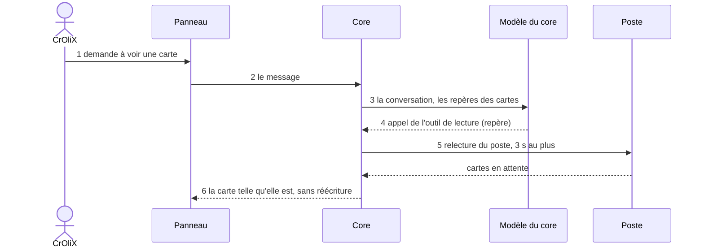

| # | De → vers | Par quoi | Ce qui circule | Retour |
|---|---|---|---|---|
| 1 | CrOliX → panneau | message écrit ou dit | sa phrase | aucun |
| 2 | Panneau → core | envoi du message | le texte, la surface | un flux : message enregistré, réponse au fil de l'eau |
| 3 | Core → modèle | appel du fournisseur | la conversation, ce qu'elle perçoit (dont « N cartes à trancher : titre (poste, repère) »), l'outil de lecture | voir 4 |
| 4 | Modèle → core | appel d'outil | le repère de la carte | aucun |
| 5 | Core → poste | une passe de lecture | santé, cartes, coûts, extras ; le core n'attend que 3 s, puis lit ce qu'il a | la carte à jour |
| 6 | Core → panneau | réponse | le texte de la carte, écrit par le code : titre suivi de l'identifiant du poste entre parenthèses (« lunacedia », pas son nom), lignes, champs proposés, raison, choix. La liste perçue par Natsume porte aussi l'identifiant du poste | la carte devient « celle dont on parle » pour 30 minutes |

- **Ce que CrOliX voit, et où** : conversation : le titre et le poste, les lignes de la carte, « Raison : … »,
  « Choix : … ; … », puis selon le cas « Pour celle-ci, dis « envoie », ou valide-la sur la carte. » ou « Cette
  carte est en lecture seule pour l'instant : elle ne peut pas être tranchée. ». Aucun second appel au modèle :
  ce texte n'est pas de Natsume.
  Sous la réponse d'une demande confiée, chaque carte rendue s'affiche en carte réduite : genre, poste, heure,
  titre, un bouton « Voir dans À trancher », sans geste ; « Tranchée » quand la file ne la tient plus.
- **Ce qui s'écrit** : la réponse, marquée comme une lecture de carte (rejouée ensuite comme une donnée, pas
  comme ses mots) ; la carte courante, avec l'empreinte de ce qui a été montré.
- **Qui décide** : le modèle décide d'appeler l'outil et avec quel repère ; le code écrit le texte.
- **Erreurs et cas limites** :
  - Carte tenue, tranchée ou inconnue : « Celle-là est déjà tranchée. ». La carte courante a déjà été oubliée à
    l'arrivée du message : après cette réponse, il n'y a plus de carte dont on parle.
  - Repère illisible ou lecture en erreur : « Cette carte n'a pas pu être relue. ».
  - La carte courante vaut pour un seul message : le core la lit puis l'oublie à l'arrivée du message suivant.
  - Une demande confiée qui rend une seule carte en fait la carte courante ; zéro ou plusieurs : aucune.
  - Hors du fil principal, l'outil de lecture n'est pas offert.
- **Écart avec les décisions** : T18 (une carte que le core n'a pas encore lue répond « déjà tranchée », déduit).
- **Non vérifié** : la façon dont ce texte est dit à la voix ; la carte réduite d'une réponse coupée (famille 8).

---

### S3.9 · Trancher dans la conversation écrite

- **Déclencheur** : CrOliX écrit un geste dans le fil principal : « valide », « oui », « refuse »,
  « valide la carte du dentiste », ou l'un des choix d'une carte à options.
- **Acteurs** : CrOliX, le panneau, le core, le modèle du core, le poste.
- **Avant** : fil principal ; son message contient un mot de geste ou l'un des choix d'une carte en attente,
  sinon l'outil n'est même pas offert au modèle. Une carte est désignée : celle qui vient de lui être montrée
  (S3.8), ou son repère, ou deux mots de son titre que nulle autre carte ne porte.

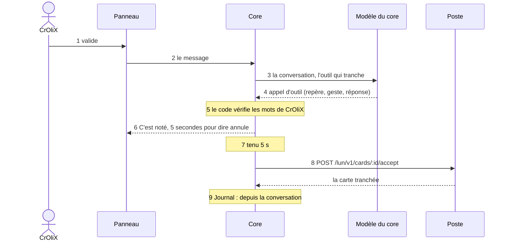

| # | De → vers | Par quoi | Ce qui circule | Retour |
|---|---|---|---|---|
| 1 | CrOliX → panneau | message écrit | sa phrase | aucun |
| 2 | Panneau → core | envoi du message | le texte, la surface. Pas d'identifiant de carte | le flux de la réponse |
| 3 | Core → modèle | appel du fournisseur | la conversation, les repères des cartes, la règle « tranche sans demander de confirmation », le repère de la carte montrée | voir 4 |
| 4 | Modèle → core | appel d'outil | le repère (facultatif), `accept` ou `refuse`, la réponse choisie (facultative) | aucun |
| 5 | Core | vérification par le code | le message de CrOliX seul : 12 mots au plus, sans négation, sans point d'interrogation ni point-virgule ; avant le mot du geste, seuls « je », « alors », « bon », « allez » ou « tu peux » / « peux-tu » passent (« tu peux » jamais sur une carte qui envoie) ; et il désigne la carte | « tranché » ou « ignoré » (S3.11) |
| 6 | Core → panneau | réponse, phrase fixe | « C'est noté : *titre*. Tu as 5 secondes pour dire annule. » ou « Refusée : *titre*. … » | ce que le modèle a écrit à côté de l'appel n'est pas gardé |
| 7 | Core | minuterie | le même geste tenu qu'un clic, d'origine « conversation » | flux en direct : carte tenue |
| 8 | Core → poste | `POST /lun/v1/cards/:id/accept` ou `/refuse` | `{}`, ou `{ input: { answer } }` si une option est choisie. Jamais de `values` par la conversation | `{ card }` |
| 9 | Core | Journal | « Validée depuis la conversation. », « Refusée depuis la conversation. », « Réponse donnée : … » | aucun |

- **Ce que CrOliX voit, et où** : conversation : la phrase fixe, avant que le poste ait agi. File : la carte
  disparaît sur tous les appareils. Journal : l'étape après le relais. Aucun message ne vient dire ensuite que
  le poste a réussi ou échoué.
- **Ce qui s'écrit** : le message et la réponse ; le geste tenu ; l'étape du Journal. La carte courante est
  oubliée dès que le geste est tenu.
- **Qui décide** : le modèle propose (le repère, le geste, la réponse) ; le code décide, sur les mots de CrOliX
  seuls. CrOliX peut encore dire « annule » (S3.12).
- **Erreurs et cas limites** :
  - Une carte à options : le message doit contenir le choix lui-même ; une réponse du modèle qui n'est pas dans
    la liste ne compte pas. Sans réponse : « Cette carte attend un choix. ».
  - Carte en lecture seule : « Cette carte est en lecture seule pour l'instant : elle ne peut pas être
    tranchée. ».
  - Carte déjà tenue ou partie : « Celle-là est déjà tranchée. ».
  - Plusieurs cartes d'un coup : la consigne dit au modèle de répondre que cela se fait une par une ; un seul
    appel d'outil est exécuté par tour.
  - Le modèle appelle l'outil sans qu'il lui soit offert : le code répond quand même, par sa vérification.
  - Le code de vérification plante : « Cette carte n'a pas pu être relue. ».
  - Corriger une proposition (boîte, étiquettes) ne se fait pas par la conversation.
  - Hors du fil principal : ni lecture ni geste.
- **Écart avec les décisions** : T2 (« C'est noté » est dit avant l'effet, l'issue ne revient pas dans la
  conversation) ; F1 (l'étape dit « depuis la conversation », sur l'entrée de la carte).
- **Non vérifié** : le comportement réel du modèle devant ces consignes.

---

### S3.10 · Trancher à la voix

- **Déclencheur** : CrOliX dit « valide », « oui », « refuse », « envoie »… à Lun'Luxuria.
- **Acteurs** : CrOliX, Lun'Luxuria (écoute, transcription, voix), le core, le modèle du core, le poste.
- **Avant** : Lun'Luxuria est reliée au core ; les conditions de S3.9 ; la transcription porte une confiance.

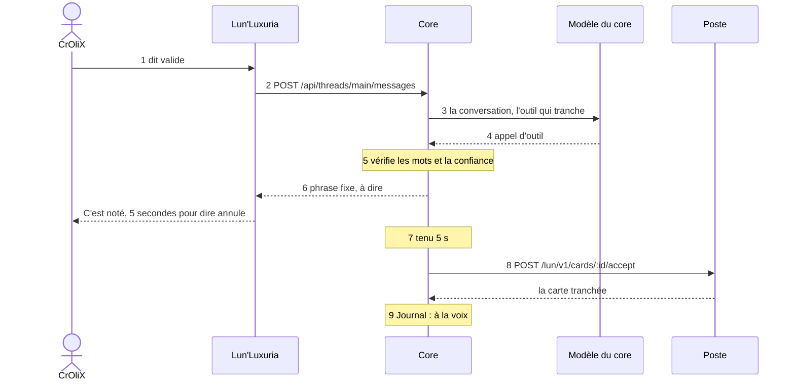

| # | De → vers | Par quoi | Ce qui circule | Retour |
|---|---|---|---|---|
| 1 | CrOliX → Lun'Luxuria | la voix | une phrase ; le son ne quitte pas le poste | la transcription et sa confiance |
| 2 | Lun'Luxuria → core | `POST /api/threads/main/messages` | `text`, `speak: true`, `surface: 'voice'`, `confidence` (0 à 1). Aucune carte, aucun geste : une phrase comme une autre | le flux de la réponse |
| 3 à 5 | Core, modèle | comme S3.9 | en plus : confiance absente, le geste est ignoré ; confiance sous 0,7, les mots ne comptent pas | « tranché » ou « ignoré » |
| 6 | Core → Lun'Luxuria | la réponse, par le flux du message et par `/api/live` | la phrase fixe, phrase par phrase | Lun'Luxuria la dit |
| 7 | Core | minuterie | geste tenu d'origine « voix » | flux en direct : carte tenue (Lun'Luxuria n'en fait rien) |
| 8 | Core → poste | `POST /lun/v1/cards/:id/accept` ou `/refuse` | comme S3.9 | `{ card }` |
| 9 | Core | Journal | « Validée à la voix. », « Refusée à la voix. » | aucun |

- **Ce que CrOliX voit, et où** : voix : « C'est noté : *titre*. Tu as 5 secondes pour dire annule. ». Panneau :
  la carte quitte la file ; l'échange figure dans le fil. Fenêtre de Lun'Luxuria : rien d'une carte, elle n'en
  affiche aucune. Aucune parole ne vient ensuite dire l'issue.
- **Ce qui s'écrit** : comme S3.9, avec l'origine « voix ».
- **Qui décide** : Lun'Luxuria ne décide rien d'une carte ; le code du core décide, sur la phrase transcrite et sa
  confiance.
- **Erreurs et cas limites** :
  - La réponse est coupée avant qu'un mot en soit entendu : le geste tenu par ce tour est annulé (S3.12).
  - CrOliX n'avait que commencé sa phrase et Lun'Luxuria la retire : même annulation (S3.12).
  - Le délai de 5 s court depuis la décision du code, pas depuis la fin de la phrase dite.
- **Écart avec les décisions** : T2 ; T4 (le core ne sait pas si la phrase a été dite).
- **Non vérifié** : la chaîne de la parole elle-même (famille 8) ; rien n'a été entendu sur le poste réel.

Références : Lun'Luxuria, `src/core.ts:93-97`, `:124-134`, `src/conversation.ts:525`, `src/brain.ts:3-7`, `:41`.

---

### S3.11 · Le geste que les mots ne portent pas

- **Déclencheur** : le modèle du core appelle l'outil qui tranche, mais le message de CrOliX ne dit pas ce geste
  sur cette carte : une question, une négation, plus de 12 mots, une carte non désignée, « oui » sur une carte
  qui envoie, une carte qui a changé depuis sa lecture.
- **Acteurs** : CrOliX, le panneau ou Lun'Luxuria, le core, le modèle du core. Aucun appel de décision au poste.
- **Avant** : comme S3.9.

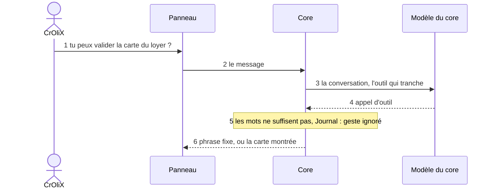

| # | De → vers | Par quoi | Ce qui circule | Retour |
|---|---|---|---|---|
| 1 à 4 | comme S3.9 | | | |
| 5 | Core | vérification, puis Journal | une entrée « Carte », mention « Geste ignoré », au nom du poste quand la carte est connue ; aucun mot de son message, aucun identifiant de carte | aucun geste tenu |
| 6 | Core → panneau | réponse fixe | l'une des phrases ci-dessous | aucun |

- **Ce que CrOliX voit, et où** : dans la conversation (ou à la voix), l'une de ces réponses :
  - « Rien n'est tranché. Pour trancher : voir la carte, puis oui ou non, ou la trancher à l'écran. » ;
  - la carte elle-même, montrée comme en S3.8, suivie de « Pour la trancher : valide ou refuse. », quand le
    modèle a nommé une carte en attente et que le message porte un mot de geste ou l'un des choix d'une carte
    en attente ; elle devient la carte
    courante ;
  - « Pour celle-ci, dis « envoie », ou valide-la sur la carte. », pour tout « valider » que ses mots ne portent
    pas sur la carte qui envoie, quand c'est la carte courante et que le message n'a pas de négation : « oui »,
    mais aussi « tu peux envoyer », « oui j'envoie », « envoie » suivi du titre ;
  - « Cette carte a changé depuis sa lecture : à relire avant de trancher. », quand son contenu n'est plus celui
    qui a été montré ;
  - « Celle-là est déjà tranchée. », quand la carte n'attend plus et que ses mots étaient bien un geste.
  Au Journal : une ligne « Carte », « Geste ignoré », sauf dans ce dernier cas, qui n'écrit rien.
- **Ce qui s'écrit** : l'entrée du Journal ; dans le cas de l'indice « envoie », seul un « oui » qui serait passé
  sur une carte ordinaire garde la carte courante pour le message suivant, à sa date d'origine (ses 30 minutes
  ne sont pas prolongées).
- **Qui décide** : le code du core, contre l'appel du modèle.
- **Erreurs et cas limites** :
  - « Changé » se juge sur le titre, les lignes, l'action, l'envoi, les options et les valeurs proposées, à
    partir de la dernière lecture du poste : un changement que le core n'a pas encore lu passe.
  - Une carte en lecture seule, qui envoie, ou à options, montrée dans ce cas : sans la ligne « valide ou
    refuse », elle dit déjà ce qu'elle attend.
  - Son message ne contient aucun mot de geste : l'outil n'est pas offert, et la consigne dit au modèle de ne
    rien trancher ni prétendre l'avoir fait ; aucune ligne au Journal.
- **Écart avec les décisions** : direction « prérequis » : ici le code répond par une phrase fixe ou montre la
  carte, Natsume ne pose pas de question ; sinon aucun connu.
- **Non vérifié** : Rien.

---

### S3.12 · Annuler par la parole, ou par une coupure

- **Déclencheur** : CrOliX écrit ou dit exactement « annule », « annule ça », « annule-le », « annule-la »,
  « non annule… » ou « annule tout » ; ou Lun'Luxuria signale une réponse coupée sans qu'un mot en soit entendu ;
  ou elle retire un début de phrase.
- **Acteurs** : CrOliX, le panneau ou Lun'Luxuria, le core. Ni modèle ni poste quand l'annulation aboutit.
- **Avant** : un geste est tenu.

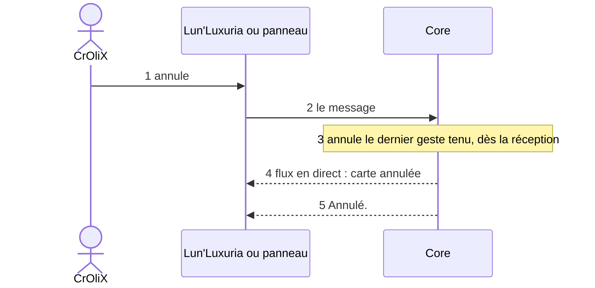

| # | De → vers | Par quoi | Ce qui circule | Retour |
|---|---|---|---|---|
| 1 | CrOliX → surface | message écrit ou dit | l'un des mots d'annulation, seul dans le message | aucun |
| 2 | Surface → core | envoi du message (Lun'Luxuria : `POST /api/threads/main/messages`) | le texte, la surface | le flux de la réponse |
| 3 | Core | annulation à la réception, sans attendre le tour de la réponse | le dernier geste encore tenu ; avec « annule tout », tous | la minuterie est arrêtée |
| 4 | Core → panneaux | flux en direct | chaque carte du geste, état « annulée » | la carte revient dans la file |
| 5 | Core → surface | réponse fixe, sans modèle ni coût | « Annulé. » | aucun |

- **Ce que CrOliX voit, et où** : « Annulé. » dans la conversation ou à la voix ; la carte revient dans la file.
  Rien au Journal.
- **Ce qui s'écrit** : le geste passe à « annulé » ; le message et la réponse fixe.
- **Qui décide** : le code du core, sur la liste fermée des mots d'annulation.
- **Erreurs et cas limites** :
  - Aucun geste tenu, mais un geste dont l'échéance date de moins de 30 s, encore en relais ou relayé avec au
    moins un élément qui n'a pas échoué : « Trop tard, c'est parti. ». Un geste dont tous les éléments ont
    échoué ne compte pas : le message suit le chemin ordinaire.
  - Les mots d'annulation sont reconnus à la réception quel que soit le fil (seuls la lecture et le geste de
    carte sont réservés au fil principal) ; ils annulent le dernier geste tenu, quelle que soit son origine.
  - Ni l'un ni l'autre : le message suit le chemin ordinaire, le modèle répond.
  - « Annule » prend le dernier geste tenu quelle que soit son origine : un clic fait sur un autre appareil dans
    les 5 s est annulé aussi.
  - Tout autre tour (« annule la carte du loyer », « non ») n'est pas une annulation.
  - Réponse coupée sans un mot entendu (Lun'Luxuria, `POST /api/threads/main/messages/:id/cut` avec `said`
    vide) : les gestes tenus par ce tour, d'origine conversation ou voix, sont annulés ; un clic du même moment
    reste.
  - Début de phrase retiré (`POST /api/threads/main/messages/:id/withdraw`) : même annulation ; la réponse est
    coupée sans rien d'entendu et le message de CrOliX reste dans le fil, vidé et marqué partiel.
  - Réponse coupée après un mot entendu : le geste reste tenu, « annule » l'atteint encore.
  - Le geste a déjà été pris par le relais : plus rien ne l'annule.
- **Écart avec les décisions** : aucun connu.
- **Non vérifié** : quand et pourquoi Lun'Luxuria coupe ou retire (famille 8).

Références : Lun'Luxuria, `src/core.ts:107-116`.

---

### S3.13 · La carte déjà tranchée ailleurs

- **Déclencheur** : deux appareils tranchent la même carte ; ou CrOliX la tranche dans l'écran du poste pendant
  qu'un geste du core est tenu ; ou le poste l'a décidée avant le relais.
- **Acteurs** : CrOliX, deux panneaux, le core, le poste.
- **Avant** : la carte est dans la file des deux appareils au moment du premier geste.

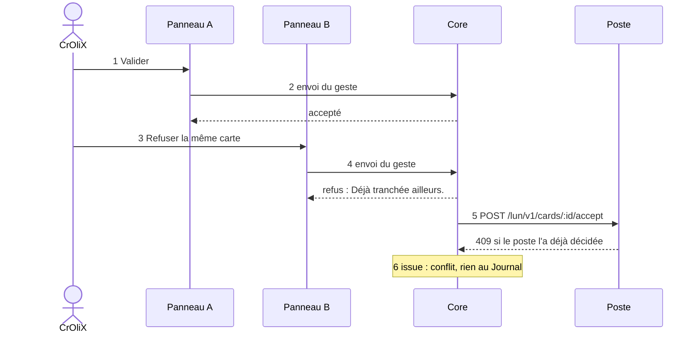

| # | De → vers | Par quoi | Ce qui circule | Retour |
|---|---|---|---|---|
| 1, 2 | Panneau A → core | envoi du geste | comme S3.1 | « accepté » ; la carte est cachée de la file pour tous |
| 3, 4 | Panneau B → core | envoi du geste | le même poste, la même carte | refus : « Déjà tranchée ailleurs. », même pendant les 5 s du premier geste |
| 5 | Core → poste | `POST /lun/v1/cards/:id/accept` | `{}` | 409 si la carte n'attend plus : « Carte déjà décidée » (Lun'Acedia), « Cette carte n'est plus en attente » (proposition), « Carte déjà traitée » (Lun'Avaritia) |
| 6 | Core | écriture | l'issue « conflit » ; flux en direct ; une relecture du poste | aucune étape au Journal pour ce geste |

- **Ce que CrOliX voit, et où** : sur l'appareil B, la raison apparaît un instant sur la rangée, qui disparaît à
  la relecture. Sur l'appareil qui a relayé un geste en conflit : toast « Déjà tranchée ailleurs. ». Au Journal :
  l'étape du premier geste seulement ; quand c'est le poste qui avait décidé, « Tranchée dans *poste*. » à la
  lecture suivante. Natsume perçoit le geste comme « déjà tranchée ailleurs ».
- **Ce qui s'écrit** : l'issue « conflit » ; la carte reste cachée jusqu'à la lecture du poste qui suit.
- **Qui décide** : le premier geste reçu par le core gagne côté core ; côté poste, la première décision
  enregistrée gagne (un seul passage de « en attente » à autre chose).
- **Erreurs et cas limites** :
  - Lun'Acedia, carte de l'agent dont l'action est en cours d'exécution : tout autre geste reçoit 409.
  - Lun'Avaritia : la prise du brouillon et ses écritures sont une seule transaction ; le second appel reçoit 409.
  - Dans l'écran de Lun'Avaritia, le même 409 donne le toast « Déjà tranché ailleurs ».
  - Annuler le premier geste dans les 5 s rend la carte à tous : le second appareil peut alors la trancher.
- **Écart avec les décisions** : F5 (rien ne dit au core qui a décidé ni quoi, quand le poste a tranché le
  premier) ; T5.
- **Non vérifié** : Rien.

Références : Lun'Acedia, `server/src/pina/agent.ts:99-136`, `:191-193`, `server/src/contract/routes.ts:155-157` ;
Lun'Avaritia, `server/src/brain/drafts.ts:302-305`, `:322-328`, `app/src/screens/Valider.svelte:97-99`.

---

### S3.14 · La carte disparue ou expirée

- **Déclencheur** : le core relaie un geste sur une carte que le poste ne connaît plus ; ou une carte quitte la
  liste « en attente » du poste sans que personne l'ait tranchée.
- **Acteurs** : le core, le poste ; CrOliX n'a rien fait de plus.
- **Avant** : le core tient la carte pour « en attente » d'après sa dernière lecture.

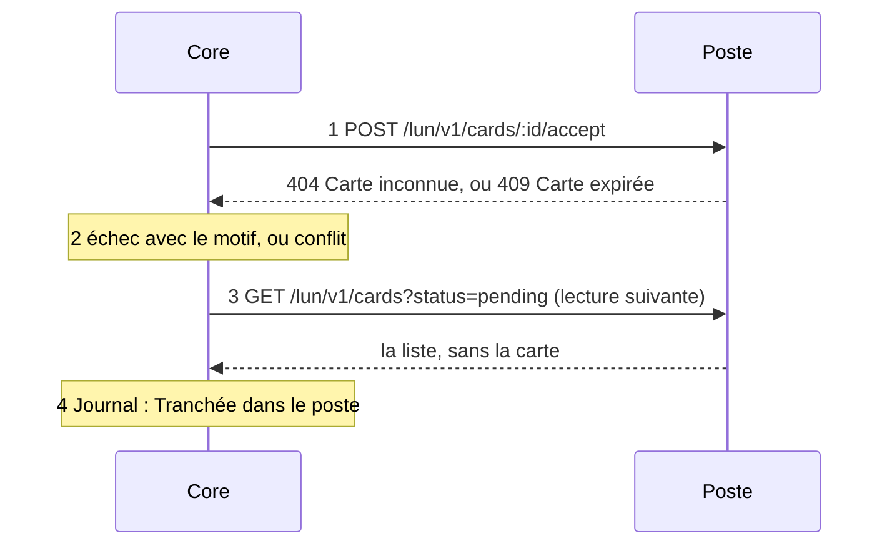

| # | De → vers | Par quoi | Ce qui circule | Retour |
|---|---|---|---|---|
| 1 | Core → poste | `POST /lun/v1/cards/:id/accept` ou `/refuse` | `{}` | 404 `{ error: 'Carte inconnue' }` ; ou, chez Lun'Acedia pour une carte d'un jour passé, 409 « Carte expirée » |
| 2 | Core | écriture | 404 : issue « échec », raison « Carte inconnue », la carte n'est pas cachée ; 409 : issue « conflit » | la raison sur la rangée, ou le toast « Déjà tranchée ailleurs. » |
| 3 | Core → poste | lecture des cartes, toutes les 2 minutes et après chaque signal | `status=pending` | Lun'Acedia fait d'abord expirer les cartes de son agent nées un jour passé ; Lun'Avaritia sert ses 15 premiers brouillons |
| 4 | Core | Journal | pour une carte lue « en attente » puis absente, encore « à trancher » au Journal : l'étape « Tranchée dans *poste*. » | la carte quitte la file |

- **Ce que CrOliX voit, et où** : la carte quitte la file sans geste de sa part ; au Journal, « Tranchée dans
  Lun'Acedia. » ou « Tranchée dans Lun'Avaritia. ».
- **Ce qui s'écrit** : l'étape du Journal, résultat « tranchée ».
- **Qui décide** : le code du poste (expiration, ordre de sa file) ; le code du core écrit la même étape quelle
  que soit la raison de l'absence.
- **Erreurs et cas limites** :
  - Une carte de l'agent d'Acedia expire au changement de jour : le Journal du core écrit « Tranchée dans
    Lun'Acedia. » alors que personne ne l'a tranchée (déduit du code, non rejoué).
  - Un brouillon d'Avaritia poussé au-delà du quinzième par des brouillons servis avant lui (contradictions et fiches qui remplacent un
    fait, puis doublons, puis le reste, par ancienneté) sort de la liste : même
    étape « Tranchée dans Lun'Avaritia. » alors qu'il attend toujours ; s'il revient, son entrée reste
    « tranchée » (déduit).
  - Une proposition de tri dont le mail a quitté la boîte de réception n'est plus servie : même étape.
  - Chez Lun'Acedia, les cartes servies avec un autre statut que « en attente » sont celles de l'agent seulement :
    une proposition tranchée ne se relit pas (Lun'Acedia, `server/src/contract/routes.ts:323-325`).
  - Lun'Avaritia ne sert aucune carte « expirée » : la liste est vide.
- **Écart avec les décisions** : F1 et F5 (le Journal dit « tranchée dans le poste » sans connaître le vrai
  résultat) ; T28.
- **Non vérifié** : rien n'est rejoué ; les trois cas « déduits » le sont de la seule lecture du code.

Références : Lun'Acedia, `server/src/pina/agent.ts:175-184`, `:200-202`, `server/src/pina/store.ts:146-151`,
`server/src/contract/routes.ts:316-328` ; Lun'Avaritia, `server/src/brain/drafts.ts:145-158`,
`server/src/contract/routes.ts:174-184`, `server/src/brain/settings.ts:16`.

---

### S3.15 · L'exécution échoue chez le poste

- **Déclencheur** : le poste reçoit le geste, mais l'action de la carte échoue.
- **Acteurs** : CrOliX, le panneau, le core, le poste, Google pour Lun'Acedia.
- **Avant** : la carte était en attente au moment du relais.

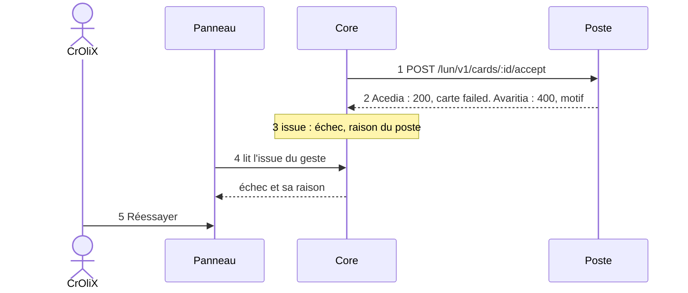

| # | De → vers | Par quoi | Ce qui circule | Retour |
|---|---|---|---|---|
| 1 | Core → poste | `POST /lun/v1/cards/:id/accept` | `{}`, `{ input }` ou `{ values }` | voir 2 |
| 2 | Poste → core | réponse | Lun'Acedia, carte de l'agent : HTTP 200, `{ card }` avec `status: 'failed'` et `error`. Lun'Avaritia : HTTP 400, `{ error }`, le brouillon reste en attente. Proposition de tri : 400 avec le motif (valeurs) | aucun |
| 3 | Core | écriture | issue « échec », la raison du poste ; flux en direct. Avec une carte rendue en échec : étape au Journal « Échec : *erreur* » et résultat « échoué ». Sans carte rendue : rien au Journal. Aucune relecture du poste n'est lancée | aucun |
| 4 | Panneau → core | lecture du geste | le numéro | l'échec et sa raison, pour l'appareil qui a fait le geste |
| 5 | CrOliX → panneau | « Réessayer » sur la rangée | le même geste, renvoyé | un nouveau geste tenu (S3.1) |

- **Ce que CrOliX voit, et où** : la carte revient dans la file (un échec ne la cache pas) ; sur l'appareil du
  geste, la raison du poste sur la rangée et un bouton « Réessayer » ; sur les autres appareils, la carte sans la
  raison. Au Journal, « Échec : … » pour une carte d'Acedia rendue en échec. Natsume perçoit « échec, *raison* »
  au tour suivant.
- **Ce qui s'écrit** : l'issue du geste ; chez Lun'Acedia la carte passe à « échouée » avec son erreur et le
  modèle de l'agent est relancé avec cette erreur ; chez Lun'Avaritia rien ne change.
- **Qui décide** : le code du poste.
- **Erreurs et cas limites** :
  - Carte d'Acedia échouée : elle n'est plus « en attente » chez le poste, mais le core ne relit pas tout de
    suite ; elle reste dans la file du core jusqu'à la lecture suivante (2 minutes au plus). « Réessayer » dans
    cet intervalle reçoit 409, donc « Déjà tranchée ailleurs. » (déduit).
  - Un 4xx sans motif lisible, ou un 5xx : traité comme un silence (S3.16).
  - Une carte rendue en échec sans texte d'erreur reçoit la raison du silence : dans un lot, le reste du lot échoue
    sans être tenté (S3.7).
  - Par la conversation ou la voix : « C'est noté » a déjà été dit ; l'échec n'est dit nulle part dans le fil.
- **Écart avec les décisions** : F1 (« la conversation ne reçoit que l'échec » : elle ne le reçoit pas) ; T2.
- **Non vérifié** : Rien.

Références : Lun'Acedia, `server/src/pina/agent.ts:117-123`, `:232-233` ; Lun'Avaritia,
`server/src/contract/routes.ts:186-203`, `server/src/brain/drafts.ts:299-318`.

---

### S3.16 · Le poste est muet ou injoignable

- **Déclencheur** : au moment du geste, le poste ne répond pas, est en pause locale, parle un vieux contrat, ou
  sa dernière lecture date ; ou il se tait au moment du relais.
- **Acteurs** : CrOliX, le panneau, le core, le poste.
- **Avant** : la carte figure dans la dernière lecture réussie du poste.

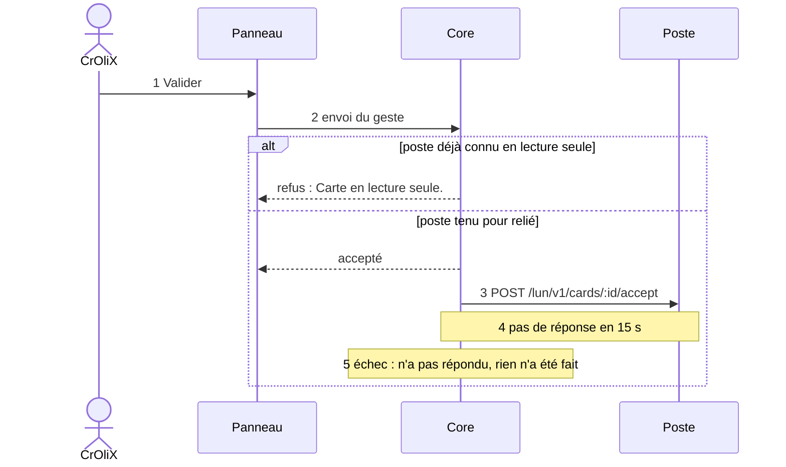

| # | De → vers | Par quoi | Ce qui circule | Retour |
|---|---|---|---|---|
| 1 | CrOliX → panneau | la carte dépliée | la rangée ; en lecture seule les boutons sont grisés, avec « Indisponible tant que *poste* ne répond pas / est en pause / n'est pas mis à jour. » | aucun geste ne part |
| 2 | Panneau → core | envoi du geste (appareil pas à jour, ou conversation) | l'élément | refus « Carte en lecture seule. » si le poste n'est pas relié, ou si sa lecture a plus de 5 minutes ou a échoué |
| 3 | Core → poste | `POST /lun/v1/cards/:id/accept` | `{}` | rien |
| 4 | Core | délai | 15 s par appel | l'appel est abandonné côté core |
| 5 | Core | écriture | issue « échec », raison « *Poste* n'a pas répondu, rien n'a été fait. » ; rien au Journal ; aucune relecture lancée | la raison sur la rangée de l'appareil du geste |

- **Ce que CrOliX voit, et où** : avant le geste : boutons grisés et la ligne d'indisponibilité ; en
  conversation : « Cette carte est en lecture seule pour l'instant : elle ne peut pas être tranchée. ». Après un
  silence : la carte revient dans la file, avec la raison et « Réessayer » sur l'appareil du geste.
- **Ce qui s'écrit** : l'issue du geste. Rien au Journal.
- **Qui décide** : le code du core, sur ce qu'il sait du poste sans le rappeler : relié ou non, pause locale,
  version du contrat, âge de la lecture.
- **Erreurs et cas limites** :
  - Sont traités comme un silence : le délai de 15 s, une connexion impossible, un jeton illisible, un jeton
    refusé par le poste, un 5xx, un 4xx sans motif lisible.
  - Dans un lot, après un silence, les cartes suivantes du même poste échouent sans être tentées.
  - « Rien n'a été fait » peut être faux : le délai coupe l'attente du core, pas le travail du poste. Chez
    Lun'Acedia la réponse attend la relance du modèle (S3.2) ; un « Réessayer » reçoit alors 409 (déduit).
  - Un poste en pause posée par le core reste « relié » : ses cartes se tranchent. Seule une pause posée dans le
    poste le met en lecture seule.
- **Écart avec les décisions** : T6 ; T13 (les deux pauses n'ont pas le même effet sur les gestes).
- **Non vérifié** : ce que fait le poste d'un `accept` reçu pendant sa propre pause (famille 10) ; si Lun'Luxuria
  peut figurer parmi les postes lus pour leurs cartes (la lecture saute le poste du bureau, mais la liste des
  satellites appairés n'a pas été regardée).

---

### S3.17 · Le core redémarre pendant un geste

- **Déclencheur** : le core s'arrête pendant qu'un geste est tenu, ou pendant qu'il le relaie.
- **Acteurs** : le core, le poste.
- **Avant** : un geste tenu ou en cours de relais est enregistré.

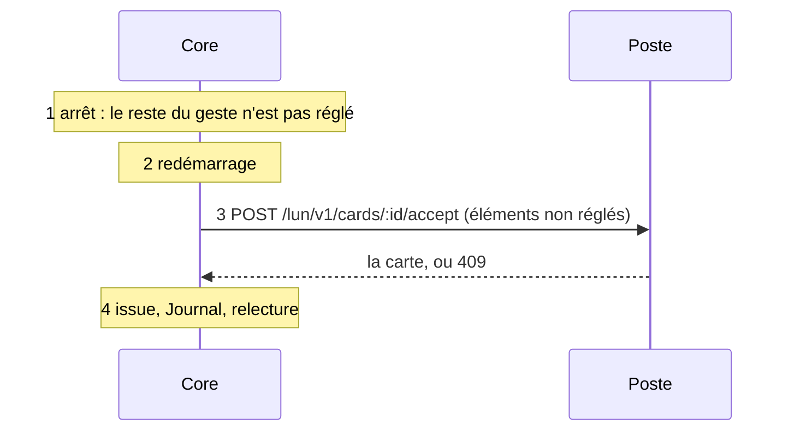

| # | De → vers | Par quoi | Ce qui circule | Retour |
|---|---|---|---|---|
| 1 | Core | arrêt | les éléments déjà réglés gardent leur issue ; les autres restent sans issue | le geste reste « en cours » ou « tenu » |
| 2 | Core | démarrage | reprise des gestes interrompus, puis relais des gestes dont l'heure est passée, puis minuterie pour ceux qui attendent encore | aucun |
| 3 | Core → poste | `POST /lun/v1/cards/:id/accept` ou `/refuse` | seulement les éléments sans issue, dans l'ordre | `{ card }`, ou 409 si l'appel d'avant l'arrêt avait abouti |
| 4 | Core | écritures | comme S3.1, étapes 7 et 8 | aucun |

- **Ce que CrOliX voit, et où** : au retour du core, la carte reste cachée de la file tant que son geste n'est
  pas réglé, puis l'issue arrive comme d'ordinaire.
- **Ce qui s'écrit** : comme S3.1.
- **Qui décide** : le code du core.
- **Erreurs et cas limites** :
  - L'appel était parti et le poste avait agi avant l'arrêt : la reprise rappelle le poste, reçoit 409 et note
    « conflit » ; aucune étape « Validée » n'est écrite pour ce geste (déduit).
  - Un geste tenu dont l'heure est passée pendant l'arrêt part dès le démarrage, sans nouveau délai.
  - Sans clé pour lire les jetons des postes, le relais démarre quand même : chaque carte échoue en « n'a pas
    répondu ».
- **Écart avec les décisions** : aucun connu.
- **Non vérifié** : rien n'est rejoué hors des tests du dépôt.

---

### S3.18 · Trancher une proposition dans l'écran de Lun'Acedia

- **Déclencheur** : CrOliX valide, corrige ou refuse une proposition dans « À valider » de Lun'Acedia : une à une,
  par groupe, ou « Tout valider au-dessus de N % ».
- **Acteurs** : CrOliX, l'écran de Lun'Acedia, Lun'Acedia, Gmail ; le core seulement par sa lecture suivante.
- **Avant** : la proposition attend.

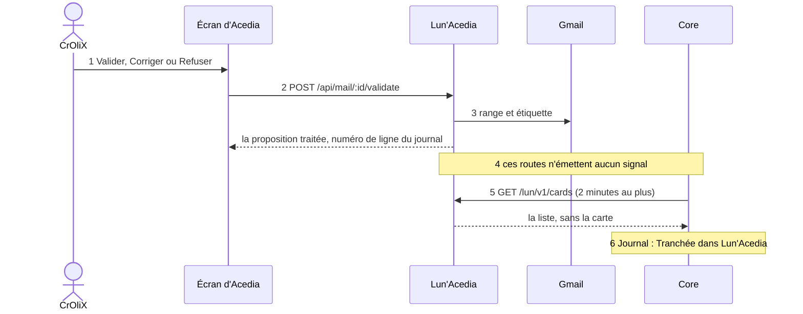

| # | De → vers | Par quoi | Ce qui circule | Retour |
|---|---|---|---|---|
| 1 | CrOliX → écran | bouton, touche, glissé au téléphone | un mail, un groupe, ou tous ceux marqués groupables par le serveur | toast avec « Annuler » 5 s |
| 2 | Écran → Lun'Acedia | `POST /api/mail/:id/validate`, `/refuse`, ou `/correct` | corriger : `boxId`, `tagIds`, `rememberSender` (facultatif). Un appel par mail, même pour un groupe | la proposition et `journalId` |
| 3 | Lun'Acedia → Gmail | déplacement et étiquettes | comme S3.3, étape 5 | les étiquettes |
| 4 | Lun'Acedia → core | rien | ces routes n'émettent aucun événement | aucun |
| 5 | Core → Lun'Acedia | `GET /lun/v1/cards?status=pending` | lecture périodique (2 minutes), ou plus tôt si un autre signal du poste arrive | la liste sans la carte |
| 6 | Core | Journal | « Tranchée dans Lun'Acedia. », résultat « tranchée » ; ni validée ni refusée ni corrigée n'est su | la carte quitte la file |

- **Ce que CrOliX voit, et où** : écran d'Acedia : la carte part, toast annulable, ligne à son journal. Panneau du
  core : la carte reste dans À trancher jusqu'à la lecture suivante, puis disparaît ; au Journal, « Tranchée dans
  Lun'Acedia. ».
- **Ce qui s'écrit** : chez Lun'Acedia comme en S3.3 ; « retenir l'expéditeur » crée en plus une règle de tri.
  Au core, l'étape du Journal.
- **Qui décide** : CrOliX ; le serveur d'Acedia désigne les propositions qui entrent dans « Tout valider ».
- **Erreurs et cas limites** :
  - CrOliX tranche la même carte dans le core avant la lecture suivante : le relais reçoit 409 (S3.13).
  - « Annuler » du toast rejoue l'annulation de chaque ligne du journal d'Acedia
    (`POST /api/journal/:id/undo`) : la proposition redevient « en attente » et la carte revient dans la file du
    core, dont l'entrée du Journal reste « tranchée » (déduit).
- **Écart avec les décisions** : F5 (aucun signal, aucun vrai résultat au Journal du core) ; T5 ; T12 (le seuil
  de « Tout valider » ne vaut que dans cet écran).
- **Non vérifié** : l'écran lui-même n'est lu que par ses appels ; le détail est à la famille 13. Une synchro
  Gmail qui voit ensuite les étiquettes changées émet-elle `mail.changed` (Lun'Acedia, `server/src/gmail/sync.ts:224`),
  ce qui avancerait la relecture du core ?

Références : Lun'Acedia, `server/src/triage/routes.ts:88-113`, `views/src/lib/client.ts:330-344`,
`views/src/lib/mail/Pending.svelte:259-296`.

---

### S3.19 · Trancher une carte de l'agent dans l'écran de Lun'Acedia

- **Déclencheur** : CrOliX valide, modifie puis valide, ou refuse une carte dans le fil de l'agent de Lun'Acedia ;
  ou annule une carte faite.
- **Acteurs** : CrOliX, l'écran de Lun'Acedia, Lun'Acedia, Google, le modèle d'Acedia ; le core par sa lecture.
- **Avant** : la carte est du jour et en attente.

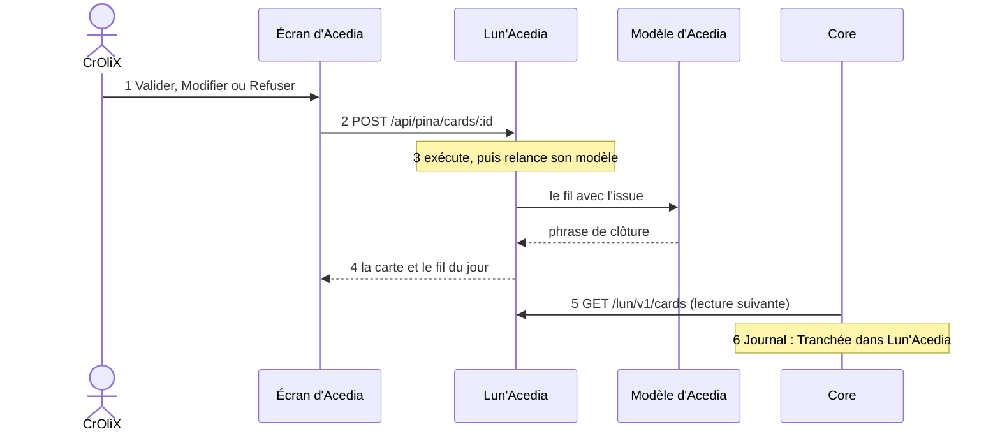

| # | De → vers | Par quoi | Ce qui circule | Retour |
|---|---|---|---|---|
| 1 | CrOliX → écran | boutons de la carte, Ctrl Entrée, Échap | la carte, l'entrée modifiée le cas échéant | la carte devient une ligne « fait » |
| 2 | Écran → Lun'Acedia | `POST /api/pina/cards/:id` | `{ decision, input? }` ; `input` remplace l'entrée de la carte (20 000 caractères au plus), validée par le schéma de l'action | voir 4 |
| 3 | Lun'Acedia | même code que par le contrat (S3.2) | exécution, puis relance du modèle | aucun |
| 4 | Lun'Acedia → écran | réponse | la carte, les messages et les cartes du jour, le nombre en attente | l'écran affiche la phrase de l'agent |
| 5, 6 | Core | lecture suivante, Journal | comme S3.18, étapes 5 et 6 ; plus tôt quand l'action émet `agenda.changed` | « Tranchée dans Lun'Acedia. » |

- **Ce que CrOliX voit, et où** : écran d'Acedia : la ligne « fait » avec l'heure et « Annuler », la phrase de
  l'agent. Panneau du core : la carte disparaît à la lecture suivante.
- **Ce qui s'écrit** : chez Lun'Acedia comme en S3.2.
- **Qui décide** : CrOliX ; le code d'Acedia refuse de modifier une suppression (« Une suppression ne se modifie
  pas »).
- **Erreurs et cas limites** :
  - « Annuler » d'une carte faite : `POST /api/pina/cards/:id/undo` joue l'action inverse, une seule fois ; 409
    « Rien à annuler » sinon. Le core n'en sait rien : son Journal garde « Tranchée » ou « Validée ».
  - « Tout valider » dans ce fil : une validation par carte, l'une après l'autre, sauf les suppressions.
  - Carte d'un jour passé : 409 « Carte expirée ».
  - La relance du modèle lève une erreur qui n'est pas une erreur du fournisseur : contrairement à la route du
    contrat (S3.2), cette route n'a pas de reprise d'erreur. La réponse est un 500 `{ error }` alors que la carte
    est déjà faite ou refusée ; l'écran affiche un toast d'erreur et recharge le fil (Lun'Acedia,
    `server/src/pina/routes.ts:50-57`, `server/src/pina/agent.ts:186-197`, `:345-360`).
- **Écart avec les décisions** : F5 ; T5.
- **Non vérifié** : l'écran lui-même (famille 13).

Références : Lun'Acedia, `server/src/pina/routes.ts:21-27`, `:50-65`, `server/src/pina/agent.ts:139-197`,
`views/src/lib/client.ts:399-400`, `views/src/lib/pina/pina.svelte.ts:136-174`.

---

### S3.20 · Trancher un brouillon dans l'écran de Lun'Avaritia

- **Déclencheur** : CrOliX valide (tel quel, ou après l'avoir corrigé) ou refuse un brouillon dans « À valider »
  de Lun'Avaritia ; touches V et R.
- **Acteurs** : CrOliX, l'écran de Lun'Avaritia, Lun'Avaritia ; le core par sa lecture suivante.
- **Avant** : le brouillon est parmi ceux que l'écran montre.

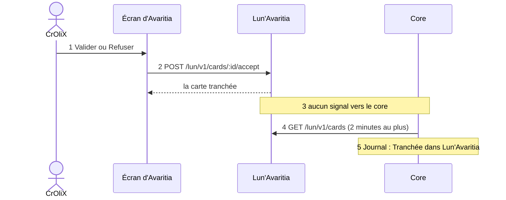

| # | De → vers | Par quoi | Ce qui circule | Retour |
|---|---|---|---|---|
| 1 | CrOliX → écran | boutons, V, R, l'éditeur du brouillon | le brouillon, corrigé ou non | toast « Appliqué », ou « Refusé » avec « Annuler » |
| 2 | Écran → Lun'Avaritia | `POST /lun/v1/cards/:id/accept` ou `/refuse`, la même route que le core | `{}`, ou `{ input }` : le brouillon corrigé en entier, du même genre que l'original | `{ card }` |
| 3 | Lun'Avaritia → core | rien | aucun événement | aucun |
| 4 | Core → Lun'Avaritia | `GET /lun/v1/cards?status=pending` | lecture périodique | la liste sans la carte |
| 5 | Core | Journal | « Tranchée dans Lun'Avaritia. » | la carte quitte la file |

- **Ce que CrOliX voit, et où** : écran d'Avaritia : la carte part, la suivante prend le focus. Panneau du core :
  la carte reste jusqu'à la lecture suivante.
- **Ce qui s'écrit** : comme S3.4. Le brouillon corrigé remplace l'original dans ce qui est appliqué et gardé.
- **Qui décide** : CrOliX.
- **Erreurs et cas limites** :
  - Refus rattrapable : « Annuler » appelle `POST /api/drafts/:id/restore` dans les 30 s ; le brouillon reprend sa
    place. Au-delà : 409 « Trop tard pour annuler : le refus est fait. ». Une validation ne se rattrape pas.
  - Après un tel rattrapage, la carte revient dans la file du core, dont l'entrée reste « tranchée » (déduit).
  - 409 : toast « Déjà tranché ailleurs » et rechargement de la liste.
  - Corriger un brouillon en changeant son genre : 400 « Le type de brouillon ne change pas. ».
- **Écart avec les décisions** : F5 ; T5.
- **Non vérifié** : l'écran lui-même (famille 13).

Références : Lun'Avaritia, `app/src/screens/Valider.svelte:78-104`, `server/src/brain/routes.ts:75-84`,
`server/src/brain/drafts.ts:281-346`.

---

### S3.21 · Les autres gestes tenus : Vu, C'est fait, Plus tard

- **Déclencheur** : dans la file, CrOliX clique « Vu » sur une urgence ou un rappel, ou « C'est fait » ou
  « Plus tard » sur une échéance de la bibliothèque.
- **Acteurs** : CrOliX, le panneau, le core ; Lun'Avaritia pour « C'est fait ».
- **Avant** : l'élément est dans la file.

```mermaid
sequenceDiagram
    actor C as CrOliX
    participant P as Panneau
    participant N as Core
    participant V as Lun'Avaritia
    C->>P: 1 Vu, C'est fait ou Plus tard
    P->>N: 2 envoi du geste
    Note over N: 3 tenu 5 s, annulable
    N->>V: 4 C'est fait seulement : demande confiée à l'agent
    V-->>N: résumé, cartes
    Note over N: 5 issue, flux en direct
```

| # | De → vers | Par quoi | Ce qui circule | Retour |
|---|---|---|---|---|
| 1 | CrOliX → panneau | bouton de la rangée | l'urgence, ou l'échéance | toast « Urgence vue », « Rappel vu », « C'est fait » ou « Plus tard », avec « Annuler » |
| 2 | Panneau → core | envoi du geste | le numéro de l'événement et « vu » ; ou le numéro du fait, « fait » ou « plus tard » | « accepté » |
| 3 | Core | minuterie | même attente et même annulation que pour une carte (S3.6) | aucun |
| 4 | Core → Lun'Avaritia | `POST /lun/v1/agent` | pour « C'est fait » : une demande « C'est fait : *texte de l'échéance* » | un résumé et des cartes (famille 7) |
| 5 | Core | écritures | « vu » : gardé au core seul ; l'étape « Vue. » ne s'écrit que si l'urgence a une entrée au Journal avec un résultat, et si elle n'a pas été vue ailleurs entre-temps ; « plus tard » : l'échéance est cachée jusqu'au lendemain, ligne « Plus tard » au Journal ; flux en direct « file » | aucun |

- **Ce que CrOliX voit, et où** : la rangée part, toast annulable 5 s.
- **Ce qui s'écrit** : au core seulement pour « vu » et « plus tard » ; le poste n'en apprend rien.
- **Qui décide** : CrOliX.
- **Erreurs et cas limites** : Lun'Avaritia ne répond pas à « C'est fait » : échec « Lun'Avaritia n'a pas
  répondu, rien n'a été fait. » ; échéance d'un poste en lecture seule : refus.
  « Vu » n'est pas refusé pour un poste en lecture seule ; seules les échéances le sont.
- **Écart avec les décisions** : T15 (« C'est fait » demande une seconde décision, sur la carte que l'agent
  prépare) ; T16.
- **Non vérifié** : la suite de « C'est fait » chez Lun'Avaritia (famille 7) ; l'origine des urgences et des
  rappels (familles 4 et 5).
