# Famille 4 · Les mails entrants : règle, tri, urgence

De l'arrivée d'un mail chez Google jusqu'à ce que CrOliX en sache. La famille suit la synchronisation de
Lun'Acedia avec Gmail, ses règles, son tri (où un modèle intervient, ce qu'il décide), les événements poussés au
core, ce que la porte d'attention du core en fait, et les lectures du core chez le poste. Elle couvre aussi les
gestes de boîte faits dans l'écran de Lun'Acedia (lire, ranger, corbeille, écrire, envoyer).
La décision sur une carte est à la famille 3 ; la nuit et la lettre du matin à la famille 6.

Lu sur `origin/main` le 27/11 : Lun'Acedia `40c293f`, et le core, dont les preuves sont dans l'annexe privée.

| Id | Titre | En une ligne |
|---|---|---|
| S4.1 | Synchroniser la boîte avec Gmail | Chaque minute, Lun'Acedia demande à Gmail ce qui a changé |
| S4.2 | Première connexion et relecture complète | 500 mails mis en cache, aucun trié ; relecture si Gmail a oublié le repère |
| S4.3 | Mail qui n'entre pas dans le tri | Envoyé par CrOliX, brouillon, déjà sorti de la boîte de réception |
| S4.4 | Créer une règle | Par l'écran, par une correction, par le catalogue |
| S4.5 | Ranger un mail par une règle | Rangé seul, signalé au core en palier P3 |
| S4.6 | Urgence par une règle, CrOliX au bureau | Dite à voix haute, écrite au fil, en tête de À trancher |
| S4.7 | Urgence, CrOliX absent | Notification sonore sur le téléphone |
| S4.8 | Urgence pendant la plage de nuit | Écrite au fil, notification sans son |
| S4.9 | Urgence au bureau, non dite | Appel en cours, réglage coupé, urgence ancienne ; la sourdine n'y change rien |
| S4.10 | Alertes urgentes coupées pour le poste | Ni notification ni ligne dans À trancher ; la voix reste |
| S4.11 | « Vu » sur une urgence | Le seul geste ; le poste ne l'apprend pas |
| S4.12 | Proposition de tri du modèle | Le mail attend, la proposition devient une carte |
| S4.13 | Mail jugé urgent par le modèle | Jamais une urgence : une carte ou un événement « à prévenir » |
| S4.14 | Rangement seul par le modèle | Seuil commun abaissé par CrOliX (le dictionnaire dit « par boîte ») ; rangé, annulable |
| S4.15 | Mail sans règle et sans modèle | Il reste dans la boîte de réception, rien ne part |
| S4.16 | Tri en pause | Pause de Lun'Acedia : rien ; pause du core : les règles seules |
| S4.17 | Crédit épuisé ou clé refusée pendant le tri | Les règles continuent, le reste attend dans la file |
| S4.18 | Échec du tri d'un mail | Panne passagère, mail fautif, trois essais |
| S4.19 | Autorisation Google à renouveler, compte absent | La synchronisation s'arrête ; un seul des deux cas remonte |
| S4.20 | Le flux d'événements vers le core | Ouverture, coupure, reprise sans doublon |
| S4.21 | Les lectures du core chez Lun'Acedia | Toutes les 2 minutes et après chaque signal |
| S4.22 | Événement « à prévenir » | Notification silencieuse groupée, sauf au bureau |
| S4.23 | Lire un mail, marquer lu ou non lu | Depuis l'écran de Lun'Acedia ; rien ne part vers le core |
| S4.24 | Ranger, archiver, corbeille, spam à la main | Avec annulation ; un rangement à la main instruit le tri |
| S4.25 | Écrire et envoyer un mail depuis l'écran | Nouveau, réponse dans le fil, transfert |
| S4.26 | Reprendre un brouillon et l'envoyer | Le seul chemin d'envoi d'un brouillon préparé par l'agent |
| S4.27 | Un compte Google, plusieurs adresses | Un seul compte par instance ; changer de compte efface ses données |
| S4.28 | Première liaison au core : rejeu des événements gardés | Jusqu'à 7 jours d'événements passent la porte d'un coup |

Renvois : valider, corriger ou refuser une proposition, et « Tout valider » : famille 3. Le brouillon préparé par
l'agent du poste et sa carte : famille 2. Le bilan du jour lu la nuit : famille 6. Le rituel d'accueil qui cite
les urgences, et ce que Lun'Luxuria fait d'une parole reçue : famille 8. La pause et les plafonds : famille 10.

---

### S4.1 · Synchroniser la boîte avec Gmail

- **Déclencheur** : l'horloge de Lun'Acedia, toutes les 60 secondes (une cadence réglable par l'instance, de 1 s
  au plus long délai d'un minuteur), et une fois au démarrage. Google ne pousse rien : Lun'Acedia vient lire.
- **Acteurs** : Lun'Acedia, Google (Gmail), le core, les écrans ouverts de Lun'Acedia.
- **Avant** : Google configuré sur le serveur, un compte branché, un repère d'historique déjà gardé (sinon S4.2).

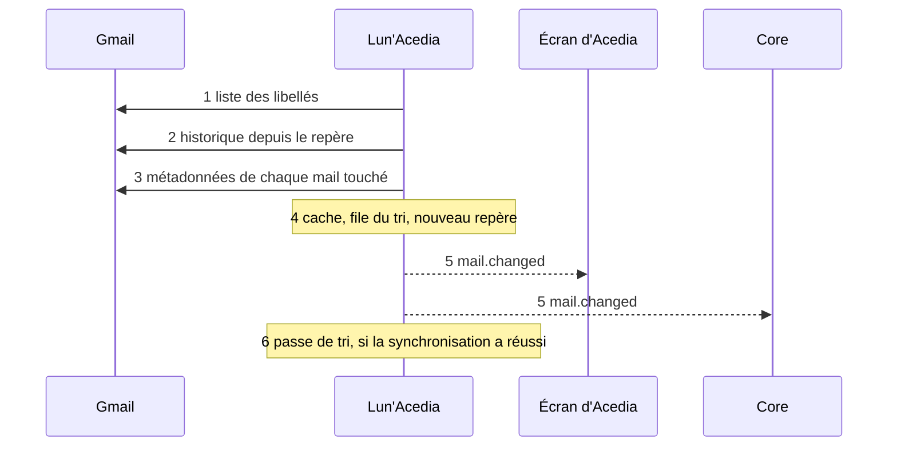

| # | De → vers | Par quoi | Ce qui circule | Retour |
|---|---|---|---|---|
| 1 | Lun'Acedia → Gmail | `GET …/users/me/labels` | rien | `labels[]` (`id`, `name`, `type`), recopiés dans le cache |
| 2 | Lun'Acedia → Gmail | `GET …/users/me/history` | `startHistoryId` (le repère), quatre `historyTypes` : mail ajouté, supprimé, libellé ajouté, retiré | pages de `history[]`, un nouveau `historyId` |
| 3 | Lun'Acedia → Gmail | `GET …/messages/<id>?format=metadata` | l'identifiant ; en-têtes demandés : `From`, `To`, `Subject` ; 8 appels à la fois | `labelIds`, `snippet`, `internalDate`, `threadId` ; 404 si le mail n'existe plus |
| 4 | Lun'Acedia → elle-même | écriture | le mail en cache ; chaque mail **ajouté et entrant** dans la file du tri ; le repère | — |
| 5 | Lun'Acedia → core et écrans | événement `mail.changed` sur `GET /lun/v1/events` | `importance: log`, `title` « Boîte mise à jour », `data: { added[], changed[], removed[] }` (des identifiants de mails, aucun objet) | aucun |
| 6 | Lun'Acedia → elle-même | passe de tri, **seulement si la synchronisation a réussi** | la file entière, y compris ce qui attendait | voir S4.5, S4.12 à S4.18 |

- **Ce que CrOliX voit, et où** : dans l'écran de Lun'Acedia, la liste et les compteurs de non-lus se rechargent
  à chaque événement `mail.*`, sauf pendant qu'un mail est ouvert (la liste ne bouge pas sous la lecture ; les
  compteurs, si). Dans le panneau du core : rien pour ce signal seul.
- **Ce qui s'écrit** : le cache des mails et des libellés, le repère d'historique, la file du tri, l'événement
  (gardé 7 jours chez Lun'Acedia). Le core garde l'événement ; il n'écrit aucune ligne au Journal (palier P4).
- **Qui décide** : du code. « Entrant » veut dire : libellé `INBOX` présent et `DRAFT` absent
  (Lun'Acedia, `server/src/gmail/sync.ts:84-86`). Aucun modèle ici.
- **Erreurs et cas limites** :
  - Rien n'a changé : aucun événement n'est émis (`sync.ts:223`).
  - Gmail répond 404 à l'historique (repère oublié) : relecture complète, S4.2.
  - Gmail répond 429 ou 5xx : trois essais espacés de 0,5 s puis 1 s, puis l'erreur ; la passe est perdue, la
    suivante reprend au même repère (`server/src/google/client.ts:182-185`, `sync.ts:205`).
  - Une passe est encore en cours à la minute suivante : pas de seconde passe en parallèle
    (`server/src/util.ts:17-28`).
  - **La passe de tri est branchée sur le résultat de la synchronisation** (`server/src/main.ts:112-118`). Si la
    synchronisation échoue (Gmail en 429 ou 5xx après trois essais, autorisation à renouveler, aucun compte,
    réseau), aucune passe de tri n'a lieu cette minute : même les mails qui attendaient dans la file (pause levée,
    crédit revenu) attendent la prochaine synchronisation réussie (S4.16, S4.19).
  - Un mail supprimé entre l'historique et sa lecture : ignoré, ou retiré du cache s'il y était.
  - Un mail déjà en cache (lu ou cherché un instant plus tôt) que Gmail annonce comme arrivé : il est quand même
    compté comme nouveau et trié (`sync.ts:194-195`).
  - Chaque signal reçu déclenche une lecture du poste par le core (S4.21), même pour ce signal de palier P4.
- **Écart avec les décisions** : aucun connu.
- **Non vérifié** : le comportement réel de l'historique de Gmail (délai, ordre) ; seul le code appelant est lu.

---

### S4.2 · Première connexion et relecture complète

- **Déclencheur** : la première passe après le branchement d'un compte (aucun repère gardé), ou un 404 de Gmail
  sur l'historique.
- **Acteurs** : Lun'Acedia, Gmail.
- **Avant** : un compte Google branché.

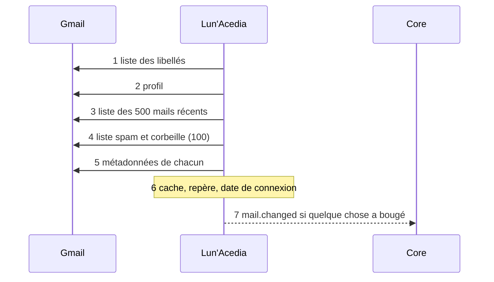

| # | De → vers | Par quoi | Ce qui circule | Retour |
|---|---|---|---|---|
| 1 | Lun'Acedia → Gmail | `GET …/users/me/labels` | rien | `labels[]`, recopiés dans le cache : première étape de toute passe, comme S4.1 |
| 2 | Lun'Acedia → Gmail | `GET …/users/me/profile` | rien | `historyId`, le nouveau repère |
| 3 | Lun'Acedia → Gmail | `GET …/messages` | `maxResults` (500 au plus) | des identifiants |
| 4 | Lun'Acedia → Gmail | `GET …/messages?q=in:spam OR in:trash` | 100 au plus | des identifiants |
| 5 | Lun'Acedia → Gmail | `GET …/messages/<id>?format=metadata` | comme S4.1 | comme S4.1 |
| 6 | Lun'Acedia → elle-même | écriture | cache, repère, « cache complet ou non », et à la première connexion l'instant du branchement | — |
| 7 | Lun'Acedia → core et écrans | `mail.changed` | comme S4.1 | aucun |

- **Ce que CrOliX voit, et où** : la boîte se remplit dans l'écran de Lun'Acedia. Aucune proposition n'apparaît
  pour les mails déjà là.
- **Ce qui s'écrit** : le cache, le repère, l'instant du branchement (gardé une fois pour toutes).
- **Qui décide** : du code. À la première connexion, **aucun mail n'est mis dans la file du tri**
  (`sync.ts:118`, test `sync.test.ts:36`). Après un repère oublié, seuls les mails entrants **inconnus du cache et
  datés d'après le branchement** y entrent.
- **Erreurs et cas limites** :
  - Un mail du cache absent de la liste des 500 : relu un par un ; retiré seulement si Gmail répond 404.
  - Au-delà du cache, les vues de l'écran vont lire Gmail page par page (`server/src/gmail/read.ts:148-166`).
- **Écart avec les décisions** : aucun connu.
- **Non vérifié** : la durée d'une première passe sur une vraie boîte.

---

### S4.3 · Mail qui n'entre pas dans le tri

- **Déclencheur** : la synchronisation voit un mail qui n'est pas « entrant », ou le tri trouve un mail déjà sorti
  de la boîte de réception.
- **Acteurs** : Lun'Acedia, Gmail.
- **Avant** : S4.1 a tourné.

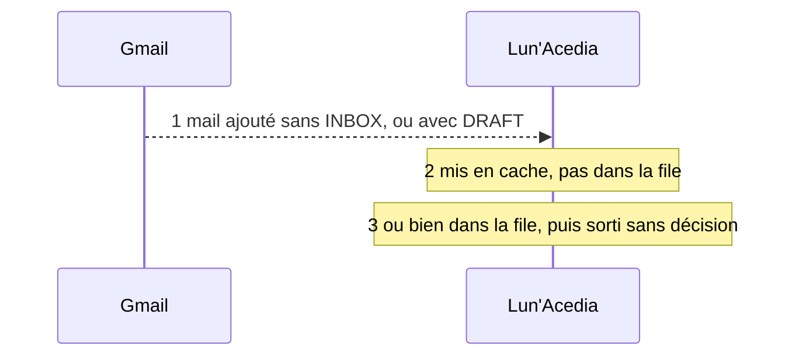

| # | De → vers | Par quoi | Ce qui circule | Retour |
|---|---|---|---|---|
| 1 | Gmail → Lun'Acedia | réponse de l'historique | un mail envoyé par CrOliX (libellé `SENT`), un brouillon (`DRAFT`) | — |
| 2 | Lun'Acedia → elle-même | écriture | le cache seul | pas de file, pas d'événement pour lui seul |
| 3 | Lun'Acedia → elle-même | passe de tri | un mail de la file qui n'a plus `INBOX` | sorti de la file, aucune proposition |

- **Ce que CrOliX voit, et où** : le mail envoyé dans la vue « Envoyés », le brouillon dans « Brouillons ». Rien
  dans « À valider », rien au core.
- **Ce qui s'écrit** : le cache.
- **Qui décide** : du code (`sync.ts:84-86`, `server/src/triage/pipeline.ts:223-227`).
- **Erreurs et cas limites** :
  - **Un mail que CrOliX s'envoie à lui-même** porte `INBOX` : il est trié comme un autre (déduit de la condition,
    pas d'un test).
  - **Un filtre Gmail** qui a sorti le mail de la boîte de réception avant la passe : laissé où il est.
  - **Une réponse dans un fil existant** : c'est un nouveau mail, trié seul. Le tri ne lit pas le fil : `threadId`
    est gardé en cache et ne sert qu'à l'écriture d'une réponse (S4.25).
- **Écart avec les décisions** : aucun connu.
- **Non vérifié** : le cas du mail envoyé à soi-même n'a pas de test.

---

### S4.4 · Créer une règle

- **Déclencheur** : CrOliX ajoute une règle dans Réglages, Règles ; ou coche « retenir l'expéditeur » en
  corrigeant une proposition (famille 3) ; ou l'action `rule.create` du catalogue est appelée.
- **Acteurs** : CrOliX, l'écran de Lun'Acedia, Lun'Acedia.
- **Avant** : la boîte visée existe (un libellé Gmail au rôle « boîte »).

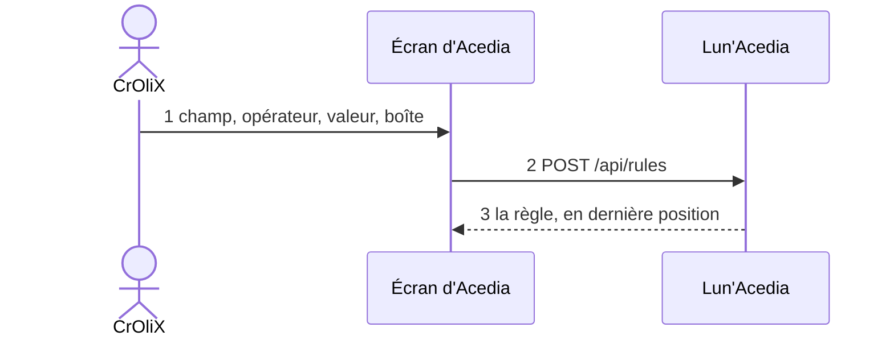

| # | De → vers | Par quoi | Ce qui circule | Retour |
|---|---|---|---|---|
| 1 | CrOliX → écran | formulaire | le champ (expéditeur, domaine de l'expéditeur, destinataire, objet), « est » ou « contient », la valeur, la boîte | — |
| 2 | Écran → Lun'Acedia | `POST /api/rules` | `field` (`from`, `fromDomain`, `to`, `subject`), `op` (`equals`, `contains`), `value`, `boxId` ; **pas de `tagIds`** depuis l'écran | 400 si `boxId` n'est pas une boîte |
| 3 | Lun'Acedia → écran | réponse | la règle : `id`, `position` (la dernière), `enabled: true`, `tagIds: []` | — |

- **Ce que CrOliX voit, et où** : la règle dans la liste, qu'il peut réordonner, couper ou supprimer
  (`PATCH` et `DELETE /api/rules/:id`).
- **Ce qui s'écrit** : la règle, chez Lun'Acedia seulement. Aucun événement ; le core n'en sait rien.
- **Qui décide** : CrOliX. La règle ne vaut que pour les mails à venir : rien ne relit la boîte à sa création.
- **Erreurs et cas limites** :
  - La comparaison ignore la casse et les accents (`server/src/triage/rules.ts:20-26`). Un mot-clé est une règle
    « l'objet contient ».
  - Les règles ne visent qu'une boîte : jamais la corbeille ni le spam (`pipeline.ts:490-491`).
  - « Retenir l'expéditeur » crée une règle « l'expéditeur est <adresse> », sauf si la même existe déjà ; annuler
    la correction la retire, sauf si CrOliX l'a modifiée depuis.
  - Une règle dont la valeur, sans casse ni accents, est vide est sautée par la comparaison
    (`server/src/triage/rules.ts:47-49`).
  - Les étiquettes d'une règle (`tagIds`) ne sont vérifiées ni à la création ni à la modification : seule la boîte
    l'est (`rules.ts:82-87`, `106-114`). Une étiquette supprimée depuis reste dans la règle (S4.6).
  - **Une règle ne devient « urgente » que par ses étiquettes** (S4.6), et l'écran des règles n'en pose aucune
    (Lun'Acedia, `views/src/lib/settings/Rules.svelte:70` : `saveRule({ field, op, value, boxId })`). Seules la
    route `POST /api/rules` appelée autrement et les actions `rule.create` / `rule.update` acceptent `tagIds`.
- **Écart avec les décisions** : le standard des notifications classe en P0 « ce qu'une règle de CrOliX dit
  urgent ». Le chemin existe dans le tri, pas dans l'écran : voir les contradictions du retour.
- **Non vérifié** : aucun autre écran n'appelle `saveRule` (cherché dans `views/src`) ; l'agent du poste peut-il
  réellement poser `tagIds` par `rule.create`, non rejoué.

---

### S4.5 · Ranger un mail par une règle

- **Déclencheur** : la passe de tri qui suit une synchronisation trouve un mail entrant qu'une règle active
  reconnaît.
- **Acteurs** : Lun'Acedia, Gmail, le core.
- **Avant** : pas de pause posée dans Lun'Acedia ; la règle mène à un libellé qui est toujours une boîte.

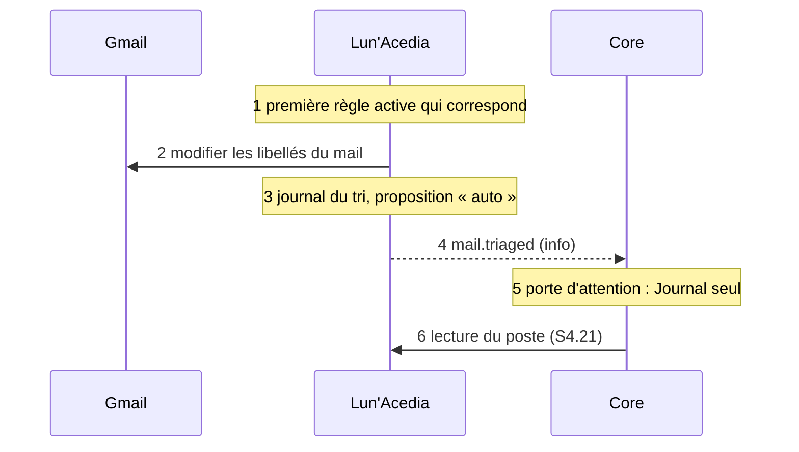

| # | De → vers | Par quoi | Ce qui circule | Retour |
|---|---|---|---|---|
| 1 | Lun'Acedia → elle-même | comparaison | l'expéditeur, son domaine, les destinataires, l'objet du mail en cache | la première règle active, par position |
| 2 | Lun'Acedia → Gmail | `POST …/messages/<id>/modify`, deux appels au plus, chacun précédé d'une lecture des métadonnées du mail chez Gmail | d'abord la boîte (`addLabelIds` : la boîte ; `removeLabelIds` : `INBOX`, une autre boîte, `SPAM`), puis, s'il en manque, les étiquettes de la règle (`addLabelIds` : les étiquettes) ; le second appel n'a lieu que si une étiquette manque | les nouveaux `labelIds` |
| 3 | Lun'Acedia → elle-même | écriture | une ligne du journal du tri (origine « règle », libellés avant et après) dès qu'un appel à Gmail a eu lieu (`if (change)`, `pipeline.ts:231-232` : toujours pour une règle, qui a une boîte) ; la proposition au statut « auto », confiance 100, part dans tous les cas | — |
| 4 | Lun'Acedia → core | événement `mail.triaged` | `importance: info`, `title` (l'objet du mail, secrets masqués), `data: { id, boxId }`, `link: #/mail/<id>` ; **pas d'expéditeur**, pas de synthèse | aucun |
| 5 | Core → lui-même | porte d'attention | palier P3 : écrire au Journal ; sortie « lettre du matin » décidée et tracée | — |
| 6 | Core → Lun'Acedia | lecture | voir S4.21 | — |

- **Ce que CrOliX voit, et où** : le mail dans sa boîte, dans l'écran de Lun'Acedia ; une ligne dans le journal du
  tri de Lun'Acedia, annulable. Dans le panneau du core : une entrée « événement » au Journal, intitulée par
  l'objet du mail. Ni voix, ni notification, ni ligne dans À trancher.
- **Ce qui s'écrit** : chez Lun'Acedia, le journal du tri et la proposition « auto ». Au core, l'événement, sa
  trace à la porte d'attention, une entrée du Journal (étape « Reçu. »).
- **Qui décide** : du code, des deux côtés. La règle chez Lun'Acedia ; le palier P3 vient de `importance: info`.
  Aucun modèle n'est appelé pour un mail qu'une règle reconnaît (`pipeline.test.ts:159`).
- **Erreurs et cas limites** :
  - Une règle dont la boîte n'en est plus une : sautée, la suivante ou le modèle décide ; une ligne du journal du
    serveur le dit, une fois par passe (`pipeline.ts:205-218`).
  - Le mail a disparu de Gmail, ou Google refuse (400, 404) : un essai compté, la passe continue (S4.18).
  - Sous une pause du core, les règles rangent quand même (S4.16).
- **Écart avec les décisions** : T20 : la sortie « lettre du matin » d'un P3 est calculée, personne ne la lit. F4
  propose que la lettre reçoive le nombre de mails rangés seuls ; ce n'est pas codé.
- **Non vérifié** : l'affichage exact de l'entrée dans l'écran Journal du panneau.

---

### S4.6 · Urgence par une règle, CrOliX au bureau

- **Déclencheur** : une règle range un mail **et** l'une de ses étiquettes s'appelle « Urgent » (sans tenir
  compte de la casse ni des accents).
- **Acteurs** : Lun'Acedia, Gmail, le core, le panneau, Lun'Luxuria, CrOliX.
- **Avant** : une présence au bureau en cours (dernier battement de moins de 90 secondes), pas d'appel, réglage
  « Dit à voix haute : P0 » actif, hors plage de nuit, alertes urgentes du poste actives ; l'événement a moins de
  5 minutes.

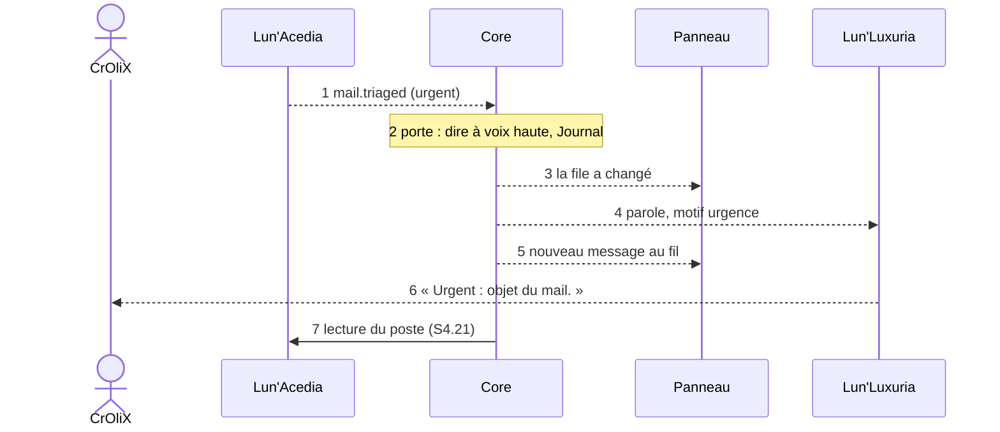

| # | De → vers | Par quoi | Ce qui circule | Retour |
|---|---|---|---|---|
| 1 | Lun'Acedia → core | événement `mail.triaged` | `importance: urgent`, `title` (l'objet, masqué), `lines: ["De : Nom <adresse>"]` (masqué), `data: { id, boxId }`, `link: #/mail/<id>` | aucun |
| 2 | Core → lui-même | porte d'attention | palier P0 ; entrées lues : présence, appel, réglage P0, pause, nuit, alertes du poste, âge de l'événement | « dire à voix haute », pas de notification, Journal |
| 3 | Core → panneaux ouverts | signal en direct | « la file a changé », sans contenu | le panneau relit la file |
| 4 | Core → Lun'Luxuria | parole publiée sur le canal en direct du core | la phrase fixe « Urgent : <objet coupé à 80 caractères>. », son motif (urgence), le message auquel elle se rattache | aucun accusé (famille 8) |
| 5 | Core → panneaux ouverts | signal en direct | l'identifiant du message ajouté au fil principal | le panneau l'affiche |
| 6 | Lun'Luxuria → CrOliX | voix | la phrase | — |
| 7 | Core → Lun'Acedia | lecture | voir S4.21 | — |

- **Ce que CrOliX voit, et où** : il entend la phrase. Dans le panneau : la même phrase au fil de la
  conversation ; en tête de À trancher, section « Urgent », une ligne avec l'objet, la ligne « De : … », le
  bouton « Vu » et un lien qui ouvre le mail dans l'écran de Lun'Acedia ; une entrée « urgence » au Journal, à
  l'état « à trancher ». Pas de notification sur le téléphone. Dans Lun'Acedia : le mail rangé, avec son
  étiquette « Urgent ».
- **Ce qui s'écrit** : chez Lun'Acedia, comme S4.5. Au core : l'événement, sa trace, l'entrée du Journal (étape
  « Reçue. »), un message de Natsume au fil principal.
- **Qui décide** : du code partout. L'urgence vient du nom de l'étiquette de la règle
  (Lun'Acedia, `pipeline.ts:70-75` et `242-248`) : « The rule's own urgent tag is the only way a mail gets
  `urgent`; the AI never does ». La phrase dite est fixe, sans modèle.
- **Erreurs et cas limites** :
  - L'écriture au fil ou l'envoi de la parole échoue : l'événement reste gardé, une ligne du journal du serveur.
  - L'événement est un rejeu après une coupure (déjà gardé) : rien n'est redit ni réécrit (S4.20).
  - La file de notification abandonne sa ligne à la passe suivante, motif « présence ».
  - **Une étiquette de la règle a été supprimée depuis** : elle reste dans la règle (S4.4), mais l'urgence n'est
    reconnue que si l'étiquette existe encore sous le nom « Urgent » (`pipeline.ts:243`) ; sinon le mail est
    rangé et l'événement part en `info` (S4.5).
- **Écart avec les décisions** : T4 et T11 : le core tient l'urgence pour dite ; il n'apprend pas si Lun'Luxuria
  l'a dite ou jetée. T16 : « Vu » ne vit qu'au core.
- **Non vérifié** : ce que Lun'Luxuria fait de la parole (famille 8) ; l'écran exact du panneau.

---

### S4.7 · Urgence, CrOliX absent

- **Déclencheur** : le même événement urgent qu'en S4.6, alors qu'aucune présence au bureau n'est en cours.
- **Acteurs** : Lun'Acedia, le core, le service de notification du téléphone, CrOliX.
- **Avant** : au moins un appareil abonné aux notifications du core ; hors plage de nuit ; alertes urgentes du
  poste actives.

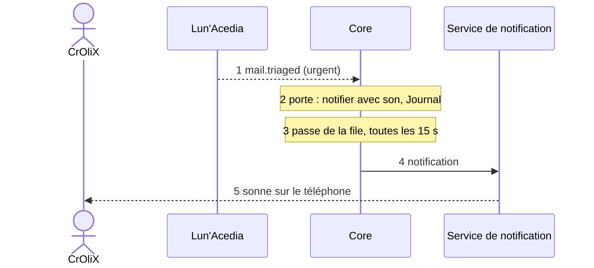

| # | De → vers | Par quoi | Ce qui circule | Retour |
|---|---|---|---|---|
| 1 | Lun'Acedia → core | événement `mail.triaged` | comme S4.6 | aucun |
| 2 | Core → lui-même | porte d'attention | palier P0, entrée décisive « absence » | notifier avec son ; rien n'est dit ni écrit au fil |
| 3 | Core → lui-même | file de notification | la ligne de l'événement ; la porte est relue à chaque passe | — |
| 4 | Core → service de notification | envoi web push | `title` (l'objet du mail, masqué par Lun'Acedia), un lien vers le panneau, une marque d'identité, « avec son », durée de vie 1 heure | « reçu », « à réessayer » ou « abonnement disparu » |
| 5 | Service → téléphone | notification | le titre | — |

- **Ce que CrOliX voit, et où** : une notification sonore sur le téléphone, qui porte l'objet du mail. En ouvrant
  le panneau : la ligne « Urgent » de À trancher et l'entrée du Journal, comme S4.6. Rien au fil.
- **Ce qui s'écrit** : l'événement, sa trace (arrivée, puis fin « envoyée »), l'entrée du Journal, la ligne de la
  file de notification.
- **Qui décide** : du code.
- **Erreurs et cas limites** :
  - **Aucun appareil abonné** : la file de notification ne lit rien ; l'urgence n'a que sa ligne dans À trancher
    et au Journal.
  - Tous les appareils répondent « à réessayer » : la ligne reste, réessayée toutes les 15 secondes, jusqu'à
    1 heure après l'heure de l'événement, puis abandonnée (« expirée »).
  - Un appareil répond « abonnement disparu » : son abonnement est retiré.
  - CrOliX fait « Vu » avant l'envoi : la ligne est abandonnée (« vue »).
  - Il revient au bureau avant l'envoi (sans appel, réglage P0 actif) : la porte relue ne notifie plus, la ligne
    est abandonnée. Rien n'est alors dit non plus : la parole ne se décide qu'à l'arrivée de l'événement.
- **Écart avec les décisions** : aucun connu.
- **Non vérifié** : l'affichage de la notification par le téléphone ; le titre traverse un service tiers.

---

### S4.8 · Urgence pendant la plage de nuit

- **Déclencheur** : l'événement urgent arrive entre 23 h et 7 h, heure de Paris (plage réglable, activable).
- **Acteurs** : Lun'Acedia, le core, le panneau, le service de notification.
- **Avant** : la plage de nuit est active. La présence ne compte pas.

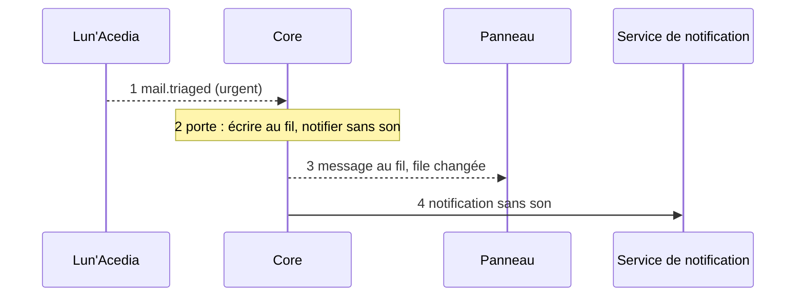

| # | De → vers | Par quoi | Ce qui circule | Retour |
|---|---|---|---|---|
| 1 | Lun'Acedia → core | événement | comme S4.6 | aucun |
| 2 | Core → lui-même | porte d'attention | palier P0, entrée décisive « nuit » | écrire au fil sans voix, notifier sans son, Journal |
| 3 | Core → panneaux ouverts | signaux en direct | le message « Urgent : <objet>. » ajouté au fil, la file changée | — |
| 4 | Core → service de notification | envoi web push | comme S4.7, marqué « sans son » | comme S4.7 |

- **Ce que CrOliX voit, et où** : au réveil, une notification silencieuse, la phrase au fil, la ligne « Urgent »
  de À trancher, l'entrée du Journal.
- **Ce qui s'écrit** : comme S4.6, plus la ligne de notification.
- **Qui décide** : du code ; la plage de nuit passe avant la présence.
- **Erreurs et cas limites** :
  - La plage de nuit ne peut pas être lue pendant la passe de notification : l'urgence garde son son.
  - Au rituel d'accueil, une urgence de nuit est comptée, pas nommée (famille 8).
- **Écart avec les décisions** : F2 veut que la nuit vérifie l'urgent resté non lu, par étiquettes réglables.
  Rien de tel n'est codé : la nuit ne relit pas les mails urgents (famille 6).
- **Non vérifié** : rien de plus qu'en S4.7.

---

### S4.9 · Urgence au bureau, non dite

- **Déclencheur** : l'événement urgent arrive pendant une présence, mais une entrée de la porte empêche la voix.
- **Acteurs** : Lun'Acedia, le core, le panneau, le service de notification.
- **Avant** : présence en cours, hors plage de nuit.

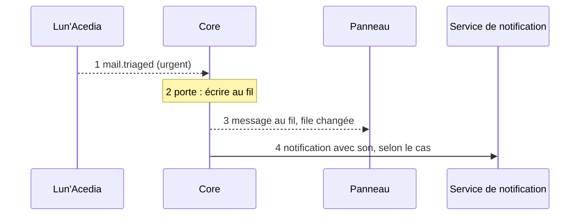

| # | De → vers | Par quoi | Ce qui circule | Retour |
|---|---|---|---|---|
| 1 | Lun'Acedia → core | événement | comme S4.6 | aucun |
| 2 | Core → lui-même | porte d'attention | la première ligne qui s'applique, voir le tableau des cas | — |
| 3 | Core → panneaux ouverts | signaux en direct | le message au fil, la file changée | — |
| 4 | Core → service de notification | envoi web push | comme S4.7, avec son | comme S4.7 |

| Cas | Entrée décisive | Au fil | Voix | Téléphone |
|---|---|---|---|---|
| Appel en cours au bureau | « appel » | oui | non | notification avec son |
| Réglage « Dit à voix haute : P0 » coupé | « réglage P0 » | oui | non | notification avec son |
| Événement daté de 5 minutes ou plus (rejeu après coupure) | « ancienneté » | oui | non | rien |
| Sourdine posée au bureau | aucune : sans effet | oui | oui, comme S4.6 | rien |

- **Ce que CrOliX voit, et où** : la phrase au fil, la ligne « Urgent » de À trancher, l'entrée du Journal ; le
  téléphone sonne dans les deux premiers cas.
- **Ce qui s'écrit** : comme S4.6.
- **Qui décide** : du code. L'ordre des lignes : nuit, absence, appel, réglage, ancienneté, puis voix.
- **Erreurs et cas limites** :
  - **La sourdine** : la porte du core l'ignore pour une urgence et envoie la parole. Lun'Luxuria relit sa propre
    sourdine avant de dire (famille 8).
  - Une date d'événement illisible vaut « ancienne » : jamais dite.
  - La porte tombe en panne à l'arrivée : l'événement et sa ligne au Journal sont gardés, l'urgence est écrite
    au fil sans voix. La file de notification redécide de son côté, à sa passe.
- **Écart avec les décisions** : T11 : la sourdine est lue à deux endroits.
- **Non vérifié** : qui pose les drapeaux « appel », « sourdine », « réglage P0 » : lu côté core seulement, comme
  des champs reçus avec la présence (famille 8).

---

### S4.10 · Alertes urgentes coupées pour le poste

- **Déclencheur** : l'événement urgent arrive alors que CrOliX a coupé « Alertes urgentes en direct » pour
  Lun'Acedia, dans l'Atelier du panneau.
- **Acteurs** : CrOliX (le réglage), Lun'Acedia, le core, le panneau.
- **Avant** : le réglage du poste est coupé (actif par défaut).

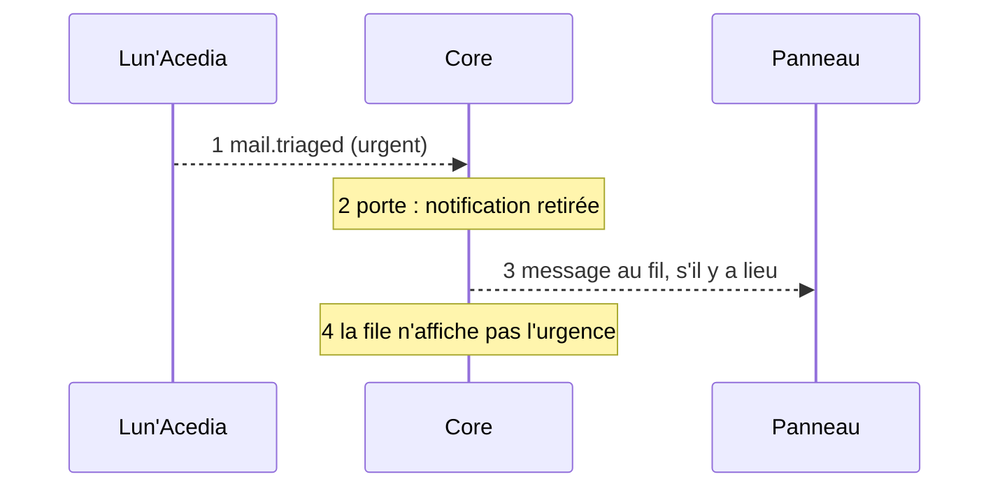

| # | De → vers | Par quoi | Ce qui circule | Retour |
|---|---|---|---|---|
| 1 | Lun'Acedia → core | événement | comme S4.6 ; Lun'Acedia ne connaît pas le réglage et émet toujours | aucun |
| 2 | Core → lui-même | porte d'attention | la sortie « notifier » est retirée, motif « urgences coupées » ; la sortie « dire » ne change pas | — |
| 3 | Core → panneau, Lun'Luxuria | signal, parole | la phrase, dite ou écrite selon S4.6, S4.8 ou S4.9 | — |
| 4 | Core → panneau | lecture de la file | les urgences des postes dont le réglage est coupé sont écartées | — |

- **Ce que CrOliX voit, et où** : aucune notification, aucune ligne « Urgent » dans À trancher. **Il entend
  quand même la phrase** s'il est au bureau (S4.6), ou la lit au fil la nuit, en appel, réglage P0 coupé. Absent
  et de jour : rien d'autre que l'entrée du Journal.
- **Ce qui s'écrit** : l'événement, sa trace, l'entrée « urgence » du Journal, qui reste « à trancher » sans
  bouton pour la voir.
- **Qui décide** : CrOliX par le réglage ; du code pour l'effet.
- **Erreurs et cas limites** :
  - Le réglage est relu à chaque lecture de la file : le remettre fait réapparaître dans À trancher les urgences
    non vues du jour. Leurs notifications, abandonnées à la première passe, ne repartent pas.
- **Écart avec les décisions** : le libellé du réglage dit « en direct » ; la voix n'est pas coupée. Le standard
  des notifications dit seulement « ne notifie pas » : le code le suit.
- **Non vérifié** : rien.

---

### S4.11 · « Vu » sur une urgence

- **Déclencheur** : CrOliX appuie sur « Vu » sur une ligne « Urgent » de À trancher.
- **Acteurs** : CrOliX, le panneau, le core.
- **Avant** : l'urgence est du jour de Natsume, non vue, alertes du poste actives.

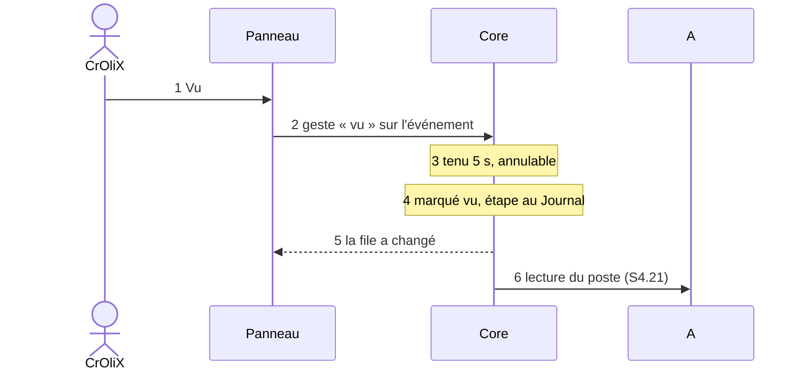

| # | De → vers | Par quoi | Ce qui circule | Retour |
|---|---|---|---|---|
| 1 | CrOliX → panneau | bouton | — | la ligne quitte la file à l'écran |
| 2 | Panneau → core | envoi d'un geste | l'identifiant de l'événement au core, le geste « vu », le lieu du geste | accepté et tenu ; « Déjà tranchée ailleurs. » si l'urgence n'est plus dans la file |
| 3 | Core → lui-même | attente | 5 secondes pendant lesquelles CrOliX peut annuler | — |
| 4 | Core → lui-même | écriture | l'événement marqué vu ; au Journal, l'étape « Vue. » et l'état « vue » | — |
| 5 | Core → panneaux ouverts | signal en direct | « la file a changé » | le panneau relit la file |
| 6 | Core → Lun'Acedia | lecture du poste | voir S4.21 (santé, cartes, coûts, agenda) | — |

- **Ce que CrOliX voit, et où** : la ligne disparaît de À trancher ; au Journal, l'entrée passe à « vue ».
- **Ce qui s'écrit** : au core seulement. Aucun geste n'est relayé à Lun'Acedia : le mail n'est ni marqué lu ni
  touché. Une fois le geste exécuté, le core relit quand même le poste (S4.21), comme après tout geste réglé.
- **Qui décide** : CrOliX.
- **Erreurs et cas limites** :
  - Une notification encore en file pour cette urgence est abandonnée (« vue »).
  - Le lien de la ligne ouvre le mail dans l'écran de Lun'Acedia (`#/mail/<id>`) ; l'ouvrir là-bas le marque lu
    dans Gmail (S4.23) sans marquer l'urgence vue au core.
  - Une urgence non vue quitte À trancher d'elle-même à la fin du jour de Natsume ; son entrée du Journal reste
    « à trancher ».
- **Écart avec les décisions** : T16 : « Vu » ne vit que dans le core. La carte du 27/11 (§ 4.8) note qu'aucun
  geste ne reporte, ne délègue ni ne répond : confirmé.
- **Non vérifié** : la mécanique complète du geste tenu (famille 3 ou 9) ; seul le cas « vu » est lu. La ligne
  disparaît-elle bien de tous les appareils ouverts, et comment le panneau relit-il la file après le signal ?

---

### S4.12 · Proposition de tri du modèle

- **Déclencheur** : la passe de tri trouve un mail entrant qu'aucune règle ne reconnaît, avec un modèle configuré.
- **Acteurs** : Lun'Acedia, Gmail, le fournisseur du modèle, le core, le panneau, les écrans de Lun'Acedia.
- **Avant** : une clé de fournisseur en service chez Lun'Acedia ; aucune pause ; seuil de rangement seul à 100
  (le défaut), ou confiance du modèle sous le seuil.

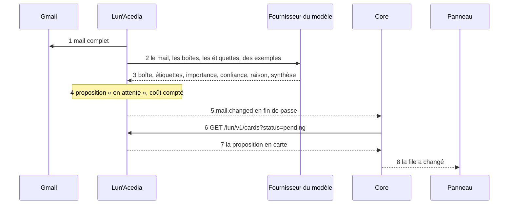

| # | De → vers | Par quoi | Ce qui circule | Retour |
|---|---|---|---|---|
| 1 | Lun'Acedia → Gmail | `GET …/messages/<id>?format=full` | l'identifiant | le mail entier ; absent : le mail sort de la file |
| 2 | Lun'Acedia → fournisseur | un appel structuré | la consigne du tri ; entre balises `<mail>` : expéditeur, destinataires, date, objet, texte sans contenu caché ; la liste des boîtes et des étiquettes (`id`, nom) ; 8 exemples au plus de gestes de CrOliX (même expéditeur d'abord, puis même domaine) | — |
| 3 | Fournisseur → Lun'Acedia | réponse au schéma | `boxId` (une boîte, `trash`, `spam` ou `none`), `tagIds`, `importance` (`urgent`, `normal`, `info`, `none`), `confidence` (0 à 100), `reason` (160 caractères), `synthesis` (2 lignes de 140 caractères) ; l'usage en jetons | — |
| 4 | Lun'Acedia → elle-même | écriture | la proposition au statut « en attente » ; la raison et la synthèse **sans phrase recopiée du mail et secrets masqués** ; le coût à l'usage « tri » | — |
| 5 | Lun'Acedia → core et écrans | événement `mail.changed` | `importance: log`, `data: { added: [], changed: [<ids en attente>], removed: [] }` ; **un seul par passe**, aucun événement par proposition | aucun |
| 6 | Core → Lun'Acedia | `GET /lun/v1/cards?status=pending` | rien | — |
| 7 | Lun'Acedia → core | réponse | une carte par proposition : `id: mail:<id>`, `action: mail.validate`, `effect: write`, `kind: Proposition de tri`, `title` (objet masqué), `lines` (la synthèse, masquée), `reason` (masquée, **seulement si la proposition a une synthèse** : une raison d'avant la synthèse reste chez le poste), `importance: low` (ou `normal` si le modèle a dit urgent, S4.13), `bulk: true` si la confiance atteint le seuil de validation groupée (85 par défaut), `fields` (`box` avec ses choix dont Corbeille et Spam, `tags` à choix multiple), `status`, `at`, `link: #/mail/<id>` | — |
| 8 | Core → panneaux ouverts | signal en direct | « la file a changé » | le panneau relit la file |

- **Ce que CrOliX voit, et où** : dans Lun'Acedia, le mail reste dans la boîte de réception, avec une proposition
  en attente. Dans le panneau : une carte « Proposition de
  tri » dans À trancher, sous Lun'Acedia, avec la synthèse ; une entrée « carte » au Journal, « à trancher »,
  étape « <nom du poste> propose. ». **Aucune notification** : la carte est de palier P2.
- **Ce qui s'écrit** : chez Lun'Acedia, la proposition et le coût ; rien dans Gmail. Au core, la lecture des
  cartes, la trace de l'arrivée de la carte, l'entrée du Journal.
- **Qui décide** : le modèle propose la boîte, les étiquettes, l'importance, la confiance. Le code décide
  d'attendre : à seuil 100 tout attend, quelle que soit la confiance (`pipeline.ts:281-287`,
  `pipeline.test.ts:109`). CrOliX tranche (famille 3).
- **Erreurs et cas limites** :
  - `boxId: none` : la proposition n'a pas de boîte ; sa carte n'a que le champ des étiquettes.
  - Une étiquette inconnue rendue par le modèle est retirée ; la confiance est bornée à 0-100.
  - Une ligne de synthèse qui recopie le mail est supprimée : la carte peut n'avoir aucune ligne.
  - Prix du modèle inconnu : coût compté à 0, un événement `llm.unknown-price` (palier P4), une fois par modèle.
  - Le mail quitte la boîte de réception par un autre chemin (Gmail, un filtre) : la proposition n'est plus
    servie en carte. À la lecture suivante, le core écrit « Tranchée dans <nom du poste>. » au Journal, alors
    que personne n'a tranché.
  - Le core ne lit que les cartes en attente ; il lit après chaque signal, donc quelques instants après la passe.
- **Écart avec les décisions** : T29 : cette carte de palier P2 compte dans le nombre de cartes de la lettre du
  matin (famille 6). F5 : la décision prise dans l'écran de Lun'Acedia n'est pas signalée (famille 3).
- **Non vérifié** : le rendu de la carte dans le panneau. Deux cartes de même nature et de même titre (deux mails
  au même objet) sont-elles empilées dans la file du core ? L'écran « À valider » de Lun'Acedia montre-t-il la
  boîte proposée, la confiance et la raison (seul le filtre serveur, mail en attente et encore en boîte de
  réception, est lu) ? Le contenu exact envoyé au fournisseur n'est lu que
  dans le code qui le compose (Lun'Acedia, `server/src/triage/llm-classifier.ts:56-71` et `110-133`).

---

### S4.13 · Mail jugé urgent par le modèle

- **Déclencheur** : le modèle du tri rend `importance: urgent` pour un mail sans règle.
- **Acteurs** : comme S4.12, plus le service de notification.
- **Avant** : comme S4.12.

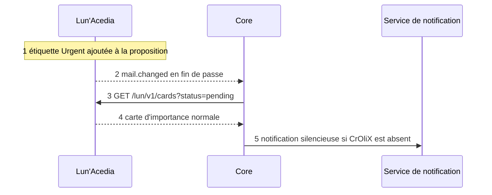

| # | De → vers | Par quoi | Ce qui circule | Retour |
|---|---|---|---|---|
| 1 | Lun'Acedia → elle-même | code | l'étiquette nommée « Urgent », si elle existe, est ajoutée aux `tagIds` de la proposition | — |
| 2 | Lun'Acedia → core | événement `mail.changed` | comme S4.12 ; **aucun événement d'urgence** | aucun |
| 3-4 | Core ↔ Lun'Acedia | `GET /lun/v1/cards?status=pending` | la carte de S4.12 avec `importance: normal` | — |
| 5 | Core → service de notification | envoi web push | « <titre de la carte> », ou « N cartes à valider » ; sans son ; durée de vie 24 heures | comme S4.7 |

- **Ce que CrOliX voit, et où** : la même carte qu'en S4.12 ; absent du bureau, une notification silencieuse
  après 2 minutes au moins (les cartes de même type partent ensemble). Au bureau : la carte seule.
- **Ce qui s'écrit** : comme S4.12, plus la ligne de notification.
- **Qui décide** : le modèle juge ; le code de Lun'Acedia borne : un avis du modèle ne fait jamais une urgence
  (`pipeline.ts:242` et `309-310`, `routes.ts:109`, test `pipeline.test.ts:205`).
- **Erreurs et cas limites** :
  - Seuil abaissé et confiance suffisante : le mail est rangé seul avec l'étiquette « Urgent », et un événement
    `mail.triaged` d'importance `normal` part (S4.14, puis S4.22).
  - Aucune étiquette ne s'appelle « Urgent » : rien n'est ajouté, la carte reste d'importance normale.
- **Écart avec les décisions** : aucun connu ; conforme au standard des notifications (« un avis de l'IA, sans
  règle : P1, jamais P0 »). F4 (pastille au bureau, puis téléphone au départ) n'est pas codé.
- **Non vérifié** : rien de plus qu'en S4.12.

---

### S4.14 · Rangement seul par le modèle

- **Déclencheur** : comme S4.12, avec un seuil de rangement seul sous 100 et une confiance qui l'atteint.
- **Acteurs** : Lun'Acedia, Gmail, le fournisseur du modèle, le core.
- **Avant** : CrOliX a abaissé le seuil de rangement seul dans les réglages de Lun'Acedia (`PUT /api/settings`,
  `threshold`). Le dictionnaire dit « le seuil par boîte » et proscrit un seuil commun à toutes les boîtes : le code
  n'a qu'**un seuil commun** (écart, plus bas).

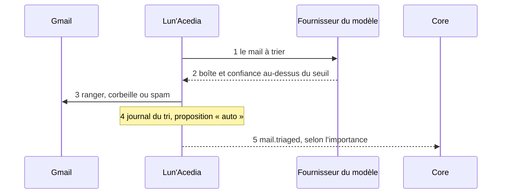

| # | De → vers | Par quoi | Ce qui circule | Retour |
|---|---|---|---|---|
| 1-2 | Lun'Acedia ↔ fournisseur | comme S4.12 | comme S4.12 | comme S4.12 |
| 3 | Lun'Acedia → Gmail | `POST …/messages/<id>/modify`, ou `…/trash` | la boîte ajoutée et `INBOX` retiré ; ou la corbeille ; ou `SPAM` ajouté | les nouveaux `labelIds` |
| 4 | Lun'Acedia → elle-même | écriture | journal du tri (origine « IA », action ranger, corbeille ou spam), proposition « auto » | — |
| 5 | Lun'Acedia → core | événement `mail.triaged` | `importance: normal` si le modèle a dit `urgent`, `info` s'il a dit `normal` ou `info` ; `title`, `data: { id, boxId, confidence }`, `link` ; **aucun événement si le modèle a dit `none`** | aucun |

- **Ce que CrOliX voit, et où** : le mail dans sa boîte et une ligne annulable dans le journal du tri de
  Lun'Acedia. Au core : une entrée « événement » au Journal (sauf importance `none`) ; une notification
  silencieuse seulement pour l'importance `normal`, s'il est absent (S4.22).
- **Ce qui s'écrit** : chez Lun'Acedia, le journal du tri, la proposition, le coût. Au core, l'événement et son
  entrée, s'il y a événement.
- **Qui décide** : le modèle (boîte, confiance), bordé par le code : jamais de spam sous 95 de confiance, quel
  que soit le seuil (`pipeline.ts:63-64` et `283-287`) ; jamais de rangement sans boîte proposée.
- **Erreurs et cas limites** :
  - Un mail jugé sans intérêt et mis seul à la corbeille (`importance: none`) ne laisse **aucune trace au core**.
  - Un rangement à la main sur un mail que le modèle a rangé seul règle sa proposition : « acceptée » si la boîte
    est la même, « corrigée » sinon, et devient un exemple (`pipeline.ts:534-541`).
- **Écart avec les décisions** : T20 (P3 : la sortie « lettre » n'est lue par personne). Le dictionnaire parle
  d'un « seuil par boîte » ; le code n'a qu'un seuil commun (`threshold`).
- **Non vérifié** : rien.

---

### S4.15 · Mail sans règle et sans modèle

- **Déclencheur** : la passe de tri trouve un mail qu'aucune règle ne reconnaît, sans clé de fournisseur.
- **Acteurs** : Lun'Acedia.
- **Avant** : aucune clé en service (ni dans les réglages, ni dans l'environnement).

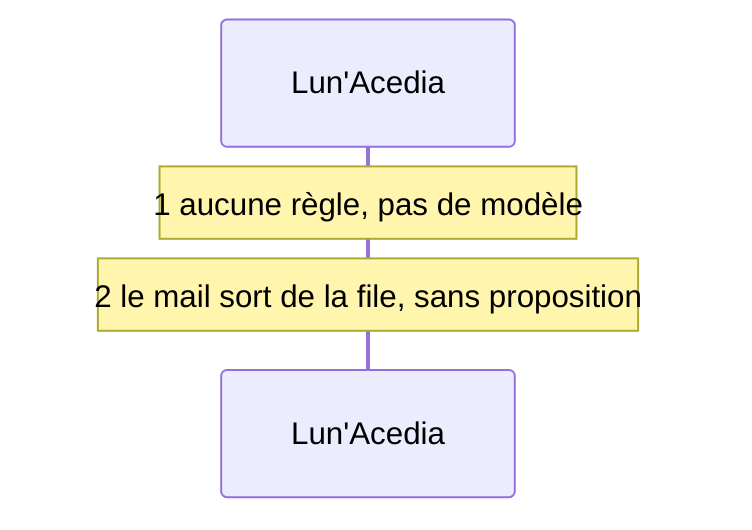

| # | De → vers | Par quoi | Ce qui circule | Retour |
|---|---|---|---|---|
| 1 | Lun'Acedia → elle-même | passe de tri | le mail en cache | — |
| 2 | Lun'Acedia → elle-même | écriture | la réservation est rendue, le mail quitte la file | aucun événement |

- **Ce que CrOliX voit, et où** : le mail dans la boîte de réception de Lun'Acedia, sans proposition. Au core :
  rien d'autre que le signal `mail.changed` de la synchronisation.
- **Ce qui s'écrit** : rien de plus que le cache.
- **Qui décide** : du code (`pipeline.ts:263-268`). Au démarrage, une ligne du journal du serveur dit : « seules
  les règles trient les mails ».
- **Erreurs et cas limites** : une clé enregistrée ensuite sert dès la passe suivante, pour les mails à venir ;
  ceux déjà sortis de la file ne sont pas repris.
- **Écart avec les décisions** : aucun connu.
- **Non vérifié** : rien.

---

### S4.16 · Tri en pause

- **Déclencheur** : une passe de tri arrive alors qu'une pause est posée.
- **Acteurs** : Lun'Acedia, le core, CrOliX.
- **Avant** : une pause posée dans Lun'Acedia, ou une pause du core relayée (`POST /lun/v1/pause` avec
  `by: core`). La pose elle-même est à la famille 10.

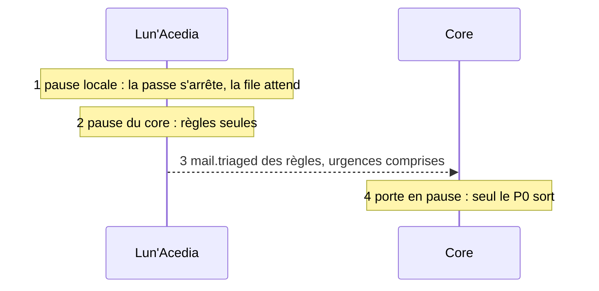

| # | De → vers | Par quoi | Ce qui circule | Retour |
|---|---|---|---|---|
| 1 | Lun'Acedia → elle-même | passe de tri | l'état de pause, relu avant chaque mail | pause locale : rien n'est trié |
| 2 | Lun'Acedia → elle-même | passe de tri | sous la pause du core, les règles rangent ; un mail sans règle reste dans la file, sans appel au modèle | — |
| 3 | Lun'Acedia → core | événements | ceux de S4.5 et S4.6 | aucun |
| 4 | Core → lui-même | porte d'attention | en pause, tout palier sauf P0 : aucune sortie que le Journal ; un P0 suit S4.6 à S4.9 | — |

- **Ce que CrOliX voit, et où** : pause locale : les mails s'accumulent dans la boîte de réception, sans
  proposition. Pause du core : les mails à règle sont rangés, une urgence par règle est dite ou notifiée comme
  hors pause, le reste attend.
- **Ce qui s'écrit** : la file du tri garde ce qui attend. Au core, les événements reçus ont leur entrée au
  Journal ; les notifications « à prévenir » sont abandonnées, motif « pause ».
- **Qui décide** : du code. La pause locale l'emporte sur celle du core (`server/src/contract/state.ts:23`,
  test `pipeline.test.ts:276`).
- **Erreurs et cas limites** :
  - La synchronisation continue pendant les deux pauses : le cache et les signaux `mail.changed` suivent.
  - À la reprise, rien ne relance le tri sur l'instant : la passe suivante (une minute au plus) vide la file, si
    la synchronisation qui la porte réussit (S4.1).
  - Une action demandée à la main ou par le core passe pendant la pause (Lun'Acedia,
    `server/src/contract/catalog.ts:82-85` ; famille 10).
  - Une notification « à prévenir » abandonnée pendant la pause n'est pas rejouée à la reprise.
- **Écart avec les décisions** : T13 (deux pauses de force inégale), T26 et F4 (ce qui arrive pendant une pause
  n'est rattrapé nulle part ailleurs qu'au Journal).
- **Non vérifié** : la pose et la levée de la pause, laissées à la famille 10. La pause locale se pose-t-elle par
  `POST /lun/v1/pause` sans `by`, ou l'écran de Lun'Acedia passe-t-il par une autre route (la route accepte ce
  corps, `server/src/contract/routes.ts:264-271`) ?

---

### S4.17 · Crédit épuisé ou clé refusée pendant le tri

- **Déclencheur** : l'appel au modèle du tri échoue pour crédit épuisé ou clé refusée.
- **Acteurs** : Lun'Acedia, le fournisseur du modèle, le core.
- **Avant** : une clé en service jusque-là.

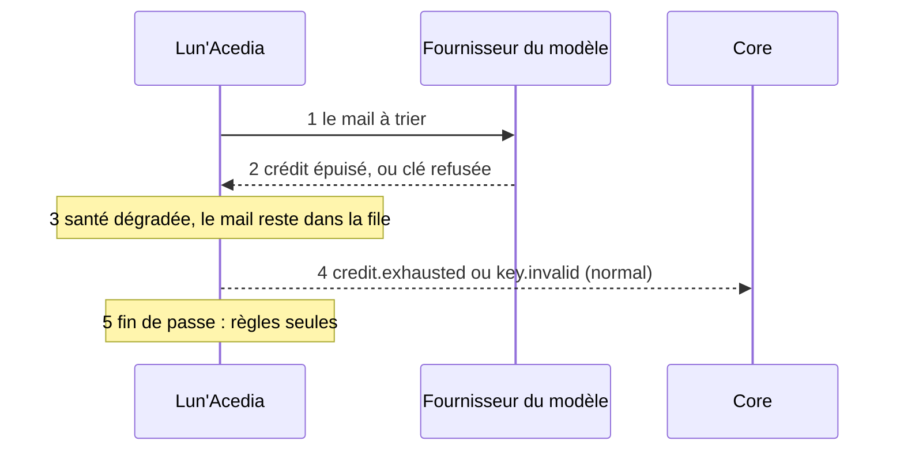

| # | De → vers | Par quoi | Ce qui circule | Retour |
|---|---|---|---|---|
| 1-2 | Lun'Acedia ↔ fournisseur | l'appel du tri | comme S4.12 | une erreur de crédit ou de clé |
| 3 | Lun'Acedia → elle-même | écriture | la raison de dégradation (`credit`, ou la clé du fournisseur) | — |
| 4 | Lun'Acedia → core | événement | `credit.exhausted` : `importance: normal`, titre « Crédit IA épuisé : le tri par l'IA est en pause, les règles continuent » ; ou `key.invalid` : `importance: normal`, `data: { provider }` ; **une seule fois** par panne | aucun |
| 5 | Lun'Acedia → elle-même | passe de tri | pour le reste de la passe, plus d'appel au modèle | les mails sans règle attendent |

- **Ce que CrOliX voit, et où** : au core, une entrée « événement » au Journal et, s'il est absent, une
  notification silencieuse (S4.22) ; le poste lu « dégradé » avec sa raison (S4.21). Dans Lun'Acedia, les mails
  sans règle restent sans proposition.
- **Ce qui s'écrit** : l'état dégradé chez Lun'Acedia ; la file du tri garde les mails.
- **Qui décide** : du code.
- **Erreurs et cas limites** :
  - Chaque passe suivante retente le modèle sur le premier mail sans règle ; au premier succès, l'état « crédit »
    est levé (`pipeline.ts:159`), et pour une clé, un événement `key.restored` (palier P4) part.
  - Un redémarrage avec la clé toujours refusée n'émet rien de nouveau (`pipeline.test.ts:341`).
- **Écart avec les décisions** : aucun connu. Le détail des clés et du crédit : familles 10 et 11.
- **Non vérifié** : la reconnaissance des erreurs du fournisseur (« crédit », « clé ») est lue dans le tri, pas
  dans les deux clients de fournisseur ; si une clé notée refusée est encore proposée au tri à la passe suivante
  (le choix du fournisseur, `server/src/llm/keys.ts`, n'est lu qu'en partie).

---

### S4.18 · Échec du tri d'un mail

- **Déclencheur** : une erreur pendant le tri d'un mail de la file.
- **Acteurs** : Lun'Acedia, Gmail, le fournisseur du modèle.
- **Avant** : une passe de tri en cours.

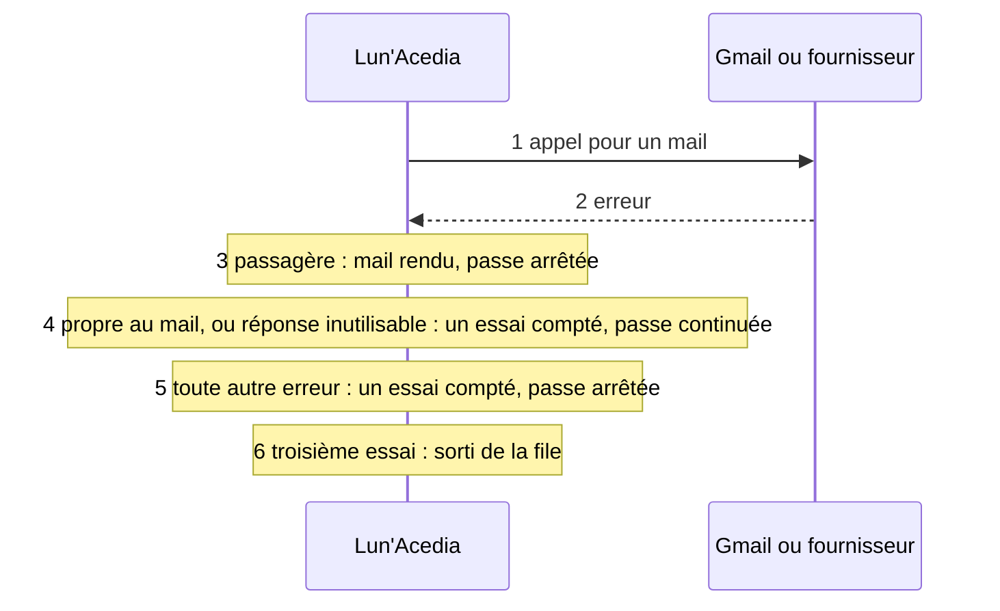

| # | De → vers | Par quoi | Ce qui circule | Retour |
|---|---|---|---|---|
| 1-2 | Lun'Acedia ↔ Gmail ou fournisseur | un appel du tri | — | une erreur |
| 3 | Lun'Acedia → elle-même | code | panne passagère : réseau, Google 429 ou 5xx, autorisation à renouveler, compte absent, fournisseur injoignable, base occupée | le mail reste dans la file **sans essai compté**, la passe s'arrête |
| 4 | Lun'Acedia → elle-même | code | erreur du mail seul (introuvable, refusé par Google en 400 ou 404, cible qui n'est plus une boîte), ou réponse du modèle inutilisable (hors format) | un essai compté, la passe continue |
| 5 | Lun'Acedia → elle-même | code | toute autre erreur | un essai compté, la passe s'arrête |
| 6 | Lun'Acedia → elle-même | code | un mail à son troisième essai (cas 4 ou 5) | il quitte la file |

- **Ce que CrOliX voit, et où** : rien de signalé. Le mail reste dans la boîte de réception, sans proposition.
  Seul le journal du serveur porte la ligne « Tri : mail <id> sorti de la file après 3 essais, à trier à la
  main : <motif> ».
- **Ce qui s'écrit** : le compteur d'essais de la file.
- **Qui décide** : du code (`pipeline.ts:321-339` et `378-409`, `server/src/triage/queue.ts:4` et `30-36`).
- **Erreurs et cas limites** :
  - Une passe arrêtée par une panne signale quand même, par `mail.changed`, les propositions déjà faites.
  - Un arrêt du serveur au milieu d'un tri : la réservation est rendue au démarrage, le mail est retrié.
  - Deux passes sur le même mail : il n'est traité qu'une fois (réservation).
- **Écart avec les décisions** : aucun événement ne dit au core qu'un mail a été abandonné par le tri : c'est un
  manque du même ordre que les trous F de la carte (« ce qui ne remonte jamais »), non listé dans T1 à T31.
- **Non vérifié** : rien.

---

### S4.19 · Autorisation Google à renouveler, compte absent

- **Déclencheur** : un appel à Google échoue parce que le jeton ne se renouvelle plus, ou aucun jeton lisible
  n'est gardé.
- **Acteurs** : Lun'Acedia, Google, le core.
- **Avant** : Google configuré sur le serveur.

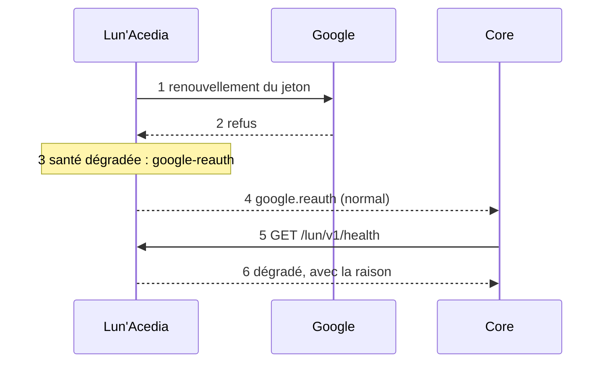

| # | De → vers | Par quoi | Ce qui circule | Retour |
|---|---|---|---|---|
| 1-2 | Lun'Acedia ↔ Google | `POST https://oauth2.googleapis.com/token` | le jeton de renouvellement, l'identité du client | `invalid_grant`, 400 ou 401 |
| 3 | Lun'Acedia → elle-même | écriture | la raison `google-reauth` | les appels suivants échouent sans appeler Google |
| 4 | Lun'Acedia → core | événement `google.reauth` | `importance: normal`, titre « Autorisation Google à renouveler » ; une seule fois | aucun |
| 5-6 | Core ↔ Lun'Acedia | `GET /lun/v1/health` | — | `status: degraded`, `reason: google-reauth` |

- **Ce que CrOliX voit, et où** : au core, une entrée au Journal, une notification silencieuse s'il est absent
  (S4.22), le poste « dégradé ». Dans Lun'Acedia, plus de nouveaux mails.
- **Ce qui s'écrit** : l'état dégradé ; il est levé quand un nouveau consentement enregistre des jetons.
- **Qui décide** : du code.
- **Erreurs et cas limites** :
  - **Aucun compte branché, ou jeton illisible avec la clé du serveur** : la synchronisation échoue en silence à
    chaque passe (`server/src/main.ts:99-105`), la santé reste « ok », aucun événement ne part. Pour un jeton
    illisible, une ligne au démarrage du serveur le dit (`main.ts:53-63`) ; pour aucun compte branché, aucune
    ligne. Dans les deux cas, l'état du compte dans les réglages de Lun'Acedia affiche « non connecté » (avec
    « illisible » pour le second, `server/src/google/oauth.ts:108-116`).
  - La passe de tri n'a lieu qu'après une synchronisation réussie (S4.1) : tant que l'échec dure, la file du tri
    ne se vide plus, règles comprises.
  - Google non configuré sur le serveur : aucune boucle ne démarre ; les routes de la boîte répondent 503.
- **Écart avec les décisions** : T23, à préciser : seul le cas « aucun compte ou jeton illisible » ne remonte
  pas ; une autorisation révoquée remonte par la santé et par un événement.
- **Non vérifié** : le parcours de reconnexion et ce que l'écran du compte Google affiche alors (famille 12).

---

### S4.20 · Le flux d'événements vers le core

- **Déclencheur** : le core démarre, un poste vient d'être relié, ou le flux a été coupé.
- **Acteurs** : le core, Lun'Acedia.
- **Avant** : Lun'Acedia reliée au core (un jeton gardé par le core).

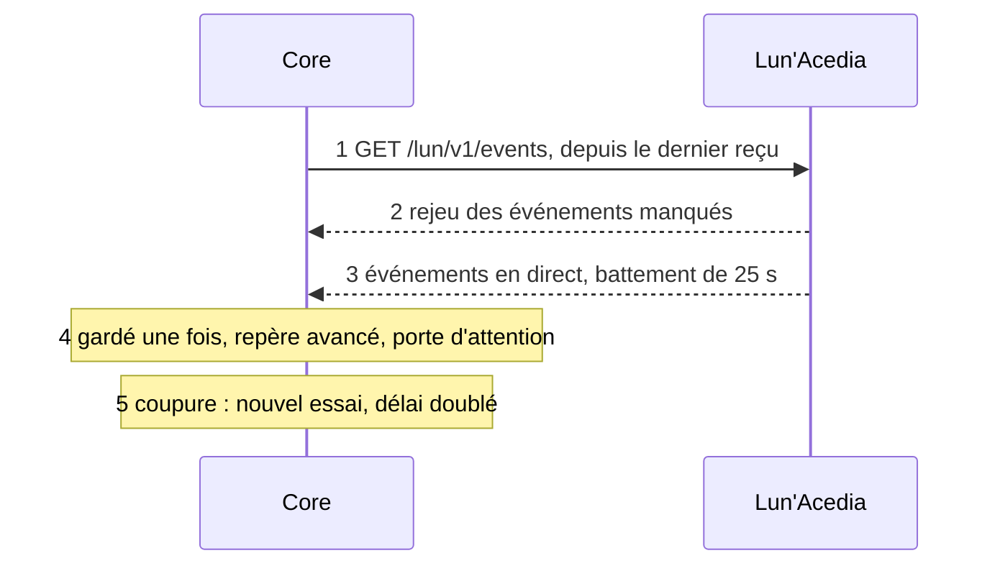

| # | De → vers | Par quoi | Ce qui circule | Retour |
|---|---|---|---|---|
| 1 | Core → Lun'Acedia | `GET /lun/v1/events` | le jeton du core ; `Last-Event-ID` : l'identifiant du dernier événement gardé | un flux ouvert |
| 2 | Lun'Acedia → core | flux | tous les événements d'identifiant supérieur, dans l'ordre | — |
| 3 | Lun'Acedia → core | flux | chaque événement : `id`, `type`, `importance`, `at`, `title`, et selon le cas `lines`, `data`, `link` ; un commentaire `ping` toutes les 25 secondes sans événement | — |
| 4 | Core → lui-même | écriture | l'événement et le repère de reprise, ensemble ; la décision de la porte pour un événement nouveau | — |
| 5 | Core → Lun'Acedia | nouvel essai | après 1 seconde, puis le double à chaque échec, 60 secondes au plus | — |

- **Ce que CrOliX voit, et où** : rien en marche normale. Flux coupé : le poste passe « injoignable » dans le
  panneau ; au-delà de 15 minutes, un événement du core le dit (famille 11).
- **Ce qui s'écrit** : au core, chaque événement une seule fois (même poste, même identifiant, même date) et le
  repère de reprise. Chez Lun'Acedia, les événements sont gardés 7 jours.
- **Qui décide** : du code.
- **Erreurs et cas limites** :
  - Un événement rejoué que le core a déjà : ignoré, **aucune seconde décision** : rien n'est redit ni renotifié.
  - Un événement manqué pendant la coupure passe la porte avec son âge : une urgence de plus de 5 minutes n'est
    pas dite (S4.9) ; de plus d'une heure, elle n'est plus notifiée (S4.7).
  - Une coupure de plus de 7 jours : les événements plus anciens ont été purgés chez Lun'Acedia, ils sont perdus.
  - Un événement mal formé (champ obligatoire absent, importance inconnue) : ignoré sans trace.
  - Un lien qui n'est pas un chemin de l'écran du poste (`/…` ou `#/…`) : l'événement est gardé sans lien.
  - Lun'Acedia répond 401 : le poste est « à relier », l'écoute s'arrête jusqu'à une nouvelle liaison.
  - Le core ne peut pas garder l'événement (sa base) : il le dit dans sa propre santé et réessaie du même point.
  - À chaque ouverture du flux, le core renvoie au poste son état de pause (famille 10).
  - Les écrans de Lun'Acedia lisent le même flux, avec leur jeton d'appareil, et se reconnectent après 3 secondes.
- **Écart avec les décisions** : aucun connu.
- **Non vérifié** : le découpage du flux côté core (lu : son appel et son traitement d'une trame).

---

### S4.21 · Les lectures du core chez Lun'Acedia

- **Déclencheur** : le démarrage du core, puis toutes les 120 secondes ; 50 millisecondes après le dernier signal
  du poste (flux ouvert ou événement reçu) ; après un geste relayé ; à la demande depuis le panneau.
- **Acteurs** : le core, Lun'Acedia, le panneau.
- **Avant** : Lun'Acedia reliée, son jeton lisible.

```mermaid
sequenceDiagram
    participant N as Core
    participant A as Lun'Acedia
    participant P as Panneau
    N->>A: 1 GET /lun/v1/health
    N->>A: 2 GET /lun/v1/cards?status=pending
    N->>A: 3 GET /lun/v1/costs (jour, puis mois)
    N->>A: 4 POST /lun/v1/actions/agenda.list
    N-->>P: 5 la file a changé, si les cartes ont changé
```

| # | De → vers | Par quoi | Ce qui circule | Retour |
|---|---|---|---|---|
| 1 | Core → Lun'Acedia | `GET /lun/v1/health` (8 s au plus) | rien | `status` (`ok`, `paused`, `degraded`), `reason`, `paused`, `pausedBy`, `version`, `contract`, `agent`, `agentName` |
| 2 | Core → Lun'Acedia | `GET /lun/v1/cards?status=pending` (15 s au plus) | rien | les cartes de l'agent et les propositions de tri en attente, des plus récentes aux plus anciennes |
| 3 | Core → Lun'Acedia | `GET /lun/v1/costs?since=…` deux fois | le début du jour de Natsume, puis le début du mois | `since`, `total` |
| 4 | Core → Lun'Acedia | `POST /lun/v1/actions/agenda.list` | `from` (aujourd'hui), `to` | les événements d'agenda et les tâches datées (famille 5) |
| 5 | Core → panneaux ouverts | signal en direct | « la file a changé » | — |

- **Ce que CrOliX voit, et où** : À trancher, les compteurs du Bureau, l'état du poste et son coût du jour sont
  servis depuis cette dernière lecture ; le panneau n'appelle jamais le poste pour les afficher.
- **Ce qui s'écrit** : au core, la dernière lecture des cartes et son heure, l'état du poste, les coûts, l'agenda
  à venir ; une entrée au Journal pour chaque carte nouvelle (« Lun'Acedia propose. ») et l'étape « Tranchée
  dans Lun'Acedia. » pour une carte disparue encore « à trancher ».
- **Qui décide** : du code. **Le core ne lit pas la boîte** : aucun mail, aucun compteur de non-lus, aucune règle
  n'est lu dans cette boucle. Des mails, il ne connaît que les événements, les cartes et, la nuit, le bilan du
  jour (action `day.digest`, famille 6).
- **Erreurs et cas limites** :
  - La santé ne répond pas : la passe s'arrête, le poste est noté injoignable ; les cartes gardées restent
    affichées, en lecture seule. Une lecture de plus de 5 minutes, ou en échec, est dite « périmée ».
  - Une seule carte hors du format attendu fait échouer la lecture de toutes (« Cartes illisibles ») ; les coûts
    et l'agenda sont lus quand même.
  - Une passe est déjà en cours : les demandes reçues pendant elle donnent une seule passe de plus.
  - Des centaines d'événements rejoués d'un coup donnent une seule lecture.
- **Écart avec les décisions** : T27 (une carte illisible arrête la lecture de toutes). F5 : le core n'apprend une
  décision prise dans l'écran du poste qu'ici, 2 minutes au plus tard.
- **Non vérifié** : le format exact des réponses de coûts et d'agenda, laissé aux familles 10 et 5.

---

### S4.22 · Événement « à prévenir »

- **Déclencheur** : un événement d'importance `normal` arrive de Lun'Acedia : mail jugé urgent et rangé seul
  (S4.14), crédit épuisé, clé refusée (S4.17), autorisation Google à renouveler (S4.19), copie de la base en
  échec.
- **Acteurs** : Lun'Acedia, le core, le service de notification, CrOliX.
- **Avant** : au moins un appareil abonné.

```mermaid
sequenceDiagram
    actor C as CrOliX
    participant A as Lun'Acedia
    participant N as Core
    participant S as Service de notification
    A-->>N: 1 événement (normal)
    Note over N: 2 porte : Journal, notifier sans son si absent
    Note over N: 3 file : attendre 2 min, grouper par type
    N->>S: 4 une notification pour le groupe
    S-->>C: 5 tiroir du téléphone, sans son
```

| # | De → vers | Par quoi | Ce qui circule | Retour |
|---|---|---|---|---|
| 1 | Lun'Acedia → core | événement | selon son type ; pour un mail : `title` (objet masqué), `data`, `link` | aucun |
| 2 | Core → lui-même | porte d'attention | palier P1 ; présent : aucune notification, motif « présence » ; absent : notifier sans son | — |
| 3 | Core → lui-même | file de notification | les lignes de même type sont regroupées ; le groupe part quand sa plus ancienne a 2 minutes | — |
| 4 | Core → service de notification | envoi web push | un seul : son titre ; plusieurs : le titre du dernier et « Et une autre. » ou « Et N autres. » ; sans son ; durée de vie 24 heures | comme S4.7 |
| 5 | Service → téléphone | notification | — | — |

- **Ce que CrOliX voit, et où** : absent : une notification silencieuse. **Au bureau : rien d'autre que l'entrée
  du Journal**, ni voix, ni pastille, ni ligne dans À trancher.
- **Ce qui s'écrit** : l'événement, sa trace, l'entrée « événement » du Journal (sans état), la ligne de
  notification et sa fin.
- **Qui décide** : du code. La porte est relue à chaque passe de 15 secondes : c'est l'état de CrOliX au moment
  de l'envoi qui compte, pas celui de l'arrivée.
- **Erreurs et cas limites** :
  - CrOliX est au bureau à la première passe : la ligne est abandonnée pour de bon ; son départ ne la rejoue pas.
  - En pause du core : abandonnée, motif « pause ». La pause ne laisse passer une alerte de santé que si elle
    vient du core lui-même ; un crédit épuisé chez Lun'Acedia est retenu.
  - Les entrées de la porte sont illisibles : la ligne attend la passe suivante.
  - Au-delà de 24 heures : abandonnée (« expirée »).
- **Écart avec les décisions** : T26 et F4 : un « à prévenir » reçu au bureau ou en pause devrait allumer une
  pastille, puis partir sur le téléphone au départ de CrOliX. Rien de cela n'est codé.
- **Non vérifié** : l'événement `backup.failed` de Lun'Acedia est relevé par son type et son importance
  seulement (famille 11).

---

### S4.23 · Lire un mail, marquer lu ou non lu

- **Déclencheur** : CrOliX ouvre un mail dans l'écran de Lun'Acedia, ou choisit « marquer lu » ou « non lu ».
- **Acteurs** : CrOliX, l'écran de Lun'Acedia, Lun'Acedia, Gmail.
- **Avant** : un compte branché.

```mermaid
sequenceDiagram
    actor C as CrOliX
    participant E as Écran d'Acedia
    participant A as Lun'Acedia
    participant G as Gmail
    C->>E: 1 ouvre un mail
    E->>A: 2 GET /api/mail/:id
    A->>G: 3 mail complet, pièces en ligne
    A-->>E: 4 le mail rendu
    E->>A: 5 POST /api/mail/:id/read
    A->>G: 6 retirer UNREAD
```

| # | De → vers | Par quoi | Ce qui circule | Retour |
|---|---|---|---|---|
| 2 | Écran → Lun'Acedia | `GET /api/mail/:id` | l'identifiant | — |
| 3 | Lun'Acedia → Gmail | `GET …/messages/<id>?format=full` | — | le mail ; le cache est rafraîchi |
| 4 | Lun'Acedia → écran | réponse | expéditeur, destinataires, copie, objet, corps en HTML, pièces jointes, libellés, la proposition s'il y en a une | 404 « Mail introuvable » |
| 5 | Écran → Lun'Acedia | `POST /api/mail/:id/read` | `read: true` (ou `false`) ; à l'ouverture, seulement si le mail était non lu | le changement de libellés |
| 6 | Lun'Acedia → Gmail | `POST …/messages/<id>/modify` | `UNREAD` retiré ou ajouté | les nouveaux `labelIds` |

- **Ce que CrOliX voit, et où** : le mail ; la ligne perd son gras sur place ; les compteurs de non-lus
  (`GET /api/mail/counts`) sont relus une fois que le serveur a répondu.
- **Ce qui s'écrit** : le libellé dans Gmail, le cache. **Pas de ligne au journal du tri** : lire n'est pas
  annulable. **Rien ne part vers le core.**
- **Qui décide** : CrOliX ; l'ouverture marque lu sans demander.
- **Erreurs et cas limites** :
  - Plusieurs mails : `POST /api/mail/batch` avec `op: { kind: read, read: true }`, 500 identifiants au plus.
  - « Non lu » referme le mail.
  - Le filtre « non lus » de la liste ne lit que le cache : la liste s'arrête avec lui.
  - Le core dispose de l'action `mail.markRead` du catalogue ; rien dans le core ne l'appelle de lui-même
    (famille 2 pour une demande confiée au poste).
- **Écart avec les décisions** : T16 : lire le mail d'une urgence ici ne la marque pas « vue » au core (S4.11).
- **Non vérifié** : rien.

---

### S4.24 · Ranger, archiver, corbeille, spam à la main

- **Déclencheur** : un geste de CrOliX sur un ou plusieurs mails dans l'écran de Lun'Acedia.
- **Acteurs** : CrOliX, l'écran de Lun'Acedia, Lun'Acedia, Gmail.
- **Avant** : un compte branché.

```mermaid
sequenceDiagram
    actor C as CrOliX
    participant E as Écran d'Acedia
    participant A as Lun'Acedia
    participant G as Gmail
    C->>E: 1 ranger, archiver, corbeille ou spam
    E->>A: 2 POST /api/mail/:id/<geste>
    A->>G: 3 modifier les libellés, ou corbeille
    Note over A: 4 journal du tri, exemple si rangement
    A-->>E: 5 le changement et son numéro de journal
    C->>E: 6 Annuler (5 s, ou Ctrl Z)
    E->>A: 7 POST /api/journal/:id/undo
```

| # | De → vers | Par quoi | Ce qui circule | Retour |
|---|---|---|---|---|
| 2 | Écran → Lun'Acedia | `POST /api/mail/:id/file` (`boxId`), `/archive`, `/trash`, `/untrash`, `/spam`, `/tags` (`add`, `remove`) ; ou `/api/mail/batch` | l'identifiant et le geste | 400 si la cible n'est pas une boîte, 404 si le mail manque |
| 3 | Lun'Acedia → Gmail | `POST …/messages/<id>/modify`, `…/trash`, `…/untrash` | les libellés à ajouter et à retirer | les nouveaux `labelIds` |
| 4 | Lun'Acedia → elle-même | écriture | une ligne du journal du tri (origine CrOliX) pour ranger, archiver, corbeille, spam ; pour un rangement, un exemple pour le modèle | — |
| 5 | Lun'Acedia → écran | réponse | `id`, libellés `before` et `after`, `journalId` | — |
| 7 | Écran → Lun'Acedia | `POST /api/journal/:id/undo` | le numéro de la ligne | 409 « Le mail a changé depuis, annulation refusée » |

- **Ce que CrOliX voit, et où** : le mail quitte la liste aussitôt ; un message (« Rangé dans … », « Mis à la
  corbeille », « Archivé », « Signalé comme spam ») avec « Annuler » pendant 5 secondes. Si le serveur refuse,
  la liste revient et l'erreur s'affiche.
- **Ce qui s'écrit** : Gmail, le cache, le journal du tri, l'exemple. La corbeille n'est jamais une suppression
  définitive.
- **Qui décide** : CrOliX.
- **Erreurs et cas limites** :
  - Ranger un mail qui attend une proposition : l'écran appelle la validation si la boîte est la même, la
    correction sinon (famille 3).
  - Ranger à la main un mail que le modèle a rangé seul règle sa proposition (S4.14).
  - L'annulation relit Gmail d'abord : refusée si le mail a changé depuis (hors lu, important, catégories).
  - En lot, un mail après l'autre : un échec en cours laisse les premiers faits et journalisés.
  - Le geste lui-même n'émet aucun événement (aucun appel d'émission dans ce chemin) : le core et les autres onglets
    ne l'apprennent pas par lui.
- **Écart avec les décisions** : F5 : un geste fait dans l'écran du satellite n'est signalé nulle part.
- **Non vérifié** : la synchronisation suivante émet-elle un `mail.changed` pour un geste fait par Lun'Acedia
  elle-même ? Gmail ajoute une entrée d'historique, mais le cache est déjà à jour et la synchronisation ne compte
  « changé » que si les libellés diffèrent du cache (`server/src/gmail/sync.ts:196`) ; non rejoué.

---

### S4.25 · Écrire et envoyer un mail depuis l'écran

- **Déclencheur** : CrOliX écrit un nouveau mail, répond ou transfère, puis clique sur « Envoyer ».
- **Acteurs** : CrOliX, l'écran de Lun'Acedia, Lun'Acedia, Gmail.
- **Avant** : un compte branché.

```mermaid
sequenceDiagram
    actor C as CrOliX
    participant E as Écran d'Acedia
    participant A as Lun'Acedia
    participant G as Gmail
    E->>A: 1 GET /api/send-as
    A->>G: 2 adresses « Envoyer en tant que »
    A-->>E: 3 les adresses et celle par défaut
    C->>E: 4 Envoyer
    E->>A: 5 POST /api/mail/send
    A->>G: 6 envoi du message
    G-->>A: 7 identifiant et fil
```

| # | De → vers | Par quoi | Ce qui circule | Retour |
|---|---|---|---|---|
| 1 | Écran → Lun'Acedia | `GET /api/send-as[?replyTo=<id>]` | le mail auquel on répond, s'il y en a un | — |
| 2 | Lun'Acedia → Gmail | `GET …/settings/sendAs` | — | les adresses, leur nom, la principale |
| 3 | Lun'Acedia → écran | réponse | `addresses[]`, `default` : pour une réponse, l'adresse qui a reçu le mail ; sinon la principale | — |
| 5 | Écran → Lun'Acedia | `POST /api/mail/send` | `from`, `to`, `cc`, `subject`, `html`, `text` ; pour une réponse, `threadId` ; pour un transfert, le mail d'origine dans `html` | 400 si `from` n'est pas une des adresses, ou si un en-tête porte un retour à la ligne |
| 6 | Lun'Acedia → Gmail | `POST …/messages/send` | le message encodé, `threadId` | — |
| 7 | Gmail → Lun'Acedia | réponse | `id`, `threadId` | — |

- **Ce que CrOliX voit, et où** : « Message envoyé ». Le mail apparaît dans « Envoyés » à la synchronisation
  suivante.
- **Ce qui s'écrit** : dans Gmail seulement. Pas de ligne au journal du tri, aucun événement, rien au core.
- **Qui décide** : CrOliX. La touche Entrée n'envoie jamais ; seul le clic le fait.
- **Erreurs et cas limites** :
  - L'adresse d'expédition se choisit dans la liste « De ».
  - Le mail envoyé n'entre pas dans le tri (S4.3).
  - **L'envoi n'existe que dans cet écran** : le catalogue du contrat n'a aucune action d'envoi
    (`server/src/contract/catalog.ts:387` : « there is no action that sends a mail, and none may ever be added »).
- **Écart avec les décisions** : F6 : l'envoi depuis Natsume, par une carte que CrOliX seul valide, n'est pas
  codé.
- **Non vérifié** : l'en-tête de réponse d'un mail écrit dans l'écran (seul `threadId` est posé pour une réponse
  directe ; `inReplyTo` ne l'est que pour un brouillon repris).

---

### S4.26 · Reprendre un brouillon et l'envoyer

- **Déclencheur** : CrOliX ouvre un brouillon préparé par l'agent du poste (sa création : famille 2) et clique
  sur « Envoyer », « Enregistrer » ou « Jeter ».
- **Acteurs** : CrOliX, l'écran de Lun'Acedia, Lun'Acedia, Gmail.
- **Avant** : le brouillon existe dans les brouillons de Gmail.

```mermaid
sequenceDiagram
    actor C as CrOliX
    participant E as Écran d'Acedia
    participant A as Lun'Acedia
    participant G as Gmail
    E->>A: 1 GET /api/drafts/:id
    A->>G: 2 le brouillon complet
    C->>E: 3 relit, corrige, Envoyer
    E->>A: 4 PUT /api/drafts/:id
    A->>G: 5 brouillon remplacé
    E->>A: 6 POST /api/drafts/:id/send
    A->>G: 7 envoi du brouillon
```

| # | De → vers | Par quoi | Ce qui circule | Retour |
|---|---|---|---|---|
| 1-2 | Écran → Lun'Acedia → Gmail | `GET /api/drafts/:id`, puis `GET …/drafts/<id>?format=full` | l'identifiant | `id`, `to`, `cc`, `subject`, `text`, `from`, `replyTo` (`id`, `threadId`) ; 404 « Brouillon introuvable » |
| 4-5 | Écran → Lun'Acedia → Gmail | `PUT /api/drafts/:id`, puis `PUT …/drafts/<id>` | le message tel qu'il est à l'écran | le brouillon relu |
| 6-7 | Écran → Lun'Acedia → Gmail | `POST /api/drafts/:id/send`, puis `POST …/drafts/send` | l'identifiant du brouillon | `id`, `threadId` du mail envoyé |

- **Ce que CrOliX voit, et où** : un bandeau « Brouillon préparé par <nom de l'agent>. Relire avant d'envoyer :
  rien ne part sans un clic sur Envoyer. » ; puis « Message envoyé », « Brouillon enregistré » ou « Brouillon
  jeté ».
- **Ce qui s'écrit** : dans Gmail. Ce qui part est ce qui est à l'écran : enregistré dans le brouillon, puis ce
  brouillon est envoyé.
- **Qui décide** : CrOliX seul. Aucun modèle n'envoie ; le core ne peut pas envoyer.
- **Erreurs et cas limites** :
  - « Jeter » retire le brouillon de Gmail (`DELETE /api/drafts/:id`), après confirmation.
  - Le brouillon garde l'adresse d'expédition depuis laquelle il a été écrit.
  - L'envoi, l'enregistrement et l'abandon n'émettent aucun événement : le core n'en sait rien.
- **Écart avec les décisions** : F6 et § 4.7 de la carte : c'est la seule chaîne qui oblige CrOliX à quitter
  Natsume. T5 : rien n'est poussé.
- **Non vérifié** : comment l'écran est conduit vers le brouillon depuis l'agent (famille 2).

---

### S4.27 · Un compte Google, plusieurs adresses

- **Déclencheur** : CrOliX reçoit du courrier sur plusieurs adresses, ou branche un autre compte Google.
- **Acteurs** : CrOliX, l'écran de Lun'Acedia, Lun'Acedia, Google.
- **Avant** : Google configuré.

```mermaid
sequenceDiagram
    actor C as CrOliX
    participant E as Écran d'Acedia
    participant A as Lun'Acedia
    participant G as Google
    C->>E: 1 branche un compte
    E->>A: 2 consentement, puis retour de Google
    A->>G: 3 adresse du compte
    Note over A: 4 autre compte : données du précédent effacées
    Note over A: 5 passe suivante : première connexion (S4.2)
```

| # | De → vers | Par quoi | Ce qui circule | Retour |
|---|---|---|---|---|
| 2 | Écran → Lun'Acedia → Google | `GET /api/google/auth-url`, puis le retour sur `/oauth/callback` | un état à usage unique | les jetons |
| 3 | Lun'Acedia → Google | lecture du profil | — | l'adresse du compte |
| 4 | Lun'Acedia → elle-même | écriture | si l'adresse diffère de la précédente : cache, repères, rôles des libellés, **règles**, journal du tri, propositions, exemples, file du tri, agenda et tâches sont effacés | les réglages, les appareils et les événements restent |

- **Ce que CrOliX voit, et où** : un seul compte dans Réglages, Compte Google. Ses autres adresses n'existent que
  comme adresses « Envoyer en tant que » du même compte : une règle peut les viser par le champ « destinataire »,
  et une réponse part de l'adresse qui a reçu le mail (S4.25).
- **Ce qui s'écrit** : un seul jeu de jetons, chiffré. Au core : un seul poste Lun'Acedia.
- **Qui décide** : CrOliX.
- **Erreurs et cas limites** :
  - **Il n'y a pas plusieurs comptes** : brancher un autre compte remplace le premier et efface ses règles.
  - Déconnecter (`POST /api/google/disconnect`) révoque le jeton chez Google et l'oublie ; les passes suivantes
    échouent en silence (S4.19).
- **Écart avec les décisions** : T9 : l'agent du poste ne choisit pas l'expéditeur d'un nouveau mail (famille 2).
- **Non vérifié** : le parcours de consentement en entier (famille 12) ; ce que le core voit après un changement
  de compte (les cartes de l'ancien disparaissent à la lecture suivante, déduit).

---

### S4.28 · Première liaison au core : rejeu des événements gardés

- **Déclencheur** : le core relie Lun'Acedia, ou la relie de nouveau.
- **Acteurs** : le core, Lun'Acedia, le panneau, Lun'Luxuria, le service de notification.
- **Avant** : Lun'Acedia garde des événements (7 jours au plus). La liaison est faite, le flux n'est pas encore
  ouvert.

```mermaid
sequenceDiagram
    participant N as Core
    participant A as Lun'Acedia
    N->>A: 1 GET /lun/v1/events, sans Last-Event-ID
    A-->>N: 2 tout ce qu'elle garde, dans l'ordre
    Note over N: 3 chaque événement est nouveau, gardé, passe la porte avec son âge
    N->>A: 4 une seule lecture du poste (S4.21)
```

| # | De → vers | Par quoi | Ce qui circule | Retour |
|---|---|---|---|---|
| 1 | Core → Lun'Acedia | `GET /lun/v1/events` | le jeton du core ; **pas de `Last-Event-ID`** : la liaison a remis à zéro le repère de reprise | un flux ouvert |
| 2 | Lun'Acedia → core | flux | tous les événements d'identifiant supérieur à 0, jusqu'à 7 jours (Lun'Acedia, `server/src/contract/routes.ts:295-299`, `server/src/contract/events.ts:10`, `64-68`, `79-81`) | — |
| 3 | Core → lui-même | écriture, porte d'attention | chaque événement, avec son âge : rien n'est connu pour ce poste, donc tout est nouveau | une entrée au Journal pour chaque événement qui n'est pas de palier P4 |
| 4 | Core → Lun'Acedia | lecture | une seule, quel que soit le nombre d'événements (S4.21) | — |

- **Ce que CrOliX voit, et où** : au Journal, une entrée par événement rejoué qui n'est pas P4. Une urgence rejouée
  de 5 minutes ou plus vaut « ancienne » (S4.9) : au bureau ou la nuit, elle est écrite au fil (« Urgent : … »), une par urgence ; absent,
  elle n'est pas écrite et sa notification expire au-delà d'1 heure. Un « à prévenir » de moins de 24 heures peut
  encore partir en notification silencieuse (S4.22).
- **Ce qui s'écrit** : au core, les événements et le repère de reprise.
- **Qui décide** : du code.
- **Erreurs et cas limites** :
  - Une nouvelle liaison au même poste : les événements déjà gardés (même identifiant, même date) sont ignorés.
  - Une coupure ordinaire reprend au dernier événement gardé, sans rejeu (S4.20) ; seule une liaison remet le repère
    à zéro.
- **Écart avec les décisions** : aucun connu.
- **Non vérifié** : le nombre d'entrées au Journal que donne un rejeu complet sur une vraie boîte.
