# Famille 5 · L'agenda, les tâches, les rappels

Cette famille suit l'agenda et les tâches de Lun'Acedia : leur synchronisation avec Google, leurs gestes dans
l'écran d'Acedia et par son agent, le rappel (`agenda.reminder`) de sa naissance chez Lun'Acedia à son rendu par le
core, et ce que le core lit des échéances pour le Bureau, l'accueil et la lettre du matin.
Lu sur `origin/main` : Lun'Acedia `40c293f`, le core `dc130d9`. Les exemples (titres, heures) sont inventés.

Trois faits valent pour toute la famille. Google est la source de vérité : la base d'Acedia n'est qu'un cache.
Lun'Acedia ne connaît qu'**un** compte Google à la fois. Le core ne lit de l'agenda qu'une fenêtre courte, et ne
reçoit de Lun'Acedia que trois signaux : « l'agenda a changé », « un rappel tombe », « un conflit a une carte ».

| Id | Scénario | En une ligne |
|---|---|---|
| S5.1 | Synchroniser l'agenda et les tâches avec Google | Chaque minute, Acedia relit Google et dit « l'agenda a changé » |
| S5.2 | Un événement ou une tâche modifiés chez Google | Le cache suit à la synchro suivante ; un événement déplacé est rappelé de nouveau |
| S5.3 | Les agendas agrégés, l'agenda par défaut, les listes | Les agendas cochés chez Google ; le principal par défaut ; la première liste |
| S5.4 | Une synchro qui échoue | Un agenda en erreur n'arrête pas les autres ; l'autorisation à renouveler se dit une fois |
| S5.5 | Changer de compte Google | Un seul compte : en changer vide l'agenda, les tâches et les rappels émis |
| S5.6 | Afficher l'agenda et les tâches dans l'écran de Lun'Acedia | L'écran lit le cache et se relit à chaque « l'agenda a changé » |
| S5.7 | Créer ou modifier un événement depuis l'écran de Lun'Acedia | L'écran écrit chez Google par Acedia, le cache suit aussitôt |
| S5.8 | Créer ou modifier une tâche depuis l'écran de Lun'Acedia | Même chemin, vers Google Tasks |
| S5.9 | Cocher ou décocher une tâche | Un geste optimiste, remis en place si Google refuse |
| S5.10 | Supprimer un événement ou une tâche depuis l'écran de Lun'Acedia | Une confirmation, puis le retrait chez Google, sans annulation |
| S5.11 | Demander à l'agent de Lun'Acedia, dans son écran | Il lit seul, écrit par carte ou tout de suite, supprime toujours par carte |
| S5.12 | Le core lit l'agenda et les tâches | Toutes les 2 minutes et après chaque signal, une fenêtre jusqu'à la prochaine lettre |
| S5.13 | « Ce qui vient » : le Bureau, l'accueil, la lettre du matin | Ce que le core fait de sa lecture, sans appeler le poste |
| S5.14 | Le rappel d'un événement, CrOliX au bureau | Acedia le calcule, le core le dit à voix haute et l'écrit |
| S5.15 | Le rappel d'une tâche due aujourd'hui | À 9 h, heure du serveur d'Acedia, comme une urgence |
| S5.16 | Le rappel quand CrOliX est absent | Une notification avec son sur le téléphone, rien dans le fil |
| S5.17 | Le rappel pendant la plage de nuit | Écrit au fil sans être dit, notification sans son |
| S5.18 | Le rappel pendant un appel, ou quand l'annonce à voix haute est coupée | Écrit au fil, notification avec son ; la sourdine ne change rien côté core |
| S5.19 | Le rappel pendant une pause | Il passe : ni la pause d'Acedia ni celle du core ne l'arrêtent |
| S5.20 | Voir un rappel dans À trancher, et le marquer « Vu » | Il part seul à l'heure du rendez-vous ; « Vu » ne vit que dans le core |
| S5.21 | Un rappel manqué : Lun'Acedia arrêtée | Moins de 15 minutes de retard : émis en retard ; au-delà : perdu sans trace |
| S5.22 | Un rappel reçu en retard par le core | Rejoué à la reconnexion ; vieux de 5 minutes, il s'écrit sans se dire |
| S5.23 | Un conflit d'agenda détecté : la carte | Acedia trouve le chevauchement sans modèle et prépare une carte |
| S5.24 | Déconnecter Google depuis les Réglages d'Acedia | Les jetons partent, le cache reste : la synchro se tait, les rappels continuent |
| S5.25 | Annuler une action faite par l'agent d'Acedia | L'inverse gardé s'exécute une seule fois, par le catalogue |

**Renvois, sans fiche ici :**

- Demander à Natsume de créer, déplacer ou supprimer un événement ou une tâche (la délégation, la carte forcée « à
  valider ») : voir la famille 2. Ce qui est propre à l'agenda y est rappelé en S5.11, « Erreurs et cas limites ».
- Valider, modifier ou refuser la carte d'un événement, d'une tâche ou d'un conflit depuis le core : voir la famille 3.
- Ce que Lun'Luxuria fait de la parole d'un rappel (sourdine, réglage local, voix en panne) : voir la famille 8.
- La lettre du matin dans son entier : voir la famille 6. La pause et les plafonds : voir la famille 10.
- Lun'Acedia injoignable, Google en panne, l'autorisation à renouveler vue du core : voir les familles 11 et 12.

---

### S5.1 · Synchroniser l'agenda et les tâches avec Google

- **Déclencheur** : l'horloge de Lun'Acedia. Une passe au démarrage, puis une toutes les 60 secondes (réglable sur le
  serveur d'Acedia), jamais deux à la fois. La boucle de l'agenda est séparée de celle des mails.
- **Acteurs** : Lun'Acedia, Google Agenda, Google Tasks, l'écran d'Acedia, le core.
- **Avant** : Google est configuré sur le serveur d'Acedia et un compte est branché.

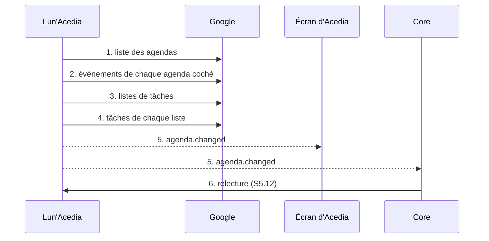

| # | De → vers | Par quoi | Ce qui circule | Retour |
|---|---|---|---|---|
| 1 | Lun'Acedia → Google Agenda | `GET /users/me/calendarList` (paginé) | le jeton du compte | les agendas : `id`, `summary`, `summaryOverride`, `selected`, `primary`, `accessRole`, `defaultReminders` |
| 2 | Lun'Acedia → Google Agenda | `GET /calendars/{id}/events` par agenda coché | `singleEvents=true`, `maxResults=250`, et soit `syncToken` (ce qui a changé), soit `timeMin` (−30 jours) et `timeMax` (+365 jours) | les événements : `id`, `status`, `summary`, `location`, `start`, `end`, `reminders`, `transparency`, `organizer`, `attendees`, `recurringEventId` ; un `nextSyncToken` |
| 3 | Lun'Acedia → Google Tasks | `GET /users/@me/lists` (paginé) | le jeton du compte | les listes : `id`, `title` |
| 4 | Lun'Acedia → Google Tasks | `GET /lists/{id}/tasks` par liste | `showCompleted`, `showDeleted`, `showHidden`, `maxResults=100`, et `updatedMin` (début de la passe précédente) | les tâches : `id`, `title`, `status`, `due`, `notes`, `deleted` |
| 5 | Lun'Acedia → écran d'Acedia et core | événement `agenda.changed` sur `GET /lun/v1/events` | `importance: log`, `title: Agenda mis à jour`, `data.changes` (nombre de lignes du cache changées) ; aucun détail de ce qui a changé | aucun |
| 6 | Core → Lun'Acedia | relecture complète du poste | voir S5.12 | voir S5.12 |

- **Ce que CrOliX voit, et où** : rien tant que rien ne change. S'il a l'écran d'Acedia ouvert, l'agenda et les
  tâches se relisent seuls (S5.6). Dans le panneau du core, « Ce qui vient » suit à la relecture (S5.13).
- **Ce qui s'écrit** : chez Lun'Acedia, le cache des agendas (titre, rappels par défaut, droit d'écriture), des
  événements, des listes et des tâches, et le point de reprise de chaque agenda et de chaque liste. Au core :
  l'événement est gardé, sans ligne au Journal (palier P4).
- **Qui décide** : du code seul. Un rappel ne compte que s'il est de méthode `popup` : un rappel par mail de Google
  est ignoré (Lun'Acedia, `server/src/agenda/calendar.ts:59-60`). L'événement `agenda.changed` ne part que si le
  cache a vraiment changé (`server/src/agenda/unified.ts:41-47`).
- **Erreurs et cas limites** :
  - Un événement annulé chez Google (`status: cancelled`) est retiré du cache ; une tâche `deleted` aussi.
  - Une lecture complète (sans `syncToken`) retire du cache les événements que Google n'a pas rendus.
  - Google a oublié le `syncToken` (410) : Acedia l'efface et relit la fenêtre entière, sans doublon.
  - Un événement sans titre s'écrit « (sans titre) » (`server/src/agenda/calendar.ts:120`).
  - D'une tâche, seul le jour de `due` est gardé (`server/src/agenda/tasks.ts:71`) : une tâche n'a pas d'heure.
  - En pause, locale ou du core, la synchro continue : elle n'agit sur rien.
- **Écart avec les décisions** : aucun connu.
- **Non vérifié** : le comportement réel de Google (quotas, délais). Rien n'est rejoué.

### S5.2 · Un événement ou une tâche modifiés chez Google

- **Déclencheur** : CrOliX (ou un invité, ou une autre application) change, déplace ou supprime un événement dans
  Google Agenda, ou une tâche dans Google Tasks. Lun'Acedia l'apprend à sa passe suivante, 60 secondes au plus.
- **Acteurs** : CrOliX, Google, Lun'Acedia, l'écran d'Acedia, le core.
- **Avant** : une première synchro a eu lieu (un `syncToken` par agenda, une date de reprise par liste).

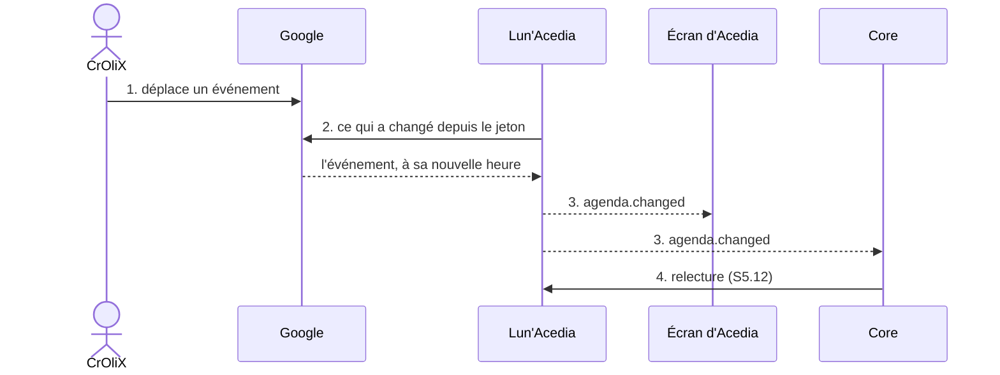

| # | De → vers | Par quoi | Ce qui circule | Retour |
|---|---|---|---|---|
| 1 | CrOliX → Google | l'application de Google | hors de l'écosystème | — |
| 2 | Lun'Acedia → Google | `GET /calendars/{id}/events?syncToken=…` ou `GET /lists/{id}/tasks?updatedMin=…` | le point de reprise | les seuls éléments changés, supprimés compris |
| 3 | Lun'Acedia → écran d'Acedia et core | événement `agenda.changed` | `data.changes` ; ni l'identifiant ni la nature du changement | aucun |
| 4 | Core → Lun'Acedia | relecture du poste | voir S5.12 | la fenêtre d'agenda à jour |

- **Ce que CrOliX voit, et où** : l'écran d'Acedia se relit. Le Bureau du core suit à sa relecture. Rien n'est dit,
  rien n'est notifié : un agenda mis à jour est un état technique.
- **Ce qui s'écrit** : le cache d'Acedia. Au core, la fenêtre d'agenda lue remplace la précédente.
- **Qui décide** : du code. La clé d'un rappel contient l'heure de début de l'événement
  (`server/src/agenda/reminders.ts:44`) : **un événement déplacé est donc rappelé de nouveau**, même si son
  rappel était déjà parti pour l'ancienne heure.
- **Erreurs et cas limites** :
  - Un événement supprimé chez Google après que son rappel est parti : le rappel reste dans À trancher du core
    jusqu'à l'heure prévue (S5.20). Rien ne le retire.
  - Un changement d'invités compte comme un changement du cache (`server/src/agenda/calendar.test.ts:158`), donc
    un `agenda.changed`, même si rien de visible ne bouge.
  - Une tâche cochée chez Google : à la synchro, elle sort de « Ce qui vient » du core. Si son rappel de 9 h est
    déjà parti, il reste dans À trancher (S5.15).
  - Un changement fait moins de 60 secondes avant l'heure d'un rappel peut ne pas être vu à temps : le rappel se
    calcule sur le cache.
- **Écart avec les décisions** : aucun connu.
- **Non vérifié** : rien n'est rejoué contre le vrai Google.

### S5.3 · Les agendas agrégés, l'agenda par défaut, les listes

- **Déclencheur** : chaque passe de synchro relit la liste des agendas et des listes (S5.1).
- **Acteurs** : CrOliX (dans Google Agenda), Google, Lun'Acedia.
- **Avant** : un compte branché.

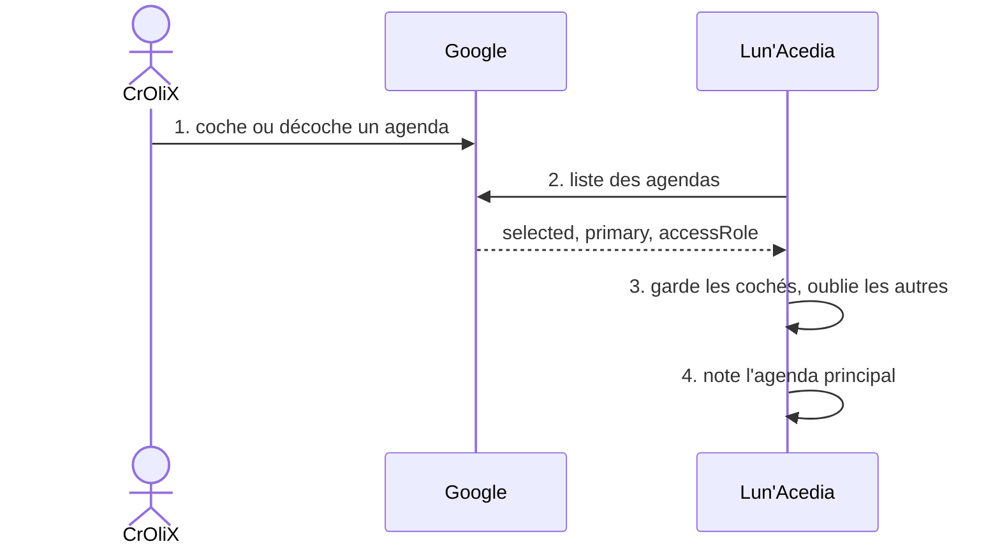

| # | De → vers | Par quoi | Ce qui circule | Retour |
|---|---|---|---|---|
| 1 | CrOliX → Google | Google Agenda, « afficher cet agenda » | hors de l'écosystème | — |
| 2 | Lun'Acedia → Google | `GET /users/me/calendarList` | — | `selected`, `primary`, `accessRole`, `defaultReminders` par agenda |
| 3 | Lun'Acedia (code) | tri des agendas | seuls les agendas `selected` sont lus ; un agenda connu qui n'est plus coché est retiré du cache avec tous ses événements et son point de reprise | le nombre de lignes retirées compte dans `changes` |
| 4 | Lun'Acedia (code) | l'agenda principal | l'agenda `primary` du compte, même s'il n'est pas coché, sinon le premier coché ; pour les tâches, la **première liste** que rend Google | — |

- **Ce que CrOliX voit, et où** : dans l'écran d'Acedia, tous les agendas cochés chez Google sont mêlés dans la même
  grille, une couleur par agenda, chacun masquable par une case (le masquage reste dans l'écran, rien n'est écrit).
  L'agenda principal est en tête de liste et sert de choix par défaut à la création.
- **Ce qui s'écrit** : la liste des agendas (titre, rappels par défaut, droit d'écriture), l'agenda principal, la liste
  de tâches principale.
- **Qui décide** : CrOliX choisit ses agendas **chez Google** ; Lun'Acedia n'a aucun réglage d'agenda à elle. Le code
  décide du droit d'écriture : `owner` ou `writer` (`server/src/agenda/calendar.ts:246`). Les jours fériés et les
  anniversaires sont en lecture seule.
- **Erreurs et cas limites** :
  - Un agenda en lecture seule n'est pas proposé à la création dans l'écran
    (`views/src/lib/agenda/ItemEditor.svelte:258`).
  - Le même événement vu dans deux agendas existe deux fois dans le cache, donc deux fois dans la lecture du core et
    dans les rappels. Seule la détection des conflits le compte une fois (`server/src/agenda/overlaps.ts:137-138`).
  - Aucun agenda principal connu (aucune synchro encore) : l'action `event.create` sans `calendarId` répond
    « Aucun agenda synchronisé ».
  - **Agenda principal non coché chez Google** : Lun'Acedia le retient quand même comme agenda principal
    (`server/src/agenda/calendar.ts:224-226`). Seuls les agendas cochés sont relus (`:234`). L'agent qui crée un
    événement sans `calendarId` (`server/src/contract/catalog.ts:292-295`) écrit donc dans un agenda ni synchronisé
    ni listé. L'événement entre dans le cache (`:332-335`) et donne des rappels, mais aucune passe ne le relit ni
    ne l'efface : il reste orphelin, et l'écran ne lui trouve pas d'agenda dans sa liste.
  - Les listes de tâches sont rendues à l'écran par ordre de titre (`server/src/agenda/tasks.ts:169-174`) : la
    liste par défaut de l'écran (la première par titre) peut différer de la liste principale de l'agent.
  - Le core ne sait rien des agendas : sa lecture ne porte pas l'agenda d'un événement (S5.12).
- **Écart avec les décisions** : T8 et T9 (personne, dans la chaîne d'une demande, ne connaît ni ne choisit l'agenda ;
  la consigne de l'agent d'Acedia ne dit rien du choix, `server/src/pina/prompt.ts:62-69`). La direction
  « prérequis » : l'agenda visé n'est jamais demandé, le principal est pris par défaut.
- **Non vérifié** : l'ordre dans lequel Google rend les listes de tâches (la « première » sert de liste principale).

### S5.4 · Une synchro qui échoue

- **Déclencheur** : pendant une passe (S5.1), Google refuse un agenda, une liste, ou tout le compte.
- **Acteurs** : Lun'Acedia, Google, le core.
- **Avant** : Google configuré.

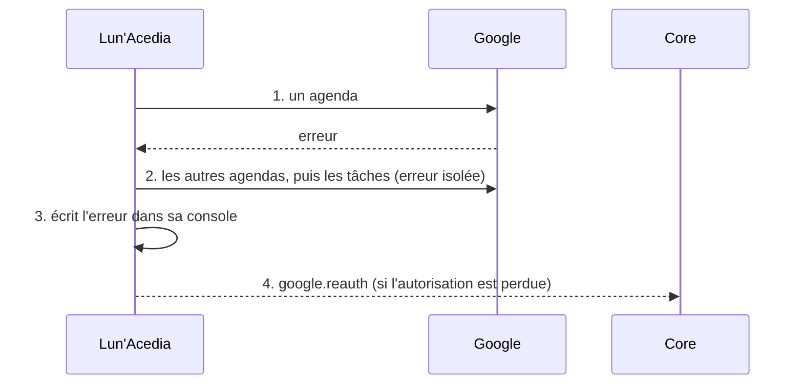

| # | De → vers | Par quoi | Ce qui circule | Retour |
|---|---|---|---|---|
| 1 | Lun'Acedia → Google | une lecture d'agenda ou de liste | — | une erreur (403, 404, 5xx…) |
| 2 | Lun'Acedia → Google | la suite de la passe | si une seule lecture a échoué, les autres agendas et listes sont lus quand même | leurs données |
| 3 | Lun'Acedia (code) | fin de passe | une erreur groupée, « Calendrier « Nom » : … » ou « Liste « Nom » : … », écrite dans la console du serveur | la passe suivante réessaie |
| 4 | Lun'Acedia → core | événement `google.reauth`, une seule fois | `importance: normal`, `title: Autorisation Google à renouveler` ; la santé passe à `degraded` | aucun |

- **Ce que CrOliX voit, et où** : pour un agenda ou une liste en erreur, **rien** : ni dans l'écran d'Acedia, ni au
  core. L'agenda concerné reste à son dernier état. Pour l'autorisation perdue : voir la famille 11.
- **Ce qui s'écrit** : une ligne dans la console du serveur d'Acedia (`server/src/main.ts:99-105`). Pour
  l'autorisation : l'état dégradé `google-reauth`, levé à la reconnexion.
- **Qui décide** : du code. Un appel à Google est tenté trois fois en tout sur un 429 ou un 5xx : deux nouvelles
  tentatives, après 0,5 s puis 1 s. La troisième réponse est rendue telle quelle. Le jeton est rafraîchi une fois sur un 401 (`server/src/google/client.ts:166-198`).
- **Erreurs et cas limites** :
  - Aucun compte branché, ou jeton illisible : la passe s'arrête sans rien écrire, pas même dans la console
    (`server/src/main.ts:102`). Ni santé dégradée ni événement.
  - Autorisation refusée au rafraîchissement (`invalid_grant`, 400, 401) : plus aucune passe n'aboutit tant que
    CrOliX n'a pas reconnecté le compte. Les rappels continuent sur le cache, qui vieillit.
  - La détection des conflits (S5.23) tourne même si un agenda a échoué ; son propre échec s'ajoute à l'erreur.
  - **Autorisation perdue, ou aucun compte branché** : toute la passe s'arrête au premier appel
    (`server/src/agenda/calendar.ts:257`, `server/src/agenda/tasks.ts:155`). Ni les autres agendas, ni les tâches,
    ni la détection des conflits ne tournent (`server/src/agenda/unified.ts:38-51`) ; les cartes de conflit devenues
    sans objet ne sont plus retirées. Le diagramme (étape 2) ne vaut que pour l'erreur d'un seul agenda ou d'une
    seule liste.
  - Google non configuré sur le serveur : aucune boucle de synchro ne démarre ; les rappels tournent sur le cache
    tel qu'il est.
- **Écart avec les décisions** : T23 (un compte déconnecté ou un jeton illisible ne remonte nulle part). Un agenda
  seul en erreur ne remonte pas non plus : ce cas n'est pas dans la carte du 27/11.
- **Non vérifié** : ce que le core montre d'un poste `degraded` (famille 12).

### S5.5 · Changer de compte Google

- **Déclencheur** : CrOliX reconnecte Google dans les Réglages d'Acedia avec une **autre** adresse.
- **Acteurs** : CrOliX, l'écran d'Acedia, Lun'Acedia, Google.
- **Avant** : un compte était déjà branché. Lun'Acedia ne garde qu'un compte (`server/src/google/client.ts:54-60`).

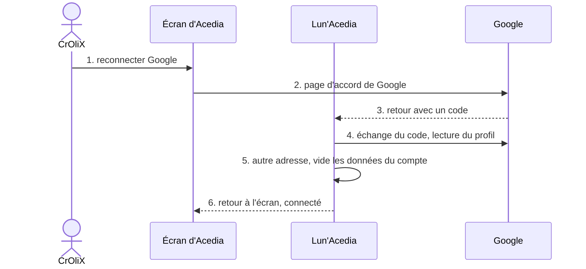

| # | De → vers | Par quoi | Ce qui circule | Retour |
|---|---|---|---|---|
| 1 | CrOliX → écran d'Acedia | Réglages, Compte Google | — | `GET /api/google/auth-url` rend l'adresse d'accord |
| 2 | Écran → Google | redirection | les droits demandés, dont l'agenda et les tâches en écriture | l'accord de CrOliX |
| 3 | Google → Lun'Acedia | `GET /oauth/callback` | `state`, `code` | — |
| 4 | Lun'Acedia → Google | échange du code, puis profil | — | les jetons, l'adresse du compte |
| 5 | Lun'Acedia (code) | comparaison avec l'adresse précédente | si elle diffère : agendas, événements, listes, tâches, **rappels déjà émis**, points de reprise, et toutes les données mail du compte (cache des mails, étiquettes et
  leurs rôles, règles, journal du tri, propositions, exemples, file du tri) sont effacés | — |
| 6 | Lun'Acedia → écran | redirection `/?google=connected` | — | la synchro suivante remplit le cache du nouveau compte |

- **Ce que CrOliX voit, et où** : l'écran d'Acedia vide, puis rempli par le nouveau compte à la passe suivante.
- **Ce qui s'écrit** : les jetons chiffrés, l'adresse du compte. Les réglages, les appareils appairés et les
  événements déjà émis restent (`server/src/google/oauth.ts:67-87`).
- **Qui décide** : CrOliX choisit le compte ; le code efface dès que l'adresse change
  (`server/src/google/oauth.ts:210-212`).
- **Erreurs et cas limites** :
  - Même adresse : rien n'est effacé, l'état dégradé `google-reauth` est levé.
  - Accord refusé, code expiré, profil illisible : rien n'est enregistré, le compte déjà branché reste tel quel.
  - Les rappels du core nés de l'ancien compte restent dans le core (Journal, À trancher jusqu'à leur heure).
  - « Plusieurs comptes » n'existe pas dans le code : plusieurs **agendas** d'un même compte, oui (S5.3).
- **Écart avec les décisions** : aucun connu.
- **Non vérifié** : l'écran des Réglages d'Acedia n'est lu que par ses routes.

### S5.6 · Afficher l'agenda et les tâches dans l'écran de Lun'Acedia

- **Déclencheur** : CrOliX ouvre l'agenda ou les tâches dans l'écran d'Acedia, ou change de période.
- **Acteurs** : CrOliX, l'écran d'Acedia, Lun'Acedia. Google n'est pas appelé.
- **Avant** : l'appareil est appairé à Lun'Acedia (jeton d'appareil).

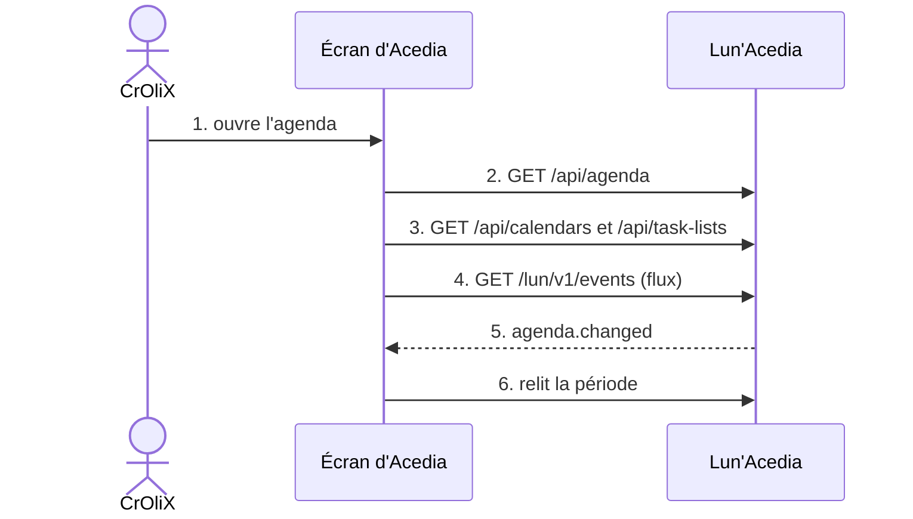

| # | De → vers | Par quoi | Ce qui circule | Retour |
|---|---|---|---|---|
| 1 | CrOliX → écran | l'onglet Agenda ou Tâches | — | — |
| 2 | Écran → Lun'Acedia | `GET /api/agenda?from=&to=` | `from`, `to` : deux jours `AAAA-MM-JJ`, la période affichée | `items[]` : événements (`kind: event`, `id`, `calendarId`, `title`, `start`, `end`, `allDay`, `reminders`, `location?`) et tâches datées (`kind: task`, `id`, `listId`, `title`, `done`, `due?`, `notes?`), par heure de début |
| 3 | Écran → Lun'Acedia | `GET /api/calendars`, `GET /api/task-lists` | — | agendas (`id`, `title`, `writable`), le principal en tête ; listes (`id`, `title`) |
| 4 | Écran → Lun'Acedia | `GET /lun/v1/events`, avec `last-event-id` à la reprise | le dernier événement vu | le flux des événements d'Acedia |
| 5 | Lun'Acedia → écran | événement `agenda.changed` | `data.changes` | — |
| 6 | Écran → Lun'Acedia | de nouveau `GET /api/agenda` (les tâches : `GET /api/tasks?all=1`, 400 ms après le dernier signal) | la période affichée | la période à jour |

- **Ce que CrOliX voit, et où** : écran d'Acedia. Agenda en jour, semaine, mois ou planning (le planning par défaut
  sous 768 px), une bulle par événement avec ses rappels et son agenda. Tâches : « En retard », « Cette semaine »,
  « À venir », « Sans date », les faites repliées.
- **Ce qui s'écrit** : rien.
- **Qui décide** : du code. Une tâche n'entre dans une période que si son jour commence dedans
  (`server/src/agenda/unified.ts:24-26`).
- **Erreurs et cas limites** :
  - `from` ou `to` illisible : 400, bandeau d'erreur dans l'écran.
  - Un rappel ne s'affiche nulle part dans Lun'Acedia. Le front reçoit bien `agenda.reminder` : comme tout
    événement `agenda.*`, il fait seulement relire les compteurs (`app/src/App.svelte:157-160`). L'agenda et les
    tâches ne se relisent que sur `agenda.changed` (`views/src/lib/agenda/Agenda.svelte:125-127`,
    `views/src/lib/agenda/Tasks.svelte:108-112`).
  - Un jour sans heure est un jour dans le fuseau **du serveur** d'Acedia
    (`server/src/agenda/time.ts:1-11`) ; l'écran, lui, calcule dans le fuseau du navigateur.
- **Écart avec les décisions** : aucun connu.
- **Non vérifié** : le rendu à l'écran (aucun navigateur lancé). Lun'Acedia utilisée seule : voir la famille 13.

### S5.7 · Créer ou modifier un événement depuis l'écran de Lun'Acedia

- **Déclencheur** : CrOliX enregistre la fenêtre « Nouvel événement » ou « Modifier l'événement ».
- **Acteurs** : CrOliX, l'écran d'Acedia, Lun'Acedia, Google Agenda, le core.
- **Avant** : Google configuré, compte branché ; pour créer, un agenda où écrire.

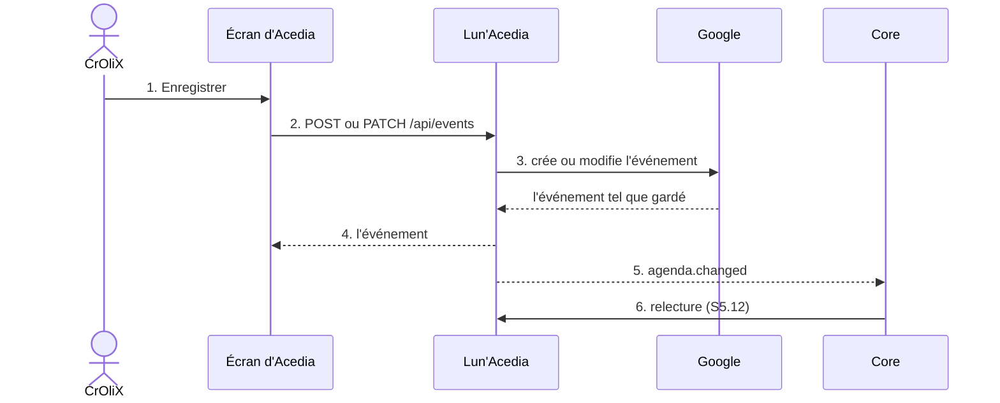

| # | De → vers | Par quoi | Ce qui circule | Retour |
|---|---|---|---|---|
| 1 | CrOliX → écran | la fenêtre d'édition | titre, date, heures, « Journée entière », lieu, agenda, rappels | — |
| 2 | Écran → Lun'Acedia | `POST /api/events/:calendarId` (créer) ou `PATCH /api/events/:calendarId/:id` (modifier) | `title`, `start`, `end` (instants ISO, ou jours `AAAA-MM-JJ` pour une journée entière, fin exclue), `allDay`, `location?`, `reminders?` (minutes avant le début, seulement si CrOliX y a touché) | — |
| 3 | Lun'Acedia → Google Agenda | `POST` ou `PATCH /calendars/{id}/events[/{id}]` | `summary`, `start`/`end` en `{ dateTime }` ou `{ date }`, `location`, `reminders { useDefault: false, overrides: [{ method: popup, minutes }] }` ; aucun fuseau, aucun invité | l'événement de Google |
| 4 | Lun'Acedia → écran | réponse | l'événement relu du cache (`kind`, `id`, `calendarId`, `title`, `start`, `end`, `allDay`, `reminders`, `location?`) | l'écran relit la période |
| 5 | Lun'Acedia → écran et core | événement `agenda.changed` | `data.changes: 1` | — |
| 6 | Core → Lun'Acedia | relecture du poste | voir S5.12 | — |

- **Ce que CrOliX voit, et où** : l'événement dans la grille de l'écran d'Acedia. Au core, « Ce qui vient » le prend
  s'il tombe dans la fenêtre (S5.13). Rien n'est dit ni notifié ; aucune ligne au Journal du core.
- **Ce qui s'écrit** : l'événement chez Google, puis dans le cache d'Acedia. Aucun journal côté Acedia pour l'agenda.
- **Qui décide** : CrOliX, de tout. Le code choisit l'agenda par défaut d'une création : le premier où l'on peut
  écrire, donc le principal (`views/src/lib/agenda/ItemEditor.svelte:100`). L'agenda d'un événement existant ne se
  change pas (sélecteur désactivé, `ItemEditor.svelte:260`).
- **Erreurs et cas limites** :
  - **Journée entière** : `start` et `end` sont des jours ; la fin envoyée est le lendemain du dernier jour
    (`ItemEditor.svelte:158`). Ses rappels se comptent depuis minuit, heure du serveur d'Acedia (S5.14).
  - **Fuseau** : l'écran convertit l'heure saisie avec le fuseau du navigateur (`views/src/lib/agenda/dates.ts:103`).
  - Rappels non touchés : rien n'est envoyé. À la création, l'événement prend les rappels par défaut de son
    agenda. À la modification, il garde ceux qu'il avait.
  - Fin avant le début le même jour : l'écran place la fin le lendemain ; fin ≤ début sinon : « La fin doit suivre
    le début. », rien ne part.
  - Corps invalide : 400. Google non configuré : 400 « Google n'est pas configuré sur ce serveur ». Événement
    disparu chez Google : 404 « Événement introuvable ». Toute autre erreur de Google (agenda en lecture seule,
    autorisation perdue) : 500 avec le message de Google. Le message s'affiche dans la fenêtre, rien n'est écrit.
  - Un déplacement relance les rappels de l'événement (S5.2).
- **Écart avec les décisions** : aucun connu.
- **Non vérifié** : le rendu à l'écran.

### S5.8 · Créer ou modifier une tâche depuis l'écran de Lun'Acedia

- **Déclencheur** : CrOliX ajoute une tâche par la ligne d'ajout, enregistre la fenêtre d'une tâche, ou change son
  échéance par le menu (« Aujourd'hui », « Demain », « Lundi prochain », « Sans date »).
- **Acteurs** : CrOliX, l'écran d'Acedia, Lun'Acedia, Google Tasks, le core.
- **Avant** : Google configuré, compte branché, au moins une liste.

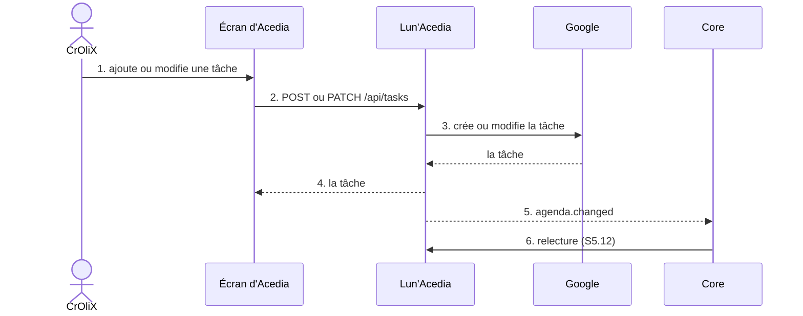

| # | De → vers | Par quoi | Ce qui circule | Retour |
|---|---|---|---|---|
| 1 | CrOliX → écran | ligne d'ajout, fenêtre, ou menu d'échéance | titre, échéance, liste, note | — |
| 2 | Écran → Lun'Acedia | `POST /api/tasks/:listId` ou `PATCH /api/tasks/:listId/:id` | `title`, `due?` (`AAAA-MM-JJ`, ou `null` pour retirer l'échéance), `notes?`, `done?` | — |
| 3 | Lun'Acedia → Google Tasks | `POST` ou `PATCH /lists/{id}/tasks[/{id}]` | `title`, `notes`, `due` (le jour à minuit UTC, ou `null`), `status` | la tâche de Google |
| 4 | Lun'Acedia → écran | réponse | `kind: task`, `id`, `listId`, `title`, `done`, `due?`, `notes?` | l'écran remplace la ligne |
| 5 | Lun'Acedia → écran et core | événement `agenda.changed` | `data.changes: 1` | — |
| 6 | Core → Lun'Acedia | relecture du poste | voir S5.12 | — |

- **Ce que CrOliX voit, et où** : la tâche dans son groupe d'échéance, dans l'écran d'Acedia ; au core, dans « Ce qui
  vient » si elle est due aujourd'hui et pas faite.
- **Ce qui s'écrit** : la tâche chez Google et dans le cache.
- **Qui décide** : CrOliX. La liste par défaut de la ligne d'ajout est la première par ordre de titre
  (`views/src/lib/agenda/Tasks.svelte:100`), pas la liste principale ; la liste d'une tâche existante ne se
  change pas.
- **Erreurs et cas limites** :
  - Une tâche créée avec l'échéance du jour **après 9 h 15** n'a pas de rappel ce jour-là (S5.15).
  - Titre vide : rien ne part. Corps invalide : 400. Tâche disparue chez Google : 404 « Tâche introuvable ».
  - Une tâche n'a ni heure ni rappel propre : Google Tasks n'expose pas ses rappels
    (`server/src/agenda/reminders.ts:12-13`).
- **Écart avec les décisions** : aucun connu.
- **Non vérifié** : le rendu à l'écran.

### S5.9 · Cocher ou décocher une tâche

- **Déclencheur** : CrOliX clique la case d'une tâche, dans la page des tâches d'Acedia.
- **Acteurs** : CrOliX, l'écran d'Acedia, Lun'Acedia, Google Tasks, le core.
- **Avant** : comme S5.8.

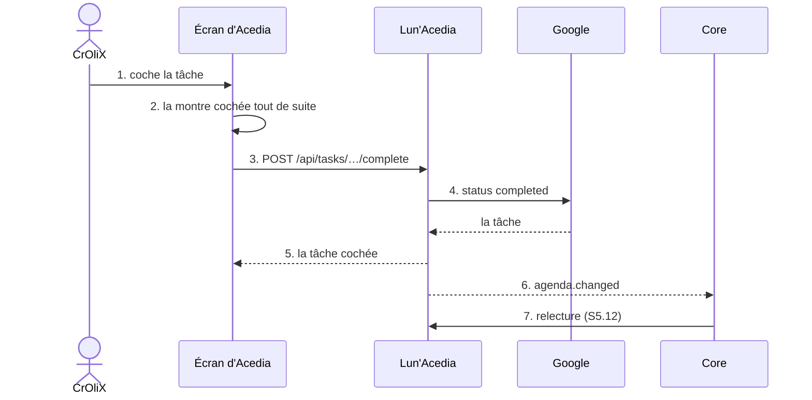

| # | De → vers | Par quoi | Ce qui circule | Retour |
|---|---|---|---|---|
| 1 | CrOliX → écran | la case | — | — |
| 2 | Écran (code) | affichage optimiste | la tâche inversée, avant toute réponse | — |
| 3 | Écran → Lun'Acedia | `POST /api/tasks/:listId/:id/complete` | `done` (vrai pour cocher, faux pour décocher ; vrai si absent) | — |
| 4 | Lun'Acedia → Google Tasks | `PATCH /lists/{id}/tasks/{id}` | `status: completed`, ou `status: needsAction` et `completed: null` | la tâche |
| 5 | Lun'Acedia → écran | réponse | la tâche relue du cache, `done` à jour | — |
| 6 | Lun'Acedia → écran et core | événement `agenda.changed` | `data.changes: 1` | — |
| 7 | Core → Lun'Acedia | relecture du poste | voir S5.12 | la tâche faite sort de « Ce qui vient » |

- **Ce que CrOliX voit, et où** : la tâche passe dans « faites », repliée. Au core, elle quitte « Ce qui vient ».
- **Ce qui s'écrit** : l'état de la tâche chez Google et dans le cache.
- **Qui décide** : CrOliX.
- **Erreurs et cas limites** :
  - Google refuse : l'écran remet la tâche dans son état d'avant et affiche l'erreur
    (`views/src/lib/agenda/Tasks.svelte:121-130`).
  - Cochée **avant** 9 h : aucun rappel ne part (`server/src/agenda/reminders.ts:58`).
  - Cochée **après** son rappel : le rappel reste dans À trancher du core jusqu'à « Vu » ou la fin de la journée de
    Natsume. Le core ne rapproche pas le rappel de l'état de la tâche (S5.20).
  - Le core n'a aucun geste pour cocher une tâche : il faut l'écran d'Acedia, ou une demande à Natsume (famille 2).
- **Écart avec les décisions** : T16, par symétrie : un état vrai d'un seul côté (la tâche faite chez Acedia, le
  rappel encore ouvert au core).
- **Non vérifié** : le rendu à l'écran. Cocher une tâche depuis l'agenda d'Acedia (et non la page des tâches)
  suit-il le même geste optimiste, remis en place si Google refuse ?

### S5.10 · Supprimer un événement ou une tâche depuis l'écran de Lun'Acedia

- **Déclencheur** : CrOliX choisit « Supprimer » (bulle, fenêtre, ou ligne d'une tâche), puis confirme.
- **Acteurs** : CrOliX, l'écran d'Acedia, Lun'Acedia, Google, le core.
- **Avant** : comme S5.7.

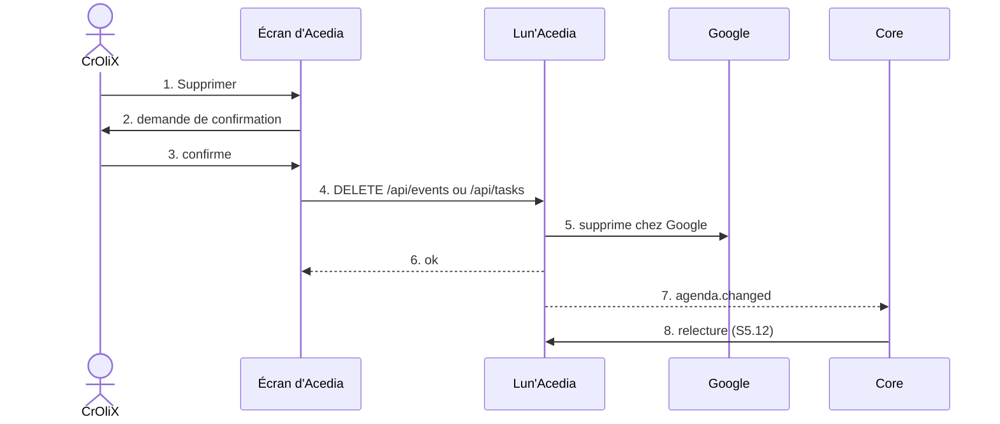

| # | De → vers | Par quoi | Ce qui circule | Retour |
|---|---|---|---|---|
| 1-3 | CrOliX ↔ écran | fenêtre de confirmation | le texte dépend de l'écran : dans l'agenda, « « Titre » est retiré de Google. Cette action ne s'annule pas ici. » (`views/src/lib/agenda/Agenda.svelte:359`) ; dans la page des tâches, « « Titre » est supprimée de Google Tasks. » (`views/src/lib/agenda/Tasks.svelte:388-393`) | l'accord |
| 4 | Écran → Lun'Acedia | `DELETE /api/events/:calendarId/:id` ou `DELETE /api/tasks/:listId/:id` | les deux identifiants, rien d'autre | — |
| 5 | Lun'Acedia → Google | `DELETE` sur l'événement ou la tâche | — | réponse vide |
| 6 | Lun'Acedia → écran | réponse | `{ ok: true }` | l'écran retire la ligne, « Événement supprimé » ou « Tâche supprimée » |
| 7 | Lun'Acedia → écran et core | événement `agenda.changed` | `data.changes: 1` | — |
| 8 | Core → Lun'Acedia | relecture du poste | voir S5.12 | — |

- **Ce que CrOliX voit, et où** : l'élément disparaît de l'écran d'Acedia ; au core, de « Ce qui vient » à la relecture.
- **Ce qui s'écrit** : la suppression chez Google ; le cache d'Acedia perd la ligne. Aucun journal, aucune annulation.
- **Qui décide** : CrOliX, deux fois (le geste, puis la confirmation).
- **Erreurs et cas limites** :
  - Déjà supprimé chez Google : 404 « Événement introuvable » ou « Tâche introuvable ».
  - Un rappel déjà parti pour cet événement reste au core jusqu'à son heure (S5.20).
  - La règle d'Acedia « jamais de suppression définitive » vaut pour les mails (corbeille) : un événement ou une
    tâche supprimés le sont vraiment chez Google (`server/src/agenda/calendar.ts:352-356`).
- **Écart avec les décisions** : aucun connu.
- **Non vérifié** : le rendu à l'écran.

### S5.11 · Demander à l'agent de Lun'Acedia, dans son écran

- **Déclencheur** : CrOliX écrit à l'agent d'Acedia, depuis l'écran de l'agenda ou des tâches : « mets le dentiste
  jeudi à 14 h », « qu'est-ce que j'ai demain ? », « supprime la tâche des impôts ».
- **Acteurs** : CrOliX, l'écran d'Acedia, Lun'Acedia (code), le modèle de l'agent, Google.
- **Avant** : un modèle est choisi pour l'agent, et son plafond du jour n'est pas atteint.

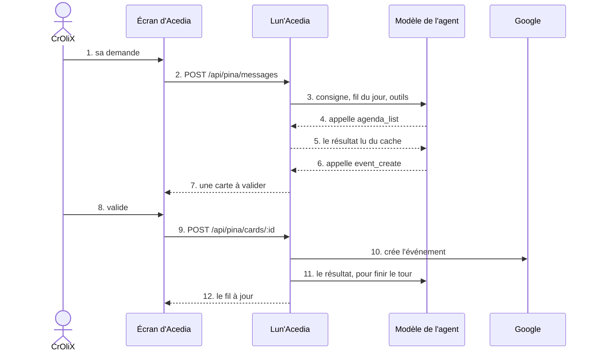

| # | De → vers | Par quoi | Ce qui circule | Retour |
|---|---|---|---|---|
| 1 | CrOliX → écran | le panneau de l'agent | sa phrase | — |
| 2 | Écran → Lun'Acedia | `POST /api/pina/messages` | `text` ; `context` : `screen` (`agenda` ou `tasks`), `day` (jour affiché) ou `listId` (liste affichée) | le fil du jour : `day`, `messages`, `cards`, `pending` |
| 3 | Lun'Acedia → modèle | appel du fournisseur choisi | la consigne (rôle, règles, le personnage de l'agent, date et heure de Paris, écran regardé, jour ou liste affichés, boîtes, consignes propres de CrOliX, `server/src/pina/prompt.ts:56-77`), le fil du jour, tous les outils du catalogue | texte et appels d'outil |
| 4-5 | Modèle ↔ Lun'Acedia | un outil de lecture : `agenda.list`, `calendar.list`, `tasklist.list`, `task.list` | `from`, `to` ; ou rien ; ou `listId?` | exécuté tout de suite, sans carte ; lu dans le cache, Google n'est pas appelé |
| 6 | Modèle → Lun'Acedia | un outil d'écriture : `event.create`, `event.update`, `task.create`, `task.update`, `task.complete` ; ou de suppression : `event.delete`, `task.delete` | pour `event.create` : `calendarId?`, `title`, `start`, `end`, `allDay` (faux par défaut), `location?`, `reminders?` | une carte ; ou, en mode « tout de suite », l'écriture exécutée (jamais une suppression) |
| 7 | Lun'Acedia → écran | réponse de l'étape 2 | la carte en attente, le tour s'arrête là | — |
| 8-9 | CrOliX → écran → Lun'Acedia | `POST /api/pina/cards/:id` | `decision` (`accept` ou `refuse`), `input?` (la carte modifiée) | la carte tranchée et le fil |
| 10 | Lun'Acedia → Google | la même fonction que l'écran (S5.7 à S5.10) | comme S5.7 à S5.10 | l'élément créé, modifié ou supprimé ; puis `agenda.changed` |
| 11 | Lun'Acedia → modèle | reprise du tour | le résultat de la carte (fait, refusé, échec), une fois toutes les cartes du tour tranchées | la phrase de clôture |
| 12 | Lun'Acedia → écran | réponse de l'étape 9 | le fil à jour | — |

- **Ce que CrOliX voit, et où** : dans le panneau de l'agent de l'écran d'Acedia : la réponse, la carte (« Créer un
  événement », « Modifier un événement », « Supprimer un événement », « Créer une tâche », « Cocher une tâche »…)
  avec ses champs, puis une ligne « fait » avec « Annuler » quand l'action a un inverse.
- **Ce qui s'écrit** : le fil du jour et ses cartes chez Lun'Acedia ; le coût de chaque appel du modèle ; l'élément
  chez Google.
- **Qui décide** :
  - **Le modèle de l'agent** choisit l'outil, la date, l'heure et l'agenda. Sa consigne lui donne la date et l'heure
    de Paris et le jour affiché ; elle ne dit rien du choix de l'agenda (`server/src/pina/prompt.ts:47-70`).
  - **Le code** applique le droit : une lecture s'exécute ; une suppression attend toujours CrOliX ; une écriture
    attend en mode « à valider » (le défaut) et part tout de suite en mode « tout de suite »
    (`server/src/pina/agent.ts:419-433`, `server/src/pina/store.ts:170`).
  - **CrOliX** valide, modifie ou refuse. Une suppression ne se modifie pas.
- **Erreurs et cas limites** :
  - **Annuler** : une création s'annule par la suppression de l'élément ; une modification par le retour aux
    valeurs lues avant l'écriture (`server/src/pina/inverse.ts:58-83`). `task.complete`, `event.delete` et
    `task.delete` n'ont **pas** d'inverse. L'échange : voir S5.25.
  - `event.create` sans `calendarId` : l'agenda principal. `task.create` sans `listId` : la liste principale
    (`server/src/contract/catalog.ts:292-296`, `326-330`).
  - Une carte non tranchée expire au changement de jour : « Carte expirée », rien ne s'exécute.
  - Huit allers-retours du modèle au plus par demande ; au-delà : « Arrêt : trop d'allers-retours… ».
  - Plafond du jour atteint, pas de modèle, clé refusée, crédit épuisé : une phrase fixe dans le fil, rien n'est fait.
  - En pause, l'agent répond quand même dans l'écran d'Acedia : une demande faite à la main passe.
  - **Depuis Natsume** (famille 2) : le core envoie une phrase à `POST /lun/v1/agent` ; l'écran regardé vaut alors
    `mail` et le mode est forcé « à valider » (`server/src/contract/routes.ts:389-390`). Les lectures s'exécutent
    quand même sans carte. En pause locale d'Acedia, la réponse est une phrase « en pause », sans carte.
  - Le contrat sert aussi chaque action seule, `POST /lun/v1/actions/:name`, qui s'exécute **tout de suite**,
    suppressions comprises et même en pause (`server/src/contract/routes.ts:407-425`,
    `server/src/contract/catalog.ts:82-85`, `:305-351`). Le core n'appelle de lui-même par ce chemin que
    `agenda.list` (S5.12) et le bilan du jour. Il expose aussi un relais générique, qui envoie n'importe quelle
    action à un poste pour le compte d'un client du core, et rend la réponse brute. Aucun client lu ne l'appelle
    aujourd'hui (ni le panneau ni Lun'Luxuria) : c'est un chemin latent, qui contourne la règle « une suppression
    attend toujours CrOliX » (écart avec F7).
- **Écart avec les décisions** : T9 et T10 (la date et l'agenda sont choisis par un modèle ; relié, deux modèles
  les décident l'un après l'autre). F7 : le relais générique du core applique une action sans carte (voir plus
  haut) ; seul, le droit vient du réglage d'Acedia ; relié, il est forcé en dur, pas
  reçu du core. La direction « prérequis » : rien n'oblige l'agent à demander l'agenda ou l'heure qui manquent.
- **Non vérifié** : aucun appel de modèle n'est rejoué ; les choix du modèle sont ceux que permet le code, pas ceux
  qu'il fait. Le panneau de l'agent n'est lu que par ses routes.

### S5.12 · Le core lit l'agenda et les tâches

- **Déclencheur** : l'horloge du core (au démarrage, puis toutes les 2 minutes), ou tout événement reçu de
  Lun'Acedia (la lecture part 50 ms après le dernier signal), ou une demande de vérification du poste.
- **Acteurs** : le core, Lun'Acedia. Google n'est pas appelé.
- **Avant** : Lun'Acedia est reliée et répond à sa santé.

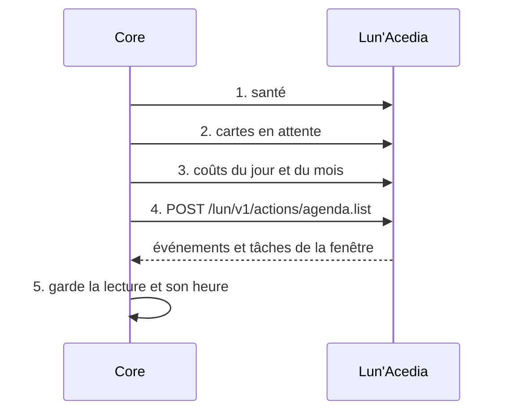

| # | De → vers | Par quoi | Ce qui circule | Retour |
|---|---|---|---|---|
| 1 | Core → Lun'Acedia | `GET /lun/v1/health` | — | l'état du poste ; sans réponse en 8 s, la passe s'arrête là |
| 2 | Core → Lun'Acedia | `GET /lun/v1/cards?status=pending` | — | les cartes en attente (famille 3) |
| 3 | Core → Lun'Acedia | `GET /lun/v1/costs?since=` deux fois | le début de la journée de Natsume, puis du mois | `since`, `total` |
| 4 | Core → Lun'Acedia | `POST /lun/v1/actions/agenda.list` | `from` : le jour d'aujourd'hui à Paris (`AAAA-MM-JJ`) ; `to` : l'instant de la prochaine lettre du matin (7 h 30 du lendemain de la journée de Natsume) | `result.items[]` ; le core n'en garde que `kind`, `id`, `title`, `start`, `end`, `allDay`, `due`, `done` |
| 5 | Core (code) | mémoire de lecture | la liste et l'heure de lecture ; elle remplace la précédente | — |

- **Ce que CrOliX voit, et où** : rien directement. Cette lecture nourrit « Ce qui vient » (S5.13).
- **Ce qui s'écrit** : au core, la dernière lecture de l'agenda et son heure. Rien au Journal. Rien chez Lun'Acedia.
- **Qui décide** : du code. La fenêtre va d'aujourd'hui à la prochaine lettre : le core ne connaît **rien** de
  l'agenda au-delà (après-demain, la semaine). Une lecture de plus de 5 minutes est tenue pour périmée.
- **Erreurs et cas limites** :
  - Sont perdus à la lecture : l'agenda (`calendarId`) ou la liste (`listId`) de l'élément, le lieu, les rappels,
    la note.
  - Chaque appel a 15 s. `agenda.list` en échec : l'ancienne lecture est gardée ; l'échec est écrit une fois dans
    la console du core, pas à l'écran.
  - Lun'Acedia déliée : la lecture gardée est effacée ; « Ce qui vient » ne montre plus rien d'elle.
  - Une tâche n'entre que si son jour commence à ou après `from` : les tâches **en retard** ne sont jamais lues.
  - `from` est un jour de Paris, que Lun'Acedia lit comme un jour de **son** fuseau
    (`server/src/agenda/time.ts:5-11`).
  - Une pause du core n'arrête pas cette lecture (aucun test de pause dans la boucle de lecture).
  - Le modèle du core ne reçoit pas cette lecture dans sa consigne : pour répondre sur l'agenda, il confie la
    demande au poste (famille 2).
- **Écart avec les décisions** : T8 (le modèle du core ne sait rien des agendas ni des listes).
- **Non vérifié** : le fuseau du serveur d'Acedia en service ; s'il n'est pas celui de Paris, `from` et les jours
  sans heure se décalent. Que dit exactement le standard des notifications des échéances lues par le core :
  passent-elles déjà par la porte d'attention ? (Cette lecture, elle, ne dit ni ne notifie rien.)

### S5.13 · « Ce qui vient » : le Bureau, l'accueil, la lettre du matin

- **Déclencheur** : CrOliX ouvre le Bureau du panneau ; ou il arrive à son poste (l'accueil) ; ou la routine de 7 h 30
  écrit la lettre du matin.
- **Acteurs** : CrOliX, le panneau, le core, le modèle du core (pour l'accueil seulement). Aucun poste n'est appelé.
- **Avant** : une lecture de l'agenda existe (S5.12) ; sinon, seules les routines s'affichent.

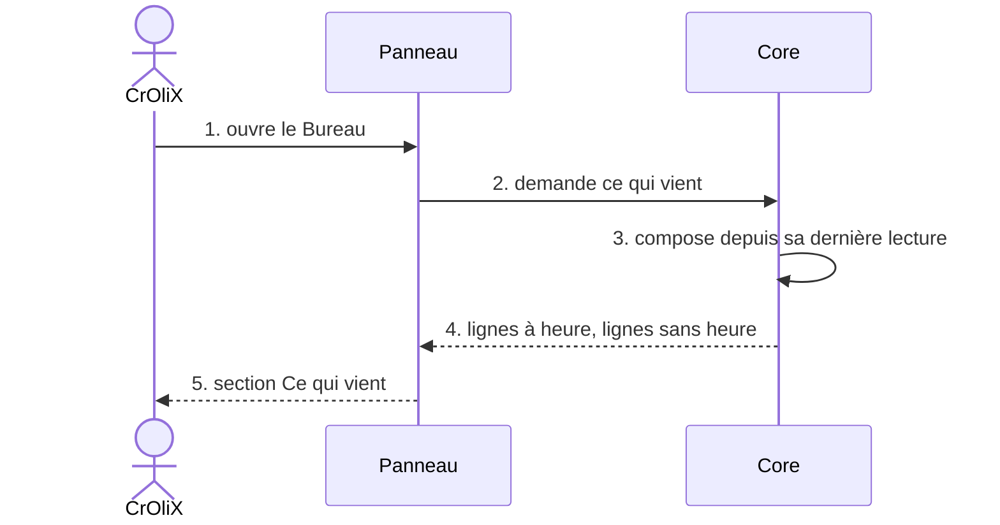

| # | De → vers | Par quoi | Ce qui circule | Retour |
|---|---|---|---|---|
| 1 | CrOliX → panneau | le lieu Bureau | — | — |
| 2 | Panneau → core | lecture de « ce qui vient » | — | — |
| 3 | Core (code) | composition, de maintenant à la prochaine lettre | les routines à venir ; les événements à heure de la fenêtre ; les urgences non-rappel des 7 derniers jours qui portent une heure limite dans la fenêtre ; à part, sans heure : les tâches dues aujourd'hui et pas faites, et les événements sur la journée d'aujourd'hui | — |
| 4 | Core → panneau | réponse | l'heure de la lecture, un drapeau « périmée », les lignes à heure (nature, heure, titre, poste), les lignes sans heure (titre, poste) | — |
| 5 | Panneau → CrOliX | section « Ce qui vient » | « 14:00, Dentiste » ; « 18:00, Justificatif, dernier délai » ; « 05:00, Veille de la nuit, demain » ; puis les titres sans heure | — |

- **Ce que CrOliX voit, et où** :
  - **Bureau** (panneau, bureau et téléphone) : la section « Ce qui vient ».
  - **Accueil** (voix, à son arrivée au poste) : la demande faite au modèle porte au plus quatre lignes « à venir,
    HH:MM : titre », routines exclues. Le modèle choisit de les dire ou non ; sa consigne lui dit de ne détailler que
    le neuf (famille 8).
  - **Lettre du matin** : après ses phrases sur la nuit et les cartes, au plus trois lignes « Titre à HH:MM. », pour ce
    qui tombe avant 5 h le lendemain. La lettre est composée par du code, sans modèle (famille 6).
- **Ce qui s'écrit** : la lettre du matin, une fois par jour. Rien d'autre.
- **Qui décide** : du code, sauf la parole de l'accueil (le modèle du core).
- **Erreurs et cas limites** :
  - **Les tâches et les événements sur la journée n'entrent ni dans la lettre ni dans l'accueil** : ils n'ont pas
    d'heure, et ces deux rendus ne prennent que les lignes à heure. Ils ne sont que sur le Bureau.
  - Une ligne « rappel » est prévue (« 13:00, Titre, rappel ») mais **ne peut pas sortir** avec les rappels que
    Lun'Acedia émet : elle exige une heure de rappel à venir, or Lun'Acedia date le rappel du moment où il tombe.
  - Un événement sur la journée qui dure plusieurs jours s'affiche chaque jour qu'il couvre, sans heure.
  - Deux exemplaires du même événement (deux agendas) donnent deux lignes.
  - Avant 5 h, la « journée » du core est encore celle de la veille : la fenêtre s'arrête au 7 h 30 du matin même.
- **Écart avec les décisions** : F2 (la lettre n'est pas écrite par le modèle et ne dit pas « ce qui m'attend pour la
  journée » au-delà de trois lignes à heure). T30 (deux « jours » dans le core). Le standard des notifications place
  une tâche due aujourd'hui « en tête de la lettre du matin » : la lettre n'en contient aucune.
- **Non vérifié** : ce que le modèle dit à l'accueil ; le rendu du Bureau à l'écran. Le Bureau affiche-t-il le
  drapeau « périmée » ? Sinon, une lecture vieille de plusieurs heures se montrerait comme une lecture fraîche.

### S5.14 · Le rappel d'un événement, CrOliX au bureau

- **Déclencheur** : l'horloge de Lun'Acedia, au démarrage puis chaque minute : l'heure d'un rappel vient de passer.
  Exemple : « Oral » commence à 9 h 15 avec un rappel à 10 minutes ; il tombe à 9 h 05.
- **Acteurs** : Lun'Acedia, le core, le panneau, Lun'Luxuria, CrOliX.
- **Avant** : l'événement est dans le cache d'Acedia, avec un rappel de méthode `popup` (le sien, ou celui par défaut
  de son agenda). Lun'Acedia est reliée et le core l'écoute. CrOliX est présent (une présence annoncée au core, dont
  le dernier battement a moins de 90 secondes, famille 8), sans appel en cours, l'annonce à voix haute n'est pas
  coupée, hors plage de nuit.

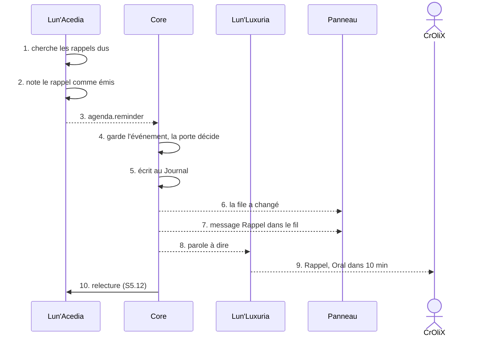

| # | De → vers | Par quoi | Ce qui circule | Retour |
|---|---|---|---|---|
| 1 | Lun'Acedia (code) | passe des rappels | les événements du cache qui commencent entre −15 minutes et +4 semaines ; pour chacun, chaque rappel `minutes` ; dû si son heure est passée depuis moins de 15 minutes | la liste des rappels dus, moins ceux déjà émis |
| 2 | Lun'Acedia (code) | registre des rappels émis | la clé : agenda, événement, heure de début, minutes | un rappel n'est émis qu'une fois, même après un redémarrage |
| 3 | Lun'Acedia → core | événement `agenda.reminder` sur `GET /lun/v1/events` | `importance: urgent` ; `title` : « Oral dans 10 min » ; `link: #/agenda` ; `data` : `kind: event`, `id`, `calendarId`, `subject` (le titre nu), `minutes`, `at` (l'heure où le rappel devait tomber), `due` (le début de l'événement) | aucun accusé |
| 4 | Core (code) | la porte d'attention | palier P0 ; ses entrées : présent, pas d'appel, annonce non coupée, pas la plage de nuit, événement vieux de moins de 5 minutes | « dire à voix haute », sans notification |
| 5 | Core (code) | Journal | une entrée d'urgence : le poste, le titre, l'étape « Reçue. » ; **sans** l'état « à trancher » des autres urgences | — |
| 6 | Core → panneau | signal « la file a changé », dès que le rappel est enregistré (pour un événement urgent) | rien d'autre | le panneau relit À trancher : une ligne « Rappel » (S5.20) |
| 7 | Core → panneau | un message dans le fil | « Rappel : Oral dans 10 min. », phrase fixe, sans modèle, coupée à 80 caractères | toutes les surfaces ouvertes le reçoivent |
| 8 | Core → Lun'Luxuria | la même phrase, comme parole | le texte, le motif « urgence » | aucun accusé (famille 8) |
| 9 | Lun'Luxuria → CrOliX | la voix | voir la famille 8 | — |
| 10 | Core → Lun'Acedia | relecture du poste, lancée 50 ms après le dernier signal | tout événement reçu la déclenche (S5.12) | — |

- **Ce que CrOliX voit, et où** :
  - **Voix** : « Rappel : Oral dans 10 min. »
  - **Panneau, conversation** : le même message, de Natsume.
  - **Panneau, À trancher** : une ligne « Rappel », le titre nu (« Oral »), le temps restant, le nom du poste.
  - **Panneau, Journal** : une entrée d'urgence, « Reçue. ».
  - **Téléphone** : rien (présent, la porte ne notifie pas).
  - **Écran d'Acedia** : rien. Aucun écran d'Acedia n'affiche un rappel.
- **Ce qui s'écrit** : chez Lun'Acedia, le rappel émis (gardé 30 jours) et l'événement (gardé 7 jours). Au core :
  l'événement, la ligne du Journal, le message du fil, la trace de la décision de la porte.
- **Qui décide** :
  - **Lun'Acedia (code)** décide qu'il y a un rappel, quand, et qu'il est urgent : `importance: urgent` est en dur
    (`server/src/agenda/reminders.ts:90-94`). Aucun modèle.
  - **CrOliX**, en amont, par les rappels qu'il a mis sur l'événement ou sur son agenda chez Google.
  - **Le core (code)** décide du rendu, par sa porte d'attention. Aucun modèle n'écrit la phrase.
  - **Lun'Luxuria** décide de dire ou non (famille 8).
- **Erreurs et cas limites** :
  - Le texte du titre : « commence maintenant » (0 minute), « dans N min », « dans N h » (multiple de 60), « dans N j »
    (multiple de 1 440) (`server/src/agenda/reminders.ts:71-77`).
  - Plusieurs rappels sur un événement (30 min et 10 min) : un événement `agenda.reminder` chacun, donc deux
    annonces. Dans À trancher, seul le plus récent se montre.
  - **Événement sur la journée** : son début est minuit, heure du serveur d'Acedia ; le code lui applique les
    rappels par défaut de son agenda (`server/src/agenda/calendar.ts:80-81`,
    `server/src/agenda/reminders.test.ts:69-83`).
  - Un événement que CrOliX a refusé, ou marqué « disponible », est rappelé comme les autres : la passe ne filtre
    pas (`server/src/agenda/calendar.ts:103-108`).
  - Le même événement dans deux agendas cochés : deux rappels (la clé contient l'agenda).
  - Un rappel de Google de méthode `email` n'en donne aucun.
  - Le rappel n'est pas masqué : contrairement aux mails, le titre d'un événement part tel quel
    (`server/src/contract/events.ts:24-41`).
  - La porte d'attention en panne : le rappel est quand même gardé, écrit au Journal et écrit au fil, sans voix.
  - L'écriture du rappel émis échoue (base occupée) : rien ne part, la minute suivante réessaie
    (`server/src/agenda/reminders.test.ts:101-136`).
  - Le cas inverse : la passe note d'abord le rappel comme émis, puis écrit l'événement
    (`server/src/agenda/reminders.ts:82-95`). Si l'écriture de l'événement échoue après la note, le rappel est
    perdu sans trace : la clé interdit de le réémettre.
  - Le core tient le rappel pour dit dès qu'il l'a publié : il ne sait pas si Lun'Luxuria l'a prononcé.
- **Écart avec les décisions** : T4 (aucun accusé de la parole). T16 (rien ne revient à Lun'Acedia). F1 ne s'applique
  pas : un rappel n'est pas une action.
- **Non vérifié** : la voix (aucun essai sur le desktop) ; ce que Lun'Luxuria fait de la parole reçue (son code n'est
  pas lu ici, famille 8) ; le fuseau du serveur d'Acedia en service. Google rend-il vraiment à Lun'Acedia des rappels
  par défaut pour un événement sur la journée ? Ses rappels par défaut visent les événements à heure. Si oui, le
  rappel de 30 minutes tomberait à 23 h 30 la veille, soit dans la plage de nuit (S5.17). Rien n'est lu ni rejoué.

### S5.15 · Le rappel d'une tâche due aujourd'hui

- **Déclencheur** : l'horloge de Lun'Acedia, à 9 h 00, heure du serveur d'Acedia, le jour d'échéance d'une tâche.
- **Acteurs** : Lun'Acedia, le core, le panneau, Lun'Luxuria, CrOliX.
- **Avant** : la tâche est dans le cache, due aujourd'hui, pas cochée.

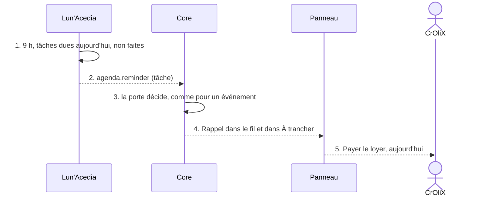

| # | De → vers | Par quoi | Ce qui circule | Retour |
|---|---|---|---|---|
| 1 | Lun'Acedia (code) | passe des rappels | les tâches dont l'échéance est le jour même, non faites ; l'heure du rappel est fixe : 9 h 00 | une clé par tâche et par jour |
| 2 | Lun'Acedia → core | événement `agenda.reminder` | `importance: urgent` ; `title` : « Payer le loyer : à faire aujourd'hui » ; `link: #/agenda` ; `data` : `kind: task`, `id`, `listId`, `subject`, `at` ; **pas** de `minutes`, **pas** de `due` | — |
| 3 | Core (code) | la porte d'attention | palier P0, mêmes entrées qu'en S5.14 | dire, écrire ou notifier selon S5.14 à S5.19 |
| 4-5 | Core → panneau → CrOliX | fil, À trancher, Journal | « Rappel : Payer le loyer : à faire aujourd'hui. » ; dans À trancher : « Rappel », « Payer le loyer », « aujourd'hui » | — |

- **Ce que CrOliX voit, et où** : comme S5.14. Dans À trancher, la ligne dit « aujourd'hui » au lieu d'un compte à
  rebours, et elle **ne part pas seule** : faute d'heure limite, elle reste jusqu'à « Vu » ou jusqu'à la fin de la
  journée de Natsume (5 h).
- **Ce qui s'écrit** : comme S5.14.
- **Qui décide** : du code. L'heure de 9 h est en dur (`server/src/agenda/reminders.ts:12-13`) ; ce n'est pas un
  réglage.
- **Erreurs et cas limites** :
  - Tâche créée, ou datée d'aujourd'hui, après 9 h 15 : pas de rappel ce jour-là.
  - Tâche en retard (échéance passée) : jamais rappelée. Tâche sans date : jamais rappelée.
  - Tâche cochée après 9 h : le rappel reste au core (S5.9).
  - 9 h est l'heure du serveur d'Acedia, pas forcément celle de Paris.
- **Écart avec les décisions** : **le standard des notifications classe « tâche à échéance aujourd'hui » en P2, en
  tête de la lettre du matin**. Le code l'émet en urgence (P0) à 9 h, dite à voix haute, et la lettre n'en parle pas.
- **Non vérifié** : le fuseau du serveur d'Acedia en service.

### S5.16 · Le rappel quand CrOliX est absent

- **Déclencheur** : un rappel arrive au core (S5.14 ou S5.15) alors qu'aucune présence n'est annoncée.
- **Acteurs** : Lun'Acedia, le core, le téléphone, CrOliX.
- **Avant** : hors plage de nuit ; un appareil au moins est abonné aux notifications ; les alertes urgentes en direct
  de Lun'Acedia ne sont pas coupées (réglage du poste, actif par défaut).

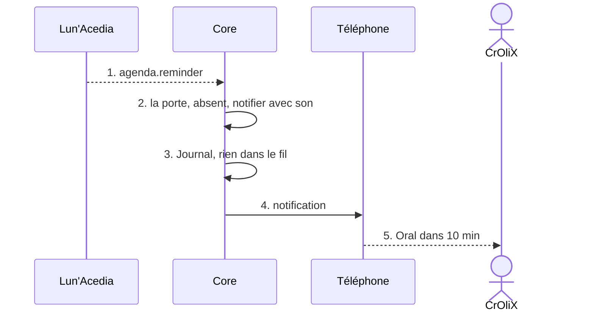

| # | De → vers | Par quoi | Ce qui circule | Retour |
|---|---|---|---|---|
| 1 | Lun'Acedia → core | événement `agenda.reminder` | comme S5.14 | — |
| 2 | Core (code) | la porte d'attention | absent : ni voix ni message, une notification avec son | — |
| 3 | Core (code) | Journal | l'entrée d'urgence « Reçue. » ; **aucun** message dans le fil | — |
| 4 | Core → téléphone | notification poussée, à la passe suivante (toutes les 15 s) | le titre de l'événement (« Oral dans 10 min »), un lien vers le panneau, avec son ; valable 1 heure | envoyée dès qu'un appareil répond |
| 5 | Téléphone → CrOliX | notification système | — | — |

- **Ce que CrOliX voit, et où** : la notification sur le téléphone ; la ligne « Rappel » dans À trancher jusqu'à
  l'heure du rendez-vous ; l'entrée au Journal. **Rien dans la conversation, et rien à son retour** : l'accueil
  écarte les rappels, tenus pour déjà dits à leur heure, or celui-ci ne l'a pas été.
- **Ce qui s'écrit** : l'événement, le Journal, la ligne de notification et son issue (envoyée, expirée, vue).
- **Qui décide** : du code (la porte). La décision se rejoue à chaque passe tant que la notification n'est pas
  partie : si CrOliX revient au bureau avant l'envoi, elle est retirée.
- **Erreurs et cas limites** :
  - Aucun appareil abonné : rien ne part. Le rappel n'existe plus que dans À trancher et au Journal.
  - Le service de notification demande de réessayer : la ligne attend, puis expire au bout d'une heure.
  - « Vu » donné avant l'envoi : la notification est retirée.
  - Alertes urgentes en direct coupées pour Lun'Acedia : pas de notification, et la ligne ne se montre pas dans
    À trancher ; il ne reste que le Journal.
- **Écart avec les décisions** : F4 vise les informations « à prévenir » (P1) ; pour un rappel (P0), l'inverse
  manque aussi : reçu en l'absence de CrOliX, il n'est ni rattrapé ni redit à son retour.
- **Non vérifié** : l'envoi réel d'une notification ; l'écran du téléphone.

### S5.17 · Le rappel pendant la plage de nuit

- **Déclencheur** : un rappel arrive au core entre 23 h et 7 h, heure de Paris (plage réglable, active par défaut).
- **Acteurs** : Lun'Acedia, le core, le panneau, le téléphone.
- **Avant** : la plage de nuit est active.

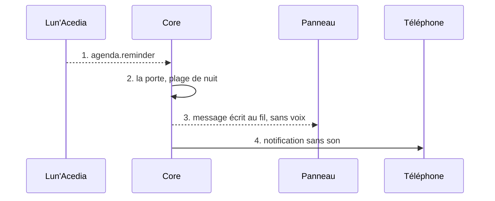

| # | De → vers | Par quoi | Ce qui circule | Retour |
|---|---|---|---|---|
| 1 | Lun'Acedia → core | événement `agenda.reminder` | comme S5.14 | — |
| 2 | Core (code) | la porte d'attention | la plage de nuit l'emporte sur tout : présent ou non, en appel ou non | « écrire au fil » et « notifier sans son » |
| 3 | Core → panneau | message dans le fil | « Rappel : … », sans parole | — |
| 4 | Core → téléphone | notification poussée | le titre, sans son | — |

- **Ce que CrOliX voit, et où** : au réveil, le message dans la conversation, la notification silencieuse, la ligne
  d'À trancher si le rendez-vous n'a pas commencé, l'entrée au Journal. L'accueil du matin ne le redit pas.
- **Ce qui s'écrit** : comme S5.14, moins la parole.
- **Qui décide** : du code (la porte).
- **Erreurs et cas limites** :
  - Un rappel d'un rendez-vous tôt le matin (7 h 30, rappel à 60 minutes) est écrit, pas dit, même si CrOliX est
    déjà à son poste.
  - La lettre du matin compte ce rappel dans « N urgences cette nuit », avec toutes les urgences de la journée
    écoulée, rappels de la veille compris.
- **Écart avec les décisions** : T30 (« cette nuit » compte la veille entière, rappels compris).
- **Non vérifié** : rien n'est rejoué. Un événement sur la journée avec un rappel par défaut tombe-t-il presque
  toujours dans la plage de nuit, donc sans jamais être dit à voix haute ? Cela dépend de ce que Google rend
  vraiment (S5.14).

### S5.18 · Le rappel pendant un appel, ou quand l'annonce à voix haute est coupée

- **Déclencheur** : un rappel arrive au core, CrOliX présent, hors plage de nuit, mais le core tient un appel
  en cours, ou le réglage « dit à voix haute : P0 » est coupé.
- **Acteurs** : Lun'Acedia, le core, le panneau, le téléphone, Lun'Luxuria.
- **Avant** : présent.

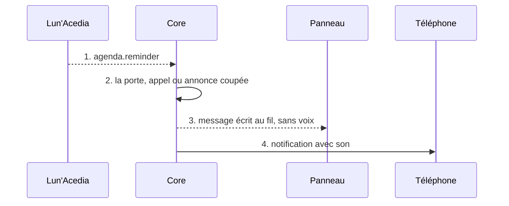

| # | De → vers | Par quoi | Ce qui circule | Retour |
|---|---|---|---|---|
| 1 | Lun'Acedia → core | événement `agenda.reminder` | comme S5.14 | — |
| 2 | Core (code) | la porte d'attention | l'appel en cours, puis le réglage de l'annonce, tels que le core les a en mémoire | « écrire au fil » et « notifier avec son » |
| 3 | Core → panneau | message dans le fil | « Rappel : … », sans parole | — |
| 4 | Core → téléphone | notification poussée | le titre, avec son, alors que CrOliX est au bureau | — |

- **Ce que CrOliX voit, et où** : le message dans la conversation, la notification sonore sur le téléphone, À trancher,
  le Journal. Pas de voix.
- **Ce qui s'écrit** : comme S5.14, moins la parole.
- **Qui décide** : du code (la porte), sur les drapeaux de présence que le core garde (appel, sourdine, annonce coupée).
- **Erreurs et cas limites** :
  - **La sourdine** : côté core, elle ne change rien à un rappel : il part « à dire à voix haute ». Ce que
    Lun'Luxuria en fait relève de la famille 8.
  - **Alertes urgentes en direct coupées** pour Lun'Acedia : la notification est retirée, la ligne d'À trancher
    aussi ; la voix ou le message du fil restent.
  - Ordre des entrées : plage de nuit, absence, appel, réglage de l'annonce, ancienneté. La première qui s'applique
    décide.
- **Écart avec les décisions** : T11 (la sourdine est lue à deux endroits ; le core ne la lit pas pour une urgence).
- **Non vérifié** : le comportement de Lun'Luxuria (hors des dépôts lus ici). L'appel en cours et le réglage de
  l'annonce arrivent-ils au core avec la présence annoncée par Lun'Luxuria ? Le chemin de la présence n'est pas lu
  ici (famille 8).

### S5.19 · Le rappel pendant une pause

- **Déclencheur** : l'heure d'un rappel passe alors que Lun'Acedia est en pause (la sienne, ou celle du core), ou que
  le core est en pause.
- **Acteurs** : Lun'Acedia, le core.
- **Avant** : une pause posée.

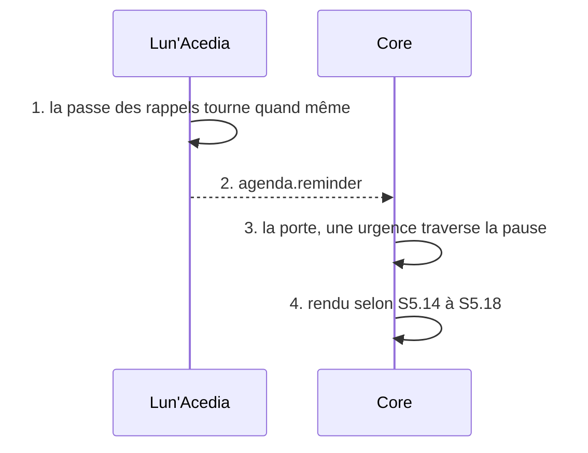

| # | De → vers | Par quoi | Ce qui circule | Retour |
|---|---|---|---|---|
| 1 | Lun'Acedia (code) | passe des rappels | aucun test de pause dans cette passe | — |
| 2 | Lun'Acedia → core | événement `agenda.reminder` | comme S5.14 ; le flux d'événements ne teste pas la pause non plus | — |
| 3 | Core (code) | la porte d'attention | la pause retient tout sauf le palier P0 et les alertes de santé du core | le rappel suit son chemin habituel |
| 4 | Core | rendu | selon la présence, la plage de nuit, l'appel | — |

- **Ce que CrOliX voit, et où** : exactement ce qu'il verrait hors pause.
- **Ce qui s'écrit** : comme S5.14.
- **Qui décide** : du code, des deux côtés.
- **Erreurs et cas limites** :
  - En pause, la synchro avec Google continue aussi (S5.1) : les rappels restent justes.
  - En pause, la détection des conflits ne crée aucune carte (S5.23).
  - Sous une pause **locale** d'Acedia, son agent répond « en pause » au core, mais ses rappels sortent.
- **Écart avec les décisions** : T13 (deux pauses de force inégale). Le standard du contrat dit qu'un poste en pause
  locale « devient muet pour le core » : pour les rappels, le code de Lun'Acedia ne se tait pas
  (`server/src/agenda/reminders.ts:80-97`, `server/src/contract/routes.ts:282-314`).
- **Non vérifié** : ce que le core fait d'autre d'un poste en pause locale (famille 10).

### S5.20 · Voir un rappel dans À trancher, et le marquer « Vu »

- **Déclencheur** : CrOliX ouvre À trancher et choisit « Vu » sur une ligne « Rappel » ; ou il ne fait rien et l'heure
  du rendez-vous arrive.
- **Acteurs** : CrOliX, le panneau, le core. Lun'Acedia n'est pas appelée.
- **Avant** : un rappel reçu aujourd'hui (journée de Natsume, de 5 h à 5 h), pas encore vu, dont le rendez-vous n'a
  pas commencé.

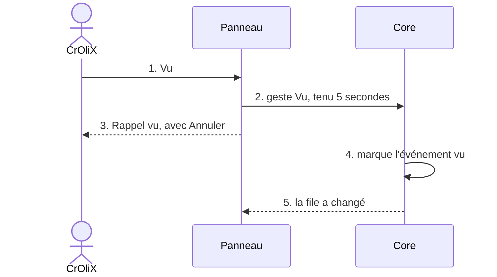

| # | De → vers | Par quoi | Ce qui circule | Retour |
|---|---|---|---|---|
| 1 | CrOliX → panneau | le bouton « Vu » | — | — |
| 2 | Panneau → core | un geste tenu | l'identifiant de l'événement au core, le geste « vu », la surface d'origine | le geste, tenu 5 secondes, annulable |
| 3 | Panneau → CrOliX | un message bref | « Rappel vu : Oral. » | — |
| 4 | Core (code) | fin de la tenue | l'événement est marqué vu, pour tous les appareils | la notification encore en attente est retirée |
| 5 | Core → panneau | signal « la file a changé » | — | la ligne disparaît partout |

- **Ce que CrOliX voit, et où** : la ligne quitte À trancher sur toutes ses surfaces. Le Journal ne change pas : un
  rappel n'y gagne pas l'étape « Vue. » que reçoit une autre urgence.
- **Ce qui s'écrit** : au core, « vu » sur l'événement. Rien chez Lun'Acedia.
- **Qui décide** : CrOliX, ou personne : la ligne part seule quand l'heure du rendez-vous (`data.due`) est passée. Le
  core le vérifie à chaque passe de ses notifications (toutes les 15 s) et prévient les écrans ouverts.
- **Erreurs et cas limites** :
  - Le temps restant affiché est calculé par le panneau sur `data.due` : « dans 8 min », « dans 1 h 05 »,
    « maintenant » ; sans heure limite (une tâche) : « aujourd'hui ».
  - Plusieurs rappels pour un même élément : seul le dernier reçu se montre, vu ou non ; « Vu » sur lui ne fait
    pas remonter un plus ancien.
  - « Vu » ne coche pas la tâche, ne touche pas l'événement, et Lun'Acedia ne l'apprend pas.
  - Aucun autre geste : ni reporter, ni rappeler plus tard, ni déplacer l'événement depuis le core. Le rappel porte
    un lien `#/agenda`, vers l'écran d'Acedia.
- **Écart avec les décisions** : T16 (« Vu » ne vit que dans le core).
- **Non vérifié** : le rendu de la ligne à l'écran ; la tenue de 5 secondes relève de la famille 3.

### S5.21 · Un rappel manqué : Lun'Acedia arrêtée

- **Déclencheur** : le serveur d'Acedia était arrêté à l'heure d'un rappel, puis redémarre.
- **Acteurs** : Lun'Acedia, le core.
- **Avant** : un rappel aurait dû tomber pendant l'arrêt.

```mermaid
sequenceDiagram
    participant A as Lun'Acedia
    participant N as Core
    A->>A: 1. redémarre, passe des rappels aussitôt
    A->>A: 2. en retard de moins de 15 min ?
    A-->>N: 3. oui, agenda.reminder, en retard
    A->>A: 4. non, rien, sans trace
```

| # | De → vers | Par quoi | Ce qui circule | Retour |
|---|---|---|---|---|
| 1 | Lun'Acedia (code) | démarrage | la passe des rappels tourne tout de suite, avant la première minute | — |
| 2 | Lun'Acedia (code) | fenêtre de retard | un rappel n'est dû que si son heure est passée depuis **moins de 15 minutes** | — |
| 3 | Lun'Acedia → core | événement `agenda.reminder` | daté de l'émission ; `data.at` garde l'heure prévue ; `title` garde son texte (« Oral dans 10 min ») même si moins de temps reste | rendu normal au core : pour lui, l'événement est neuf |
| 4 | Lun'Acedia (code) | abandon | rien n'est émis, rien n'est écrit | — |

- **Ce que CrOliX voit, et où** : soit le rappel avec quelques minutes de retard, soit **rien du tout**.
- **Ce qui s'écrit** : rien pour un rappel abandonné. Ni Lun'Acedia ni le core ne savent qu'il a manqué.
- **Qui décide** : du code : « mieux vaut se taire que rappeler en retard » (`server/src/agenda/reminders.ts:8-9`).
- **Erreurs et cas limites** :
  - Retard de 11 à 15 minutes sur un rappel à 10 minutes : la voix dit « Oral dans 10 min » alors que l'oral a
    commencé ; À trancher ne montre pas la ligne (l'heure limite est passée), mais la phrase est dite et écrite.
  - Arrêt à 9 h 00 qui finit avant 9 h 15 : le rappel des tâches du jour part au redémarrage ; arrêt plus long :
    aucune tâche n'est rappelée ce jour-là.
  - Le serveur d'Acedia tourne mais Google est injoignable : les rappels partent sur le cache, sans les
    changements récents.
  - Le poste de CrOliX éteint n'a aucun effet sur Lun'Acedia : c'est l'absence, S5.16.
- **Écart avec les décisions** : aucun connu ; ce trou n'est pas dans la carte du 27/11 (à rapprocher de T23 à T28,
  « ce qui ne remonte jamais »).
- **Non vérifié** : rien n'est rejoué ; les retards sont lus dans le code et son test
  (`server/src/agenda/reminders.test.ts:85-96`).

### S5.22 · Un rappel reçu en retard par le core

- **Déclencheur** : le core était arrêté, ou son écoute de Lun'Acedia coupée, quand le rappel a été émis ; la liaison
  revient.
- **Acteurs** : Lun'Acedia, le core, le panneau, le téléphone.
- **Avant** : le rappel a moins de 7 jours (Lun'Acedia garde ses événements 7 jours).

```mermaid
sequenceDiagram
    participant N as Core
    participant A as Lun'Acedia
    participant P as Panneau
    N->>A: 1. GET /lun/v1/events, depuis le dernier reçu
    A-->>N: 2. rejoue les événements manqués
    N->>N: 3. la porte, vieux de plus de 5 min
    N-->>P: 4. message écrit au fil, sans voix
```

| # | De → vers | Par quoi | Ce qui circule | Retour |
|---|---|---|---|---|
| 1 | Core → Lun'Acedia | `GET /lun/v1/events` avec `last-event-id` | l'identifiant du dernier événement gardé | le flux |
| 2 | Lun'Acedia → core | rejeu | tous les événements plus récents, dans l'ordre, rappels compris, à leur date d'origine | — |
| 3 | Core (code) | la porte d'attention | l'âge : la réception moins la date de l'événement ; présent et vieux de 5 minutes ou plus : « écrire au fil », sans voix ni notification | — |
| 4 | Core → panneau | message dans le fil, Journal | « Rappel : … » ; l'entrée du Journal est datée de l'événement, pas de sa réception | — |

- **Ce que CrOliX voit, et où** : le message dans la conversation, l'entrée au Journal. Dans À trancher, la ligne ne
  se montre que si le rendez-vous n'a pas commencé et que le rappel date de la journée de Natsume en cours.
- **Ce qui s'écrit** : l'événement, le Journal, le message, la trace de la porte, le point de reprise de l'écoute.
- **Qui décide** : du code.
- **Erreurs et cas limites** :
  - Absent au retour de la liaison : la porte demande une notification avec son quel que soit l'âge, mais la ligne de
    notification expire si l'événement a plus d'une heure. Rien dans le fil.
  - Plage de nuit au retour : écrit au fil, notification sans son.
  - Un événement déjà gardé et rejoué une seconde fois est ignoré : ni voix, ni message, ni seconde ligne au Journal.
  - Coupure de plus de 7 jours : les rappels purgés chez Lun'Acedia ne sont jamais reçus.
  - Pendant la coupure, le core retente l'écoute avec un délai qui double ; Lun'Acedia paraît injoignable
    (famille 11).
- **Écart avec les décisions** : aucun connu.
- **Non vérifié** : les délais de reconnexion réels.

### S5.23 · Un conflit d'agenda détecté : la carte

- **Déclencheur** : la fin de chaque passe de synchro de l'agenda (S5.1) : deux événements à heure, occupés et non
  refusés, se chevauchent dans les sept jours qui viennent.
- **Acteurs** : Lun'Acedia (code, sans modèle), l'écran d'Acedia, le core, CrOliX.
- **Avant** : hors pause (locale ou du core) pour créer une carte ; trois cartes de conflit par jour au plus.

```mermaid
sequenceDiagram
    participant A as Lun'Acedia
    participant E as Écran d'Acedia
    participant N as Core
    participant P as Panneau
    A->>A: 1. cherche les chevauchements
    A->>A: 2. prépare une carte
    A-->>E: 3. agenda.overlap
    A-->>N: 3. agenda.overlap
    N->>A: 4. relit les cartes en attente
    N-->>P: 5. la carte dans À trancher
```

| # | De → vers | Par quoi | Ce qui circule | Retour |
|---|---|---|---|---|
| 1 | Lun'Acedia (code) | détection sur le cache | les événements à heure, occupés (pas « disponible »), non refusés, non finis, des 7 jours à venir ; le même événement dans deux agendas compte une fois | les paires en conflit dont le premier n'a pas commencé |
| 2 | Lun'Acedia (code) | une carte par conflit | soit une carte `event.update` qui déplace l'événement que CrOliX tient seul dans son agenda principal vers le premier créneau libre qui suit la fin du conflit, le jour (de Paris) où commence le second événement, entre 8 h et 22 h, au quart d'heure (un créneau déjà offert par une autre carte en attente compte comme pris ; `server/src/agenda/overlaps.ts:58-68`, `:76-85`, `:228-229`) : `calendarId`, `id`, `start`, `end` ; soit une carte qui signale seulement, avec sa raison | — |
| 3 | Lun'Acedia → écran et core | événement `agenda.overlap` | `importance: log` ; `title` : « « Titre A » et « Titre B » se chevauchent » ; `link: #/agenda` ; pas d'identifiant de la carte | — |
| 4 | Core → Lun'Acedia | `GET /lun/v1/cards?status=pending` | — | la carte : `id`, `action` (`event.update` ou `agenda.list`), `effect: write`, `kind`, `title`, `lines`, `status`, `at` ; pas d'`importance` (elle vaut P1) |
| 5 | Core → panneau | À trancher | la carte | voir la famille 3 pour la suite |

- **Ce que CrOliX voit, et où** : dans le panneau de l'agent d'Acedia, une carte « Déplacer un événement qui en
  chevauche un autre » (Événement, Chevauche, Début, Fin) ou « Deux événements se chevauchent » (avec « Pourquoi »).
  Au core : la même carte dans À trancher, et une notification silencieuse s'il est absent (palier P1).
- **Ce qui s'écrit** : la carte, chez Lun'Acedia. Rien chez Google tant que CrOliX n'a pas validé.
- **Qui décide** : le code trouve le conflit et propose ; **CrOliX seul** valide. Cette carte attend toujours, même
  si l'agent d'Acedia est en mode « tout de suite » (`server/src/agenda/overlaps.ts:9-13`). Valider la carte qui
  signale ne fait qu'une lecture : « Conflit vu ».
- **Erreurs et cas limites** :
  - Raisons de la carte qui signale : chacun a un invité ou vient d'un autre agenda que le principal ; aucun créneau
    libre ce jour-là ; deux séries ; l'un des deux a déjà une carte qui le déplace.
  - Conflit réglé à la main, ou créneau proposé pris entre-temps : la carte est retirée à la passe suivante ; conflit
    commencé : elle expire. Un seul `agenda.overlap` le dit, par passe.
  - Une carte laissée sans réponse expire au changement de jour ; le conflit revient une fois, la veille (jour de
    Paris), jamais après une décision.
  - En pause : aucune carte créée, mais les cartes devenues sans objet sont quand même retirées.
  - Un événement sur la journée n'entre jamais dans un conflit.
  - Décidée dans l'écran d'Acedia, la carte ne réveille aucun modèle (elle n'appartient à aucun tour) et rien n'est
    poussé au core, qui l'apprend à sa lecture suivante.
- **Écart avec les décisions** : T5 et F5 (une carte tranchée dans l'écran du satellite n'est pas signalée). Le
  standard des notifications classe une carte sans heure en P2 ; celle-ci, sans `importance`, vaut P1.
- **Non vérifié** : le parcours de la carte au core (famille 3) ; le rendu dans le panneau de l'agent.

### S5.24 · Déconnecter Google depuis les Réglages d'Acedia

- **Déclencheur** : CrOliX choisit « Déconnecter » dans les Réglages d'Acedia, section du compte Google.
- **Acteurs** : CrOliX, l'écran d'Acedia, Lun'Acedia, Google. Le core n'est pas prévenu.
- **Avant** : un compte est branché.

```mermaid
sequenceDiagram
    actor C as CrOliX
    participant E as Écran d'Acedia
    participant A as Lun'Acedia
    participant G as Google
    C->>E: 1. Déconnecter
    E->>A: 2. POST /api/google/disconnect
    A->>G: 3. révoque le jeton
    A->>A: 4. efface les jetons
    A-->>E: 5. connected false
    A->>A: 6. les passes suivantes se taisent
```

| # | De → vers | Par quoi | Ce qui circule | Retour |
|---|---|---|---|---|
| 1 | CrOliX → écran | le bouton « Déconnecter » | — | — |
| 2 | Écran → Lun'Acedia | `POST /api/google/disconnect` | rien | — |
| 3 | Lun'Acedia → Google | `POST` sur l'adresse de révocation de Google | le jeton de rafraîchissement | une réponse ignorée : un échec ne change rien |
| 4 | Lun'Acedia (code) | oubli des jetons | les jetons sont effacés, l'état dégradé `google-reauth` est levé | — |
| 5 | Lun'Acedia → écran | réponse | `{ connected: false }` | — |
| 6 | Lun'Acedia (code) | passes de synchro suivantes | aucun compte branché : chaque passe s'arrête au premier appel, sans écrire | aucune erreur dite |

- **Ce que CrOliX voit, et où** : l'agenda et les tâches gardent leur
  dernier état (le cache n'est pas vidé). Rien au core, rien au Journal, aucune notification.
- **Ce qui s'écrit** : les jetons sont effacés. Le cache (agendas, événements, tâches, rappels déjà émis) et l'adresse
  du compte précédent restent (`server/src/google/oauth.ts:132-143`, `server/src/google/client.ts:91-94`).
- **Qui décide** : CrOliX. Le code ne demande aucune confirmation dans cette route.
- **Erreurs et cas limites** :
  - La passe de synchro échoue sans bruit : ni console, ni santé dégradée (`server/src/main.ts:99-105`). Le core
    n'en sait rien (T23).
  - Les rappels continuent sur un cache qui ne se met plus à jour : ils ne dépendent d'aucun compte
    (`server/src/agenda/reminders.ts`). Un événement supprimé chez Google après la déconnexion reste rappelé.
  - Reconnexion avec la **même** adresse : rien n'est effacé, la synchro reprend. Avec une **autre** adresse : tout
    s'efface (S5.5).
- **Écart avec les décisions** : T23 (un compte déconnecté ne remonte nulle part).
- **Non vérifié** : le rendu des Réglages ; la réponse réelle de Google à la révocation.

### S5.25 · Annuler une action faite par l'agent d'Acedia

- **Déclencheur** : CrOliX choisit « Annuler » sur une ligne « fait » du panneau de l'agent d'Acedia (S5.11).
- **Acteurs** : CrOliX, l'écran d'Acedia, Lun'Acedia, Google, le core.
- **Avant** : une carte de l'agent a été exécutée et a gardé un inverse (une création, ou une modification ; pas
  `task.complete`, `event.delete` ni `task.delete`).

```mermaid
sequenceDiagram
    actor C as CrOliX
    participant E as Écran d'Acedia
    participant A as Lun'Acedia
    participant G as Google
    participant N as Core
    C->>E: 1. Annuler
    E->>A: 2. POST /api/pina/cards/:id/undo
    A->>A: 3. prend l'inverse, une seule fois
    A->>G: 4. exécute l'inverse par le catalogue
    A-->>E: 5. la carte et le résultat
    A-->>N: 6. agenda.changed
    N->>A: 7. relecture (S5.12)
```

| # | De → vers | Par quoi | Ce qui circule | Retour |
|---|---|---|---|---|
| 1 | CrOliX → écran | le bouton « Annuler » de la ligne | — | — |
| 2 | Écran → Lun'Acedia | `POST /api/pina/cards/:id/undo` | l'identifiant de la carte dans l'adresse, pas de corps | — |
| 3 | Lun'Acedia (code) | l'inverse gardé de la carte | l'inverse est pris (il ne sert qu'une fois) | — |
| 4 | Lun'Acedia → Google | l'action inverse, par le catalogue d'actions | la suppression de l'élément créé, ou les valeurs d'avant l'écriture | l'élément remis en l'état |
| 5 | Lun'Acedia → écran | réponse | `card` (la carte relue), `result` (le résultat de l'inverse) | — |
| 6 | Lun'Acedia → écran et core | événement `agenda.changed` | `data.changes` | — |
| 7 | Core → Lun'Acedia | relecture du poste | voir S5.12 | — |

- **Ce que CrOliX voit, et où** : dans l'écran d'Acedia, l'élément créé disparaît, ou l'élément modifié revient à ses
  valeurs d'avant. Au core, « Ce qui vient » suit à la relecture. Rien n'est dit ni notifié.
- **Ce qui s'écrit** : chez Google et dans le cache d'Acedia, comme S5.7 à S5.10. L'inverse est consommé.
- **Qui décide** : CrOliX, par le geste. Le code a décidé à l'écriture de garder ou non un inverse
  (`server/src/pina/inverse.ts:58-83`).
- **Erreurs et cas limites** :
  - Pas d'inverse, ou déjà pris : 409 « Rien à annuler » (`server/src/pina/routes.ts:59-65`).
  - L'inverse échoue (élément disparu chez Google, autorisation perdue…) : 409 avec le message de l'erreur, et
    l'inverse est rendu pour un nouvel essai (`server/src/pina/agent.ts:155-163`). Seul un geste déjà annulé (mails)
    ne le rend pas.
- **Écart avec les décisions** : aucun connu.
- **Non vérifié** : le rendu de la ligne après l'annulation ; ce que l'écran montre d'un 409.
