# Famille 6 · La nuit et la lettre du matin

Cette famille couvre ce que le core fait seul, à heure fixe : la nuit (5 h, heure de Paris) et la lettre du matin
(7 h 30). Elle suit ce que la nuit lit, chez qui, ce qu'un modèle en fait, ce qui part à la bibliothèque et ce que
Lun'Avaritia en tire. Elle suit aussi la lettre : ses faits, son texte, où elle arrive, et toutes les variantes
(échec, pause, poste absent, core redémarré, relance). Il n'existe que ces deux routines : aucun « point du soir »
n'est codé. Les écrans du core disent « Veille de la nuit » ; le dictionnaire dit « la nuit ».

| Id | Titre | En une ligne |
|---|---|---|
| S6.1 | La nuit de 5 h, cas nominal | Le core relit chaque jour non couvert, le trie par un modèle, garde ses souvenirs |
| S6.2 | Le bilan du jour lu chez Lun'Acedia | L'action `day.digest`, ce qu'elle rend, ce que le core en garde |
| S6.3 | L'envoi des observations à la bibliothèque | L'action `brain.ingest`, par lots de 500, les seuls mots de CrOliX |
| S6.4 | Le traitement du lot par Lun'Avaritia | Deux appels de modèle, des brouillons, des questions, aucun signal |
| S6.5 | Un lot retenu ou en échec chez Lun'Avaritia | Pause, plafond du mois, fournisseur absent, réponse invalide |
| S6.6 | Les dernières étapes de la nuit | Portrait, tempérament, scènes de contrôle, purge du fil |
| S6.7 | Nuit incomplète : un poste absent ou éteint | Le jour reste « en attente », la nuit se dit faite |
| S6.8 | Nuit en échec | Modèle absent, prix inconnu, plafond de la nuit, réponse invalide deux fois |
| S6.9 | Jour sans rien | Aucun appel, aucun coût, une lettre de deux phrases |
| S6.10 | La lettre du matin, cas nominal | Des faits lus en cache, un contexte du jour par le modèle, un texte par le code |
| S6.11 | Lettre déjà écrite : la relance et sa note | Une seule lettre par jour, puis des notes de correction |
| S6.12 | Nuit encore en cours à l'heure de la lettre | La lettre le dit, la fin de la nuit la corrige |
| S6.13 | Lettre en échec ou écrite sans le modèle | Pas de lettre, ou une lettre sans contexte du jour |
| S6.14 | Routine sautée sous une pause | Le créneau est noté « sautée », rien n'est rattrapé |
| S6.15 | Core arrêté ou redémarré | Passage interrompu, rattrapage au démarrage |
| S6.16 | Lancer une routine à la main | Depuis l'Atelier, même en pause |
| S6.17 | Lire la lettre et l'état des routines | Bureau, Constellation, fiche de Natsume, Atelier, Journal |
| S6.18 | L'entretien à intervalle fixe | Copie de la base, échéance des clés, boucles horaires de Lun'Avaritia |
| S6.19 | Routine lancée à la main qui tourne encore au créneau | Le créneau reste dû, un second passage suit |
| S6.20 | Poste qui accepte l'appel sans jamais répondre | Aucun délai : le passage reste « en cours » |

---

### S6.1 · La nuit de 5 h, cas nominal

- **Déclencheur** : l'horloge du core. Chaque minute, le core regarde si une routine est due. La nuit l'est quand
  aucun passage n'a commencé depuis le dernier 5 h 00 de Paris.
- **Acteurs** : le core, le fournisseur du modèle, Lun'Acedia, Lun'Avaritia. CrOliX n'intervient pas.
- **Avant** : pas de pause en cours, aucune nuit déjà en route, un fournisseur de modèle en service avec un prix
  connu, les deux postes reliés et leurs réglages « La veille de la nuit » et « Le bilan du jour » allumés
  (c'est le défaut).

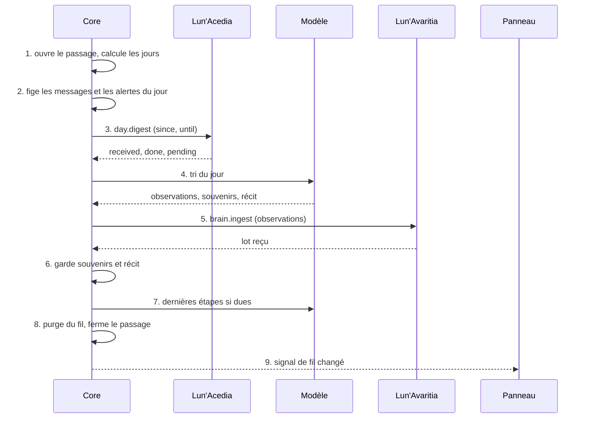

| # | De → vers | Par quoi | Ce qui circule | Retour |
|---|---|---|---|---|
| 1 | Core → core | horloge, une fois par minute | le début de la période (la fin de la dernière nuit réussie, ou la date de mise en service), sa fin (5 h 00 d'aujourd'hui), les jours restés inachevés d'un passage précédent | la liste des jours à traiter, les inachevés d'abord |
| 2 | Core → core | lecture de sa propre base, à la première visite du jour | tous les messages du jour de tous les fils (texte, heure, fil, rôle CrOliX ou Natsume), sauf les paroles de routine et les cartes lues à voix haute ; les événements urgents reçus de 5 h à 5 h (titre, heure, poste) | une copie figée du jour ; un échange déjà noté par une carte de la bibliothèque porte une marque « déjà noté » |
| 3 | Core → Lun'Acedia | `POST /lun/v1/actions/day.digest` | `since`, `until` : le jour de 5 h à 5 h, en ISO UTC. Pas de `boxes` | `received[]`, `done[]`, `pending` (voir S6.2) |
| 4 | Core → modèle | un appel, réponse en JSON contraint | une consigne fixe ; trois blocs de données : messages, alertes, bilan ; le nombre de mails encore en attente s'il n'est pas nul | `observations[]` (`text`, `ref`), `souvenirs[]` (`text`, `ref`, `reaction`, `provenance`, `citation`), `recit` |
| 5 | Core → Lun'Avaritia | `POST /lun/v1/actions/brain.ingest` | les seules observations tirées d'un message de CrOliX (voir S6.3) | `lot`, `accepted`, `status` ; le core ne lit que le code HTTP |
| 6 | Core → core | une transaction | les souvenirs (texte, source, réaction, provenance « dit » ou « déduit ») et le récit du jour, secrets masqués | l'étape du journal est marquée faite. Le jour n'est fini (il sort du fil, il quitte les inachevés) que quand ses quatre marques sont posées, envoi compris |
| 7 | Core → modèle | zéro à plusieurs appels | portrait, tempérament, scènes de contrôle quand ils sont dus (voir S6.6) | une nouvelle version, ou rien |
| 8 | Core → core | fin du passage | les jours traités sortent du fil ; le passage reçoit son état, son coût, sa période | une ligne au Journal |
| 9 | Core → panneau | flux en direct du core | « le fil principal a changé », sans contenu | le panneau relit le fil |

- **Ce que CrOliX voit, et où** : rien ne lui est annoncé quand la nuit réussit. Au Journal, une ligne « Veille de
  la nuit », faite, avec son coût et sa durée, et une ligne « Veille AAAA-MM-JJ : N observation(s) », confiée à
  Lun'Avaritia. Dans la conversation, les jours traités ne sont plus affichés. À la Constellation, la ligne
  « 05:00, … faite ». À l'Atelier, « Veille de la nuit, 05:00, faite à … ».
- **Ce qui s'écrit** : côté core, le passage (début, fin, période, coût, état), la copie figée de chaque jour et
  son tri, les souvenirs et le récit dans la mémoire de Natsume, le coût de chaque appel compté sur le jour
  résumé, la délégation à Lun'Avaritia, deux lignes au Journal. Côté Lun'Avaritia, un lot et ses observations.
- **Qui décide** : du code décide de l'heure, des jours, de ce qui est lu et de ce qui part. Un modèle décide de ce
  qui devient observation, souvenir ou récit. Du code vérifie ensuite chaque référence, masque les secrets, et
  rétrograde en « déduit » tout souvenir « dit » dont la citation (trois mots au moins) n'est pas retrouvée mot
  pour mot dans le message cité. CrOliX ne décide de rien pendant la nuit.
- **Erreurs et cas limites** :
  - Une nuit tourne déjà : le second passage est refusé (voir S6.16).
  - Plusieurs jours à couvrir (core éteint plusieurs nuits) : ils sont traités un par un, dans l'ordre.
  - Une étape déjà marquée n'est jamais refaite : une reprise n'écrit pas deux fois un souvenir.
  - Réponse du tri trop longue : chaque texte est coupé à 2 000 signes avant contrôle.
  - Référence inconnue ou JSON illisible : le tri est redemandé une fois, puis le jour échoue (S6.8).
  - Les appels aux postes n'ont pas de délai propre posé par la nuit (voir S6.20).
- **Écart avec les décisions** : F2 : la nuit ne vérifie pas « l'urgent resté sans suite » par étiquettes ; elle
  ne lit que le bilan du jour. T3 : le core ne sait rien du sort du lot. T30 : le jour de la nuit va de 5 h à 5 h.
- **Non vérifié** : le détail du masquage des secrets ; la forme exacte de la mémoire relue ensuite par la
  conversation (famille 1).

---

### S6.2 · Le bilan du jour lu chez Lun'Acedia

- **Déclencheur** : la nuit ouvre un jour pour la première fois (étape 3 de S6.1), ou revient sur un jour dont le
  bilan manquait.
- **Acteurs** : le core, Lun'Acedia.
- **Avant** : chez le core, les réglages « La veille de la nuit » et « Le bilan du jour » de Lun'Acedia sont
  allumés, et Lun'Acedia est reliée ou au moins appairée.

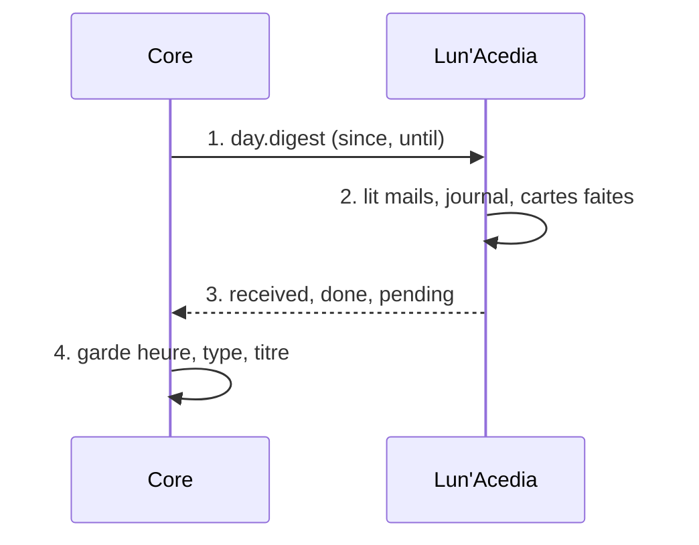

| # | De → vers | Par quoi | Ce qui circule | Retour |
|---|---|---|---|---|
| 1 | Core → Lun'Acedia | `POST /lun/v1/actions/day.digest`, jeton du core | `since` (début inclus), `until` (fin exclue), ISO UTC. Le core n'envoie jamais `boxes` | — |
| 2 | Lun'Acedia → sa base | lecture seule | les mails datés dans la période (200 au plus, les plus récents d'abord) ; les lignes de son journal non annulées ; les cartes de son agent faites dans la période | — |
| 3 | Lun'Acedia → core | réponse `{ ok: true, result }` | `since`, `until` ; `received[]` : `type: "mail"`, `title` (objet masqué), `at`, `ref` ; `done[]` : une ligne du journal de tri porte `type: "journal.<action>"`, `title`, `at` et `ref` (le mail : `type`, `id`, `title`), une carte d'agent faite porte `type: "card.<action>"`, `title`, `at`, sans `ref` ; `pending` : mails à valider plus cartes en attente. Sans `boxes` : ni `box` ni `synthesis` | — |
| 4 | Core → core | écriture dans la copie du jour | pour chaque élément : `at`, `type`, `title`, et l'état « reçu » ou « fait », numérotés `d0`, `d1`… ; `pending` devient « mails encore en attente ». `ref` n'est gardé dans aucun des deux cas | le bilan entre dans le tri du jour |

- **Ce que CrOliX voit, et où** : rien. Le bilan n'est montré nulle part ; il sert de donnée au tri.
- **Ce qui s'écrit** : côté core, le bilan dans la copie figée du jour. Côté Lun'Acedia, l'action appelle aussi
  l'expiration de ses cartes d'agent périmées (Lun'Acedia, `server/src/contract/catalog.ts:625`).
- **Qui décide** : le core choisit la période ; du code de Lun'Acedia choisit ce qui entre dans le bilan
  (Lun'Acedia, `server/src/contract/catalog.ts:534-635`). Aucun modèle : sans `boxes`, Lun'Acedia n'écrit aucune
  synthèse (`catalog.ts:590-593`).
- **Erreurs et cas limites** :
  - Lun'Acedia ne répond pas, répond en erreur, ou refuse le jeton : le jour s'ouvre sans bilan, et une seconde
    part « bilan » est créée pour ce jour. Elle est redemandée au passage suivant de la nuit, pas dans le même.
  - Bilan arrivé plus tard : il est trié seul par le modèle. Il peut donner des souvenirs (toujours « déduit »),
    jamais une observation envoyée à la bibliothèque.
  - Réglage du bilan éteint après l'ouverture de la part : elle est close sans appel, comme « non relié ».
  - Lun'Acedia ni reliée ni appairée : le bilan n'est pas attendu, le jour se fait sans lui.
  - `since` égal ou postérieur à `until` : `400`, « since doit précéder until » (`catalog.ts:562`).
  - Plus de 200 éléments : les plus anciens sont perdus (`catalog.ts:564-565`).
  - Lun'Acedia dégradée : une action qui lève `DegradedError` répond `503` (Lun'Acedia,
    `server/src/contract/routes.ts:421`). Le core la traite comme un bilan indisponible : une part « bilan » est
    ouverte et redemandée au passage suivant. Ce cas est distinct du `200` avec `ok: false` ci-dessous.
  - Une action qui casse autrement répond `200` avec `ok: false` (Lun'Acedia,
    `server/src/contract/routes.ts:419-423`) : le core, n'y trouvant pas de `result`, la traite comme un bilan
    indisponible.
- **Écart avec les décisions** : F3 : le core ne lit le bilan que chez Lun'Acedia. Lun'Avaritia sert aussi
  `day.digest` (Lun'Avaritia, `server/src/brain/digest.ts:14-44`), mais le core ne l'appelle jamais. Le standard
  du contrat décrit `boxes` et la synthèse ; la nuit ne s'en sert pas.
- **Non vérifié** : le filtre exact de la vue « À valider » qui donne `pending` ; ce que fait l'expiration des
  cartes appelée en fin d'action.

---

### S6.3 · L'envoi des observations à la bibliothèque

- **Déclencheur** : le tri d'un jour est rangé, et l'envoi de ce jour n'est pas encore marqué (étape 5 de S6.1).
- **Acteurs** : le core, Lun'Avaritia.
- **Avant** : le tri a rendu au moins une observation tirée d'un message de CrOliX ; le réglage « La veille de la
  nuit » de Lun'Avaritia est allumé chez le core ; le plafond du jour posé par le core sur ce poste, s'il y en a
  un, n'est pas atteint ; Lun'Avaritia est reliée.

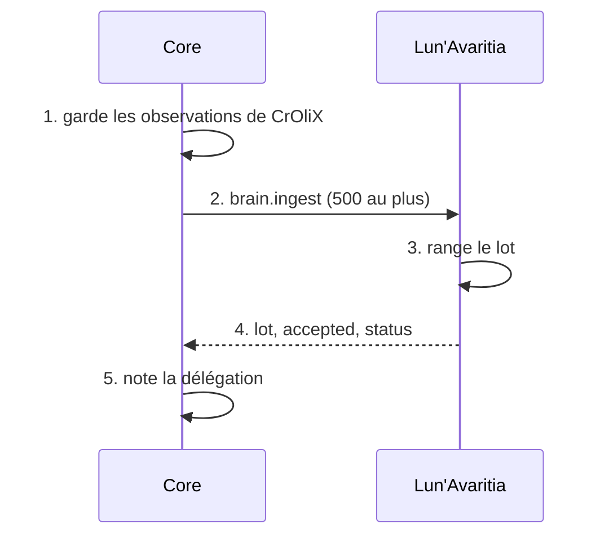

| # | De → vers | Par quoi | Ce qui circule | Retour |
|---|---|---|---|---|
| 1 | Core → core | filtre en code | seules les observations dont la référence est un message de CrOliX. Celles tirées d'un mot de Natsume, d'une alerte ou du bilan sont écartées | la liste à envoyer |
| 2 | Core → Lun'Avaritia | `POST /lun/v1/actions/brain.ingest`, un appel par tranche de 500 | `version: 1` ; `observations[]` : `text` (2 000 signes au plus, secrets masqués), `source` : `kind: "core"`, `origin: "chat"`, `ref` (le numéro du message, `m…`), `at` (l'heure du message). Pas le texte du message d'origine | — |
| 3 | Lun'Avaritia → sa base | une transaction, sans modèle | un lot, et une ligne par observation | — |
| 4 | Lun'Avaritia → core | réponse `{ ok: true, result }` | `lot` (son numéro), `accepted` (le nombre reçu), `status` : `queued` ou `held` | le core ne lit que le code HTTP ; le corps n'est pas lu |
| 5 | Core → core | écriture | la délégation : « Veille AAAA-MM-JJ : N observation(s) », origine « nuit », faite ou échouée | une ligne « confié » au Journal |

- **Ce que CrOliX voit, et où** : au Journal du core, une ligne confiée à Lun'Avaritia, « veille de la nuit »,
  faite ou en échec. Dans l'écran de Lun'Avaritia, le lot apparaît une fois traité (S6.4).
- **Ce qui s'écrit** : côté core, la marque d'envoi du jour, la délégation, sa ligne au Journal. Côté
  Lun'Avaritia, le lot et ses observations (Lun'Avaritia, `server/src/brain/ingest.ts:31-48`).
- **Qui décide** : du code du core décide de ce qui part (règle du 24/11 : la bibliothèque n'apprend que des mots
  de CrOliX). Du code de Lun'Avaritia valide la forme (`ingest.ts:10-26`) et choisit `queued` ou `held`.
- **Erreurs et cas limites** :
  - Aucune observation à envoyer : l'étape est faite, sans appel ni ligne au Journal.
  - Réglage de nuit éteint pour Lun'Avaritia, ou plafond du jour de ce poste atteint : rien n'est envoyé et
    l'étape est marquée faite. Ces observations ne partiront plus.
  - Lun'Avaritia non reliée : rien n'est tenté, le jour reste en attente (S6.7).
  - Injoignable, jeton refusé, ou code HTTP d'erreur : délégation « échouée » au Journal, le jour reste en
    attente, tout le jour est renvoyé au passage suivant.
  - Plus de 500 observations : plusieurs appels. Si le second échoue, le premier lot est déjà reçu ; au passage
    suivant tout le jour est renvoyé, donc le premier lot l'est deux fois.
  - Forme refusée par Lun'Avaritia (`400`) : traité comme un échec d'envoi.
  - L'action casse côté Lun'Avaritia (base indisponible) : elle répond `200` avec `ok: false`
    (Lun'Avaritia, `server/src/contract/routes.ts:236-242`). Le core, qui ne lit que le code HTTP, marque
    l'envoi fait : le lot est perdu sans trace.
- **Écart avec les décisions** : T3 : le core ne lit ni le numéro du lot ni son état, et n'y revient jamais. F3
  n'est pas codé.
- **Non vérifié** : le cas des deux lots en double et celui du `200` avec `ok: false` sont déduits du code ; aucun
  test lu ne les rejoue.

---

### S6.4 · Le traitement du lot par Lun'Avaritia

- **Déclencheur** : la réception d'un lot (S6.3). Le traitement part aussitôt, en fond, sans attendre la réponse
  au core. Il part aussi chaque heure, et à la levée d'une pause.
- **Acteurs** : Lun'Avaritia, ses deux modèles (tri et rédaction), le core, CrOliX.
- **Avant** : Lun'Avaritia n'est pas en pause ; son plafond mensuel n'est pas atteint ; un fournisseur est en
  service pour le tri et pour la rédaction ; aucun autre traitement ne tourne.

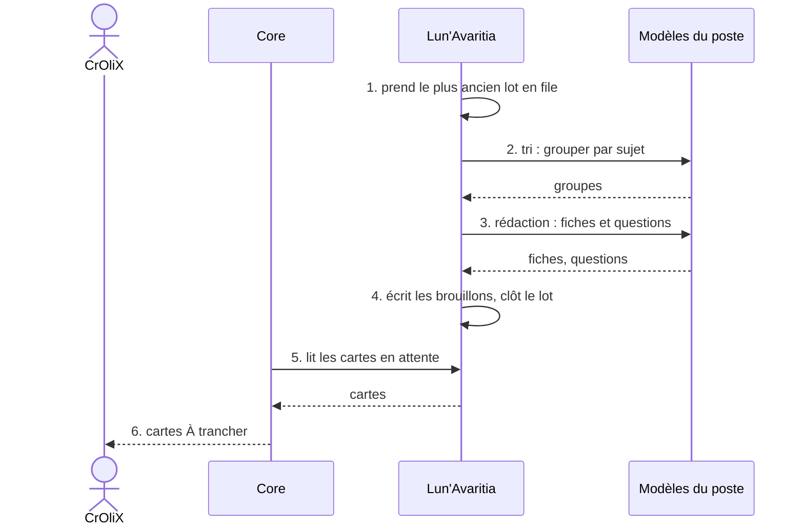

| # | De → vers | Par quoi | Ce qui circule | Retour |
|---|---|---|---|---|
| 1 | Lun'Avaritia → sa base | boucle de traitement | le lot `queued` le plus ancien passe `running` ; ses observations sont relues | — |
| 2 | Lun'Avaritia → modèle de tri | un appel, JSON contraint, 2 000 jetons au plus | les observations numérotées (texte seul), les fiches candidates (30 au plus) | des groupes d'observations, chacun rattaché à une fiche ou à une nouvelle |
| 3 | Lun'Avaritia → modèle de rédaction | un appel, JSON contraint, 8 000 jetons au plus | les groupes, les observations avec leur date, les doublons probables | des fiches (faits, liens, échéances) et des questions (5 au plus) |
| 4 | Lun'Avaritia → sa base | une transaction | un brouillon par fiche, une question par contradiction ou doublon (5 au plus, jamais une déjà posée) ; le lot passe `done` ; un relevé du passage : durée, coût, observations, brouillons, questions | — |
| 5 | Core → Lun'Avaritia | `GET /lun/v1/cards`, à sa lecture de fond | — | les brouillons en attente, servis en cartes (famille 7) |
| 6 | Core → CrOliX | panneau | les cartes de fiches et de questions | voir les familles 3 et 7 |

- **Ce que CrOliX voit, et où** : dans l'écran Tableau de Lun'Avaritia, « Dernier traitement », son heure, sa
  durée, son coût, le nombre d'observations reçues et de brouillons. Dans le panneau du core, les cartes arrivent
  à À trancher à la lecture suivante. La lettre du matin les compte (« Lun'Avaritia propose N cartes »).
- **Ce qui s'écrit** : chez Lun'Avaritia, les brouillons avec leur lot d'origine, le coût de chaque appel, le
  relevé du passage (Lun'Avaritia, `server/src/brain/ingest.ts:81-123`). Rien dans une fiche : un brouillon
  n'entre qu'après validation.
- **Qui décide** : le modèle de tri regroupe et peut laisser une observation hors de tout groupe. Du code fait un
  seul groupe par fiche et cherche les doublons probables. Le modèle de rédaction écrit faits, liens, échéances et
  questions. Du code vérifie les réponses avant d'écrire (Lun'Avaritia, `server/src/brain/process.ts`, le
  détail des contrôles est à confirmer). CrOliX seul fait entrer un brouillon dans une fiche.
- **Erreurs et cas limites** :
  - Lun'Avaritia n'émet aucun événement quand un lot est traité : le core l'apprend seulement par les cartes.
  - Une observation laissée hors de tout groupe disparaît sans trace.
  - Une question déjà posée, en attente ou tranchée, ne revient pas (`process.ts:370-375`).
  - Réponse invalide : redemandée une fois avec le motif ; deux fois invalide, le lot échoue (S6.5).
  - Lot vide : fait, sans appel.
- **Écart avec les décisions** : F3 : aucun bilan du lot n'est lu par le core, et rien ne garde ce qui est écarté.
  T3. T28 (cartes au-delà du plafond de brouillons) relève de la famille 7.
- **Non vérifié** : quels sont les champs exacts des réponses des deux appels de modèle (groupes, fiches, faits,
  liens, questions) ? Quels contrôles du code portent sur chaque index, chaque fait remplacé, chaque échéance
  (`process.ts:156-209`) ? Seules les bornes (2 000 et 8 000 jetons, 30 candidates, 5 questions, second essai
  avec le motif) ont été lues. La façon dont `GET /lun/v1/cards` borne le nombre de brouillons servis ; le parcours d'une
  carte de fiche jusqu'à sa validation (familles 3 et 7).

---

### S6.5 · Un lot retenu ou en échec chez Lun'Avaritia

- **Déclencheur** : un lot arrive, ou la boucle horaire passe, alors qu'une condition de S6.4 manque.
- **Acteurs** : Lun'Avaritia, ses modèles, le core (qui n'en sait rien), CrOliX dans l'écran de Lun'Avaritia.
- **Avant** : une pause posée chez Lun'Avaritia, son plafond mensuel atteint, aucun fournisseur pour le tri ou la
  rédaction, ou un fournisseur en panne.

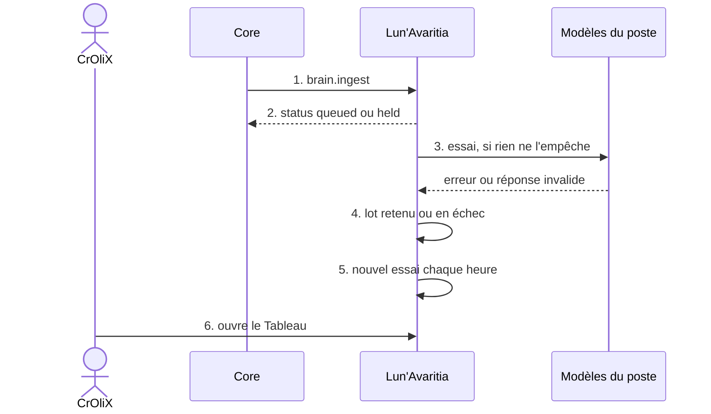

| # | De → vers | Par quoi | Ce qui circule | Retour |
|---|---|---|---|---|
| 1 | Core → Lun'Avaritia | `POST /lun/v1/actions/brain.ingest` | comme S6.3 | — |
| 2 | Lun'Avaritia → core | réponse | `status: "held"` si le plafond mensuel est atteint, `"queued"` sinon, pause comprise | le core ne le lit pas |
| 3 | Lun'Avaritia → modèles | les deux appels de S6.4 | comme S6.4 | une erreur du fournisseur, ou une réponse invalide |
| 4 | Lun'Avaritia → sa base | écriture | `held` avec son motif (`cost-cap`, `no-provider`, `provider-…`), ou `failed` avec sa raison | — |
| 5 | Lun'Avaritia → elle-même | boucle horaire, et à la levée de la pause | les lots `held` repassent `queued` si le plafond et les deux fournisseurs le permettent | un nouvel essai |
| 6 | CrOliX → Lun'Avaritia | écran Tableau | — | bandeau « Plafond de coût atteint : N lot(s) en attente » ; activité « Lot en échec (n° …) » |

- **Ce que CrOliX voit, et où** : rien dans le panneau du core. Dans le Tableau de Lun'Avaritia : le bandeau du
  plafond, ou la ligne d'activité d'un lot en échec. Un lot retenu pour une autre raison n'a pas de bandeau.
- **Ce qui s'écrit** : l'état du lot, son motif, et la date avant laquelle il ne sera pas rejoué.
- **Qui décide** : du code seul (Lun'Avaritia, `server/src/brain/ingest.ts:57-79`).
- **Erreurs et cas limites** :
  - En pause : le lot est rangé `queued`, rien ne tourne ; il part à `POST /lun/v1/resume` ou à l'heure suivante
    une fois la pause levée (`ingest.ts:60`, `server/src/contract/routes.ts:131-136`).
  - Plafond mensuel atteint à l'arrivée : `held`, motif `cost-cap` (`ingest.ts:33-39`).
  - Plafond atteint entre le tri et la rédaction : retenu, le tri est déjà payé (`process.ts:304`).
  - Fournisseur en erreur après un tri payé : le lot attend un jour entier avant d'être rejoué, pour ne pas
    repayer le tri chaque heure (`ingest.ts:102-109`).
  - Réponse invalide deux fois : lot `failed`, jamais rejoué (`process.ts:387`).
  - Exception inattendue pendant le traitement (hors fournisseur et hors réponse invalide) : lot `failed`, motif
    « Erreur inattendue : … », jamais rejoué (Lun'Avaritia, `server/src/brain/ingest.ts:95-101`). Un lot `failed`
    écrit une ligne de passage avec 0 brouillon et 0 question, que le Tableau montre en « Dernier traitement » ;
    un lot `held` n'en écrit aucune (`ingest.ts:104-122`, `server/src/brain/dashboard.ts:45`).
  - Arrêt pendant un traitement : le lot resté `running` est remis en file au passage suivant (`ingest.ts:64`).
- **Écart avec les décisions** : T3 et T24 : un lot retenu ou en échec ne remonte ni au core ni à la lettre. F3
  non codé.
- **Non vérifié** : une clé refusée ou un crédit épuisé est-il porté à la santé et aux événements de
  Lun'Avaritia (familles 10 et 11) ? Seul son journal technique a été lu (`process.ts:389`). Les événements exacts
  émis pour une clé refusée ; l'effet de ces états sur la santé servie au
  core.

---

### S6.6 · Les dernières étapes de la nuit

- **Déclencheur** : la fin de la boucle des jours, dans le même passage de la nuit, que les jours aient réussi ou
  non.
- **Acteurs** : le core, le fournisseur du modèle, le panneau.
- **Avant** : pour chaque étape, sa propre échéance (une semaine pour le portrait et le tempérament ; pour les
  scènes : jamais jouées, modèle changé, tempérament plus récent, ou trente jours).

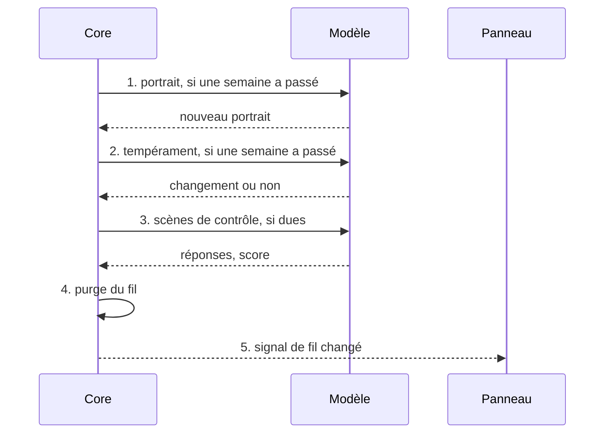

| # | De → vers | Par quoi | Ce qui circule | Retour |
|---|---|---|---|---|
| 1 | Core → modèle | un appel | le portrait précédent, les souvenirs écrits depuis (texte, réaction, provenance) | un nouveau portrait de CrOliX, 300 mots au plus, gardé en version |
| 2 | Core → modèle | un appel | le tempérament actuel, les 200 derniers souvenirs | un changement, avec les souvenirs cités, ou pas de changement |
| 3 | Core → modèle | une série d'appels | les scènes de contrôle de Natsume | un score de la série |
| 4 | Core → core | effacement | les messages des jours traités, plus vieux que le jour tout juste couvert, sauf les six derniers du fil principal et le dernier message de CrOliX ; les fils de sujet vides | — |
| 5 | Core → panneau | flux en direct | « le fil principal a changé » | le panneau relit le fil |

- **Ce que CrOliX voit, et où** : un tempérament changé donne un événement « à prévenir » : une ligne au Journal
  et, s'il est loin du bureau, une notification silencieuse. De même un score de scènes en baisse de plus de 10 %,
  ou sous le plancher, et une réponse de tempérament illisible. Le portrait ne s'annonce pas.
- **Ce qui s'écrit** : une version du portrait, une version du tempérament, le score des scènes, le coût de chaque
  appel, compté sur le jour tout juste couvert et sous le plafond de la nuit.
- **Qui décide** : le modèle propose. Du code refuse un changement de tempérament qui ne cite pas assez de
  souvenirs connus, étalés sur assez de jours. Rien ne se corrige seul sur un mauvais score : CrOliX est prévenu.
- **Erreurs et cas limites** :
  - Une étape qui échoue n'échoue pas la nuit : c'est écrit au journal technique du core, et les autres passent.
  - Pas de fournisseur, prix inconnu ou plafond de la nuit atteint : l'étape est abandonnée, sans appel.
  - La purge vide aussi la copie figée d'un jour traité plus vieux que le jour couvert : elle est vidée, pas
    supprimée. Le jour reste traité et n'est jamais rejoué. Le tri rangé reste ; le contexte du matin ne relit que
    le tri de la veille.
  - Aucun nouveau souvenir : pas de portrait.
  - Série de scènes coupée : aucun score écrit, elle reste due.
  - Le titre de l'événement du tempérament renvoie CrOliX à une commande de terminal pour relire la version.
- **Écart avec les décisions** : aucun connu.
- **Non vérifié** : le contenu des scènes et de leur juge ; les seuils exacts du tempérament (nombre de souvenirs,
  étalement) ; ces étapes appartiennent à l'être de Natsume plus qu'à ce chapitre.

---

### S6.7 · Nuit incomplète : un poste absent ou éteint

- **Déclencheur** : pendant la nuit, Lun'Acedia ne rend pas son bilan, ou Lun'Avaritia ne prend pas le lot.
- **Acteurs** : le core, le poste muet, le fournisseur du modèle.
- **Avant** : le poste est appairé mais ne répond pas ; ou il n'est pas relié du tout ; ou son réglage de nuit est
  éteint dans l'Atelier.

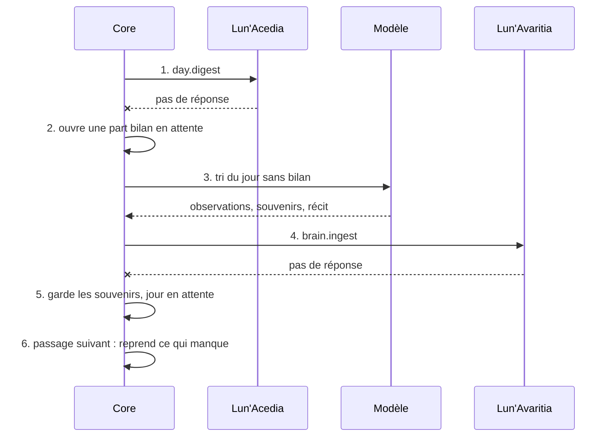

| # | De → vers | Par quoi | Ce qui circule | Retour |
|---|---|---|---|---|
| 1 | Core → Lun'Acedia | `POST /lun/v1/actions/day.digest` | `since`, `until` | aucun, ou une erreur |
| 2 | Core → core | écriture | le jour sans bilan, et une part « bilan » vide pour ce jour | — |
| 3 | Core → modèle | un appel | messages et alertes ; le bloc du bilan vaut « rien » | observations, souvenirs, récit |
| 4 | Core → Lun'Avaritia | `POST /lun/v1/actions/brain.ingest` | comme S6.3 | aucun, ou une erreur |
| 5 | Core → core | une transaction | souvenirs et récit sont gardés quand même ; l'envoi n'est pas marqué | le jour est « en attente » |
| 6 | Core → postes | à la nuit suivante, ou à une relance à la main | le bilan redemandé, le jour entier renvoyé | les étapes manquantes se font ; le tri n'est pas repayé |

- **Ce que CrOliX voit, et où** : la nuit se dit faite. Au Journal : « Veille de la nuit », faite, sans motif.
  Si l'envoi a été tenté et a échoué : une ligne confiée à Lun'Avaritia, en échec. Un jour dont l'envoi attend
  reste affiché dans la conversation. La lettre ne dit rien de ce qui manque.
- **Ce qui s'écrit** : les marques de chaque étape faite ; le jour reste dans la liste des inachevés.
- **Qui décide** : du code. « Appairé mais muet » est attendu ; « pas relié du tout » ne l'est pas pour le bilan.
- **Erreurs et cas limites** :
  - Lun'Acedia non reliée : pas de part « bilan », le jour se termine sans elle.
  - Lun'Avaritia non reliée, avec des observations à envoyer : le jour reste en attente à chaque nuit, et ne sort
    pas de la conversation, tant qu'elle n'est pas reliée ou que son réglage de nuit n'est pas éteint.
  - Réglage de nuit de Lun'Acedia éteint : aucun bilan n'est demandé. Réglage de nuit de Lun'Avaritia éteint :
    rien n'est envoyé, l'étape est dite faite.
  - Un jour en attente n'échoue pas la nuit ; les autres jours se font.
- **Écart avec les décisions** : la carte du 27/11 le note (§ 4.5) : la nuit se dit « faite » même incomplète. F2
  et F3 ne sont pas codés : la lettre ne dit pas ce que la bibliothèque a reçu ou non.
- **Non vérifié** : le cas « Lun'Avaritia jamais reliée » est déduit du code, non rejoué par un test lu.

---

### S6.8 · Nuit en échec

- **Déclencheur** : pendant la nuit, le tri d'un jour ne peut pas se faire.
- **Acteurs** : le core, le fournisseur du modèle, le téléphone de CrOliX.
- **Avant** : un jour qui a du contenu, et l'une de ces causes : pas de fournisseur en service, prix du modèle
  inconnu, plafond de la nuit atteint pour ce jour (0,50 $ par jour résumé, par défaut), appel refusé par le
  fournisseur, réponse invalide deux fois.

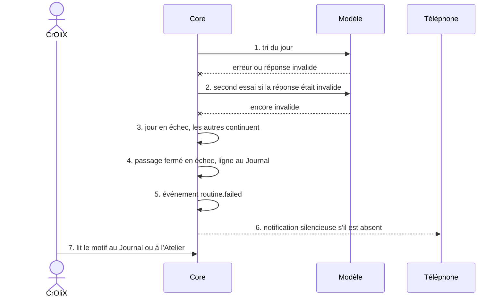

| # | De → vers | Par quoi | Ce qui circule | Retour |
|---|---|---|---|---|
| 1 | Core → modèle | l'appel du tri | comme S6.1 | une erreur, ou un JSON illisible, hors forme, ou citant une référence inconnue |
| 2 | Core → modèle | le même appel, une seconde fois | le même contenu, sans le motif du refus | invalide de nouveau |
| 3 | Core → core | écriture | rien n'est marqué pour ce jour ; les appels faits sont payés | les jours suivants se font quand même |
| 4 | Core → core | fin du passage | état « échec », le motif du premier jour en échec, le coût | une ligne « Veille de la nuit », « Échec : … » |
| 5 | Core → core | événement du core | `routine.failed`, palier « à prévenir », titre « Veille de la nuit : en échec », le numéro du passage | pas de seconde ligne au Journal |
| 6 | Core → téléphone | notification web | le titre, un lien vers le panneau | silencieuse, groupée, seulement si CrOliX n'est pas au bureau |
| 7 | CrOliX → panneau | Journal, Atelier, Constellation | — | le motif en clair |

- **Ce que CrOliX voit, et où** : au Journal, « Veille de la nuit », en échec, avec le motif (« Pas de
  fournisseur : … », « Prix inconnu pour le modèle … », « Plafond de la veille atteint (0.5 $) pour le … »,
  « Tri du … invalide deux fois : … »). À l'Atelier, « échec à … : motif ». À la Constellation, « échouée ».
  Dans la lettre de 7 h 30 : « La veille de la nuit a échoué. ». Sur le téléphone, une notification s'il est loin.
- **Ce qui s'écrit** : le passage en échec, son motif, le coût payé ; le jour reste inachevé.
- **Qui décide** : du code. Le plafond de la nuit est relu avant chaque appel.
- **Erreurs et cas limites** :
  - Le créneau n'est pas rejoué avant le prochain 5 h : un échec attend la nuit suivante, ou une relance à la main.
  - Le jour en échec est repris en premier à la nuit suivante ; son tri est alors repayé.
  - Sans fournisseur et sans rien à trier, la nuit finit bien, avec la mention « sans le modèle » (S6.9).
  - En pause, l'événement d'échec ne notifie pas ; la ligne du Journal reste.
  - Une erreur hors de ces cas (base illisible) échoue tout le passage avec son message.
- **Écart avec les décisions** : aucun connu. Le standard des notifications range bien `routine.failed` en P1.
- **Non vérifié** : un jour qui a atteint le plafond de la nuit semble échouer de nouveau chaque nuit tant que le
  plafond n'est pas relevé (les coûts restent comptés sur ce jour) : déduit du code, non rejoué par un test lu.

---

### S6.9 · Jour sans rien

- **Déclencheur** : la nuit ouvre un jour sans message, sans alerte urgente, et dont le bilan est vide ou absent.
- **Acteurs** : le core seul ; Lun'Acedia si elle est reliée.
- **Avant** : rien n'a été dit ni reçu dans le jour.

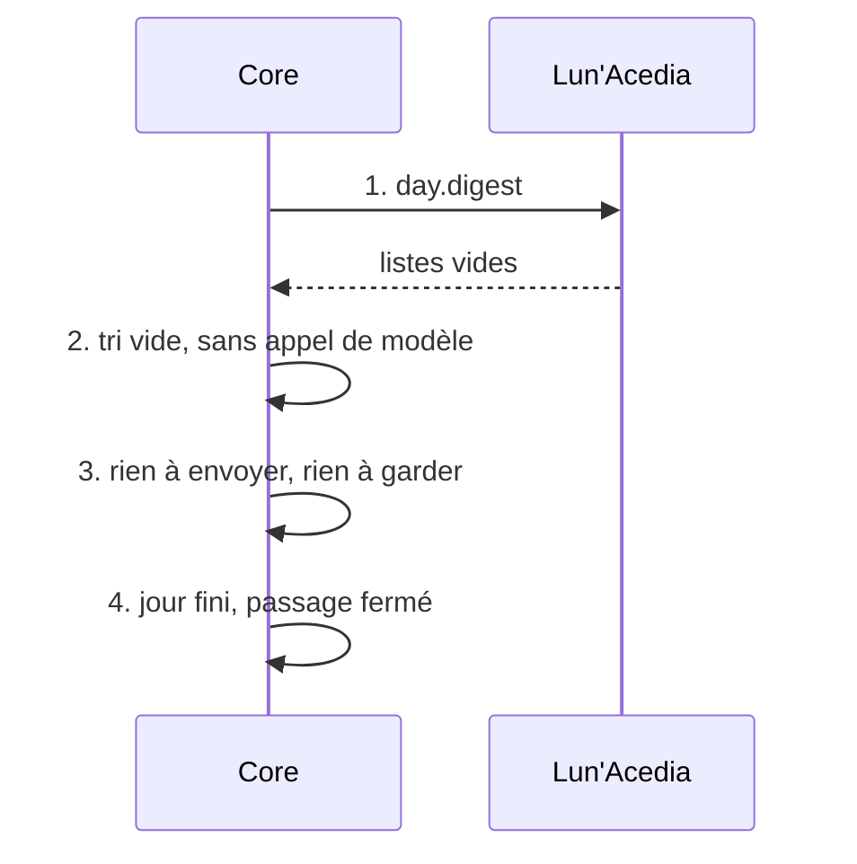

| # | De → vers | Par quoi | Ce qui circule | Retour |
|---|---|---|---|---|
| 1 | Core → Lun'Acedia | `POST /lun/v1/actions/day.digest` | `since`, `until` | `received: []`, `done: []`, `pending` |
| 2 | Core → core | code | aucune source à citer : le tri est posé vide | aucun appel, aucun coût |
| 3 | Core → core | code | aucune observation : pas d'appel à Lun'Avaritia ; aucun souvenir, pas de récit | — |
| 4 | Core → core | écriture | le jour est marqué fini | la ligne du Journal, à coût nul |

- **Ce que CrOliX voit, et où** : au Journal, « Veille de la nuit », faite. La lettre de 7 h 30 dit « Nuit calme.
  Rien à trancher. » s'il n'y a ni carte ni urgence en attente.
- **Ce qui s'écrit** : le passage, et la part du jour, vide.
- **Qui décide** : du code. Aucun modèle n'est appelé.
- **Erreurs et cas limites** :
  - Aucun jour à couvrir (nuit relancée dans la journée) : le passage finit bien, sans jour.
  - Sans fournisseur en service : le passage finit bien et porte « sans le modèle », avec le nom du réglage
    fautif quand il y en a un.
  - Un bilan non vide suffit à déclencher le tri, même sans message.
- **Écart avec les décisions** : aucun connu.
- **Non vérifié** : rien.

---

### S6.10 · La lettre du matin, cas nominal

- **Déclencheur** : l'horloge du core, à 7 h 30 de Paris, quand aucun passage du matin n'a commencé depuis ce
  créneau.
- **Acteurs** : le core, le fournisseur du modèle, Lun'Avaritia, le panneau, le téléphone, CrOliX.
- **Avant** : pas de pause ; pas de lettre déjà écrite pour ce jour ; la nuit finie. Le fournisseur et
  Lun'Avaritia servent au contexte du jour, pas à la lettre elle-même.

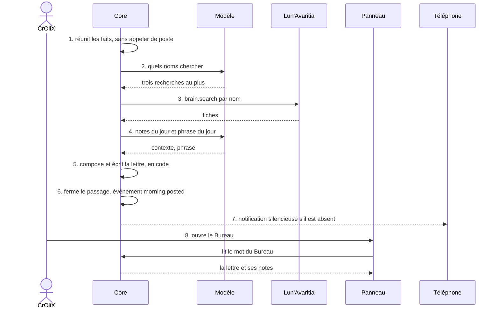

| # | De → vers | Par quoi | Ce qui circule | Retour |
|---|---|---|---|---|
| 1 | Core → core | lecture de sa base et de son cache | l'état de la nuit d'aujourd'hui ; les événements urgents reçus de 5 h hier à 5 h aujourd'hui ; le nombre de cartes en attente par poste, tel que lu en dernier ; les urgences non vues du jour, hors rappels d'agenda ; les échéances de la bibliothèque lues en dernier ; ce qui vient dans l'agenda | les faits de la lettre, et un « point » de cinq éléments au plus : alertes, échéances, contradictions, cartes |
| 2 | Core → modèle | un appel, JSON contraint | les souvenirs et les observations que la nuit a tirés d'hier | `recherches` : trois noms courts au plus |
| 3 | Core → Lun'Avaritia | `POST /lun/v1/actions/brain.search`, une fois par nom | `query` (le nom), `limit: 3` | des fiches, que le core pousse telles quelles (leurs champs : voir « Non vérifié ») |
| 4 | Core → modèle | un appel, JSON contraint | l'identité de Natsume en tête de consigne ; la date du jour, le portrait, les souvenirs de sept jours (30 au plus, réaction coupée), le récit des deux derniers jours, le texte des éléments du point, les fiches trouvées | `contexte` (les notes du jour, 4 000 signes au plus), `phrase` (240 signes au plus) |
| 5 | Core → core | code, sans modèle | les faits de l'étape 1 | le texte de la lettre, écrit une fois pour ce jour, avec les faits dont il vient |
| 6 | Core → core | fin du passage | état, coût ; l'événement `morning.posted`, palier « à prévenir », titre « Le point du matin est posté », une fois par jour | une ligne « Lettre du matin » au Journal, une ligne d'événement au Journal |
| 7 | Core → téléphone | notification web | le titre de l'événement, un lien vers le panneau | silencieuse, après deux minutes, seulement s'il n'est pas au bureau |
| 8 | Panneau → core | lecture du mot du Bureau | le lieu demandé | la lettre : son jour, son heure, son texte, ses notes |

- **Ce que CrOliX voit, et où** : au Bureau du panneau, en tête : « <date>, lettre de 07:30 », puis le texte. Le
  texte suit toujours le même ordre : la nuit si elle a échoué ou tourne encore ; « Nuit calme. » ou « N
  urgence(s) cette nuit. » ; « <Poste> propose N carte(s), … et N urgence(s) à voir » ou « rien d'urgent », ou
  « Rien à trancher. » ; puis jusqu'à trois rendez-vous, rappels ou échéances à heure dite avant le prochain 5 h
  (« <titre> à HH:MM. »). Sur le téléphone, une notification « Le point du matin est posté » s'il est loin du
  bureau. Sur la fiche de Natsume, l'heure de la lettre. La lettre n'est pas écrite dans la conversation.
- **Ce qui s'écrit** : la lettre et ses faits ; le contexte du jour et la phrase du jour ; le coût des deux appels,
  compté sur aujourd'hui sous le plafond de la nuit ; le passage ; deux lignes au Journal ; la marque « annoncé
  aujourd'hui ».
- **Qui décide** : du code écrit la lettre, phrase par phrase, à partir de comptes. Le modèle n'écrit que le
  contexte du jour, que Natsume relit ensuite en conversation, et la phrase du jour. La porte d'attention décide
  de la notification.
- **Erreurs et cas limites** :
  - Le contexte du jour est composé avant la lettre : la lettre attend la fin des deux appels.
  - Lun'Avaritia non reliée : les recherches sont sautées. Une recherche en erreur (injoignable, code d'erreur)
    est ignorée. Une Lun'Avaritia qui accepte l'appel mais ne répond jamais n'a pas de délai : la recherche attend,
    et la lettre, écrite après le contexte du jour, attend avec elle (S6.20).
  - CrOliX au bureau : pas de notification ; l'événement n'a que sa ligne au Journal.
  - Aucun appareil abonné aux notifications : rien ne part.
  - La lettre ne lit aucun poste : un poste muet depuis la veille y garde son dernier compte connu.
  - Une urgence reçue entre 5 h et 7 h 30 n'est pas dans « cette nuit » ; elle compte dans « à voir » si elle
    n'est pas vue.
  - Le nombre de cartes ne lit pas leur importance. Une pile compte pour une. Pour Lun'Avaritia, le compte inclut
    aussi ses échéances en attente, celles qui ne sont ni remises à plus tard ni masquées. « Lun'Avaritia propose
    N cartes » peut donc compter des échéances.
  - Les tâches du jour et les événements sur la journée entière n'entrent pas dans la lettre.
- **Écart avec les décisions** : F2 : la lettre n'est pas écrite par le modèle ; elle ne dit rien du traitement de
  la bibliothèque pendant la nuit, et n'en parle que si la nuit a échoué ou tourne. F3 : aucun bilan lu chez
  Lun'Avaritia. T20 : la sortie « lettre du matin » de la porte d'attention n'est lue par rien ; un P3 n'entre pas
  dans la lettre. T21 : la phrase du jour est écrite et n'est affichée nulle part. T29, T30. Le dictionnaire
  demande « la lettre du matin » : le titre de l'événement dit « Le point du matin ».
- **Non vérifié** : l'envoi au service de notification du navigateur (famille 9) ; le détail de la présence qui
  retient la notification (famille 8) ; l'endroit où la conversation relit le contexte du jour (famille 1) ;
  aucun appel à la lettre n'a été trouvé dans Lun'Luxuria par recherche de texte, sans lecture complète de ce
  dépôt : Lun'Luxuria dit-elle la lettre à voix haute, ou la relit-elle par un appel ? Quels champs une fiche
  rendue par `brain.search` porte-t-elle (Lun'Avaritia coupe l'extrait, `server/src/brain/agent.ts:47-52`) ?

---

### S6.11 · Lettre déjà écrite : la relance et sa note

- **Déclencheur** : un second passage du matin le même jour : CrOliX relance la routine depuis l'Atelier, ou le
  créneau de 7 h 30 tombe après une lettre écrite à la main plus tôt.
- **Acteurs** : CrOliX, le panneau, le core, le fournisseur du modèle.
- **Avant** : une lettre existe pour ce jour.

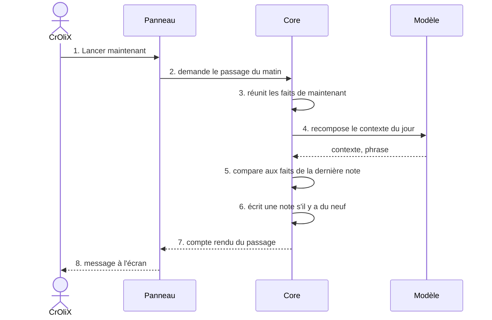

| # | De → vers | Par quoi | Ce qui circule | Retour |
|---|---|---|---|---|
| 1 | CrOliX → panneau | Atelier, carte Routines, « Lancer maintenant » | — | — |
| 2 | Panneau → core | demande de lancer la routine du matin | rien d'autre que la routine visée | — |
| 3 | Core → core | lecture | les mêmes faits qu'en S6.10 | — |
| 4 | Core → modèle | les deux appels de S6.10 | comme S6.10 | un nouveau contexte du jour, qui s'ajoute au précédent |
| 5 | Core → core | code | les faits d'avant (ceux de la dernière note, sinon ceux de la lettre) et ceux de maintenant | les écarts à la hausse seulement |
| 6 | Core → core | écriture | une note : « <Poste> propose N carte(s) de plus », « N urgence(s) de plus », « la veille de la nuit a fini (ou échoué) à HH:MM » | la note garde les faits dont elle vient |
| 7 | Core → panneau | réponse | état, coût, lettre « écrite », « corrigée par une note » ou « inchangée », contexte composé ou non, motif | — |
| 8 | Panneau → CrOliX | message bref | « Lettre du matin faite à … » ou l'échec et son motif | — |

- **Ce que CrOliX voit, et où** : au Bureau, sous la lettre, « Correction de HH:MM : … ». Le texte de la lettre
  ne change jamais. Au Journal, une nouvelle ligne « Lettre du matin ».
- **Ce qui s'écrit** : la note et ses faits ; un nouveau contexte du jour ; le passage.
- **Qui décide** : du code. Une seule lettre par jour : la base en refuse une seconde.
- **Erreurs et cas limites** :
  - Rien de neuf : pas de note, la lettre est dite « inchangée ».
  - Un compte qui baisse (une carte tranchée) n'écrit pas de note.
  - La fin de la nuit n'est notée qu'une fois : si elle est venue après la lettre et après la dernière note.
  - L'événement `morning.posted` ne part qu'une fois par jour : une relance ne notifie pas de nouveau.
  - Une relance repaie les deux appels du contexte du jour.
- **Écart avec les décisions** : F2 (voir S6.10).
- **Non vérifié** : rien.

---

### S6.12 · Nuit encore en cours à l'heure de la lettre

- **Déclencheur** : le créneau de 7 h 30 tombe pendant que la nuit tourne : les deux routines, dues, partent
  sans s'attendre. Le cas courant : le core démarre après 7 h 30, elles partent dans la même minute.
- **Acteurs** : le core, le fournisseur du modèle, le panneau.
- **Avant** : un passage de la nuit commencé depuis 5 h et pas fini.

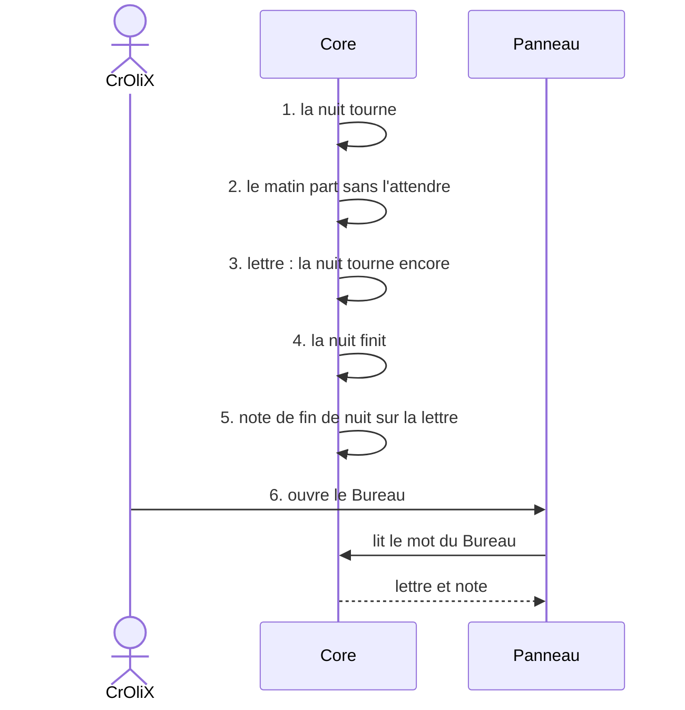

| # | De → vers | Par quoi | Ce qui circule | Retour |
|---|---|---|---|---|
| 1 | Core → core | passage de la nuit | comme S6.1 | — |
| 2 | Core → core | horloge | le créneau du matin est dû | les deux passages tournent ensemble |
| 3 | Core → core | composition de la lettre | l'état de la nuit : « en cours » | la lettre commence par « La veille de la nuit tourne encore. » |
| 4 | Core → core | fin de la nuit | son état, son heure de fin | — |
| 5 | Core → core | à la fin de chaque nuit, si une lettre du jour est plus ancienne | les faits de maintenant, l'heure et l'état de fin | une note : « la veille de la nuit a fini à HH:MM » ou « a échoué à HH:MM », plus les cartes et urgences en plus |
| 6 | Panneau → core | lecture du mot du Bureau | — | la lettre et sa note de correction |

- **Ce que CrOliX voit, et où** : au Bureau, la lettre dit que la nuit tourne encore, puis « Correction de
  HH:MM : la veille de la nuit a fini à HH:MM ».
- **Ce qui s'écrit** : la lettre, puis la note.
- **Qui décide** : du code. Aucune routine n'attend l'autre.
- **Erreurs et cas limites** :
  - Le contexte du jour, composé pendant que la nuit tourne, ne lit que les tris d'hier déjà rangés.
  - La note de fin de nuit qui ne peut pas s'écrire est notée au journal technique ; la nuit reste réussie.
  - Une nuit relancée à la main après la lettre laisse la même note à sa fin.
- **Écart avec les décisions** : F2 (voir S6.10).
- **Non vérifié** : le chapitre dit « le cas courant » (core démarré après 7 h 30) ; une nuit lancée à 5 h qui dure
  encore à 7 h 30 donne le même flux (`engine.ts:173-209`) : faut-il le dire comme second déclencheur ?

---

### S6.13 · Lettre en échec ou écrite sans le modèle

- **Déclencheur** : le passage du matin rencontre une erreur, ou tourne sans fournisseur de modèle.
- **Acteurs** : le core, le fournisseur du modèle, le panneau, le téléphone.
- **Avant** : l'une de ces causes : la lecture des faits casse ; aucun fournisseur en service ; prix inconnu ;
  plafond de la nuit atteint pour aujourd'hui ; réponse du modèle invalide deux fois.

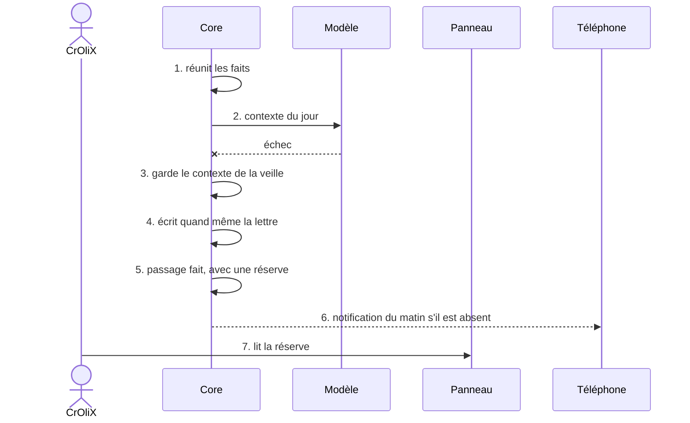

| # | De → vers | Par quoi | Ce qui circule | Retour |
|---|---|---|---|---|
| 1 | Core → core | lecture | comme S6.10 | si la lecture casse : passage en échec, pas de lettre (voir les cas limites) |
| 2 | Core → modèle | les appels de S6.10 | comme S6.10 | pas de fournisseur, plafond atteint, erreur, ou réponse invalide deux fois |
| 3 | Core → core | — | rien n'est écrit pour le contexte | celui de la veille reste en service |
| 4 | Core → core | code | les faits | la lettre est écrite : elle ne dépend pas du modèle |
| 5 | Core → core | fin du passage | état « fait », avec la réserve « sans le modèle » ou « sans le contexte du jour » | une ligne « Lettre du matin », faite, avec la réserve |
| 6 | Core → téléphone | notification web | `morning.posted` | comme S6.10 |
| 7 | CrOliX → panneau | Atelier, Constellation | — | « faite à …, sans le contexte du jour » |

- **Ce que CrOliX voit, et où** : la lettre est au Bureau comme d'habitude. La réserve se lit à l'Atelier, à la
  Constellation et au Journal. Si la lecture des faits a cassé : pas de lettre ; passé 7 h 30, le Bureau écrit
  « Pas de lettre ce matin : la routine a échoué à 07:30. » ; le Journal porte « Lettre du matin », en échec ;
  l'événement `routine.failed` « Lettre du matin : en échec » peut notifier le téléphone.
- **Ce qui s'écrit** : la lettre, le passage et sa réserve ; ou le passage en échec et son motif.
- **Qui décide** : du code. La réserve « sans le contexte du jour » n'est posée que si aucun contexte n'existe
  pour aujourd'hui : une relance qui échoue après une réussite ne signale rien.
- **Erreurs et cas limites** :
  - Passage en échec : pas de notification du matin, pas de rejeu avant le prochain 7 h 30. Une relance à la main
    écrit alors la première lettre du jour.
  - Sans fournisseur : aucun appel, aucun coût, lettre écrite, réserve « sans le modèle ».
  - Un appel refusé par le fournisseur est payé quand celui-ci en rend le compte.
- **Écart avec les décisions** : F2 : la lettre tient sans modèle parce qu'elle n'est pas écrite par lui.
- **Non vérifié** : rien.

---

### S6.14 · Routine sautée sous une pause

- **Déclencheur** : un créneau (5 h ou 7 h 30) tombe pendant une pause du core.
- **Acteurs** : le core, le panneau, CrOliX.
- **Avant** : une pause en cours : posée à la main, ou venue d'un plafond de dépense global (jour ou mois) quand
  le réglage du plafond dit « pause » (famille 10).

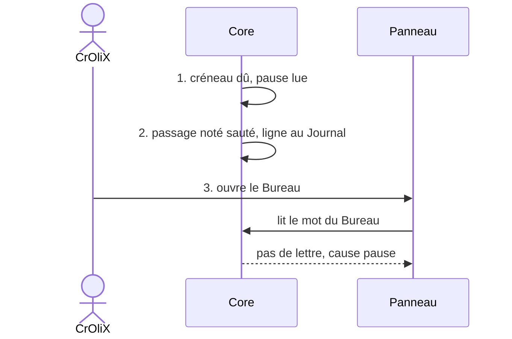

| # | De → vers | Par quoi | Ce qui circule | Retour |
|---|---|---|---|---|
| 1 | Core → core | horloge, à la minute du créneau | l'état de la pause, relu à cet instant | la routine n'est pas lancée |
| 2 | Core → core | écriture | un passage « sauté », motif « en pause » | une ligne au Journal : la routine, « sautée », « en pause » |
| 3 | Panneau → core | lecture du mot du Bureau | — | l'absence de lettre et sa cause |

- **Ce que CrOliX voit, et où** : passé 7 h 30, le Bureau écrit « Pas de lettre ce matin : Natsume était en pause
  à 07:30. ». À la Constellation : « sautée, en pause » pour aujourd'hui, « suspendue » pour demain tant que la
  pause dure. À l'Atelier : « sautée à …, en pause ». Au Journal : la ligne sautée. Aucune notification.
- **Ce qui s'écrit** : le passage sauté et sa ligne au Journal. Aucun appel, aucun coût.
- **Qui décide** : du code. Le créneau sauté compte comme fait : la reprise ne le rejoue pas.
- **Erreurs et cas limites** :
  - La nuit sautée n'est pas perdue : la nuit suivante couvre depuis la fin de la dernière nuit réussie.
  - La lettre sautée, elle, n'est pas rattrapée ; seule une relance à la main l'écrit (S6.16).
  - La pause ne peut pas être lue : le créneau reste dû, la minute suivante redemande.
  - Une routine déjà partie n'est pas arrêtée par une pause posée ensuite.
  - Le plafond global atteint sans le réglage « pause » : les routines tournent ; seul le plafond de la nuit
    les borne (S6.8, S6.13).
  - La copie de la base continue sous la pause (S6.18).
- **Écart avec les décisions** : F4 : rien ne rattrape, à la reprise, ce que la lettre aurait dit.
- **Non vérifié** : ce que fait la pause chez les postes pendant ce temps (famille 10).

---

### S6.15 · Core arrêté ou redémarré

- **Déclencheur** : le core s'arrête pendant un passage, ou il est éteint à l'heure d'un créneau, puis redémarre.
- **Acteurs** : le core, les postes, le fournisseur du modèle, le téléphone.
- **Avant** : un passage en cours à l'arrêt, ou un créneau manqué.

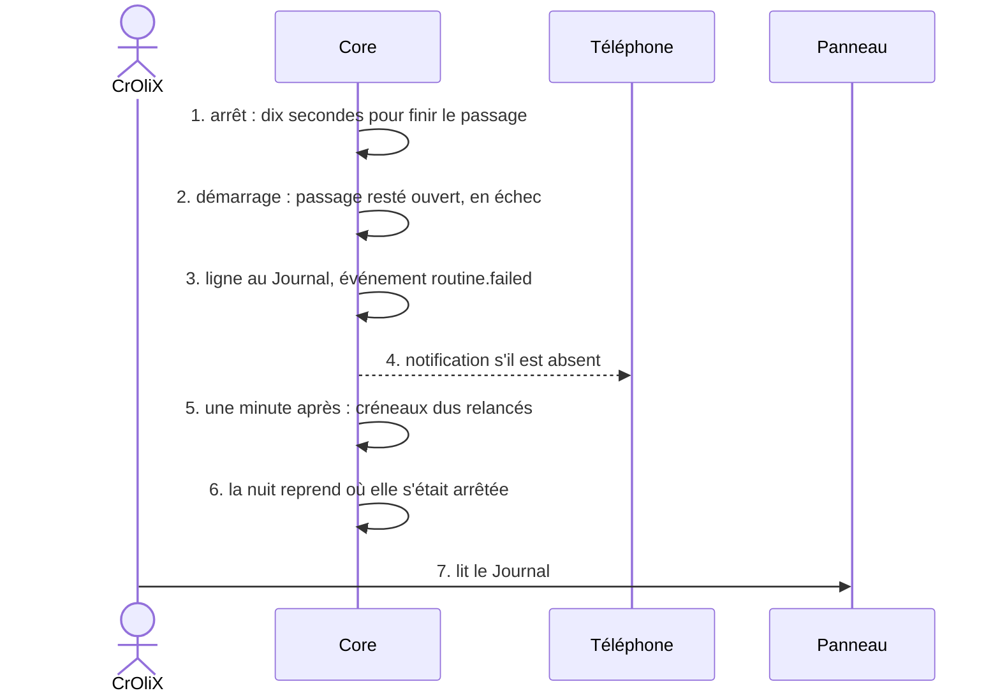

| # | De → vers | Par quoi | Ce qui circule | Retour |
|---|---|---|---|---|
| 1 | Core → core | signal d'arrêt | le core attend au plus dix secondes que les passages en cours finissent tout entiers ; rien ne les arrête après l'étape en cours | passé ce délai, la base est fermée et le passage reste « en cours » |
| 2 | Core → core | démarrage | tout passage resté « en cours » passe en échec, motif « interrompu » | — |
| 3 | Core → core | écriture | une ligne « Interrompue pendant le passage. » ; l'événement `routine.failed` | — |
| 4 | Core → téléphone | notification web | « Veille de la nuit : en échec » | comme S6.8 |
| 5 | Core → core | premier tour d'horloge, une minute après le démarrage | chaque routine sans passage depuis son dernier créneau est due ; un passage interrompu ne compte pas | la nuit et, passé 7 h 30, le matin partent dans la même minute |
| 6 | Core → postes, modèle | passage de la nuit | seules les étapes non marquées | pas de souvenir en double, pas de tri repayé pour une part déjà triée |
| 7 | CrOliX → panneau | Journal | — | la ligne interrompue, puis la ligne du passage refait |

- **Ce que CrOliX voit, et où** : au Journal, « Veille de la nuit », en échec, « Interrompue pendant le
  passage », puis une seconde ligne quand le passage est refait. Une notification d'échec s'il est loin. À la
  Constellation, un créneau passé sans passage se lit « prévue ».
- **Ce qui s'écrit** : le passage interrompu, puis le nouveau.
- **Qui décide** : du code. Un créneau manqué est rattrapé une fois, pas davantage ; un échec ordinaire, lui,
  attend le créneau suivant.
- **Erreurs et cas limites** :
  - Core éteint à 5 h, rallumé à 6 h : la nuit part une minute après. Rallumé à 7 h 40 : nuit et matin partent
    ensemble, la lettre dit que la nuit tourne (S6.12).
  - Core éteint plusieurs jours : une seule nuit couvre tous les jours manqués, un par un ; une seule lettre est
    écrite, celle du jour.
  - Arrêt entre l'envoi d'un lot et sa marque : le lot est renvoyé au passage suivant, donc reçu deux fois.
  - Un réglage d'installation coupe le rattrapage, pour une base jetable : les créneaux déjà dus au démarrage
    sont notés « sautée », « sans rattrapage ».
  - Le démarrage attend une minute pour laisser rejouer les événements manqués des postes.
- **Écart avec les décisions** : aucun connu.
- **Non vérifié** : le lot reçu deux fois est déduit du code. Le relancement du core après une erreur fatale
  relève de la famille 11.

---

### S6.16 · Lancer une routine à la main

- **Déclencheur** : CrOliX appuie sur « Lancer maintenant » dans l'Atelier du panneau, carte Routines, pour la
  nuit ou pour la lettre. Le terminal du core offre le même geste.
- **Acteurs** : CrOliX, le panneau, le core, puis les acteurs de la routine lancée.
- **Avant** : le panneau joint le core (sinon le bouton est grisé) ; l'appareil est appairé.

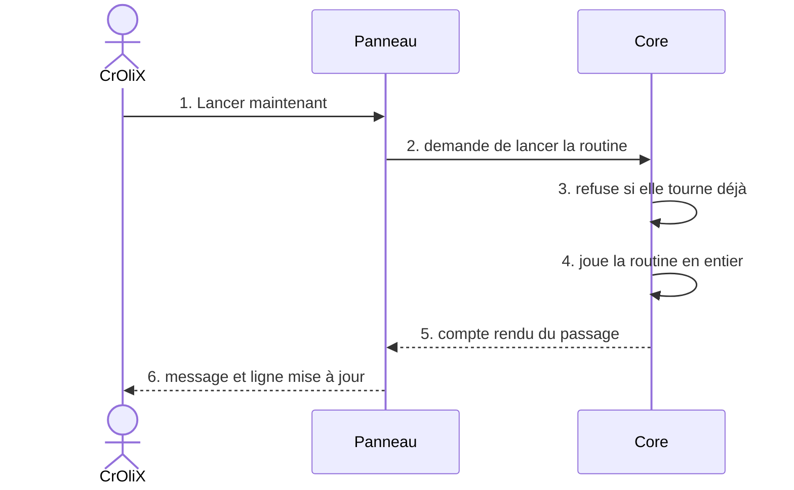

| # | De → vers | Par quoi | Ce qui circule | Retour |
|---|---|---|---|---|
| 1 | CrOliX → panneau | bouton | la routine visée | le bouton tourne |
| 2 | Panneau → core | demande authentifiée par le jeton de l'appareil | le nom de la routine, sans corps | la réponse n'arrive qu'à la fin du passage |
| 3 | Core → core | contrôle | un passage de cette routine est-il en cours | si oui : refus « déjà en cours » (`409`) |
| 4 | Core → postes, modèle | le passage complet | comme S6.1 ou S6.10 | — |
| 5 | Core → panneau | réponse | nuit : état, période, coût, motif, chaque jour avec « fait », « en attente » ou « en échec » ; matin : état, coût, nombre d'éléments du point, sort de la lettre, sort du contexte, motif | — |
| 6 | Panneau → CrOliX | message bref | « … faite à … », avec la réserve, ou « … : échec, motif » | la ligne de la routine est mise à jour |

- **Ce que CrOliX voit, et où** : le message de fin, et la ligne de la routine à l'Atelier. Au Journal, la ligne du
  passage. Pour la lettre : une première lettre, ou une note (S6.11).
- **Ce qui s'écrit** : comme un passage à l'heure.
- **Qui décide** : CrOliX lance. Une demande à la main passe même en pause : la pause ne saute que les créneaux de
  l'horloge.
- **Erreurs et cas limites** :
  - Routine déjà en cours : refus, message d'erreur à l'écran, rien n'est écrit.
  - Nuit lancée en journée : sa période s'arrête à 5 h d'aujourd'hui ; elle reprend les jours inachevés (bilan ou
    envoi en attente, jour en échec), sinon elle n'a « rien à couvrir ».
  - Un passage lancé à la main avant le créneau ne remplace pas ce créneau : la routine repart à l'heure.
  - Lancé après un créneau en échec ou sauté, il devient le dernier passage du jour : c'est son état que
    montrent ensuite la Constellation et l'Atelier.
  - Le panneau montre « en cours » tant que la réponse n'est pas revenue.
  - La routine n'est pas servie par ce core : refus « indisponible » (`503`).
- **Écart avec les décisions** : aucun connu.
- **Non vérifié** : ce que devient le passage si la page est fermée ou si la connexion tombe avant la réponse.

---

### S6.17 · Lire la lettre et l'état des routines

- **Déclencheur** : CrOliX ouvre un lieu du panneau ; le panneau relit aussi quand le core signale un changement.
- **Acteurs** : CrOliX, le panneau, le core.
- **Avant** : l'appareil est appairé. Aucun poste ni modèle n'est appelé : tout vient de la base du core.

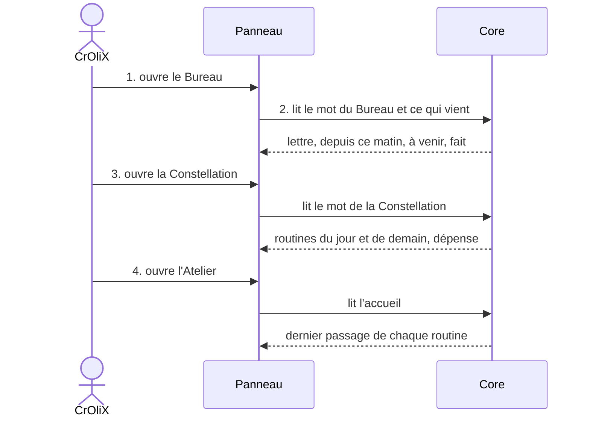

| # | De → vers | Par quoi | Ce qui circule | Retour |
|---|---|---|---|---|
| 1 | CrOliX → panneau | ouverture du Bureau | — | — |
| 2 | Panneau → core | deux lectures | le lieu « bureau » | la lettre (jour, heure, texte, notes) ou la cause de son absence (échec, pause) ; « depuis ce matin » : cartes arrivées depuis la lettre, dont celles à trancher ; « ce qui vient » jusqu'à la prochaine lettre, routines comprises ; les trois dernières lignes du Journal du jour |
| 3 | Panneau → core | une lecture | le lieu « constellation » | pour chaque routine, aujourd'hui et demain : heure, état (faite, échouée, sautée, en cours, prévue, suspendue), la mention « en pause », la réserve ; la dépense |
| 4 | Panneau → core | une lecture | — | le dernier passage de chaque routine : début, fin, état, motif |

- **Ce que CrOliX voit, et où** :
  - Bureau : la lettre et ses corrections ; « Depuis ce matin » ; « Ce qui vient » ; « Ce que j'ai fait ».
  - Constellation : « 05:00, … faite », « 07:30, … sautée, en pause », demain « prévue » ou « suspendue ».
  - Fiche de Natsume : « Lettre du matin : 07:30 » ou « pas encore ».
  - Atelier, carte Routines : « Veille de la nuit, 05:00, faite à … », « échec à … : motif », « sautée à … »,
    « pas encore passée », « en cours ».
  - Journal : une ligne par passage (routine, état, coût, durée, motif).
- **Ce qui s'écrit** : rien. Ce sont des lectures.
- **Qui décide** : du code. Le Bureau n'explique une lettre absente qu'après 7 h 30, et seulement pour un échec
  ou une pause.
- **Erreurs et cas limites** :
  - Lettre absente pour une autre cause (core éteint, créneau sauté sans rattrapage) : le Bureau ne dit rien.
  - Lecture en échec : « Le mot du Bureau ne s’est pas chargé. », « Ce qui vient ne s’est pas chargé. ».
  - « Ce que j'ai fait » ne garde que trois lignes : celle de la nuit en sort dès le matin (T31).
  - « Depuis ce matin » compte depuis l'heure de la lettre, ou depuis 5 h sans lettre.
- **Écart avec les décisions** : T31. T21 : la phrase du jour n'est lue par aucun de ces écrans.
- **Non vérifié** : l'affichage détaillé d'une ligne de routine dans l'écran Journal (famille 9 ou 11). Quel
  libellé exact « Ce qui vient » donne-t-il à la nuit (« 05:00, Veille de la nuit, demain » ?) : le composant
  d'affichage n'a pas été lu.

---

### S6.18 · L'entretien à intervalle fixe

- **Déclencheur** : des minuteries, hors des deux routines : au démarrage, puis toutes les heures.
- **Acteurs** : le core ; Lun'Avaritia ; le téléphone en cas d'alerte.
- **Avant** : le service tourne. Ces tâches passent aussi en pause : elles n'agissent sur rien.

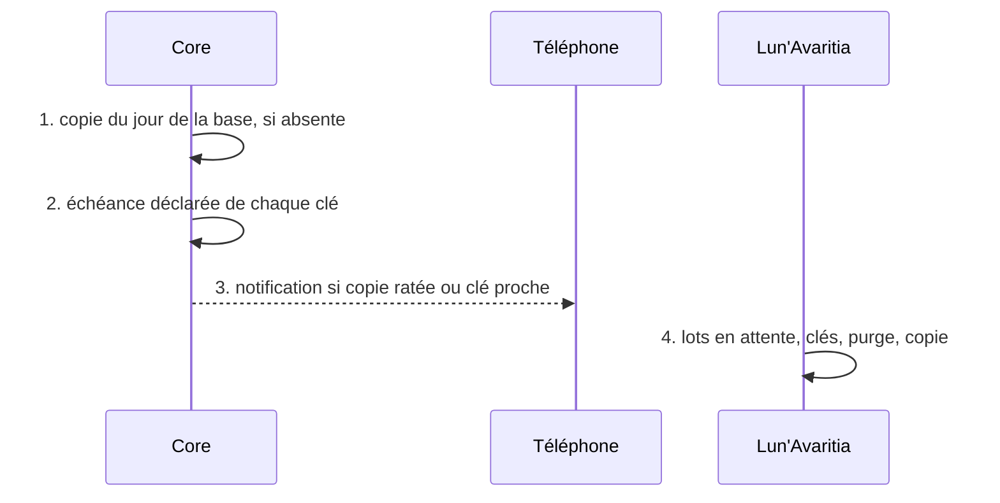

| # | De → vers | Par quoi | Ce qui circule | Retour |
|---|---|---|---|---|
| 1 | Core → core | au démarrage puis chaque heure | la base est copiée à côté d'elle si la copie du jour manque ; les sept dernières sont gardées | en cas d'échec : la santé du core le dit, et un événement `backup.failed`, une fois par jour |
| 2 | Core → core | au démarrage puis chaque heure, par fournisseur | la date d'échéance déclarée de la clé | un événement `key.expiring` à 14 jours, puis à 3 jours, une fois chacun |
| 3 | Core → téléphone | notification web | le titre de l'événement (« La copie de la base a échoué », « Clé … : échéance déclarée le …, dans N jours ») | ces alertes de santé passent même en pause |
| 4 | Lun'Avaritia → elle-même | chaque heure | le traitement des lots en attente (S6.5), l'échéance de ses clés, la purge de ses événements, la copie de sa base | — |

- **Ce que CrOliX voit, et où** : rien tant que tout va bien. Sinon une ligne d'événement au Journal du core et
  une notification silencieuse s'il est loin du bureau.
- **Ce qui s'écrit** : les copies de la base ; les marques « déjà prévenu » ; les événements.
- **Qui décide** : du code.
- **Erreurs et cas limites** :
  - Poste éteint la nuit : la copie se fait dès le démarrage du core, avant le premier tour des routines, puis
    chaque heure si celle du jour manque encore.
  - Copie ratée plusieurs heures de suite : un seul événement par jour.
  - Une nouvelle date d'échéance, ou une nouvelle clé, remet les avertissements à zéro.
  - Passé la date, plus d'avertissement : c'est le premier refus réel du fournisseur qui compte.
- **Écart avec les décisions** : aucun connu.
- **Non vérifié** : les boucles horaires de Lun'Acedia (synchro, rappels, copie) ne sont pas lues ici : voir les
  familles 4, 5 et 13. La pause et ses plafonds : famille 10. Les lectures de fond des postes : familles 2 et 12.
  La file des notifications : familles 8 et 9. L'arrêt sur erreur fatale : famille 11.

---

### S6.19 · Routine lancée à la main qui tourne encore au créneau

- **Déclencheur** : CrOliX lance la nuit (ou la lettre) depuis l'Atelier juste avant 5 h (ou 7 h 30), et ce passage
  tourne encore quand le créneau sonne.
- **Acteurs** : CrOliX, le panneau, le core.
- **Avant** : un passage manuel en cours ; aucun passage n'a commencé depuis le dernier créneau.

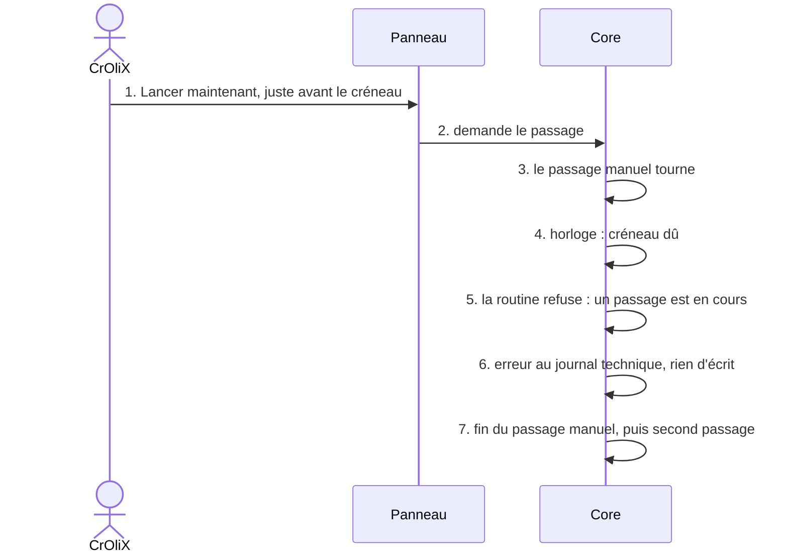

| # | De → vers | Par quoi | Ce qui circule | Retour |
|---|---|---|---|---|
| 1 | CrOliX → panneau | bouton | la routine visée | — |
| 2 | Panneau → core | demande authentifiée | le nom de la routine | réponse à la fin du passage |
| 3 | Core → core | passage manuel | comme S6.16 | — |
| 4 | Core → core | horloge, chaque minute | aucun passage n'a commencé depuis le créneau : la routine est due. Le moteur ne connaît que ses propres passages et relance | — |
| 5 | Core → core | la routine | un passage est « en cours » | refus (« Une veille tourne déjà » pour la nuit) |
| 6 | Core → core | journal technique | le refus | aucun passage écrit : le créneau reste dû, le moteur réessaie chaque minute |
| 7 | Core → core | fin du passage manuel | — | un second passage part au tour suivant |

- **Ce que CrOliX voit, et où** : deux lignes au Journal au lieu d'une. Pour la nuit, le second passage n'a souvent
  rien à couvrir. Pour le matin, il écrit une note de correction ou laisse la lettre « inchangée » (S6.11).
- **Ce qui s'écrit** : le passage manuel, puis le second passage. Le refus n'écrit rien dans la base.
- **Qui décide** : du code.
- **Erreurs et cas limites** :
  - Tant que le passage manuel dure, le refus se répète chaque minute au journal technique.
- **Écart avec les décisions** : aucun connu.
- **Non vérifié** : rien.

---

### S6.20 · Poste qui accepte l'appel sans jamais répondre

- **Déclencheur** : pendant un passage, Lun'Acedia (`day.digest`) ou Lun'Avaritia (`brain.ingest` la nuit,
  `brain.search` le matin) accepte la connexion mais ne répond pas.
- **Acteurs** : le core, le poste muet, CrOliX.
- **Avant** : le poste est relié ; sa connexion s'ouvre, sa réponse ne vient pas.

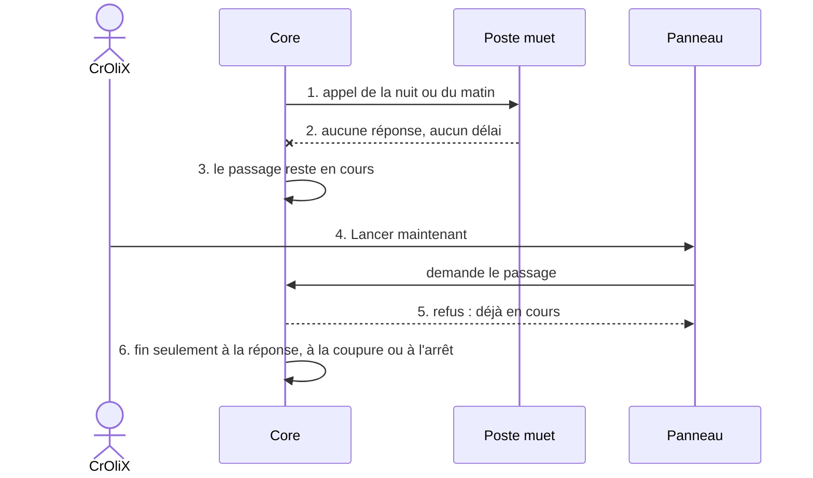

| # | De → vers | Par quoi | Ce qui circule | Retour |
|---|---|---|---|---|
| 1 | Core → poste | `POST /lun/v1/actions/…` | l'appel de la nuit ou du matin, sans signal de délai | — |
| 2 | Poste → core | rien | — | la connexion reste ouverte |
| 3 | Core → core | le passage | — | le passage reste « en cours », sans limite de temps. Le matin, la lettre n'est pas écrite tant que la recherche n'a pas rendu |
| 4 | CrOliX → panneau | « Lancer maintenant » | la routine visée | — |
| 5 | Core → panneau | réponse | refus `409`, « déjà en cours » | message d'erreur à l'écran |
| 6 | Core → core | fin | la réponse, la coupure de la connexion, ou l'arrêt du core | à l'arrêt, le passage devient « interrompu » (S6.15) |

- **Ce que CrOliX voit, et où** : « en cours » à l'Atelier et à la Constellation. Le moteur ne relance pas une
  routine en vol.
- **Ce qui s'écrit** : rien de plus que le passage ouvert.
- **Qui décide** : du code ; aucun délai n'est posé.
- **Erreurs et cas limites** :
  - Poste qui répond en erreur ou refuse : ce n'est pas ce cas (S6.2, S6.3, S6.7).
- **Écart avec les décisions** : aucun connu.
- **Non vérifié** : le comportement réel d'une connexion qui reste ouverte sans réponse n'a pas été rejoué ; il est
  déduit de l'absence de signal dans l'appel.
