# Famille 7 · La bibliothèque

Cette famille suit ce qui entre dans Lun'Avaritia et ce qui en sort : les observations reçues, leur traitement par deux
appels au modèle, les fiches et les questions proposées, leur validation, les échéances que le core lit, la recherche de
Natsume, les événements que la bibliothèque pousse, son bilan et ses plafonds. Lu sur `origin/main` : Lun'Avaritia
`bd6f7cf`, le core `dc130d9`. Les exemples (noms, dates, textes) sont inventés.

Cinq faits valent pour toute la famille. Rien n'entre dans une fiche sans la validation de CrOliX : tout passe par un
brouillon. Le traitement n'a lieu qu'en arrière-plan, sauf une note ou un document, traités tout de suite. Lun'Avaritia
ne pousse **aucun** événement sur son travail : ses quatre événements parlent de sa clé et de sa copie. Le core apprend
la naissance d'une carte en la lisant, toutes les 2 minutes. Le contrat que la bibliothèque déclare est la 1.4
(Lun'Avaritia, `server/src/identity.ts:5`), sans le champ `values` de la 1.5.

| Id | Scénario | En une ligne |
|---|---|---|
| S7.1 | Recevoir le lot de la nuit | Le core envoie des observations ; la réponse dit « en file » ou « retenu », jamais le résultat |
| S7.2 | Traiter un lot : le tri, puis la rédaction | Deux appels au modèle ; des brouillons de fiches et au plus cinq questions |
| S7.3 | Un lot retenu, puis repris | Plafond, pas de modèle, fournisseur en panne, pause : le lot attend, une passe par heure |
| S7.4 | Un lot en échec | Deux réponses invalides : le lot est perdu, avec son motif, et n'est jamais repris |
| S7.5 | Observation écartée, fait connu, question déjà posée | Ce qui sort du traitement sans carte et sans trace |
| S7.6 | Une carte de la bibliothèque arrive au core | Lecture toutes les 2 minutes, 15 cartes au plus par défaut |
| S7.7 | Valider une fiche dans l'écran de Lun'Avaritia | Un geste, une transaction, rien n'est poussé au core |
| S7.8 | Refuser un brouillon, puis le rétablir | Refus définitif, sauf 30 secondes pour le reprendre |
| S7.9 | Répondre à une question | Contradiction ou doublon : une option, l'autre, ou une réponse libre |
| S7.10 | Une note ou un document déposé par CrOliX | Traité tout de suite ; le texte est gardé même si le traitement est refusé |
| S7.11 | Importer un coffre Obsidian | Un seul brouillon d'import, sans modèle |
| S7.12 | Natsume dit « note ça » | Le core confie la demande à l'agent de la bibliothèque, qui prépare des brouillons |
| S7.13 | Natsume cherche dans la bibliothèque en conversation | L'agent de la bibliothèque cherche et lit, répond, cite ses fiches |
| S7.14 | Le contexte du matin : la recherche par mots-clés | Le core appelle `brain.search` sans passer par l'agent |
| S7.15 | Une échéance : le core la lit | `brain.due` toutes les 2 minutes, et à chaque ouverture de l'accueil |
| S7.16 | « C'est fait » ou « Plus tard » sur une échéance | Le premier passe par l'agent et une carte ; le second ne quitte pas le core |
| S7.17 | Parcourir, corriger et exporter dans l'écran | La recherche, la fiche, sa modification, le graphe, l'export |
| S7.18 | L'agent de l'écran de Lun'Avaritia | Même boucle que pour Natsume, avec l'historique de la page |
| S7.19 | Le bilan et le Tableau | `day.digest` existe ; le core ne l'appelle pas aujourd'hui |
| S7.20 | Le plafond mensuel de coût | Vérifié avant chaque appel ; ni santé dégradée ni événement |
| S7.21 | Une clé de fournisseur refusée, qui expire, rétablie | Trois événements poussés au core, et la santé dégradée |
| S7.22 | La copie de la base échoue | Un événement par jour, tant que la copie manque |
| S7.23 | La pause, du core ou locale | Ce qui s'arrête, ce qui passe, ce que la reprise relance |
| S7.24 | La bibliothèque ne répond pas | Ce que devient chaque appel du core |

**Renvois, sans fiche ici :**

- Comment le core construit le lot de la nuit, le trie, le masque et ne garde que les paroles de CrOliX : voir la
  famille 6. S7.1 ne décrit que la réception.
- Trancher une carte de la bibliothèque depuis le panneau, valider en groupe, la correction : voir la famille 3.
- La délégation à un poste en général (l'outil de Natsume, le délai, le plafond par poste) : voir la famille 2. S7.12 et
  S7.13 n'en décrivent que ce qui est propre à la bibliothèque.
- La pause demandée par le core, les plafonds du core et les coûts affichés : voir la famille 10. S7.20 et S7.23 ne
  décrivent que le côté de la bibliothèque.
- L'appairage et l'autorisation de la bibliothèque, sa santé vue du core : voir les familles 11 et 12.

---

### S7.1 · Recevoir le lot de la nuit

- **Déclencheur** : le core, pendant la routine de la nuit, envoie les observations qu'il a triées dans la journée de
  CrOliX (famille 6).
- **Acteurs** : le core, Lun'Avaritia (son code seul, aucun modèle à cette étape).
- **Avant** : la bibliothèque est appairée. L'envoi n'a lieu que si la nuit est activée pour ce poste et que le plafond
  journalier du poste n'est pas atteint ; sinon le core ne l'appelle pas et compte l'étape faite.

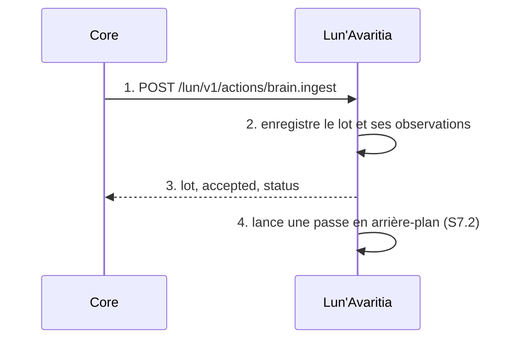

| # | De → vers | Par quoi | Ce qui circule | Retour |
|---|---|---|---|---|
| 1 | Core → Lun'Avaritia | `POST /lun/v1/actions/brain.ingest` | `version: 1` et `observations[]` : `text` (1 à 2000 caractères, secrets masqués par le core), `source` = `kind: core`, `origin` (d'où vient la parole), `ref` (sa référence dans le tri), `at` (quand, ISO 8601). Au plus 500 observations par envoi, le core les découpe par 500. Aucun identifiant de lot ni de jour | `{ ok: true, result: { lot, accepted, status } }` |
| 2 | Lun'Avaritia → sa base | une transaction | une ligne de lot (état `queued`, ou `held` avec la raison `cost-cap`) et une ligne par observation | rien |
| 3 | Lun'Avaritia → core | réponse de l'action | `lot` (numéro), `accepted` (nombre d'observations), `status` : `queued` ou `held` | le core marque l'étape faite et écrit une ligne de délégation |
| 4 | Lun'Avaritia → elle-même | une passe lancée sans l'attendre | rien | une erreur de la passe est écrite au journal du serveur, pas renvoyée |

- **Ce que CrOliX voit, et où** : rien tout de suite. Dans le Journal du core, la ligne de la veille. Dans l'écran de
  Lun'Avaritia, le Tableau montre « Dernier traitement » une fois la passe finie (S7.19).
- **Ce qui s'écrit** : chez Lun'Avaritia, le lot et ses observations (Lun'Avaritia, `server/src/brain/ingest.ts:31-48`).
  Chez le core, une ligne de délégation « faite » ou « échouée », origine nuit.
- **Qui décide** : du code seul. Le lot est « retenu » (`held`) si le plafond mensuel est déjà atteint au moment de
  l'envoi (S7.20), « en file » sinon, y compris pendant une pause.
- **Erreurs et cas limites** :
  - Un champ en trop, un texte vide ou de plus de 2000 caractères, 0 ou 501 observations, une date qui n'est pas ISO :
    `400` et le message de validation, rien n'est stocké. Le core ne relit pas ce message : il écrit « échouée » et
    recommencera l'envoi complet.
  - Un corps de plus de 25 Mo : `413`, `Envoi trop volumineux`.
  - Erreur imprévue pendant l'action (ni validation, ni dégradation : par exemple une écriture en base qui échoue et
    est annulée) : la route rend `200` avec `{ ok: false, error }`. Le core ne teste que le statut HTTP : il écrit la
    délégation « faite », marque l'étape du lot faite et ne renvoie jamais le lot. Les observations sont perdues sans
    trace côté core. Le même `{ ok: false }` en `200` vaut pour `brain.search` (le contexte du matin, S7.14, en tire une
    ligne au journal du serveur) et pour `brain.due` (la lecture échoue au contrôle de forme : l'ancienne liste reste,
    S7.15).
  - Plus de 500 observations : le core envoie plusieurs lots à la suite. Si le deuxième échoue, l'étape n'est pas
    marquée faite : au passage suivant, **tout** est renvoyé, donc le premier lot en double. Le contrat ne porte aucun
    identifiant qui permettrait à la bibliothèque de le reconnaître.
  - Réponse perdue après l'enregistrement : même effet, un lot en double au renvoi.
  - L'appel n'a pas de délai propre côté core ; il s'arrête avec la connexion.
  - En pause du core, ou en pause locale : le lot est enregistré « en file », aucun appel au modèle (S7.23).
- **Écart avec les décisions** : T3 (le core ne sait pas ce que le lot devient) et F3 (le core lira le bilan du lot) :
  le code ne rend que `lot`, `accepted`, `status`, et personne ne relit le lot ensuite. Voir aussi S7.19.
- **Non vérifié** : l'effet d'un lot en double sur les fiches (le prompt demande de ne pas répéter un fait déjà présent,
  mais ce n'est pas contrôlé par le code). Que rend la bibliothèque à un jeton absent ou révoqué : le code de retour
  exact (`401` ?) n'a pas été lu.

### S7.2 · Traiter un lot : le tri, puis la rédaction

- **Déclencheur** : la passe lancée par S7.1, par la reprise (S7.3) ou par la fin d'une pause.
- **Acteurs** : Lun'Avaritia, le fournisseur du modèle (celui choisi pour le tri, celui choisi pour l'agent).
- **Avant** : pas de pause (celle du core comme la locale), plafond mensuel non atteint, un modèle choisi pour le tri et
  un pour l'agent. Une seule passe à la fois tourne ; une passe en cours fait revenir les autres sans rien faire.

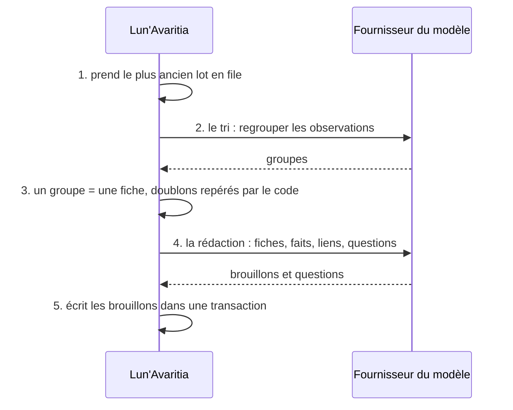

| # | De → vers | Par quoi | Ce qui circule | Retour |
|---|---|---|---|---|
| 1 | Lun'Avaritia | lecture du lot | les textes et sources des observations, dans l'ordre | rien |
| 2 | Lun'Avaritia → fournisseur | le tri : un appel JSON, 2000 jetons au plus | trois blocs de données : les types de fiche, jusqu'à 30 fiches candidates (id, titre, type, extrait) trouvées par les mots de 4 lettres et plus des observations, les observations numérotées | `groups[]` : `observations` (numéros), `ficheId` ou `null`, `typeId`, `title` |
| 3 | Lun'Avaritia | du code | le regroupement final : une fiche existante, ou un nouveau titre, par groupe ; les doublons probables entre titres proches | rien |
| 4 | Lun'Avaritia → fournisseur | la rédaction : un appel JSON, 8000 jetons au plus | les groupes (pour une fiche existante : sa synthèse et ses faits actifs avec leur id), les observations avec leur groupe et, pour une note ou une parole du core, le jour où elle a été dite, les paires de doublons | `fiches[]` (synthèse, faits : texte, observation source, `replaces`, `due` ; liens : fiche visée, relation) et `questions[]` (contradiction ou doublon, avec sa raison) |
| 5 | Lun'Avaritia → sa base | une transaction | un brouillon par fiche, une question par contradiction ou doublon confirmé | le lot passe à `done`, une ligne de passe est écrite : durée, coût, nombre d'observations, de brouillons, de questions |

- **Ce que CrOliX voit, et où** : dans l'écran de Lun'Avaritia, les brouillons dans « À valider » et la ligne « Dernier
  traitement » du Tableau (S7.19). Dans le core, les cartes n'apparaissent qu'à la lecture suivante (S7.6).
- **Ce qui s'écrit** : les brouillons et les questions ; le coût de chaque appel (fournisseur, modèle, montant, usage
  `tri` ou `agent`) ; la ligne de passe. Aucun fait, aucune fiche : tout attend la validation.
- **Qui décide** : le modèle choisit les groupes, écarte les observations « sans intérêt pour le wiki », rédige les
  faits (une phrase de 300 caractères au plus), place une échéance (`due`) seulement quand une date est dite, remplace
  un fait daté quand une observation le dit fait. Le code vérifie chaque réponse (numéros, identifiants, jours qui
  existent, longueurs), fabrique les groupes (« une fiche, un groupe »), repère les doublons de titre, borne les
  questions.
- **Erreurs et cas limites** :
  - Réponse invalide : le modèle est rappelé une fois, avec la raison de l'erreur. Deux fois invalide : S7.4.
  - Plafond franchi par le tri lui-même : la rédaction n'a pas lieu, le lot repart en attente (S7.3). Le tri payé n'est
    pas perdu mais il sera repayé à la reprise.
  - Le plafond est vérifié avant le tri et entre le tri et la rédaction, pas entre un appel et son rappel après une
    réponse invalide : un rappel peut donc faire dépasser le plafond.
  - Un lot vide ne coûte rien. Un prix inconnu pour le modèle compte pour 0 $ (le plafond ne le voit pas).
  - Une question déjà posée, quel qu'en soit le sort, n'est pas reposée (S7.5). Cinq questions au plus par lot,
    contradictions d'abord.
  - Les écritures sont atomiques : si une écriture échoue, aucun brouillon du lot n'existe.
  - Le texte des observations et des fiches voisines part chez le fournisseur du modèle, jamais dans l'instruction
    système.
- **Écart avec les décisions** : T3 ; F2 (la lettre résumera ce traitement) n'est pas codée.
- **Non vérifié** : la qualité du regroupement par le modèle, les prix des modèles, la durée réelle d'une passe.

### S7.3 · Un lot retenu, puis repris

- **Déclencheur** : une passe qui ne peut pas aller au bout, puis l'horloge de la bibliothèque : une passe au démarrage,
  puis une toutes les heures, et une à la reprise d'une pause du core.
- **Acteurs** : Lun'Avaritia, le fournisseur du modèle.
- **Avant** : un lot enregistré (S7.1), ou déposé par une passe précédente.

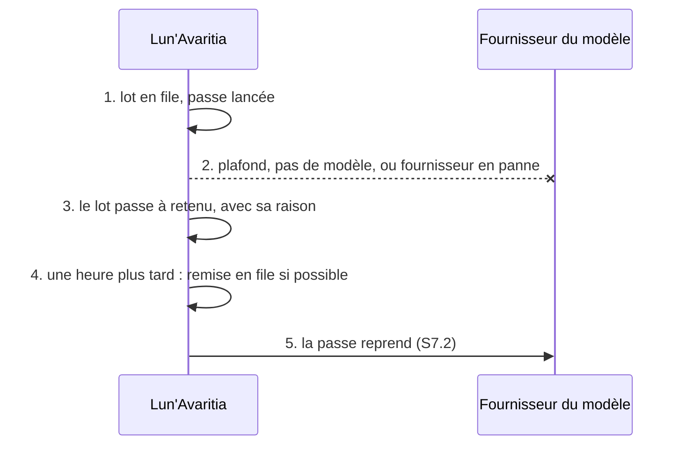

| # | De → vers | Par quoi | Ce qui circule | Retour |
|---|---|---|---|---|
| 1 | Lun'Avaritia | une passe | le lot en file le plus ancien | rien |
| 2 | Lun'Avaritia → fournisseur | tri ou rédaction | voir S7.2 | échec : plafond atteint, aucun modèle choisi, ou l'erreur du fournisseur (clé refusée, crédit épuisé, indisponible) |
| 3 | Lun'Avaritia → sa base | mise à jour du lot | état `held` et une raison (`cost-cap`, `no-provider`, `provider-key`, `provider-credit`, `provider-unavailable`). Une date de reprise (un jour plus tard, soit environ 25 h en pratique) n'est posée que si le fournisseur tombe en panne après le tri payé. Si c'est le plafond qui est franchi après le tri, aucune date : le lot est relâché à la passe suivante qui trouve le plafond sous la limite, et son tri est repayé | rien |
| 4 | Lun'Avaritia | la passe horaire | remet en file tout lot retenu, si le plafond n'est plus atteint et que les deux modèles sont disponibles, sauf un lot dont la date de reprise n'est pas venue | rien |
| 5 | Lun'Avaritia | la passe | traitement du lot (S7.2) | `done`, ou de nouveau `held` |

- **Ce que CrOliX voit, et où** : dans le Tableau de Lun'Avaritia, un bandeau nomme le plafond quand des lots sont
  retenus par lui. Les autres raisons ne s'affichent que dans l'état de la bibliothèque : une clé refusée la met en
  « dégradée » avec sa raison, un crédit épuisé de même (S7.21). Le core voit la santé à sa lecture suivante.
- **Ce qui s'écrit** : l'état et la raison du lot ; rien d'autre. Un lot repris plusieurs fois ne laisse pas de ligne de
  passe tant qu'il n'a pas fini.
- **Qui décide** : du code seul.
- **Erreurs et cas limites** :
  - Panne du fournisseur après le tri payé : le lot attend un jour avant de repasser, pour ne pas repayer le tri toutes
    les heures. Panne au tri lui-même : reprise à la passe de l'heure suivante, rien n'a été payé.
  - Plafond relevé dans Réglages : la prochaine passe horaire relâche les lots retenus par le plafond.
  - Crash pendant une passe : un lot resté « en cours » est remis en file au passage suivant et rejoué en entier.
  - Pause (du core ou locale) : la passe ne fait rien ; une pause survenue pendant la passe arrête avant le lot suivant.
    La reprise de la pause du core relance une passe tout de suite (S7.23).
  - Un lot déjà retenu n'est pas relâché si aucun modèle n'est choisi pour le tri ou pour l'agent.
- **Écart avec les décisions** : T24 (le plafond atteint ne remonte nulle part), voir S7.20.
- **Non vérifié** : la durée réelle entre deux passes quand le serveur redémarre souvent.

### S7.4 · Un lot en échec

- **Déclencheur** : le modèle répond deux fois une réponse invalide, au tri ou à la rédaction.
- **Acteurs** : Lun'Avaritia, le fournisseur du modèle.
- **Avant** : une passe en cours (S7.2).

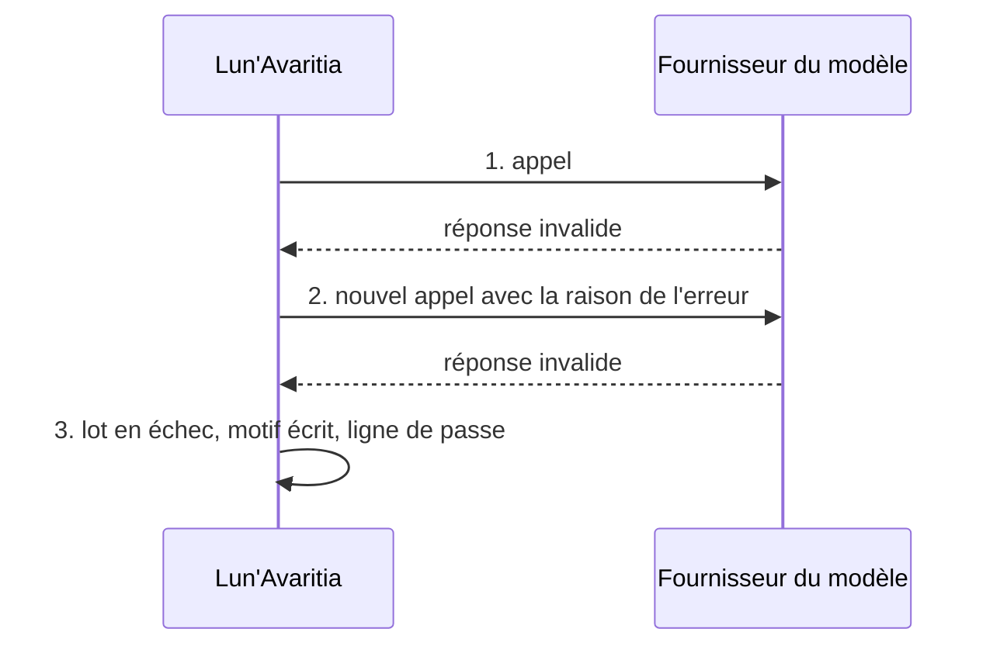

| # | De → vers | Par quoi | Ce qui circule | Retour |
|---|---|---|---|---|
| 1 | Lun'Avaritia → fournisseur | l'appel | voir S7.2 | une réponse qui ne passe pas la vérification |
| 2 | Lun'Avaritia → fournisseur | un seul rappel | la même demande et « Ta réponse précédente était invalide » avec la raison (300 caractères au plus, jamais de donnée) | une réponse invalide de nouveau |
| 3 | Lun'Avaritia → sa base | mise à jour | état `failed`, motif (500 caractères au plus), ligne de passe avec 0 brouillon | rien |

- **Ce que CrOliX voit, et où** : dans l'écran de Lun'Avaritia, une ligne « Lot en échec (n° …) » dans l'activité du
  Tableau. Le motif n'est pas affiché dans ce que le code d'activité renvoie (il reste dans la base). Le core n'en sait
  rien.
- **Ce qui s'écrit** : l'état `failed` et son motif, le coût des appels qui ont rendu une réponse. Une réponse que le
  fournisseur rend illisible au niveau du format n'enregistre aucun coût.
- **Qui décide** : du code seul (la vérification).
- **Erreurs et cas limites** :
  - Un lot en échec n'est **jamais** repris : aucune passe ne le remet en file. Les observations restent en base, sans
    écran pour les relire.
  - Une exception inattendue pendant la passe est traitée de même, avec « Erreur inattendue » et le message.
  - Une réponse du fournisseur illisible au niveau du format compte comme une réponse invalide (même rappel).
- **Écart avec les décisions** : T3 ; le motif de l'échec n'est lu par aucun écran.
- **Non vérifié** : si un écran montre le motif d'un lot en échec (aucun appel de l'application ne le lit).

### S7.5 · Observation écartée, fait déjà connu, question déjà posée

- **Déclencheur** : une passe (S7.2) qui ne donne pas de carte pour une partie de ce qu'elle a reçu.
- **Acteurs** : Lun'Avaritia, le modèle.
- **Avant** : un lot en cours de traitement.

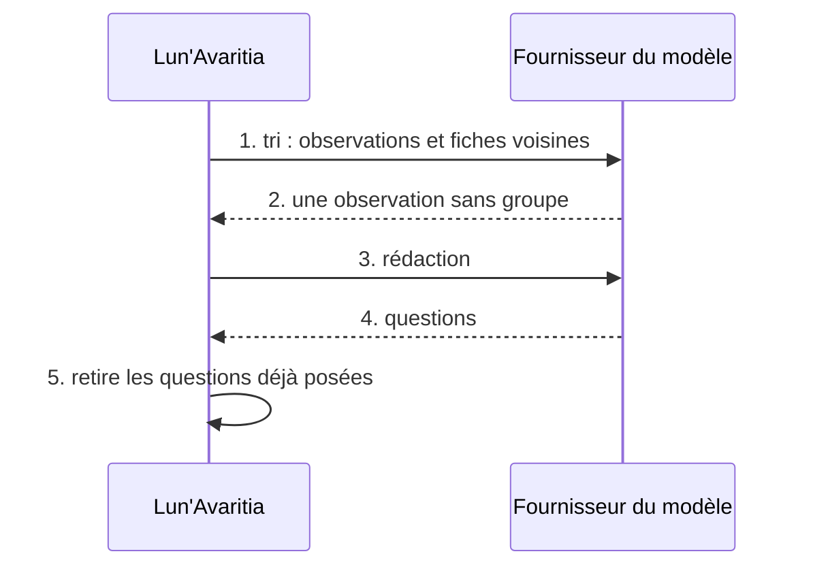

| # | De → vers | Par quoi | Ce qui circule | Retour |
|---|---|---|---|---|
| 1 | Lun'Avaritia → fournisseur | le tri | voir S7.2 | des groupes |
| 2 | fournisseur → Lun'Avaritia | réponse du tri | une observation n'entre dans aucun groupe : « sans intérêt pour le wiki » | rien : elle n'est plus utilisée |
| 3 | Lun'Avaritia → fournisseur | la rédaction | le modèle reçoit les faits actifs de la fiche et doit ne pas répéter un fait présent | des faits nouveaux seulement |
| 4 | fournisseur → Lun'Avaritia | questions | contradiction (fait à garder, fait à barrer) ou doublon (fiche à garder, fiche à fusionner) | des questions |
| 5 | Lun'Avaritia | du code | retire toute question dont la paire de faits ou de fiches a déjà été posée, en attente, tranchée ou **refusée** | au plus cinq questions gardées |

- **Ce que CrOliX voit, et où** : rien. Ni une observation écartée, ni un fait déjà connu, ni une question reposée ne
  laissent de carte.
- **Ce qui s'écrit** : seulement le décompte de la passe (observations reçues, brouillons, questions). Ce qui est écarté
  n'est tracé nulle part.
- **Qui décide** : le modèle pour « sans intérêt » et « déjà connu » ; le code pour les questions déjà posées.
- **Erreurs et cas limites** :
  - Une observation écartée à tort est perdue : elle reste dans la base du lot, sans écran.
  - Un brouillon de fiche refusé n'est **pas** retenu contre une observation semblable : elle peut redonner la même
    carte. Une question refusée, elle, ne revient jamais.
  - Un fait déjà présent mais reformulé peut passer : seul le modèle en juge.
- **Écart avec les décisions** : F3 (le core lirait « ce qui a été écarté et pourquoi ») : rien n'est gardé de la
  raison.
- **Non vérifié** : le taux d'observations écartées en pratique.

### S7.6 · Une carte de la bibliothèque arrive au core

- **Déclencheur** : l'horloge de lecture du core : au démarrage, toutes les 2 minutes, et peu après chaque signal d'un
  poste. Aucun événement n'annonce une carte née (S7.2) ni une décision prise dans l'écran de la bibliothèque (S7.7).
- **Acteurs** : le core, Lun'Avaritia, le panneau, CrOliX.
- **Avant** : la bibliothèque est appairée et son contrat (la 1.4) est lu ; des brouillons attendent.

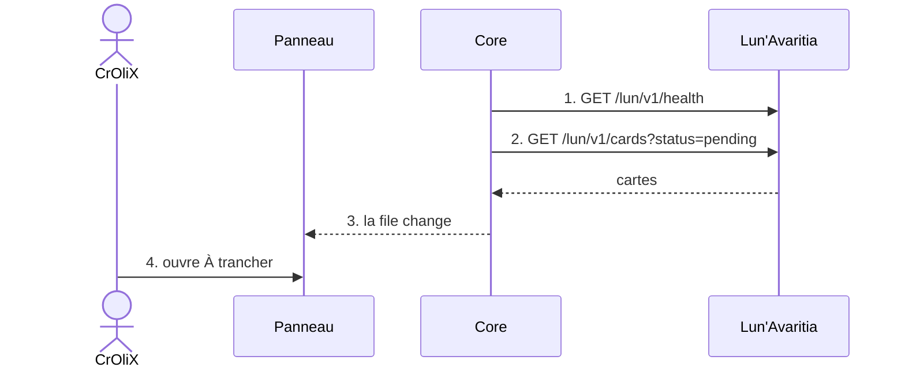

| # | De → vers | Par quoi | Ce qui circule | Retour |
|---|---|---|---|---|
| 1 | Core → Lun'Avaritia | `GET /lun/v1/health` | rien | `status`, `reason?`, `paused?`, `pausedBy?`, `version`, `contract: 1.4`, `agent: true`, `agentName?` |
| 2 | Core → Lun'Avaritia | `GET /lun/v1/cards?status=pending` | rien | `cards[]` : `id` (numéro du brouillon, en texte), `action` (`brain.fiche`, `brain.contradiction`, `brain.doublon` ou `brain.import`), `effect: write`, `title`, `lines[]`, `status`, `at`, `link` (chemin dans l'écran de la bibliothèque), `kind` (« Nouvelle fiche », « Fiche enrichie », « Import », « Question »), et pour une question `reason` et `options[]` |
| 3 | Core → panneau | une mise à jour de la file | rien de plus | le panneau relit sa file |
| 4 | CrOliX → panneau | ouvre À trancher | rien | les cartes, groupées par poste |

- **Ce que CrOliX voit, et où** : dans le panneau, dans À trancher, la carte de la bibliothèque : son titre, ses lignes
  (la synthèse, chaque fait, chaque lien, chaque échéance), pour une question sa raison et ses deux réponses. Le
  compteur de la file la compte.
- **Ce qui s'écrit** : côté core, la dernière liste lue (elle sert de cache), l'état de lecture du poste. Rien chez la
  bibliothèque.
- **Qui décide** : du code : la bibliothèque classe sa file (contradictions et fiches qui remplacent un fait, puis
  doublons, puis le reste, du plus ancien au plus récent) et n'en rend que `drafts.cap` (15 par défaut, réglable de 1 à
  100). Le surplus attend ; il n'apparaît que dans l'écran de la bibliothèque, avec « N autres brouillons attendent le prochain passage ».
- **Erreurs et cas limites** :
  - La liste des cartes en attente compte aussi les brouillons en cours d'application, rendus avec le statut
    `pending`.
  - Chaque passe attend la santé 8 secondes au plus, puis chaque appel (cartes, coûts, échéances) 15 secondes au plus.
    Si la santé échoue, la passe s'arrête : ni cartes, ni coûts, ni échéances, et le poste est noté comme tombé. Si
    seules les cartes sont illisibles, les coûts et les échéances sont lus quand même.
  - Statut inconnu (autre que pending, done, refused, failed, expired) : `400`. `expired` rend toujours une liste vide ;
    un brouillon n'est jamais « en échec » dans le code lu.
  - Le core ne reçoit ni `importance`, ni `bulk`, ni `fields`, ni `sends` : une carte de la bibliothèque ne se valide
    jamais en groupe côté bibliothèque, et ne se corrige pas par champs.
  - Une carte déjà tranchée dans l'écran de la bibliothèque disparaît à la lecture suivante, 2 minutes au plus plus
    tard.
  - Une carte illisible arrête la lecture de toutes les cartes de ce poste (T27, lu côté core).
  - Bibliothèque injoignable : le dernier état lu reste affiché, marqué comme ancien (S7.24).
- **Écart avec les décisions** : T5 (une décision prise dans l'écran du satellite n'est poussée nulle part), T18 (une
  carte tout juste préparée n'est pas encore connue du core), T28 (au-delà de 15, visibles dans l'écran seulement : 15
  est le réglage par défaut, pas une borne du code), F5 non codée.
- **Non vérifié** : le délai réel entre la naissance d'une carte et son apparition dans le panneau.

### S7.7 · Valider une fiche dans l'écran de Lun'Avaritia

- **Déclencheur** : CrOliX appuie sur « Valider » (ou sur V) dans « À valider » de l'écran de la bibliothèque, avec ou
  sans modification de la fiche proposée.
- **Acteurs** : CrOliX, l'écran de Lun'Avaritia, Lun'Avaritia.
- **Avant** : un brouillon en attente ; l'appareil est appairé.

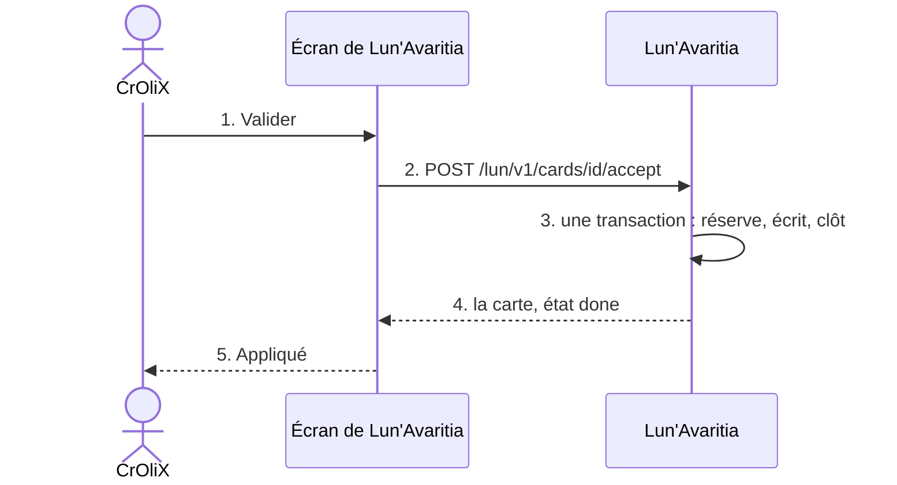

| # | De → vers | Par quoi | Ce qui circule | Retour |
|---|---|---|---|---|
| 1 | CrOliX → écran | clic ou touche V | le brouillon choisi, éventuellement corrigé | rien |
| 2 | Écran → Lun'Avaritia | `POST /lun/v1/cards/:id/accept` | `input` facultatif : le brouillon corrigé en entier (même type), ou `{ answer }` pour une question (S7.9) | la carte |
| 3 | Lun'Avaritia → sa base | une transaction | le brouillon passe à « en cours », la fiche, ses faits, ses liens sont écrits, l'index de recherche est mis à jour, le brouillon passe à `done` avec la date | rien |
| 4 | Lun'Avaritia → écran | réponse | `{ card }` à l'état `done` | rien |
| 5 | Écran → CrOliX | un message | « Appliqué », la carte quitte la file, la suivante prend le focus | rien |

- **Ce que CrOliX voit, et où** : « Appliqué » ; la fiche existe dans Mémoire. Le core ne voit rien tout de suite.
- **Ce qui s'écrit** : une fiche créée ou enrichie, ses faits (chacun avec sa source et sa date), ses liens, une version
  de la fiche si la synthèse change, l'échéance (`due`) du fait ; le fait remplacé est barré et daté, jamais effacé. La
  ligne « Brouillon appliqué (fiche) » dans l'activité.
- **Qui décide** : CrOliX, sur chaque brouillon, et sur le contenu s'il le corrige ; le code applique.
- **Erreurs et cas limites** :
  - Brouillon déjà tranché (ailleurs, par le core) : `409` ; l'écran écrit « Déjà tranché ailleurs » et se recharge.
  - Brouillon inconnu : `404`. Entrée invalide (type de brouillon changé, fait remplacé qui n'est plus actif, fiche
    absente) : `400` avec le message ; tout est annulé et le brouillon reste en attente.
  - Si CrOliX a modifié la synthèse de la fiche **après** la création du brouillon, la synthèse du brouillon n'est pas
    appliquée (les faits le sont) ; la carte le dit : « Synthèse non appliquée ».
  - Un lien vers une fiche introuvable n'empêche pas la validation : un avertissement est écrit sur la carte.
  - Un corps de plus de 25 Mo : `413`.
  - Le même geste fait en même temps depuis le panneau du core et l'écran : un seul passe, l'autre reçoit `409`.
- **Écart avec les décisions** : T5, F5 : le core ne reçoit rien de cette décision ; il la découvre à sa lecture.
- **Non vérifié** : rien (lu dans `drafts.ts` et `Valider.svelte`).

### S7.8 · Refuser un brouillon, puis le rétablir

- **Déclencheur** : CrOliX appuie sur « Refuser » (ou R), puis éventuellement sur « Annuler » dans le message qui suit.
- **Acteurs** : CrOliX, l'écran de Lun'Avaritia, Lun'Avaritia.
- **Avant** : un brouillon en attente.

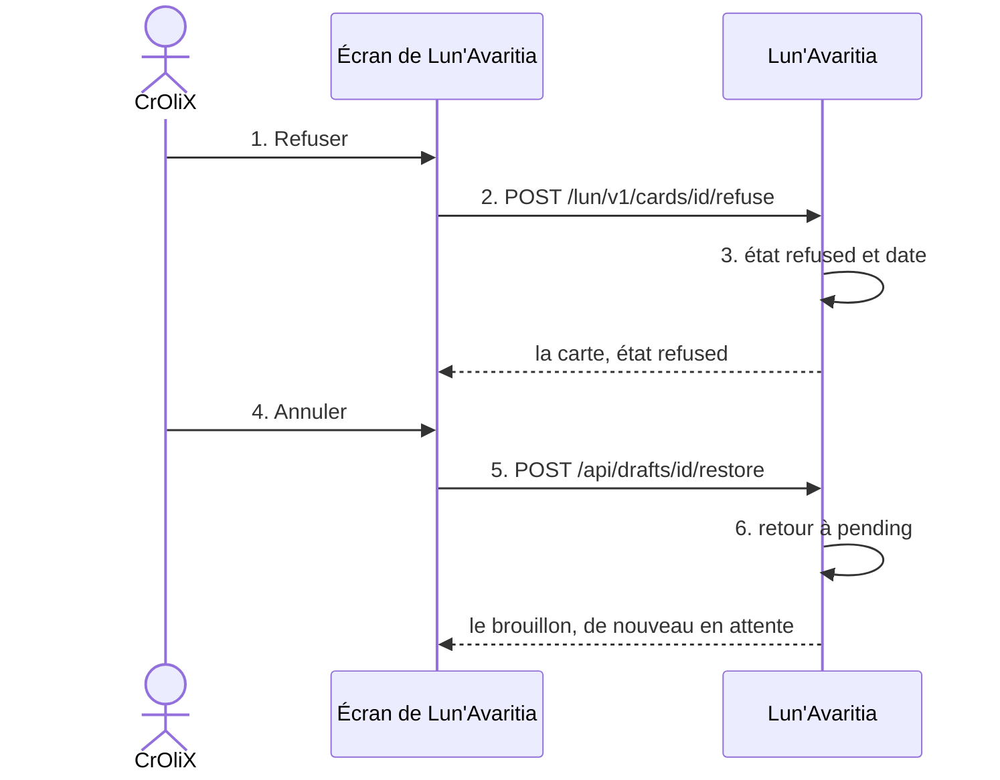

| # | De → vers | Par quoi | Ce qui circule | Retour |
|---|---|---|---|---|
| 1 | CrOliX → écran | clic ou touche R | le brouillon | rien |
| 2 | Écran → Lun'Avaritia | `POST /lun/v1/cards/:id/refuse` | corps vide | `{ card }` à l'état `refused` |
| 3 | Lun'Avaritia → sa base | mise à jour | état `refused` et date | rien |
| 4 | CrOliX → écran | « Annuler » dans le message « Refusé » (5 secondes) | rien | rien |
| 5 | Écran → Lun'Avaritia | `POST /api/drafts/:id/restore` | rien | `{ draft }` |
| 6 | Lun'Avaritia → sa base | mise à jour | l'état revient à `pending`, la date de décision est effacée | rien |

- **Ce que CrOliX voit, et où** : « Refusé » avec « Annuler ». Le brouillon revient à sa place dans la file.
- **Ce qui s'écrit** : l'état du brouillon et la date ; la ligne « Brouillon refusé (fiche) » dans l'activité, retirée
  si le refus est défait. Rien n'est retenu contre l'observation d'origine (S7.5).
- **Qui décide** : CrOliX.
- **Erreurs et cas limites** :
  - Le rétablissement n'est possible que dans les 30 secondes après le refus (le message d'annulation dure 5 secondes) ;
    après, `409` « Trop tard pour annuler : le refus est fait ».
  - Rétablir un brouillon qui n'est pas refusé : `409` ; inconnu : `404`.
  - Le core n'a aucun geste de rétablissement : refuser depuis le panneau est définitif (famille 3).
  - Un refus ne produit pas de nouveau brouillon et ne se « retient » pas pour les fiches : S7.5.
- **Écart avec les décisions** : T5.
- **Non vérifié** : rien.

### S7.9 · Répondre à une question

- **Déclencheur** : CrOliX répond à une carte de type « Question » (contradiction ou doublon), dans l'écran de la
  bibliothèque ou depuis le panneau du core.
- **Acteurs** : CrOliX, l'écran de Lun'Avaritia ou le panneau et le core, Lun'Avaritia.
- **Avant** : une question en attente (S7.2).

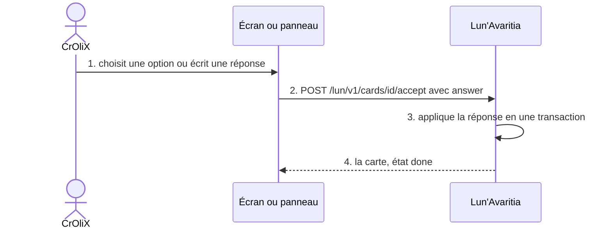

| # | De → vers | Par quoi | Ce qui circule | Retour |
|---|---|---|---|---|
| 1 | CrOliX → écran | un choix | une des deux `options` de la carte, ou un texte libre (1 à 1000 caractères) | rien |
| 2 | Écran (ou core) → Lun'Avaritia | `POST /lun/v1/cards/:id/accept` | `input: { answer }` | la carte |
| 3 | Lun'Avaritia → sa base | une transaction | selon la réponse (ci-dessous) | rien |
| 4 | Lun'Avaritia → demandeur | réponse | `{ card }` à l'état `done` | rien |

- **Ce que CrOliX voit, et où** : la carte part de la file. La fiche concernée porte le fait barré, ou la fusion.
- **Ce qui s'écrit** : contradiction, la première option garde la proposition et barre le fait à barrer ; la seconde
  intervertit ; une réponse libre ajoute un **nouveau fait** (source : le core, daté) qui remplace les deux anciens,
  tous deux barrés. Doublon, la première option fusionne la seconde fiche dans la première, la seconde fait l'inverse ;
  les faits et les liens de la fiche fusionnée passent à la fiche gardée, la fiche fusionnée redirige vers elle et
  quitte la recherche.
- **Qui décide** : CrOliX ; le code applique.
- **Erreurs et cas limites** :
  - Réponse libre à un doublon : `400` « Choisis l'une des deux fiches » ; réponse à une carte de fiche : `400`.
  - Fait déjà barré, ou fiche déjà fusionnée entre-temps : `400` avec le message, rien d'écrit, la question reste en
    attente.
  - Question déjà tranchée : `409`.
  - Une question refusée ne revient jamais (S7.5).
- **Écart avec les décisions** : T5, T15 (deux endroits décident). Le champ `values` du contrat 1.5 n'existe pas ici.
- **Non vérifié** : la façon dont le panneau du core présente ces options (famille 3).

### S7.10 · Une note ou un document déposé par CrOliX

- **Déclencheur** : CrOliX dépose un fichier texte ou Markdown dans « Dépôts ». Une note part de la même façon, par
  l'agent (S7.12) : la route de note (`POST /api/notes`) existe, mais aucun écran de l'application ne l'appelle.
- **Acteurs** : CrOliX, l'écran de Lun'Avaritia, Lun'Avaritia, le fournisseur du modèle.
- **Avant** : un modèle choisi pour le tri et pour l'agent, une clé de fournisseur, un plafond non atteint. Pas besoin
  que la bibliothèque soit en service : la pause ne l'arrête pas, c'est un geste manuel.

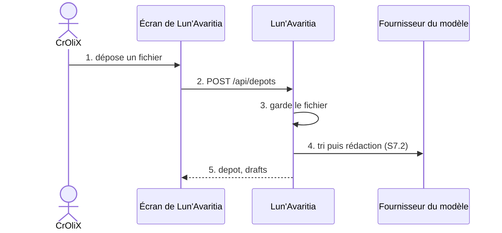

| # | De → vers | Par quoi | Ce qui circule | Retour |
|---|---|---|---|---|
| 1 | CrOliX → écran | glisser ou choisir un fichier | le fichier | rien |
| 2 | Écran → Lun'Avaritia | `POST /api/depots` en multipart | champ `file` (nom, type, octets) | `{ depot, drafts }` |
| 3 | Lun'Avaritia → sa base | enregistrement | le fichier tel quel | rien |
| 4 | Lun'Avaritia → fournisseur | une passe de S7.2 sur une seule observation | le texte, source `depot` avec le numéro du fichier et l'heure d'arrivée (pas de jour « dit ») | des brouillons |
| 5 | Lun'Avaritia → écran | réponse | numéro du dépôt, nombre de brouillons | l'écran additionne les brouillons |

- **Ce que CrOliX voit, et où** : dans Dépôts, le fichier et le nombre de brouillons qu'il a donnés, dont ceux encore en
  attente ; le Tableau montre le traitement.
- **Ce qui s'écrit** : le fichier (une note est un fichier de type texte nommé « note »), les brouillons, la ligne de
  traitement. Supprimer un dépôt retire le fichier seulement : les brouillons et les fiches gardent leur référence.
- **Qui décide** : le modèle pour le contenu ; le code pour les formats (texte ou Markdown, UTF-8, 200 000 caractères au
  plus).
- **Erreurs et cas limites** :
  - PDF ou autre format : `400`, rien n'est gardé. Texte vide, trop long, UTF-8 illisible : `400`. Corps de plus
    d'1 Mo : `413`.
  - Plafond atteint (`409`), aucune clé, aucun modèle, clé refusée, crédit épuisé, fournisseur indisponible (`503`) : le
    fichier est **gardé** dans Dépôts « sans traitement », le message dit quoi faire (relever le plafond, ajouter une
    clé…) puis renvoyer. Rien ne le retraite seul.
  - Réponses invalides deux fois : `502` avec le motif ; le fichier est gardé.
  - Pendant une pause, du core ou locale : le geste passe, puisqu'il est manuel.
- **Écart avec les décisions** : aucun connu.
- **Non vérifié** : le traitement d'un gros document (le plafond n'est vérifié qu'entre les deux appels).

### S7.11 · Importer un coffre Obsidian

- **Déclencheur** : CrOliX choisit un dossier de notes Markdown dans « Dépôts ».
- **Acteurs** : CrOliX, l'écran de Lun'Avaritia, Lun'Avaritia. Aucun modèle.
- **Avant** : un coffre d'au plus 2000 fichiers et 20 Mo de texte.

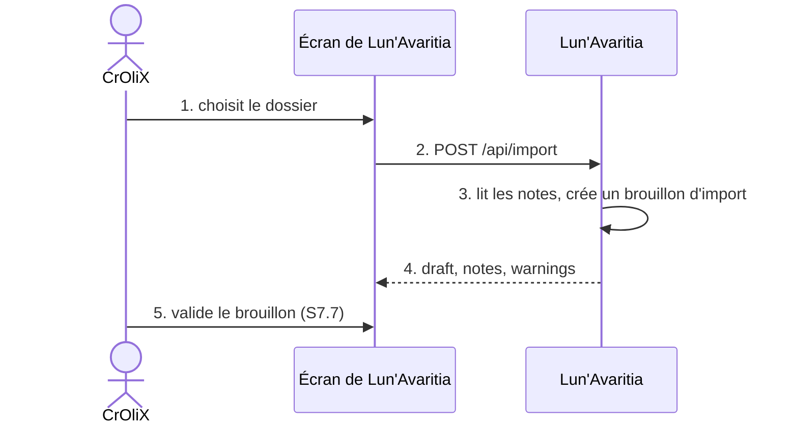

| # | De → vers | Par quoi | Ce qui circule | Retour |
|---|---|---|---|---|
| 1 | CrOliX → écran | choix du dossier | les fichiers | rien |
| 2 | Écran → Lun'Avaritia | `POST /api/import` | `files[]` : `path`, `text` | rien tout de suite |
| 3 | Lun'Avaritia → sa base | un brouillon de type import | les notes lues (titre, corps, liens) et les avertissements | rien |
| 4 | Lun'Avaritia → écran | réponse | numéro du brouillon, nombre de notes, `warnings[]` | rien |
| 5 | Écran → Lun'Avaritia | accept | le brouillon, éventuellement corrigé | une fiche par note, du type « Note », ou du premier type de fiche s'il n'existe pas de type « Note » (S7.7) |

- **Ce que CrOliX voit, et où** : « 1 brouillon d'import, N notes » ; dans À valider, une carte « Import de N notes »
  qui liste dix titres. Elle apparaît aussi dans le core, à la lecture (S7.6).
- **Ce qui s'écrit** : à la validation, une fiche par note, des liens `mentionne` entre notes qui se citent par titre ;
  un lien vers une note absente donne un avertissement, pas un échec.
- **Qui décide** : CrOliX valide ; le code lit.
- **Erreurs et cas limites** :
  - Liste de fichiers mal formée : `400`. Plus de 2000 fichiers : `400`. Plus de 20 Mo : `400`. Corps de plus de 25 Mo :
    `413`.
  - Aucune note Markdown : `400` « Aucune note Markdown trouvée ».
  - Aucun type de fiche : `400` à la validation.
- **Écart avec les décisions** : aucun connu.
- **Non vérifié** : le détail de la lecture des liens et des avertissements (`obsidian.ts` n'a pas été relu ligne à
  ligne).

### S7.12 · Natsume dit « note ça »

- **Déclencheur** : CrOliX dit ou écrit « note que… » à Natsume ; son modèle appelle l'outil de délégation vers la
  bibliothèque.
- **Acteurs** : CrOliX, le panneau, le core (son modèle), Lun'Avaritia (son agent), le fournisseur du modèle de l'agent.
- **Avant** : la bibliothèque est reliée et son agent déclaré ; le plafond du poste n'est pas atteint côté core.

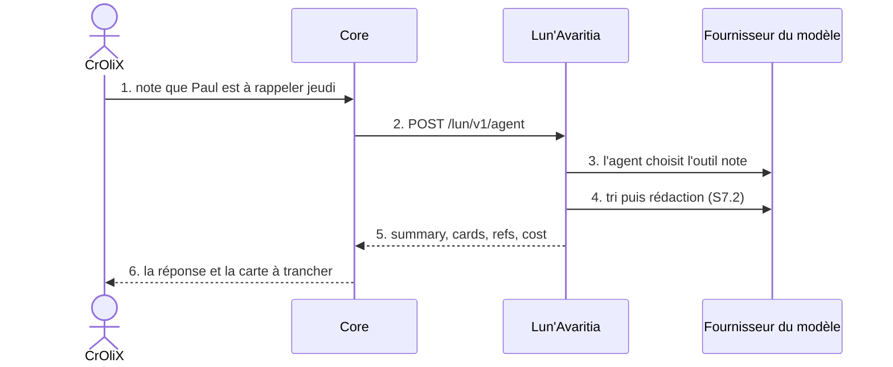

| # | De → vers | Par quoi | Ce qui circule | Retour |
|---|---|---|---|---|
| 1 | CrOliX → core | message | le texte | le fil |
| 2 | Core → Lun'Avaritia | `POST /lun/v1/agent` | `request` : la demande réécrite par le modèle du core, secrets masqués (4000 caractères au plus). Pas de `context` envoyé | voir 5 |
| 3 | Lun'Avaritia → fournisseur | un appel de l'agent avec quatre outils | l'instruction de l'agent (nom, ton, personnage réglés par CrOliX, la date du jour), la demande | un appel d'outil `note` avec le texte |
| 4 | Lun'Avaritia → fournisseur | la note : le texte est gardé comme un dépôt nommé « note », puis une passe | voir S7.10 et S7.2 | des brouillons ; le résultat de l'outil (nombre de brouillons, ou le refus) est rendu au modèle |
| 5 | Lun'Avaritia → core | réponse | `summary` (la phrase de l'agent), `cards[]` (tous les brouillons nés pendant l'appel), `refs[]` (les fiches lues, ici aucune), `cost` : la hausse de la dépense du mois de la bibliothèque pendant l'appel (un lot traité en même temps y entre aussi, comme ses cartes) | le core enregistre la délégation |
| 6 | Core → CrOliX | réponse de Natsume et carte | le résumé, les cartes relayées | une carte « À trancher » |

- **Ce que CrOliX voit, et où** : Natsume répond ; dans À trancher, la ou les cartes de brouillon à valider ; le Journal
  porte la délégation.
- **Ce qui s'écrit** : le texte de la note (un dépôt), les brouillons, le coût (usage `agent`, plus le tri et la
  rédaction), une ligne de passe. Au core : la délégation, ses cartes, son coût.
- **Qui décide** : le modèle du core décide d'envoyer à la bibliothèque ; l'agent décide d'appeler l'outil ; CrOliX
  valide la carte (S7.7 ou famille 3). Rien n'entre dans les fiches sans lui.
- **Erreurs et cas limites** :
  - Plafond mensuel atteint, aucun modèle choisi, clé refusée, crédit épuisé, fournisseur en panne : la réponse porte le
    texte d'explication dans `summary`, sans carte ; pour la note elle-même, le refus est rendu au modèle comme résultat
    d'outil et le texte est gardé dans Dépôts sans traitement (S7.10).
  - Plus de 6 allers-retours avec le modèle : l'agent s'arrête et le dit.
  - Pause **locale** de la bibliothèque : réponse fixe « en pause, je ne fais rien », sans carte ni coût. Pause **du
    core** : l'agent répond et crée des brouillons (S7.23).
  - Délai : le core abandonne l'attente après 120 secondes par défaut (réglage du poste) ; il écrit « délai dépassé ».
    Le travail de la bibliothèque continue : les brouillons existeront quand même, sans le résumé ; une relance peut en
    doubler.
  - Plafond du poste, réglé côté core, atteint : le core ne l'appelle pas du tout.
  - Les cartes de la réponse sont **toutes** celles nées pendant l'appel, aussi celles d'un lot traité en même temps ;
    le coût de la réponse suit la même règle.
- **Écart avec les décisions** : T6 (le délai du core coupe l'attente, pas le travail), T7 (le champ `context` reste
  vide), T14 (deux plafonds indépendants).
- **Non vérifié** : si le modèle du core appelle toujours l'outil dans ce cas (c'est une consigne, pas du code). Que
  dit exactement la consigne du core : lui demande-t-elle d'envoyer à la bibliothèque tout « note ça », même une chose
  à faire ? Seuls le rôle déclaré du poste et la délégation ont été lus.

### S7.13 · Natsume cherche dans la bibliothèque en conversation

- **Déclencheur** : CrOliX pose une question sur ce qui a été noté, une personne, un projet ; le modèle du core délègue
  à la bibliothèque.
- **Acteurs** : CrOliX, le core, Lun'Avaritia (son agent), le fournisseur du modèle de l'agent.
- **Avant** : comme S7.12.

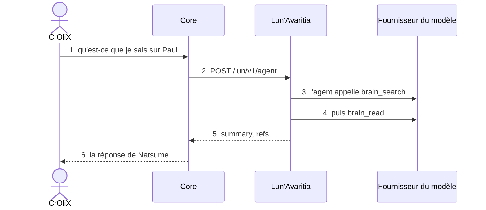

| # | De → vers | Par quoi | Ce qui circule | Retour |
|---|---|---|---|---|
| 1 | CrOliX → core | message | la question | le fil |
| 2 | Core → Lun'Avaritia | `POST /lun/v1/agent` | `request` seule | voir 5 |
| 3 | Lun'Avaritia → fournisseur → sa base | outil `brain_search` | `query` (1 à 500 caractères), `limit` (1 à 20, 10 par défaut) | des lignes : `id`, `title`, `type`, `excerpt` (300 caractères au plus) |
| 4 | idem | outil `brain_read` | `id` d'une fiche | `id`, `title`, `type`, `synthesis` (4000 caractères au plus), `facts[]` actifs (`id`, `text`, `source`, `at`, `due?`), `links[]`, `updatedAt`, `redirectedFrom?` |
| 5 | Lun'Avaritia → core | réponse | `summary` (en français, brièvement, avec le titre des fiches citées), `cards: []`, `refs[]` (`type: fiche`, `id`, `title`, pour chaque fiche lue), `cost` | le core en fait la réponse de Natsume |
| 6 | Core → CrOliX | message de Natsume | la réponse | le fil |

- **Ce que CrOliX voit, et où** : la réponse de Natsume dans la conversation (écrite ou dite). Rien dans À trancher.
- **Ce qui s'écrit** : le coût de chaque appel (usage `agent`). Au core, la délégation. Aucune donnée de la bibliothèque
  ne change.
- **Qui décide** : le modèle de l'agent choisit ses outils (`brain_search`, `brain_read`, `brain_neighbors`, `note`) ;
  il ne répond qu'à partir des fiches, et doit dire qu'il n'a rien quand elles ne disent rien. Le code borne les tours
  (6).
- **Erreurs et cas limites** :
  - Recherche sans résultat : l'outil rend une liste vide, l'agent répond qu'il n'a rien ; ce n'est pas une erreur. Une
    requête sans mot (que de la ponctuation) rend aussi une liste vide.
  - Fiche fusionnée : la lecture rend la fiche gardée et dit d'où l'on venait (`redirectedFrom`). Fiche inconnue :
    l'outil rend une erreur au modèle, qui s'en explique.
  - L'outil `brain_neighbors` prend `id` (une fiche fusionnée mène à la fiche gardée). Il rend une ligne par lien vers
    une fiche vivante : `id`, `title`, `relation`, `direction` (`out` ou `in`). Une fiche inconnue rend une erreur au
    modèle. Il n'ajoute rien à `refs[]` : seul `brain_read` le remplit.
  - Le fournisseur de l'agent refuse la clé, n'a plus de crédit, ne répond pas : le texte d'explication devient
    `summary`, la santé de la bibliothèque passe à « dégradée » pour la clé ou le crédit (S7.21).
  - Plafond mensuel atteint (avant ou au milieu de la boucle), aucun modèle : même mécanisme que S7.12.
  - Pause locale de la bibliothèque : réponse fixe sans rien chercher. Pause du core : l'agent cherche.
  - Délai dépassé côté core : « délai dépassé », sans réponse.
  - Les fiches lues par l'outil sont envoyées au fournisseur du modèle de l'agent, et le texte de la demande aussi.
- **Écart avec les décisions** : T1 (la phrase de l'agent ne revient que par le résumé), T7, T19 (un poste en pause
  locale est offert comme en service).
- **Non vérifié** : la qualité des réponses, et ce que le core fait du `summary` (famille 2).

### S7.14 · Le contexte du matin : la recherche par mots-clés

- **Déclencheur** : la routine du matin du core, quand elle compose les notes de la journée de Natsume.
- **Acteurs** : le core (deux appels à son modèle), Lun'Avaritia (code seul).
- **Avant** : la bibliothèque est reliée. Sinon la recherche est sautée et le contexte se compose sans fiches.

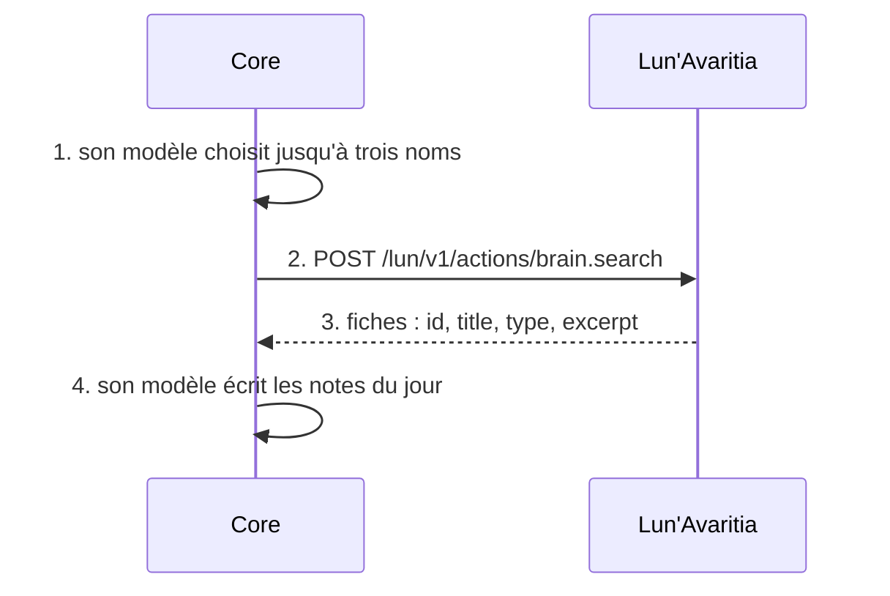

| # | De → vers | Par quoi | Ce qui circule | Retour |
|---|---|---|---|---|
| 1 | Core | un appel à son modèle | les souvenirs et observations de la veille | jusqu'à trois recherches (60 caractères au plus chacune) |
| 2 | Core → Lun'Avaritia | `POST /lun/v1/actions/brain.search` (une fois par recherche) | `query`, `limit: 3` | `{ ok: true, result: [...] }` |
| 3 | Lun'Avaritia → core | réponse | par fiche : `id`, `title`, `type`, `excerpt` (300 caractères au plus) | rien |
| 4 | Core | un second appel à son modèle | les fiches avec le portrait, les souvenirs, le récit, le point du matin | les notes du jour, masquées, gardées |

- **Ce que CrOliX voit, et où** : rien directement ; les notes du jour orientent Natsume toute la journée.
- **Ce qui s'écrit** : côté core, les notes du jour. Chez la bibliothèque, rien (une lecture).
- **Qui décide** : le modèle du core choisit les noms ; la bibliothèque cherche sans modèle : chaque mot devient un
  début de mot, tous doivent y être, classement par pertinence ; les fiches fusionnées n'en font pas partie.
- **Erreurs et cas limites** :
  - Une recherche qui échoue (bibliothèque injoignable, corps illisible) : une ligne au journal du serveur du core, les
    autres recherches continuent.
  - Une réponse en erreur (par exemple `400`) est ignorée en silence : aucune ligne, aucune fiche pour cette recherche.
  - Sans bibliothèque reliée, aucune recherche n'est tentée.
  - La recherche ne passe pas par l'agent : elle n'utilise pas de modèle chez la bibliothèque, ne coûte rien, et marche
    en pause comme en plafond.
- **Écart avec les décisions** : aucun connu.
- **Non vérifié** : la routine du matin entière (famille 6).

### S7.15 · Une échéance : le core la lit

- **Déclencheur** : l'horloge de lecture du core (2 minutes, S7.6). À chaque passe, `brain.due` est lu en dernier,
  après la santé, les cartes et les deux lectures de coût (le jour, le mois). Si la santé ne répond pas, la passe
  s'arrête et les échéances ne sont pas relues. L'ouverture de l'accueil déclenche en plus un appel direct.
- **Acteurs** : le core, Lun'Avaritia (code seul), le panneau.
- **Avant** : des faits portent une échéance (`due`). Une échéance naît d'un brouillon de fiche validé dont un fait
  porte `due` (S7.2, S7.7) ; le fait barré ou remplacé n'est plus dû.

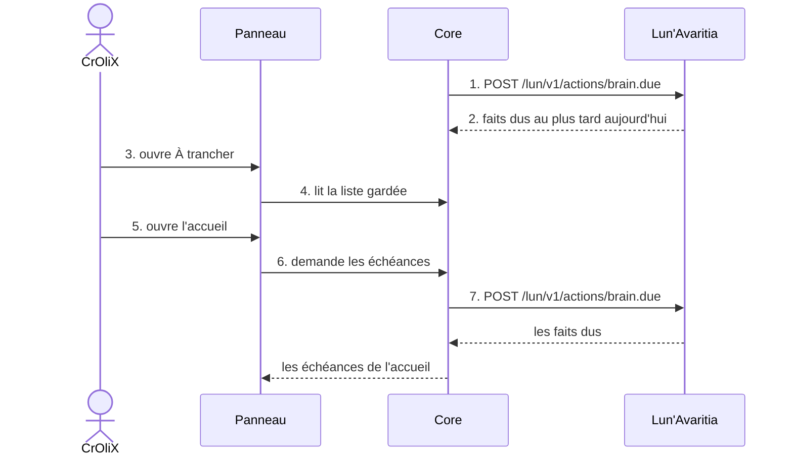

| # | De → vers | Par quoi | Ce qui circule | Retour |
|---|---|---|---|---|
| 1 | Core → Lun'Avaritia | `POST /lun/v1/actions/brain.due` | `day` : le jour à Paris, `AAAA-MM-JJ` | `{ ok: true, result: [...] }` |
| 2 | Lun'Avaritia → core | réponse | par fait actif échu : `factId`, `ficheId`, `fiche` (titre), `text`, `due`, du plus ancien au plus récent. Pas de borne basse : tout le retard est rendu | le core garde la liste |
| 3 | CrOliX → panneau | ouvre À trancher | rien | la file |
| 4 | Panneau → core | lecture de la liste gardée par la lecture des 2 minutes | rien | les échéances, moins celles remises à demain et celles dont un geste est en cours |
| 5 | CrOliX → panneau | ouvre l'accueil | rien | les échéances |
| 6 | Panneau → core | la demande des échéances de l'accueil | rien | les échéances de 7, moins celles remises à demain |
| 7 | Core → Lun'Avaritia | `POST /lun/v1/actions/brain.due` à chaque ouverture de l'accueil, sans passer par la liste gardée | `day` | la même liste qu'en 2 |

- **Ce que CrOliX voit, et où** : dans À trancher, une ligne d'échéance par fait dû, avec ses gestes « C'est fait » et « Plus
  tard » (S7.16) ; sur l'accueil, la liste des échéances. Dans la lettre du matin, les échéances échues récentes, avec
  « c'est fait ? ».
- **Ce qui s'écrit** : côté core, la dernière liste lue. Rien chez la bibliothèque.
- **Qui décide** : du code. Un fait est dû si son échéance est au plus égale au jour demandé, qu'il n'est pas barré et
  que sa fiche n'est pas fusionnée.
- **Erreurs et cas limites** :
  - Jour illisible ou impossible (30 février) : `400`.
  - La lecture des 2 minutes échoue : le core garde l'ancienne liste ; l'erreur est écrite une fois. L'appel direct de
    l'accueil, lui, répond `502` « Lun'Avaritia ne répond pas », ou `502` « n'est pas relié » sans bibliothèque
    appairée.
  - Fait déjà fait mais dont personne n'a validé la carte : il reste dû (S7.16).
  - Une échéance n'a pas d'heure, seulement un jour. Aucun rappel n'est poussé : la bibliothèque n'a pas d'horloge
    d'échéance.
- **Écart avec les décisions** : aucun connu.
- **Non vérifié** : à partir de quelle ancienneté le core marque-t-il la liste gardée comme périmée, et la marque-t-il
  quand la lecture échoue ? Que fait le core d'une bibliothèque en pause locale : la considère-t-il comme à l'arrêt
  (T19) ? La lecture des 2 minutes ne regarde aucune pause. Combien de jours en arrière la lettre du matin reprend-elle
  les échéances (la valeur n'a pas été lue) ?

### S7.16 · « C'est fait » ou « Plus tard » sur une échéance

- **Déclencheur** : CrOliX touche « C'est fait » ou « Plus tard » sur une échéance, dans À trancher ou sur l'accueil.
- **Acteurs** : CrOliX, le panneau, le core, Lun'Avaritia (son agent), le fournisseur du modèle de l'agent.
- **Avant** : une échéance affichée (S7.15).

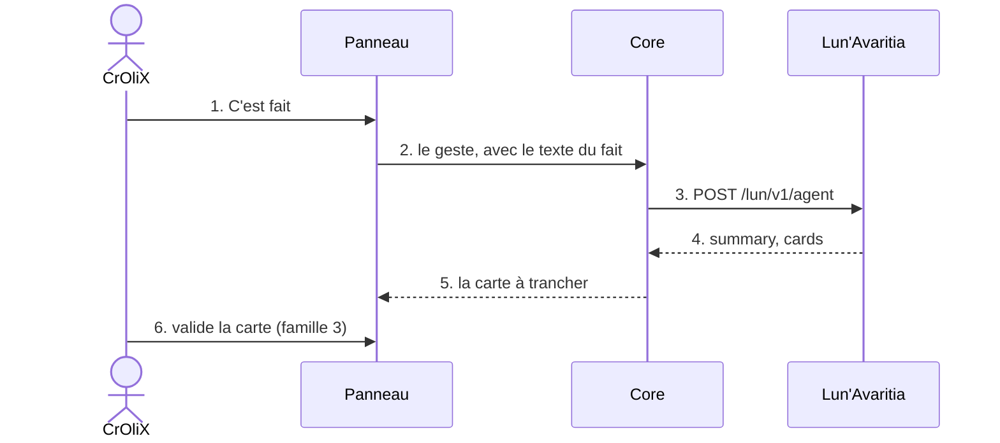

| # | De → vers | Par quoi | Ce qui circule | Retour |
|---|---|---|---|---|
| 1 | CrOliX → panneau | geste « C'est fait » | le fait visé | rien |
| 2 | Panneau → core | le geste, tenu un court instant avant d'agir | le numéro du fait, le texte du fait | accusé |
| 3 | Core → Lun'Avaritia | `POST /lun/v1/agent` | `request` : « C'est fait : » suivi du texte du fait, secrets masqués | voir 4 |
| 4 | Lun'Avaritia → core | réponse | `summary`, `cards[]` : un brouillon de fiche dont le fait nouveau remplace le fait daté, `refs`, `cost` | le core écrit la délégation, origine « fait » |
| 5 | Core → panneau | la carte relayée | la carte | À trancher |
| 6 | CrOliX → panneau | valider | voir S7.7 et la famille 3 | le fait daté est barré, l'échéance disparaît de `brain.due` |

- **Ce que CrOliX voit, et où** : l'échéance disparaît de sa file pendant la durée du geste, puis une carte de fiche à
  valider arrive. Tant que la carte n'est pas validée, la bibliothèque dit encore le fait dû : l'échéance **réapparaît**
  à la relecture que le core lance juste après le geste. « Plus tard » cache l'échéance jusqu'à demain, sur tous les
  appareils, sans que la bibliothèque en sache rien.
- **Ce qui s'écrit** : côté core, la délégation et une trace du geste (qui masque l'échéance jusqu'à la relecture
  suivante) ; pour « Plus tard », une remise à demain. Chez la bibliothèque, le texte gardé comme une note, un
  brouillon, et à la validation un fait barré par son remplaçant.
- **Qui décide** : CrOliX pour le geste ; l'agent pour le rapprochement avec la bonne fiche ; CrOliX encore pour la
  carte.
- **Erreurs et cas limites** :
  - La bibliothèque ne répond pas (injoignable, délai de 120 secondes, plafond du poste) : le geste est refusé avec
    « n'a pas répondu, rien n'a été fait ». L'échéance n'est donc pas cachée.
  - Variante : « C'est fait » par la route directe de l'accueil. Elle porte l'identifiant du fait et un corps
    `{ text }`. Le core délègue « C'est fait : » suivi du texte à l'agent de la bibliothèque, écrit la délégation
    (origine « fait », avec son coût et ses cartes) et rend `{ summary, cards }`, sans masquage par un geste et sans
    relecture lancée. En échec : `502` avec « Lun'Avaritia ne répond pas », ou un texte d'échec « réponse illisible »
    quand la réponse de l'agent est mal formée. Corps sans `text` : `400`. « Plus tard » a aussi sa route directe :
    `204`, ou `400` si l'identifiant est illisible.
  - Si la carte n'est jamais validée, l'échéance reste dans `brain.due` : elle revient à la relecture et se montre en
    même temps que la carte qui doit la clore.
  - Le brouillon peut viser la mauvaise fiche, ou aucune : l'agent ne reçoit que le texte du fait, pas son numéro.
  - Plafond mensuel atteint chez la bibliothèque : la réponse dit que rien n'a été préparé, sans carte.
  - « Plus tard » ne touche pas la bibliothèque.
- **Écart avec les décisions** : T15 (« C'est fait » : deux décisions pour une), T16 (« Plus tard » ne vit que dans le
  core). Le constat de la carte du 27/11 (§ 4.6, T17) dit l'échéance « cachée 24 heures dès le premier geste, même si la
  carte n'est jamais validée » : le code lu la masque seulement jusqu'à la relecture qui suit le geste (voir
  « Écarts relevés avec la carte du 27/11 et avec les standards »).
- **Non vérifié** : que l'agent rapproche toujours le fait de la bonne fiche (la consigne le demande, le code ne le
  force pas).

### S7.17 · Parcourir, corriger et exporter dans l'écran

- **Déclencheur** : CrOliX, dans Mémoire : il cherche, ouvre une fiche, la modifie, regarde le graphe, ou exporte.
- **Acteurs** : CrOliX, l'écran de Lun'Avaritia, Lun'Avaritia (code seul).
- **Avant** : l'appareil est appairé.

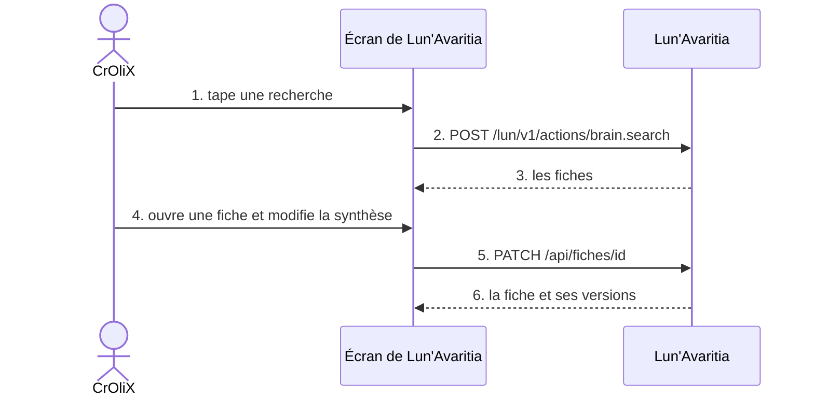

| # | De → vers | Par quoi | Ce qui circule | Retour |
|---|---|---|---|---|
| 1 | CrOliX → écran | frappe | le texte, 250 ms après la dernière touche | rien |
| 2 | Écran → Lun'Avaritia | `POST /lun/v1/actions/brain.search` | `query` (`limit` 10 par défaut) | `{ result }` |
| 3 | Lun'Avaritia → écran | réponse | `id`, `title`, `type`, `excerpt` | la liste |
| 4 | Écran → Lun'Avaritia | `GET /api/fiches/:id` à l'ouverture | rien | `fiche`, `neighbors`, `depots` cités, `versions`, `redirectedFrom?` |
| 5 | Écran → Lun'Avaritia | `PATCH /api/fiches/:id` | `title` et/ou `synthesis` (20 000 caractères au plus) | `fiche`, `versions` |
| 6 | Lun'Avaritia → sa base | mise à jour | l'ancienne version est gardée, la modification date de CrOliX | rien |

- **Ce que CrOliX voit, et où** : la liste, la fiche (synthèse, faits actifs et barrés, liens, dépôts sources,
  versions), le graphe (`GET /api/graph` : fiches, liens, fiches à question marquées). L'export (`POST /api/export`)
  rend un fichier zip de fiches Markdown, nommé du jour.
- **Ce qui s'écrit** : une version de la fiche à chaque modification, l'index de recherche. La modification de CrOliX
  est immédiate, sans carte, et prime sur un brouillon plus ancien de l'agent (S7.7). Rien n'est poussé au core.
- **Qui décide** : CrOliX.
- **Erreurs et cas limites** :
  - Fiche fusionnée à la modification : `400`, il faut modifier la fiche gardée. Fiche inconnue : `404` à l'ouverture,
    mais `400` « Fiche absente. » à la modification. Type de champ faux, synthèse trop longue : `400`. Corps de plus d'1 Mo : `413`.
  - Les types de fiche (`GET/POST/PATCH/DELETE /api/types`) : un type utilisé ne se supprime pas ; un nom en double est
    refusé.
  - Une réponse plus ancienne de la recherche ne remplace jamais une plus récente.
  - Le core ne voit ni ces recherches ni ces modifications.
- **Écart avec les décisions** : aucun connu.
- **Non vérifié** : l'affichage du graphe (WebGL), non lu.

### S7.18 · L'agent de l'écran de Lun'Avaritia

- **Déclencheur** : CrOliX ouvre la bulle de l'agent dans l'écran de la bibliothèque et écrit.
- **Acteurs** : CrOliX, l'écran, Lun'Avaritia, le fournisseur du modèle.
- **Avant** : l'appareil est appairé ; un modèle choisi pour l'agent.

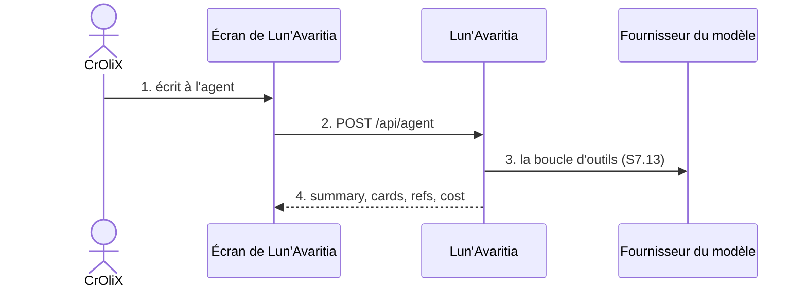

| # | De → vers | Par quoi | Ce qui circule | Retour |
|---|---|---|---|---|
| 1 | CrOliX → écran | message | le texte | rien |
| 2 | Écran → Lun'Avaritia | `POST /api/agent` | `request`, `history` (20 messages au plus, ceux de la page), `context` facultatif | voir 4 |
| 3 | Lun'Avaritia → fournisseur | la boucle de S7.13 | idem | idem |
| 4 | Lun'Avaritia → écran | réponse | `summary`, `cards[]`, `refs[]`, `cost` | la réponse, les cartes (avec le lien vers À valider) |

- **Ce que CrOliX voit, et où** : la réponse dans la bulle ; les cartes de brouillon que sa note a créées.
- **Ce qui s'écrit** : comme S7.12. L'échange vit dans la page seulement, pour la journée en cours : la bibliothèque ne
  garde aucun historique.
- **Qui décide** : comme S7.13.
- **Erreurs et cas limites** :
  - Cette route ne regarde pas la pause : l'agent de l'écran répond même en pause locale, contrairement à la route du
    core.
  - Corps de plus de 100 Ko : `413`.
- **Écart avec les décisions** : aucun connu.
- **Non vérifié** : l'affichage de la bulle.

### S7.19 · Le bilan et le Tableau

- **Déclencheur** : CrOliX ouvre le Tableau de l'écran de la bibliothèque ; ou le core appellerait `day.digest`.
- **Acteurs** : CrOliX, l'écran de Lun'Avaritia, Lun'Avaritia.
- **Avant** : rien de particulier.

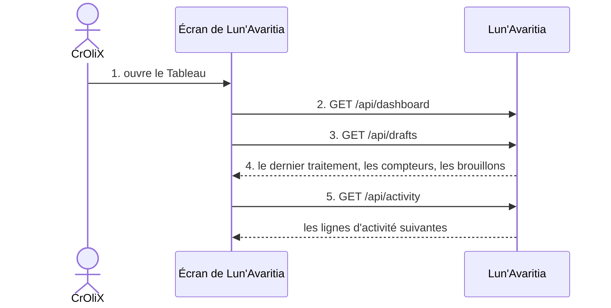

| # | De → vers | Par quoi | Ce qui circule | Retour |
|---|---|---|---|---|
| 1 | CrOliX → écran | ouvre | rien | rien |
| 2 | Écran → Lun'Avaritia | `GET /api/dashboard` | rien | `lastRun` (heure, durée, coût, observations, brouillons, questions), `pending` (brouillons, contradictions, doublons), `fiches`, `heldLots`, `monthSpend`, `monthlyCap`, `recent` (5 lignes), `recentMore` |
| 3 | Écran → Lun'Avaritia | `GET /api/drafts` | rien | les brouillons de la file, `held` (ceux au-delà du plafond de la file) |
| 4 | Lun'Avaritia → écran | réponses des deux appels | voir 2 et 3 | le Tableau et la liste |
| 5 | Écran → Lun'Avaritia | `GET /api/activity?offset=` à la demande | `offset` | 20 lignes par page |

- **Ce que CrOliX voit, et où** : ce que fait la bibliothèque : le dernier traitement, ce qui attend, la dépense du mois
  face au plafond, un bandeau quand des lots sont retenus par le plafond, les dernières lignes d'activité.
- **Ce qui s'écrit** : rien.
- **Qui décide** : du code.
- **Erreurs et cas limites** :
  - `day.digest` : `{ since, until }` (ISO UTC) rend `received` (lots avec leur nombre d'observations, notes, dépôts),
    `done` (brouillons appliqués ou refusés dans la période, par leur titre), `pending` (nombre de brouillons en
    attente). **Rien n'indique** le sort d'un lot, les observations écartées, les questions ni la raison d'un retard.
  - Le core n'appelle pas `day.digest` chez la bibliothèque : son seul appel de bilan vise Lun'Acedia.
  - Un brouillon refusé puis rétabli sort du bilan.
  - « Dernier traitement » inclut aussi une note ou un dépôt, sans lot derrière.
  - Un lot retenu n'a pas de ligne de passe : il n'apparaît pas dans l'activité avant d'avoir fini.
- **Écart avec les décisions** : F3 (le core lira le bilan du lot de la nuit) : l'action existe mais son contenu n'est
  pas celui décrit (ni observations écartées, ni état du lot), et rien ne l'appelle. T3.
- **Non vérifié** : rien.

### S7.20 · Le plafond mensuel de coût

- **Déclencheur** : le plafond mensuel (5 $ par défaut, réglable de 0 à 50 $ dans Réglages) est atteint, sur le mois à
  Paris.
- **Acteurs** : Lun'Avaritia ; CrOliX par Réglages.
- **Avant** : des appels payants ont eu lieu ce mois-ci.

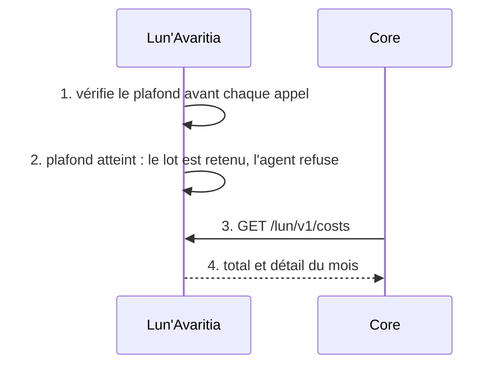

| # | De → vers | Par quoi | Ce qui circule | Retour |
|---|---|---|---|---|
| 1 | Lun'Avaritia | contrôle interne | la dépense du mois (somme des appels enregistrés) | atteint ou non |
| 2 | Lun'Avaritia | selon l'entrée | lot : retenu `cost-cap` (S7.3) ; agent : phrase d'explication ; note ou dépôt : `409` et texte gardé | rien |
| 3 | Core → Lun'Avaritia | `GET /lun/v1/costs?since=` | début de la période | `currency`, `since`, `until`, `total`, `items[]` : fournisseur, modèle, montant, nombre d'appels |
| 4 | Lun'Avaritia → core | réponse | idem | le core affiche le coût et le garde (hebdomadaire et mensuel) |

- **Ce que CrOliX voit, et où** : dans le Tableau de la bibliothèque, la dépense face au plafond et un bandeau. Dans le
  panneau, le coût du poste.
- **Ce qui s'écrit** : chaque appel au modèle est une ligne de coût (montant, nombre d'appels, usage `tri` ou `agent`).
- **Qui décide** : du code, avant chaque appel, y compris à chaque tour de la boucle de l'agent et entre le tri et la
  rédaction.
- **Erreurs et cas limites** :
  - Le plafond atteint ne dégrade pas la santé et n'émet aucun événement : le core n'en sait rien (T24).
  - Plafond mis à 0 : tout est retenu, les lectures marchent.
  - Plafond relevé : le prochain passage horaire reprend les lots retenus par lui.
  - Modèle sans prix connu : l'appel compte pour 0 $.
  - Une passe peut dépasser le plafond de ses propres appels (il n'est vérifié qu'entre le tri et la rédaction).
  - Recherche, lecture, échéances, validation, export : jamais coupés par le plafond, car sans modèle.
  - Il n'y a pas de plafond journalier chez la bibliothèque ; celui du poste est côté core (S7.12, S7.1).
- **Écart avec les décisions** : T14, T24.
- **Non vérifié** : l'affichage du coût dans le panneau (famille 10).

### S7.21 · Une clé de fournisseur refusée, qui expire, rétablie

- **Déclencheur** : un fournisseur refuse la clé pendant un appel ; l'horloge horaire constate la date d'échéance
  déclarée proche ; CrOliX enregistre une clé valable.
- **Acteurs** : Lun'Avaritia, le fournisseur, le core, CrOliX.
- **Avant** : une clé enregistrée (dans Réglages, ou déclarée par l'environnement du serveur).

```mermaid
sequenceDiagram
    participant A as Lun'Avaritia
    participant M as Fournisseur du modèle
    participant N as Core
    A->>M: 1. un appel
    M-->>A: clé refusée
    A->>A: 2. santé dégradée, une fois par changement
    A-->>N: 3. événement key.invalid sur GET /lun/v1/events
    A-->>N: 4. plus tard : key.restored
```

| # | De → vers | Par quoi | Ce qui circule | Retour |
|---|---|---|---|---|
| 1 | Lun'Avaritia → fournisseur | un appel | voir S7.2 | refus de la clé |
| 2 | Lun'Avaritia | du code | raison `<fournisseur>-key` ajoutée à la santé | `status: degraded` |
| 3 | Lun'Avaritia → core | événement `key.invalid` | `importance: normal`, `title` « Clé … refusée : l'IA est en pause », `data.provider`. Un seul par changement d'état | le core le range |
| 4 | Lun'Avaritia → core | événement `key.restored` | `importance: log`, `title` « Clé … de nouveau en service », `data.provider` | le core le garde sans l'écrire au Journal |
| 5 | Lun'Avaritia → core | événement `key.expiring` | `data.daysLeft` (14 ou 3), `data.expires` ; `importance: low` à J-14, `normal` à J-3 | le core le range |

- **Ce que CrOliX voit, et où** : le core écrit au Journal `key.invalid`, `key.expiring` (palier « à prévenir », ou « à
  attendre » à J-14) ; au téléphone une notification silencieuse seulement s'il est absent, et jamais pendant une pause
  du core. `key.restored` n'a aucune ligne. Dans l'écran de la bibliothèque, l'état de chaque clé et la pause de l'IA.
- **Ce qui s'écrit** : l'événement, conservé 7 jours et rejoué à une reconnexion du core ; les drapeaux d'avertissement
  (pour ne pas répéter J-14 et J-3 après un redémarrage).
- **Qui décide** : du code. Rien n'est envoyé après la date d'échéance : le premier vrai refus décide.
- **Erreurs et cas limites** :
  - Crédit épuisé : pas d'événement, seulement la santé `degraded` avec la raison `credit` ; elle se lève au premier
    appel qui passe.
  - Enregistrer une clé : elle est essayée d'abord ; refusée, rien ne change (`400`) ; fournisseur injoignable : `502` ;
    sans clé secrète du serveur, la clé ne s'enregistre pas.
  - Une date déclarée à moins de 3 jours ne donne que J-3.
  - Le core reçoit les événements par un flux continu ; coupé, il reprend après le dernier identifiant lu.
- **Écart avec les décisions** : aucun connu.
- **Non vérifié** : la notification du téléphone elle-même (famille 4 ou 8).

### S7.22 · La copie de la base échoue

- **Déclencheur** : l'horloge de la bibliothèque, au démarrage puis toutes les heures : la copie du jour n'existe pas
  encore et ne peut pas être faite.
- **Acteurs** : Lun'Avaritia, le core.
- **Avant** : le serveur écoute.

```mermaid
sequenceDiagram
    participant A as Lun'Avaritia
    participant N as Core
    A->>A: 1. tente la copie du jour
    A->>A: 2. échec
    A-->>N: 3. événement backup.failed
    A->>A: 4. l'heure suivante : nouvel essai, sans nouvel événement ce jour-là
```

| # | De → vers | Par quoi | Ce qui circule | Retour |
|---|---|---|---|---|
| 1 | Lun'Avaritia | l'horloge | rien | rien |
| 2 | Lun'Avaritia | copie de la base | rien | échec |
| 3 | Lun'Avaritia → core | événement `backup.failed` | `importance: normal`, `title` « La copie de la base a échoué », `data.reason` (le message d'origine) | le core le range |

- **Ce que CrOliX voit, et où** : une ligne au Journal du core et, s'il est absent, une notification silencieuse.
  Pendant une pause du core, la ligne du Journal reste mais la notification ne part pas : l'exception de santé de la
  porte d'attention ne vaut que pour les alertes du core lui-même.
- **Ce qui s'écrit** : le jour de l'échec (pour n'avertir qu'une fois par jour), l'événement.
- **Qui décide** : du code.
- **Erreurs et cas limites** :
  - Un échec de l'avertissement lui-même est écrit au journal du serveur et retenté à l'heure suivante.
  - Une copie réussie ne dit rien.
  - La copie n'est pas une action « automatique » : elle continue en pause.
- **Écart avec les décisions** : le commentaire du code dit « même en pause » ; la porte du core, elle, retient la
  notification d'un événement de poste pendant sa pause (porte d'attention, famille 8). Voir « Écarts relevés avec la
  carte du 27/11 et avec les standards ».
- **Non vérifié** : le chemin des notifications du téléphone après la porte.

### S7.23 · La pause, du core ou locale

- **Déclencheur** : le core pose la pause (`POST /lun/v1/pause` avec `by: core`), ou CrOliX la pose dans l'écran de la
  bibliothèque (même route, sans `by`) ; la reprise suit le même chemin.
- **Acteurs** : le core ou CrOliX, Lun'Avaritia.
- **Avant** : la pause voulue n'est pas déjà posée.

```mermaid
sequenceDiagram
    participant N as Core
    participant A as Lun'Avaritia
    N->>A: 1. POST /lun/v1/pause avec by core
    A-->>N: 2. status paused
    N->>A: 3. POST /lun/v1/resume avec by core
    A->>A: 4. relance une passe sur les lots en file
    A-->>N: 5. status
```

| # | De → vers | Par quoi | Ce qui circule | Retour |
|---|---|---|---|---|
| 1 | Core ou écran → Lun'Avaritia | `POST /lun/v1/pause` | `by: core` (ou rien : locale), `reason` facultatif | `{ status: paused }` |
| 2 | Lun'Avaritia → demandeur | réponse | idem | rien |
| 3 | Core ou écran → Lun'Avaritia | `POST /lun/v1/resume` | `by` | `{ status }` |
| 4 | Lun'Avaritia | du code | une passe sur les lots en file, sans attendre | rien |

- **Ce que CrOliX voit, et où** : l'état « en pause » dans l'écran de la bibliothèque (Réglages et bandeau) ; le panneau
  montre la pause du poste.
- **Ce qui s'écrit** : deux drapeaux distincts, celui du core et le local, qui se lèvent chacun par leur origine.
- **Qui décide** : le core (décision de CrOliX) ou CrOliX.
- **Erreurs et cas limites** :
  - Ce qui s'arrête dans les deux cas : le traitement automatique des lots (aucun appel au modèle ; un lot reçu reste
    « en file ») et la passe horaire. Une pause survenue pendant une passe arrête avant le lot suivant.
  - Ce qui passe quand même, dans les deux cas : les lectures (`brain.search`, `brain.read`, `brain.due`,
    `brain.neighbors`, `day.digest`, cartes, santé, coûts, événements), la validation et le refus des cartes, une note
    ou un dépôt déposés à la main, la copie de la base, l'échéance des clés, l'agent de l'écran.
  - Pause **du core** : l'agent répond à `/lun/v1/agent` et crée des brouillons ; la bibliothèque reste utilisable par
    CrOliX.
  - Pause **locale** : `/lun/v1/agent` répond « en pause, je ne fais rien », sans carte ni coût.
  - Les deux posées : la santé dit `pausedBy: local` (la locale prime). Une dégradation prime sur la pause dans
    `status`, la pause est alors dite à part par `paused: true`.
  - Pause déjà posée de la même origine, ou reprise d'une pause non posée : `409`. Origine inconnue : `400`. Reprise du
    core qui ne lève pas la locale.
  - L'écran de la bibliothèque relit la santé toutes les 30 secondes et après chaque pause ou reprise. Il n'offre la
    reprise que pour sa propre pause : la pause posée par le core n'y est pas levable. Une reprise envoyée sans `by`
    vise la pause locale, donc `409` « Déjà actif » si seule la pause du core est posée. Une reprise qui laisse l'autre
    pause en place relance une passe, qui ne fait rien tant qu'une pause tient.
  - La reprise relance une passe : les lots en file passent, y compris ceux qui ont attendu la pause.
- **Écart avec les décisions** : T13 (deux pauses de force inégale), T19. Le contrat dit que la pause locale rend le
  poste « muet pour le core » et que son agent le dit : c'est exact pour l'agent seulement ; les autres routes répondent
  encore.
- **Non vérifié** : ce que le core fait précisément d'un poste en pause locale (famille 10), et comment il réagit à un
  `409` sur une pause ou une reprise : le prend-il pour un accusé ? Le code de la bibliothèque, lui, est confirmé.

### S7.24 · La bibliothèque ne répond pas

- **Déclencheur** : le serveur de la bibliothèque est arrêté, injoignable, ou plus appairé, au moment d'un appel du
  core.
- **Acteurs** : le core, le panneau, CrOliX.
- **Avant** : rien : c'est une variante de S7.1, S7.6, S7.12 à S7.16.

```mermaid
sequenceDiagram
    participant N as Core
    participant A as Lun'Avaritia
    N--xA: 1. un appel : lot, lecture, délégation, recherche
    N->>N: 2. selon l'appel (tableau)
```

| # | De → vers | Par quoi | Ce qui circule | Retour |
|---|---|---|---|---|
| 1 | Core → Lun'Avaritia | l'un des appels | voir la fiche de l'appel | pas de réponse, un délai dépassé, ou `401` |
| 2 | Core | selon l'appel | voir « Erreurs et cas limites » | voir plus bas |

- **Ce que CrOliX voit, et où** : un poste « injoignable » ou « à réappairer » dans le panneau ; les données lues
  restent affichées, marquées anciennes.
- **Ce qui s'écrit** : côté core, l'échec de lecture, le début de l'indisponibilité ; chez la bibliothèque, rien.
- **Qui décide** : du code.
- **Erreurs et cas limites** :
  - Le lot de la nuit (S7.1) : l'étape n'est pas marquée faite et la nuit la rejoue au passage suivant. La délégation
    s'écrit « échouée » quand l'appel échoue. Si la bibliothèque n'est plus appairée, aucune délégation n'est écrite.
    La nuit se dit faite quand même si ce poste manque.
  - La lecture des cartes et des échéances (S7.6, S7.15) : l'ancienne liste reste, le poste est noté en échec, une ligne
    d'erreur écrite une fois.
  - Une délégation (S7.12, S7.13, S7.16) : « injoignable », « liaison à refaire » ou « délai dépassé » ; la phrase dite
    à CrOliX est « n'a pas répondu, rien n'a été fait » ; le délai coupe l'attente, pas le travail.
  - Le contexte du matin (S7.14) : la recherche est sautée, une ligne au journal du serveur.
  - Le flux d'événements : le core réessaie avec une attente qui double ; au retour, il reprend après le dernier
    événement lu. Un `401` met le poste « à réappairer » et arrête l'écoute.
  - Les événements de la bibliothèque sont gardés 7 jours : une coupure plus longue en perd.
- **Écart avec les décisions** : T3, T6, T19 ; panne en général : famille 11.
- **Non vérifié** : le détail de l'état « injoignable » du poste (famille 11).

---

## Écarts relevés avec la carte du 27/11 et avec les standards

- **« Caché 24 heures dès le premier geste » (carte § 4.6, T17).** Le code lu masque une échéance (ou une carte)
  tranchée depuis le panneau seulement jusqu'à ce qu'une lecture du poste, postérieure au geste, redise sa vérité. Le
  core relance cette lecture dès la fin du geste : une échéance dont la carte n'est pas validée réapparaît aussitôt. Les
  24 heures sont la durée pendant laquelle le core garde la trace du geste, pas celle du masquage.
- **« 15 cartes au plus » (carte, tableau des postes, et T28).** C'est la valeur par défaut d'un réglage (de 1 à 100),
  pas une borne du code.
- **« Un refus n'est pas retenu » (carte § 4.5).** Vrai pour une fiche proposée. Faux pour une question (contradiction,
  doublon) : une question refusée n'est jamais reposée.
- **Le bilan de la bibliothèque (F3).** L'action `day.digest` existe, mais elle ne rend ni l'état du lot, ni les
  observations écartées, ni les questions ; et le core ne l'appelle pas : son seul appel de bilan vise Lun'Acedia.
- **La pause locale (standard « contrat satellite », pause).** Le standard dit qu'elle rend le poste muet ; le code
  n'arrête que la réponse de l'agent et le traitement automatique. Les lectures, les cartes, les événements répondent
  toujours.
- **La copie de la base « même en pause » (commentaire du code de Lun'Avaritia).** La porte d'attention du core ne
  réserve l'exception de santé qu'aux alertes du core lui-même : pendant une pause du core, la notification d'un
  `backup.failed` de la bibliothèque ne part pas ; seule sa ligne au Journal est écrite.
