# Famille 8 · La présence et la parole

Cette famille couvre Lun'Luxuria reliée au core, hors du simple tour question-réponse (famille 1). Ce que le corps dit
de la présence de CrOliX (arrivée, battement, départ, appel en cours, sourdine). Ce que le core lui envoie sans qu'on
lui ait parlé (accueil, urgence, parole spontanée) et ce que Lun'Luxuria décide de dire ou de jeter. La coupure quand
CrOliX parle par-dessus. Le service de voix local, l'émotion par phrase, la fenêtre et ses états. Hors la présence,
seules la coupure (avec ce qui a été entendu, ou à vide pour une réponse oubliée) et le retrait d'un fragment
remontent vers le core. Il n'apprend jamais « dit ». Ici, « arrivée » nomme l'état `started` de la présence, et
« départ » son état `stopped`.

Tout ce qui suit décrit `origin/main` : Lun'Luxuria `8afe402`, avec le comportement du core à `dc130d9` (décrit en
mots ; ses références sont dans l'annexe privée). Les messages écrits depuis la fenêtre (même dits à voix haute en
retour), le filtre de parole et le tour de parole complet sont de la famille 1.

| Id | Titre | En une ligne |
|---|---|---|
| S8.1 | Arrivée : la présence et l'accueil | Une arrivée de présence, puis un accueil écrit par le modèle et dit à voix haute |
| S8.2 | Retour rapide : « Te revoilà. » | Une phrase fixe, sans modèle, quand il n'a pas vraiment quitté son poste |
| S8.3 | Le battement de 30 s | Le corps dit qu'il est là et ce qu'il fait ; le core peut répondre 410 |
| S8.4 | Départ, absence et retour | `stopped` à la fermeture, à l'absence ; une nouvelle arrivée au retour |
| S8.5 | Un appel en cours | Le service voix dit qui tient le micro ; le corps le dit au core |
| S8.6 | Une urgence dite à voix haute | Une phrase fixe, sans modèle, qui passe devant ce qui attend |
| S8.7 | Une urgence qui n'est pas dite | Écrite au fil, ou seulement notifiée, selon l'état de CrOliX |
| S8.8 | La parole spontanée | Le core la tente à un battement, le modèle peut répondre RIEN |
| S8.9 | Ce que Lun'Luxuria dit ou jette | Les quatre motifs, le réglage de chacun, un motif inconnu |
| S8.10 | La sourdine | Ce qu'elle coupe au corps, ce que le core en lit, l'exception de l'urgence |
| S8.11 | CrOliX parle par-dessus | La voix se suspend, reprend ou se coupe ; le core apprend ce qui a été entendu |
| S8.12 | « Faire taire » | Le bouton coupe la parole en cours, sans verdict à attendre |
| S8.13 | Le micro coupé ou qui ne s'ouvre pas | Aucun signal vers le core ; elle continue de parler |
| S8.14 | Le flux coupé, puis repris | La parole envoyée dans le trou est perdue ; une nouvelle arrivée au retour |
| S8.15 | « Annule » dit à la voix | Le seul geste reconnu sans modèle : une phrase fixe, « Annulé. » |
| S8.16 | Un « oui » ou un « non » dit à la voix | Ce que la voix ajoute : la confiance, le texte seul, pas d'identifiant de carte |
| S8.17 | La transcription | Le corps envoie le son au service voix local, le texte seul part ensuite |
| S8.18 | La synthèse et la conversion de voix | Une phrase après l'autre, une conversion à la fois, une phrase sans voix si elle échoue |
| S8.19 | Démarrer et surveiller le service voix | Le ping, le lancement par la fenêtre, l'état des briques, le sondage du micro |
| S8.20 | L'émotion par phrase | Le core la choisit, le corps la garde, rien ne la dessine encore |
| S8.21 | La fenêtre et ses états | Neuf états, trois icônes, trois raccourcis, la fermeture |

---

### S8.1 · Arrivée : la présence et l'accueil

- **Déclencheur** : Lun'Luxuria entre. Dans la fenêtre, elle entre seule dès que rien ne manque (le code d'appairage est
  là) et que le service voix a donné son premier verdict. Dans un onglet, CrOliX clique sur « Entrer ».
- **Acteurs** : CrOliX, Lun'Luxuria, le core, le fournisseur du modèle, le service voix local.
- **Avant** : Lun'Luxuria est appairée (elle a un jeton), le cerveau choisi est le « relié », la parole d'accueil est
  allumée dans ses réglages (c'est le défaut) et la sourdine n'est pas posée.

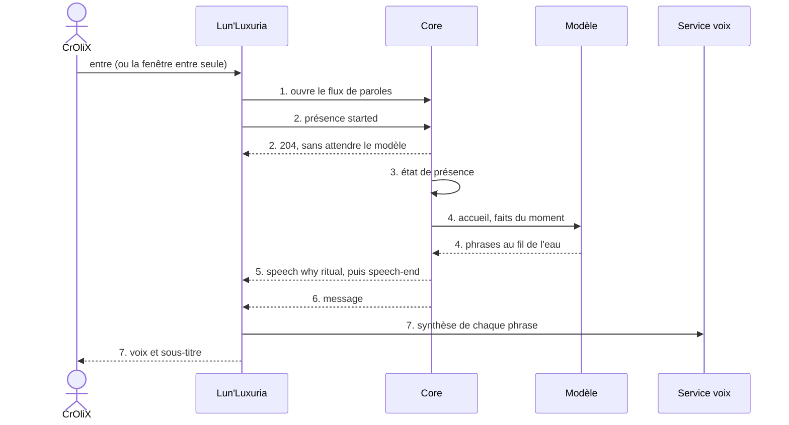

| # | De → vers | Par quoi | Ce qui circule | Retour |
|---|---|---|---|---|
| 1 | Lun'Luxuria → core | `GET /api/live` (`src/core.ts:124`) | le jeton du poste | un flux d'événements, ouvert tant que la page vit |
| 2 | Lun'Luxuria → core | `POST /api/presence` (`src/core.ts:74`, `src/session.svelte.ts:380`) | `state: started`, `busy` (toujours), `ritual` (vrai si le réglage est allumé et qu'il n'y a pas de sourdine), `muted` seulement si vrai, `silentAnnounce` seulement si le réglage « urgences dites » est coupé, `tab` (16 octets tirés au hasard au chargement de la page) | 204, sans corps |
| 3 | Core → core | état de présence | un début de présence, la date, les drapeaux, l'onglet ; une présence morte sans arrêt est close à la date de son dernier battement | un événement de niveau « journal », « CrOliX est sur son PC », hors Journal |
| 4 | Core → modèle | un tour composé, sans outil | une consigne d'accueil, et un bloc de faits (urgences et cartes en attente, 5 « neufs » au plus, le reste compté, 4 échéances à venir au plus, ou « rien de neuf ») | des phrases, avec leur émotion si le modèle en a marqué |
| 5 | Core → Lun'Luxuria | événements `speech` du flux (`src/brain.ts:3`) | `id` (celui du message de Natsume), `n` (rang), `text` (masqué des secrets, sans balisage), `why: ritual`, `emotion` si elle n'est pas neutre ; puis `speech-end` | — |
| 6 | Core → Lun'Luxuria | événement `message` du flux | l'`id` du message et le fil (`main`) | Lun'Luxuria relit le fil (`GET /api/threads/main/messages?limit=50`) |
| 7 | Lun'Luxuria → service voix | voir S8.18 | le texte de chaque phrase | un son par phrase |

- **Ce que CrOliX voit, et où** : la voix de Natsume, dans la fenêtre ; le sous-titre de chaque phrase (il s'efface
  4 s après la dernière) ; l'état « Parle ». Le message d'accueil est aussi dans le fil (panneau du core, fil de
  Lun'Luxuria si ouvert). Si le modèle ne peut pas répondre (plafond, clé), le fil porte un message en erreur et
  rien n'est dit.
- **Ce qui s'écrit** : côté core, la présence (début, dernier battement, onglets, drapeaux) ; un événement de niveau
  « journal » ; le message d'accueil dans le fil principal, avec le coût de l'appel. Côté Lun'Luxuria, rien.
- **Qui décide** : le code, si l'accueil est complet ou court (voir S8.2), et ce qui est « neuf » (plus récent que la
  dernière parole de Natsume hors routine de nuit et que la dernière activité d'un autre appareil). Le modèle, les
  mots de l'accueil. Lun'Luxuria, de le dire ou non (réglage « accueil » du corps), à deux endroits : elle ne le
  demande pas si le réglage est coupé, et jette la parole si elle arrive quand même (S8.9).
- **Erreurs et cas limites** :
  - L'arrivée échoue (réseau, core arrêté) : la page passe en « Injoignable », sans accueil.
  - Le core ne reconnaît plus le jeton (401) : Lun'Luxuria oublie le jeton et recharge sur l'arrivée, avec la raison
    (voir la famille 12).
  - Un core plus ancien refuse un champ qu'il ne connaît pas : c'est pourquoi `muted` et `silentAnnounce` ne partent
    que quand ils sont vrais (`src/brain.ts:38`).
  - Le début d'accueil échoue chez le core (exception) : il est écrit au journal d'exécution, la présence tient.
  - Plafond atteint : le tour composé laisse un message en erreur au fil ; Lun'Luxuria n'est avertie d'aucun
    échec (elle ne voit que `message`).
  - Sourdine posée : `ritual` part faux, le core ne compose rien.
  - Rien de neuf : l'accueil s'arrête aux mots d'accueil.
  - Plusieurs onglets : le départ d'un autre onglet ne coupe pas la présence du premier (identifiant d'onglet).
- **Écart avec les décisions** : l'accueil n'est pas retenu par la pause manuelle (voir S8.7) : le dictionnaire dit
  que la pause arrête toute action automatique.
- **Non vérifié** : le contenu exact des faits « neufs » côté panneau ; le comportement quand le fournisseur est lent
  (aucun délai propre lu pour l'accueil).

---

### S8.2 · Retour rapide : « Te revoilà. »

- **Déclencheur** : une arrivée de présence (`started`) alors que la présence précédente vit encore, ou s'est arrêtée il
  y a moins de 30 minutes.
- **Acteurs** : Lun'Luxuria, le core, le service voix local.
- **Avant** : comme S8.1. Le cas arrive à chaque ré-annonce : retour de l'absence, flux repris (S8.14), page rendue par
  l'historique, battement refusé (S8.3), core redémarré pendant une présence.

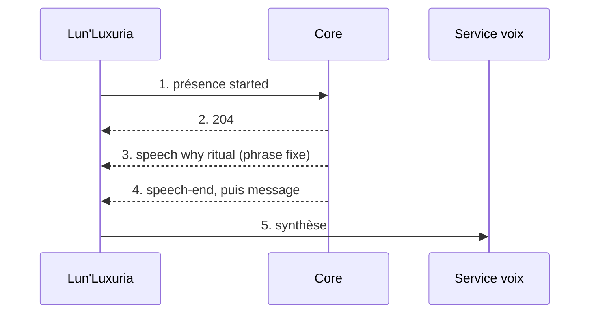

| # | De → vers | Par quoi | Ce qui circule | Retour |
|---|---|---|---|---|
| 1 | Lun'Luxuria → core | `POST /api/presence` | mêmes champs qu'en S8.1 | 204 |
| 2 | Core → core | état de présence | présence encore vivante : elle est mise à jour, aucun événement de début ; présence close depuis moins de 30 min : nouveau début | « retour rapide » vrai |
| 3 | Core → Lun'Luxuria | `speech`, `speech-end`, `message` | la phrase « Te revoilà. », `why: ritual`, enregistrée comme message de Natsume au fil, sans appel au modèle | — |

- **Ce que CrOliX voit, et où** : la phrase dite, un sous-titre, un message au fil.
- **Ce qui s'écrit** : un message de Natsume au fil principal (aucun coût). La présence est mise à jour.
- **Qui décide** : le code (30 minutes ; présence vivante = quatre-vingt-dix secondes sans battement).
- **Erreurs et cas limites** :
  - Une ré-annonce répétée (flux qui saute, page qui revient de l'historique) redit la phrase : Lun'Luxuria évite
    l'effet au retour d'onglet en envoyant un battement et non une arrivée (`src/session.svelte.ts:356`).
  - Réglage « accueil » coupé : `ritual` part faux, la phrase n'est pas composée.
  - Plafond ou pause manuelle : sans effet, la phrase est fixe et ne coûte rien.
- **Écart avec les décisions** : aucun connu. La phrase fixe est l'une des « deux réponses directes » du standard des
  notifications.
- **Non vérifié** : Rien.

---

### S8.3 · Le battement de 30 s

- **Déclencheur** : l'horloge de la page (30 s) ; un changement d'état (appel en cours, sourdine, réglage « urgences
  dites ») ; la page redevient visible.
- **Acteurs** : Lun'Luxuria, le core.
- **Avant** : entrée faite (S8.1), pas d'absence en cours.

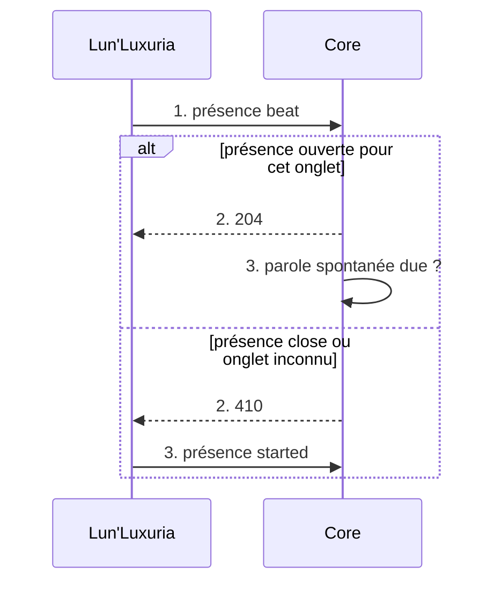

| # | De → vers | Par quoi | Ce qui circule | Retour |
|---|---|---|---|---|
| 1 | Lun'Luxuria → core | `POST /api/presence` (`src/core.ts:74`) | `state: beat`, `busy`, `muted` et `silentAnnounce` si vrais, `tab` | 204, ou 410 |
| 2 | Core → Lun'Luxuria | réponse | 204 : pris ; 410 : « pas de présence ouverte pour cet onglet » | le corps lit 410 comme `gone` |
| 3a | Core → core | état de présence | dernier battement, drapeaux de cet onglet ; un drapeau tient tant qu'un onglet vivant le porte | puis S8.8 |
| 3b | Lun'Luxuria → core | `POST /api/presence` | une arrivée (S8.1 ou S8.2), sauf si une arrivée a commencé après ce battement | 204 |

- **Ce que CrOliX voit, et où** : rien. Un battement pris efface un message « serveur injoignable » encore affiché.
- **Ce qui s'écrit** : le dernier battement et les drapeaux dans la présence du core.
- **Qui décide** : le code : le core estime la présence vivante quatre-vingt-dix secondes après le dernier battement.
  Un battement n'est jamais pris après un départ ; seule une arrivée rouvre.
- **Erreurs et cas limites** :
  - Le battement échoue (réseau) : le corps n'en fait rien (pas de changement d'état « injoignable ») ; la page ne
    passe en « Injoignable » que par le flux (S8.14) ou par une arrivée qui échoue.
  - Absente (S8.4) : aucun battement ne part.
  - Un onglet inconnu quand d'autres sont connus : 410 (c'est le battement en vol d'un onglet fermé) ; sans onglet
    connu, le battement rejoint la présence.
  - Le jeton n'est plus reconnu : 401, le jeton est oublié et la page recharge.
  - Au plus huit onglets sont gardés dans la présence, tous appareils confondus (le core ne tient qu'une présence) ; le
    plus ancien battement part.
- **Écart avec les décisions** : aucun connu.
- **Non vérifié** : Rien.

---

### S8.4 · Départ, absence et retour

- **Déclencheur** : la page est quittée (`pagehide`) ; la fenêtre se ferme ; aucune touche ni souris pendant le délai
  d'absence (15 minutes par défaut, dans la fenêtre seulement) ; le premier signe de retour.
- **Acteurs** : CrOliX, Lun'Luxuria, le core.
- **Avant** : entrée faite. Le réglage d'absence est allumé (c'est le défaut) pour l'absence.

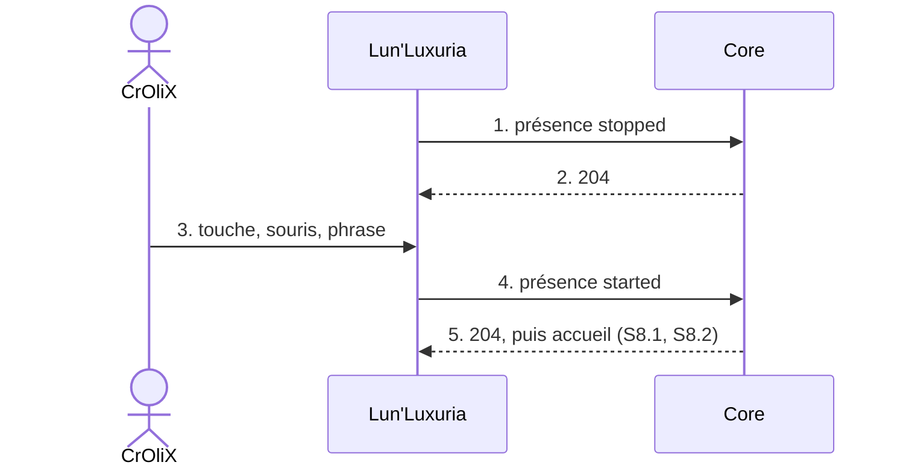

| # | De → vers | Par quoi | Ce qui circule | Retour |
|---|---|---|---|---|
| 1 | Lun'Luxuria → core | `POST /api/presence` | `state: stopped`, `tab`. Page quittée : avec `keepalive`. Fenêtre fermée : attendu 2 s au plus | 204 |
| 2 | Core → core | état de présence | l'onglet part ; la présence finit avec le dernier onglet vivant ; un événement de niveau « journal », « CrOliX a quitté son PC » | — |
| 3 | Lun'Luxuria | sondage de la fenêtre | le temps sans entrée du poste (lu par la fenêtre, toutes les 30 s, toutes les 3 s en absence), ou le temps depuis la dernière phrase entendue ou écrite, le plus court | présent ou absent |
| 4 | Lun'Luxuria → core | `POST /api/presence` | arrivée ; ses messages écrits attendent jusqu'à 3 s la réponse | 204 |

- **Ce que CrOliX voit, et où** : rien. Le corps n'arrête ni l'écoute ni la sourdine pendant l'absence.
- **Ce qui s'écrit** : la fin de présence (date, onglets) et l'événement de niveau « journal ».
- **Qui décide** : le code de la fenêtre (délai), puis celui du core. Absent, le core voit CrOliX comme absent : une
  urgence n'est pas dite, elle est seulement notifiée (S8.7).
- **Erreurs et cas limites** :
  - Le délai d'absence se règle (15 minutes par défaut) ; éteint, la présence ne s'arrête jamais par l'absence. Dans un
    onglet, la détection d'absence ne tourne pas.
  - Une durée d'inactivité illisible : CrOliX compte comme présent.
  - Absent, le corps n'essaie plus de phrase anticipée sur une pause (un fragment partirait avant le retour).
  - Arrivée lancée juste avant que l'absence commence : si elle arrive après, elle est refermée aussitôt.
  - Fermeture : si le core ne répond pas en 2 s, la fenêtre se ferme quand même.
- **Écart avec les décisions** : aucun connu.
- **Non vérifié** : le détail de la lecture de la dernière entrée côté fenêtre (appel Windows, lu dans le code Rust) ;
  le départ d'absence est-il attendu sans borne avant que la suite se joue, et l'envoi persistant (`keepalive`)
  part-il sur tout départ, pas seulement à la page quittée ?

---

### S8.5 · Un appel en cours

- **Déclencheur** : l'horloge de la page (toutes les 3 s), tant que la détection est allumée (c'est le défaut).
- **Acteurs** : Lun'Luxuria, le service voix local, le registre du système (lu par le service), le core.
- **Avant** : entrée faite. Les applis à ignorer sont réglées (OBS en défaut).

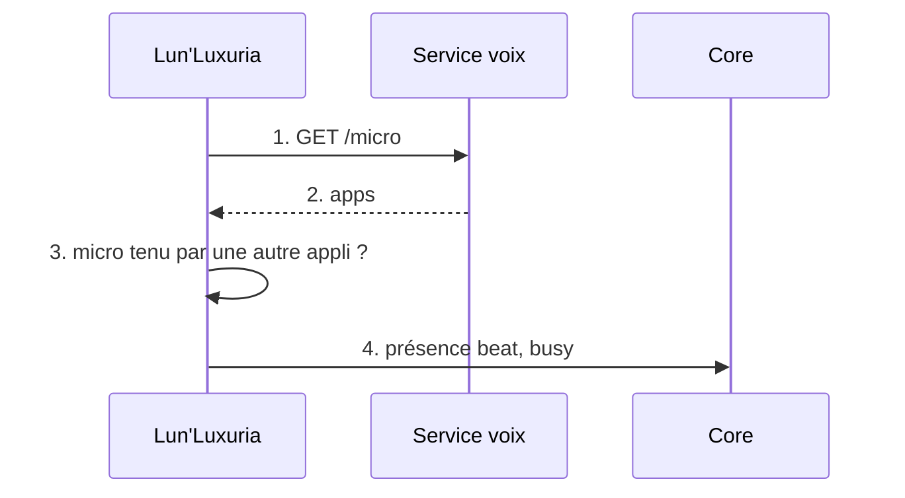

| # | De → vers | Par quoi | Ce qui circule | Retour |
|---|---|---|---|---|
| 1 | Lun'Luxuria → service voix | `GET /voix/micro` (`src/voice.ts:42`), arrêt à 3 s | rien | `apps` : les noms des programmes qui tiennent le micro |
| 2 | Lun'Luxuria | décision locale | les noms hors navigateurs, hors Lun'Luxuria, hors applis ignorées | occupé, ou libre depuis moins de 5 s : encore occupé |
| 3 | Lun'Luxuria → core | `POST /api/presence` à chaque changement | `busy` vrai ou faux : jamais le nom d'une appli | 204 |

- **Ce que CrOliX voit, et où** : l'état « Micro occupé » ; un bouton « Micro occupé, le reprendre » qui rend le micro
  à la détection ou le garde ; le micro de Lun'Luxuria est fermé tant que l'appel dure, sauf reprise.
- **Ce qui s'écrit** : le drapeau dans la présence du core (un drapeau tient tant qu'un onglet vivant le porte).
- **Qui décide** : le code du service voix (qui tient le micro, lu au registre) et le code de la page (ce qui
  compte). Le core : une urgence est écrite au fil sans voix, et sonne sur le téléphone ; la parole spontanée
  se tait ; le modèle reçoit « CrOliX est en vocal avec quelqu'un ».
- **Erreurs et cas limites** :
  - Le service ne répond pas dans les 3 s : « Le service voix ne répond plus. », une fois par panne, effacé au retour,
    et seulement si aucun autre message n'est à l'écran.
  - Service en panne = micro libre : quand `GET /voix/micro` échoue, la page lit une liste vide (`src/session.svelte.ts:526-537`,
    `:558-564`). Un appel en cours retombe à « libre » après 5 s, un battement part avec `busy: false` et le micro se
    rouvre. Le core croit alors CrOliX disponible pour une urgence dite.
  - Un service sans la détection répond 404 : il répond, la liste est vide, c'est « libre ».
  - Détection éteinte : jamais occupé.
  - Une entrée de registre laissée ouverte par un plantage compte jusqu'à 12 h ;
    un appel de plus de 12 h ne compte plus.
  - Un appel dans un onglet de navigateur ou dans une autre appli à fenêtre web du système n'est pas vu.
  - L'accueil et les réponses ne sont pas retenus par l'appel : seule l'urgence l'est (côté core).
- **Écart avec les décisions** : aucun connu.
- **Non vérifié** : la lecture du registre n'a pas été rejouée sur un poste.

---

### S8.6 · Une urgence dite à voix haute

- **Déclencheur** : un poste envoie un événement d'importance « urgent » sur son flux, au core relié.
- **Acteurs** : un poste (Lun'Acedia pour un mail ou un rappel d'agenda), le core, Lun'Luxuria, le service voix.
- **Avant** : CrOliX est présent, sans appel, hors plage de nuit ; le réglage « urgences dites » de Lun'Luxuria est
  allumé ; l'événement a moins de 5 minutes ; la sourdine et la pause n'y changent rien.

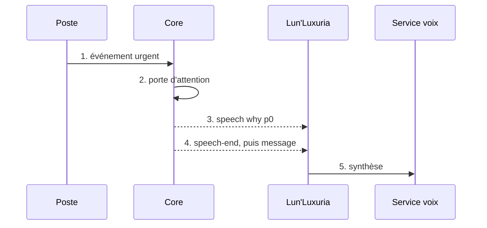

| # | De → vers | Par quoi | Ce qui circule | Retour |
|---|---|---|---|---|
| 1 | Poste → core | flux d'événements du contrat `/lun/v1` | type, importance `urgent`, titre, date | le core ne rejoue pas : un événement déjà reçu n'annonce rien |
| 2 | Core → core | la porte d'attention | présence, appel, sourdine, `silentAnnounce`, plage de nuit, pause, âge | décision « dire à voix haute », tracée |
| 3 | Core → Lun'Luxuria | `speech` | une phrase fixe, sans modèle : « Urgent : <titre>. » (titre aux blancs repliés, coupé à 80 signes, sans marque de coupe), ou « Rappel : … » pour un rappel d'agenda ; `why: p0` ; `id` du message | — |
| 4 | Core → Lun'Luxuria | `speech-end`, `message` | l'`id` du message | relecture du fil |

- **Ce que CrOliX voit, et où** : la phrase dite, sous-titrée, au fil. Pas de notification sur le téléphone quand c'est
  dit à voix haute. La phrase passe devant ce qui attend, après la phrase qui sonne.
- **Ce qui s'écrit** : un message de Natsume au fil, créé comme message de routine (il revient au modèle comme donnée) ;
  la trace de la porte ; la ligne du Journal de l'événement.
- **Qui décide** : le code, sans modèle (la porte). Lun'Luxuria seule décide de dire (S8.9). Elle ne rend aucun
  accusé : le core tient l'urgence pour dite. Si CrOliX la coupe, la coupure part comme pour toute parole (S8.11).
- **Erreurs et cas limites** :
  - La porte tombe en panne : l'urgence est écrite au fil et n'est pas dite, ni notifiée.
  - Voix en panne : sous-titre sans voix (S8.18). Le core l'ignore.
  - Flux coupé à cet instant : la parole est perdue (S8.14).
  - Un événement rejoué à la reconnexion d'un poste : aucune annonce.
- **Écart avec les décisions** : T4 (le core ne sait pas ce que Lun'Luxuria a dit) ; T11 (qui peut parler : deux
  endroits).
- **Non vérifié** : la ligne du Journal exacte écrite pour l'événement (famille 4).

---

### S8.7 · Une urgence qui n'est pas dite

- **Déclencheur** : le même événement qu'en S8.6, dans un autre état de CrOliX ou de Lun'Luxuria.
- **Acteurs** : le core, Lun'Luxuria, le téléphone de CrOliX.
- **Avant** : un événement « urgent » reçu.

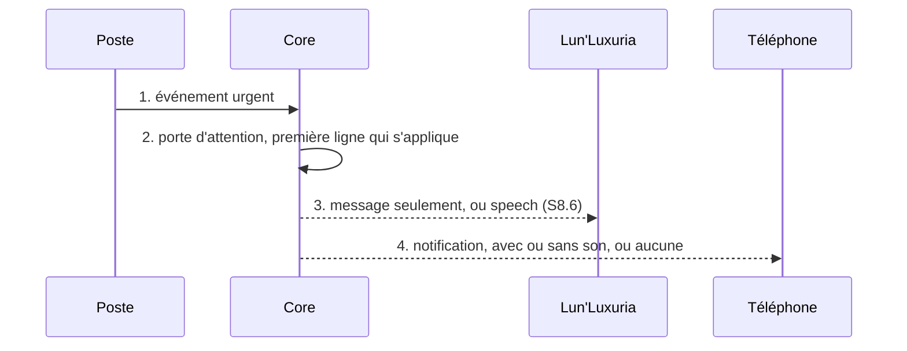

| # | De → vers | Par quoi | Ce qui circule | Retour |
|---|---|---|---|---|
| 1 | Poste → core | flux d'événements du contrat `/lun/v1` | comme S8.6 | — |
| 2 | Core → core | la porte d'attention | l'état de CrOliX et de Lun'Luxuria : la table ci-dessous | une décision « dire », « écrire » ou rien, et « notifier » avec ou sans son |
| 3 | Core → Lun'Luxuria | `message`, ou `speech` | l'`id` du message ; une phrase fixe si elle est dite | relecture du fil |
| 4 | Core → téléphone | notification | titre, importance (voir la famille 10) | — |

La porte retient la première ligne qui s'applique, dans cet ordre :

| Si | Ce que le core fait | Ce que Lun'Luxuria reçoit |
|---|---|---|
| plage de nuit (allumée par défaut, de 23 h à 7 h, heure de Paris, réglable) | écrit au fil sans le dire, notifie sans son | seulement un `message` |
| CrOliX absent (S8.4) | ne l'écrit pas, notifie avec son | rien |
| appel en cours (S8.5) | écrit au fil sans le dire, notifie avec son | seulement un `message` |
| réglage « urgences dites » coupé (`silentAnnounce`) | écrit au fil sans le dire, notifie avec son | seulement un `message` |
| événement vieux de 5 minutes ou plus | écrit au fil sans le dire, sans notification | seulement un `message` |
| sinon | le dit à voix haute (S8.6) | `speech` |

À ces lignes s'ajoutent :

- Le réglage « alertes urgentes en direct » du poste source, coupé : la notification n'est pas envoyée, le reste
  s'applique.
- La pause laisse passer l'urgence : les autres paliers sont retenus.
- Une carte urgente n'est ni dite ni écrite : elle sonne sur le téléphone, sans son la nuit.
- La sourdine n'a aucun effet sur une urgence.

- **Ce que CrOliX voit, et où** : au fil, un message sans voix ; au téléphone, une notification (voir la famille 4 et la
  famille 10 pour la file des notifications).
- **Ce qui s'écrit** : le message au fil (sauf absent), la trace de la porte.
- **Qui décide** : le code, sans modèle. CrOliX pose lui-même la plage de nuit, la pause, la sourdine et le réglage.
- **Erreurs et cas limites** :
  - Le réglage « urgences dites » est envoyé au core par un battement tout de suite quand il change, pour que le
    core ne perde pas la notification (`src/session.svelte.ts:224`).
  - Un battement perdu : le core garde l'ancien drapeau jusqu'au battement suivant.
  - La porte qui tombe en panne : l'urgence est écrite au fil, ni dite ni notifiée.
- **Écart avec les décisions** : aucun connu. Le dictionnaire dit que l'urgence « se dit malgré la sourdine » : c'est
  vrai du code (S8.10). Le standard des notifications place la plage de nuit avant la présence : c'est l'ordre du code.
- **Non vérifié** : Rien.

---

### S8.8 · La parole spontanée

- **Déclencheur** : un battement pris (S8.3).
- **Acteurs** : Lun'Luxuria, le core, le modèle, le service voix.
- **Avant** : le réglage de parole spontanée du core est allumé (**éteint par défaut**), CrOliX est présent, pas en
  appel, pas en sourdine.

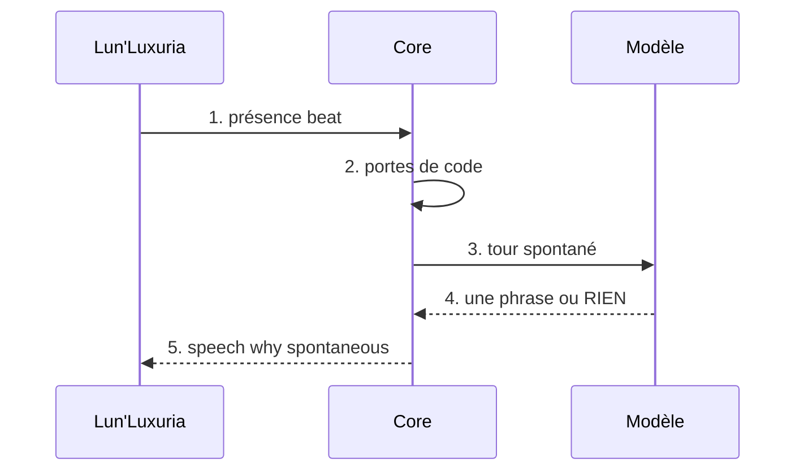

| # | De → vers | Par quoi | Ce qui circule | Retour |
|---|---|---|---|---|
| 1 | Lun'Luxuria → core | battement | `busy`, `muted` | 204 |
| 2 | Core → core | portes de code | présent, pas en appel, pas muet ; moins de 3 essais ce jour (défaut) ; moins de 2 paroles restées sans réponse ; aucun message en attente ; silence d'au moins 20 minutes (défaut) depuis le début de présence, le dernier message et la dernière tentative | tentative comptée avant l'appel |
| 3 | Core → modèle | tour composé, une réponse permise « rien » | une consigne : une remarque à elle, une ou deux phrases, ou RIEN | la réponse entière |
| 4 | Core → Lun'Luxuria | `speech`, `speech-end`, `message` | les phrases avec leur émotion, `why: spontaneous` | — |

- **Ce que CrOliX voit, et où** : une phrase dite et sous-titrée, un message au fil. Si le modèle répond RIEN, rien.
- **Ce qui s'écrit** : le compteur du jour et l'heure de la tentative ; le compteur « sans réponse », qui monte quand
  une parole est composée (dite ou jetée) et retombe quand CrOliX écrit ou parle ;
  le message au fil (une réponse « RIEN » laisse un message vide) ; le coût de l'appel.
- **Qui décide** : le code ouvre les portes, sans modèle ; le modèle choisit de parler ou de se taire. Lun'Luxuria
  décide de dire (réglage « parole spontanée », allumé par défaut).
- **Erreurs et cas limites** :
  - Réglage « parole spontanée » de Lun'Luxuria coupé : le core compose quand même (coût, compteur, « sans réponse »
    qui monte), la parole est jetée. Le core ne l'apprend pas.
  - Plafond atteint ou modèle en échec : un message vide, une ligne au journal d'exécution ; rien n'est dit.
  - Plage de nuit : aucune porte ne la lit pour la parole spontanée.
  - Pause manuelle : aucune porte ne la lit non plus ; seul un plafond atteint arrête l'appel.
  - Le tour d'une réponse en cours (`pending`) retient la tentative.
- **Écart avec les décisions** : le standard dit que la parole spontanée ne passe pas encore par la porte : c'est le
  code. Le dictionnaire dit que la pause arrête toute action automatique : la parole spontanée n'est pas arrêtée par
  la pause manuelle.
- **Non vérifié** : la limite exacte du « jour » du compteur (jour de Natsume) ; le message vide d'une réponse « RIEN »
  est-il publié aux écrans (événement `message`) malgré tout, même s'il n'est jamais dit ?

---

### S8.9 · Ce que Lun'Luxuria dit ou jette

- **Déclencheur** : un événement `speech` ou `speech-end` du flux.
- **Acteurs** : Lun'Luxuria seule.
- **Avant** : le flux est ouvert.

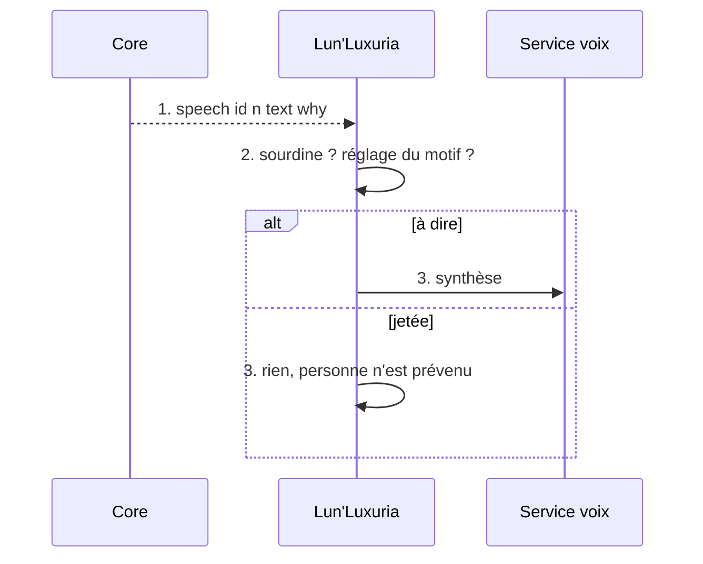

| # | De → vers | Par quoi | Ce qui circule | Retour |
|---|---|---|---|---|
| 1 | Core → Lun'Luxuria | événement `speech` | `id`, `n`, `text`, `why` (`reply`, `ritual`, `p0` ou `spontaneous`), `emotion` éventuelle | — |
| 2 | Lun'Luxuria | `src/conversation.ts:165` | la sourdine du moment, le réglage du motif | dire ou jeter |
| 3 | Lun'Luxuria → service voix | voir S8.18 | le texte | un son |

Les règles, dans l'ordre :

1. Un `speech` dont l'`id` est celui d'une phrase envoyée à l'instant ferme son délai d'attente (« la première phrase
   de la réponse »).
2. Sourdine posée et motif autre que `p0` : la parole est jetée. Elle ne laisse rien à reprendre.
3. Motif autre que `reply` et réglage de ce motif coupé (`ritual`, `p0`, `spontaneous`) : jetée. Un motif inconnu n'a
   pas de réglage, il est jeté.
4. Sinon, la phrase entre dans la file de la voix. `p0` passe devant les tours qui attendent, après les urgences déjà
   là et après la phrase qui sonne.

`speech-end` ferme toujours le tour, même pour une parole jetée.

- **Ce que CrOliX voit, et où** : une phrase dite, ou rien. Une parole jetée n'est pas sous-titrée. Le fil, lui,
  garde le message écrit.
- **Ce qui s'écrit** : rien (la trace en mémoire de Lun'Luxuria garde le motif, le rang et la longueur).
- **Qui décide** : le code de Lun'Luxuria, sur ses réglages « accueil », « urgences » et « parole spontanée »
  (tous allumés par défaut) et sur la sourdine. Le core connaît deux de ces réglages (S8.1, S8.7), pas le troisième.
- **Erreurs et cas limites** :
  - Une parole jetée n'est signalée à personne : le core la tient pour dite.
  - Une parole d'un motif inconnu d'un core plus récent est jetée.
  - Les événements `card` et `queue` du même flux sont reçus et ignorés ; `message` fait relire le fil.
  - Les mots d'un tour terminé sont ignorés, et un numéro de réponse ne sert qu'une fois.
- **Écart avec les décisions** : T4, T11, T25 (rien ne part quand Lun'Luxuria est sourde ou sans voix). La carte du
  27/11 écrit que le réglage par motif est inconnu du core : c'est vrai de « parole spontanée », faux de « accueil »
  et « urgences » (S8.1, S8.7).
- **Non vérifié** : Rien.

---

### S8.10 · La sourdine

- **Déclencheur** : CrOliX bascule la sourdine (bouton, icône de la barre, raccourci `Ctrl+Maj+M` par défaut), ou
  Lun'Luxuria démarre avec une sourdine gardée (elle ne se lève jamais seule).
- **Acteurs** : CrOliX, Lun'Luxuria, le core.
- **Avant** : entrée faite.

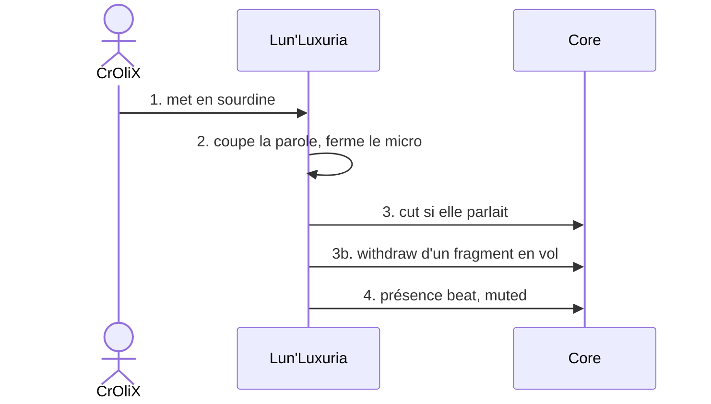

| # | De → vers | Par quoi | Ce qui circule | Retour |
|---|---|---|---|---|
| 1 | CrOliX → Lun'Luxuria | bouton, barre, raccourci | — | état « En sourdine » |
| 2 | Lun'Luxuria | `src/session.svelte.ts:699` | elle coupe la voix en cours, retire la phrase en cours d'écoute, éteint « réfléchit », ferme le micro | — |
| 3 | Lun'Luxuria → core | `POST /api/threads/main/messages/<id>/cut` | `said` : ce qui a été entendu | le message coupé |
| 3b | Lun'Luxuria → core | `POST /api/threads/main/messages/<id>/withdraw` (`src/core.ts:114`, `src/conversation.ts:608-614`, `:659`) | aucun corps : l'`id` du message de CrOliX est dans la route, pour un fragment déjà envoyé | son message est vidé, la réponse coupée à vide, les gestes lâchés |
| 4 | Lun'Luxuria → core | `POST /api/presence` | `muted: true` (à chaque arrivée et battement tant qu'elle dure) ; `ritual: false` à l'arrivée | 204 |

- **Ce que CrOliX voit, et où** : l'état « En sourdine », l'icône de la barre.
- **Ce qui s'écrit** : le choix est gardé dans le navigateur de la page (il survit à un relancement). Côté core, le
  drapeau dans la présence.
- **Qui décide** : CrOliX, seul. Rien ne la lève, ni un appel, ni un retour d'absence.
- **Ce que la sourdine coupe, côté corps** : le micro ; la touche tenue ; la voix en cours et les paroles reçues
  ensuite, sauf `p0` ; les phrases écrites depuis la fenêtre (elles ne partent pas) ; une transcription en cours (son
  texte ne part pas) ; une phrase prête à partir mais en attente du retour de présence ; l'accueil (il n'est pas
  demandé).
- **Ce que la sourdine coupe, côté core** : la parole spontanée (S8.8). Rien d'autre : pour le reste, le corps jette
  ce qui arrive (S8.9), y compris un accueil composé avant la sourdine.
- **Ce qu'elle ne coupe pas** : une urgence dite (S8.6), parce que la porte du core ne lit pas la sourdine pour une
  urgence et que la règle de Lun'Luxuria laisse passer `p0`.
- **Erreurs et cas limites** :
  - Une touche tenue quand la sourdine arrive est relâchée ; sous sourdine elle ne compte plus.
  - Le raccourci peut être déjà pris par une autre appli, ou doubler une autre touche : l'écran de réglages le dit.
  - Le battement qui porte `muted` part tout de suite après le basculement.
  - Lever la sourdine pendant qu'elle parle ou lit la coupe aussi (`silence()` dans les deux sens, `src/session.svelte.ts:699-710`) :
    une urgence dite sous sourdine (seule parole possible) est coupée, et `cut` part avec ce qui a été entendu
    (`src/conversation.ts:676-683`). Un battement part ensuite.
  - Poser la sourdine retire un fragment déjà envoyé au core (étape 3b) : micro fermé, écoute abandonnée.
- **Écart avec les décisions** : la carte du 27/11 (§ 1) écrit qu'« aucun signal de silence ne part » ; le code envoie
  `muted` à l'arrivée et à chaque battement (sa ligne 58 le dit aussi).
- **Non vérifié** : dans le panneau du core, que dit l'étoile de l'appareil de bureau sous sourdine, et que dit-elle
  quand un appel en cours et la sourdine sont posés ensemble (l'appel passe-t-il devant) ?

---

### S8.11 · CrOliX parle par-dessus

- **Déclencheur** : un son de CrOliX qui dure (400 ms par défaut) pendant que Lun'Luxuria parle.
- **Acteurs** : CrOliX, Lun'Luxuria, le service voix, le core.
- **Avant** : la coupure par la voix est allumée (c'est le défaut).

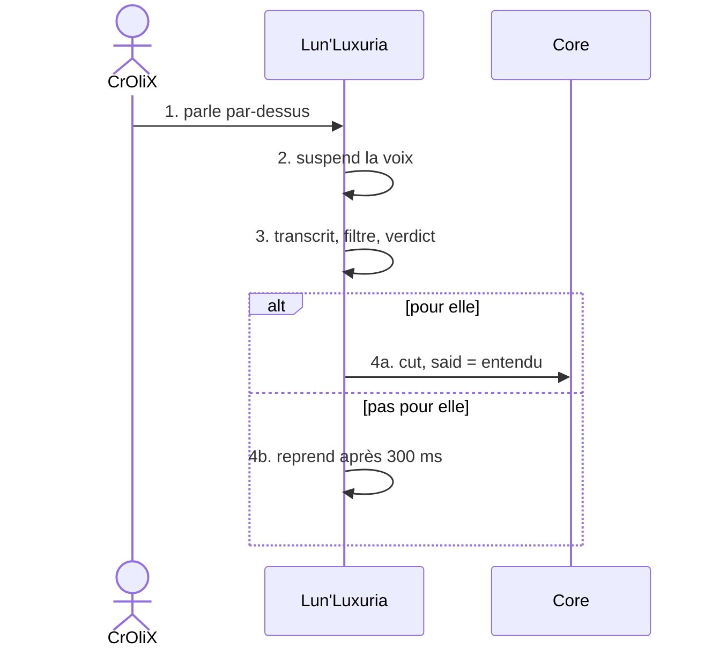

| # | De → vers | Par quoi | Ce qui circule | Retour |
|---|---|---|---|---|
| 1 | CrOliX → Lun'Luxuria | micro | un son tenu | — |
| 2 | Lun'Luxuria | `src/conversation.ts:229`, `src/speech/speaker.ts:257` | la voix s'arrête tout de suite (mode « tout de suite ») ou à la fin de la phrase (mode « doux ») ; la partie entendue est retenue par un ratio de mots | — |
| 3 | Lun'Luxuria | transcription (S8.17), filtre | le texte | le verdict : pour elle, bruit, écarté |
| 4a | Lun'Luxuria → core | `POST /api/threads/main/messages/<id>/cut` (`src/core.ts:107`) | `said` : les phrases entendues et la part de la phrase en cours ; vide si rien n'a été entendu | le message coupé |
| 4b | Lun'Luxuria | reprise de la voix | — | rien ne part vers le core |

- **Ce que CrOliX voit, et où** : sa voix coupe celle de Natsume ; le sous-titre s'efface tout de suite ; le fil
  garde ce qui a été entendu, suivi de « (coupée ici) », sauf si la réponse était finie et entendue en entier (pas de
  marque). Exception : si un poste a préparé des cartes et que seule la phrase d'avant le résultat a été entendue, le
  message reste tel quel. Si le son n'était pas pour elle, elle reprend après 300 ms
  (réglable, 1 s au plus) pourvu qu'il ne reprenne pas.
- **Ce qui s'écrit** : côté core, le texte du message de Natsume est remplacé par ce qui a été entendu, suivi de la
  marque de coupure ; rien d'entendu : le message est vidé. Un tour encore en route est arrêté (l'appel au modèle,
  la parole) et réécrit sur place ; sa fin publie `message`. Un tour fini est réécrit et publie `message` tout de
  suite. Une coupure n'émet pas de `speech-end` pour le tour arrêté. Les cartes qu'un poste a déjà préparées restent en attente dans la file.
- **Qui décide** : le code, sur le son et le filtre. Le modèle n'y est pour rien. Le core ne vérifie pas ce que dit
  `said`.
- **Erreurs et cas limites** :
  - Les autres tours en attente, sauf une urgence et la réponse à ce qu'il vient de dire, sont jetés sur place sans
    être signalés. Deux coupures peuvent partir : celle du tour suspendu, avec ce qui a été entendu, et celle d'une
    réponse retenue (CrOliX avait repris la parole avant qu'elle sonne) que sa nouvelle phrase remplace, coupée avec
    `said` vide. Le core garde le texte entier des autres.
  - Une réponse dont aucune phrase n'arrive en 60 s (« Sa réponse n'est pas venue : aucune phrase en 60 s ») est
    oubliée de la même façon : coupure à vide, sans geste de CrOliX (famille 1).
  - La coupure échoue : le message « Coupure non transmise : … » (service « serveur ») ; le core garde le texte entier.
  - Un message inconnu ou qui n'est pas de Natsume : 404, même message.
  - Une phrase de CrOliX reprise (« fragment ») : le corps la retire par `POST …/messages/<id>/withdraw` : son
    message devient vide, la réponse est coupée sans mot entendu, les gestes tenus de ce tour sont lâchés (famille 1).
  - Réglage de coupure par la voix éteint : la voix ne se suspend pas et ne se coupe pas, la réponse en attente n'est
    pas retenue, rien ne part vers le core.
- **Écart avec les décisions** : aucun connu.
- **Non vérifié** : le détail du verdict d'une phrase anticipée (famille 1).

---

### S8.12 · « Faire taire »

- **Déclencheur** : CrOliX appuie sur le bouton « Faire taire », qui n'existe que pendant que Lun'Luxuria parle ou lit.
- **Acteurs** : CrOliX, Lun'Luxuria, le core.
- **Avant** : une parole en cours (voix ou lecture sans voix).

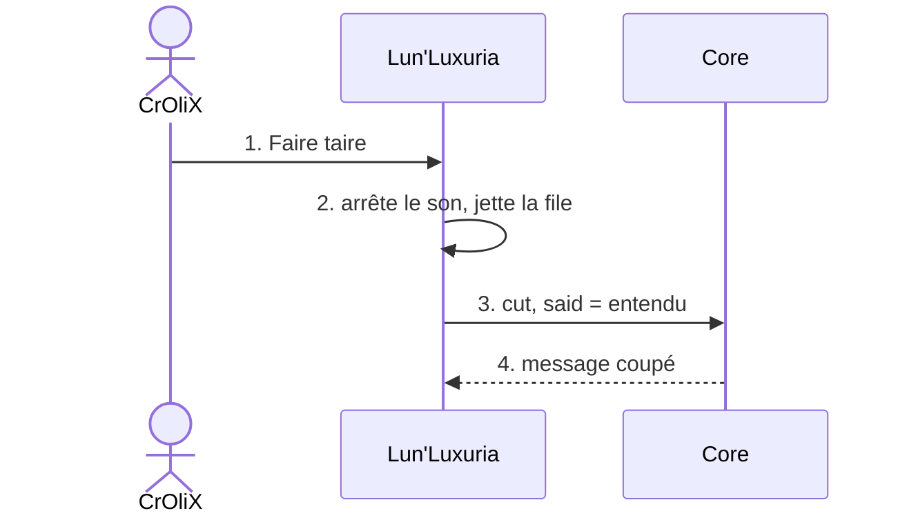

| # | De → vers | Par quoi | Ce qui circule | Retour |
|---|---|---|---|---|
| 1 | CrOliX → Lun'Luxuria | bouton (`src/session.svelte.ts:723`) | — | — |
| 2 | Lun'Luxuria | arrêt du son | tout ce qui attendait est jeté localement | l'état « Parle » s'éteint |
| 3 | Lun'Luxuria → core | `POST /api/threads/main/messages/<id>/cut` | `said` : phrases entendues et part de la phrase coupée | le message coupé |

- **Ce que CrOliX voit, et où** : le son s'arrête, le sous-titre s'efface.
- **Ce qui s'écrit** : comme S8.11 pour le tour qui sonnait.
- **Qui décide** : CrOliX.
- **Erreurs et cas limites** :
  - Seul le tour qui sonnait (ou suspendu) est coupé auprès du core. Les autres tours en file sont jetés sans
    être signalés : le core garde leur texte entier. Même effet qu'en S8.11 : un tour encore en route est arrêté, sa
    coupure n'émet pas de `speech-end`.
  - La coupure échoue : « Coupure non transmise : … ».
  - Rien n'était entendu : `said` vide, le message du core est vidé, et les gestes que ce tour tenait (le « C'est
    noté… Tu as 5 secondes ») sont annulés, comme pour un fragment retiré.
  - Silencieuse déjà (un second appui, un flux perdu) : rien n'est écrit, aucune fenêtre ne s'ouvre.
  - Quand le flux est perdu, la voix s'arrête aussi (S8.14) mais aucune coupure n'est envoyée.
- **Écart avec les décisions** : T4 (le core ne sait pas ce que Lun'Luxuria a dit).
- **Non vérifié** : Rien.

---

### S8.13 · Le micro coupé ou qui ne s'ouvre pas

- **Déclencheur** : CrOliX coupe le micro (bouton) ; le mode de parole de la disposition est « coupé » ; le système
  refuse d'ouvrir le micro.
- **Acteurs** : CrOliX, Lun'Luxuria.
- **Avant** : entrée faite.

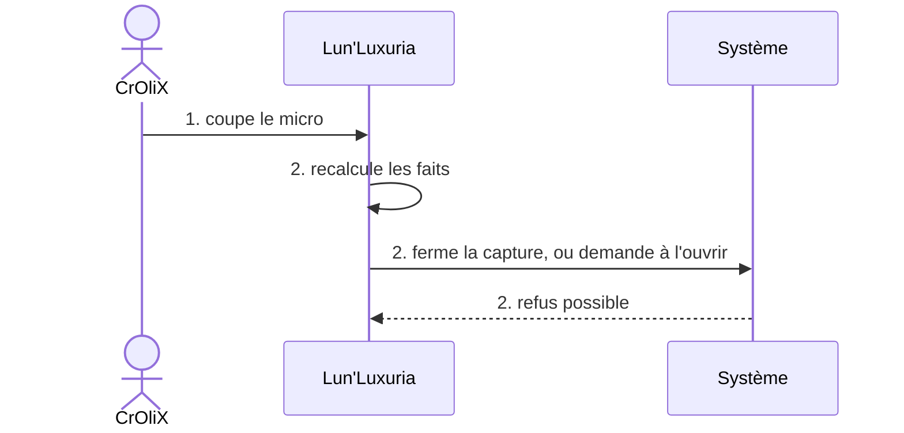

| # | De → vers | Par quoi | Ce qui circule | Retour |
|---|---|---|---|---|
| 1 | CrOliX → Lun'Luxuria | bouton « Couper le micro » (`src/session.svelte.ts:692`) | — | état « Micro coupé » |
| 2 | Lun'Luxuria | suit les faits (`src/session.svelte.ts:582`) | le micro est ouvert seulement si : micro allumé, pas de sourdine, mode de la disposition autre que « coupé », pas d'appel (ou reprise) | capture ouverte ou fermée |

- **Ce que CrOliX voit, et où** : l'état « Micro coupé » ; si le système refuse l'ouverture : « Le micro n'a pas pu
  s'ouvrir : … » à l'écran.
- **Ce qui s'écrit** : le choix (allumé ou coupé) dans le navigateur de la page. Rien chez le core.
- **Qui décide** : CrOliX et le système. Un micro coupé ne se rallume jamais seul.
- **Erreurs et cas limites** :
  - Le micro coupé ne part pas vers le core : aucun drapeau n'existe pour lui. Le core voit toujours CrOliX présent.
  - Elle continue de parler : réponses, accueil, urgence, parole spontanée arrivent et sont dites.
  - L'écriture depuis la fenêtre marche.
  - Phrase en cours d'écoute au moment de la coupure : l'écoute est abandonnée ; un fragment déjà envoyé au core est
    retiré (`withdraw`), le reste ne part jamais.
  - Le modèle de détection de voix ne se charge pas, ou échoue en route : le niveau sonore le remplace,
    et l'écran le dit.
  - Mode « touche » : le micro est ouvert, mais seule la touche tenue fait entendre.
- **Écart avec les décisions** : T25 (rien ne part quand Lun'Luxuria est sourde).
- **Non vérifié** : Rien.

---

### S8.14 · Le flux coupé, puis repris

- **Déclencheur** : le flux `GET /api/live` se termine ou échoue (réseau, core arrêté ou redémarré).
- **Acteurs** : Lun'Luxuria, le core.
- **Avant** : entrée faite.

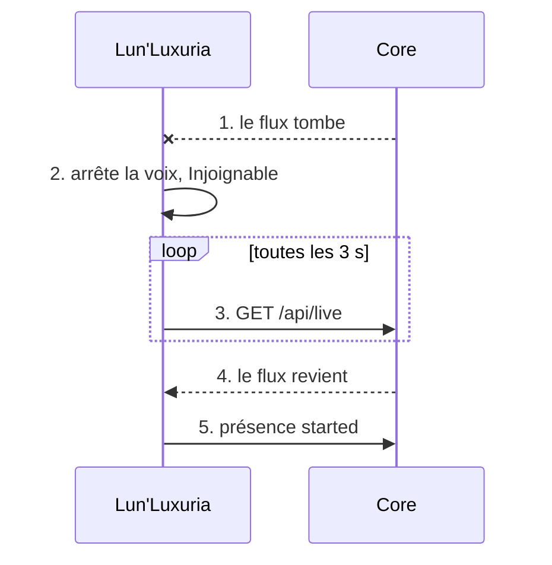

| # | De → vers | Par quoi | Ce qui circule | Retour |
|---|---|---|---|---|
| 1 | Core → Lun'Luxuria | flux | — | fin ou erreur |
| 2 | Lun'Luxuria | `src/session.svelte.ts:331` | la voix en cours s'arrête, « réfléchit » s'éteint, l'état devient « Injoignable » | — |
| 3 | Lun'Luxuria → core | `GET /api/live` (`src/core.ts:124`), après 3 s | le jeton | un flux ou une erreur |
| 4 | Core → Lun'Luxuria | flux | — | l'état « Injoignable » s'efface |
| 5 | Lun'Luxuria → core | `POST /api/presence` | arrivée, comme S8.1 | « Te revoilà. » si l'accueil est allumé (S8.2) et que la présence vivait encore ou s'est close il y a moins de 30 min ; après une coupure plus longue sans battement pris, l'accueil complet (S8.1) |

- **Ce que CrOliX voit, et où** : l'état « Injoignable » (le pire fait l'emporte sur tous les autres), l'icône de la
  barre, la voix qui se tait ; au retour, la phrase « Te revoilà. » ou l'accueil complet.
- **Ce qui s'écrit** : rien côté Lun'Luxuria. Côté core : l'arrivée du retour met la présence à jour.
- **Qui décide** : le code, sans délai maximal : la reprise boucle sans fin.
- **Erreurs et cas limites** :
  - Le jeton n'est plus reconnu (401 sur le flux) : la boucle s'arrête, le jeton est oublié, la page recharge.
  - Le core ne rejoue rien : ce qu'il publie pendant le trou est perdu pour Lun'Luxuria (une urgence « dite » reste
    écrite au fil, jamais prononcée). Aucun numéro d'événement n'est demandé à la reprise.
  - Le fil n'est pas relu à la reprise : il l'est au prochain événement `message` ou à la prochaine phrase écrite.
  - Les battements continuent : un battement pris efface « serveur injoignable », mais l'état reste « Injoignable »
    jusqu'au retour du flux.
  - La voix en cours à la perte n'est pas coupée auprès du core.
  - Une réponse dont `done` a été vue se dit par le flux même si le flux de son envoi casse (famille 1, 11).
- **Écart avec les décisions** : T4. Famille 11 pour les pannes en général.
- **Non vérifié** : Rien.

---

### S8.15 · « Annule » dit à la voix

- **Déclencheur** : CrOliX dit « annule » (ou une de ses variantes) à la voix, quand un geste sur une carte est tenu
  (les 5 secondes qui suivent un « oui » ou un « non »).
- **Acteurs** : CrOliX, Lun'Luxuria, le core. Pas de modèle, pas de coût.
- **Avant** : une carte tranchée à voix ou au fil, geste encore tenu ; le filtre de parole laisse passer la phrase
  (la fenêtre de 15 s après que Natsume a parlé s'ouvre avec « Tu as 5 secondes pour dire annule. »).

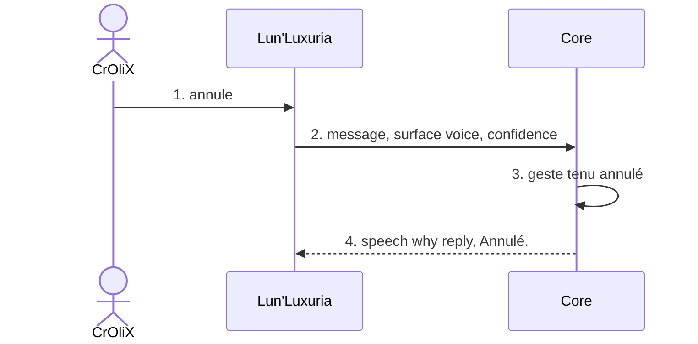

| # | De → vers | Par quoi | Ce qui circule | Retour |
|---|---|---|---|---|
| 1 | CrOliX → Lun'Luxuria | micro, transcription (S8.17) | le texte et la confiance | — |
| 2 | Lun'Luxuria → core | `POST /api/threads/main/messages` (`src/core.ts:93`) | `text`, `surface: voice`, `confidence`, `speak: true` | flux `user`, `reply`, `delta`, `done` |
| 3 | Core → core | à la réception, avant la file du fil | si le texte, ôté de la ponctuation et des accents, est l'un de neuf mots (« annule », « annule ça », « non annule la », « annule tout »…) : le dernier geste tenu est annulé (tous pour « annule tout ») | « Annulé. », ou « Trop tard, c'est parti. » si un geste est parti depuis moins de 30 s, ou rien |
| 4 | Core → Lun'Luxuria | `speech`, `speech-end` | la phrase fixe, `why: reply` | dite |

- **Ce que CrOliX voit, et où** : « Annulé. » dit et au fil.
- **Ce qui s'écrit** : un geste passe à l'état annulé ; le message de CrOliX et la réponse fixe au fil. Aucun appel
  au modèle, aucun coût.
- **Qui décide** : du code, sur le texte seul. Aucune confiance minimale n'est exigée pour « annule » (au contraire du
  « oui » : S8.16).
- **Erreurs et cas limites** :
  - Aucun geste tenu ni parti : la phrase suit le chemin normal, le modèle répond.
  - Seule une phrase faite exactement de l'un de ces mots compte : « annule le rendez-vous » va au modèle.
  - Une carte qui envoie un mail dont les 5 s sont écoulées : « Trop tard, c'est parti. »
  - Le texte est lu aussi sur un message écrit au fil : le même mécanisme (la voix n'est pas requise).
- **Écart avec les décisions** : T2 : « C'est noté » est dit au moment où le geste est tenu, avant son effet ; c'est
  ce « Tu as 5 secondes » qui rend l'annulation possible.
- **Non vérifié** : le relais du geste au poste après les 5 secondes (famille 3) ; dans le panneau du core, la carte
  redevient-elle en attente à l'annulation (seul l'événement `card` annulé est émis, l'affichage n'est pas lu) ?

---

### S8.16 · Un « oui » ou un « non » dit à la voix

- **Déclencheur** : CrOliX dit « oui », « non », « envoie », « valide », « refuse »… au sujet d'une carte.
- **Acteurs** : CrOliX, Lun'Luxuria, le core, le modèle.
- **Avant** : une carte attend ; une carte vient d'être montrée, ou elle est nommée dans la phrase.

Cette fiche ne décrit que ce que **la voix** ajoute au geste, qui est décrit en famille 3.

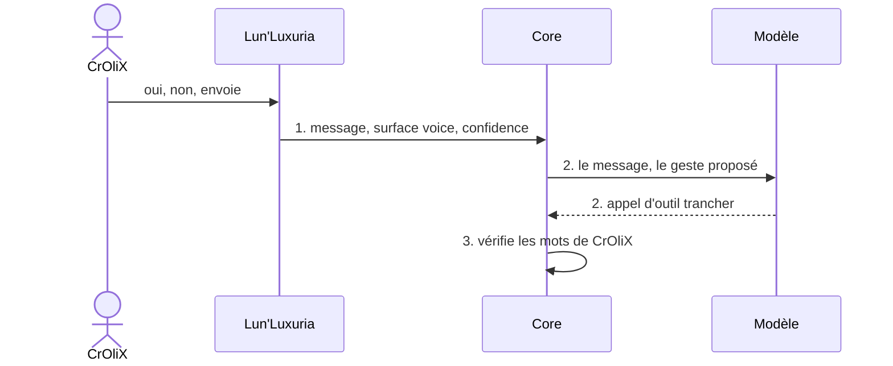

| # | De → vers | Par quoi | Ce qui circule | Retour |
|---|---|---|---|---|
| 1 | Lun'Luxuria → core | `POST /api/threads/main/messages` | `text` (la transcription), `surface: voice`, `confidence` (0 à 1, la lecture du service de transcription), `speak: true`. **Aucun identifiant de carte** | flux de la réponse |
| 2 | Core → modèle | le geste n'est proposé au modèle que si la phrase contient un mot de geste ou un choix d'une carte en attente | le message | un appel d'outil « trancher » ou une réponse |
| 3 | Core → core | vérification en code des mots de CrOliX | le message, la confiance, la carte | geste tenu 5 s, ou une phrase fixe de refus |

- **Ce que CrOliX voit, et où** : une phrase fixe dite : « C'est noté : <carte>. Tu as 5 secondes pour dire annule. »,
  ou « Refusée : … », ou une phrase qui dit pourquoi rien n'est tranché.
- **Ce qui s'écrit** : un geste tenu, origine « voix » ; une ligne « Geste ignoré » au Journal si rien n'est tranché.
- **Qui décide** : le modèle choisit d'appeler l'outil ; le code seul décide si les mots de CrOliX valent le geste.
- **Erreurs et cas limites** :
  - Une voix sans confiance lue, ou une confiance sous 0,7 : le geste est ignoré.
  - Plus de 12 mots, un point d'interrogation (ou un point-virgule), une négation, un mot d'avant autre que « je »,
    « j' », « alors », « bon », « allez » (« tu peux » est admis devant, sauf sur une carte qui envoie) : ignoré.
  - Une carte qui envoie veut le mot « envoie » et doit être la carte dont on parle ; un « oui » seul n'envoie pas.
  - Le filtre de parole de Lun'Luxuria peut écarter la phrase avant tout (famille 1).
  - Le banc des gestes (`npm run gestes`) rejoue ce que la page envoie, sans juger.
- **Écart avec les décisions** : la direction « prérequis » (retenue, non validée) n'est pas codée. Seul « annule »
  est reconnu sans modèle (S8.15).
- **Non vérifié** : la suite du geste (les 5 secondes, le relais au poste : famille 3) ; la confiance réellement rendue
  par chaque transcription n'est pas mesurée ici.

---

### S8.17 · La transcription

- **Déclencheur** : une phrase de CrOliX finit (ou une pause, pour une phrase anticipée).
- **Acteurs** : Lun'Luxuria, le service voix local, (si choisi) un whisper-server sur ce poste.
- **Avant** : le service voix répond sur la boucle locale ; le son ne quitte jamais le poste.

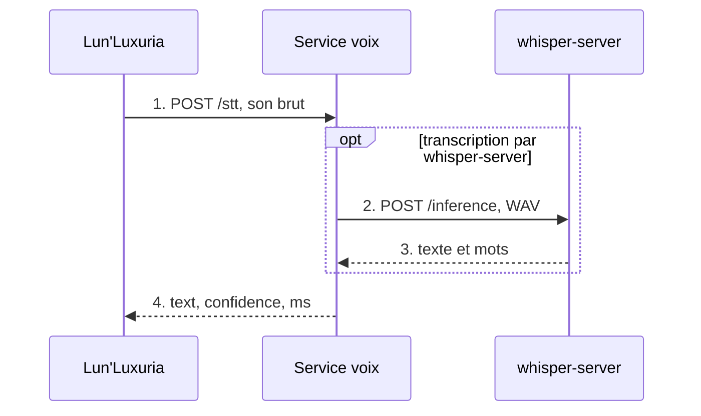

| # | De → vers | Par quoi | Ce qui circule | Retour |
|---|---|---|---|---|
| 1 | Lun'Luxuria → service voix | `POST /voix/stt` (`src/voice.ts:14`) | le son brut, 16 kHz, flottants 32 bits | `text`, `confidence`, `ms` |
| 2 | Service voix → whisper-server | `POST <adresse>/inference` (`voix/service.py:59`) | un WAV, la langue, le format verbeux | le texte et la probabilité de chaque mot |
| 4 | Service voix → Lun'Luxuria | réponse | `text` ; `confidence` : le modèle local donne l'exponentielle de la moyenne des log-probabilités, whisper-server la moyenne géométrique des probabilités des mots ; `ms` | — |

- **Ce que CrOliX voit, et où** : rien tant que ça va ; sur la scène, « Filtré : … » quand sa phrase est écartée ; en
  cas d'échec, une alerte et, si le service est en panne, le bandeau de la voix (S8.19).
- **Ce qui s'écrit** : rien. Le texte n'est écrit dans le déroulé en mémoire que s'il est pour elle.
- **Qui décide** : le service (le texte). Lun'Luxuria décide ensuite du verdict (filtre, famille 1).
- **Erreurs et cas limites** :
  - Le service ne répond pas : « le service voix ne répond pas ». Une origine refusée : 403, et la page lit
    « transcription refusée (403) ». Une panne interne : le service répond 500, la page lit « transcription
    refusée (500) » (le message du service n'est pas repris).
  - Délai de 20 s : la requête est coupée, la phrase échoue (« aucun texte en 20 s »).
  - Une phrase qui échoue : « Ta phrase n'a pas pu être transcrite : … » (service « voix ») ; si la phrase était finie,
    le « réfléchit » s'éteint. Rien n'est envoyé au core.
  - Sourdine posée pendant la transcription : le texte est jeté.
  - Le service traite un son à la fois (verrou) ; un second attend.
  - whisper-server éteint : `/etat` le dit, la transcription échoue.
- **Écart avec les décisions** : T25.
- **Non vérifié** : la qualité de la confiance rendue (mesure hors de cette famille).

---

### S8.18 · La synthèse et la conversion de voix

- **Déclencheur** : une phrase à dire entre dans la file de la voix (S8.9).
- **Acteurs** : Lun'Luxuria, le service voix, (si allumé) RVC sur ce poste.
- **Avant** : le service a une voix (Piper ou autre) ; RVC est facultatif (éteint par défaut).

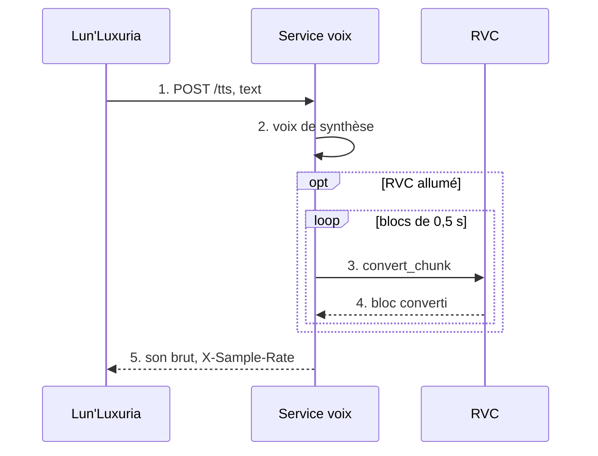

| # | De → vers | Par quoi | Ce qui circule | Retour |
|---|---|---|---|---|
| 1 | Lun'Luxuria → service voix | `POST /voix/tts` (`src/voice.ts:29`) | `{ text }`, une phrase à la fois | le son : flottants 32 bits, `X-Sample-Rate` (22 050 si absent), `X-Ms` |
| 3 | Service voix → RVC | `POST <adresse>/api/voice-changer/convert_chunk` (`voix/service.py:104`) | 50 ms de silence puis le son à 48 kHz, en blocs de 24 000 échantillons, un appel à la fois | un bloc converti ; le tout est rendu × gain (2 par défaut), borné à ±1 |

- **Ce que CrOliX voit, et où** : la voix ; le sous-titre naît au début réel de la phrase ; l'état « Parle ».
- **Ce qui s'écrit** : rien. Le déroulé en mémoire note le début, la fin et l'échec de chaque synthèse.
- **Qui décide** : le code. Les phrases se fabriquent l'une après l'autre, dans l'ordre où elles arrivent, tous tours
  confondus, sans attendre leur lecture : un tour retenu ou en file est fabriqué d'avance. Seul un tour jeté avant que
  sa phrase soit prise n'est pas fabriqué.
- **Erreurs et cas limites** :
  - Plus de 5 s sans son : la phrase est abandonnée, elle s'affiche sans voix pendant le temps de la lire (1,5 s au
    moins, 60 ms par signe), puis la suite continue. Message : « Sa voix n'a pas pu dire une phrase : … » (service
    « voix »). Le core n'en sait rien.
  - Le service répond 503 quand il n'a pas de voix (« aucune synthèse ») ;
    500 sur une panne ; une origine refusée : 403.
  - RVC éteint ou en erreur : la phrase échoue (le service répond 500).
  - Le service termine une synthèse commencée même abandonnée.
  - Une urgence attend les phrases déjà en cours de fabrication.
  - Un tour jeté avant que sa phrase soit prise n'est jamais fabriqué.
- **Écart avec les décisions** : T22 pour l'émotion (S8.20) ; T25.
- **Non vérifié** : les temps réels mesurés (faits sur le poste, hors de cette lecture).

---

### S8.19 · Démarrer et surveiller le service voix

- **Déclencheur** : le démarrage de la fenêtre ; un clic dans les réglages de la voix ; un sondage toutes les 3 s.
- **Acteurs** : la fenêtre (le côté qui lance les programmes), le service voix, whisper-server et RVC si choisis.
- **Avant** : dans un onglet, la page ne lance rien : elle demande seulement.

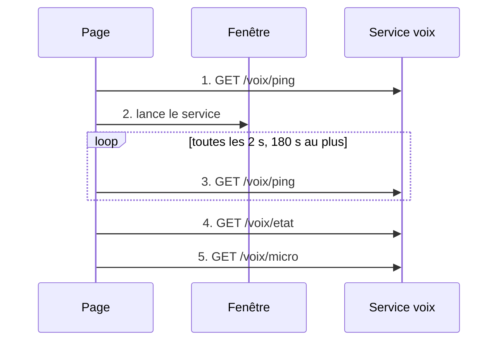

| # | De → vers | Par quoi | Ce qui circule | Retour |
|---|---|---|---|---|
| 1 | Page → service voix | `GET /voix/ping` (`src/desktop/voix.ts:507`), arrêt à 1,5 s | rien | `ok`, ou rien : à l'arrêt |
| 2 | Page → fenêtre | commande de lancement du service (`voice_start`) | les arguments seuls (transcription, voix, RVC, gain) ; le dossier est celui que la fenêtre garde | le chemin d'un journal |
| 3 | Page → service voix | `GET /voix/ping` toutes les 2 s, 180 s au plus | — | le premier « répond », ou « s'est arrêté au démarrage » (avec le journal), ou, après 180 s, « Le service voix ne répond toujours pas. Journal : … » |
| 4 | Page → service voix | `GET /voix/etat` (`src/desktop/voix.ts:58`), arrêt à 3 s | — | l'état de la transcription et de RVC : répondent ou non |
| 5 | Page → service voix | `GET /voix/micro` toutes les 3 s (détection allumée, ou tant qu'un message dit le service en panne) | — | S8.5, aussi preuve que le service répond |

- **Ce que CrOliX voit, et où** : sur la scène et dans les réglages : « Voix en démarrage : les modèles se chargent. »,
  « Le service voix répond. », ou la raison de l'échec avec le chemin du journal ; un bouton « Régler la voix ».
- **Ce qui s'écrit** : les choix de la personne (dossier, programme, arguments confirmés) sont gardés par la fenêtre,
  jamais par la page. Un journal du service est écrit sur le poste.
- **Qui décide** : CrOliX (lancement avec l'appli, arguments confirmés dans une boîte du système) ; la fenêtre
  refuse ce qui sort de ses bornes (cinq drapeaux, adresses locales, une voix `.onnx` de ce poste).
- **Erreurs et cas limites** :
  - Lancement avec l'appli coupé et rien ne répond : « Le service voix ne répond pas. Lance-le, ou active … ».
  - Dossier, fichier de voix ou adresse manquants : le manque est dit, rien n'est lancé.
  - Les arguments d'un programme jamais confirmés : il reste éteint, « à confirmer ».
  - Une seule action sur le service à la fois ; une deuxième n'est pas lancée.
  - Le service ne répond plus en route : « Le service voix ne répond plus. » (S8.5), une fois par panne.
  - Un changement de réglages d'un service lancé par la fenêtre : « à relancer » ; démarré à la main : « à changer à la
    main ».
  - Le service n'écoute que sur la boucle locale ; une autre origine ou un autre nom d'hôte reçoit 403.
- **Écart avec les décisions** : aucun connu.
- **Non vérifié** : le détail Rust du lancement (une seule lecture de la limite des arguments).

---

### S8.20 · L'émotion par phrase

- **Déclencheur** : le modèle du core marque une émotion avant une phrase d'une réponse dite.
- **Acteurs** : le core, Lun'Luxuria.
- **Avant** : la liste des émotions de l'instance compte plus que le neutre (c'est une donnée du core, sa liste par
  défaut n'a que le neutre : alors, rien n'est demandé au modèle).

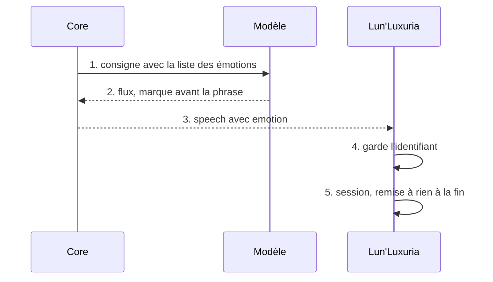

| # | De → vers | Par quoi | Ce qui circule | Retour |
|---|---|---|---|---|
| 1 | Core → modèle | la consigne d'une réponse dite | la liste des émotions et la façon de marquer : `{id}` avant la phrase | — |
| 2 | Modèle → core | le flux de la réponse | un marquage, lu seulement où il peut se trouver (début, après une fin de phrase) ; un identifiant inconnu vaut le neutre | le texte sans marque |
| 3 | Core → Lun'Luxuria | `speech` | `emotion` : l'identifiant, absent quand c'est le neutre ; une nouvelle émotion ferme la phrase en cours | — |
| 4 | Lun'Luxuria | `src/brain.ts:10`, `src/speech/speaker.ts:225` | l'identifiant, s'il est de la forme `[a-z_]{1,24}`, sinon absent | l'événement `subtitle` du début de la phrase le porte |
| 5 | Lun'Luxuria | `src/session.svelte.ts:473` | la session garde l'émotion de la phrase en cours, la remet à rien à la fin de la parole | — |

- **Ce que CrOliX voit, et où** : rien de différent. L'émotion n'est ni affichée, ni passée à la synthèse (`synthesize`
  ne reçoit que le texte), ni écrite dans la trace. Aucun écran ne la lit.
- **Ce qui s'écrit** : rien.
- **Qui décide** : le modèle, sur une liste que CrOliX règle au core.
- **Erreurs et cas limites** :
  - Les phrases fixes (urgence, « Te revoilà. », « Annulé. ») n'ont jamais d'émotion.
  - Un message écrit au fil et dit à voix haute en réponse porte des émotions comme les autres paroles dites.
  - Une phrase qui échoue en synthèse : l'événement `subtitle` sans voix porte aussi l'émotion.
  - Une valeur d'un autre format : absente.
- **Écart avec les décisions** : T22. La carte écrit que l'émotion « arrive au sous-titre » ; elle arrive dans
  l'événement de sous-titre et la session la tient, mais ni le sous-titre ni la voix ni le visage ne s'en servent.
- **Non vérifié** : rien d'autre qu'une sonde de test ne lit la valeur tenue (vérifié par recherche dans les sources).

---

### S8.21 · La fenêtre et ses états

- **Déclencheur** : tout changement d'un fait (liaison, plafond, parole, réflexion, micro, appel, sourdine, écoute).
- **Acteurs** : Lun'Luxuria (la page et la fenêtre), CrOliX.
- **Avant** : dans la fenêtre. Un onglet montre la scène sans icône de barre ni raccourci global.

Un seul état est affiché, le premier qui s'applique (`src/body/body.ts:43`) :

| Rang | État | Libellé | Quand |
|---|---|---|---|
| 1 | `unreachable` | Injoignable | le flux est coupé (S8.14) ou une arrivée a échoué |
| 2 | `speaking` | Parle | une phrase sonne ou se lit |
| 3 | `capped` | Plafond atteint | une réponse a échoué avec un message qui dit « plafond » |
| 4 | `silenced` | En sourdine | S8.10 |
| 5 | `busy` | Micro occupé | S8.5, sauf micro repris |
| 6 | `thinking` | Réfléchit | une phrase est partie, rien n'a encore sonné |
| 7 | `muted` | Micro coupé | S8.13 |
| 8 | `listening` | Écoute | un son de CrOliX est en cours |
| 9 | `present` | Disponible | sinon |

```mermaid
sequenceDiagram
    actor C as CrOliX
    participant P as Page
    participant F as Fenêtre
    P->>P: 1. un fait change, un seul état est retenu
    P->>F: 2. icône de la barre
    C->>F: 3. menu de la barre, raccourci
    F->>P: 3. message show, mute ou quit
```

| # | De → vers | Par quoi | Ce qui circule | Retour |
|---|---|---|---|---|
| 1 | Page | `src/body/body.ts:43` | les faits (liaison, plafond, parole, réflexion, micro, appel, sourdine, écoute) | un état, affiché sur la scène |
| 2 | Page → fenêtre | icône de la barre | l'une des trois formes (présente, en sourdine, injoignable) et la bulle | — |
| 3 | Fenêtre → page | menu de la barre, raccourcis globaux | les messages `show`, `mute`, `quit` (`src/desktop/tray.svelte.ts:40-47`) | la page agit (S8.10, fermeture) |

- **Ce que CrOliX voit, et où** : l'état sur la scène (une pastille) ; l'icône de la barre : trois formes seulement
  (présente, en sourdine, injoignable), avec une bulle « Lun'Luxuria : <libellé> » ; un menu de la barre. Le fil, la consigne (« pour lui parler »), le sous-titre (effacé 4 s après), la trace
  « Filtré : … » (6 s), les échecs en alerte, les bandeaux du service voix. Le raccourci `Ctrl+Maj+L` bascule la scène
  et le petit mode ; `F9` tenue ouvre le micro pour la phrase (toutes deux réglables).
- **Ce qui s'écrit** : la disposition et son coin, la sourdine, le micro, les réglages : dans le navigateur de la
  page. Le jeton aussi. Rien vers le core hors de ce que disent les autres fiches.
- **Qui décide** : le code, sur les faits. Le plus grave l'emporte sur le reste.
- **Erreurs et cas limites** :
  - Fermer la fenêtre (croix, menu « quitter ») : `stopped` part d'abord, 2 s au plus.
  - Une touche globale déjà prise par une autre appli : dite sur l'écran des réglages ; la page garde sa touche locale.
  - Une touche qui écrit quelque chose est refusée en global.
  - Démarrage avec Windows : un refus du système est dit et le bouton revient.
  - Dans un onglet, seule la page vit : pas de barre, pas de raccourci global, pas d'absence.
- **Écart avec les décisions** : aucun connu.
- **Non vérifié** : les cinq bandeaux de la scène pour chaque état du service voix (lus en partie) ; les libellés
  exacts du menu de la barre, et l'arrêt, à la fermeture de la fenêtre, du service voix lancé avec l'appli (côté
  fenêtre, non relus : la page ne gère que `show`, `mute`, `quit`).
