# Famille 9 · Plusieurs surfaces en même temps

Cette famille couvre ce que change la simultanéité : le panneau sur le téléphone, le panneau sur le bureau, la fenêtre
de Lun'Luxuria sur le desktop et l'écran d'un poste, ouverts ensemble ou l'un après l'autre. Elle suit ce que chaque
surface reçoit en direct, comment un message ou une carte passe de l'une aux autres, ce qui est dit à voix haute et ce
qui ne l'est pas, les notifications du téléphone, les compteurs communs, la présence, le rattrapage après une coupure
et l'appareil révoqué. Elle décrit le code d'`origin/main` ; ce qui est déduit est dit « déduit ». Le contenu d'une
conversation (famille 1), d'une carte tranchée (famille 3) et de la présence parlée (famille 8) est décrit là ;
ici, seulement ce que la simultanéité y ajoute. Les chemins `src/…` sont ceux de Lun'Luxuria, `server/src/…` ceux de
Lun'Acedia.

| Id | Titre | En une ligne |
|---|---|---|
| S9.1 | Ouvrir une surface : s'abonner au flux en direct | Un flux ouvert par surface, sans rejeu de ce qui a été manqué |
| S9.2 | Ce que le flux en direct porte | Cinq sortes d'événements, aucune adresse : toutes les surfaces entendent tout |
| S9.3 | Écrire sur le téléphone, Lun'Luxuria ouverte | Le message et la réponse apparaissent dans la fenêtre, rien n'est dit |
| S9.4 | Parler à Lun'Luxuria, le panneau ouvert | La réponse est dite sur le desktop seulement, écrite partout |
| S9.5 | Un tour parlé en cours, vu du téléphone | Le téléphone voit une réponse en attente, puis le texte final ou coupé |
| S9.6 | Deux surfaces écrivent en même temps | Un seul tour à la fois dans le fil, chaque message a sa réponse |
| S9.7 | Une carte tranchée sur une surface, vue sur les autres | Elle disparaît partout, « annule » vaut pour toutes |
| S9.8 | Une décision prise dans l'écran d'un poste | Lun'Acedia n'envoie rien au core : le panneau rattrape en relisant |
| S9.9 | Une phrase dite à voix haute : qui l'entend | Accueil, urgence, parole spontanée, réponse : selon l'origine |
| S9.10 | La présence de Lun'Luxuria pendant que le téléphone est en main | Le core croit CrOliX au bureau tant que la fenêtre bat |
| S9.11 | Abonner un téléphone aux notifications | Clé, abonnement, essai, retrait |
| S9.12 | Envoyer une notification | Passe de 15 s : urgences seules, le reste groupé après 2 min |
| S9.13 | Une notification retenue ou close | Elle ne se retient pas : elle est close pour de bon, avec sa raison |
| S9.14 | Ouvrir une notification sur le téléphone | Une notification silencieuse se tait si le panneau est devant |
| S9.15 | Les compteurs et pastilles communs | Un seul compte, relu par chaque surface, sauf la fenêtre de Lun'Luxuria |
| S9.16 | Le retour au PC après le téléphone | Le rituel compte le téléphone comme vu ; la parole spontanée se tait |
| S9.17 | Une surface revient après une coupure du flux | Le panneau se resynchronise, la fenêtre de Lun'Luxuria perd ce qui a été dit |
| S9.18 | Un appareil révoqué | Jeton refusé à la requête suivante, abonnements retirés, flux ouvert non coupé |

---

### S9.1 · Ouvrir une surface : s'abonner au flux en direct

- **Déclencheur** : le panneau s'ouvre avec un jeton d'appareil, ou la fenêtre de Lun'Luxuria entre, reliée au core.
- **Acteurs** : CrOliX, le panneau ou la fenêtre de Lun'Luxuria, le core.
- **Avant** : l'appareil est appairé (jeton valide) ; le core joint.

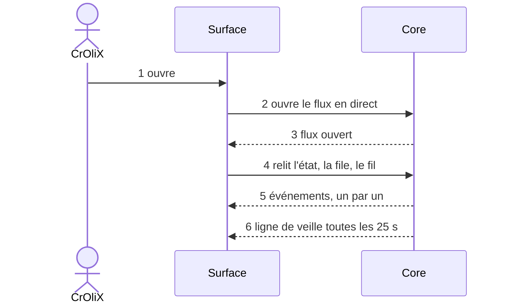

| # | De → vers | Par quoi | Ce qui circule | Retour |
|---|---|---|---|---|
| 1 | CrOliX → surface | ouverture | rien | la surface démarre |
| 2 | Surface → core | `GET /api/live` (Lun'Luxuria : `src/core.ts:127`) | le jeton d'appareil, rien d'autre : pas d'identifiant du dernier événement vu | flux ouvert, ou 401 si le jeton est refusé |
| 3 | Core | abonnement au bus d'événements | rien | le core garde la surface dans sa liste d'écoute tant que le flux dure |
| 4 | Panneau → core | lecture de l'état, de la file, du fil courant | rien | l'état, la file, le fil : le panneau le fait à chaque ouverture du flux, avant tout événement |
| 5 | Core → surface | un bloc par événement | le nom de l'événement et ses champs (S9.2) | la surface met à jour son écran |
| 6 | Core → surface | une ligne de commentaire toutes les 25 s sans événement | rien | garde la connexion et décèle un client mort |

- **Ce que CrOliX voit, et où** :
  - Panneau : rien de propre à l'abonnement. Le flux ne se voit que par ses effets : une carte qui disparaît, un message
    qui arrive, un compteur qui bouge.
  - Fenêtre de Lun'Luxuria : l'état « relié » passe à vrai à l'ouverture du flux (`src/core.ts:133`).
- **Ce qui s'écrit** : rien. Le flux n'est pas rejoué : le core n'attribue aucun numéro aux événements et ne garde
  pas ce que chaque surface a reçu.
- **Qui décide** : le code. Le jeton décide de l'accès.
- **Erreurs et cas limites** :
  - Jeton refusé à l'ouverture : le panneau arrête sa boucle d'écoute et retourne à la page d'appairage ; la fenêtre
    de Lun'Luxuria sort de la boucle et oublie son jeton (S9.18).
  - Plusieurs onglets du panneau, ou le panneau et la fenêtre : chacun a son flux, tous reçoivent les mêmes événements.
  - Un abonné dont l'écriture échoue ne coupe pas les autres : le core les prévient chacun à son tour.
  - Les cinq événements sont les mêmes pour toutes les surfaces ; aucun n'est adressé à une seule.
- **Écart avec les décisions** : aucun connu. Contraste : le flux entre un poste et le core reprend après son
  dernier numéro d'événement (Lun'Acedia, `server/src/contract/routes.ts:295-299`) ; celui du core vers ses
  surfaces ne le fait pas.
- **Non vérifié** : l'en-tête du flux part-il avant l'abonnement du core ? Cela dépend de la bibliothèque du
  serveur, non lue (le panneau compte sur l'abonnement fait, son commentaire le dit). La ligne de veille a-t-elle
  un test ? Non lu.

---

### S9.2 · Ce que le flux en direct porte

- **Déclencheur** : un fait du core qui concerne ce que CrOliX voit (message écrit, carte tenue ou tranchée, file
  changée, phrase dite).
- **Acteurs** : le core, chaque surface ouverte.
- **Avant** : au moins une surface a un flux ouvert (sans abonné, l'événement est perdu).

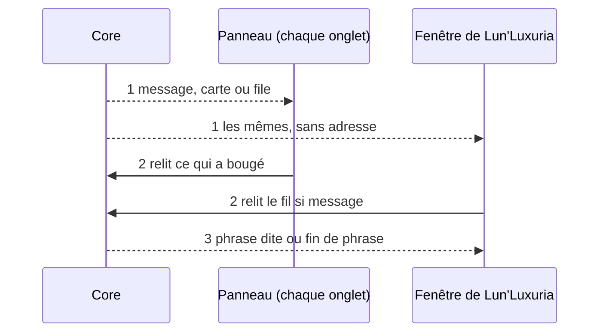

| # | De → vers | Par quoi | Ce qui circule | Retour |
|---|---|---|---|---|
| 1 | Core → toutes les surfaces | flux en direct, un événement | voir la table ci-dessous | chaque surface réagit ou ignore |
| 2 | Surface → core | relecture | rien | l'état, la file ou le fil à jour |
| 3 | Core → fenêtre | événement de parole | la phrase, son rang, son origine, son émotion si elle n'est pas neutre | la fenêtre la dit et l'affiche en sous-titre |

Les cinq sortes d'événements, tels que les écrit le code :

| Événement | Champs | Émis quand | Panneau | Fenêtre de Lun'Luxuria |
|---|---|---|---|---|
| message | le fil, le numéro du message | CrOliX écrit ; une réponse finit ; une phrase du core est écrite ; une réponse est coupée ou retirée ; fin de la nuit | relit le fil si c'est le fil affiché et s'il n'attend pas lui-même une réponse | relit le fil principal (50 messages au plus), quel que soit le fil de l'événement |
| carte | le poste, l'identifiant de la carte, l'état : tenue, annulée, ou l'issue (faite, échouée, conflit) | un geste est tenu, annulé ou réglé | relit la file et l'état | ignore |
| file | rien | un geste « vu », « fait » ou « plus tard » est tenu ; une urgence arrive d'un poste ; une lecture d'un poste change ses cartes ; un rappel d'agenda tombe | relit la file et l'état | ignore |
| parole | le numéro de la réponse, le rang de la phrase, le texte masqué, l'origine (réponse, accueil, urgence, spontanée), l'émotion | une phrase est prête à être dite | ignore | la dit si ses réglages le permettent (S9.9) |
| fin de parole | le numéro de la réponse, l'origine | le tour finit | ignore | ferme la lecture de ce tour |

- **Ce que CrOliX voit, et où** :
  - Panneau : une carte qui sort de la file, un compteur qui bouge, un message qui apparaît.
  - Fenêtre de Lun'Luxuria : une voix et un sous-titre ; le fil mis à jour.
  - Téléphone : comme le panneau ; la parole ne l'atteint pas.
- **Ce qui s'écrit** : rien. Un événement du flux n'est pas gardé.
- **Qui décide** : le code du core choisit quand émettre ; chaque surface choisit ce qu'elle lit. Aucune règle du core
  ne dit « celle-ci seulement ».
- **Erreurs et cas limites** :
  - L'événement « message » de la fin de nuit porte le numéro 0 : il ne désigne aucun message, il demande de relire.
  - Une phrase du core est masquée avant d'être publiée : les secrets reconnus n'y figurent pas.
  - Les événements des postes (Lun'Acedia, Lun'Avaritia) n'entrent pas dans ce flux : le core les range puis émet
    « file ». Pour un événement urgent, il l'émet tout de suite. Pour les autres, il lit les cartes 50 ms plus tard
    et n'émet « file » que si la liste a changé (famille 11 pour leur arrivée).
  - Un événement émis alors qu'aucune surface n'écoute n'est pas rejoué (S9.17).
- **Écart avec les décisions** : aucun connu.
- **Non vérifié** : l'ordre exact des événements entre deux surfaces (le bus les envoie dans l'ordre d'émission ; pas de
  test d'ordre sur deux abonnés).

---

### S9.3 · Écrire sur le téléphone, Lun'Luxuria ouverte

- **Déclencheur** : CrOliX écrit dans la barre « Écrire à Natsume » du panneau, sur le téléphone, pendant que la fenêtre
  de Lun'Luxuria est ouverte sur le desktop.
- **Acteurs** : CrOliX, le panneau du téléphone, le core, la fenêtre de Lun'Luxuria, le fournisseur du modèle.
- **Avant** : fil principal ; flux ouvert des deux surfaces ; Natsume répond (clé, pas de pause).

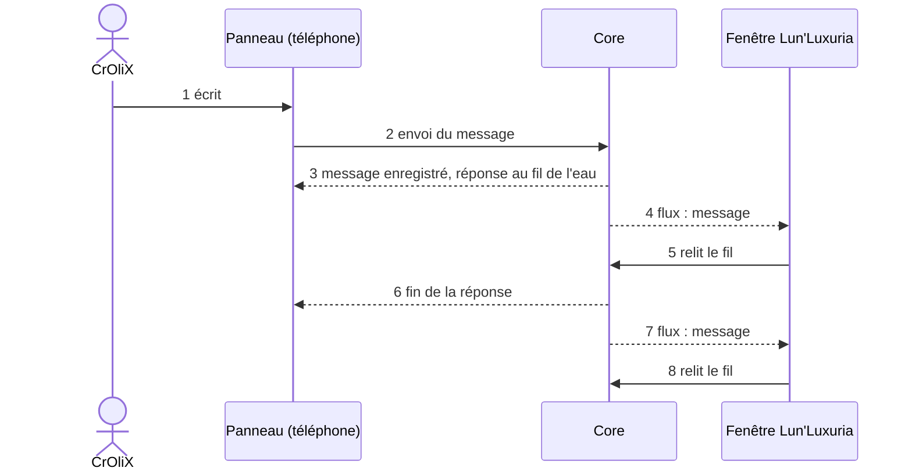

| # | De → vers | Par quoi | Ce qui circule | Retour |
|---|---|---|---|---|
| 1 | CrOliX → panneau | saisie | le texte | la barre se vide |
| 2 | Panneau → core | envoi d'un message sur le fil principal | le texte, la surface « mobile » (écran de moins de 768 px, sinon « desktop »). Pas de demande de voix, pas de confiance | un flux : message enregistré, numéro de la réponse, morceaux, fin |
| 3 | Core → panneau | flux de la requête | le message de CrOliX, puis les morceaux de réponse, puis la réponse enregistrée | la bulle se remplit |
| 4 | Core → toutes les surfaces | flux en direct : message | le fil, le numéro du message | la fenêtre est prévenue |
| 5 | Fenêtre → core | `GET /api/threads/main/messages?limit=50` (`src/core.ts:119`) | rien | les 50 derniers messages du fil en vue, dont la réponse en attente |
| 6 | Core → panneau | fin du flux de la requête | la réponse enregistrée (texte, état) | la bulle est remplacée |
| 7-8 | Core → fenêtre | message, puis relecture | comme 4-5 | le fil de la fenêtre contient la réponse |

- **Ce que CrOliX voit, et où** :
  - Téléphone : sa phrase, la réponse qui se forme morceau par morceau.
  - Fenêtre de Lun'Luxuria : son message et la réponse dans le fil principal, après relecture. Aucun son, aucun
    sous-titre.
  - Un autre onglet du panneau : le fil se relit, sauf s'il attend lui-même une réponse.
- **Ce qui s'écrit** : le message et la réponse dans le fil principal, avec la surface d'origine ; le coût de la réponse.
  La présence n'est pas touchée : le panneau n'envoie jamais de présence.
- **Qui décide** : CrOliX choisit la surface ; le core ne dit la réponse à voix haute que si le message le demande, et
  le panneau ne le demande pas.
- **Erreurs et cas limites** :
  - Le panneau ne demande jamais la voix : une réponse à un message du téléphone n'est jamais dite sur le desktop,
    même si la fenêtre est ouverte.
  - La fenêtre est hors flux au moment de l'événement : elle ne relit pas à la reconnexion (S9.17) ; le fil reste
    à l'état de sa dernière lecture jusqu'au prochain événement « message » ou à son prochain envoi.
  - La relecture échoue : la fenêtre garde son fil précédent.
  - Le panneau a une réponse en cours dans la même requête : il écarte l'événement « message » de ce fil (sinon la
    bulle serait refaite).
- **Écart avec les décisions** : aucun connu.
- **Non vérifié** : l'affichage du fil dans la fenêtre (le code garde la liste, le rendu n'a pas été relu). Quels
  jours couvrent exactement les 50 messages relus : seulement le jour en cours, ou aussi les jours que la nuit n'a
  pas encore traités ? La famille 1 décrit la réponse elle-même.

---

### S9.4 · Parler à Lun'Luxuria, le panneau ouvert

- **Déclencheur** : CrOliX dit une phrase adressée à Natsume (ou l'écrit dans la fenêtre) pendant que le panneau est
  ouvert sur son téléphone ou son bureau.
- **Acteurs** : CrOliX, la fenêtre de Lun'Luxuria, le core, le panneau.
- **Avant** : fenêtre reliée au core ; panneau avec un flux ouvert.

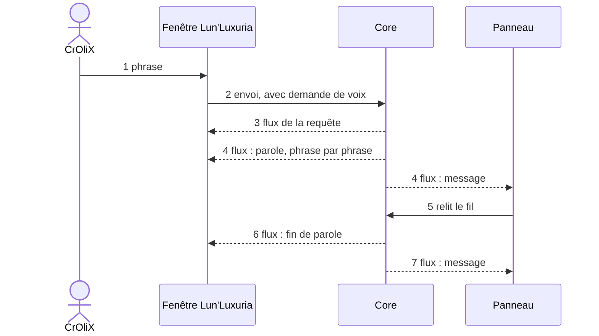

| # | De → vers | Par quoi | Ce qui circule | Retour |
|---|---|---|---|---|
| 1 | CrOliX → fenêtre | voix ou saisie | la phrase | la fenêtre transcrit et décide d'envoyer |
| 2 | Fenêtre → core | `POST /api/threads/main/messages` (`src/core.ts:94`) | le texte, la demande de voix (toujours vraie), la surface « voice » ou « desktop », la confiance de la transcription si c'est une voix | un flux : message, numéro de la réponse, morceaux, fin |
| 3 | Core → fenêtre | flux de la requête | message enregistré, numéro de la réponse | la fenêtre garde ce numéro pour couper |
| 4 | Core → toutes les surfaces | flux en direct | parole (phrase par phrase), et message (le message de CrOliX) | la fenêtre dit ; le panneau relit |
| 5 | Panneau → core | relecture du fil | rien | le message de CrOliX et la réponse en attente |
| 6 | Core → fenêtre | fin de parole | numéro de la réponse | la fenêtre ferme la lecture |
| 7 | Core → panneau | message | le fil, le numéro de la réponse | le panneau relit : réponse finale |

- **Ce que CrOliX voit, et où** :
  - Fenêtre : la voix, le sous-titre phrase par phrase, l'état « réfléchit ».
  - Panneau (téléphone ou bureau) : le message et la réponse apparaissent à la relecture ; pas de voix, pas de morceau
    par morceau.
- **Ce qui s'écrit** : comme S9.3, avec la surface « voice » (ou « desktop » pour une saisie dans la fenêtre).
- **Qui décide** : le code de la fenêtre décide d'envoyer (fin de phrase, filtre, sourdine : famille 8) ; le core
  décide de publier la parole parce que la demande de voix est vraie.
- **Erreurs et cas limites** :
  - La fenêtre est en sourdine : elle n'envoie plus de saisie (`src/session.svelte.ts:728, 734`) et retire la phrase
    en attente de sa fin (`:703`).
  - Deux fenêtres de Lun'Luxuria sur deux machines : les deux reçoivent la parole et chacune la dit (le bus n'a pas
    de destinataire) ; cas non rencontré, déduit du code.
  - La réponse est coupée par la voix de CrOliX : S9.5.
- **Écart avec les décisions** : aucun connu.
- **Non vérifié** : le cas de deux fenêtres (aucun test).

---

### S9.5 · Un tour parlé en cours, vu du téléphone

- **Déclencheur** : CrOliX a posé une question à la voix ; Natsume répond à voix haute sur le desktop ; il regarde son
  téléphone avant la fin.
- **Acteurs** : CrOliX, le panneau du téléphone, le core, la fenêtre de Lun'Luxuria.
- **Avant** : S9.4 en cours.

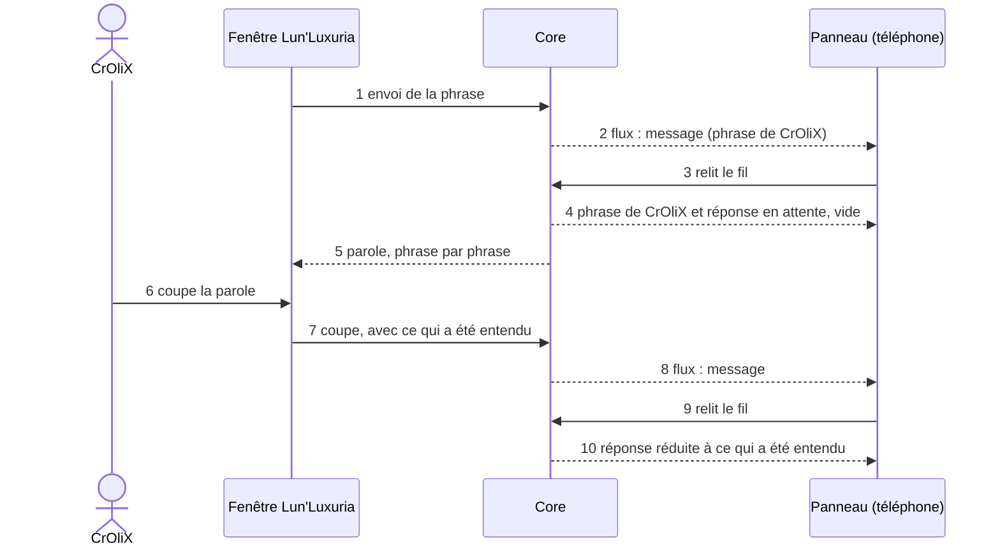

| # | De → vers | Par quoi | Ce qui circule | Retour |
|---|---|---|---|---|
| 1 | Fenêtre → core | envoi du message | comme S9.4 | message enregistré, réponse « en attente » |
| 2 | Core → téléphone | flux en direct : message | le fil, le numéro du message | le panneau relit s'il n'attend pas lui-même |
| 3-4 | Panneau → core | lecture du fil | rien | la phrase de CrOliX, et la réponse en attente sans texte (la bulle « réfléchit ») |
| 5 | Core → fenêtre | parole | une phrase à la fois | la fenêtre dit |
| 6 | CrOliX → fenêtre | voix par-dessus | rien | la fenêtre se tait |
| 7 | Fenêtre → core | `POST /api/threads/main/messages/:id/cut` (`src/core.ts:108`) | `said` : ce qui a été réellement entendu | réponse mise à jour |
| 8 | Core → toutes les surfaces | flux en direct : message | le fil, le numéro | le téléphone est prévenu |
| 9-10 | Panneau → core | lecture du fil | rien | la réponse avec le seul texte entendu, suivi d'une marque « coupée ici » ; vide : la réponse n'est pas montrée |

- **Ce que CrOliX voit, et où** :
  - Téléphone : une bulle en attente, puis, à la fin du tour, le texte final. Le texte de la réponse n'est enregistré
    qu'à la fin du tour (déduit des points d'écriture lus) : le panneau ne voit pas la réponse se former, il ne reçoit
    pas non plus la parole.
  - Fenêtre : la voix, jusqu'à la coupure.
- **Ce qui s'écrit** : la réponse enregistrée est remplacée par ce que CrOliX a entendu, suivie de la marque « coupée
  ici », sauf si la réponse était déjà finie et qu'il l'a entendue en entier. Une réponse coupée avant sa première
  parole est enregistrée vide et n'est plus montrée. Les outils qu'elle a lancés sont décrits en famille 1.
- **Qui décide** : CrOliX coupe ; le code de la fenêtre calcule ce qui a été entendu ; le core remplace le texte.
- **Erreurs et cas limites** :
  - La coupe arrive après la fin du tour : le core émet « message » lui-même, la fin de tour ne le fera plus.
  - La coupe arrive avant la fin du tour : le tour s'arrête, et c'est sa fin qui émet « message » (une seule relecture).
  - La phrase de CrOliX est retirée (début de phrase repris) : la phrase et sa réponse sortent du fil ; « message »
    est émis (retrait, `withdraw`).
- **Écart avec les décisions** : aucun connu.
- **Non vérifié** : l'affichage du texte « coupée ici » dans le panneau ; le texte de la réponse pendant la génération
  (le code lu ne l'écrit qu'aux points de fin). Quand le panneau attend lui-même une réponse, voit-il tout de suite ce
  qui a été écrit ailleurs pendant son attente ? À la fin de sa réponse, il ne relit que l'état et la file, et
  l'événement « message » de fin de tour part en même temps que la fin de son propre flux : l'ordre entre les deux
  connexions n'est pas fixé, le rattrapage peut attendre le « message » suivant.

---

### S9.6 · Deux surfaces écrivent en même temps

- **Déclencheur** : CrOliX écrit sur le téléphone et parle à la fenêtre dans le même moment, ou deux onglets du panneau
  envoient ensemble.
- **Acteurs** : les deux surfaces, le core, le fournisseur du modèle.
- **Avant** : même fil (le principal).

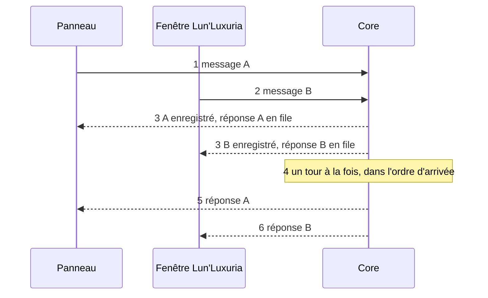

| # | De → vers | Par quoi | Ce qui circule | Retour |
|---|---|---|---|---|
| 1-2 | Surface → core | deux envois | chacun : texte, surface (et voix pour la fenêtre) | chaque envoi reçoit son flux |
| 3 | Core | enregistrement | chaque message reçoit son numéro et sa réponse en attente, à la réception | « message » émis pour chacun |
| 4 | Core | file du fil | les réponses d'un même fil se préparent une à une, dans l'ordre d'arrivée : chacune voit celle d'avant | — |
| 5-6 | Core → surfaces | flux de chaque requête | la réponse de chacun, à son tour | chaque surface reçoit sa propre réponse |

- **Ce que CrOliX voit, et où** :
  - Chaque surface voit sa phrase et sa réponse en direct. L'autre surface voit les deux messages à la relecture.
  - Deux fils différents (un sujet à part) avancent côte à côte.
- **Ce qui s'écrit** : deux messages et deux réponses dans l'ordre d'arrivée. Le message suivant est enregistré
  même si la réponse précédente n'est pas finie.
- **Qui décide** : le code (ordre d'arrivée). Natsume ne choisit pas laquelle traiter d'abord.
- **Erreurs et cas limites** :
  - Quand un geste est tenu, sont traités à la réception « annule », « annule ça / le / la », les mêmes précédés de
    « non », et « annule tout » (S9.7). Toute autre phrase attend son tour.
  - Une requête du panneau est interrompue (onglet fermé) : la réponse continue et s'enregistre.
  - Le panneau qui attend une réponse met en file la phrase suivante tapée dans la même barre. Il n'envoie tout de
    suite que « annule » et « annule ça / le / la ». « Annule tout » et « non annule » ne sont pas dans sa liste :
    il les garde derrière sa propre réponse. Ils n'arrivent au core qu'à la fin de cette réponse, souvent après les
    5 s du geste tenu, alors que le core les traiterait à la réception.
  - La parole spontanée se tait pendant une conversation sur une autre surface (voir S9.16).
  - La voix : les phrases dites des deux réponses ne se superposent pas côté core (une réponse à la fois) ; la lecture
    côté fenêtre n'a pas été relue ici.
- **Écart avec les décisions** : aucun connu.
- **Non vérifié** : que deux « paroles » en rafale ne se chevauchent jamais dans la fenêtre (standard : « deux
  prises de parole ne se recouvrent jamais ») ; famille 8.

---

### S9.7 · Une carte tranchée sur une surface, vue sur les autres

- **Déclencheur** : CrOliX valide, refuse ou annule une carte depuis une surface, pendant que d'autres sont ouvertes.
- **Acteurs** : CrOliX, la surface qui décide, les autres surfaces, le core, le poste de la carte.
- **Avant** : la carte est en attente dans la file (famille 3 pour tout le détail du geste).

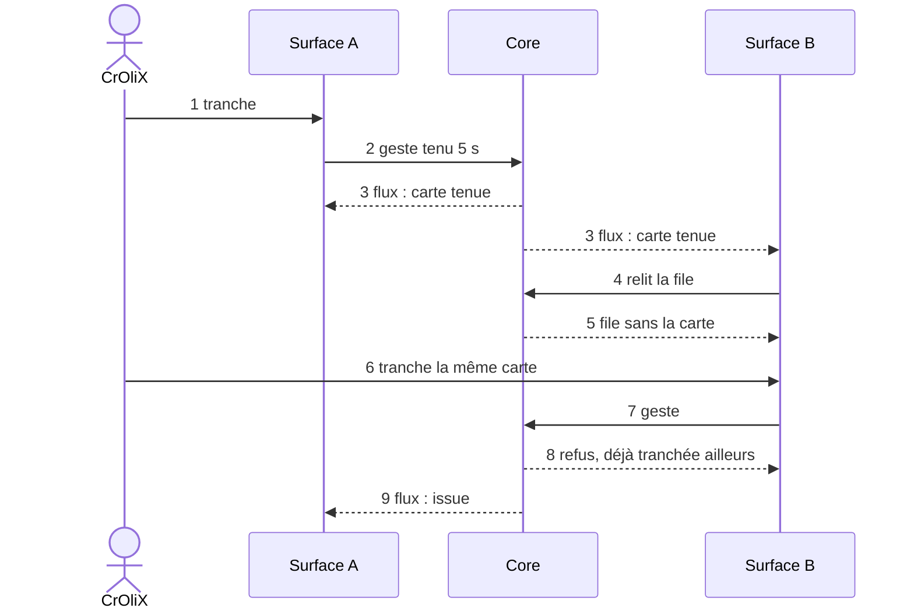

| # | De → vers | Par quoi | Ce qui circule | Retour |
|---|---|---|---|---|
| 1-2 | Surface A → core | geste (panneau), ou phrase (fenêtre ou conversation) | l'identifiant de la carte, valider ou refuser, le lieu d'origine : bureau, À trancher, fil ou voix | geste tenu, délai de 5 s |
| 3 | Core → toutes les surfaces | flux en direct : carte | le poste, l'identifiant, l'état « tenue » | chaque panneau relit |
| 4-5 | Panneau B → core | lecture de la file et de l'état | rien | la file sans la carte (cachée dès que le geste est tenu), le compteur baissé |
| 6-8 | CrOliX → B → core | un second geste sur la même carte | comme 1-2 | refus « Déjà tranchée ailleurs. » |
| 9 | Core → toutes les surfaces | flux en direct : carte | l'état de l'issue (faite, échouée, conflit) | chaque panneau relit |

- **Ce que CrOliX voit, et où** :
  - Surface B : la carte disparaît de sa file sans toast ; une carte réduite relayée dans la conversation passe à
    « Tranchée ».
  - Surface A : le toast avec « Annuler » pendant 5 s.
  - Fenêtre de Lun'Luxuria : rien (aucune logique de carte).
- **Ce qui s'écrit** : voir S3.1 (geste tenu, issue, étape au Journal avec « depuis la file », « depuis le fil » ou
  « depuis la voix » selon l'origine).
- **Qui décide** : CrOliX ; le code du core vérifie que la carte est encore dans la file, au moment du geste.
- **Erreurs et cas limites** :
  - Deux surfaces tranchent la même carte presque ensemble : le premier geste cache la carte, le second la trouve
    absente et est refusé.
  - Annuler : sur le toast, ou en disant « annule » à Natsume depuis n'importe quelle surface. Dans le second cas,
    le core annule le **dernier geste tenu, quelle que soit son origine**, y compris un clic fait sur une autre
    surface ; « annule tout » les annule tous. Annulé, il émet « carte annulée » et la carte revient dans les files.
  - Un geste tenu par un clic n'est pas défait quand CrOliX coupe ou retire une phrase : seule une prise de décision
    issue de la conversation l'est (famille 3, S3.12).
  - Le délai de 5 s est celui du core : il court même si la surface qui l'a posé se ferme.
- **Écart avec les décisions** : T17 (carte cachée dès le geste).
- **Non vérifié** : la suite côté poste (S3.2 à S3.4).

---

### S9.8 · Une décision prise dans l'écran d'un poste

- **Déclencheur** : CrOliX valide une proposition ou une carte directement dans l'écran de Lun'Acedia, alors que le
  panneau (ou le téléphone) la montre encore en attente. L'écran de Lun'Avaritia n'a pas été lu (voir Non vérifié).
- **Acteurs** : CrOliX, l'écran du poste, le poste, le core, le panneau.
- **Avant** : la carte est dans la dernière lecture du core ; le poste est relié.

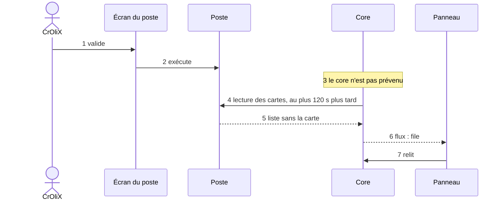

| # | De → vers | Par quoi | Ce qui circule | Retour |
|---|---|---|---|---|
| 1-2 | CrOliX → écran du poste → poste | geste interne du poste | l'identifiant interne | la carte est tranchée côté poste |
| 3 | — | — | rien n'est envoyé au core au moment de la décision (Lun'Acedia, `server/src/triage/pipeline.ts:450-480` et `server/src/triage/routes.ts:92-93`, sans événement ; son agent, `server/src/contract/catalog.ts:257, :271`) | — |
| 4-5 | Core → poste | `GET /lun/v1/cards?status=pending` à chaque passe | rien | les cartes encore en attente |
| 6 | Core → toutes les surfaces | flux en direct : file | rien (seulement si la liste a changé) | chaque panneau relit |
| 7 | Panneau → core | lecture de la file | rien | la file sans la carte |

- **Ce que CrOliX voit, et où** :
  - Écran du poste : la carte tranchée à l'instant.
  - Panneau : la carte reste affichée jusqu'à la lecture du core. La passe tourne toutes les 120 s, et dans les 50 ms
    qui suivent un signal du poste (n'importe quel événement de son flux, urgent ou non).
  - Une lecture de plus de 5 minutes met les cartes de ce poste en lecture seule (boutons grisés).
- **Ce qui s'écrit** : l'étape au Journal « Tranchée dans *poste* » est ajoutée par le core quand il voit la carte
  disparaître, sans lien avec l'origine (famille 3, S3.18).
- **Qui décide** : CrOliX, dans l'écran du poste ; le poste applique ses règles.
- **Erreurs et cas limites** :
  - CrOliX tranche la même carte dans le panneau avant la relecture : le geste est tenu 5 s puis relayé ; le poste
    répond « déjà tranchée » (S3.13).
  - Une notification déjà envoyée pour cette carte : voir la question ouverte de S9.13.
  - Si Lun'Acedia envoie un événement `mail.changed` parce que la boîte a bougé (synchro), le core relit tout de suite.
- **Écart avec les décisions** : T5 (une décision prise dans l'écran d'un poste n'est poussée nulle part) ; F5 non codé.
- **Non vérifié** : la fréquence de la synchro de la boîte, donc le délai réel avant l'événement `mail.changed`.
  Une décision prise dans l'écran de Lun'Avaritia envoie-t-elle quelque chose au core ? Seuls Lun'Acedia et son agent
  ont été relus.

---

### S9.9 · Une phrase dite à voix haute : qui l'entend

- **Déclencheur** : le core produit une phrase destinée à la voix : réponse à un message, accueil, urgence, parole
  spontanée.
- **Acteurs** : le core, la fenêtre de Lun'Luxuria, le panneau.
- **Avant** : un flux ouvert ; pour l'accueil, l'urgence et la parole spontanée, une présence ouverte (S9.10).

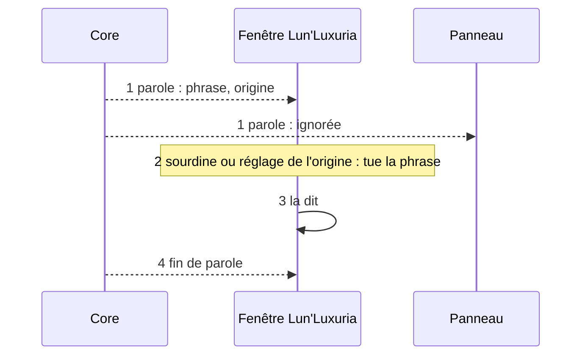

| # | De → vers | Par quoi | Ce qui circule | Retour |
|---|---|---|---|---|
| 1 | Core → toutes les surfaces | flux en direct : parole | texte, rang, numéro, origine, émotion | la fenêtre agit, le panneau ignore |
| 2 | Fenêtre | filtre | l'origine et les réglages | la phrase est jetée ou gardée (voir ci-dessous) |
| 3 | Fenêtre | voix et sous-titre | le texte | CrOliX entend et lit |
| 4 | Core → surfaces | fin de parole | numéro, origine | la fenêtre ferme |

D'où vient la phrase, et ce que la fenêtre en fait :

| Origine | Quand | Dite si |
|---|---|---|
| réponse | à un message envoyé avec la demande de voix : la fenêtre seule le fait ; le panneau ne la demande jamais | la fenêtre n'est pas en sourdine (`src/conversation.ts:172-177`) |
| accueil | CrOliX arrive : la fenêtre a démarré sa présence et n'a pas coupé l'accueil | sourdine absente, réglage « accueil » actif |
| urgence | une urgence d'un poste, que la porte d'attention décide de dire : présence ouverte, pas en appel, réglage « dit à voix haute » actif, urgence de moins de 5 minutes, hors plage de nuit | réglage « urgence » actif ; la sourdine n'y change rien |
| spontanée | un battement de présence, quand elle est due (S9.16) | pas en sourdine, réglage actif |

- **Ce que CrOliX voit, et où** :
  - Fenêtre : la voix et le sous-titre.
  - Téléphone ou panneau : la même phrase est écrite au fil (s'il est ouvert, à la relecture), jamais dite.
  - Une urgence que la porte décide d'écrire sans la dire est écrite au fil, avec « Urgent : titre. » ; un rappel
    d'agenda urgent s'écrit « Rappel : titre. ». Le titre est coupé à 80 caractères.
- **Ce qui s'écrit** : la phrase au fil principal (surface « routine » pour l'urgence, « voice » pour l'accueil).
  Le core ne sait pas ce que la fenêtre a effectivement dit (T4).
- **Qui décide** : la porte d'attention (du code) choisit dire ou écrire ; la fenêtre choisit de dire ou taire selon
  ses réglages et sa sourdine.
- **Erreurs et cas limites** :
  - Fenêtre hors flux : la phrase n'est jamais dite, elle reste écrite au fil.
  - Fenêtre en sourdine : la phrase est jetée et considérée comme entendue, sauf l'urgence qui sonne quand même.
  - Aucune surface n'est choisie par le core : si deux fenêtres écoutent, les deux disent (S9.4).
  - Une urgence venue du core lui-même (clé refusée, plafond atteint…) n'est jamais annoncée à voix haute ; elle
    passe par les notifications (S9.12).
- **Écart avec les décisions** : T4, T11, T25.
- **Non vérifié** : rien.

---

### S9.10 · La présence de Lun'Luxuria pendant que le téléphone est en main

- **Déclencheur** : CrOliX quitte le desktop avec son téléphone, mais la fenêtre de Lun'Luxuria reste ouverte.
- **Acteurs** : CrOliX, la fenêtre de Lun'Luxuria, le core.
- **Avant** : la fenêtre a ouvert une présence ; elle bat toutes les 30 s.

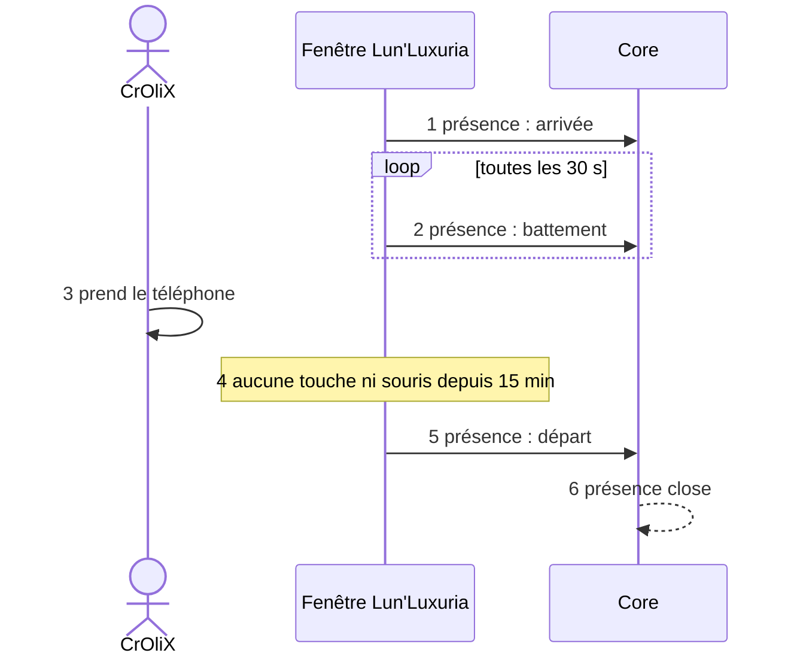

| # | De → vers | Par quoi | Ce qui circule | Retour |
|---|---|---|---|---|
| 1 | Fenêtre → core | `POST /api/presence`, état « started » (`src/core.ts:74-91`) | l'identifiant de la page, « occupé », « sourdine », « urgence non dite », « accueil » | accueil lancé, ou courte phrase |
| 2 | Fenêtre → core | même route, état « beat » | les mêmes drapeaux | 204, ou 410 si la présence est close : la fenêtre se ré-annonce |
| 3 | CrOliX | — | le panneau n'envoie aucune présence ni visibilité au core | — |
| 4 | Fenêtre | lecture de l'inactivité de la session | la durée sans touche ni souris ; ou depuis la dernière phrase entendue ou écrite | au-delà du seuil (15 min par défaut, réglable, peut être coupé), « absent » |
| 5 | Fenêtre → core | état « stopped » | l'identifiant de la page | présence close |
| 6 | Core | écriture | la présence est datée de la fin | le poste du desktop passe « injoignable, absent » |

- **Ce que CrOliX voit, et où** :
  - Panneau : l'astre de Lun'Luxuria « présente », « occupée », « en sourdine » ou « absente depuis… ».
  - Téléphone : des notifications du palier « prévenir » seulement quand la présence est close ou morte (plus de
    battement depuis 90 s).
  - Fenêtre : rien de particulier.
- **Ce qui s'écrit** : la ligne de présence (une seule pour tout le core, avec les battements de chaque page).
  « CrOliX est sur son PC » n'est écrit qu'à l'ouverture d'une nouvelle présence : une arrivée reçue alors que la
  présence est encore vivante (retour du flux, page revenue) n'écrit rien. « CrOliX a quitté son PC » est écrit quand
  la dernière page vivante part. Il l'est aussi, daté du dernier battement, quand une présence morte est refermée à
  l'arrivée suivante.
- **Qui décide** : le code de la fenêtre, d'après l'inactivité de la session ; le core ne sait rien de ce que CrOliX
  fait ailleurs.
- **Erreurs et cas limites** :
  - Tant que la fenêtre bat et que l'inactivité reste sous le seuil, **le core croit CrOliX au bureau, téléphone en
    main** : un événement « prévenir » n'est pas notifié (S9.13) ; une urgence récente est dite à voix haute dans la
    pièce, et n'est pas notifiée au téléphone.
  - Un appel en cours (« occupé ») ou un réglage « urgence non dite » : l'urgence est écrite au fil et sonne sur le
    téléphone.
  - La sourdine n'a aucun effet sur une urgence.
  - Une présence sans battement depuis 90 s est considérée comme finie ; elle se referme à la prochaine arrivée.
  - Plusieurs pages d'un même appareil : un drapeau tient tant qu'une page vivante le porte.
  - Retour de veille : un battement refusé (410) refait une arrivée ; la page revenue de l'historique fait une arrivée.
- **Écart avec les décisions** : F4 (au bureau : pastille, puis notification au téléphone s'il part sans l'avoir vue :
  le code ne retient rien, S9.13) ; T26.
- **Non vérifié** : le comportement de la lecture de l'inactivité sur une session verrouillée (le commentaire dit que
  la session verrouillée compte comme inactive) ; rien n'est vérifié hors de la fenêtre Windows.

---

### S9.11 · Abonner un téléphone aux notifications

- **Déclencheur** : CrOliX active les notifications dans l'Atelier du panneau, sur le téléphone.
- **Acteurs** : CrOliX, le panneau, le navigateur du téléphone, son service de notification, le core.
- **Avant** : l'application est installée (service de notification présent) ; le navigateur prend en charge les
  notifications.

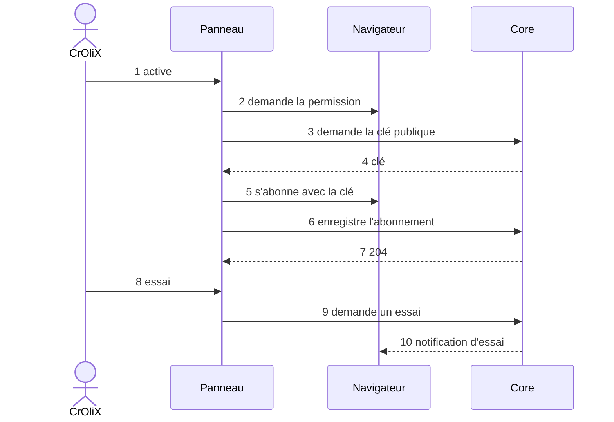

| # | De → vers | Par quoi | Ce qui circule | Retour |
|---|---|---|---|---|
| 1-2 | CrOliX → panneau → navigateur | permission | rien | refusée : « refusé », rien d'autre |
| 3-4 | Panneau → core | lecture de la clé publique de notification | rien | la clé publique, créée au premier usage ; 503 si la clé secrète du core est absente |
| 5 | Panneau → navigateur | abonnement | la clé publique | l'adresse du service du navigateur, deux clés |
| 6-7 | Panneau → core | enregistrement d'un abonnement | l'adresse, les deux clés ; le core ajoute l'appareil qui l'envoie | 204 ; 400 si l'adresse n'est pas d'un service connu (Chrome, Firefox, Apple, Windows) |
| 8-10 | Panneau → core → service | essai | « Essai de notification », avec son | 204 si un appareil répond ; 409 si l'appareil n'a pas d'abonnement ou s'il est périmé ; 502 si le service ne répond pas |

- **Ce que CrOliX voit, et où** :
  - Atelier : l'état « activé », « désactivé », « refusé » ou « non pris en charge » ; la liste des appareils dit lesquels
    reçoivent.
  - Téléphone : la notification d'essai.
- **Ce qui s'écrit** : l'abonnement (adresse, deux clés, appareil, date), la paire de clés du core (la privée chiffrée).
  Le **premier** abonnement du core (quand il n'y en avait aucun) efface la file des notifications en attente et place
  le curseur des événements à la fin : rien d'ancien ne part (cartes déjà en attente comprises).
- **Qui décide** : CrOliX active ; le code du core accepte l'adresse si c'est un service connu en https, sans port ni
  identifiant.
- **Erreurs et cas limites** :
  - Désactiver : le panneau retire l'abonnement du core puis du navigateur.
  - Chaque fois que l'Atelier lit l'état des notifications, un abonnement que le navigateur détient encore est redit au
    core (cas d'un appareil révoqué puis rappairé).
  - Réglage de la plage de nuit (23 h à 7 h par défaut, heures en HH:MM) : lu et écrit par le panneau, partagé par tous.
  - L'abonnement est lié à l'appareil appairé : les notifications partent vers **tous** les abonnements, pas vers celui
    de la surface en cours.
- **Écart avec les décisions** : aucun connu.
- **Non vérifié** : la version du service de notification du navigateur de CrOliX ; aucun envoi réel n'a été rejoué.

---

### S9.12 · Envoyer une notification

- **Déclencheur** : l'horloge du core (une passe toutes les 15 s).
- **Acteurs** : le core, le service de notification du navigateur, le téléphone.
- **Avant** : au moins un abonnement ; la clé secrète du core lisible.

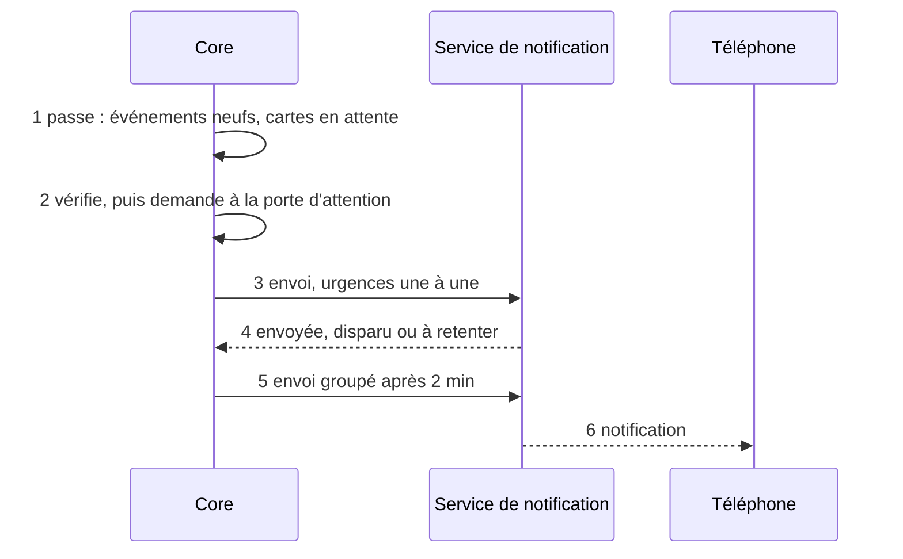

| # | De → vers | Par quoi | Ce qui circule | Retour |
|---|---|---|---|---|
| 1 | Core | lecture de la table des événements après le curseur, et des cartes en attente de chaque poste | les événements urgents ou normaux, les cartes dont le palier est urgent, normal ou absent, qui ne sont pas cachées | des lignes dans la file des notifications, chacune sous une clé unique |
| 2 | Core | vérification, puis décision par la porte | pour chaque ligne : trop vieille, déjà vue, tranchée, cachée, ou ce que les entrées de la porte décident | des lignes closes ; les autres gardent leur décision |
| 3 | Core → service | envoi d'une urgence | titre, lien, étiquette, silencieux ou non ; durée de vie 1 h ; urgence « haute » si avec son | envoyée, abonnement disparu (retiré), ou à retenter |
| 4 | Service → core | réponse | 404 ou 410 : abonnement disparu | la ligne est close si au moins un appareil a reçu l'envoi |
| 5 | Core → service | envoi groupé d'un même type | titre, lien, silencieux, durée de vie 24 h ; pour des cartes, « N cartes à valider » sans texte ; pour des événements, le titre du dernier et le texte « Et une autre. » (deux lignes) ou « Et N-1 autres. » (N lignes) | un seul envoi par type, quand la plus ancienne ligne a 2 min |
| 6 | Service → téléphone | message de notification | le même contenu | le service de notification du panneau l'affiche (S9.14) |

- **Ce que CrOliX voit, et où** :
  - Téléphone : la notification (titre, éventuellement « N cartes à valider »). Un envoi d'une seule ligne garde le
    titre et le lien de sa ligne : le lien de la carte pour une carte, la racine du panneau pour un événement. Un lot
    de plusieurs lignes ouvre la racine du panneau.
  - Bureau et fenêtre : rien.
- **Ce qui s'écrit** : la ligne de notification (envoyée, ou close avec sa raison, gardée 30 jours) ; une trace de la
  porte pour chaque fin ; un événement « poste injoignable » du core au bout de 15 min de panne d'un poste, une fois
  par panne, même sans abonnement.
- **Qui décide** : le code du core, sans modèle. La porte lit la présence, l'appel, la sourdine, la plage de nuit,
  la pause, le réglage « urgences en direct » du poste.
- **Erreurs et cas limites** :
  - Une urgence part seule, tout de suite ; une urgence de poste dont le réglage « urgences en direct » est coupé ne part
    pas.
  - Une urgence de carte sonne même au bureau ; en plage de nuit, elle sonne sans son.
  - Plage de nuit : une urgence d'événement est notifiée sans son, présence ou non. Elle n'est écrite au fil que si
    elle vient d'un poste : une urgence du core lui-même n'est jamais écrite au fil.
  - Les entrées de la porte sont illisibles : les urgences partent avec leur son (ou sans, si la plage de nuit se lit) ;
    le reste attend la passe suivante.
  - Tous les appareils sont à retenter : la ligne reste en file jusqu'à son expiration (1 h pour une urgence, 24 h
    sinon) ; le panneau n'en sait rien.
  - Sans clé secrète lisible, chaque envoi échoue (écrit au journal technique) : les lignes restent jusqu'à leur
    expiration.
  - Une passe lente n'en empile pas d'autre.
  - Le core redémarre : une ligne déjà envoyée n'est pas renvoyée.
  - Un appareil dont l'abonnement a disparu est oublié ; revenu, il ne reçoit pas ce qui attendait.
- **Écart avec les décisions** : T29 (le relevé disait « cartes urgentes seulement » ; le code notifie aussi les cartes
  de palier normal ou sans palier, groupées).
- **Non vérifié** : le contenu exact d'une notification d'événement de poste ; aucun envoi réel n'a été rejoué.

---

### S9.13 · Une notification retenue ou close

- **Déclencheur** : une ligne de la file des notifications est examinée à la passe suivante ; ou CrOliX agit sur la
  chose qu'elle annonce.
- **Acteurs** : le core, la porte d'attention, CrOliX, les surfaces.
- **Avant** : la ligne existe et n'est pas envoyée.

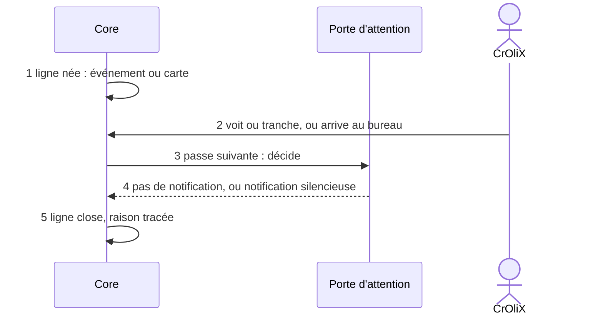

| # | De → vers | Par quoi | Ce qui circule | Retour |
|---|---|---|---|---|
| 1 | Core | ingestion | l'événement ou la carte | ligne ouverte |
| 2 | CrOliX → core | geste « vu », carte tranchée, présence ouverte, pause | — | l'état du core change |
| 3 | Core → porte | lecture des entrées et décision | l'arrivée et les entrées | la sortie choisie |
| 4 | Porte → core | décision | « notifier » ou rien | — |
| 5 | Core | fin de la ligne | la raison | la ligne est close, sa trace est écrite |

Les raisons de fin d'une ligne :

| Raison | Quand | Effet |
|---|---|---|
| envoyée | un appareil au moins a répondu | fin normale |
| expirée | 1 h pour une urgence, 24 h sinon, depuis la date de l'événement ou de la carte | jamais envoyée |
| vue | l'événement a été marqué « vu » (S3.21) | jamais envoyée |
| tranchée | la carte n'est plus en attente dans la dernière lecture du poste | jamais envoyée |
| cachée | un geste tient ou a réglé l'élément | jamais envoyée |
| disparue | l'événement n'est plus en base | jamais envoyée |
| présence | un événement ou une carte « prévenir » avec la présence ouverte (au bureau, même en appel) ; aussi une urgence d'événement récente dite à voix haute | close pour de bon |
| pause | la pause est posée, hors urgences et alertes de santé du core | close pour de bon |
| urgences coupées | le poste source a coupé ses urgences en direct | close pour de bon |
| ancienneté | une urgence d'événement de plus de 5 minutes, au bureau : écrite au fil, sans notification | close pour de bon |

- **Ce que CrOliX voit, et où** :
  - Téléphone : rien pour une ligne close.
  - Une carte retenue au bureau ou en pause n'a que sa place dans la file (compteur) ; un événement « prévenir » n'a
    que sa ligne au Journal : pas de compteur (S9.15).
- **Ce qui s'écrit** : l'état et la raison de la ligne ; une trace dans le registre de la porte pour chaque fin.
- **Qui décide** : la porte d'attention, sur les entrées qu'elle lit à cette passe.
- **Erreurs et cas limites** :
  - **Rien n'est retenu en attente du départ de CrOliX.** Une ligne « prévenir » croisée à la présence est close tout
    de suite ; si CrOliX part ensuite, rien n'est renvoyé (test : un « prévenir » né au bureau ne part pas à la fin de
    la présence).
  - Une carte qui attend ses 2 min de regroupement est réexaminée à chaque passe : si CrOliX arrive entre-temps, elle
    est close.
  - Une lecture des entrées qui échoue pour un seul poste n'arrête pas les autres ; la ligne d'un poste dont la lecture
    échoue attend, sauf urgence.
  - Un événement vu sur le téléphone avant l'envoi : close « vue », rien ne part.
  - La trace de fin n'a pas pu être écrite : la ligne est close quand même, jamais remise en file.
  - La pause n'a aucun effet sur une urgence : une carte urgente notifie pendant la pause.
  - Une ligne expirée est close « expirée » avant toute lecture des entrées de la porte, même illisibles.
- **Écart avec les décisions** : F4 (notification au téléphone s'il part sans avoir vu) : non codé ; T26.
- **Non vérifié** : une notification déjà affichée est-elle retirée quand la carte est tranchée ou l'événement vu
  ailleurs ? Aucun code ne la ferme. Mais l'étiquette d'un envoi groupé est son type, et le navigateur remplace une
  notification de même étiquette : un nouveau lot remplace donc l'ancien. C'est le comportement standard du
  navigateur, non testé ici.

---

### S9.14 · Ouvrir une notification sur le téléphone

- **Déclencheur** : le téléphone reçoit un message de notification, puis CrOliX touche la notification.
- **Acteurs** : le téléphone, le service de notification du panneau, CrOliX.
- **Avant** : abonnement actif ; le panneau installé.

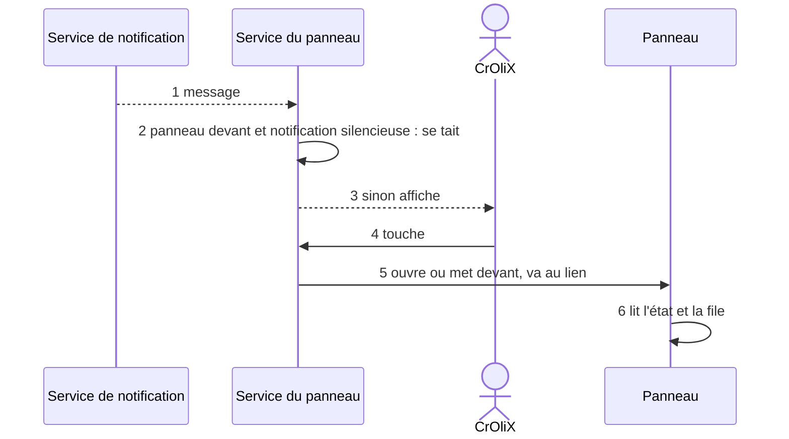

| # | De → vers | Par quoi | Ce qui circule | Retour |
|---|---|---|---|---|
| 1 | Service → téléphone | message | titre, texte, lien, étiquette, silencieux ou non | — |
| 2 | Service du panneau | règle | une notification silencieuse dont l'étiquette ne commence pas par « event: » n'est pas montrée si une fenêtre de l'app est au premier plan | rien n'est affiché |
| 3 | Service du panneau → CrOliX | affichage | titre, texte, icône, vibration si avec son | la notification |
| 4-5 | CrOliX → service | touche | le lien | la fenêtre du panneau existante est mise devant et va au lien, sinon une fenêtre s'ouvre |
| 6 | Panneau → core | lecture | rien | la carte désignée s'ouvre dans le Bureau ou À trancher |

- **Ce que CrOliX voit, et où** :
  - Téléphone : la notification, ou rien si le panneau est au premier plan (cas d'une carte : son compteur a déjà
    bougé).
  - Panneau : la carte désignée, sinon le Bureau.
- **Ce qui s'écrit** : rien.
- **Qui décide** : le service du panneau, par la règle ci-dessus ; CrOliX en touchant.
- **Erreurs et cas limites** :
  - La règle suppose que le compteur a déjà bougé (le commentaire du code le dit). C'est vrai pour une carte ; c'est
    **faux pour un événement « prévenir »** (S9.15) : une notification d'événement envoyée à un téléphone dont le panneau
    est au premier plan n'est ni affichée ni comptée.
  - Une urgence d'événement s'affiche toujours (son étiquette commence par « event: »), même panneau devant.
  - Une urgence de carte silencieuse (plage de nuit) suit la règle des silencieuses : cachée si le panneau est devant.
- **Écart avec les décisions** : aucun connu (écart noté : S9.15).
- **Non vérifié** : la navigation vers l'adresse de la carte côté panneau et ses cas (carte déjà tranchée) ; aucun
  test du service.

---

### S9.15 · Les compteurs et pastilles communs

- **Déclencheur** : tout ce qui change la file : un geste, une urgence, une lecture de poste, un rappel qui tombe ; ou
  une ouverture de surface.
- **Acteurs** : le core, le panneau (téléphone, bureau).
- **Avant** : au moins une lecture de poste (le core ne rappelle aucun poste pour calculer).

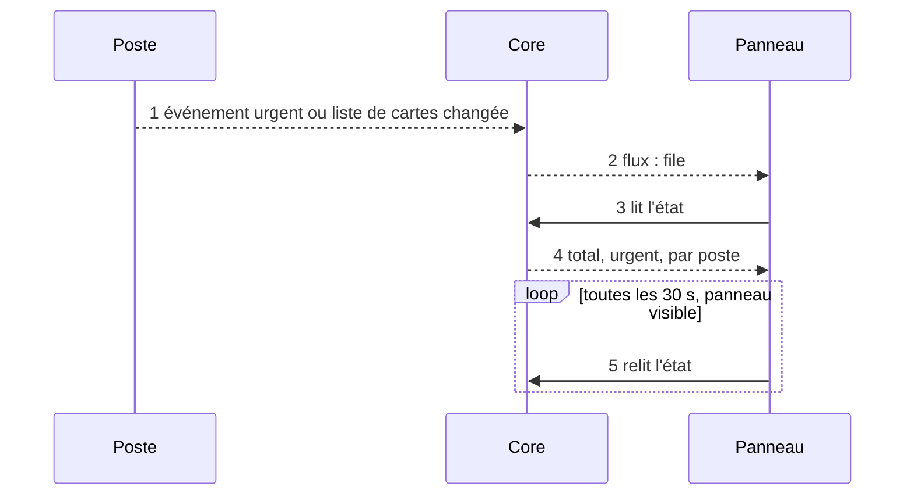

| # | De → vers | Par quoi | Ce qui circule | Retour |
|---|---|---|---|---|
| 1 | Poste → core | flux d'événements, ou lecture des cartes (toutes les 120 s, ou 50 ms après un événement) | l'événement, ou la liste des cartes en attente | le core compare à sa dernière lecture |
| 2 | Core → surfaces | flux en direct : file | rien | seulement si quelque chose a changé |
| 3-4 | Panneau → core | lecture de l'état | rien | le total (urgences non vues du jour, cartes en attente, échéances de la bibliothèque), l'urgent, le compte et la fraîcheur de chaque poste |
| 5 | Panneau → core | relecture périodique | rien | l'état, toutes les 30 s tant que la page est visible, et au retour de la page |

- **Ce que CrOliX voit, et où** :
  - Panneau : le core calcule un total, un compte par poste, et une liste de bandeaux (postes injoignables, pause,
    plafond). Leur rendu sur le téléphone et au bureau n'a pas été relu (voir Non vérifié).
  - Fenêtre de Lun'Luxuria : **aucun compteur** ; le code n'appelle aucune route d'état ni de file.
  - Après un geste du panneau, il relit tout de suite l'état et la file.
- **Ce qui s'écrit** : rien ; tout est dérivé de la dernière lecture de chaque poste et des gestes tenus.
- **Qui décide** : le code ; la lecture de chaque poste fixe ce qui est en attente.
- **Erreurs et cas limites** :
  - Ce qui compte : urgences non vues du jour de Natsume, hors rappels passés, hors postes dont les urgences en direct
    sont coupées ; cartes en attente (un lot de cartes de même nom et de même sorte compte pour un, une carte qui
    envoie ou qui pose une question reste seule) ; échéances de la bibliothèque non repoussées.
  - Un événement « prévenir » (normal), « signaler » ou plus bas **n'a pas de compteur**, que CrOliX soit au bureau ou
    non ; le standard promet une pastille.
  - Un événement urgent d'un poste fait bouger le compteur tout de suite ; un événement urgent du core lui-même
    n'émet pas « file » (relu au plus tard à la relecture de 30 s).
  - Une lecture de poste de plus de 5 minutes, ou en échec, met ses cartes en lecture seule (« périmée ») : le compteur
    garde sa valeur, marquée périmée.
  - Une carte tenue ou réglée disparaît du compte tout de suite, et reste cachée jusqu'à une lecture du poste plus
    récente que le règlement (24 h au plus), sauf un échec.
  - Le core injoignable : le panneau garde le dernier état et passe en lecture seule.
  - Un poste à l'état « à relier » ne montre rien de ce qu'il a lu : ses cartes sortent de la file et du total, sur
    toutes les surfaces. Un poste injoignable ou muet garde ses cartes en lecture seule, avec la raison du poste (pas
    « périmée »).
- **Écart avec les décisions** : le standard des notifications dit « les compteurs sont communs à tous les supports »
  et donne une pastille aux paliers « prévenir » et « signaler » ; le code ne compte que les urgences d'événements, les
  cartes et les échéances ; T26, T29.
- **Non vérifié** : l'affichage de la pastille du bureau de Natsume (famille 8). Où et comment le panneau montre-t-il
  la pastille de « À trancher », les décomptes par poste, le compte du Bureau et la bande des postes injoignables,
  de la pause et du plafond ? Seul le calcul du core a été relu.

---

### S9.16 · Le retour au PC après le téléphone

- **Déclencheur** : la fenêtre de Lun'Luxuria ouvre une présence (arrivée de CrOliX au desktop) après qu'il s'est servi
  du téléphone.
- **Acteurs** : CrOliX, la fenêtre de Lun'Luxuria, le core, le fournisseur du modèle.
- **Avant** : un panneau s'est servi d'une requête depuis la dernière parole de Natsume.

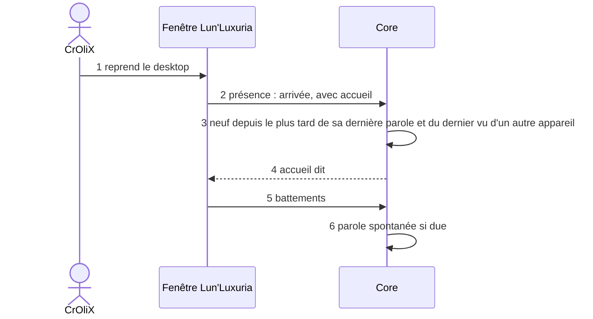

| # | De → vers | Par quoi | Ce qui circule | Retour |
|---|---|---|---|---|
| 1-2 | Fenêtre → core | `POST /api/presence`, « started » | drapeaux de S9.10 ; « accueil » si réglé | 204 |
| 3 | Core | lecture | la dernière parole de Natsume, hors urgences écrites la nuit ; la dernière activité des **autres** appareils appairés (jamais celui qui arrive) | la borne du « neuf » |
| 4 | Core → fenêtre | parole d'accueil | un bloc : accueil, comment il va, puis ce qui est neuf (cinq lignes au plus, rappels exclus), « déjà là » en nombre, « à venir » (l'agenda, quatre lignes au plus) | la fenêtre le dit |
| 5 | Fenêtre → core | battement | drapeaux | 204 ; la parole spontanée est évaluée à chaque battement |
| 6 | Core | porte de la parole spontanée | présence, occupation, sourdine, quota du jour, silence depuis l'arrivée, depuis le dernier message, depuis la dernière parole spontanée | une phrase ou rien |

- **Ce que CrOliX voit, et où** :
  - Fenêtre : l'accueil dit. Si la présence n'a pas été close ou qu'il revient en moins de 30 min, une seule phrase fixe,
    « Te revoilà. », sans modèle.
  - Téléphone : la phrase d'accueil se lit au fil.
- **Ce qui s'écrit** : le message d'accueil, le coût de son tour.
- **Qui décide** : le code choisit « court » ou « complet » ; le modèle écrit l'accueil complet ; il ne cite que le
  « neuf ».
- **Erreurs et cas limites** :
  - L'activité du téléphone compte comme **vue** : une carte arrivée avant le dernier passage du panneau est « déjà là ».
  - L'activité est écrite au plus toutes les 60 s et pour tout appel authentifié (pas seulement la lecture de l'état).
  - Le prompt de chaque tour donne l'heure et la surface du message de CrOliX qui précède celui auquel Natsume répond
    (« sur mobile », « sur le PC », « à la voix », « en terminal »). Ce n'est pas la surface du message en cours.
    Au-delà de 12 h, cette ligne devient « CrOliX n'avait rien écrit depuis … (son dernier message : …) ».
  - La parole spontanée se tait pendant une conversation sur une autre surface. Déclencheur : un battement de la
    fenêtre pendant qu'une réponse du fil principal est en attente, par exemple une question écrite au téléphone.
    Le core refuse tant qu'une réponse est en attente dans le fil principal. Il exige aussi un silence réglable depuis
    l'arrivée, depuis le dernier message du fil principal (toute surface, tout rôle) et depuis la dernière parole
    spontanée. Il compte le quota du jour et deux paroles sans réponse au plus. Un message de CrOliX sur le fil
    principal, de n'importe quelle surface, remet ce compteur à zéro. Le core ne la lance pas non plus en appel ni en
    sourdine. Retour : rien, tant que ces conditions ne sont pas toutes remplies.
  - Un accueil qui échoue ne coûte pas la présence.
- **Écart avec les décisions** : aucun connu.
- **Non vérifié** : le texte de la parole spontanée (famille 8).

---

### S9.17 · Une surface revient après une coupure du flux

- **Déclencheur** : le flux d'une surface est coupé (réseau, mise en veille, redémarrage du core), puis revient.
- **Acteurs** : la surface, le core.
- **Avant** : un flux ouvert avant la coupure.

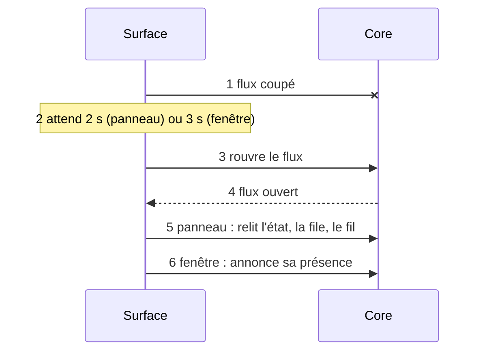

| # | De → vers | Par quoi | Ce qui circule | Retour |
|---|---|---|---|---|
| 1 | — | coupure | — | le panneau retente après 2 s, la fenêtre après 3 s ; l'état « relié » de la fenêtre passe à faux |
| 3-4 | Surface → core | ouverture du flux | le jeton | flux ouvert |
| 5 | Panneau → core | lectures de reprise | rien | l'état et la file ; le fil courant seulement si le panneau n'attend pas lui-même une réponse |
| 6 | Fenêtre → core | présence (Lun'Luxuria, `src/session.svelte.ts:333-343`, `:386-389`) | toujours « started » (jamais un simple battement), avec ses drapeaux et « accueil » si réglé et pas en sourdine | 204 ; la présence est encore vivante (moins de 90 s sans battement), le core dit donc l'accueil court « Te revoilà. » |

- **Ce que CrOliX voit, et où** :
  - Panneau : tout se remet à jour d'un coup. Si l'état ne se relit pas, il garde son dernier instantané en lecture
    seule (« Natsume est injoignable »).
  - Fenêtre : le message d'erreur du serveur s'efface au retour ; une phrase en cours de lecture est
    coupée à la perte du flux ; l'état « réfléchit » s'éteint.
- **Ce qui s'écrit** : rien de nouveau. Au redémarrage du core, les réponses restées en attente sont marquées en erreur.
- **Qui décide** : le code de chaque surface.
- **Erreurs et cas limites** :
  - Aucun événement n'est rejoué : la fenêtre **perd les phrases dites** pendant la coupure (elles restent écrites au
    fil) ; elle ne relit pas le fil à la reconnexion, d'après le code lu (déduit).
  - À la reconnexion, le panneau relit toujours l'état et la file. Il ne relit le fil que s'il n'attend pas lui-même
    une réponse : quand une réponse se forme dans cet onglet, la relecture du fil est sautée.
  - Un retour du flux de la fenêtre refait une arrivée. Déclencheur : le flux est coupé (la voix s'arrête,
    « réfléchit » s'éteint), puis revient 3 s plus tard. La fenêtre envoie « started ». La présence étant encore
    vivante, le core met la ligne à jour sans nouvel événement au Journal, répond 204 et dit « Te revoilà. »
    (origine accueil), écrit au fil principal (surface voix). Tous les panneaux reçoivent « message ». Chaque
    coupure du flux de plus de 3 s, CrOliX restant devant le desktop, fait donc dire « Te revoilà. ».
  - Jeton refusé à la reconnexion : S9.18.
  - Un battement refusé (410) : la fenêtre se ré-annonce ; c'est une arrivée, avec le court « Te revoilà. » si elle
    est revenue en moins de 30 min.
  - La requête d'un message coupée à mi-réponse : la réponse continue et s'enregistre, le core ne dépend pas de la
    requête qui l'a lancée.
- **Écart avec les décisions** : aucun connu.
- **Non vérifié** : ce que le panneau affiche si sa propre requête de réponse est coupée avant la fin ; le sort d'une
  parole entamée par la fenêtre pendant la coupure. Quel texte la fenêtre affiche-t-elle quand elle n'est plus
  reliée ? Le code passe l'état à faux, le texte n'a pas été lu.

---

### S9.18 · Un appareil révoqué

- **Déclencheur** : CrOliX révoque un appareil depuis l'Atelier d'une autre surface (ou le terminal du core).
- **Acteurs** : CrOliX, le core, l'appareil révoqué, ses abonnements de notification.
- **Avant** : deux appareils appairés au moins.

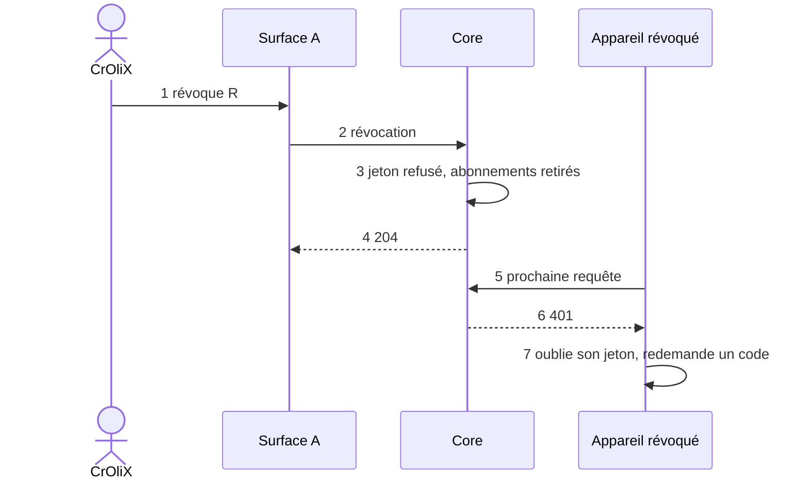

| # | De → vers | Par quoi | Ce qui circule | Retour |
|---|---|---|---|---|
| 1-2 | CrOliX → surface A → core | révocation de l'appareil | son identifiant | 204 ; 404 si inconnu ; la liste ne propose pas de révoquer l'appareil qu'on tient en main |
| 3 | Core | écriture | date de révocation ; abonnements de cet appareil supprimés | — |
| 5-6 | Appareil → core | toute requête | l'ancien jeton | 401 « Jeton absent, invalide ou révoqué » |
| 7 | Appareil | réaction | — | le panneau retourne à la page d'appairage avec « révoqué » ; la fenêtre de Lun'Luxuria recharge et redemande un code |

- **Ce que CrOliX voit, et où** :
  - Surface A : l'appareil sort de la liste.
  - Appareil révoqué : la page d'appairage, avec la raison.
  - Fenêtre de Lun'Luxuria révoquée : l'arrivée redemande un code ; son astre dans le panneau passe « à relier ».
- **Ce qui s'écrit** : la date de révocation ; les abonnements retirés. Rien au Journal.
- **Qui décide** : CrOliX ; le code refuse le jeton à chaque requête.
- **Erreurs et cas limites** :
  - Le panneau ne s'en aperçoit qu'à la requête suivante : la relecture de l'état toutes les 30 s (page visible), ou
    n'importe quel geste ; la fenêtre, à son prochain battement (30 s) ou envoi.
  - Un flux déjà ouvert d'un appareil révoqué **n'est pas coupé** : le jeton n'est vérifié qu'à l'ouverture, d'après la
    boucle du flux. Il continue de recevoir les événements jusqu'à sa fermeture (déduit).
  - Un navigateur révoqué garde son abonnement chez lui ; au réappairage il le redit au core (S9.11).
  - L'écran de l'Atelier n'offre pas de révoquer l'appareil en main ; la route du core ne l'interdit pas.
  - Plus aucun appareil vivant : le core redonne un premier code à la page locale de la machine.
  - La révocation ne ferme pas la présence. Le battement suivant de la fenêtre révoquée est refusé (401), donc la
    présence reste ouverte jusqu'à 90 s après son dernier battement accepté. Pendant ce temps, la porte croit encore
    CrOliX au bureau. L'astre du desktop est lu « à relier » dès la révocation, sauf si un autre appareil
    Lun'Luxuria non révoqué existe.
- **Écart avec les décisions** : aucun connu.
- **Non vérifié** : la fermeture réelle d'un flux révoqué (aucun test) ; l'écran exact après la révocation de la fenêtre
  de Lun'Luxuria.
