# Famille 10 · La pause, les plafonds, les coûts

Cette famille couvre ce qui arrête l'écosystème et ce que cela coûte. La pause : qui la pose (CrOliX, ou un plafond
atteint), où elle se pose (le core, ou un poste seul), ce qu'elle arrête, ce qu'elle laisse passer, comment elle se
lève. Les coûts : ce que chaque appel de modèle coûte, où c'est compté, ce qui remonte et à quelle cadence. Les
plafonds : par jour, par mois, par poste, et ce qui se passe quand l'un est atteint. Les six chapitres déjà écrits
renvoient ici pour la nuit sautée (S6.14), le plafond de la bibliothèque (S6.5) et le plafond de la nuit (S6.8).

Il y a **deux pauses de force inégale**. Celle du core est une seule pause, posée à la main ou par un plafond, et
relayée aux postes. Celle d'un poste est la sienne (« locale ») : CrOliX la pose dans l'écran du poste, le core ne
peut pas la lever. Les plafonds, eux, sont **plusieurs et indépendants** : celui du core (jour, mois), celui que le
core met à chaque poste, celui de l'agent de Lun'Acedia, celui de Lun'Avaritia, celui de Lun'Luxuria seule.

| Id | Titre | En une ligne |
|---|---|---|
| S10.1 | Mettre Natsume en pause à la main | Un geste du panneau, une pause stockée, une ligne au Journal, un relais aux postes |
| S10.2 | Reprendre, et reprendre sous un plafond | La pause manuelle se lève ; un plafond atteint la remplace |
| S10.3 | Ce que la pause arrête et laisse passer, chez le core | Routines sautées, alertes tenues, conversation ouverte |
| S10.4 | Le relais de la pause aux postes | Un ordre `by: core`, un accusé, un rappel à chaque reconnexion |
| S10.5 | Ce qu'un poste fait sous la pause du core | Lun'Acedia et Lun'Avaritia : l'automatique s'arrête, les demandes passent |
| S10.6 | La pause propre d'un poste | Posée dans son écran, plus forte, le core la voit « muette » |
| S10.7 | Une demande confiée à un poste en pause | Réponse normale sous la pause du core, phrase de pause sous la pause locale |
| S10.8 | Le tri des mails pendant une pause | Les règles seules sous le core, rien sous la pause locale |
| S10.9 | Les lots de la bibliothèque, en pause ou au plafond | Reçus, gardés, traités à la reprise |
| S10.10 | Compter le coût d'un tour de conversation | Un prix par modèle, une ligne par appel, au core |
| S10.11 | Le coût d'un tour coupé ou en échec | Ce qui a coulé est facturé, estimé si le fournisseur ne le dit pas |
| S10.12 | Le coût d'une demande confiée à un poste | Compté chez le poste, repris dans `cost`, relu par la lecture des coûts |
| S10.13 | La lecture des dépenses des postes | `GET /lun/v1/costs`, toutes les deux minutes, gardée en cache |
| S10.14 | Voir les dépenses | Le panneau (état, Atelier) et la route des coûts, poste par poste |
| S10.15 | D'où viennent les prix | Une table par fournisseur, des surcharges de l'instance, un prix inconnu |
| S10.16 | Régler les plafonds | Jour, mois, comportement au plafond, alerte à 80 % |
| S10.17 | Plafond du jour atteint, avec pause | La conversation se ferme, les postes sont mis en pause, jusqu'à 5 h |
| S10.18 | Plafond du mois atteint | Même chose jusqu'au 1er du mois suivant, le mois passe avant le jour |
| S10.19 | « Prévenir seulement » et l'alerte à 80 % | Un événement une fois par jour ou par mois, aucune pause |
| S10.20 | Le plafond d'un poste, fixé par le core | Une délégation refusée, un lot de la nuit non envoyé |
| S10.21 | Les plafonds propres aux postes | L'agent de Lun'Acedia, ses résumés, le mois de Lun'Avaritia |
| S10.22 | La nuit : son plafond, la pause, le plafond atteint | Trois arrêts différents, trois traces différentes |
| S10.23 | Lun'Luxuria : plafond seule, plafond du core relié | Des jetons au poste, un message du core, une apparence « plafond atteint » |
| S10.24 | Le changement de jour et de mois | 5 h au core, minuit chez Lun'Acedia et Lun'Avaritia, minuit local chez Lun'Luxuria |
| S10.25 | Crédit épuisé chez Lun'Acedia : le tri par l'IA s'arrête | Un arrêt automatique lié au coût, distinct des deux pauses |

---

### S10.1 · Mettre Natsume en pause à la main

- **Déclencheur** : CrOliX appuie sur « Mettre en pause » dans le panneau (le bouton de la fiche de Natsume, celui de
  la colonne de Natsume, ou la commande de la palette).
- **Acteurs** : CrOliX, le panneau, le core, les postes appairés.
- **Avant** : le panneau est relié au core. Le core n'a pas de pause manuelle en cours.

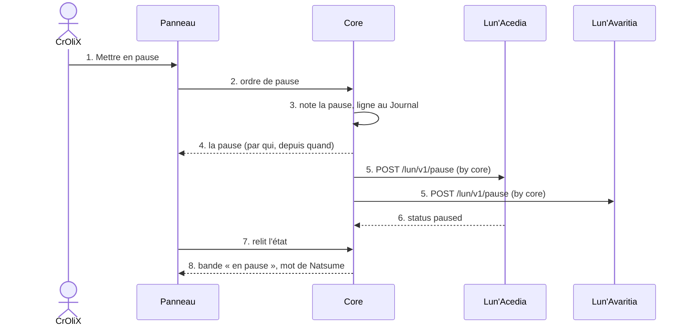

| # | De → vers | Par quoi | Ce qui circule | Retour |
|---|---|---|---|---|
| 1 | CrOliX → panneau | un geste | rien de plus | — |
| 2 | Panneau → core | ordre de pause, sans corps | aucun champ : ni durée, ni motif | la pause : `by` = manuelle, `since` (l'instant) |
| 3 | Core → core | écriture | la pause manuelle (depuis quand), puis la pause en cours | une ligne « Mise en pause » au Journal |
| 4 | Core → panneau | réponse de l'ordre | `pause` : `by`, `since`, pas de `until` | un toast « Natsume en pause. » |
| 5 | Core → chaque poste | `POST /lun/v1/pause` | `{ by: "core" }` (voir S10.4) | `200` `{ status: "paused" }` ou `409` |
| 6 | Poste → core | réponse | le statut ; le poste garde aussi sa propre pause à part | un accusé noté par le core |
| 7 | Panneau → core | relecture de l'état | — | `pause`, `natsume` = pause, bande « pause » |
| 8 | Core → panneau | l'état | la bande « Natsume est en pause depuis… Rien d'automatique ne tourne, sauf les urgences » | bouton « Reprendre » |

- **Ce que CrOliX voit, et où** : la bande « Natsume est en pause depuis… Rien d'automatique ne tourne, sauf les
  urgences ; tu peux toujours lui écrire. » avec « Reprendre ». Elle ne s'affiche que si aucun plafond n'est atteint :
  la bande de plafond passe avant celle de la pause, même sous « Prévenir seulement ». Dans ce cas, la bande montre le
  plafond, sans « jusqu'à » et sans bouton « Reprendre » (on reprend alors depuis la fiche, la colonne ou la palette).
  Aussi : le mot de Natsume à « pause », les routines à venir « suspendues » (Constellation, Atelier), un toast.
  Au Journal, une ligne « Mise en pause ». Dans l'écran de chaque poste relié, la carte de service passe à « pause » (Lun'Acedia : « Les
  règles seules rangent »).
- **Ce qui s'écrit** : côté core, la pause manuelle et la pause en cours, une ligne du Journal, la liste des postes
  qui n'ont pas accusé. Côté poste, un drapeau « en pause par le core » (Lun'Acedia, `server/src/contract/state.ts:33`).
- **Qui décide** : CrOliX décide de poser la pause. Du code décide du reste : une pause manuelle l'emporte sur un
  plafond atteint, et ne garde pas de fin.
- **Erreurs et cas limites** :
  - Ordre répété : le core répond encore la pause et n'écrit pas de seconde ligne au Journal.
  - Core injoignable depuis le panneau : toast « Natsume n'a pas pu se mettre en pause. », rien n'est posé.
  - Poste hors ligne au moment de l'ordre : voir S10.4.
- **Écart avec les décisions** : T13 (deux pauses de force inégale) : voir S10.6. Autrement, aucun connu.
- **Non vérifié** : rien.

---

### S10.2 · Reprendre, et reprendre sous un plafond

- **Déclencheur** : CrOliX appuie sur « Reprendre » (bande, fiche de Natsume, colonne de Natsume, palette).
- **Acteurs** : CrOliX, le panneau, le core, les postes.
- **Avant** : une pause existe, manuelle ou due à un plafond.

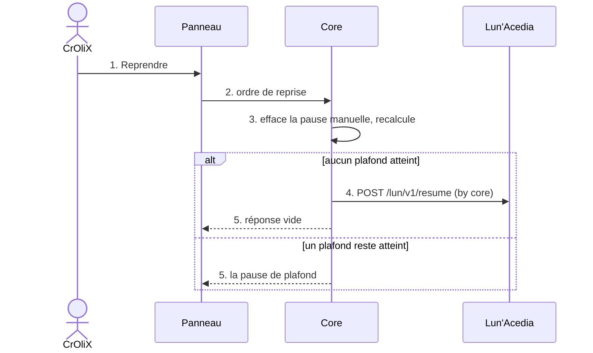

| # | De → vers | Par quoi | Ce qui circule | Retour |
|---|---|---|---|---|
| 1 | CrOliX → panneau | un geste | — | — |
| 2 | Panneau → core | ordre de reprise, sans corps | aucun champ | `{}` si plus aucune pause, sinon `{ pause }` |
| 3 | Core → core | écriture puis recalcul | la pause manuelle effacée ; la pause voulue est recalculée sur la dépense | « Reprise » au Journal, ou « Pause au plafond du jour/mois » |
| 4 | Core → chaque poste | `POST /lun/v1/resume` | `{ by: "core" }` | `200` ou `409` (déjà actif : tenu pour un accusé) |
| 5 | Core → panneau | réponse | `{}` : toast « Natsume reprend. » ; sinon la pause de plafond : pas de toast, la bande de plafond reste | — |

- **Ce que CrOliX voit, et où** : la bande « pause » disparaît ; ou, si un plafond est encore atteint, elle est
  remplacée par la bande « Plafond du jour atteint : X sur Y. Natsume est en pause jusqu'à… » avec « Relever le
  plafond ». Au Journal : « Reprise », ou « Pause au plafond… ».
- **Ce qui s'écrit** : la pause manuelle effacée ; une ligne du Journal par changement de cause ; l'événement
  « Plafond du jour/mois atteint » **de nouveau** si la reprise fait passer de la pause manuelle à la pause de plafond
  (la cause change, donc le core note et prévient encore).
- **Qui décide** : CrOliX décide de reprendre. Du code décide si un plafond impose encore la pause.
- **Erreurs et cas limites** :
  - Reprise sans pause : réponse `{}`, aucune ligne au Journal.
  - Pause manuelle posée pendant qu'un plafond est atteint (sous « Mettre en pause » comme sous « Prévenir
    seulement »), ou plafond atteint pendant une pause manuelle : la bande est celle du plafond, sans « jusqu'à »
    (la fin n'est donnée que pour une pause de plafond), « Plafond du jour atteint : X $ sur Y $. » avec « Relever le
    plafond ». La bande de pause et son bouton « Reprendre » ne s'affichent pas : on reprend par la fiche de Natsume,
    sa colonne ou la palette. Après la reprise, si le plafond reste atteint sous « Mettre en pause », la bande prend
    « jusqu'à… ».
  - Pause de plafond puis pause manuelle par-dessus : le Journal note « Mise en pause », la conversation reste
    fermée (le plafond, lui, ferme toujours la conversation), les postes ne sont pas relancés (déjà en pause).
  - Les postes ne reçoivent un ordre que quand l'état « en pause » change, pas quand seule la cause change.
- **Écart avec les décisions** : aucun connu.
- **Non vérifié** : rien.

---

### S10.3 · Ce que la pause arrête et laisse passer, chez le core

- **Déclencheur** : une pause manuelle ou de plafond est en vigueur au core.
- **Acteurs** : le core, ses routines, sa porte d'attention, le panneau.
- **Avant** : S10.1 ou S10.17 s'est jouée.

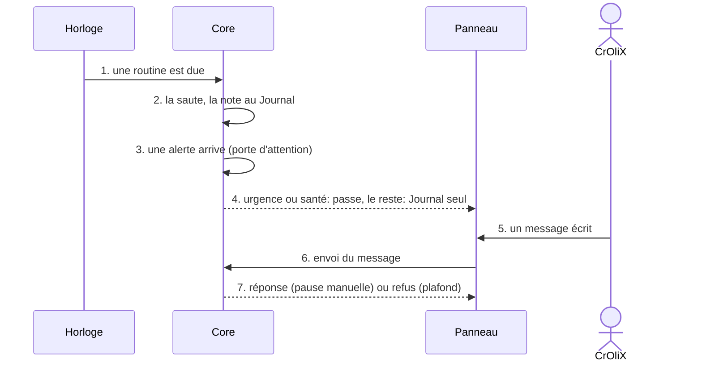

| # | De → vers | Par quoi | Ce qui circule | Retour |
|---|---|---|---|---|
| 1 | Horloge → core | tick du moteur des routines | l'heure du créneau de la nuit ou de la lettre | le core demande l'état de la pause |
| 2 | Core → core | routine sautée | le nom de la routine, la raison « en pause » | une exécution « sautée » (le créneau compte comme fait), une ligne au Journal |
| 3 | Core → core | porte d'attention | l'alerte, son palier, la pause en cours | la décision (voir ci-dessous) |
| 4 | Core → panneau | notification ou ligne de Journal | une urgence ou une alerte de santé passe ; une autre alerte ou une carte non urgente n'a que sa ligne au Journal | voix ou notification seulement pour ce qui passe |
| 5 | CrOliX → panneau | un message écrit ou parlé | le texte | — |
| 6 | Panneau → core | envoi du message | le texte, la surface | un flux de réponse |
| 7 | Core → panneau | la réponse | pause manuelle : réponse normale ; pause de plafond : message en erreur « Plafond du jour atteint… » | — |

Ce qui **s'arrête** sous la pause (manuelle ou de plafond) : les deux routines (la nuit de 5 h, la lettre de 7 h 30,
chacune sautée et notée, jamais rattrapée) ; les alertes de palier normal, bas ou info, qui n'ont plus que leur ligne
de Journal. Ce qui **passe** : les urgences, les alertes de santé du core (plantage, copie ratée, clé refusée, crédit
épuisé, conversation non configurée, clé qui expire, poste injoignable, plafond atteint) ; la lecture des postes
(cartes, coûts) ; les décisions de CrOliX sur les cartes ; le lancement d'une routine à la main (S6.16) ; la copie de
la base. La conversation **reste ouverte** sous la pause manuelle ; elle se **ferme** sous un plafond atteint.

- **Ce que CrOliX voit, et où** : la bande, le mot de Natsume « pause », les routines « suspendues », une exécution
  « sautée » au Journal (Atelier, Constellation) ; le matin, au lieu de la lettre : « Pas de lettre ce matin : Natsume
  était en pause à 07:30. ». Les bandes « poste muet » et « poste injoignable » sont tues pendant une pause.
- **Ce qui s'écrit** : une exécution « sautée » par créneau, les lignes du Journal, l'événement d'alerte tenu.
- **Qui décide** : du code décide, sur l'état de la pause, du palier de l'alerte et de la source (le core ou un poste).
- **Erreurs et cas limites** :
  - La pause ne peut pas être lue pendant un tick : le créneau reste dû, le tick suivant redemande.
  - Une alerte venue d'un poste et de palier normal pendant la pause : Journal seul, ni voix, ni notification. Qu'elle
    ne soit pas rejouée à la reprise est le constat T26 de la carte (rejeu : voir Non vérifié).
  - La parole spontanée : voir Non vérifié.
- **Écart avec les décisions** : T26 (alerte non urgente pendant une pause, sans rejeu). F4 (pastille puis notification
  au départ) n'est pas codé. Le dictionnaire dit « CrOliX peut toujours écrire » : il le peut, mais sous un plafond la
  réponse est un refus (voir S10.17).
- **Non vérifié** : si la parole spontanée de Natsume s'arrête sous la pause : son code ne lit pas la pause, la porte
  d'attention seule la tient peut-être ; non confirmé. Quel est l'intervalle du moteur des routines (seul celui du
  contrôle des plafonds, 60 s, a été lu) ? Une alerte non urgente tenue pendant la pause est-elle rejouée à la reprise ?

---

### S10.4 · Le relais de la pause aux postes

- **Déclencheur** : l'état « en pause » du core change (pause posée, levée, plafond atteint ou levé), ou un poste ouvre
  son flux d'événements (connexion, reconnexion, nouvel appairage).
- **Acteurs** : le core, chaque poste appairé.
- **Avant** : un poste est appairé avec un jeton lisible.

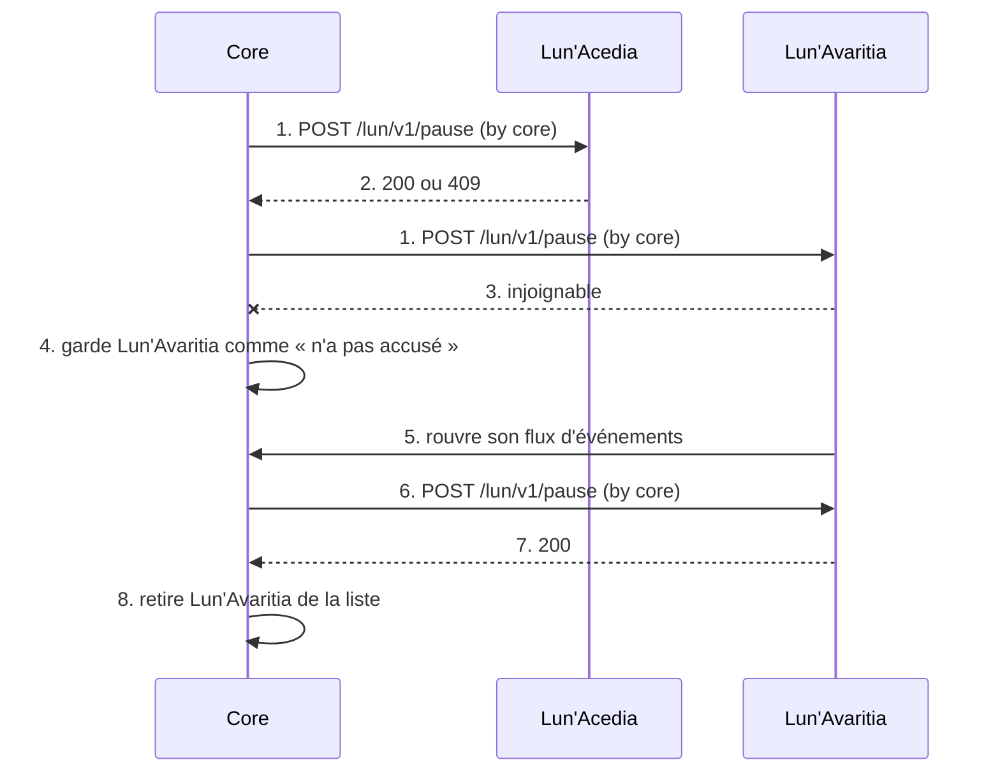

| # | De → vers | Par quoi | Ce qui circule | Retour |
|---|---|---|---|---|
| 1 | Core → poste | `POST /lun/v1/pause` ou `POST /lun/v1/resume`, délai de 8 s | `{ by: "core" }` : ni raison, ni durée | `200` avec le statut, ou `409` |
| 2 | Poste → core | réponse | `200` ou `409` : les deux comptent comme un accusé | le poste sort de la liste « n'a pas accusé » |
| 3 | Poste → core | échec | réseau coupé, délai, jeton illisible, autre code HTTP | le poste reste (ou entre) dans la liste |
| 4 | Core → core | écriture | la liste des postes qui n'ont pas accusé | — |
| 5 | Poste → core | ouverture de son flux d'événements | rien de propre à la pause | — |
| 6 | Core → poste | pause renvoyée si le core est en pause ; reprise renvoyée seulement si le poste la doit encore | `{ by: "core" }` | — |
| 7-8 | Poste → core, core → core | accusé, mise à jour de la liste | — | la liste se vide |

- Lun'Acedia et Lun'Avaritia traitent l'ordre pareil : `by: "core"` pose ou lève leur drapeau « pause du core »,
  indépendant du drapeau local (Lun'Acedia, `server/src/contract/routes.ts:264-279` ; Lun'Avaritia,
  `server/src/contract/routes.ts:123-137`). Une pause déjà posée de la même origine répond `409` « Déjà en pause » ;
  une reprise sans pause de cette origine répond `409` « Déjà actif ». Un corps invalide répond `400`.
- **Ce que CrOliX voit, et où** : rien de dédié si tout va bien. Un poste qui n'a pas accusé n'a pas de bande : sa
  carte de service dans son propre écran dit encore « actif ». Aucune alerte n'est levée sur un relais raté.
- **Ce qui s'écrit** : la liste des postes sans accusé, côté core ; le drapeau « pause du core », côté poste.
- **Qui décide** : du code décide, sans CrOliX. Les envois partent en même temps vers tous les postes, mais les
  envois successifs sont rangés l'un après l'autre : un accusé en retard n'écrase jamais un état plus récent.
- **Erreurs et cas limites** :
  - Un poste hors ligne à la pause reçoit l'ordre à sa reconnexion ; à chaque reconnexion tant que la pause dure.
  - Un poste hors ligne à la reprise reçoit la reprise à sa reconnexion, et seulement là.
  - Un poste appairé pendant une pause reçoit la pause dès l'ouverture de son flux.
  - Un poste sans jeton lisible : l'envoi est compté « sans accusé », réessayé à la reconnexion.
  - Un poste qui ne parle pas le contrat 1.4 ou plus est tenu pour muet par le core (carte « À mettre à jour »).
  - Le relais ne suit que le passage « en pause » à « actif » : un plafond atteint pendant une pause manuelle ne
    renvoie rien.
- **Écart avec les décisions** : T13. Le standard (contrat-satellite, § Deux pauses) dit que le `409` vaut accusé :
  c'est bien ce que fait le core.
- **Non vérifié** : le comportement d'un poste qui répond 404 à `/pause` (contrat plus ancien) : le core le traite en
  non-accusé, rien de plus n'a été lu. Au démarrage du core, la pause stockée est-elle réappliquée aux postes avant
  la première minute, et seulement quand la clé qui déchiffre les jetons est lisible ?

---

### S10.5 · Ce qu'un poste fait sous la pause du core

- **Déclencheur** : le poste a reçu `by: "core"` (S10.4).
- **Acteurs** : Lun'Acedia, Lun'Avaritia, leurs modèles.
- **Avant** : le poste est « en pause par le core ». Il n'est pas aussi en pause locale.

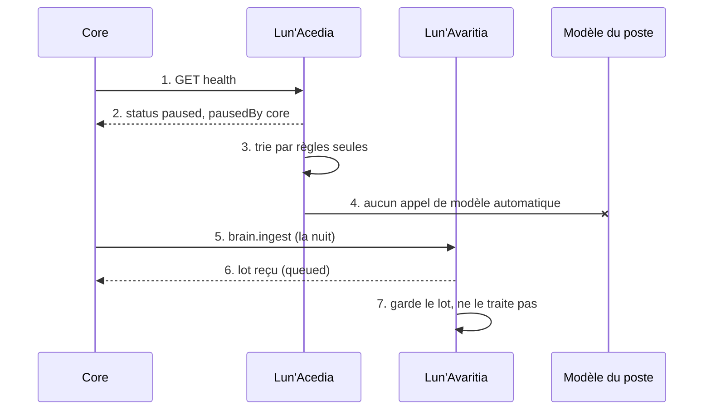

| # | De → vers | Par quoi | Ce qui circule | Retour |
|---|---|---|---|---|
| 1 | Core → Lun'Acedia | `GET /lun/v1/health` | — | `status: "paused"`, `pausedBy: "core"`, `contract`, `agent: true` |
| 2 | Lun'Acedia → core | réponse | un état dégradé prime sur la pause : `status: "degraded"` avec `paused: true` à part | — |
| 3 | Lun'Acedia → elle-même | tri des mails | les règles seules sont appliquées | voir S10.8 |
| 4 | Lun'Acedia → modèle | aucun appel | ni tri par l'IA, ni synthèse de mail pour le bilan | — |
| 5 | Core → Lun'Avaritia | `POST /lun/v1/actions/brain.ingest` | les observations du lot | `lot`, `accepted`, `status: "queued"` |
| 6 | Lun'Avaritia → core | réponse | le lot est accepté et écrit même en pause | le core ne lit que le code HTTP |
| 7 | Lun'Avaritia → elle-même | traitement des lots, toutes les heures | rien : un lot en file attend | à la reprise, le traitement repart |

- **Ce que CrOliX voit, et où** : dans Lun'Acedia, la carte de service « pause » avec « Les règles seules rangent » ;
  son bouton « Reprendre le tri » n'apparaît **pas** (il ne lève que la pause de ce front). Dans Lun'Avaritia, son état
  « en pause » (lu sur sa santé). Au core, la bande de pause (S10.1).
- **Ce qui s'écrit** : rien de plus que S10.1 côté core. Côté Lun'Avaritia, un lot « queued » par lot reçu.
- **Qui décide** : du code décide. Le poste répond toujours à ses lectures, ses événements, ses cartes, ses gestes et
  son agent ; seuls ses travaux automatiques par modèle s'arrêtent. Une action demandée par le core s'exécute même en
  pause (le catalogue d'actions de Lun'Acedia le dit en commentaire).
- **Erreurs et cas limites** :
  - Lun'Acedia sans pause locale : son agent répond comme d'habitude (voir S10.7).
  - La synchronisation de Gmail ne contient aucune vérification de pause (recherche faite) : les mails arrivent.
  - Lun'Acedia arrête pourtant une chose qui n'utilise pas le modèle : elle ne pose plus de cartes de chevauchement
    d'agenda (Lun'Acedia, `server/src/agenda/overlaps.ts:173`) ; le contrat promet seulement l'arrêt de ce qui passe
    par le modèle.
  - Poste dégradé et en pause en même temps : Lun'Acedia et Lun'Avaritia répondent `status: "degraded"` avec
    `paused: true` et `pausedBy` à part (Lun'Acedia, `server/src/contract/routes.ts:232-246`). Le core ne regarde que
    `pausedBy` égal à « local » pour tenir le poste « muet » : une pause du core ne le change pas. Dans l'écran de
    Lun'Acedia, la carte de service montre l'état dégradé (clé refusée, crédit) plutôt que la pause ; son bouton
    propose encore de reprendre la pause locale, et seulement elle (Lun'Acedia, `app/src/shell/status.ts:86-103`).
  - L'entretien de Lun'Avaritia (copie de la base, échéance des clés) continue : il n'agit sur rien.
- **Écart avec les décisions** : contrat-satellite (§ Pause du core) : « tout ce qui est automatique et passe par le
  modèle s'arrête » ; le code de Lun'Acedia arrête aussi la pose des cartes de chevauchement. T14 : voir S10.21.
- **Non vérifié** : si l'écran de Lun'Avaritia affiche « pause » pour une pause du core (son bouton, lui, ne lève que
  la pause locale : `app/src/App.svelte:90`).

---

### S10.6 · La pause propre d'un poste

- **Déclencheur** : CrOliX appuie sur « Mettre le tri en pause » (Lun'Acedia) ou la pause du service (Lun'Avaritia),
  dans l'écran du poste lui-même.
- **Acteurs** : CrOliX, le front du poste, le poste, le core.
- **Avant** : le poste est appairé ou non ; le core peut être en pause ou non.

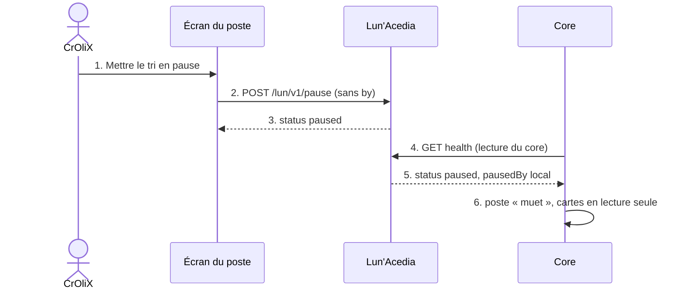

| # | De → vers | Par quoi | Ce qui circule | Retour |
|---|---|---|---|---|
| 1 | CrOliX → front | un geste | — | — |
| 2 | Front → poste | `POST /lun/v1/pause` | `{}` : sans `by`, le poste pose la pause **locale** | `200 { status: "paused" }`, ou `409` si déjà locale |
| 3 | Poste → front | réponse | — | toast « Tri en pause : rien n'est rangé seul » |
| 4 | Core → poste | `GET /lun/v1/health`, à chaque lecture (toutes les deux minutes, ou après un signal) | — | `pausedBy: "local"` (la locale l'emporte sur celle du core) |
| 5 | Poste → core | réponse | — | — |
| 6 | Core → core | état du poste | `pausedBy: "local"` | état « muet », raison « pause locale » |

- **Ce que CrOliX voit, et où** : dans Lun'Acedia, le bouton devient « Reprendre le tri » et la carte dit « Rien n'est
  rangé seul ». Dans le panneau du core, la pastille du poste dit « En pause dans ses réglages » ; ses cartes passent en
  **lecture seule** (raison « pause locale »), et une bande « poste muet » apparaît, sauf si le core est lui-même en
  pause (alors la bande est tue).
- **Ce qui s'écrit** : le drapeau local, côté poste. Rien de plus côté core que l'état lu.
- **Qui décide** : CrOliX, dans l'écran du poste. Le core ne peut pas lever la pause locale : `resume` avec
  `by: "core"` ne lève que celle du core.
- **Erreurs et cas limites** :
  - Le front d'un poste ne propose « Reprendre » que pour sa propre pause : si le poste est en pause **du core**
    seulement, son bouton propose « Mettre en pause » (qui pose alors la pause locale en plus).
  - Les deux pauses cohabitent : le poste annonce `pausedBy: "local"` tant que la locale tient ; lever celle du core
    (`resume by core`) ne le remet pas en service.
  - Une pause locale est lue par le core à la prochaine lecture de ce poste : jusqu'à deux minutes de retard.
- **Écart avec les décisions** : T13 (deux pauses de force inégale) ; T19 (un poste en pause locale est tout de même
  proposé à Natsume : voir S10.7).
- **Non vérifié** : l'écran de Lun'Avaritia pour une pause locale (le front lit `pausedBy` pour décider de son bouton,
  `app/src/App.svelte:86-104`).

---

### S10.7 · Une demande confiée à un poste en pause

- **Déclencheur** : CrOliX demande à Natsume une chose qui passe par un poste ; le modèle du core appelle l'outil de
  délégation.
- **Acteurs** : CrOliX, le core, un poste en pause (du core, ou locale).
- **Avant** : la conversation est ouverte (pause manuelle, ou aucune). Le poste est relié.

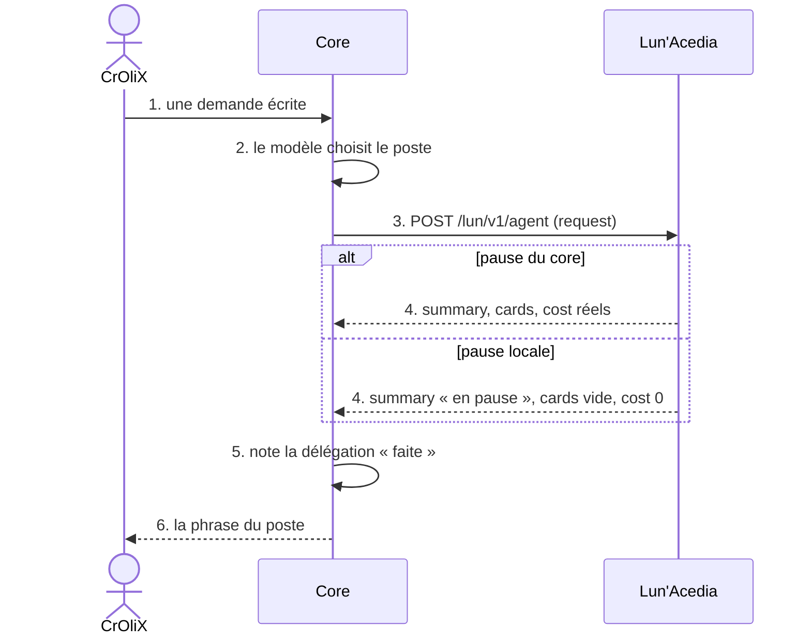

| # | De → vers | Par quoi | Ce qui circule | Retour |
|---|---|---|---|---|
| 1 | CrOliX → core | un message | le texte | — |
| 2 | Core → modèle | appel du tour | la conversation et la liste des postes **reliés** | l'appel d'outil : le poste et la demande réécrite |
| 3 | Core → poste | `POST /lun/v1/agent` | `request` (la demande réécrite). Pas de `context` | voir 4 |
| 4 | Poste → core | réponse | `summary`, `cards[]`, `refs[]`, `cost` | pause du core : une réponse normale ; pause locale : `summary` = la phrase de pause, `cards: []`, `refs: []`, `cost` = 0 |
| 5 | Core → core | trace de délégation | le poste, la demande, l'issue « faite », le coût rendu, le résumé | une ligne au Journal |
| 6 | Core → CrOliX | la réponse | le résumé du poste, repris par Natsume | — |

- **Ce que CrOliX voit, et où** : sous la pause du core, la réponse habituelle du poste et ses cartes dans À trancher.
  Sous la pause locale, la phrase de pause du poste (Lun'Acedia : « Acedia est en pause : rien ne se fait tant qu'elle
  n'est pas reprise » ; Lun'Avaritia : « Avaritia est en pause : je ne fais rien tant qu'elle n'est pas reprise »),
  rendue comme si c'était le résultat ; la délégation est notée « faite ».
- **Ce qui s'écrit** : une ligne de délégation au core ; chez le poste, la demande de l'agent et ses éventuelles cartes.
- **Qui décide** : du code décide de la liste des postes offerts : tout poste **relié** est proposé au modèle, sans
  regarder s'il est en pause locale. Le modèle décide de déléguer ou non. Le poste décide de répondre ou de dire sa
  pause.
- **Erreurs et cas limites** :
  - Sous un plafond du core (S10.17), la conversation est fermée avant tout : rien n'est délégué.
  - Le plafond du poste fixé par le core (S10.20) : la délégation est refusée avant l'appel.
  - Le plafond propre du poste atteint (S10.21) : le poste répond une phrase de plafond, notée « faite » aussi.
  - Une pause locale sans réponse écrite (`summary` vide) : pas de tour de résultat pour Natsume.
- **Écart avec les décisions** : T19 (un poste en pause locale est offert comme un poste en service) : confirmé, voir
  ligne 2. La carte du 27/11 dit aussi que la phrase de pause est tracée « faite » : confirmé.
- **Non vérifié** : le texte exact que Natsume dit à voix haute après une phrase de pause locale (famille 1).

---

### S10.8 · Le tri des mails pendant une pause

- **Déclencheur** : un mail arrive, ou une passe de tri reprend la file, pendant une pause.
- **Acteurs** : Lun'Acedia (Gmail, ses règles, son modèle de tri).
- **Avant** : Lun'Acedia est en pause du core, ou en pause locale.

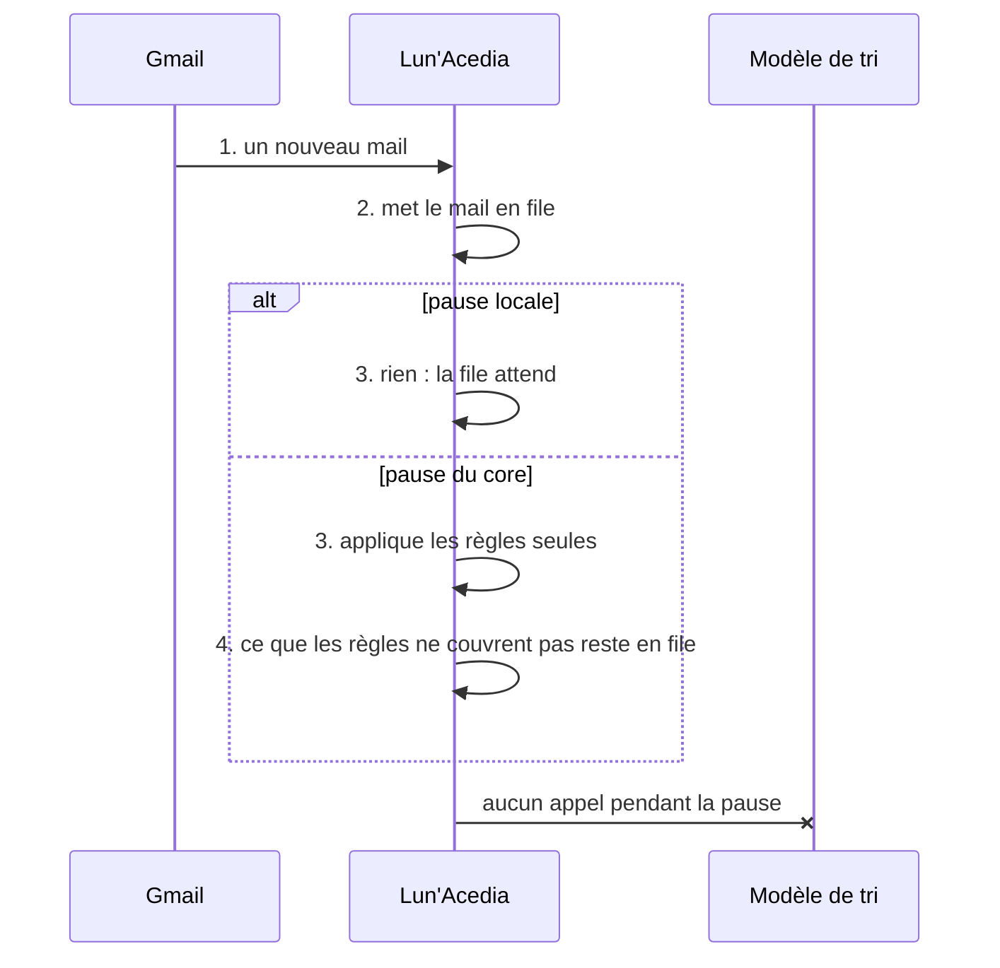

| # | De → vers | Par quoi | Ce qui circule | Retour |
|---|---|---|---|---|
| 1 | Gmail → Lun'Acedia | synchronisation | le mail | — |
| 2 | Lun'Acedia → elle-même | file de tri | l'identifiant du mail | — |
| 3 | Lun'Acedia → elle-même | une passe de tri | pause locale : la passe s'arrête avant le premier mail ; pause du core : les règles passent, pas le modèle | un mail rangé par règle porte une proposition `status: auto` et un événement `mail.triaged` (urgent si l'étiquette de la règle l'est) |
| 4 | Lun'Acedia → elle-même | mail sans règle | pause du core : le mail est rendu à la file sans tentative perdue | il sera repris à la première passe où le modèle a le droit de servir |

- **Ce que CrOliX voit, et où** : dans Lun'Acedia, les mails couverts par une règle sont rangés ; les autres restent
  dans la boîte de réception. La carte de service dit « Les règles seules rangent » (pause du core) ou « Rien n'est
  rangé seul » (pause locale). Au core, les urgences issues de règles remontent comme d'habitude (S10.3) ; sous pause
  locale, plus rien ne remonte de nouveau.
- **Ce qui s'écrit** : une proposition `auto` par mail rangé par règle ; la file reste.
- **Qui décide** : du code décide, par les règles de CrOliX ; le modèle ne décide de rien pendant la pause.
- **Erreurs et cas limites** :
  - Aucune règle ne couvre le mail et il n'y a pas de modèle : il est rendu et rangé à la main (voir famille 4).
  - Un mail déjà sorti de la boîte de réception est laissé où il est.
  - Les coûts du tri (compte `triage`) cessent pendant la pause : aucun appel n'est fait.
- **Écart avec les décisions** : aucun connu. Le contrat dit « le poste garde son tri par règles seules » : confirmé.
- **Non vérifié** : le détail de la reprise (famille 4) : l'ordre dans lequel la file est reprise après la pause.

---

### S10.9 · Les lots de la bibliothèque, en pause ou au plafond

- **Déclencheur** : le core envoie le lot de la nuit (`brain.ingest`), ou l'heure revient, ou la pause est levée.
- **Acteurs** : le core, Lun'Avaritia, ses deux appels de modèle.
- **Avant** : Lun'Avaritia est en pause (du core ou locale), ou son plafond mensuel est atteint.

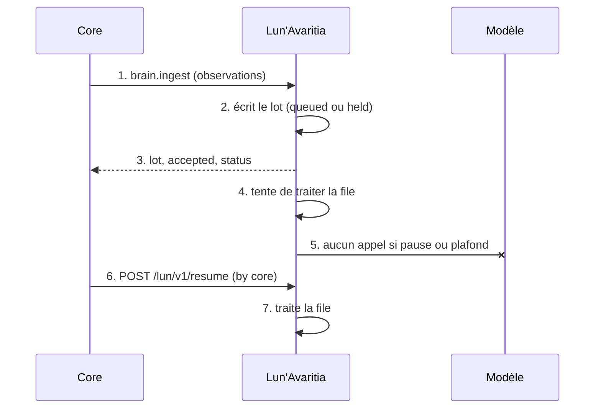

| # | De → vers | Par quoi | Ce qui circule | Retour |
|---|---|---|---|---|
| 1 | Core → Lun'Avaritia | `POST /lun/v1/actions/brain.ingest` | `observations[]` (1 à 500) | — |
| 2 | Lun'Avaritia → elle-même | écriture du lot | statut « held » (raison « cost-cap ») si le plafond du mois est atteint, sinon « queued » | — |
| 3 | Lun'Avaritia → core | réponse | `lot`, `accepted`, `status` : `queued` ou `held` | le core ne lit que le code HTTP |
| 4 | Lun'Avaritia → elle-même | `runPending`, sans attendre | sous pause : sortie avant tout appel ; sous plafond : les lots attendus restent « held » | — |
| 5 | Lun'Avaritia → modèle | rien | — | — |
| 6 | Core → Lun'Avaritia | reprise | `{ by: "core" }` | le poste relance le traitement des lots, sans attendre l'heure |
| 7 | Lun'Avaritia → elle-même | traitement | deux appels de modèle par lot | voir S6.4 |

- **Ce que CrOliX voit, et où** : dans l'écran de Lun'Avaritia, le Tableau annonce les lots retenus par le plafond
  mensuel (avec le plafond à côté de la dépense) ; un lot « held » se reprend à l'heure suivante dès que le plafond le
  permet (relevé, ou mois suivant). Au core : rien. Le plafond atteint ne change ni la santé du poste, ni n'envoie
  d'événement (T24).
- **Ce qui s'écrit** : un lot et ses observations, côté Lun'Avaritia ; son statut change à chaque passe.
- **Qui décide** : du code décide. Un lot dont le tri payé a abouti mais dont la rédaction a échoué attend un jour avant
  d'être repris (pour ne pas repayer le tri chaque heure).
- **Erreurs et cas limites** :
  - Le plafond est vérifié avant chaque appel du poste, pas à l'intérieur d'un lot : un gros lot peut le dépasser de ses
    propres appels (le code le dit en commentaire).
  - Une pause posée **pendant** une passe : aucun autre appel de modèle ne part ; le lot en cours se termine.
  - Plafond mensuel à 0 : il est atteint d'emblée (la dépense, 0 au moins, est toujours supérieure ou égale) : tous les
    lots sont retenus (voir S10.16).
- **Écart avec les décisions** : T24 (plafond de Lun'Avaritia atteint : aucun signal) ; T3 (le core ne sait rien du sort
  du lot).
- **Non vérifié** : rien.

---

### S10.10 · Compter le coût d'un tour de conversation

- **Déclencheur** : un message de CrOliX provoque un appel du modèle du core (réponse, ou second appel de la voix).
- **Acteurs** : le core, le fournisseur du modèle.
- **Avant** : un fournisseur en service, un prix connu pour le modèle réglé, la conversation ouverte (S10.17).

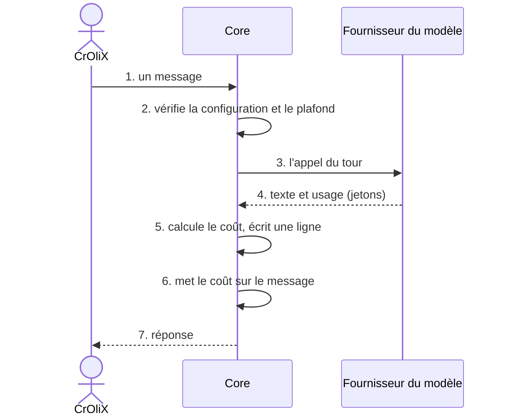

| # | De → vers | Par quoi | Ce qui circule | Retour |
|---|---|---|---|---|
| 1 | CrOliX → core | un message | le texte, la surface | — |
| 2 | Core → core | contrôle avant l'appel | modèle sans prix, clé absente, plafond de pause : refus avec la raison | un message « en erreur » (S10.17) |
| 3 | Core → fournisseur | l'appel | la conversation | un flux de texte |
| 4 | Fournisseur → core | usage | jetons d'entrée, de sortie, lus au cache, écrits au cache, durée du premier mot | — |
| 5 | Core → core | écriture | la date, le fournisseur, le modèle, le montant en dollars, « conversation », jetons lus au cache, délai du premier mot | une ligne de coût par appel |
| 6 | Core → core | mise à jour du message | jetons d'entrée et de sortie, coût du tour (somme des deux appels si la voix en fait un second), modèle | — |
| 7 | Core → CrOliX | la réponse | — | — |

- Le coût d'un appel : (jetons d'entrée × prix d'entrée + jetons de sortie × prix de sortie) divisé par un million, avec
  des prix de cache distincts quand le modèle en déclare (la part lue et la part écrite au cache sont sorties de
  l'entrée et payées à leur prix).
- **Ce que CrOliX voit, et où** : la dépense du jour et du mois dans l'Atelier (Dépenses), la ligne « Natsume » par
  jour, la répartition par fournisseur et modèle ; le coût d'un tour est gardé sur le message.
- **Ce qui s'écrit** : une ligne de coût par appel, le coût et les jetons sur le message.
- **Qui décide** : du code calcule. Le prix vient de la table de l'instance (S10.15). Rien n'est estimé quand le
  fournisseur rend son usage.
- **Erreurs et cas limites** :
  - Usage non fourni par le fournisseur : les jetons sont estimés d'après les caractères, et le log le dit.
  - Modèle sans prix : la conversation est déclarée « non configurée » et refuse, avant tout appel : aucun coût inconnu
    n'est compté à 0.
  - Le plafond est lu **avant** l'appel : le tour qui le franchit va à son terme, le suivant est refusé.
- **Écart avec les décisions** : aucun connu.
- **Non vérifié** : le calcul du coût côté modules de fournisseur (le core reçoit l'usage déjà formé).

---

### S10.11 · Le coût d'un tour coupé ou en échec

- **Déclencheur** : la surface signale une coupure avec ce que CrOliX a réellement entendu (par exemple parce qu'il
  parle par-dessus Natsume), ou bien le fournisseur coupe le flux ou refuse. « annule » ne coupe pas le tour : ce mot
  annule un geste tenu sur une carte, c'est une autre voie.
- **Acteurs** : CrOliX, le core, le fournisseur du modèle.
- **Avant** : un tour est en cours.

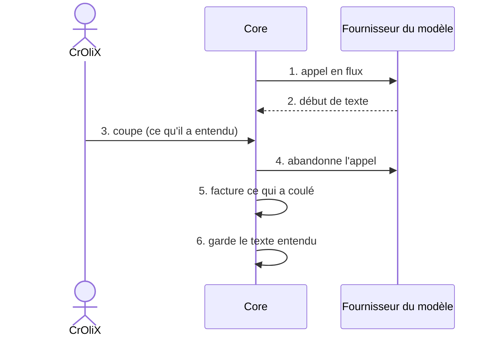

| # | De → vers | Par quoi | Ce qui circule | Retour |
|---|---|---|---|---|
| 1-2 | Core ↔ fournisseur | flux | le texte au fil de l'eau | — |
| 3 | CrOliX (ou la voix) → core | coupure | ce que CrOliX a réellement entendu | le tour s'arrête, aucun outil ne s'exécute après |
| 4 | Core → fournisseur | abandon du flux | — | — |
| 5 | Core → core | coût | si du texte est venu ou si l'usage est connu : une ligne de coût (jetons estimés d'après le texte si le fournisseur ne dit rien) | un tour coupé sans un mot ni usage ne coûte rien |
| 6 | Core → core | message | le texte entendu, suivi de la marque « (coupée ici) » si une partie n'a pas été dite | « ok » si au moins un mot a été entendu, « partiel » avec un texte vide sinon ; le tour d'outil n'est pas gardé |

- **Ce que CrOliX voit, et où** : il n'existe pas de statut « coupé ». Le message coupé garde ce qu'il a entendu,
  avec la marque « (coupée ici) » quand une partie n'a pas été dite ; la dépense du jour monte du coût estimé.
- **Ce qui s'écrit** : une ligne de coût (modèle, montant, jetons) et le message.
- **Qui décide** : du code décide, sur ce que le fournisseur a rendu.
- **Erreurs et cas limites** :
  - Fournisseur qui refuse ou coupe le flux : un refus qui rend son usage est facturé ; un flux cassé après du texte est
    facturé en jetons estimés ; un échec avant tout texte sans usage ne coûte rien.
  - Coupure alors que le poste prépare des cartes : le résumé du poste reste, le coût du poste suit S10.12.
  - Une demande refusée par le fournisseur (400) avec les tours d'outil : relancée une fois sans eux, la première
    tentative n'est pas facturée (son usage est jeté).
- **Écart avec les décisions** : aucun connu.
- **Non vérifié** : si le fournisseur facture réellement l'appel abandonné : le core compte ce qu'il a vu.

---

### S10.12 · Le coût d'une demande confiée à un poste

- **Déclencheur** : un poste répond à `POST /lun/v1/agent`.
- **Acteurs** : le core, le poste, le modèle du poste.
- **Avant** : la délégation s'est jouée (S10.7).

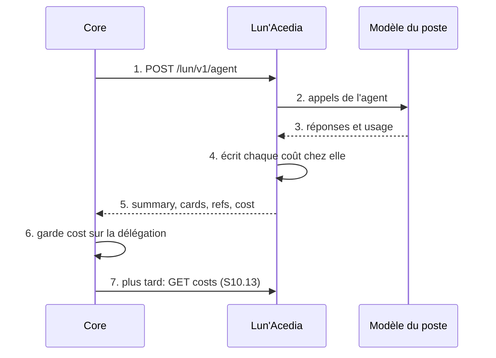

| # | De → vers | Par quoi | Ce qui circule | Retour |
|---|---|---|---|---|
| 1 | Core → poste | `POST /lun/v1/agent` | `request` | — |
| 2-3 | Poste ↔ fournisseur du poste | les appels de l'agent | — | usage en jetons |
| 4 | Poste → lui-même | écriture d'une ligne de coût par appel | fournisseur, modèle, montant (0 si le prix est inconnu), un appel, usage `pina` (Lun'Acedia) ou `agent` (Lun'Avaritia) | — |
| 5 | Poste → core | réponse | `cost: { currency: "USD", amount }` : la dépense du tour, mesurée par différence avant/après | — |
| 6 | Core → core | trace | `cost.amount` sur la trace de la délégation et son entrée au Journal | le coût **n'est pas** ajouté à la dépense du core |
| 7 | Core → poste | lecture des coûts | voir S10.13 | la dépense réelle du poste, qui entre dans les plafonds du core |

- **Ce que CrOliX voit, et où** : la dépense du poste dans Dépenses, à la source du poste, et son coût du jour sur sa
  fiche du panneau. Le coût rendu par `cost` est gardé sur la trace de la délégation et sur son entrée au Journal : le
  panneau l'affiche dans le détail de cette entrée (ligne « Coût »).
- **Ce qui s'écrit** : côté poste, une ligne de coût par appel ; côté core, la délégation avec son coût.
- **Qui décide** : le poste compte lui-même chaque appel payant (le contrat le dit : « chaque appel payant est compté
  par le poste lui-même »). Le core ne recalcule rien.
- **Erreurs et cas limites** :
  - `cost` de Lun'Acedia et de Lun'Avaritia est une différence mesurée sur toute la période du tour : un autre appel
    payant du même poste, au même moment (tri, lot), s'y ajoute, et le code le dit en commentaire pour Lun'Avaritia.
  - Pause locale du poste : `cost` vaut 0, aucun appel.
  - Plafond propre du poste atteint : chez les deux postes, le plafond est relu avant chaque appel du modèle, à
    l'intérieur du tour. Atteint dès le départ, la phrase de plafond revient avec `cost` à 0. Atteint au milieu du
    tour, elle revient avec le coût des appels déjà faits ; chez Lun'Avaritia, elle suit alors le texte déjà écrit
    (Lun'Acedia, `server/src/pina/agent.ts:374-376` et `server/src/contract/routes.ts:388-402` ; Lun'Avaritia,
    `server/src/brain/agent.ts:164-165` et `:213-220`).
- **Écart avec les décisions** : aucun connu.
- **Non vérifié** : rien.

---

### S10.13 · La lecture des dépenses des postes

- **Déclencheur** : l'horloge de lecture du core (toutes les deux minutes par poste), un signal d'un poste qui se
  stabilise, un geste sur une carte, ou une demande de CrOliX (« vérifier » un poste).
- **Acteurs** : le core, chaque poste.
- **Avant** : le poste est appairé, son jeton lisible.

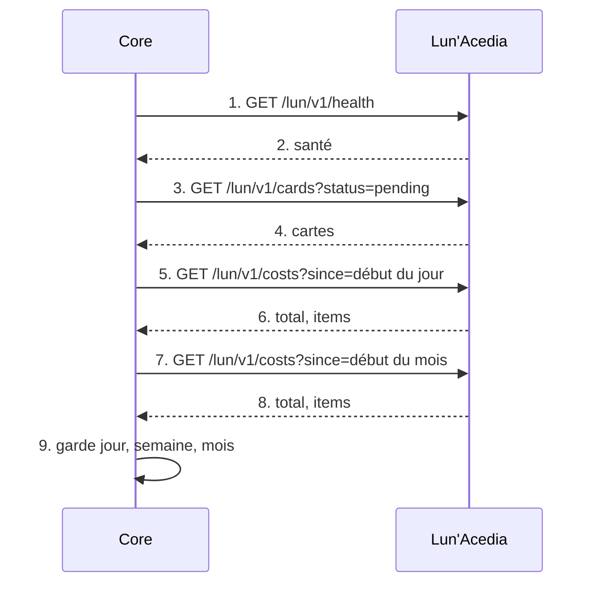

| # | De → vers | Par quoi | Ce qui circule | Retour |
|---|---|---|---|---|
| 1-2 | Core ↔ poste | `GET /lun/v1/health` | — | l'état, dont la pause |
| 3-4 | Core ↔ poste | `GET /lun/v1/cards?status=pending` | — | les cartes en attente (voir famille 3) |
| 5 | Core → poste | `GET /lun/v1/costs` | `since` = le début du jour du core (5 h, heure de Paris), en ISO | `currency`, `since`, `until`, `total`, `items[]` (`provider`, `model?`, `amount`, `calls`) |
| 6 | Poste → core | réponse | seuls `since` et `total` sont lus | gardés en cache sous le poste |
| 7-8 | Core ↔ poste | le même appel | `since` = le 1er du mois à 5 h | `since`, `total` du mois |
| 9 | Core → core | cache | le total du jour est ajouté à la semaine (sept jours gardés) | — |

- Chaque appel de la lecture est borné à 15 s ; une passe commence par la santé (8 s au plus). Une lecture qui échoue
  est notée au journal d'exécution, une fois par message identique ; les chiffres déjà gardés restent.
- **Ce que CrOliX voit, et où** : les dépenses des postes dans Dépenses (jour, semaine, mois) avec l'heure de la
  dernière lecture ; le coût du jour sur la fiche d'un poste du panneau.
- **Ce qui s'écrit** : le dernier total du jour, du mois et de la semaine de chaque poste, côté core.
- **Qui décide** : du code décide. Le poste choisit seul de quoi sa dépense se compose.
- **Erreurs et cas limites** :
  - Une lecture du jour **plus ancienne que le début du jour** compte zéro : un poste silencieux ne gèle jamais le total
    à un chiffre périmé. Conséquence : après 5 h, la dépense d'un poste est à 0 tant qu'il n'a pas été relu.
  - Un poste qui répond un format inattendu : l'élément est ignoré, une ligne du journal d'exécution le dit.
  - Un poste délié : ses lectures de jour, de mois et de semaine sont retirées.
  - Les plafonds du core lisent ce cache (jusqu'à deux minutes de retard) : une rafale de demandes à un poste peut
    dépasser le plafond du poste fixé par le core (S10.20).
- **Écart avec les décisions** : aucun connu.
- **Non vérifié** : les limites de temps de la lecture quand la demande vient du panneau pour « vérifier » (famille 12).

---

### S10.14 · Voir les dépenses

- **Déclencheur** : CrOliX ouvre l'Atelier (Dépenses), ou le panneau relit l'état ; ou un client appelle la route des
  coûts du core.
- **Acteurs** : CrOliX, le panneau, le core ; pour la route des coûts, aussi chaque poste.
- **Avant** : le panneau est relié au core.

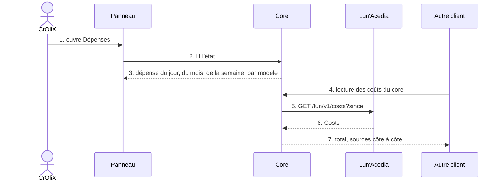

| # | De → vers | Par quoi | Ce qui circule | Retour |
|---|---|---|---|---|
| 1-2 | CrOliX → panneau → core | lecture de l'état | — | — |
| 3 | Core → panneau | l'état | `spend` : `day` (total, plafond, sources : Natsume avec sa part conversation et sa part routines, puis chaque poste avec l'heure de sa lecture), `month` (total, plafond), `week` (7 jours), `byModel`, `reached` (`jour` ou `mois`) | la jauge, la répartition, les sept jours |
| 4 | Autre client → core | la lecture des coûts du core, jeton d'appareil, `since` facultatif (début du jour du core par défaut) | une date ISO 8601 | `400` si illisible |
| 5-6 | Core → chaque poste | `GET /lun/v1/costs?since` | — | `Costs` du poste |
| 7 | Core → autre client | réponse | `since`, `until`, `total` (les sources qui ont répondu), `sources[]` : celle du core, puis chaque poste **tel qu'il a répondu**, sans fusion | un poste en échec donne une entrée `error`, jamais une route en échec |

- **Ce que CrOliX voit, et où** : Atelier > Dépenses : « X sur Y » pour le jour (avec la mention « remis à zéro à
  05:00 »), le mois, les sept dernières journées, la répartition par fournisseur et modèle, une ligne par poste. Dans
  la bande, « Plafond du jour atteint » (ou du mois).
- **Ce qui s'écrit** : rien.
- **Qui décide** : du code additionne ; la route des coûts n'invente rien.
- **Erreurs et cas limites** :
  - Poste sans jeton lisible, injoignable, non appairé, ou dont la réponse n'est pas un `Costs` : une entrée d'erreur
    avec la raison, le reste est rendu.
  - L'état (le panneau) lit le **cache** (S10.13) ; la route des coûts interroge les postes **en direct** : les deux
    chiffres peuvent différer de quelques minutes. L'appel direct n'a pas de délai posé par le core dans le code lu.
  - La part « routines » de la dépense du jour ne compte que les appels datés du jour ; voir S10.22.
- **Écart avec les décisions** : aucun connu.
- **Non vérifié** : le comportement d'un poste qui ne répondrait jamais à la route directe (aucun délai lu).

---

### S10.15 · D'où viennent les prix

- **Déclencheur** : un appel est compté (S10.10, S10.12) ; ou la configuration est relue au démarrage.
- **Acteurs** : le core, Lun'Acedia, Lun'Avaritia, leur configuration.
- **Avant** : un modèle choisi chez chacun.

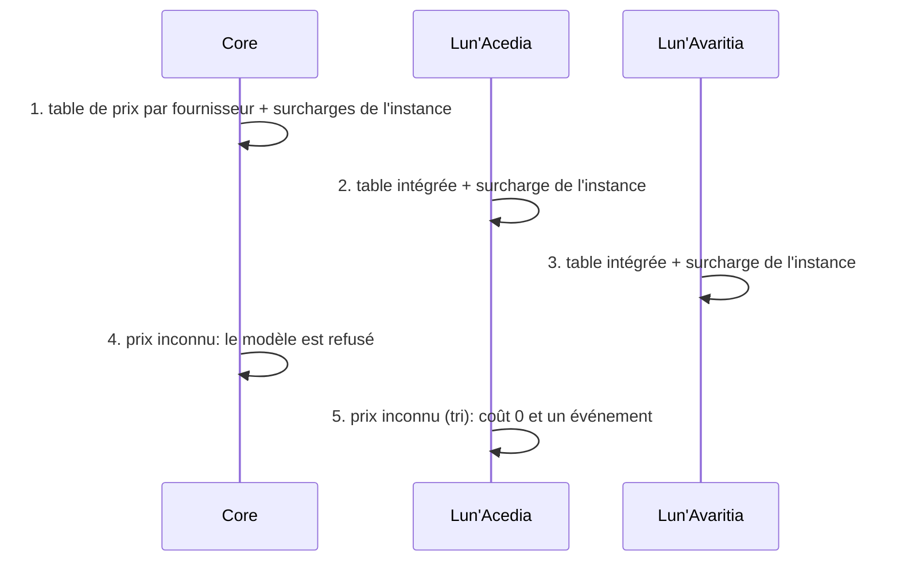

| # | De → vers | Par quoi | Ce qui circule | Retour |
|---|---|---|---|---|
| 1 | Core → lui-même | lecture au démarrage | la table de chaque fournisseur (prix par million de jetons : entrée, sortie, et si déclaré cache lu et écrit), ses ajouts et surcharges faits dans la configuration de l'instance, **contrôlés** (une valeur illisible est refusée par un message qui nomme la variable) | un modèle sans prix refuse la conversation |
| 2 | Lun'Acedia → elle-même | table de modèles intégrée, surchargée par `LLM_PRICES` (Lun'Acedia, `server/src/llm/models.ts:99-118`) | `fournisseur/modèle` → `[entrée, sortie]` | `priceOf` |
| 3 | Lun'Avaritia → elle-même | table intégrée (prix relevés le 26/10, Lun'Avaritia, `server/src/llm/models.ts:9`), surchargée par `LLM_PRICES` | idem | idem |
| 4 | Core | prix absent | le modèle réglé n'a pas de prix | conversation « non configurée : prix inconnu » ; le tri de la nuit échoue (S6.8) |
| 5 | Poste | prix absent | `amount` = 0 | seul le tri de Lun'Acedia émet, une fois par modèle, `llm.unknown-price` « Prix inconnu pour <modèle> : coût compté à 0 » (palier `log`) ; son agent compte 0 sans événement |

- **Ce que CrOliX voit, et où** : la conversation qui refuse avec la raison (prix inconnu), ou la dépense d'un poste qui
  reste à 0 pour un modèle sans prix. Les écrans de Lun'Acedia et de Lun'Avaritia affichent le prix de chaque modèle
  dans le choix du modèle (« X / Y $ par M jetons », ou « prix inconnu ») (Lun'Acedia,
  `views/src/lib/settings/ModelPicker.svelte:18` ; Lun'Avaritia, `app/src/reglages/ModelPicker.svelte:15-18`). Le
  panneau du core n'affiche aucun prix.
- **Ce qui s'écrit** : rien de plus que les coûts.
- **Qui décide** : l'instance (CrOliX par sa configuration) décide des prix ; le code applique la formule. Les prix des
  postes et ceux du core sont **indépendants** : chacun a sa table.
- **Erreurs et cas limites** :
  - Les prix intégrés de Lun'Avaritia datent de leur relevé du 26/10 : un changement du fournisseur ne les change pas.
  - Chez Lun'Acedia, un modèle sans prix **ne coûte rien** pour les plafonds ; chez le core, il est refusé : l'écart est
    un choix du code, pas du standard.
  - Lun'Avaritia n'émet aucun événement pour un prix inconnu (aucune occurrence dans `server/src`) : son coût compte
    0 en silence.
- **Écart avec les décisions** : « Rien en dur : tout paramétrable » (mémoire du 20/11) : les prix du core le sont ;
  ceux des satellites aussi, par leur variable de prix.
- **Non vérifié** : rien.

---

### S10.16 · Régler les plafonds

- **Déclencheur** : CrOliX modifie un plafond dans Atelier > Dépenses (jour, mois, comportement au plafond, alerte
  à 80 %).
- **Acteurs** : CrOliX, le panneau, le core.
- **Avant** : le panneau est relié au core.

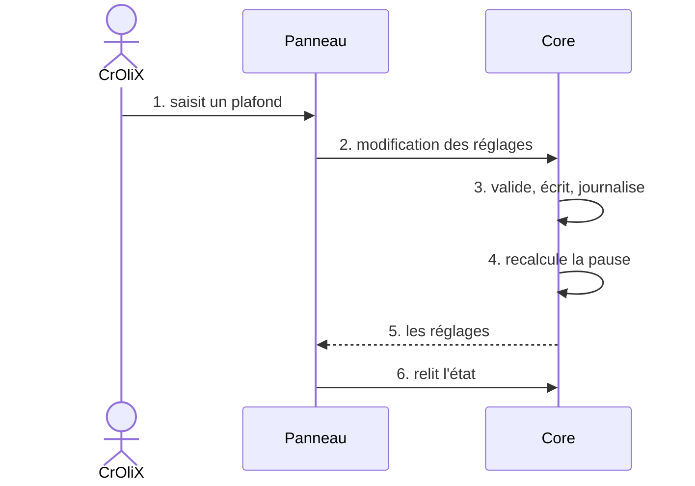

| # | De → vers | Par quoi | Ce qui circule | Retour |
|---|---|---|---|---|
| 1 | CrOliX → panneau | une saisie | un nombre en dollars | un message d'avertissement dans la fiche si le nouveau plafond est sous la dépense : « pause jusqu'à 05:00 » ou « jusqu'au 1er » |
| 2 | Panneau → core | modification des réglages | `dayCapUsd` (0 à 100), `monthCapUsd` (0 à 1000), `atCap` (`pause` ou `warn`), `warnAt80` (vrai ou faux) ; par poste, `capUsd` (0 à 100 ou aucun) | un champ inconnu ou une valeur hors bornes : `400` avec la raison |
| 3 | Core → core | une transaction | les valeurs ; « les plafonds sont fixés » (la mise en route le lit) | une ligne « Plafond par jour, X $ », etc. au Journal, seulement si la valeur change |
| 4 | Core → core | recalcul immédiat de la pause | la dépense lue contre le nouveau plafond | pose ou lève la pause de plafond à l'instant (S10.17), sans attendre la minute |
| 5 | Core → panneau | les réglages | — | — |
| 6 | Panneau → core | relecture de l'état | — | la bande suit |

- Valeurs de départ : le plafond du jour est la somme de l'ancien plafond de conversation (1 $) et de l'ancien plafond
  de routines (0,5 $), écrite une seule fois ; le plafond du mois est de 40 $ ; le comportement au plafond est la
  pause ; l'alerte à 80 % est éteinte. La configuration de l'instance peut changer ces trois chiffres de départ ;
  ce qui est réglé dans le panneau l'emporte ensuite.
- **Ce que CrOliX voit, et où** : Atelier > Dépenses : les quatre réglages, les avertissements en direct ; une ligne par
  changement au Journal ; la bande de plafond apparaît ou disparaît.
- **Ce qui s'écrit** : les réglages (la valeur écrite dans le panneau l'emporte sur la configuration de l'instance,
  qui ne fait que les semer), le drapeau « plafonds fixés », les lignes du Journal.
- **Qui décide** : CrOliX pour les valeurs. Du code valide les bornes.
- **Erreurs et cas limites** :
  - Un plafond à **0** n'est pas « sans plafond » au core : il est déjà atteint (la dépense est toujours ≥ 0). La seule
    alerte à 80 % l'ignore, mais la pause, elle, s'applique (voir Écart).
  - Le plafond de la **nuit** n'est pas réglable ici : il vient de la configuration de l'instance (S10.22).
  - Un poste inconnu dans les réglages par poste : `400` « Poste inconnu ».
- **Écart avec les décisions** : Lun'Luxuria seule accepte « 0 : sans plafond » ; le core, Lun'Acedia (agent) et
  Lun'Avaritia tiennent 0 pour un plafond atteint (voir S10.23).
- **Non vérifié** : rien.

---

### S10.17 · Plafond du jour atteint, avec pause

- **Déclencheur** : la dépense du jour (core et postes) atteint ou dépasse le plafond du jour, avec « Mettre en pause »
  choisi ; constaté à chaque minute, à chaque tick des routines et à chaque réglage modifié. Un message écrit lit le
  plafond en direct pour refuser, sans rien poser (ni pause, ni Journal, ni événement, ni relais).
- **Acteurs** : le core, les postes, CrOliX.
- **Avant** : « Quand un plafond est atteint » = « Mettre en pause ».

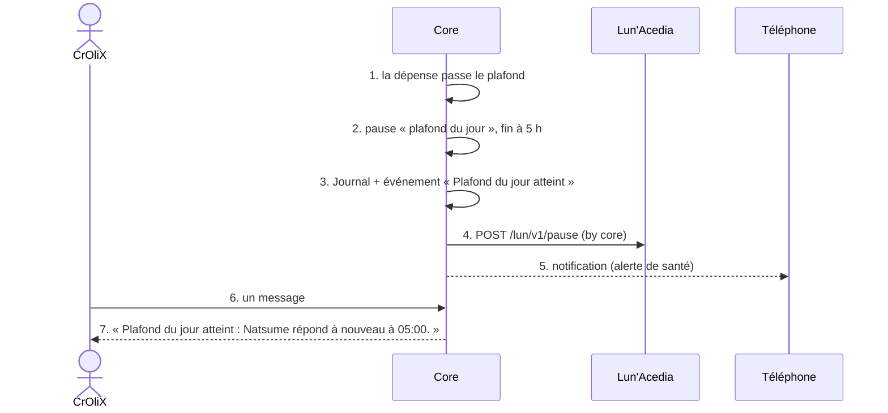

| # | De → vers | Par quoi | Ce qui circule | Retour |
|---|---|---|---|---|
| 1 | Core → core | contrôle d'une minute | la dépense du jour (core + lecture en cache des postes) contre le plafond ; le mois d'abord | — |
| 2 | Core → core | écriture | la pause : cause « plafond du jour », début maintenant, fin au prochain 5 h | — |
| 3 | Core → core | Journal + événement | une ligne « Pause au plafond du jour » ; un événement `cap.reached` « Plafond du jour atteint » (palier normal) | — |
| 4 | Core → chaque poste | relais (S10.4) | `{ by: "core" }` | accusé |
| 5 | Core → téléphone | la porte d'attention | l'événement, qui passe la pause comme alerte de santé | une notification, sans son si CrOliX est absent ; rien si CrOliX est présent au bureau |
| 6 | CrOliX → core | un message | — | — |
| 7 | Core → CrOliX | refus | le message de réponse passe « en erreur » avec le texte du plafond et l'heure de reprise ; le fournisseur n'est pas appelé | — |

- **Ce que CrOliX voit, et où** : la bande « Plafond du jour atteint : X $ sur Y $. Natsume est en pause jusqu'à 05:00,
  sauf les urgences » avec « Relever le plafond » ; les réponses de Natsume en erreur avec la même phrase ; au Journal,
  « Pause au plafond du jour » et la ligne de l'événement ; dans Lun'Luxuria, l'apparence « Plafond atteint » (S10.23).
- **Ce qui s'écrit** : la pause avec sa fin, une ligne du Journal, un événement du core, les messages refusés (sans
  coût).
- **Qui décide** : du code décide, sur les dollars. CrOliX décide de relever le plafond, ce qui lève la pause à
  l'instant.
- **Erreurs et cas limites** :
  - La pause se lève d'elle-même au prochain 5 h (heure de Paris), ou dès que le plafond est relevé. Le core la
    recalcule chaque minute.
  - Le plafond ferme la conversation même sous une pause manuelle posée par-dessus.
  - La pause tient aussi les routines sautées (S10.3) et les postes (relais S10.4).
  - La conversation n'est vérifiée qu'**au début** du tour : celui qui franchit le plafond va à son terme.
  - Les cartes restent à trancher : les décisions de CrOliX sur les cartes ne passent pas par le modèle.
  - Dépense des postes lue au plus tard deux minutes avant : le plafond peut être franchi un peu avant d'être vu.
- **Écart avec les décisions** : le dictionnaire dit que CrOliX peut toujours écrire pendant la pause : sous un plafond,
  son message est enregistré mais la réponse est un refus.
- **Non vérifié** : la pause se lève-t-elle quand la dépense repasse sous le plafond dans la même journée ? Cela
  suppose qu'un poste soit délié ou que sa lecture du jour devienne périmée : aucun cas nominal n'a été lu.

---

### S10.18 · Plafond du mois atteint

- **Déclencheur** : la dépense du mois atteint le plafond du mois (avec « Mettre en pause »).
- **Acteurs** : le core, les postes, CrOliX.
- **Avant** : « Quand un plafond est atteint » = « Mettre en pause ».

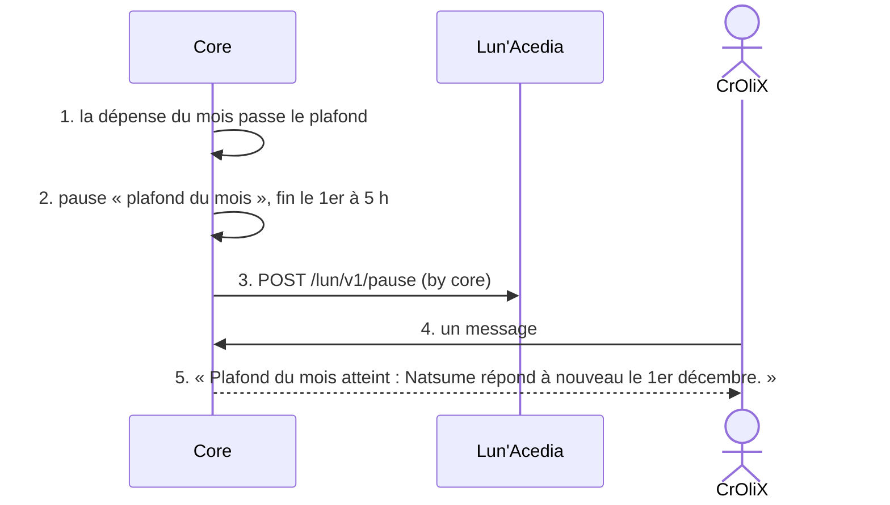

| # | De → vers | Par quoi | Ce qui circule | Retour |
|---|---|---|---|---|
| 1 | Core → core | contrôle d'une minute | le total du mois : les appels du core depuis le 1er à 5 h + la dernière lecture du mois de chaque poste | le mois passe avant le jour si les deux sont atteints |
| 2 | Core → core | pause | cause « plafond du mois », fin au 1er du mois suivant à 5 h | ligne « Pause au plafond du mois », événement `cap.reached` « Plafond du mois atteint » |
| 3 | Core → postes | relais | `{ by: "core" }` | accusé |
| 4-5 | CrOliX ↔ core | un message | — | refus avec la date de reprise |

- **Ce que CrOliX voit, et où** : la bande « Plafond du mois atteint… jusqu'au 1er… » ; les refus ; les routines
  sautées chaque jour du mois restant (la nuit, la lettre) : S6.14.
- **Ce qui s'écrit** : comme S10.17.
- **Qui décide** : du code décide ; CrOliX peut relever le plafond du mois.
- **Erreurs et cas limites** :
  - Quand le plafond du jour **et** du mois sont atteints, la pause porte la cause du mois.
  - Un plafond de jour atteint puis le plafond du mois atteint le même jour : le core change de cause, note la nouvelle
    pause au Journal et prévient de nouveau, sans renvoyer d'ordre aux postes (ils sont déjà en pause).
  - Le mois commence le 1er à 5 h (heure de Paris), non à minuit : la nuit du 1er (5 h) tombe exactement à la reprise.
  - Une lecture de mois d'un poste plus ancienne que le début du mois ne compte pas.
- **Écart avec les décisions** : aucun connu.
- **Non vérifié** : rien.

---

### S10.19 · « Prévenir seulement » et l'alerte à 80 %

- **Déclencheur** : un plafond est atteint avec « Prévenir seulement » choisi ; ou la dépense du jour passe 80 % du
  plafond, avec l'alerte activée.
- **Acteurs** : le core, CrOliX.
- **Avant** : le réglage de comportement au plafond ; pour l'alerte, « Prévenir à 80 % » activé (éteint au départ).

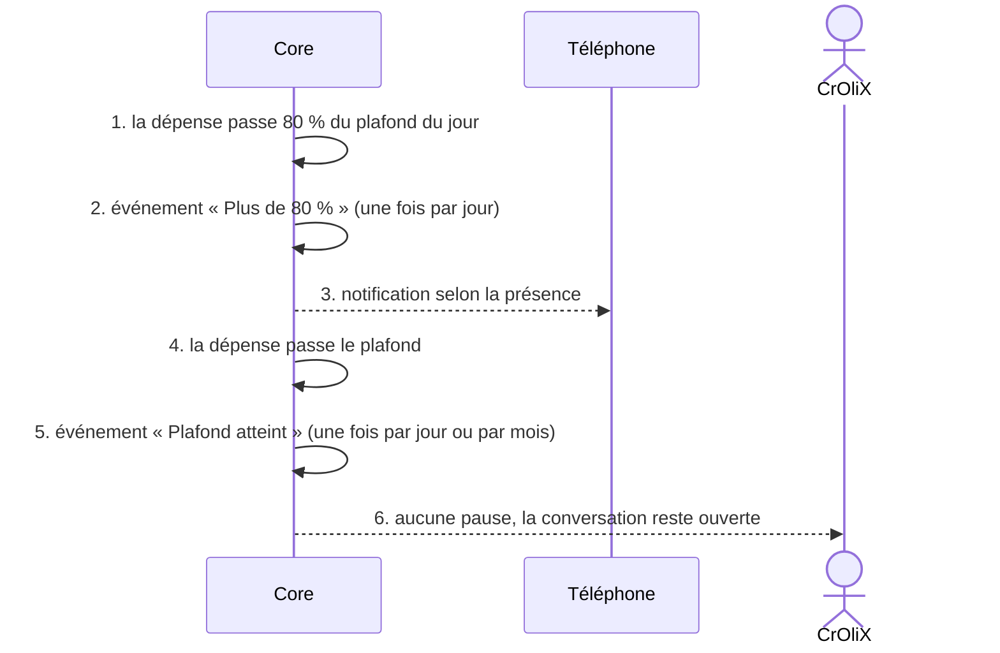

| # | De → vers | Par quoi | Ce qui circule | Retour |
|---|---|---|---|---|
| 1 | Core → core | contrôle d'une minute | la dépense du jour : à partir de 80 % du plafond, et avant le plafond | — |
| 2 | Core → core | événement | `cap.warned` « Plus de 80 % du plafond du jour dépensés » (palier normal), une seule fois par jour | une ligne au Journal |
| 3 | Core → téléphone | la porte d'attention | l'événement, avec les règles de présence | notification ou ligne de Journal seule |
| 4 | Core → core | contrôle d'une minute | plafond atteint, comportement « Prévenir seulement » | — |
| 5 | Core → core | événement | `cap.reached` « Plafond du jour atteint » (ou du mois), une fois par jour, ou une fois par mois | une ligne au Journal |
| 6 | Core → CrOliX | rien d'autre | aucune pause, aucun refus : la conversation et les postes continuent de dépenser | — |

- **Ce que CrOliX voit, et où** : la bande « Plafond du jour atteint : X $ sur Y $. » (ou « du mois »), sans
  « jusqu'à », avec « Relever le plafond » ; un événement au Journal ; une notification selon sa présence.
  L'alerte à 80 % ne dit rien du mois.
- **Ce qui s'écrit** : un événement du core, et une date « déjà dit » (jour ou mois) pour ne pas répéter.
- **Qui décide** : CrOliX, en choisissant « Prévenir seulement ». Du code décide des seuils.
- **Erreurs et cas limites** :
  - L'alerte à 80 % se tait si le plafond du jour est 0, si le plafond est déjà atteint, ou si elle a déjà été dite
    ce jour-là.
  - Sous « Prévenir seulement », le mois l'emporte sur le jour. Le plafond du jour n'est annoncé que s'il est atteint
    avant celui du mois. Une fois le mois atteint, seul le mois est dit, une fois dans le mois, et le plafond du jour
    n'est plus annoncé jusqu'au mois suivant.
  - Sous « Prévenir seulement », seul un plafond **propre à un poste** ou celui de la nuit freine encore des appels.
  - Une alerte à 80 % pendant une pause manuelle : elle n'est pas une alerte de santé, elle n'a que sa ligne de Journal.
- **Écart avec les décisions** : aucun connu.
- **Non vérifié** : rien.

---

### S10.20 · Le plafond d'un poste, fixé par le core

- **Déclencheur** : le modèle du core veut confier une demande à un poste dont la dépense du jour a atteint son
  plafond ; ou la nuit veut envoyer son lot à Lun'Avaritia.
- **Acteurs** : le core, le poste (qui n'est pas appelé), CrOliX.
- **Avant** : un plafond a été donné à ce poste (Atelier, par poste) ; sa dépense du jour, lue au cache, l'atteint.

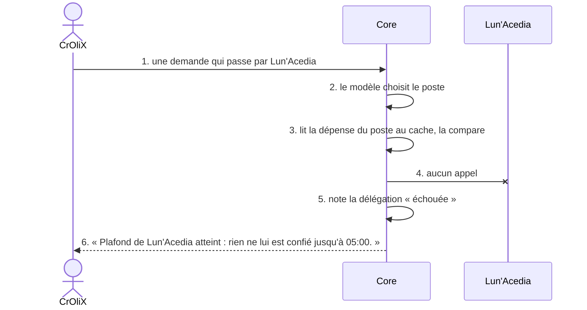

| # | De → vers | Par quoi | Ce qui circule | Retour |
|---|---|---|---|---|
| 1-2 | CrOliX → core → modèle | S10.7 | — | l'appel d'outil |
| 3 | Core → core | contrôle | la dépense du poste lue à la dernière lecture (S10.13) contre son plafond ; sans plafond (défaut), rien n'est refusé | — |
| 4 | Core → poste | **aucun** | — | — |
| 5 | Core → core | trace | la délégation, issue « échouée », sans coût | une ligne de Journal |
| 6 | Core → CrOliX | texte du refus | le nom du poste | le même texte, mot pour mot |

- **Ce que CrOliX voit, et où** : la phrase de refus dans la conversation ; la délégation en échec au Journal. Pour la
  nuit : rien n'est annoncé (voir plus bas).
- **Ce qui s'écrit** : la délégation « échouée ».
- **Qui décide** : CrOliX, en réglant le plafond du poste. Du code décide du refus.
- **Erreurs et cas limites** :
  - La nuit : si Lun'Avaritia est à son plafond côté core, ou si « la veille de la nuit » est éteinte pour elle, **rien
    n'est envoyé** et l'étape compte comme faite (voir S6.7 pour un poste absent).
  - Le plafond lit un cache qui peut avoir deux minutes de retard : plusieurs demandes en rafale le dépassent.
  - Après 5 h, la dépense d'un poste vaut 0 tant qu'il n'a pas été relu (S10.13) : la porte se rouvre pendant ce temps.
- **Écart avec les décisions** : T14 (le plafond du core et celui de Lun'Avaritia sont indépendants) : vrai, avec deux
  plafonds de plus (celui-ci, et celui de l'agent de Lun'Acedia).
- **Non vérifié** : rien.

---

### S10.21 · Les plafonds propres aux postes

- **Déclencheur** : un poste atteint un plafond qu'il tient lui-même.
- **Acteurs** : Lun'Acedia, Lun'Avaritia, le core.
- **Avant** : le plafond est atteint chez le poste.

```mermaid
sequenceDiagram
    actor C as CrOliX
    participant N as Core
    participant A as Lun'Acedia
    participant V as Lun'Avaritia
    N->>A: 1. POST /lun/v1/agent
    A->>A: 2. dépense du jour de l'agent ≥ son plafond
    A-->>N: 3. summary plafond, cards du tour, cost du tour
    N->>V: 4. POST /lun/v1/agent
    V->>V: 5. dépense du mois ≥ plafond mensuel
    V-->>N: 6. summary plafond du mois, cost du tour
```

| # | De → vers | Par quoi | Ce qui circule | Retour |
|---|---|---|---|---|
| 1 | Core → Lun'Acedia | `POST /lun/v1/agent` | `request` | — |
| 2 | Lun'Acedia → elle-même | contrôle avant chaque appel du modèle par l'agent, à chaque tour de boucle d'un même tour (Lun'Acedia, `server/src/pina/agent.ts:374-376`) : le plafond peut arrêter un tour en cours | la dépense du jour d'usage `pina`, depuis minuit de Paris, contre le plafond réglé (1 $ au départ) | — |
| 3 | Lun'Acedia → core | réponse | une phrase « Plafond de dépense du jour atteint : reprise demain, ou plafond à relever… », `cards` (celles déjà posées pendant ce tour, vide si atteint dès le départ), `cost` du tour (0 si atteint dès le départ) (Lun'Acedia, `server/src/contract/routes.ts:393-402`) | traitée par le core comme une réponse normale |
| 4-6 | Core ↔ Lun'Avaritia | même appel | plafond du mois (5 $ au départ, 0 à 50, réglé dans ses réglages de modèle), contrôlé **avant chaque appel** de l'agent (Lun'Avaritia, `server/src/brain/agent.ts:167` et `:215`) | une phrase de plafond, notée « faite » |

- Autres plafonds de Lun'Acedia : les synthèses de mails faites à la demande du bilan (usage `digest`) ont un plafond
  du jour de 0,02 $ au départ (0 à 5 $, 0 les arrête) ; elles s'arrêtent aussi sous la pause, en mode dégradé, ou si
  Google manque. Le **tri par l'IA** de Lun'Acedia n'a aucun plafond propre (recherche faite : aucune comparaison de
  dépense dans le tri).
- **Ce que CrOliX voit, et où** : dans le panneau, la phrase du poste rendue comme résultat ; dans Lun'Acedia, une jauge
  « X $ sur Y $ » dans ses réglages d'agent ; dans Lun'Avaritia, le Tableau et ses lots retenus.
- **Ce qui s'écrit** : les coûts chez le poste ; au core, la délégation « faite » avec la phrase.
- **Qui décide** : le poste, seul. Ces plafonds ne passent pas par le core ; leur dépense monte pourtant dans le total
  du core (S10.13).
- **Erreurs et cas limites** :
  - Un plafond à 0 chez Lun'Acedia (agent) ou Lun'Avaritia (mois) est atteint de suite : toute demande répond la phrase
    de plafond.
  - Les phrases de plafond sont notées « faite » par le core : ni l'échec ni le refus n'apparaissent comme tels (T24
    pour Lun'Avaritia).
  - Le jour de Lun'Acedia commence à minuit de Paris, celui du core à 5 h : voir S10.24.
- **Écart avec les décisions** : T14, T24.
- **Non vérifié** : le message exact de Lun'Avaritia pour un plafond atteint pendant une passe de lot (famille 7).

---

### S10.22 · La nuit : son plafond, la pause, le plafond atteint

- **Déclencheur** : le créneau de la nuit (5 h) arrive ; ou la nuit appelle son modèle ; ou un plafond du core est
  atteint.
- **Acteurs** : le core, son modèle, CrOliX.
- **Avant** : voir S6.1.

```mermaid
sequenceDiagram
    participant H as Horloge
    participant N as Core
    participant M as Modèle
    H->>N: 1. 5 h: la nuit est due
    alt une pause est en vigueur (manuelle, jour, mois)
        N->>N: 2. saute, note « en pause »
    else plafond de la nuit atteint pour ce jour
        N->>M: 3. aucun appel de plus
        N->>N: 4. la nuit échoue, dit pourquoi
    else rien n'arrête
        N->>M: 5. tri du jour, portrait, scènes
        N->>N: 6. coûts écrits, datés du jour couvert
    end
```

| # | De → vers | Par quoi | Ce qui circule | Retour |
|---|---|---|---|---|
| 1 | Horloge → core | tick | le créneau | le core relit la pause avant de lancer (S10.3) |
| 2 | Core → core | exécution « sautée » | « en pause » | ligne « sautée » au Journal ; rien rattrapé |
| 3 | Core → core | contrôle avant chaque appel de la nuit (tri, portrait, tempérament, scènes de contrôle, contexte du jour) | les coûts « routines » du jour couvert contre le plafond de la nuit (0,5 $ par jour au départ) | à l'atteinte : « Plafond de la veille atteint (X $) pour le AAAA-MM-JJ », le jour échoue |
| 4 | Core → core | échec noté | le jour couvert, la raison | l'exécution est en échec : alerte `routine.failed` et ligne au Journal (S6.8) |
| 5-6 | Core ↔ modèle | appels | — | chaque appel écrit une ligne de coût, **datée du début du jour couvert** (le jour d'hier à 5 h), pas de l'instant de l'appel |

- **Ce que CrOliX voit, et où** : une nuit sautée : « sautée », « en pause » à l'Atelier, au Journal, à la
  Constellation. Une nuit au plafond : un échec avec sa raison, une alerte au téléphone. Une nuit réussie : rien.
- **Ce qui s'écrit** : une exécution (sautée ou en échec), des lignes de coût de la nuit.
- **Qui décide** : du code décide. Le plafond de la nuit vient de la configuration de l'instance ; il n'est pas dans le
  panneau.
- **Erreurs et cas limites** :
  - La pause de plafond **du jour** se lève au prochain 5 h, juste à l'heure de la nuit : le contrôle de 5 h recalcule
    la pause avec le nouveau jour et n'est pas retenu par la pause de la veille. La pause du **mois** saute chaque nuit
    du reste du mois.
  - Les coûts de la nuit sont datés du jour **couvert** (le tri, le portrait, le tempérament, les scènes) : ils ne
    pèsent pas sur le plafond du jour de 5 h où ils se jouent, mais sur la veille, et sur le mois **précédent** pour
    la nuit du 1er. Le contexte du jour (7 h 30) est daté du jour même.
  - Un lot que Lun'Avaritia ne peut pas traiter n'est pas un échec de la nuit (S10.9).
- **Écart avec les décisions** : S6.8 dit que la nuit s'arrête sur son plafond : confirmé. L'écran Dépenses dit « remis
  à zéro à 05:00 » : vrai pour le jour, mais la dépense de la nuit ne s'y compte pas le jour où elle se joue.
- **Non vérifié** : que le jour couvert soit bien la veille pour le portrait et le tempérament (leur code date comme le
  tri ; la boucle des jours couverts n'a été lue que pour le tri) ; que le « jour » du contexte du matin soit le jour
  courant.

---

### S10.23 · Lun'Luxuria : plafond seule, plafond du core relié

- **Déclencheur** : CrOliX parle ou écrit à Lun'Luxuria.
- **Acteurs** : CrOliX, Lun'Luxuria, son modèle (seule) ou le core (reliée).
- **Avant** : seule : un modèle réglé, un plafond de jetons ; reliée : le core relié.

```mermaid
sequenceDiagram
    actor C as CrOliX
    participant L as Lun'Luxuria
    participant N as Core
    C->>L: 1. une phrase
    alt seule
        L->>L: 2. dépense du jour en jetons ≥ plafond ?
        L-->>C: 3. « Plafond du jour atteint : à relever dans les Réglages »
    else reliée
        L->>N: 2. envoie la phrase
        N-->>L: 3. réponse « en erreur » : Plafond atteint
        L-->>C: 4. apparence « Plafond atteint »
    end
```

| # | De → vers | Par quoi | Ce qui circule | Retour |
|---|---|---|---|---|
| 1 | CrOliX → Lun'Luxuria | une phrase ou un message écrit | le texte | — |
| 2 (seule) | Lun'Luxuria → elle-même | contrôle avant l'appel (Lun'Luxuria, `src/local.ts:150-158`) | la dépense du jour **en jetons** contre `tokensPerDay` (100 000 au départ, `src/settings.ts:92`) ; 0 = sans plafond | — |
| 3 (seule) | Lun'Luxuria → CrOliX | refus | message en erreur « Plafond du jour atteint : à relever dans les Réglages, ou à demain. » | l'appel ne part pas |
| 2 (reliée) | Lun'Luxuria → core | envoi de la phrase | le texte | S10.17 : réponse en erreur avec le texte du plafond |
| 3-4 (reliée) | Core → Lun'Luxuria → CrOliX | réponse terminée en erreur | le texte de l'erreur | si le texte contient « plafond », l'état du corps devient « Plafond atteint » (Lun'Luxuria, `src/session.svelte.ts:321-323`, `src/body/body.ts:56`) |

- Seule, Lun'Luxuria compte les jetons rendus par son modèle (ou, à défaut, environ un jeton pour 4 caractères), en
  tire un total par jour et le garde dans le navigateur (`src/local.ts:143-146`, `:254`). Elle n'a **pas de prix** :
  son plafond est en jetons, non en dollars.
- **Ce que CrOliX voit, et où** : la fenêtre de Lun'Luxuria : le message d'erreur dans le fil, l'apparence « Plafond
  atteint » (mode relié), jusqu'à ce qu'une phrase de réponse soit dite (`src/session.svelte.ts:486`). Reliée, elle ne
  lit **aucune pause** du core (aucune référence dans son code) : une pause manuelle ne la change en rien (le core
  répond encore) ; elle ne voit que le refus d'un plafond.
- **Ce qui s'écrit** : la dépense du jour en jetons (seule, dans le navigateur) ; chez le core, rien de plus que S10.17.
- **Qui décide** : CrOliX règle le plafond seule (Réglages > modèle avancé, `src/Reglages.svelte:438`). Le core décide
  seul quand elle est reliée.
- **Erreurs et cas limites** :
  - Seule : le jour est le jour calendaire du poste (`toDateString`, minuit local) ; la réponse qui franchit le plafond
    va à son terme, la suivante est refusée.
  - Reliée, l'apparence « Plafond atteint » dépend du mot « plafond » dans le texte du core : un autre refus qui ne le
    contient pas est un échec ordinaire.
  - La sourdine de Lun'Luxuria n'est pas la pause : elle coupe ses sens et sa voix, la pause du core ne la déclenche
    pas.
- **Écart avec les décisions** : la carte du 27/11 ne traite pas ce plafond ; il est d'une autre nature (jetons, jour
  local) que les autres.
- **Non vérifié** : si le serveur de voix ou de transcription a un plafond ou un coût (hors du périmètre du dépôt lu).
  Le refus local seule passe-t-il par le même événement d'échec que la réponse du core (Lun'Luxuria,
  `src/session.svelte.ts:321-323`, refus local `src/local.ts:157`) ? Si oui, l'apparence « Plafond atteint » vaut
  aussi pour le mode seul.

---

### S10.24 · Le changement de jour et de mois

- **Déclencheur** : l'horloge passe l'heure où un plafond repart de zéro.
- **Acteurs** : le core, Lun'Acedia, Lun'Avaritia, Lun'Luxuria.
- **Avant** : des dépenses ont été comptées sur la période qui se termine.

```mermaid
sequenceDiagram
    participant H as Horloge
    participant N as Core
    participant A as Lun'Acedia
    participant V as Lun'Avaritia
    participant L as Lun'Luxuria
    H->>N: 1. 5 h de Paris
    N->>N: 2. nouveau jour, pause de plafond du jour levée
    H->>A: 3. minuit de Paris
    A->>A: 4. nouveau jour pour l'agent et les synthèses
    H->>V: 5. minuit du 1er de Paris
    V->>V: 6. nouveau mois pour le plafond mensuel
    H->>L: 7. minuit de la machine
    L->>L: 8. nouveau jour en jetons
```

| # | De → vers | Par quoi | Ce qui circule | Retour |
|---|---|---|---|---|
| 1-2 | Horloge → core | tick d'une minute | le jour de Natsume va de 5 h à 5 h, heure de Paris, heure d'été comprise ; le mois commence le 1er à 5 h | la pause « plafond du jour » se lève, la dépense du jour repart de zéro dans l'état |
| 3-4 | Lun'Acedia | calendrier de Paris | les dépenses de l'agent et des synthèses comptent depuis minuit de Paris | le plafond de l'agent repart à minuit, cinq heures avant le jour du core |
| 5-6 | Lun'Avaritia | calendrier de Paris | le mois commence le 1er à minuit de Paris | les lots retenus par le plafond reprennent à la passe horaire suivante |
| 7-8 | Lun'Luxuria seule | date du jour de la machine | le total de jetons repart avec la date | — |

- **Ce que CrOliX voit, et où** : la bande de plafond disparaît au changement de jour (au plus une minute après 5 h) ;
  chez les postes, leurs jauges repartent à minuit.
- **Ce qui s'écrit** : rien de plus ; l'historique de sept jours du core garde chaque jour.
- **Qui décide** : du code décide, par poste.
- **Erreurs et cas limites** :
  - Entre minuit et 5 h de Paris, le core compte encore « la veille » alors que Lun'Acedia compte déjà « le jour » : un
    appel de 2 h est de la veille pour le core, du nouveau jour pour le plafond de l'agent de Lun'Acedia. Le total des
    postes que lit le core reste cohérent : il demande leur dépense depuis le début du jour du core.
  - Après 5 h, la dépense d'un poste vaut 0 tant que le core ne l'a pas relu (S10.13).
  - La nuit du 1er du mois (5 h) couvre le dernier jour du mois précédent : ses coûts sont de l'ancien mois (S10.22).
- **Écart avec les décisions** : l'écran Dépenses dit « remis à zéro à 05:00 » : vrai pour le core seul. Les satellites
  décomptent à minuit de Paris, Lun'Luxuria à minuit local ; aucun standard ne l'écrit.
- **Non vérifié** : rien.

---

### S10.25 · Crédit épuisé chez Lun'Acedia : le tri par l'IA s'arrête

- **Déclencheur** : le fournisseur du modèle de tri de Lun'Acedia répond que le crédit est épuisé, pendant le tri
  d'un mail ou la synthèse des mails du bilan.
- **Acteurs** : Lun'Acedia, le fournisseur de son modèle, le core (qui lit la santé), CrOliX.
- **Avant** : le tri par l'IA est en service, avec une clé acceptée. Lun'Acedia n'est pas en pause.

```mermaid
sequenceDiagram
    participant A as Lun'Acedia
    participant M as Fournisseur du modèle
    participant N as Core
    A->>M: 1. appel de tri
    M-->>A: 2. crédit épuisé
    A->>A: 3. état dégradé credit, un événement
    A->>A: 4. le tri continue par les règles seules
    N->>A: 5. GET /lun/v1/health
    A-->>N: 6. status degraded
    A->>M: 7. un appel d'une passe suivante réussit
    A->>A: 8. l'état credit est effacé
```

| # | De → vers | Par quoi | Ce qui circule | Retour |
|---|---|---|---|---|
| 1-2 | Lun'Acedia ↔ fournisseur | l'appel de tri (ou de synthèse) | le mail lu | une erreur « crédit » |
| 3 | Lun'Acedia → elle-même | écriture | l'état dégradé `credit`, puis l'événement `credit.exhausted` « Crédit IA épuisé : le tri par l'IA est en pause, les règles continuent » (palier normal), une seule fois tant que l'état dure (Lun'Acedia, `server/src/triage/pipeline.ts:111-122`) | le mail reste en attente (`wait`) |
| 4 | Lun'Acedia → elle-même | le reste de la passe | plus aucun appel de modèle dans cette passe ; les règles continuent (`server/src/triage/pipeline.ts:405`) | — |
| 5-6 | Core → Lun'Acedia | `GET /lun/v1/health` | — | `status: "degraded"`, raison `credit` |
| 7-8 | Lun'Acedia → elle-même | une passe suivante | un nouvel essai du modèle à chaque passe | dès qu'un appel réussit, l'état `credit` est effacé (`server/src/triage/pipeline.ts:159`) |

- **Ce que CrOliX voit, et où** : dans Lun'Acedia, la carte de service « Crédit épuisé · les règles continuent »
  (Lun'Acedia, `app/src/shell/status.ts:30`, `:86-91`), et le fournisseur du tri marqué « crédit » dans ses clés
  (`server/src/llm/keys.ts:331-334`). Au core, un poste dégradé ; l'événement remonte comme n'importe quel événement du
  poste (voir la famille des alertes).
- **Ce qui s'écrit** : l'état dégradé `credit` et l'événement chez Lun'Acedia ; les mails non triés par l'IA restent
  en attente.
- **Qui décide** : du code décide, sur la réponse du fournisseur. CrOliX décide de recharger son crédit ; rien n'est à
  lever à la main.
- **Erreurs et cas limites** :
  - Ce n'est ni la pause du core ni la pause locale : aucun drapeau de pause n'est posé, et le bouton de pause de
    l'écran ne change pas.
  - L'état dégradé prime sur la pause dans la santé : voir le cas « dégradé et en pause » de S10.5.
  - Une clé refusée suit la même voie (`KeyRefusedError`), avec un autre événement et une autre raison
    (`<fournisseur>-key`).
  - La synthèse des mails du bilan déclenche le même état quand c'est elle qui rencontre le crédit épuisé
    (Lun'Acedia, `server/src/contract/catalog.ts:155`).
- **Écart avec les décisions** : aucun connu. Le contrat ne connaît que deux pauses : cet arrêt est un troisième cas,
  automatique et lié au coût.
- **Non vérifié** : rien.
