# Famille 11 · Les pannes

Ce qui se passe quand quelque chose casse, et ce que CrOliX en apprend : un poste qui ne répond plus, le core qui
s'arrête, la clé ou le crédit du fournisseur du modèle, Google qui refuse, la voix qui se tait, la copie de la base qui
rate. Pour chaque panne : qui la détecte, comment, ce qui est émis (événement, santé, importance), ce que la porte
d'attention en fait, ce qui se rattrape seul et ce qui est perdu.

Relevé sur `origin/main` le 27/11/2026 : Lun'Acedia `40c293f`, Lun'Avaritia `bd6f7cf`, Lun'Luxuria `8afe402`. Le core
est décrit par ses comportements ; ses références sont dans l'annexe privée. Les exemples sont inventés.

| Id | Titre | En une ligne |
|---|---|---|
| S11.1 | Une alerte, de l'événement à CrOliX | Le chemin commun : événement, porte d'attention, Journal, téléphone. |
| S11.2 | Un poste injoignable : le flux coupé, puis repris | Détection, nouvelles tentatives, état affiché, reprise et rejeu. |
| S11.3 | Un poste muet depuis 15 minutes : l'alerte | Une seule alerte par panne, qui passe même en pause. |
| S11.4 | Liaison à refaire : jeton refusé ou illisible | Le core cesse d'essayer ; seul un nouvel appairage relance. |
| S11.5 | Un poste qui répond mais dont les lectures échouent | Cartes illisibles, lectures lentes : la file date, sans alerte. |
| S11.6 | Le core arrêté ou redémarré, vu des postes et des réponses | Arrêt propre, réponse interrompue, rattrapage. |
| S11.7 | Le core injoignable, vu du panneau | Le panneau garde son dernier état, en lecture seule. |
| S11.8 | Le core injoignable, vu de Lun'Luxuria | Le corps se déclare injoignable et réessaie toutes les 3 s. |
| S11.9 | Le core tombe sur une erreur imprévue | Une trace, un événement par jour, sortie pour relance. |
| S11.10 | La base refuse d'écrire | Verrou, disque : ce qui attend, ce qui se perd. |
| S11.11 | La clé du fournisseur du modèle est refusée (core) | Le gel de la conversation, la sonde, la reprise. |
| S11.12 | Le crédit du fournisseur est épuisé (core) | Même gel, mais sans bande ni nouvelle clé à saisir. |
| S11.13 | Le fournisseur est injoignable, lent ou refuse une requête | Aucun gel : chaque message réessaie. |
| S11.14 | La conversation ne peut plus être configurée | Une raison en français, un événement par changement d'état. |
| S11.15 | Une clé qui va expirer | J-14 et J-3, une fois chacun, au core et chez les postes. |
| S11.16 | Clé refusée ou crédit épuisé chez un poste | Santé dégradée, événement, tri par l'IA en pause. |
| S11.17 | Google : l'autorisation est à renouveler | Un événement, une santé dégradée, puis le silence. |
| S11.18 | Google : compte non branché, jeton illisible, quota, panne | Aucun événement : les boucles réessaient à leur tour. |
| S11.19 | La copie de la base rate | Un événement par jour, un nouvel essai toutes les heures. |
| S11.20 | La voix de Lun'Luxuria en panne | Synthèse, transcription, détection : un message à l'écran. |

Renvois : une demande confiée à un poste qui ne répond pas, ou dont l'agent ne peut pas travailler, voir la famille 2
(S2.11 à S2.16). Le plafond du jour ou du mois et la pause, voir la famille 10. Une routine qui échoue (la nuit, la
lettre du matin), voir la famille 6. L'appairage et la santé d'un poste affichée dans la Constellation, voir la famille
12. Un satellite utilisé seul, sans core, voir la famille 13.

---

### S11.1 · Une alerte, de l'événement à CrOliX

- **Déclencheur** : le core ou un poste constate une panne et la dit par un événement d'importance `normal` (palier P1).
  Les fiches suivantes disent chacune ce qui le déclenche ; celle-ci dit ce qui se passe ensuite.
- **Acteurs** : le core (détecteur et porte d'attention), le poste émetteur le cas échéant, le panneau, le téléphone de
  CrOliX.
- **Avant** : un appareil est abonné aux notifications du téléphone pour qu'une notification parte ; sinon seuls le
  Journal et l'état du panneau en gardent la trace.

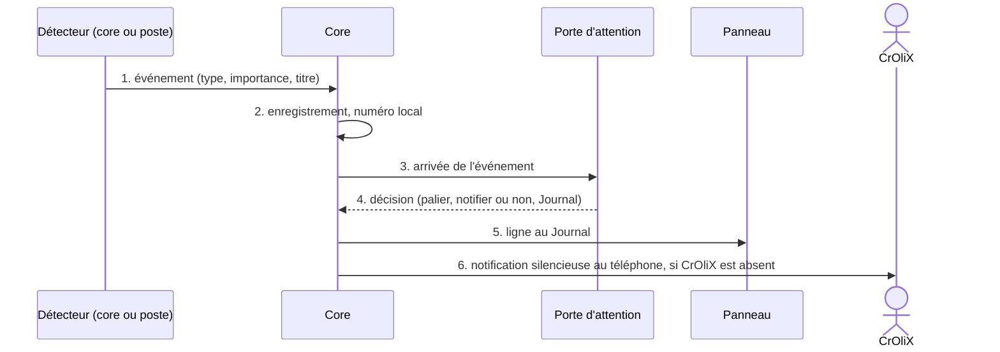

| # | De → vers | Par quoi | Ce qui circule | Retour |
|---|---|---|---|---|
| 1 | Détecteur → core | événement du core, ou événement d'un poste sur son flux `GET /lun/v1/events` | `id`, `type`, `importance`, `at`, `title`, parfois `data`, `link`, `lines` | — |
| 2 | Core (code) | enregistrement | l'événement tel quel (un événement déjà vu n'est pas réécrit) ; le lien n'est gardé que s'il est un chemin du front | pour un poste, le repère de reprise avance dans la même opération |
| 3 | Core → porte d'attention | décision sur l'arrivée | la source, le type, l'importance, l'ancienneté | une décision tracée : palier, voix, notification, Journal |
| 4 | Porte (code) | table de décision | présence de CrOliX, appel en cours, sourdine, pause, plage de nuit, réglage du poste | P1 : rien si CrOliX est présent au bureau, notification silencieuse sinon |
| 5 | Core → Journal | une ligne « Reçu. » | le titre et la source | — |
| 6 | Core → téléphone | notification silencieuse | le titre ; les notifications non urgentes en attente sont regroupées par type : le groupe part quand la plus ancienne a au moins 2 minutes, avec le titre de la dernière et « Et une autre. » / « Et N autres. » (pour les cartes, « N cartes à valider ») ; une urgence part seule, sans attente | un appareil qui répond « disparu » est retiré |

- **Ce que CrOliX voit, et où** : au Journal, la ligne de l'événement ; sur le téléphone, une notification sans son,
  seulement s'il n'est pas au bureau. Le panneau n'ajoute rien de propre à une alerte : ses bandes viennent de l'état
  (voir S11.2, S11.7, S11.11).
- **Ce qui s'écrit** : l'événement, sa décision tracée (gardée 30 jours), la ligne du Journal, une ligne de la file des
  notifications avec sa fin (envoyée, expirée, vue, cachée).
- **Qui décide** : le code de la porte, jamais un modèle. Le poste fixe l'importance ; il ne connaît pas la porte.
- **Erreurs et cas limites** :
  - en pause, seules passent les alertes de santé nées dans le core (plantage, copie ratée, clé refusée, crédit épuisé,
    conversation qui ne répond plus, clé qui expire, poste injoignable, plafond atteint) ; le même type venu d'un poste
    est écrit au Journal mais ne notifie pas ;
  - la plage de nuit et la sourdine ne touchent pas un événement P1 ; seule la présence le fait taire ;
  - une notification attend 2 minutes avant de partir (regroupement), et expire au bout de 24 heures ;
  - aucun appareil abonné : la file ne lit rien ; à l'abonnement elle relit tout, mais ce qui a plus de 24 heures expire
    sans partir ;
  - le service de notification répond une erreur : la ligne reste, un nouvel essai a lieu au passage suivant (15 s) ;
  - la porte tombe en panne à l'arrivée : l'événement et sa ligne de Journal sont gardés, la décision de repli ne dit
    rien à voix haute (une urgence est écrite au fil). Le téléphone n'est pas coupé pour autant : la file des
    notifications reprend chaque événement P0 ou P1 et refait sa propre décision à chaque passage (15 s), avec les
    entrées lues à ce moment-là. Si ces entrées ne se lisent pas, seule une urgence part ;
  - un événement `log` ne va ni au Journal ni au téléphone.
- **Écart avec les décisions** : T26 (un P1 reçu au bureau n'a que sa ligne au Journal, la notification n'est pas
  rejouée au départ de CrOliX), T20.
- **Non vérifié** : l'écran qui montre le Journal et ses pastilles ; l'effet réel de la notification sur le téléphone.

### S11.2 · Un poste injoignable : le flux coupé, puis repris

- **Déclencheur** : le flux d'événements d'un poste se ferme (réseau, poste arrêté ou redémarré), ou sa lecture
  périodique échoue.
- **Acteurs** : le core, le poste (Lun'Acedia ou Lun'Avaritia), le panneau, CrOliX.
- **Avant** : le poste est appairé ; le core a ouvert son flux au moins une fois.

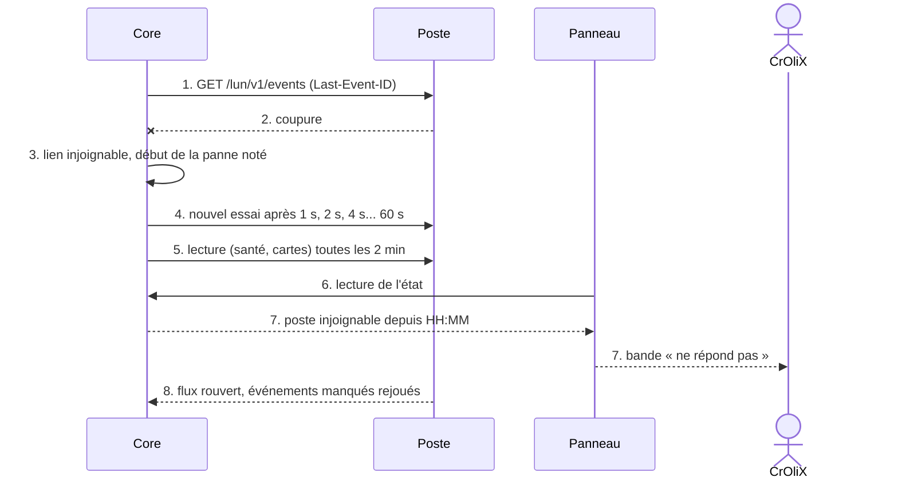

| # | De → vers | Par quoi | Ce qui circule | Retour |
|---|---|---|---|---|
| 1 | Core → poste | `GET /lun/v1/events`, jeton du core, en-tête `Last-Event-ID` (dernier événement enregistré) | l'identifiant de reprise | un flux ; les événements depuis cet identifiant sont rejoués, puis les nouveaux, avec un battement `: ping` toutes les 25 s (Lun'Acedia, `server/src/contract/routes.ts:282-312`) |
| 2 | Poste → core | coupure ou fin du flux | — | le core l'apprend à la fermeture |
| 3 | Core (code) | lien « injoignable », début de panne noté | la raison de la coupure | — |
| 4 | Core → poste | nouvel essai | délai doublé à chaque échec : 1 s, 2 s, 4 s, jusqu'à 60 s ; remis à 1 s à la reconnexion | un flux, ou un refus (voir S11.4) |
| 5 | Core → poste | `GET /lun/v1/health` (8 s au plus), puis cartes et suppléments (15 s au plus chacun) | le jeton | un échec de la santé note aussi la panne et efface la dernière santé connue |
| 6 | Panneau → core | lecture de l'état (toutes les 30 s si la page est visible) | — | un état construit depuis le cache du core, sans appeler le poste |
| 7 | Core → panneau | l'état | le poste, son état « injoignable », depuis quand | la bande « <poste> ne répond pas depuis… Ses cartes sont en lecture seule ; nouvel essai automatique » |
| 8 | Poste → core | flux rouvert | les événements au-delà du repère | le core note le contact, relit le poste 50 ms après le dernier signal ; si la pause du core est posée il la renvoie au poste, sinon il ne lui renvoie la reprise que si ce poste ne l'avait pas encore accusée (famille 10) |

- **Ce que CrOliX voit, et où** : dans le panneau, une bande sous l'en-tête, avec le bouton « Voir le poste », tant que
  la pause du core n'est pas posée (la bande se tait alors). Dans la Constellation, l'état « injoignable ». Après 15
  minutes, l'alerte de S11.3. Rien n'est dit à voix haute.
- **Ce qui s'écrit** : au core, le contact, l'échec avec sa raison, le début de la panne ; à la reprise, la santé, le
  nombre de cartes, la fin de la panne. Chez le poste, ses événements s'accumulent et sont gardés 7 jours (Lun'Acedia,
  `server/src/contract/events.ts:10`, `:79-81` ; Lun'Avaritia, `server/src/contract/events.ts:6`, `:63`).
- **Qui décide** : le code du core, sur des durées fixes. Rien n'est demandé à CrOliX.
- **Erreurs et cas limites** :
  - un flux resté ouvert mais muet n'est pas coupé par le core : les battements sont ignorés et aucune attente n'est
    bornée. La panne se voit alors par l'échec de la lecture de santé, au plus 2 minutes plus tard : l'état est «
    injoignable » bien que le lien se dise relié ;
  - un événement rejoué après la reprise est reconnu (même poste, même identifiant, même date) et n'est pas réécrit ; un
    événement manqué est traité comme neuf : une urgence de plus de 5 minutes est écrite au fil sans être dite ;
  - un poste resté coupé plus de 7 jours a perdu ses plus anciens événements : ils ne sont jamais rejoués ;
  - le même message d'erreur n'est écrit qu'une fois au journal d'exécution du core, pas à chaque essai ;
  - un poste jamais lu depuis le démarrage du core est « inconnu », pas « injoignable » ;
  - le poste répond au flux autre chose que 200 avec un corps, et autre chose que 401 (500, 503…) : le core écrit
    « Flux d'événements refusé (<code>) », une fois par message, émet le signal de coupure (panne notée), passe le lien
    à « injoignable » et réessaie avec le même délai doublé de 1 s à 60 s. Même suite que ci-dessus, mais le poste
    répond ;
  - une trame du flux dont le JSON est illisible, ou dont `id`, `type`, `at` ou `title` n'est pas une chaîne, ou dont
    l'`importance` n'est pas une des cinq valeurs (`urgent`, `normal`, `low`, `info`, `log`) : le core l'ignore sans
    rien écrire, ni journal d'exécution, ni santé, ni Journal. Le repère de reprise n'avance pas : la trame est
    rejouée, et ignorée de nouveau, à chaque reconnexion. CrOliX n'en voit rien.
- **Écart avec les décisions** : aucun connu. Voir S11.3 pour l'alerte.
- **Non vérifié** : l'affichage de la Constellation ; ce que fait la reprise quand le poste est en pause locale (famille
  12).

### S11.3 · Un poste muet depuis 15 minutes : l'alerte

- **Déclencheur** : un poste est noté injoignable depuis plus de 15 minutes. Le contrôle passe toutes les 15 secondes.
- **Acteurs** : le core, la porte d'attention, CrOliX.
- **Avant** : la panne de S11.2 dure ; le début de panne est noté.

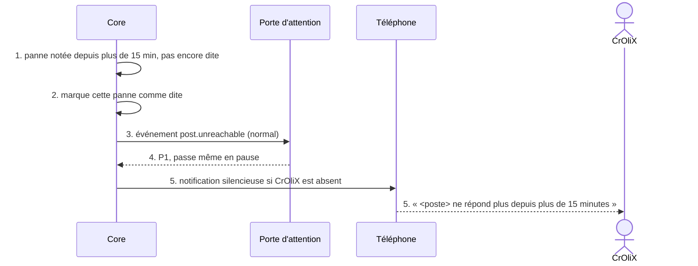

| # | De → vers | Par quoi | Ce qui circule | Retour |
|---|---|---|---|---|
| 1 | Core (code) | contrôle de la file des notifications | le début de panne de chaque poste appairé | une panne plus vieille que 15 min et pas encore dite |
| 2 | Core (code) | marque | la date de début de cette panne | — |
| 3 | Core → porte | événement `post.unreachable`, importance `normal` | titre « <nom du poste> ne répond plus depuis plus de 15 minutes », `data.post` = l'identifiant du poste | — |
| 4 | Porte (code) | décision | le type fait partie des alertes de santé du core | P1 ; la pause ne le retient pas |
| 5 | Core → téléphone | notification | le titre | — |

- **Ce que CrOliX voit, et où** : une ligne au Journal ; sur le téléphone, une notification silencieuse s'il est absent
  ; rien de plus au bureau que la bande de S11.2.
- **Ce qui s'écrit** : l'événement, la marque de la panne, la ligne du Journal.
- **Qui décide** : le code, par un seuil fixe de 15 minutes.
- **Erreurs et cas limites** :
  - une alerte par panne : une panne qui se termine puis recommence a un nouveau début et donc une nouvelle alerte ;
  - le contrôle tourne même sans appareil abonné : l'événement est écrit, la notification attend un abonnement (et
    expire à 24 heures) ;
  - aucun événement de retour n'est émis quand le poste revient (aucun trouvé dans le code) ;
  - une lecture qui échoue sans que le poste soit déclaré injoignable (S11.5) ne déclenche rien ;
  - le poste de bureau (Lun'Luxuria, appairé comme appareil) n'est pas un poste appairé : pas d'alerte pour lui ;
  - le nom dit est celui que le core a gardé à l'appairage.
- **Écart avec les décisions** : aucun connu. Le standard des notifications classe `post.unreachable` en P1 : conforme.
- **Non vérifié** : le rendu exact de la notification sur un téléphone.

### S11.4 · Liaison à refaire : jeton refusé ou illisible

- **Déclencheur** : le poste répond 401 au core, ou le core ne sait plus lire le jeton qu'il a gardé pour ce poste (clé
  de chiffrement du core absente ou changée, ligne abîmée).
- **Acteurs** : le core, le poste, le panneau, CrOliX.
- **Avant** : le poste est appairé.

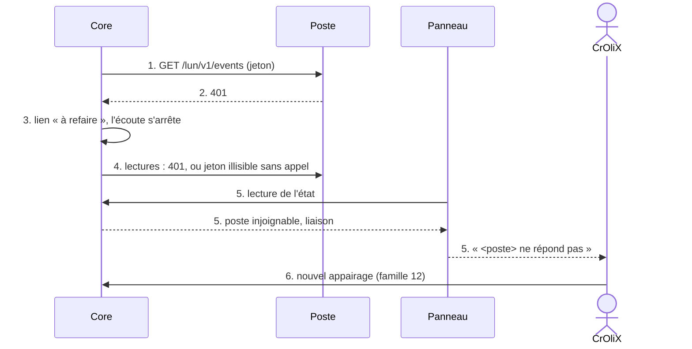

| # | De → vers | Par quoi | Ce qui circule | Retour |
|---|---|---|---|---|
| 1 | Core → poste | `GET /lun/v1/events` | le jeton du core | 401 |
| 2 | Poste → core | refus | `{ error }` | — |
| 3 | Core (code) | l'écoute prend fin, sans nouvel essai | — | seul un nouvel appairage en démarre une autre |
| 4 | Core → poste | lectures périodiques | un jeton refusé donne 401 ; un jeton illisible n'envoie rien : « Jeton du satellite illisible : il faut le réappairer » | chaque lecture note une panne |
| 5 | Core → panneau | l'état | le poste « injoignable », raison « liaison », sans heure de début | la bande « <poste> ne répond pas. » |
| 6 | CrOliX → core | appairage par adresse et code à 6 chiffres | — | voir famille 12 |

- **Ce que CrOliX voit, et où** : la même bande que S11.2 mais sans durée (« <poste> ne répond pas. »), avec « Voir le
  poste ». L'alerte de 15 minutes (S11.3) part aussi, puisque les lectures notent la panne.
- **Ce qui s'écrit** : la raison de l'échec, le début de panne.
- **Qui décide** : le code ; la réparation revient à CrOliX.
- **Erreurs et cas limites** :
  - sans clé de chiffrement lisible au démarrage, le core ne lit aucun jeton : aucun poste n'est écouté, la santé du
    core dit « satellites désactivés », et la conversation et les gestes continuent ;
  - une demande confiée à ce poste répond « injoignable : liaison à refaire » (S2.14) ;
  - le jeton d'un poste remplacé par un nouvel appairage est repris par le core dans les 15 secondes : une ancienne
    écoute ne peut plus écrire ;
  - un poste « délié » par CrOliX est oublié d'un coup : sa lecture en cours s'arrête sans rien écrire.
- **Écart avec les décisions** : aucun connu.
- **Non vérifié** : le texte exact affiché dans la fiche du poste.

### S11.5 · Un poste qui répond mais dont les lectures échouent

- **Déclencheur** : la lecture périodique du core (toutes les 2 minutes, et après un signal du poste) trouve la santé
  bonne mais les cartes illisibles ou trop lentes, ou un supplément (coûts, échéances, agenda) en échec.
- **Acteurs** : le core, le poste.
- **Avant** : le poste est relié.

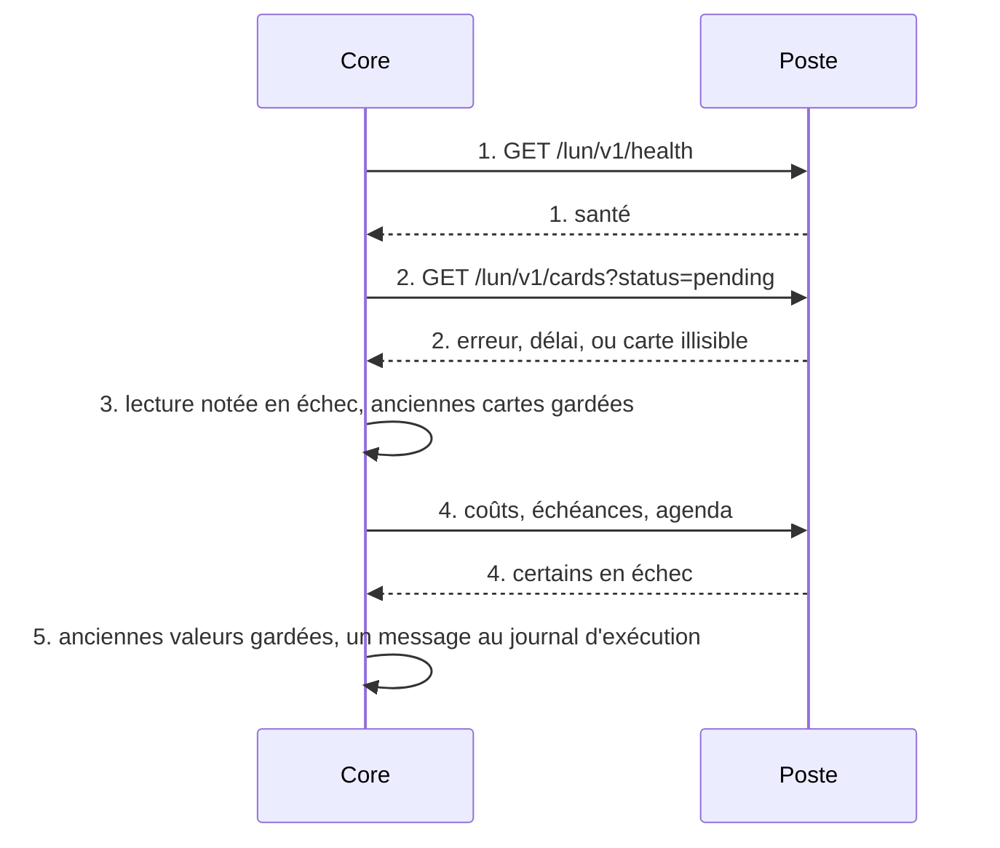

| # | De → vers | Par quoi | Ce qui circule | Retour |
|---|---|---|---|---|
| 1 | Core → poste | `GET /lun/v1/health` (8 s au plus) | le jeton | la santé |
| 2 | Core → poste | `GET /lun/v1/cards?status=pending` (15 s au plus) | le jeton | la liste ; une seule carte à laquelle manque un champ obligatoire (identifiant, action, effet, titre, lignes, statut, date) ou au statut inconnu fait rejeter toute la liste |
| 3 | Core (code) | échec noté « Cartes illisibles : … » | la raison | les cartes enregistrées à la lecture précédente restent |
| 4 | Core → poste | coûts du jour et du mois, `brain.due` (Lun'Avaritia), `agenda.list` (Lun'Acedia) | le jeton | chaque supplément réussit ou échoue seul |
| 5 | Core (code) | cache | — | un supplément en échec garde son ancienne valeur |

- **Ce que CrOliX voit, et où** : la file À trancher montre les cartes de la dernière lecture réussie ; la lecture est
  dite périmée au bout de 5 minutes, ou aussitôt qu'elle a échoué. Pas de bande ni d'alerte, sauf pour un poste revenu
  d'une coupure (cas limites).
- **Ce qui s'écrit** : l'échec et sa raison ; le journal d'exécution du core, une ligne par message nouveau.
- **Qui décide** : le code.
- **Erreurs et cas limites** :
  - un champ `importance` ou `bulk` invalide ne fait pas rejeter la carte : le champ est ignoré ;
  - un échec de lecture des cartes ne note pas de panne, mais il n'en lève pas non plus et ne garde pas la santé lue :
    un poste qui revient après une coupure et dont les cartes restent illisibles reste « injoignable » (bande comprise),
    son début de panne court toujours, et l'alerte de 15 minutes (S11.3) finit par partir. Un poste jamais coupé, lui,
    ne déclenche ni bande ni alerte ;
  - une lecture coupée parce que le poste est délié ou le core arrêté n'est pas notée comme un échec du poste.
- **Écart avec les décisions** : T27 (une carte illisible arrête la lecture de toutes celles du poste), confirmé.
- **Non vérifié** : le rendu de « périmé » dans la file.

### S11.6 · Le core arrêté ou redémarré, vu des postes et des réponses

- **Déclencheur** : le core reçoit un signal d'arrêt (mise à jour, maintenance, coupure) puis redémarre.
- **Acteurs** : le core, les postes, CrOliX.
- **Avant** : le core tourne, des postes sont reliés.

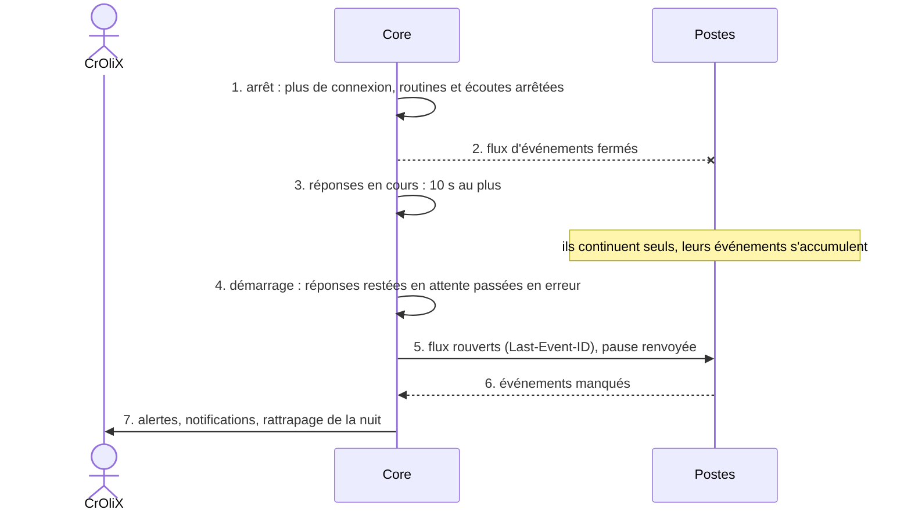

| # | De → vers | Par quoi | Ce qui circule | Retour |
|---|---|---|---|---|
| 1 | Core (code) | arrêt sur signal | — | un second signal sort aussitôt |
| 2 | Core → postes | fermeture des flux | — | chaque poste voit son flux tomber |
| 3 | Core (code) | attente des réponses en cours | — | 10 secondes au plus (limite commune aux étapes 2 et 3), puis la base se ferme |
| 4 | Core (code) | démarrage | — | « Réponse interrompue par un redémarrage du core » sur chaque réponse restée en attente, une ligne au journal d'exécution |
| 5 | Core → postes | flux rouverts ; à chaque ouverture, la pause est renvoyée si elle est posée, la reprise seulement aux postes qui ne l'avaient pas accusée | `Last-Event-ID`, `POST /lun/v1/pause` ou `/resume` avec `by: core` | 200 ou 409 pris pour un accusé |
| 6 | Postes → core | événements au-delà du repère | les événements, un par un | enregistrés, décidés par la porte |
| 7 | Core → CrOliX | selon la porte | — | voir S11.1 ; une routine due est rattrapée au premier passage d'une minute |

- **Ce que CrOliX voit, et où** : pendant l'arrêt, S11.7 et S11.8. Au retour, la réponse interrompue porte l'erreur
  ci-dessus dans la conversation.
- **Ce qui s'écrit** : les événements rejoués ; l'état de pause renvoyée aux postes ; la copie du jour si elle manque.
- **Qui décide** : le code.
- **Erreurs et cas limites** :
  - pendant l'arrêt, les postes continuent seuls : tri, agenda, rappels, copie de leur base (Lun'Acedia,
    `server/src/main.ts:106-149`) ; leurs événements sont gardés 7 jours ;
  - si la pause du core était posée, les postes restent en pause : elle ne se lève que quand le core la lève ; un poste
    qui n'a pas accusé la reprise la reçoit à la reconnexion ;
  - les paroles et signaux du flux en direct du core (réponse dite à voix haute, mise à jour de la file) ne sont pas
    rejoués : un client rouvre son flux et repart du présent ;
  - une nuit en cours finit son étape et reprend au démarrage suivant ;
  - une urgence manquée de plus de 5 minutes est écrite au fil sans être dite, et sa notification de téléphone expire au
    bout d'une heure ;
  - une alerte de S11.1 émise pendant l'arrêt n'existe pas : le core ne la voit qu'après.
- **Écart avec les décisions** : aucun connu. La carte du 27/11 ne décrit pas cette séquence.
- **Non vérifié** : le lanceur qui relance le core ; la durée réelle d'un arrêt sous charge.

### S11.7 · Le core injoignable, vu du panneau

- **Déclencheur** : le panneau n'obtient plus de réponse à la lecture de l'état (core arrêté, réseau coupé).
- **Acteurs** : le panneau, CrOliX, le core (absent).
- **Avant** : le panneau est ouvert.

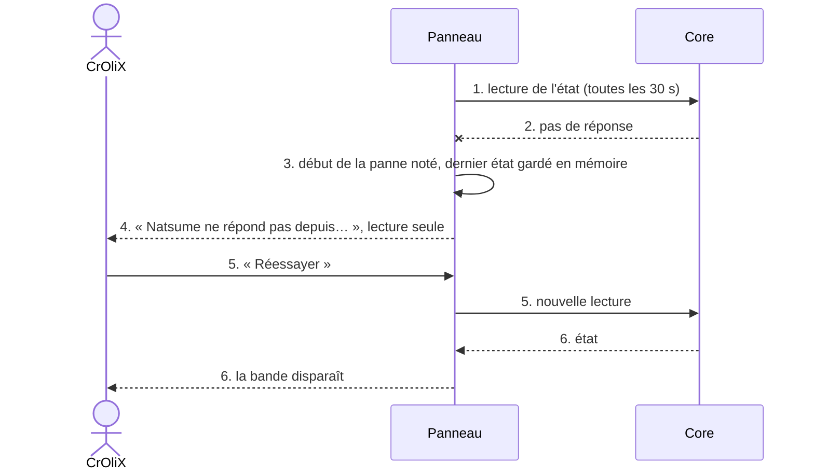

| # | De → vers | Par quoi | Ce qui circule | Retour |
|---|---|---|---|---|
| 1 | Panneau → core | lecture de l'état | le jeton de l'appareil | l'état |
| 2 | Core → panneau | rien | — | un échec réseau ou une erreur |
| 3 | Panneau (code) | début de panne | l'heure du premier échec après un succès | — |
| 4 | Panneau → CrOliX | bande et mot d'état | « Natsume ne répond pas <depuis>. Ce que tu vois date de <heure>, en lecture seule. » ; le mot d'état dit « Injoignable <depuis> » | bouton « Réessayer » |
| 5 | CrOliX → panneau | geste | — | une nouvelle lecture tout de suite |
| 6 | Core → panneau | l'état | — | le début de panne est effacé |

- **Ce que CrOliX voit, et où** : la bande de la coque, qui passe avant toutes les autres, le mot d'état de Natsume, et
  tous les lieux en lecture seule avec leur dernier contenu.
- **Ce qui s'écrit** : rien, ni au core ni sur l'appareil : le dernier état ne vit qu'en mémoire de la page.
- **Qui décide** : le code du panneau.
- **Erreurs et cas limites** :
  - un jeton refusé (401) n'est pas une panne : aucun début de panne n'est noté ;
  - la lecture ne tourne que si la page est visible ;
  - une page rechargée pendant la panne n'a plus rien à montrer ;
  - si le panneau n'a jamais lu l'état, le début de panne est noté quand même au premier échec : la bande s'affiche
    sans « Ce que tu vois date de… » (cas nominal décrit ci-dessus : une lecture a réussi avant).
- **Écart avec les décisions** : aucun connu.
- **Non vérifié** : le flux en direct du panneau et sa reconnexion ; ce que devient un message tapé pendant la panne.

### S11.8 · Le core injoignable, vu de Lun'Luxuria

- **Déclencheur** : Lun'Luxuria, relié à un serveur, perd son flux en direct, ou un envoi échoue.
- **Acteurs** : Lun'Luxuria (la fenêtre et la voix), le core, CrOliX.
- **Avant** : le cerveau est « Relié à un serveur » ; la présence est ouverte.

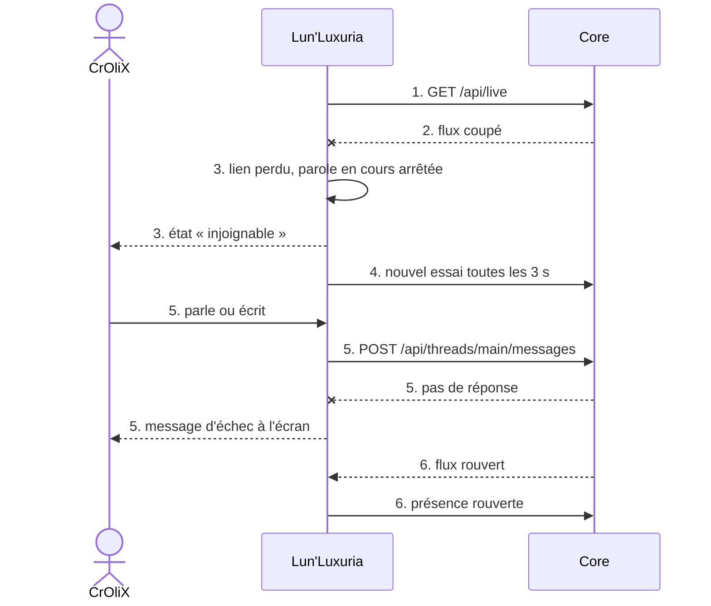

| # | De → vers | Par quoi | Ce qui circule | Retour |
|---|---|---|---|---|
| 1 | Lun'Luxuria → core | `GET /api/live` (Lun'Luxuria, `src/core.ts:124-142`) | le jeton de l'appareil | un flux de paroles et de signaux |
| 2 | Core → Lun'Luxuria | coupure | — | le flux se ferme |
| 3 | Lun'Luxuria (code) | lien perdu | — | la parole en cours s'arrête, « réfléchit » s'éteint, l'état du corps devient « injoignable » (`src/body/body.ts:54`) |
| 4 | Lun'Luxuria → core | nouvelle connexion toutes les 3 s, sans fin | — | un flux, ou un 401 qui arrête les essais (jeton refusé) |
| 5 | Lun'Luxuria → core | envoi d'une phrase (`src/core.ts:93-105`) | `text`, `speak: true`, `surface: voice`, la confiance | un flux : la phrase, la réponse ; sinon l'erreur affichée telle quelle |
| 6 | Core → Lun'Luxuria | flux rouvert | — | le message d'échec du serveur disparaît, la présence est annoncée de nouveau (`src/session.svelte.ts:336-346`) |

- **Ce que CrOliX voit, et où** : dans la fenêtre, le corps « injoignable » ; un message d'échec en bas (« Sa réponse
  n'est pas venue : … », « Coupure non transmise : … ») tant que le serveur ne s'est pas manifesté.
- **Ce qui s'écrit** : rien de durable ; le déroulé de la chaîne (réglages avancés) garde l'essai.
- **Qui décide** : le code de Lun'Luxuria ; elle ne dit que ce que le serveur envoie.
- **Erreurs et cas limites** :
  - aucune phrase de réponse en 60 s après un envoi : « Sa réponse n'est pas venue : aucune phrase en 60 s » ;
    Lun'Luxuria renonce à cette réponse, jette ce qui en viendrait, et envoie au core la coupure de cette réponse
    (`POST /api/threads/main/messages/<id>/cut`, `said` vide) ; un échec de cet envoi n'est pas affiché
    (`src/conversation.ts:78`, `:398-404`, `:560-570`, `src/core.ts:107-112`) ;
  - une coupure de la parole dite mais non transmise : « Coupure non transmise : … » (`src/conversation.ts:375`, `:403`)
    ;
  - le serveur répond une erreur pour la réponse (plafond, clé) : son texte est affiché, et reste jusqu'à la prochaine
    phrase dite ;
  - un battement de présence qui échoue n'efface rien (`src/core.ts:74-91`) ;
  - le message d'échec d'un service ne s'efface que par un signe du même service (flux revenu, battement répondu,
    réponse plus récente dite) : un échec de la voix reste malgré le retour du serveur
    (`src/pannes.test.ts`) ;
  - au core, sans battement depuis 90 secondes, la présence du poste de bureau n'est plus tenue pour ouverte : il est
    affiché « absent », sans bande.
- **Écart avec les décisions** : T4 (le core ne sait pas ce que Lun'Luxuria a dit), T25.
- **Non vérifié** : le comportement de la fenêtre Tauri (seule la page est lue) ; la relance de la présence par la page
  après un battement refusé ; un battement qui obtient une réponse du serveur, même « plus de présence ouverte » (410),
  vaut-il retour du serveur et efface-t-il un message d'échec du serveur ? (le code lu transforme le 410 en « gone » ;
  l'effacement côté session n'a pas été lu).

### S11.9 · Le core tombe sur une erreur imprévue

- **Déclencheur** : une erreur ou un rejet de promesse qu'aucun filet n'a rattrapé.
- **Acteurs** : le core, son lanceur (hors code), CrOliX.
- **Avant** : le core tourne, sa base est ouverte.

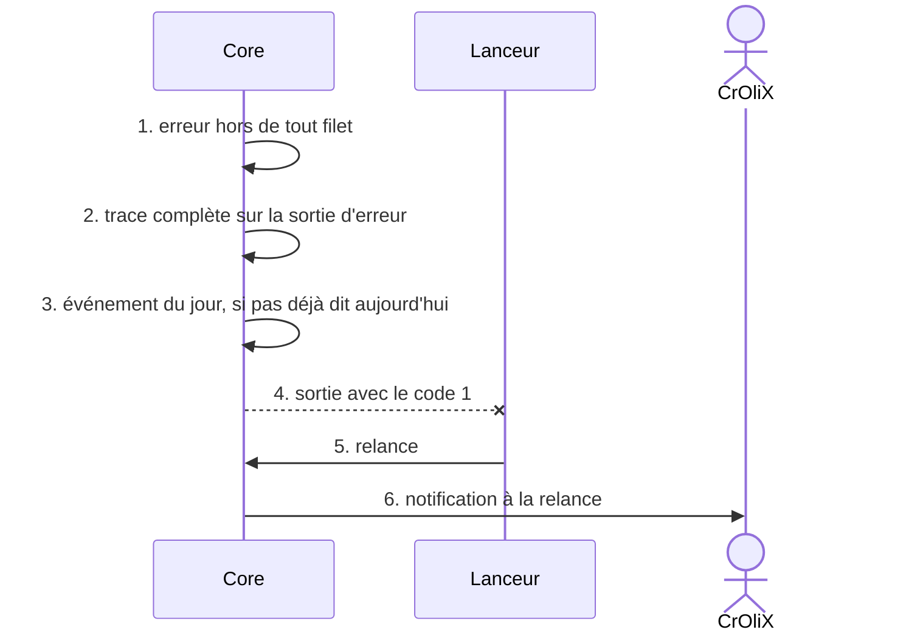

| # | De → vers | Par quoi | Ce qui circule | Retour |
|---|---|---|---|---|
| 1 | Code → core | erreur non rattrapée | — | — |
| 2 | Core (code) | écriture synchrone | le détail complet (journal d'exécution) | — |
| 3 | Core → porte | événement du core, importance `normal`, titre « Le core s'est arrêté sur une erreur » | le nom de l'erreur et son code seulement (le message peut contenir un chemin) | P1, passe même en pause |
| 4 | Core (code) | sortie avec le code 1 | — | pas d'arrêt propre |
| 5 | Lanceur | relance | — | voir S11.6 |
| 6 | Core → téléphone | file des notifications, relue au démarrage | le titre | silencieuse si CrOliX est absent |

- **Ce que CrOliX voit, et où** : la panne côté panneau et corps (S11.7, S11.8) ; à la relance, une ligne au Journal et
  une notification de téléphone s'il est absent.
- **Ce qui s'écrit** : l'événement, une fois par jour du calendrier local, quel que soit le nombre de chutes.
- **Qui décide** : le code.
- **Erreurs et cas limites** :
  - une transaction laissée ouverte est annulée avant l'écriture de l'événement ;
  - une seconde erreur pendant la chute sort aussitôt, sans événement ;
  - si l'écriture de l'événement échoue, le journal d'exécution le dit : « Chute non portée au Journal » ;
  - certaines boucles périodiques du core (la relecture des postes) sont entourées d'un filet qui n'écrit un message
    qu'une fois tant qu'il dure : une erreur dedans ne fait pas tomber le core.
- **Écart avec les décisions** : aucun connu.
- **Non vérifié** : qu'un lanceur relance bien le core ; il n'est pas dans le code lu.

### S11.10 · La base refuse d'écrire

- **Déclencheur** : une écriture en base échoue (base verrouillée au-delà de 5 s, disque plein, fichier abîmé).
- **Acteurs** : le core, Lun'Acedia, Lun'Avaritia.
- **Avant** : en cours de route, un événement, une copie ou un lot à écrire.

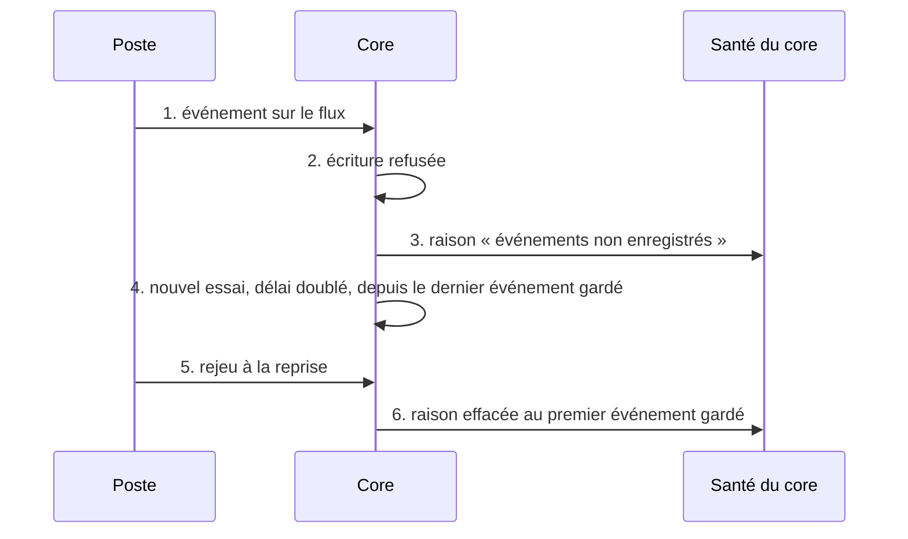

| # | De → vers | Par quoi | Ce qui circule | Retour |
|---|---|---|---|---|
| 1 | Poste → core | événement du flux | l'événement | — |
| 2 | Core (code) | enregistrement | — | l'écriture échoue : la transaction est annulée, le repère de reprise n'avance pas |
| 3 | Core (code) | santé du core | « Les événements du satellite <id> ne peuvent pas être enregistrés (<cause>) » | le lien du poste reste « relié », mais le core émet quand même son signal de coupure : la lecture du poste note une panne (début de panne, santé effacée). Si cette écriture passe, le poste s'affiche « injoignable », avec la bande « ne répond pas », jusqu'à la lecture suivante réussie (2 minutes au plus) |
| 4 | Core → poste | nouvel essai | délai 1 s doublé jusqu'à 60 s | flux rouvert depuis le dernier événement gardé |
| 5 | Poste → core | rejeu | les événements non gardés | — |
| 6 | Core (code) | enregistrement réussi | — | la raison est effacée |

- **Ce que CrOliX voit, et où** : pas de bande propre à la base : la raison est dans la santé du core, lue avec le
  jeton d'un appareil. La bande « <poste> ne répond pas » peut apparaître un moment, à cause du signal de coupure
  (étape 3).
  Aucune alerte : le core ne peut pas écrire l'événement qui la dirait.
- **Ce qui s'écrit** : rien tant que la base refuse ; rien n'est perdu côté poste (7 jours de garde).
- **Qui décide** : le code.
- **Erreurs et cas limites** :
  - les trois bases attendent un verrou 5 secondes avant d'échouer ;
  - Lun'Acedia (tri) : une base tenue donne le mail sans compter d'essai et arrête la passe
    (`server/src/triage/pipeline.ts:328-339`) ; les autres boucles notent l'erreur et repartent à leur tour
    (`server/src/util.ts:12-33`) ;
  - Lun'Avaritia : une erreur inattendue pendant un lot l'écrit « Erreur inattendue : … » et marque le lot échoué
    (`server/src/brain/ingest.ts:95-110`) ;
  - core, alerte de clé ou de crédit : écrite après la mise à jour de l'état de la clé ; si l'écriture de l'événement
    échoue, l'état est déjà changé et l'événement n'est pas rejoué (déduit de l'ordre du code) ;
  - core, copie ratée : l'événement est marqué dit après son écriture, donc retenté à l'heure suivante.
- **Écart avec les décisions** : aucun connu.
- **Non vérifié** : l'affichage de la santé du core à l'écran ; aucune panne de disque n'est rejouée.

### S11.11 · La clé du fournisseur du modèle est refusée (core)

- **Déclencheur** : le fournisseur répond « clé invalide » (401) à un appel du modèle du core : une réponse de
  conversation, un pas de la nuit, ou la vérification d'une clé saisie.
- **Acteurs** : CrOliX, le panneau, le core, le fournisseur du modèle.
- **Avant** : une clé est en service pour le fournisseur choisi.

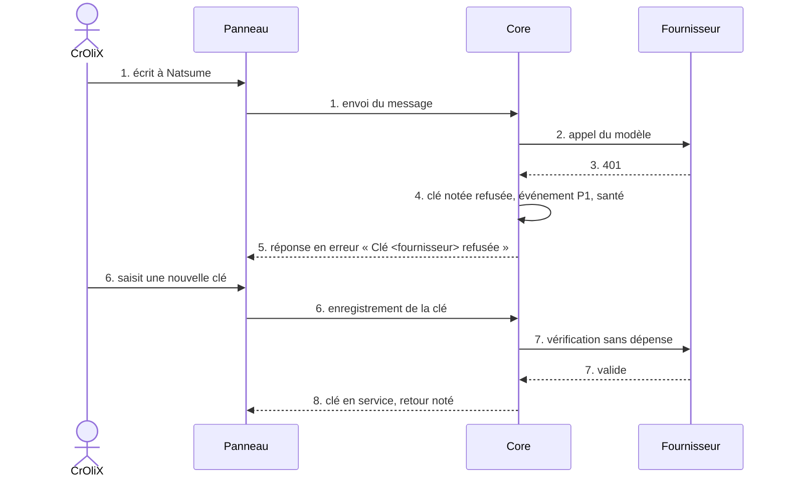

| # | De → vers | Par quoi | Ce qui circule | Retour |
|---|---|---|---|---|
| 1 | Panneau → core | envoi d'un message | le texte, la surface | un flux |
| 2 | Core → fournisseur | appel du modèle | consigne, fil, outils | — |
| 3 | Fournisseur → core | refus | 401 (un 403, clé sans droit sur ce modèle, n'est pas traité ainsi) | — |
| 4 | Core (code) | état de la clé | « refusée » garde sa valeur jusqu'au prochain appel réussi, même après redémarrage | un événement `key.invalid` P1, titre « Clé <fournisseur> refusée : Natsume ne peut plus répondre », `data.provider` ; une seule fois par changement d'état |
| 5 | Core → panneau | fin du flux | la réponse en erreur : « Clé <fournisseur> refusée » | — |
| 6 | Panneau → core | enregistrement d'une clé, avec une date d'expiration facultative | la clé | vérifiée avant d'être gardée |
| 7 | Core → fournisseur | vérification (15 s au plus) | la clé | « valide » : gardée chiffrée ; « refusée » : 422 « Clé refusée par <fournisseur> » ; injoignable : 502 avec la raison |
| 8 | Core (code) | prise en compte | — | le gel est levé, l'événement de retour (P3) est écrit |

- **Ce que CrOliX voit, et où** : dans le panneau, la bande de tête « Clé refusée à HH:MM. Natsume ne peut plus répondre
  ni rien confier. » avec le bouton « Modèle et clé », et le mot d'état « Clé refusée » ; dans la conversation, la
  réponse en erreur ; au Journal, la ligne de l'événement ; au téléphone, la notification silencieuse s'il est absent.
  Dans Lun'Luxuria, le texte d'erreur de la réponse.
- **Ce qui s'écrit** : l'état de la clé, l'événement, la raison dans la santé du core, la réponse en erreur.
- **Qui décide** : le code ; CrOliX décide de la nouvelle clé.
- **Erreurs et cas limites** :
  - tant que la clé est refusée, un message n'appelle pas le fournisseur : la réponse en erreur vient aussitôt, sauf un
    essai de sonde au plus toutes les 5 minutes. Ce gel ne vit qu'en mémoire : après un redémarrage, le premier message
    rappelle le fournisseur, même si l'état « refusée » (bande, mot d'état) est gardé. Un nouveau refus ne réémet pas
    d'événement (état inchangé) ; une réussite lève l'état et écrit l'événement de retour ;
  - un appel de la conversation qui réussit lève le gel et note le retour. Un pas de la nuit qui réussit remet
    seulement la clé « en service » (état, bande, événement de retour). Le gel de la conversation, lui, reste jusqu'à
    sa propre sonde (5 minutes au plus) ou une nouvelle clé. Une réponse encore en cours sur l'ancienne clé après son
    remplacement ne dit rien de la nouvelle ;
  - la nuit : chaque pas qui rencontre le refus note l'état de la même façon ; la routine échoue ou tourne sans le
    modèle (famille 6) ;
  - la clé d'un autre fournisseur n'est pas touchée ;
  - le panneau enregistre une clé alors que la clé de chiffrement du core est absente ou mal formée : le core répond
    503 avec un texte d'erreur, sans vérifier la clé chez le fournisseur ni la garder. Autres refus de la même route :
    400 (clé ou date illisible, fournisseur inconnu) ; la correction de la date seule répond 409 « Aucune clé
    enregistrée » s'il n'y a pas de clé ;
  - une clé absente au démarrage donne « En attente de la clé » (S11.14), pas « refusée ».
- **Écart avec les décisions** : le standard des notifications classe « clé rétablie » en état technique P4 ; le core
  l'émet en `info` (P3, donc dans la lettre du matin).
- **Non vérifié** : le texte exact de la bande à l'écran ; le comportement du second fournisseur configuré.

### S11.12 · Le crédit du fournisseur est épuisé (core)

- **Déclencheur** : le fournisseur dit que le solde ou la limite de dépense est atteint. Chez Anthropic : 402, ou 400
  ou 429 dont le texte parle de « credit balance » ou d'« usage limits ». Chez OpenAI : 429 avec le code
  « insufficient_quota » (un 402 n'y est pas reconnu comme crédit).
- **Acteurs** : CrOliX, le panneau, le core, le fournisseur.
- **Avant** : une clé valide est en service.

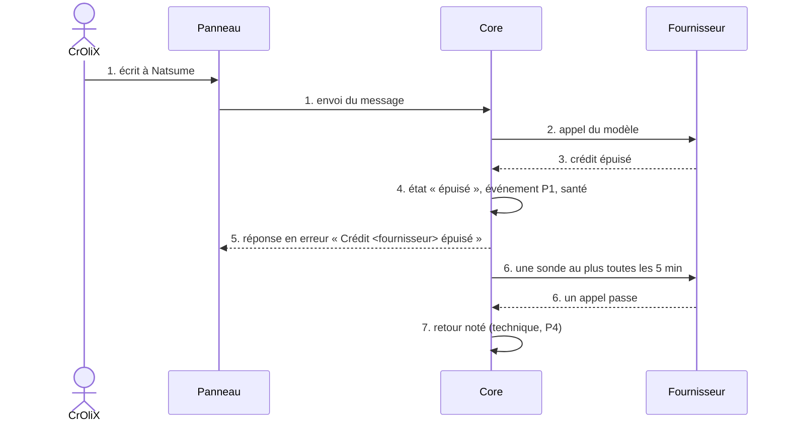

| # | De → vers | Par quoi | Ce qui circule | Retour |
|---|---|---|---|---|
| 1 | Panneau → core | envoi d'un message | le texte, la surface | un flux |
| 2 | Core → fournisseur | appel du modèle | consigne, fil, outils | — |
| 3 | Fournisseur → core | refus de facturation | — | reconnu par l'adaptateur du fournisseur |
| 4 | Core (code) | état « épuisé », gardé aussi au redémarrage | — | un événement `credit.exhausted` P1, « Crédit <fournisseur> épuisé : Natsume ne peut plus répondre » ; une fois par changement d'état |
| 5 | Core → panneau | fin du flux | « Crédit <fournisseur> épuisé » | — |
| 6 | Core → fournisseur | sonde | un vrai message de CrOliX | un appel réussi lève le gel |
| 7 | Core (code) | retour | — | un événement technique (`log`), ni Journal ni téléphone |

- **Ce que CrOliX voit, et où** : la réponse en erreur, la ligne d'alerte au Journal, la notification silencieuse s'il
  est absent. Aucune bande de tête et aucun mot d'état propres au crédit : l'état du panneau ne regarde que la clé
  refusée.
- **Ce qui s'écrit** : l'état du crédit, l'événement, la raison dans la santé du core.
- **Qui décide** : le code ; CrOliX recharge son compte chez le fournisseur.
- **Erreurs et cas limites** :
  - le crédit revient sans geste du core : seule la sonde (5 minutes) ou une nouvelle clé le découvre ;
  - une clé refusée et un crédit épuisé peuvent coexister : la raison la plus récente est celle que le message donne ;
  - le plafond de dépense du core (famille 10) est un autre arrêt, avec sa propre phrase.
- **Écart avec les décisions** : aucune bande ne dit le crédit (T25 en est proche, mais pour la voix) ; le standard le
  classe P1 : conforme.
- **Non vérifié** : Rien.

### S11.13 · Le fournisseur est injoignable, lent ou refuse une requête

- **Déclencheur** : un appel du modèle échoue sans que ce soit la clé ni le crédit : réseau, 5xx, 429 sans crédit,
  requête refusée (400, 403, 404), flux interrompu.
- **Acteurs** : CrOliX, le panneau, le core, le fournisseur.
- **Avant** : conversation configurée, clé et crédit valides.

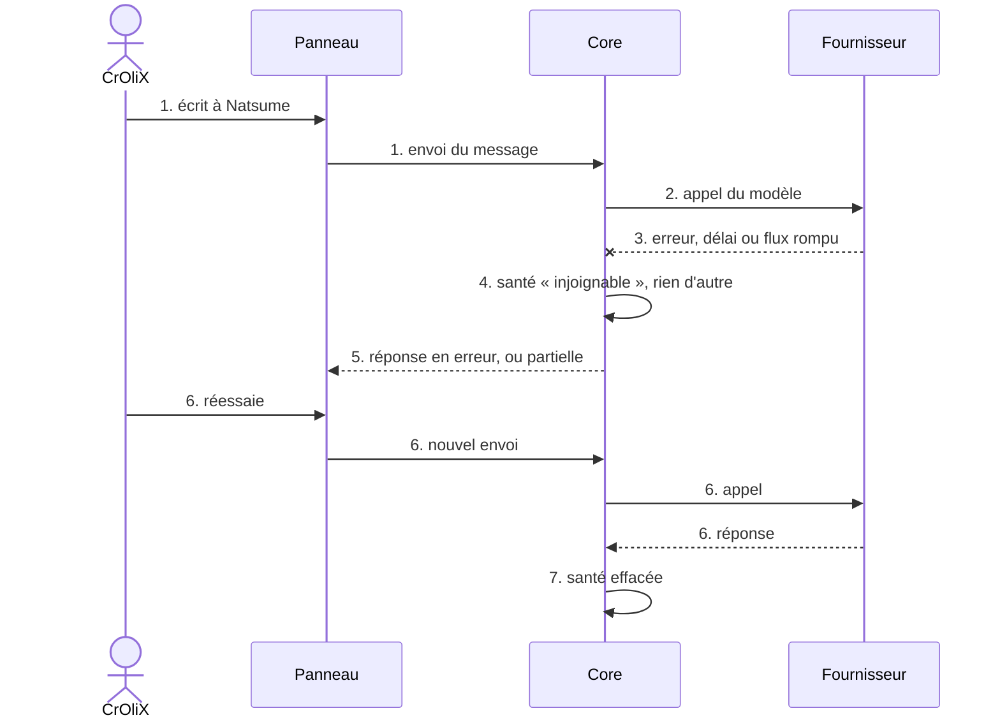

| # | De → vers | Par quoi | Ce qui circule | Retour |
|---|---|---|---|---|
| 1 | Panneau → core | envoi d'un message | le texte, la surface | un flux |
| 2 | Core → fournisseur | appel du modèle | consigne, fil, outils | un flux de mots |
| 3 | Fournisseur → core | échec | une limite de 60 s s'applique à l'attente de la réponse | — |
| 4 | Core (code) | santé | « <fournisseur> injoignable » | aucun événement, aucune alerte, aucune bande |
| 5 | Core → panneau | fin du flux | sans mot encore : « <fournisseur> injoignable pour le moment, réessaie dans un instant. » ; avec des mots : la réponse gardée, marquée « Réponse coupée en cours de route », jetons facturés estimés | — |
| 6 | CrOliX → core | nouvel envoi | — | chaque message réessaie : aucun gel |
| 7 | Core (code) | appel réussi | — | la raison est effacée de la santé |

- **Ce que CrOliX voit, et où** : l'erreur sur la réponse dans la conversation. Rien d'autre : ni Journal, ni téléphone.
- **Ce qui s'écrit** : la réponse en erreur ou partielle et son coût ; la raison dans la santé du core ; une ligne du
  journal d'exécution pour les refus de requête (le texte du fournisseur, en anglais).
- **Qui décide** : le code.
- **Erreurs et cas limites** :
  - le modèle refuse de répondre à cette demande (« Réponse refusée par le modèle ») : le fournisseur est tenu pour
    sain, la santé n'est pas touchée ;
  - une requête refusée en 400 alors qu'elle rejoue des appels d'outil : elle repart une fois sans eux, une ligne
    technique (`log`) est écrite au plus une fois par jour de Natsume ;
  - la limite de sortie atteinte avant le premier mot : « Réponse vide : limite de sortie atteinte avant le premier mot
    » ;
  - une parole d'elle-même que personne n'a demandée qui échoue ne laisse rien dans le fil, seulement une ligne du
    journal d'exécution ;
  - un second appel (relire le résultat d'un poste) qui échoue garde le résumé du poste (S2.16) ;
  - Lun'Luxuria coupe l'attente à 60 s sans première phrase (S11.8).
- **Écart avec les décisions** : aucun connu.
- **Non vérifié** : les 60 s portent-elles seulement sur l'arrivée des en-têtes de la réponse, et un flux qui se tait
  ensuite est-il coupé ? Pour le premier fournisseur, seul un commentaire du code le dit ; pour le second, la
  limite existe mais sa portée n'est pas vérifiée.

### S11.14 · La conversation ne peut plus être configurée

- **Déclencheur** : le core constate que la conversation ne peut pas fonctionner : fournisseur inconnu ou hors service,
  clé absente, prix inconnu pour le modèle choisi, raisonnement non déclaré, limite de sortie invalide.
- **Acteurs** : le core, le panneau, CrOliX.
- **Avant** : un réglage vient de changer, ou le core démarre.

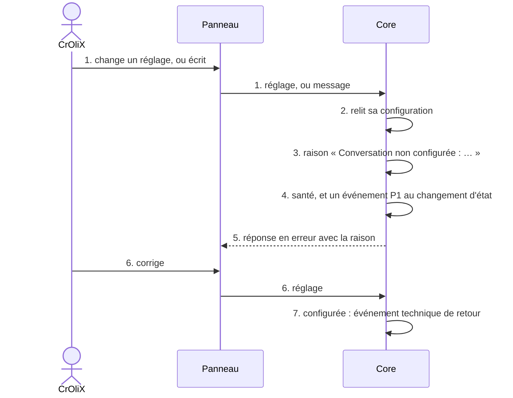

| # | De → vers | Par quoi | Ce qui circule | Retour |
|---|---|---|---|---|
| 1 | Panneau → core | réglage ou message | — | — |
| 2 | Core (code) | relecture à chaque message et à chaque changement | le réglage en cours | une raison, ou aucune |
| 3 | Core (code) | raison en français | « Conversation non configurée : <cause> » | — |
| 4 | Core (code) | santé et événement | « <raison> — Natsume ne peut plus répondre », P1 | une fois par changement d'état, y compris à travers un redémarrage ; au retour, un événement technique `log` |
| 5 | Core → panneau | réponse en erreur | la raison | — |
| 6 | CrOliX → panneau | correction | — | — |
| 7 | Core (code) | retour | — | santé effacée |

- **Ce que CrOliX voit, et où** : la raison dans la réponse ; une ligne au Journal et, absent, la notification. Sans clé
  en service, le mot d'état dit « En attente de la clé ».
- **Ce qui s'écrit** : la raison, l'événement, la santé.
- **Qui décide** : le code ; CrOliX corrige.
- **Erreurs et cas limites** :
  - un premier démarrage déjà configuré n'écrit rien ;
  - un fournisseur à la table cassée est seul hors service ; une erreur entre fournisseurs laisse toute la conversation
    non configurée.
- **Écart avec les décisions** : « Rien en dur » : la raison nomme le réglage fautif ; aucun écart connu.
- **Non vérifié** : quelle bande, hors « mise en route » et « attente de la clé », montre une conversation non
  configurée ; la nuit tourne-t-elle « sans le modèle » avec la raison complète de la conversation, ou seulement avec
  celle d'une erreur de la table des fournisseurs (famille 6) ?

### S11.15 · Une clé qui va expirer

- **Déclencheur** : la date d'expiration déclarée d'une clé de fournisseur approche. Contrôle au démarrage, puis toutes
  les heures, au core et chez chaque poste.
- **Acteurs** : le core ou le poste, la porte d'attention, CrOliX.
- **Avant** : CrOliX a déclaré une date (à l'enregistrement de la clé, ou après) ; sans date, rien n'est dit.

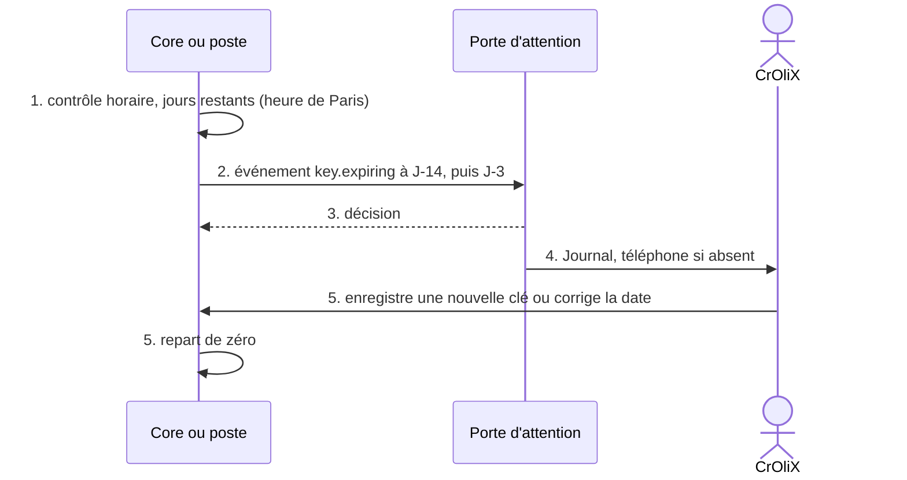

| # | De → vers | Par quoi | Ce qui circule | Retour |
|---|---|---|---|---|
| 1 | Core ou poste (code) | contrôle | la date déclarée, les jours calendaires restants | — |
| 2 | Détecteur → porte | événement `key.expiring` | titre « Clé <fournisseur> : échéance déclarée le JJ/MM/AAAA, dans N jours » ; `data.daysLeft` (14 ou 3), `data.expires` | importance : au core `normal` aux deux seuils ; chez Lun'Acedia et Lun'Avaritia `low` à J-14, `normal` à J-3 |
| 3 | Porte (code) | décision | — | core : P1, passe en pause ; poste : P2 ou P1, écrit en pause mais sans notification |
| 4 | Porte → CrOliX | Journal, téléphone | — | — |
| 5 | CrOliX → core ou poste | nouvelle clé ou nouvelle date | — | les avertissements recommencent |

- **Ce que CrOliX voit, et où** : une ligne au Journal ; au téléphone, la notification silencieuse pour un P1 (core, ou
  poste à J-3).
- **Ce qui s'écrit** : les avertissements déjà dits, gardés en base : un redémarrage n'en renvoie aucun.
- **Qui décide** : le code, par un calendrier fixe.
- **Erreurs et cas limites** :
  - une date déclarée à moins de 3 jours reçoit seulement J-3 ; une date à moins de 14 jours, J-14 puis J-3 ;
  - après la date, plus rien : le premier refus réel (S11.11) prend le relais ;
  - une date illisible est ignorée, avec une ligne au démarrage chez les postes ;
  - chaque fournisseur a ses propres avertissements ;
  - enregistrer une clé ou corriger sa date au core peut échouer : 503 si la clé de chiffrement du core manque, 400 si
    la date ou le fournisseur est illisible, 409 s'il n'y a pas de clé à dater (voir S11.11).
- **Écart avec les décisions** : le standard des notifications dit « J-3 en P1, J-14 en P2 » ; le core émet les deux en
  P1. Les postes sont conformes (Lun'Acedia, `server/src/keys/expiry.ts:65-75` ; Lun'Avaritia,
  `server/src/keys/expiry.ts:65-75`).
- **Non vérifié** : l'écran où la date se déclare.

### S11.16 · Clé refusée ou crédit épuisé chez un poste

- **Déclencheur** : le fournisseur du modèle d'un poste refuse la clé ou le crédit pendant son tri, son traitement du
  lot ou son agent.
- **Acteurs** : le poste (Lun'Acedia ou Lun'Avaritia), son fournisseur, le core, CrOliX.
- **Avant** : une clé est en service chez le poste.

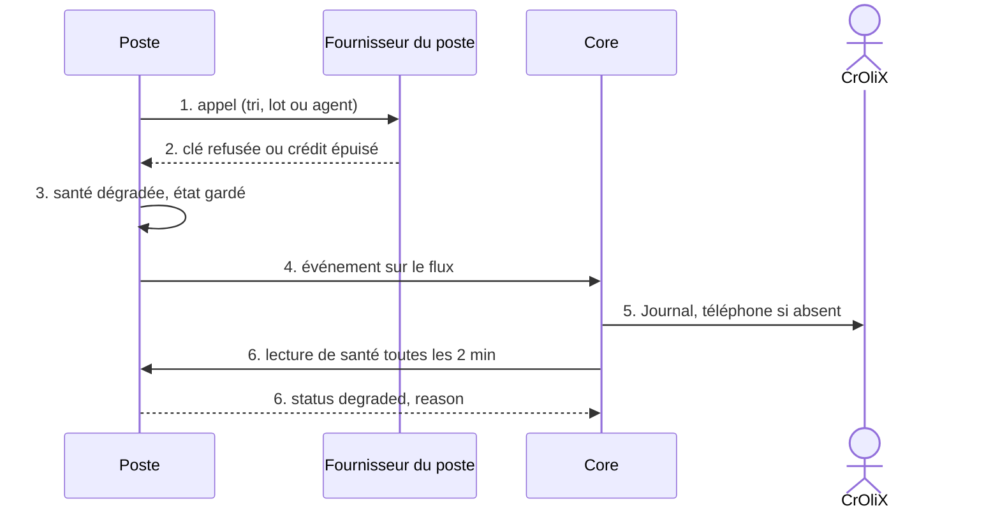

| # | De → vers | Par quoi | Ce qui circule | Retour |
|---|---|---|---|---|
| 1 | Poste → fournisseur | appel du modèle | — | — |
| 2 | Fournisseur → poste | refus | — | — |
| 3 | Poste (code) | santé | Lun'Acedia : raison `<fournisseur>-key` si ce fournisseur trie, `credit` pour le crédit du tri ; Lun'Avaritia : `<fournisseur>-key` ou `credit` | `GET /lun/v1/health` répond `status: degraded` et `reason`, une seule chaîne où les raisons sont jointes par une virgule (Lun'Acedia, `server/src/contract/state.ts:51-54`) |
| 4 | Poste → core | événement | Lun'Acedia : `key.invalid` (`normal`, `data.provider`) et `credit.exhausted` (`normal`) ; Lun'Avaritia : `key.invalid` seulement | un événement par changement d'état |
| 5 | Core → CrOliX | porte | — | P1 : Journal, notification silencieuse s'il est absent, sauf en pause (écrit sans notifier) |
| 6 | Core → poste | lecture de santé | — | la santé est gardée et relayée sur demande ; aucun code du core n'en tire de décision |

- **Ce que CrOliX voit, et où** : la ligne au Journal ; dans l'écran de Lun'Acedia, le badge « Clé
  refusée » ou « Crédit épuisé » dans les Réglages (`views/src/lib/settings/Settings.svelte:194-204`), et la ligne
  d'état de la coque : « Clé <fournisseur> refusée · les règles continuent » ou « Crédit épuisé · les règles
  continuent » (`app/src/shell/status.ts:29-31`, `:88-99`). Si une raison finit par `-key`, la coque dit la clé ; pour
  `credit`, le crédit ; pour `google-reauth`, « Compte Google à reconnecter » (S11.17) ; sinon « Service dégradé ». Un
  problème de clé ou de crédit du fournisseur du tri passe avant. C'est le seul écran qui dise ces pannes à CrOliX
  côté poste. Aucune ligne du panneau du core ne lit l'état dégradé d'un poste.
- **Ce qui s'écrit** : chez le poste, l'état de la clé, la santé, l'événement ; à la reprise, `key.restored` (`log`) ;
  au core, l'événement et la santé lue.
- **Qui décide** : le code du poste, sur la nature de l'erreur du fournisseur.
- **Erreurs et cas limites** :
  - Lun'Acedia, tri : les règles de CrOliX continuent, l'IA est en pause ; le crédit se lève au prochain tri réussi
    (`server/src/triage/pipeline.ts:159-160`) ;
  - Lun'Acedia, agent : une clé refusée est notée (`server/src/pina/agent.ts:380-385`), mais un crédit épuisé de l'agent
    ne donne ni événement ni santé, seulement une phrase au fil de l'agent ;
  - Lun'Avaritia, crédit épuisé : la santé passe à `degraded`, aucun événement n'est émis. Le lot est retenu et retenté
    à chaque passe horaire, tant qu'un modèle est choisi pour les deux usages. Exception : si son tri était déjà payé,
    il attend environ un jour (`server/src/brain/process.ts:60-69`, `:386-397` ; `server/src/brain/ingest.ts:63-68`,
    `:100-108`) ;
  - clé refusée de l'agent de Lun'Acedia sur un autre fournisseur que celui du tri : un événement `key.invalid`
    (`normal`) part au titre court « Clé <fournisseur> refusée », sans santé dégradée, et le tri continue ; si c'est
    le fournisseur du tri, le titre devient « … le tri par l'IA est en pause, les règles continuent » et la santé se
    dégrade (`server/src/llm/keys.ts:224-239`). Chez Lun'Avaritia, le même événement dit « Clé <fournisseur> refusée :
    l'IA est en pause » (`server/src/llm/keys.ts:222-236`) ;
  - une demande confiée à ce poste reçoit une phrase fixe de l'agent (S2.11) ;
  - pendant une pause, l'événement du poste est écrit au Journal mais ne notifie pas.
- **Écart avec les décisions** : T24 (le plafond de Lun'Avaritia ne remonte pas) est voisin ; ici le crédit de
  Lun'Avaritia reste muet côté événements, contrairement à celui de Lun'Acedia. Le contrat dit que `health` passe en
  `degraded` : conforme.
- **Non vérifié** : l'écran de la Constellation, qui pourrait afficher la santé relayée.

### S11.17 · Google : l'autorisation est à renouveler

- **Déclencheur** : Google refuse le renouvellement du jeton de Lun'Acedia (`invalid_grant`, ou 400 ou 401 à la demande
  de renouvellement).
- **Acteurs** : Lun'Acedia, Google, le core, CrOliX.
- **Avant** : un compte Google est branché.

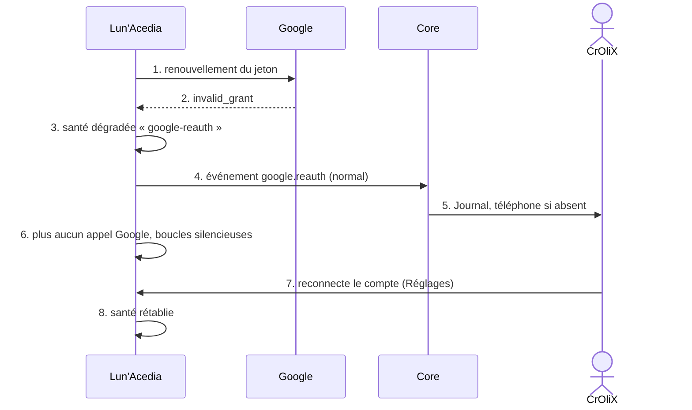

| # | De → vers | Par quoi | Ce qui circule | Retour |
|---|---|---|---|---|
| 1 | Lun'Acedia → Google | `POST https://oauth2.googleapis.com/token` | `client_id`, `client_secret`, `refresh_token`, `grant_type=refresh_token` | — |
| 2 | Google → Lun'Acedia | refus | `error: invalid_grant`, ou 400, 401 | — |
| 3 | Lun'Acedia (code) | santé | la raison `google-reauth` (Lun'Acedia, `server/src/google/client.ts:114-124`) | `status: degraded` |
| 4 | Lun'Acedia → core | événement | `google.reauth`, `normal`, « Autorisation Google à renouveler » ; une seule fois tant que la raison tient | — |
| 5 | Core → CrOliX | porte | — | P1 : Journal, téléphone silencieux, rien en pause |
| 6 | Lun'Acedia (code) | tant que la raison tient, tout appel Google échoue aussitôt sans appel réseau | — | les boucles d'attente ignorent cette erreur (`server/src/main.ts:99-105`) |
| 7 | CrOliX → Lun'Acedia | nouveau consentement Google | — | les jetons sont réécrits, la raison levée (`server/src/google/client.ts:54-62`) |

- **Ce que CrOliX voit, et où** : le Journal du core ; au téléphone, la notification. Dans l'écran de Lun'Acedia, le
  statut du compte Google reste « Connecté » tant que les jetons se lisent (`server/src/google/oauth.ts:108-110`,
  `views/src/lib/settings/GoogleAccount.svelte:66`). En revanche la coque de Lun'Acedia lit la santé du poste : la
  raison `google-reauth` y devient « Compte Google à reconnecter » (`app/src/shell/status.ts:29-31`, `:92-99`).
- **Ce qui s'écrit** : la raison de santé, l'événement. La synchro du mail et de l'agenda s'arrête, les rappels non.
- **Qui décide** : Google (le refus), puis le code ; CrOliX seul rebranche.
- **Erreurs et cas limites** :
  - le tri note l'erreur comme passagère : le mail est rendu à la file sans compter d'essai
    (`server/src/triage/pipeline.ts:328-332`) ;
  - une action demandée à la main échoue avec « Autorisation Google à renouveler » ;
  - la déconnexion volontaire efface les jetons et la raison.
- **Écart avec les décisions** : T23 est inexact ici : ce cas émet un événement et dégrade la santé (voir S11.18 pour le
  cas qui ne remonte vraiment rien).
- **Non vérifié** : si d'autres écrans que la coque et les Réglages lisent la raison.

### S11.18 · Google : compte non branché, jeton illisible, quota, panne

- **Déclencheur** : Lun'Acedia n'a pas de jeton lisible, ou Google répond 429 ou 5xx à la synchro ou à une action.
- **Acteurs** : Lun'Acedia, Google, CrOliX.
- **Avant** : Lun'Acedia tourne.

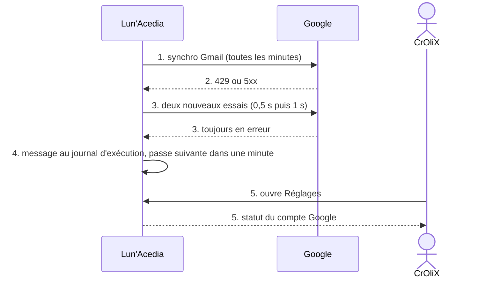

| # | De → vers | Par quoi | Ce qui circule | Retour |
|---|---|---|---|---|
| 1 | Lun'Acedia → Google | synchro du mail, puis de l'agenda, chacune sa boucle | — | — |
| 2 | Google → Lun'Acedia | 429 ou 5xx | — | — |
| 3 | Lun'Acedia → Google | trois essais au plus, attentes 0,5 s puis 1 s, sans lire `Retry-After` | — | (`server/src/google/client.ts:182-185`) |
| 4 | Lun'Acedia (code) | l'erreur remonte à la boucle | « Synchro Gmail : Google 429 : … » | la boucle repart à l'intervalle suivant ; le tri de cette minute ne tourne pas |
| 5 | CrOliX → Lun'Acedia | statut du compte | — | « Connecté » avec l'adresse ; sinon le badge « Non connecté », avec la ligne « Aucun compte » ou, si le jeton enregistré ne se lit pas (`unreadable`), « Compte illisible » et le conseil de remettre l'ancienne clé ou de reconnecter le compte (Lun'Acedia, `server/src/google/oauth.ts:108-115` ; `views/src/lib/settings/GoogleAccount.svelte:64-97`) |

- **Ce que CrOliX voit, et où** : au mieux le statut des Réglages ; la boîte et l'agenda ne bougent plus.
- **Ce qui s'écrit** : une ligne du journal d'exécution par échec ; aucune santé, aucun événement.
- **Qui décide** : le code ; la reprise est automatique à la première réponse valide.
- **Erreurs et cas limites** :
  - aucun compte branché, ou jeton chiffré avec une autre clé de Lun'Acedia : les boucles se taisent ; une phrase au
    démarrage dit « Jeton Google illisible avec cette clé… » (`server/src/main.ts:60-63`), puis rien ;
  - Google non configuré : une phrase au démarrage ;
  - un historique trop ancien (404) relance une synchro complète ;
  - un quota Google n'a aucun traitement propre : c'est un 429 comme un autre.
- **Écart avec les décisions** : T23 confirmé pour le compte non branché ou le jeton illisible : ni santé ni événement.
- **Non vérifié** : le comportement d'une action de l'agent face à un 429 ; la durée réelle d'un quota Google.

### S11.19 · La copie de la base rate

- **Déclencheur** : la copie quotidienne de la base du core, de Lun'Acedia ou de Lun'Avaritia échoue. Contrôle au
  démarrage puis toutes les heures, tant que la copie du jour manque.
- **Acteurs** : le core ou le poste, la porte d'attention, CrOliX.
- **Avant** : le dossier de copies existe ou peut être créé.

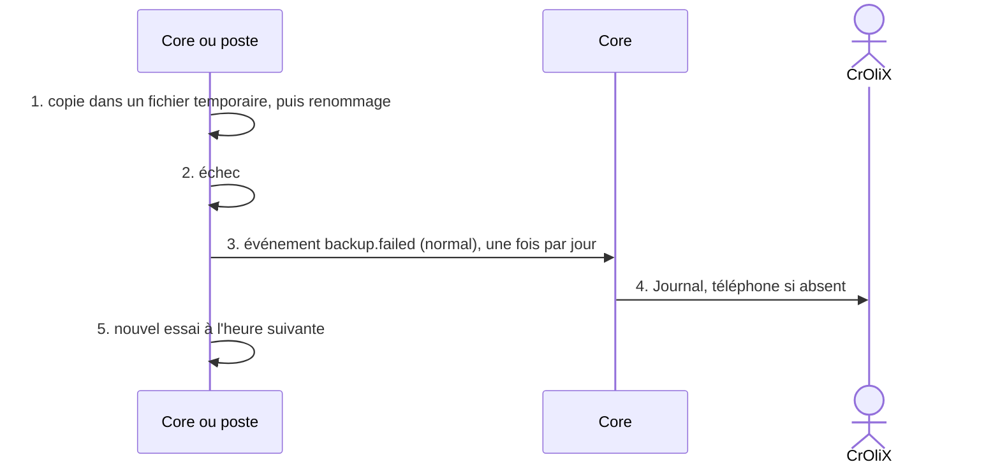

| # | De → vers | Par quoi | Ce qui circule | Retour |
|---|---|---|---|---|
| 1 | Détecteur (code) | copie consistante de la base, 7 copies gardées | — | — |
| 2 | Détecteur (code) | échec | la raison (en anglais, avec un chemin) | santé du core « La copie de la base a échoué : … » pour le core |
| 3 | Détecteur → porte | événement `backup.failed`, `normal`, « La copie de la base a échoué » | `data.reason` | une fois par jour du calendrier du poste (Lun'Acedia, `server/src/backup.ts:64-89`) |
| 4 | Core → CrOliX | porte | — | P1 ; celui du core passe en pause, celui d'un poste est écrit sans notifier |
| 5 | Détecteur (code) | nouvel essai | — | la santé du core est effacée au premier succès |

- **Ce que CrOliX voit, et où** : une ligne au Journal, la notification au téléphone ; la raison technique n'est que
  dans les données de l'événement.
- **Ce qui s'écrit** : la raison, l'événement, la marque du jour.
- **Qui décide** : le code.
- **Erreurs et cas limites** :
  - la copie se fait aussi pendant une pause : elle n'agit sur rien ;
  - les copies plus anciennes restent ; une ancienne copie qu'on ne peut pas retirer (fichier tenu) est notée et
    retentée ;
  - si l'événement lui-même ne s'écrit pas, la marque du jour n'est pas posée : il sera retenté à l'heure suivante ;
  - une copie perdue n'est jamais refaite pour un jour passé.
- **Écart avec les décisions** : Lun'Acedia et Lun'Avaritia annoncent dans leur code qu'une copie ratée atteint le
  Journal et le téléphone « même en pause » (`server/src/backup.ts:59-63`). Or la porte du core ne laisse passer en
  pause que les alertes de santé du core lui-même : l'événement d'un poste est écrit au Journal, sans notification.
- **Non vérifié** : la restauration d'une copie ; aucune n'est décrite ici.

### S11.20 · La voix de Lun'Luxuria en panne

- **Déclencheur** : le service voix local (transcription, synthèse, détection du micro) ne répond plus ou refuse.
- **Acteurs** : CrOliX, Lun'Luxuria, le service voix local, le core.
- **Avant** : Lun'Luxuria est ouvert ; le service voix tourne sur le poste.

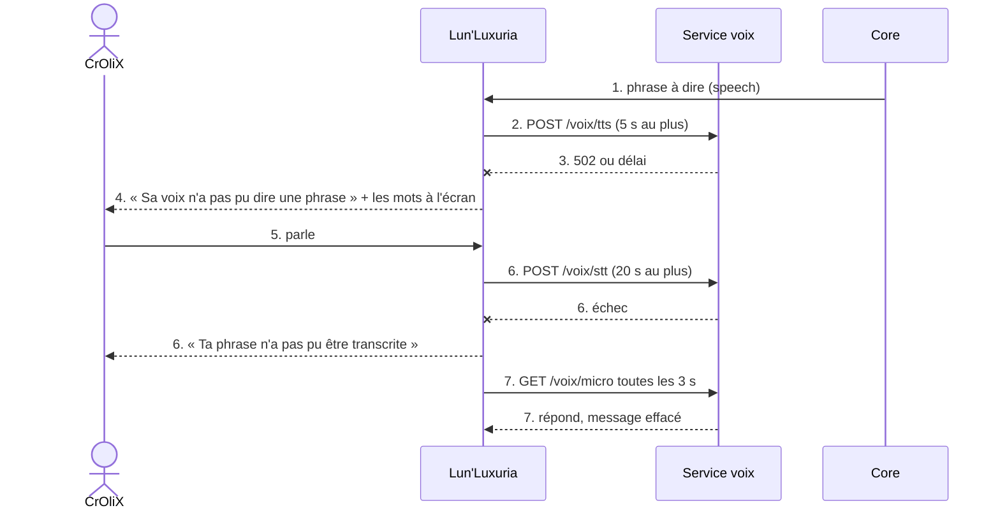

| # | De → vers | Par quoi | Ce qui circule | Retour |
|---|---|---|---|---|
| 1 | Core → Lun'Luxuria | signal `speech` sur le flux en direct | `id`, `n`, `text`, `why`, parfois l'émotion | — |
| 2 | Lun'Luxuria → service voix | `POST /voix/tts` (`src/voice.ts:28-37`) | le texte | un son ; 5 s au plus (`src/speech/speaker.ts:44`) |
| 3 | Service voix → Lun'Luxuria | 502, refus, ou rien | — | — |
| 4 | Lun'Luxuria (code) | message d'échec ; la phrase reste affichée en sous-titre muet, le temps de la lire | — | la suite de la réponse continue (`src/speech/speaker.ts:162-187`, `:212-219`) |
| 5 | CrOliX → Lun'Luxuria | parole | l'audio, qui ne quitte jamais le poste | — |
| 6 | Lun'Luxuria → service voix | `POST /voix/stt` (`src/voice.ts:14-26`) | l'audio | le texte et la confiance ; en échec, rien n'est envoyé au core |
| 7 | Lun'Luxuria → service voix | `GET /voix/micro` toutes les 3 s | — | une réponse efface le message de panne que la détection a posé lui-même |

- **Ce que CrOliX voit, et où** : un message en bas de la fenêtre ; les mots de Natsume en sous-titre même sans voix ; «
  Le service voix ne répond plus. » une fois par panne si la détection du micro est active.
- **Ce qui s'écrit** : rien de durable ; le déroulé de la chaîne note « synthèse : échec ».
- **Qui décide** : le code de Lun'Luxuria.
- **Erreurs et cas limites** :
  - la synthèse échoue sur une phrase : les phrases suivantes sont essayées ;
  - la détection du micro échoue par un 502 : « Le service voix ne répond plus. » (une fois) ; un 404 veut dire «
    service sans détection » et n'est pas une panne ;
  - un message de panne de la voix ne s'efface que par un signe de la voix (réponse de la détection, phrase dite plus
    récente) : le retour du serveur ne l'efface pas ;
  - le core n'est informé de rien : une urgence P0 dont la voix a échoué est tenue pour dite ;
  - la fenêtre Tauri n'est pas lue ici.
- **Écart avec les décisions** : T25 (voix en panne : rien ne part), confirmé ; T4.
- **Non vérifié** : une urgence passe-t-elle devant les autres phrases à dire (le tour porte un champ `urgent`, mais
  l'ordre de passage n'a pas été lu) ? ; le service voix lui-même (`voix/service.py`) ; si la parole d'urgence est
  aussi écrite dans le fil du core quand la voix échoue.
