# Famille 12 · L'appairage et la santé des postes

Relier, puis tenir relié. La famille couvre : relier un satellite au core (par sa page d'autorisation ou par un code),
relier Lun'Luxuria à son serveur, ajouter un appareil au panneau, ce qui authentifie chaque appel, révoquer ou délier,
la santé d'un poste (`GET /lun/v1/health`) et ce que le core en déduit, la version annoncée, le flux d'événements d'un
poste (ouverture, coupure, reprise), le démarrage du core, et la connexion Google de Lun'Acedia.

Relevé sur `origin/main` le 27/11/2026 : Lun'Acedia `40c293f`, Lun'Avaritia `bd6f7cf`, Lun'Luxuria `8afe402` ; le core à
la même date, décrit en mots. Les exemples sont inventés. Lun'Avaritia a la même mécanique que Lun'Acedia pour le code,
l'autorisation, la santé et les événements (Lun'Avaritia, `server/src/contract/routes.ts:50-107`, `:140-172`,
`server/src/contract/auth.ts`, `server/src/contract/authorize.ts`) ; seules les différences sont dites. Le contrat
(`standards/contrat-satellite.md`) est cité à l'écart seulement.

Trois mots à ne pas mélanger. Un **appareil** est un navigateur (ou l'appli de bureau) relié au core par un code. Un
**poste** est un satellite relié au core. Un satellite a, lui aussi, ses appareils et ses applications : le core y est
une **application** si la liaison passe par la page d'autorisation, un **appareil** si elle passe par le code (voir
S12.2).

| Id | Titre | En une ligne |
|---|---|---|
| S12.1 | Relier un satellite par sa page d'autorisation | Commande du terminal du core, navigateur, code à usage unique, jeton. |
| S12.2 | Relier un satellite par un code, depuis le panneau | Le code à six chiffres lu chez le satellite, saisi dans l'Atelier. |
| S12.3 | Le verrou du satellite | Cinq codes faux en dix minutes annulent tous les codes en cours. |
| S12.4 | Le premier appareil du panneau | Aucun appareil : le code sort au démarrage ou sur la page locale. |
| S12.5 | Ajouter un appareil depuis un appareil reconnu | Un code de dix minutes, saisi sur le téléphone ou le bureau. |
| S12.6 | Relier Lun'Luxuria au serveur | Adresse, confirmation de l'hôte, code, jeton gardé par l'appli. |
| S12.7 | Un code d'appareil refusé, et le verrou du core | Cinq refus en dix minutes annulent les codes du core. |
| S12.8 | Chaque appel, authentifié | Qui porte quel jeton, vers qui, et ce que devient un refus. |
| S12.9 | Révoquer un appareil | L'appareil est refusé à son prochain appel et revient au code. |
| S12.10 | Le satellite retire le core : « Liaison à refaire » | Le jeton du core est refusé : le poste est injoignable, sans reprise seule. |
| S12.11 | Délier un poste | Le core oublie le poste ; le satellite n'est pas prévenu. |
| S12.12 | Ouvrir le flux d'événements d'un poste | Reprise après le dernier événement connu, puis lecture et pause relayée. |
| S12.13 | Flux coupé, puis repris | Attente doublée de 1 à 60 secondes, rattrapage des événements manqués. |
| S12.14 | La santé d'un poste et ce que le core en déduit | Cadence, champs lus, quatre états. |
| S12.15 | Vérifier un poste maintenant | Une lecture à la demande, et son retour. |
| S12.16 | Ce que le panneau montre de la liaison | L'état lu toutes les 30 secondes, la bande, la liste des postes. |
| S12.17 | La version annoncée et la compatibilité | Seule la version du contrat décide : en dessous de 1.4, le poste est muet. |
| S12.18 | Démarrer le core | L'ordre des gestes, la première lecture de chaque poste, le premier code. |
| S12.19 | Jetons illisibles : la clé de chiffrement manque ou a changé | Le core tourne, sans ses postes. |
| S12.20 | La santé du core lui-même | Les raisons que chaque partie y dépose. |
| S12.21 | Connecter le compte Google de Lun'Acedia | Consentement, retour de Google, profil, jetons chiffrés. |
| S12.22 | Déconnecter le compte Google | Révocation chez Google et oubli des jetons. |
| S12.23 | L'autorisation Google est à renouveler | Santé « dégradée » et un événement, sans changement d'état au core. |
| S12.24 | Le flux du serveur côté Lun'Luxuria | Ouverture, coupure, reprise toutes les 3 secondes, jeton refusé. |
| S12.25 | Relier à nouveau un poste déjà lié | La ligne du poste est remplacée, les événements repartent de zéro. |
| S12.26 | Relier un satellite par un code, depuis le terminal du core | L'adresse et le code à six chiffres, sans navigateur. |
| S12.27 | Donner au core l'adresse du front d'un poste | Une origine gardée comme réglage, pour les liens vers l'écran du satellite. |

Renvois : la pause relayée à chaque ouverture du flux est décrite en S12.12 (une ligne), le détail est dans la famille
10 ; ce que fait le core d'une urgence reçue, voir la famille 4 (mails) et la famille 8 (la parole) ; poste injoignable
au moment de confier une demande, voir S2.14 (famille 2) ; la présence de Lun'Luxuria (battement, « absente »), voir la
famille 8 ; un satellite utilisé seul, voir la famille 13.

---

### S12.1 · Relier un satellite par sa page d'autorisation

- **Déclencheur** : CrOliX lance, dans le terminal de la machine qui héberge le core, la commande de liaison avec
  l'adresse du satellite et sans code.
- **Acteurs** : CrOliX, le terminal du core, son navigateur, le satellite (serveur et front).
- **Avant** : le satellite répond à son adresse ; la clé de chiffrement du core est lisible (32 octets) ; le navigateur
  de CrOliX est relié au front du satellite comme appareil, sinon l'écran de code du satellite passe d'abord (S12.4).

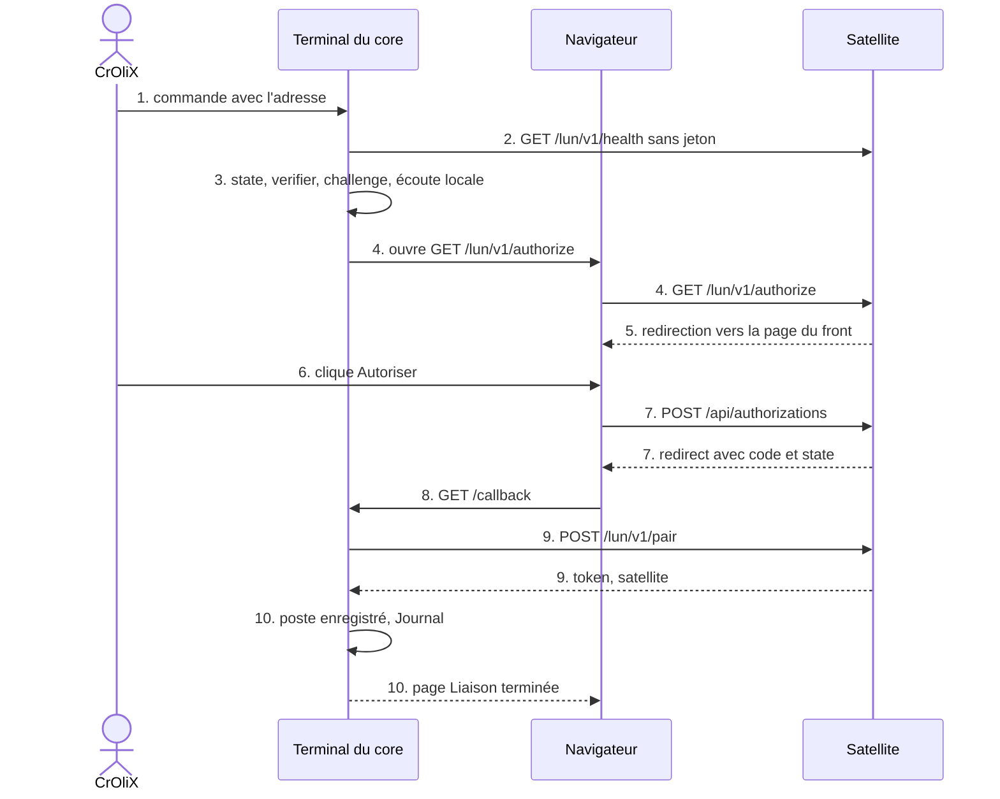

| # | De → vers | Par quoi | Ce qui circule | Retour |
|---|---|---|---|---|
| 1 | CrOliX → terminal | la commande | l'adresse (`http://` ou `https://` seulement) | une adresse autre est refusée tout de suite |
| 2 | Core → satellite | `GET /lun/v1/health`, sans jeton, 5 s | rien | toute réponse HTTP compte (un 401 aussi) ; aucune réponse : « Satellite injoignable », avant le navigateur |
| 3 | Core (code) | tirage | `state` (32 octets), `code_verifier` (32 octets), `code_challenge` (SHA-256 en base64url) ; une écoute unique sur une adresse locale, port libre | — |
| 4 | Core → navigateur → satellite | `GET /lun/v1/authorize` | `client` (« Lun'Anima »), `redirect_uri` (l'adresse d'écoute locale), `state`, `code_challenge`, `code_challenge_method` (non lu par le satellite) | l'adresse est aussi écrite dans le terminal |
| 5 | Satellite (code) | contrôle, redirection 302 | les quatre champs lus : tous présents, `client` 64 signes au plus, `state` 256 au plus, challenge de 43 signes, `redirect_uri` en `http` sur `127.0.0.1` ou `localhost` sans identifiants | sinon un texte 400 ; sinon la page `/?autoriser=1&…` du front |
| 6 | CrOliX → front | clic | le front dit qui demande (« Lun'Anima ») et quatre droits ; boutons Refuser et Autoriser | — |
| 7 | Front → satellite | `POST /api/authorizations`, jeton d'appareil | la demande et `decision` (`allow` ou `deny`) | `allow` : un code de 32 octets, 2 minutes, un usage, lié au challenge, et `redirect` vers `redirect_uri?code&state` ; `deny` : `redirect` avec `error=access_denied&state` |
| 8 | Navigateur → core | `GET /callback` | `code` et `state` (ou `error`) | une seule réponse est prise ; une seconde visite : page « Adresse inconnue » |
| 9 | Core → satellite | `POST /lun/v1/pair` | `code`, `code_verifier`, `client` (« Lun'Anima ») | `{ token, satellite: { id, nom, version } }` ; le satellite vérifie le verifier, marque le code utilisé, crée un client de type application |
| 10 | Core (code) | enregistrement | le poste : identifiant, nom, version, adresse, jeton chiffré, curseur de reprise vide ; une ligne au Journal | la page « Liaison terminée » au navigateur, « Satellite branché : nom (id, version) » au terminal |

- **Ce que CrOliX voit, et où** : le terminal (adresse de la page, puis la ligne finale) ; la page d'autorisation du
  satellite (Lun'Acedia, `app/src/Authorize.svelte` : « Lun'Anima demande l'accès à Lun'Acedia », droits listés, hôte du
  retour, Refuser, Autoriser) ; la page de retour du core (« Liaison terminée » ou « Liaison interrompue ») ; au Journal
  du panneau, une ligne « <nom> relié. » ; le poste apparaît dès la lecture suivante de l'état par le panneau (30
  secondes au plus), d'abord « Inconnu » : la liste des postes vient directement de ce que le core a enregistré.
  L'écoute du flux et la première lecture attendent la relecture de la liste des postes (15 secondes au plus, ou plus
  tôt si le panneau liste les postes ou relaie une action), car la commande tourne dans un autre processus que le core
  (S12.12).
- **Ce qui s'écrit** : côté core, la ligne du poste (jeton chiffré) et une entrée du Journal. Côté satellite, le code
  d'autorisation (marqué utilisé) et un client nommé d'après `client`, de type application, listé et retirable dans ses
  réglages (Lun'Acedia, `server/src/contract/authorize.ts:101-131`, `server/src/contract/auth.ts:58`).
- **Qui décide** : CrOliX, par le clic Autoriser (ou Refuser) ; le code du satellite pour les contrôles ; le code du
  core pour le `state` (comparé à temps constant).
- **Erreurs et cas limites** :
  - Refuser : le navigateur revient avec `access_denied` ; le terminal dit « Liaison refusée dans <nom>. » seulement si
    un poste est déjà lié à cette adresse ; pour un premier lien, c'est l'adresse du satellite qui est écrite (« Liaison
    refusée dans http://… ») ; la commande se termine sans erreur (code de sortie 0) ; rien n'est relié, et le refus ne
    compte pas dans le verrou (S12.3) ;
  - un retour avec un `error` autre que `access_denied` : « Liaison impossible, le satellite répond : <error>. », page
    400 « Liaison interrompue », sortie 1 ; un retour sans `code` : « Réponse de la page d'autorisation sans code. Rien
    n'a été relié. » ;
  - la première visite du chemin de retour consomme l'unique réponse, même avec un `state` faux : une visite légitime
    arrivée après tombe sur « Adresse inconnue » (404), et la commande a déjà échoué ;
  - un statut autre que 401 et 2xx à l'échange : « Appairage impossible (<n>) : <raison> » ;
  - côté front du satellite, une demande qu'il juge invalide (paramètres illisibles) : « Demande d'accès refusée », la
    raison et un bouton « Ouvrir Lun'Acedia » ; un clic Autoriser ou Refuser en erreur (400 : corps invalide, ou «
    decision attendue : 'allow' ou 'deny' ») s'affiche sous les boutons, qui redeviennent actifs (Lun'Acedia,
    `app/src/App.svelte:187-196`, `app/src/Authorize.svelte:31-41`, `:71`, `server/src/app.ts:115-130`) ;
  - `state` différent au retour : page 400 « Liaison interrompue », « Rien n'a été relié » ;
  - code d'autorisation déjà utilisé, expiré (2 minutes) ou verifier faux : le satellite répond 401, le terminal le dit,
    et cet échec compte dans le verrou du satellite ;
  - aucun retour du navigateur : après 5 minutes, « Pas de réponse de la page d'autorisation », l'écoute se ferme ;
  - le navigateur ne s'ouvre pas : l'adresse reste écrite dans le terminal, CrOliX peut l'ouvrir à la main ;
  - le satellite donne l'identifiant `core` : refusé (« Identifiant de satellite réservé »), rien n'est relié ;
  - une adresse sans `http://` (par exemple `satellite.local`) : message avec la forme attendue, avant tout appel ;
  - clé de chiffrement de 32 octets absente : message, avant tout appel (le code à usage unique n'est pas gâché).
- **Écart avec les décisions** : aucun connu. Remarque : le contrat dit que le code à six chiffres « reste valable » en
  repli pour le core ; ce repli donne au core un jeton d'**appareil**, plus large que le jeton d'application (voir
  S12.2).
- **Non vérifié** : la page d'autorisation de Lun'Avaritia est-elle la même que celle de Lun'Acedia ? (Les routes sont
  identiques, `server/src/app.ts:102-143`, `server/src/contract/routes.ts:50-107` ; son écran Authorize n'a pas été
  relu.) Que dit le terminal si le navigateur n'a jamais été relié au satellite ? (L'écran de code du satellite passe
  d'abord, lu dans Lun'Acedia, `app/src/App.svelte:287`.)

---

### S12.2 · Relier un satellite par un code, depuis le panneau

- **Déclencheur** : CrOliX, dans l'Atelier du panneau, ouvre « Relier » pour un poste, saisit l'adresse du poste et le
  code à six chiffres que le satellite lui a donné.
- **Acteurs** : CrOliX, le front du satellite, le panneau, le core, le satellite.
- **Avant** : le panneau est relié au core ; le core lit sa clé de chiffrement ; CrOliX a demandé un code dans les
  réglages du satellite (« Relier un appareil »).

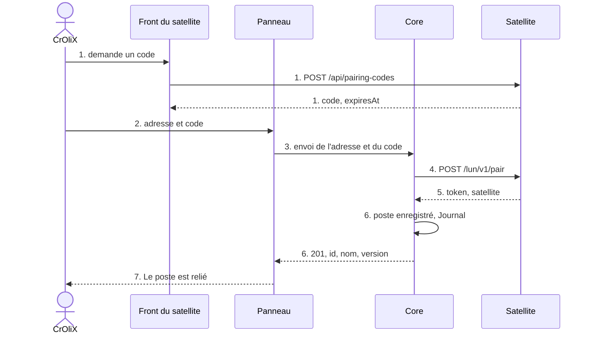

| # | De → vers | Par quoi | Ce qui circule | Retour |
|---|---|---|---|---|
| 1 | Front → satellite | `POST /api/pairing-codes`, jeton d'appareil | rien | `{ code, expiresAt }` : six chiffres, 10 minutes, un usage ; affiché « 482 917 » |
| 2 | CrOliX → panneau | formulaire | l'adresse, le code (collage permis) | « Il faut six chiffres » avant tout envoi si le code est court |
| 3 | Panneau → core | envoi | `url`, `code` | contrôles : adresse `http(s)`, code de six chiffres, clé de chiffrement lisible (32 octets) ; sinon 400 ou 503 |
| 4 | Core → satellite | `POST /lun/v1/pair` | `code`, `client` (« lun-anima ») | — (aucun appel de santé avant : seule la commande de S12.1 en fait un) |
| 5 | Satellite (code) | échange | espaces du code retirés ; code inconnu, utilisé ou expiré : refus | `{ token, satellite: { id, nom, version } }` ; client créé de type **appareil**, nommé « lun-anima » |
| 6 | Core (code) | enregistrement | comme S12.1 étape 10 ; le gestionnaire de postes relit la liste des postes aussitôt | `201` avec `{ id, nom, version }` ; le jeton n'est jamais rendu au panneau |
| 7 | Panneau | lecture | l'état et la liste des postes sont relus | « <nom> est relié. », puis la Constellation |

- **Ce que CrOliX voit, et où** : dans le satellite, le code et son compte à rebours (Lun'Acedia,
  `server/src/contract/auth.ts:24`, 10 minutes) ; dans l'Atelier, un formulaire en trois étapes (le poste, le code,
  vérification) ; un message d'erreur sous le champ du code ; à la fin, un toast puis la Constellation avec le poste. Au
  Journal, « <nom> relié. ».
- **Ce qui s'écrit** : comme S12.1. Côté satellite, un client de type appareil nommé « lun-anima ».
- **Qui décide** : CrOliX (il choisit de relier) ; le code du satellite (il accepte ou refuse le code) ; le code du core
  (adresse, forme du code, identifiant réservé).
- **Erreurs et cas limites** :
  - adresse illisible ou d'un autre schéma : 400, message ; code qui n'a pas six chiffres : 400 « Le code a 6 chiffres »
    ;
  - clé de chiffrement absente : 503 ; rien n'est tenté ;
  - code refusé par le satellite : 502, « Code refusé par le satellite : <raison du satellite> » ; l'échec compte dans
    le verrou du satellite (S12.3) ;
  - satellite injoignable : 502 « Satellite injoignable : <adresse> » ;
  - un statut du satellite autre que 401 ou 2xx : 502 « Appairage impossible (<n>) : <raison du satellite> », affiché
    sous le champ du code ;
  - une réponse qui n'est pas du JSON, ou sans jeton ni identifiant : 502 « Ce n'est pas un poste Lun' à cette adresse »
    ;
  - identifiant `core` : 502, refusé ; un incident de base du core reste une erreur 500, sans message du poste ;
  - le panneau désactive « Relier » quand le core est injoignable (lecture seule).
- **Écart avec les décisions** : aucun connu. Remarque (constat de code) : par ce chemin le satellite range le core
  parmi ses **appareils** ; or tout `/api` du satellite (codes d'appairage, révocations, clés, compte Google) est
  réservé aux appareils (Lun'Acedia, `server/src/app.ts:94`, `server/src/contract/auth.ts:152`). Le core n'appelle
  pourtant que `/lun/v1` ; son jeton, lui, pourrait aller plus loin. Le chemin de S12.1 donne un jeton d'application.
- **Non vérifié** : le texte exact du formulaire pour chaque poste (adresses proposées par défaut) ; l'écran « Relier un
  appareil » du satellite Lun'Avaritia (même route `POST /api/pairing-codes` lue, Lun'Avaritia,
  `server/src/app.ts:105`).

---

### S12.3 · Le verrou du satellite

- **Déclencheur** : un `POST /lun/v1/pair` refusé (code faux, utilisé, expiré, verifier faux, corps sans code), venu du
  core ou de n'importe qui qui connaît l'adresse.
- **Acteurs** : l'appelant (le core, un navigateur, un tiers), le satellite.
- **Avant** : aucune ; la route `pair` est publique, comme `authorize`.

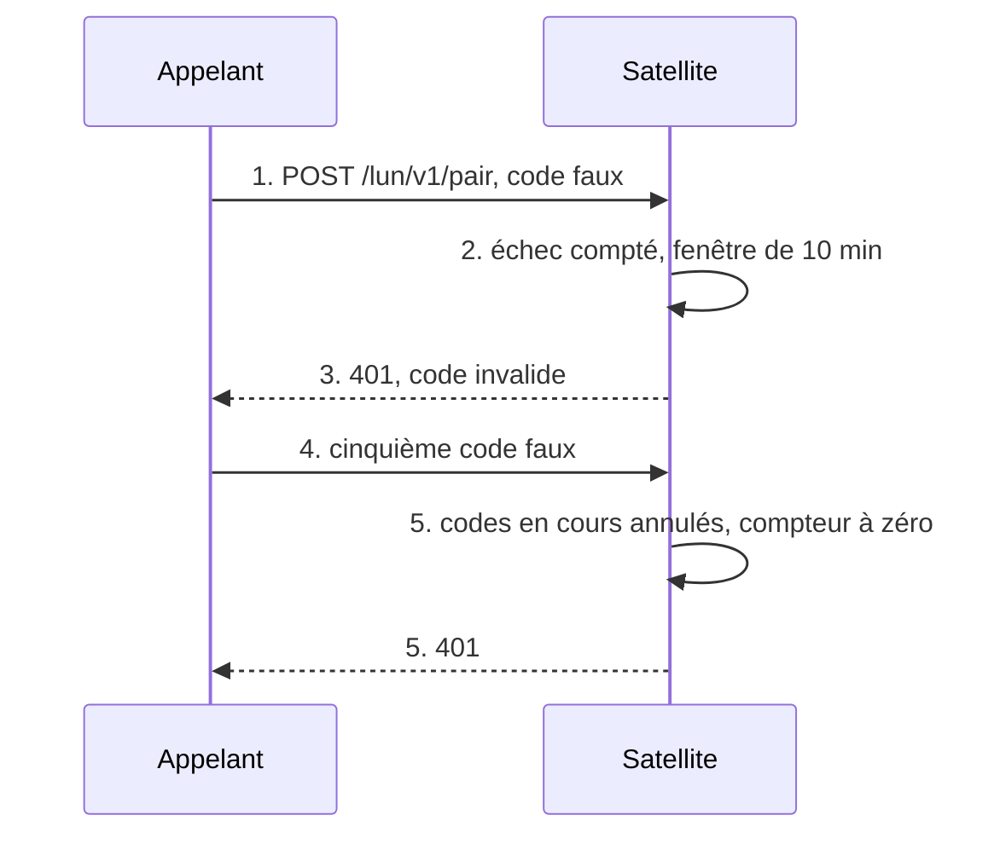

| # | De → vers | Par quoi | Ce qui circule | Retour |
|---|---|---|---|---|
| 1 | Appelant → satellite | `POST /lun/v1/pair` | `code`, `client` ou `code_verifier` | — |
| 2 | Satellite (code) | compte | une ligne d'échec datée ; celles de plus de 10 minutes sont effacées | — |
| 3 | Satellite → appelant | réponse | — | `401` : « Code d'appairage invalide, déjà utilisé ou expiré », ou, avec un verifier, « Code d'autorisation invalide, déjà utilisé, expiré ou code_verifier faux » |
| 4 | Appelant → satellite | cinquième échec | — | — |
| 5 | Satellite (code) | verrou | tous les codes d'appairage et d'autorisation non utilisés sont supprimés ; le compteur repart à zéro ; une ligne est écrite dans le journal du serveur : « Appairage verrouillé : 5 codes faux en 10 min, codes en cours annulés. » | `401` comme avant ; aucun code n'est créé |

- **Ce que CrOliX voit, et où** : au satellite, rien de lui-même ; côté core, l'erreur du code refusé (S12.2) ; le code
  qu'il avait demandé ne marche plus, il en redemande un (les codes demandés ensuite marchent normalement).
- **Ce qui s'écrit** : les échecs dans la base du satellite ; la ligne du journal du serveur (Lun'Acedia,
  `server/src/contract/auth.ts:75-97`, appelée par `server/src/contract/routes.ts:213-219`).
- **Qui décide** : le code du satellite, seul.
- **Erreurs et cas limites** :
  - un corps qui n'est pas du JSON : 400, **non compté** ; un corps sans `code` texte : compté ;
  - le refus volontaire de la page d'autorisation n'arrive jamais à `pair` : non compté ;
  - le compte et la suppression se font dans une seule transaction, partagée avec la commande `pair-code` du satellite ;
  - la ligne du journal n'est écrite qu'après la validation de la transaction : rien n'est annoncé qui n'ait eu lieu.
- **Écart avec les décisions** : aucun connu (le contrat dit : verrou global, cinq échecs sur dix minutes glissantes).
- **Non vérifié** : Lun'Avaritia (même code lu, Lun'Avaritia, `server/src/contract/auth.ts:75-97`, mêmes constantes
  `:5-7`).

---

### S12.4 · Le premier appareil du panneau

- **Déclencheur** : le core démarre avec aucun appareil relié (installation neuve, ou tous révoqués) ; CrOliX ouvre
  l'appli sur la machine qui l'héberge.
- **Acteurs** : CrOliX, le core, son terminal de démarrage, la page du panneau.
- **Avant** : aucun appareil non révoqué dans le core.

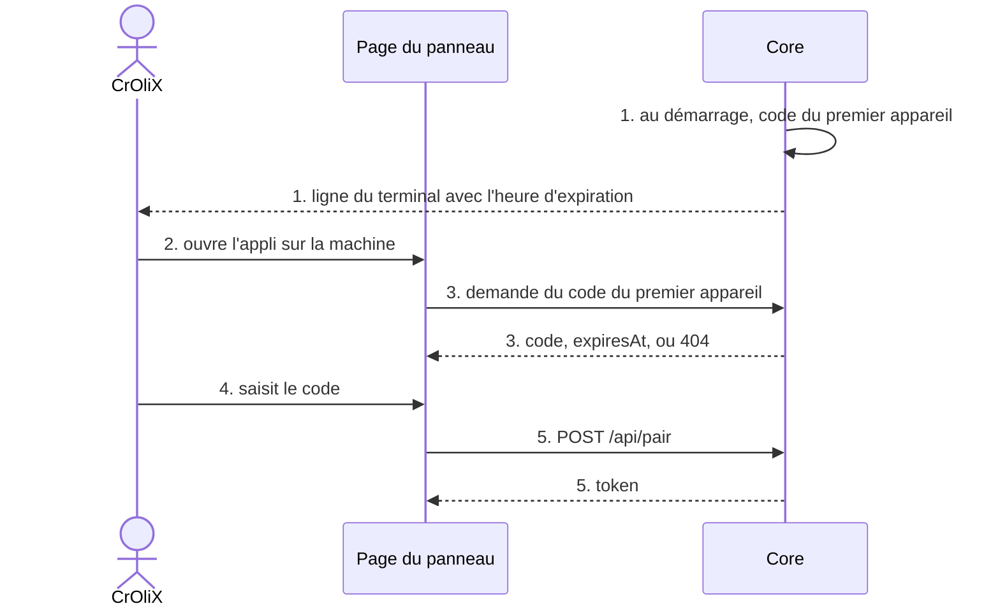

| # | De → vers | Par quoi | Ce qui circule | Retour |
|---|---|---|---|---|
| 1 | Core → terminal | ligne au démarrage | « Aucun client appairé. Code d'appairage du premier client (expire à HH:MM) : 482917 » (heure de Paris) | — |
| 2 | CrOliX → page | ouverture de l'appli | — | — |
| 3 | Page → core | demande du code du premier appareil (route publique) | rien | `{ code, expiresAt }`, jamais en cache ; ou 404 « Pas de code ici » |
| 4 | CrOliX → page | saisie | six chiffres | — |
| 5 | Page → core | `POST /api/pair` (route publique) | `code`, `client` (« Lun'Anima (app) ») | `{ token }` ; jeton gardé par le navigateur |

- **Ce que CrOliX voit, et où** : la ligne du terminal ; la page d'accueil publique du core (« En ligne, version X »,
  deux pas : obtenir un code, relier ce navigateur) ; l'écran de code du panneau, qui demande ce code au core (étape 3).
  Lun'Acedia et Lun'Avaritia ont le même geste (Lun'Acedia, `server/src/contract/first-code.ts:42-54`,
  `app/src/session.ts:51-65`, ligne de démarrage `server/src/main.ts:86`).
- **Ce qui s'écrit** : le code (10 minutes) ; à l'échange, l'appareil et son jeton (seul le condensé du jeton est
  gardé).
- **Qui décide** : le code du core : il donne le code à la seule page de la machine qui l'héberge (voir ci-dessous).
- **Erreurs et cas limites** :
  - le code est donné si et seulement si la demande vient de la machine elle-même (connexion locale), à l'adresse locale
    du core, avec l'en-tête `Origin` identique, et sans aucun en-tête de relais (`X-Forwarded-…`, `Tailscale-…`,
    `Forwarded`) ; sinon le même 404 pour tous les refus, aucun code créé, aucun échec compté ;
  - le core écoute ailleurs que sur l'adresse locale : aucune page n'a de code, il faut le terminal ;
  - un code encore valable est redonné (redémarrage, deux demandes) au lieu d'en créer un ; un code expiré en fait
    naître un nouveau ;
  - dès qu'un appareil non révoqué existe, plus aucun code (404) ; si le dernier est révoqué, le code revient ;
  - l'adresse « Lun'Acedia » équivalente (`localOriginFor`) : `http://localhost:<port>` seulement sur une écoute locale
    (Lun'Acedia, `server/src/contract/first-code.ts:15-18`).
- **Écart avec les décisions** : aucun connu.
- **Non vérifié** : le détail de l'écran de code du panneau (s'il affiche ou préremplit le code reçu, et son texte quand
  le core n'en donne pas) ; la commande de secours du terminal est décrite dans l'annexe privée.

---

### S12.5 · Ajouter un appareil depuis un appareil reconnu

- **Déclencheur** : CrOliX, dans l'Atelier, ouvre « Appareils » puis « Ajouter un appareil » (téléphone, bureau).
- **Acteurs** : CrOliX, le panneau, le core, le nouvel appareil.
- **Avant** : un appareil déjà relié ; le core joignable (le bouton est inactif sinon).

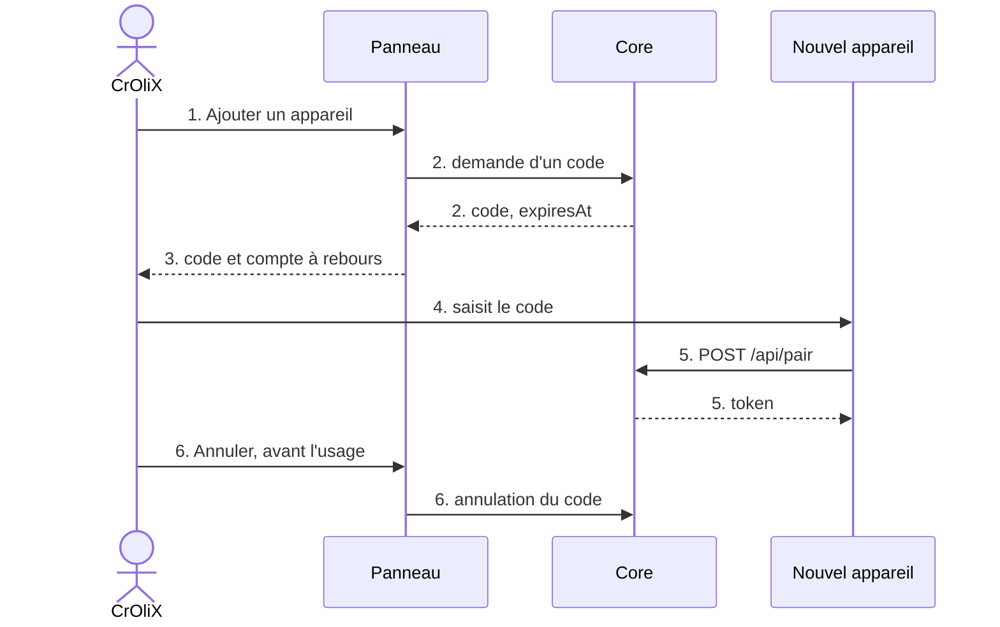

| # | De → vers | Par quoi | Ce qui circule | Retour |
|---|---|---|---|---|
| 1 | CrOliX → panneau | clic | — | l'écran d'ajout s'ouvre |
| 2 | Panneau → core | demande d'un code, jeton d'appareil | rien | `{ code, expiresAt }` : six chiffres, 10 minutes, un usage ; les codes expirés ou utilisés sont purgés à ce moment |
| 3 | Panneau → CrOliX | affichage | « 482 917 », compte à rebours, deux consignes (navigateur : ouvrir l'adresse du core ; Lun'Luxuria : « Relié à un serveur » puis le code) | — |
| 4–5 | Nouvel appareil → core | `POST /api/pair` (public) | `code`, `client` (le nom de l'appareil, 1 à 100 signes) | `{ token }` ; l'appareil est inscrit avec le condensé du jeton |
| 6 | Panneau → core | annulation du code | le code | 204 ; un code inconnu ou déjà utilisé : 404 « Code inconnu » |

- **Ce que CrOliX voit, et où** : le code et son compte à rebours (« Valable encore 9:41. Un seul usage. », puis « Code
  expiré »). Dans la liste « Appareils reconnus » : le nouvel appareil, son nom, sa création, sa dernière activité, et
  s'il reçoit les notifications. « Code annulé : il ne marche plus » après Annuler.
- **Ce qui s'écrit** : le code, puis l'appareil ; la dernière activité d'un appareil est écrite au plus une fois par
  minute.
- **Qui décide** : CrOliX (créer, annuler) ; le code du core (validité, un seul usage).
- **Erreurs et cas limites** :
  - le code n'est demandé qu'une fois par ouverture de l'écran ; en cas d'échec, une erreur « Le code n'a pas pu être
    créé » ;
  - annuler après l'expiration : seulement « Code expiré », pas d'appel ;
  - la liste est lisible par tout appareil reconnu : « Un appareil reconnu voit tout Lun'Anima » (texte de l'écran) ;
  - pour la fin du geste côté Lun'Luxuria : S12.6 ; pour un refus du code : S12.7.
- **Écart avec les décisions** : aucun connu.
- **Non vérifié** : la fenêtre « notifications » du nouvel appareil (famille 9 ou 10).

---

### S12.6 · Relier Lun'Luxuria au serveur

- **Déclencheur** : CrOliX, à l'écran d'arrivée de Lun'Luxuria, choisit « Relié à un serveur », saisit l'adresse du
  serveur et le code d'appairage.
- **Acteurs** : CrOliX, Lun'Luxuria (la page et la fenêtre de bureau), le core.
- **Avant** : un code a été demandé comme en S12.5 ; l'adresse du serveur est en `https`, ou sur cet ordinateur.

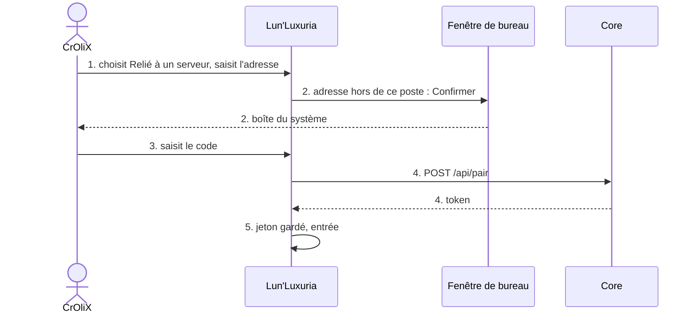

| # | De → vers | Par quoi | Ce qui circule | Retour |
|---|---|---|---|---|
| 1 | CrOliX → Luxuria | arrivée | l'adresse du serveur ; en `http` hors de cet ordinateur : refusée (« doit être en https ») | l'adresse est refusée avant tout envoi (Lun'Luxuria, `src/desktop/net.ts:44-54`, `:25-27`) |
| 2 | Luxuria → fenêtre | confirmation (bureau seulement) | l'origine de l'adresse, si elle est hors de ce poste | une boîte du système ; tant que l'origine n'est pas confirmée, la fenêtre ne la joint pas ; « Oublier » la retire (Lun'Luxuria, `src/desktop/hotes.ts:16-20`, `:51`) |
| 3 | CrOliX → Luxuria | saisie | six chiffres | l'envoi part quand le dernier chiffre est saisi |
| 4 | Luxuria → core | `POST /api/pair` (Lun'Luxuria, `src/core.ts:66-70`) | `code`, `client` (« luxuria »), `name` (« Lun'Luxuria ») | `{ token }` ; le core ne lit que `code` et `client` |
| 5 | Luxuria (code) | enregistrement | le jeton, dans le stockage local de l'appli (Lun'Luxuria, `src/session.svelte.ts:227-231`) | l'appli entre |

- **Ce que CrOliX voit, et où** : l'écran d'arrivée de Lun'Luxuria, deux cartes (Seul, Relié à un serveur), le champ de
  l'adresse et ses avertissements, le bouton « Confirmer… » sous une adresse hors de ce poste, le champ du code ; un
  code refusé s'affiche sous le champ, qui se vide. Dans le panneau : Lun'Luxuria passe de « à relier » à une présence
  (famille 8), et l'appareil « luxuria » est listé dans « Appareils reconnus ».
- **Ce qui s'écrit** : côté Lun'Luxuria, l'adresse (réglages) et le jeton ; côté core, l'appareil nommé « luxuria » : le
  panneau reconnaît le poste de bureau à ce nom.
- **Qui décide** : CrOliX (adresse, confirmation de l'hôte, code) ; la fenêtre de bureau (elle refuse toute adresse non
  confirmée, tout schéma autre que `http` ou `https`, toute redirection).
- **Erreurs et cas limites** :
  - changer l'adresse du serveur efface le jeton : un jeton ne va jamais vers une autre adresse (Lun'Luxuria,
    `src/session.svelte.ts:256-263`) ;
  - code refusé : S12.7 ; le message du core s'affiche tel quel ;
  - le serveur n'a pas ce code : le même 401 qu'un code faux.
- **Écart avec les décisions** : aucun connu.
- **Non vérifié** : le déroulé de la boîte du système (le code Rust de la fenêtre n'est pas relu, seulement son résumé
  en tête de fichier : Lun'Luxuria, `src-tauri/src/net_guard.rs:1-8`). Dans un onglet de navigateur (pas la fenêtre),
  que devient l'adresse du serveur saisie ? (Le navigateur envoie un chemin relatif `/api/...` : l'appel va à l'origine
  de la page, donc à son proxy et non à l'adresse saisie ; Lun'Luxuria, `src/desktop/net.ts:38-41`. Y a-t-il alors une
  confirmation d'hôte ? Non tranché.)

---

### S12.7 · Un code d'appareil refusé, et le verrou du core

- **Déclencheur** : un appareil (navigateur, Lun'Luxuria) envoie un code inconnu, déjà utilisé ou expiré au core.
- **Acteurs** : l'appareil, le core.
- **Avant** : la route d'échange est publique.

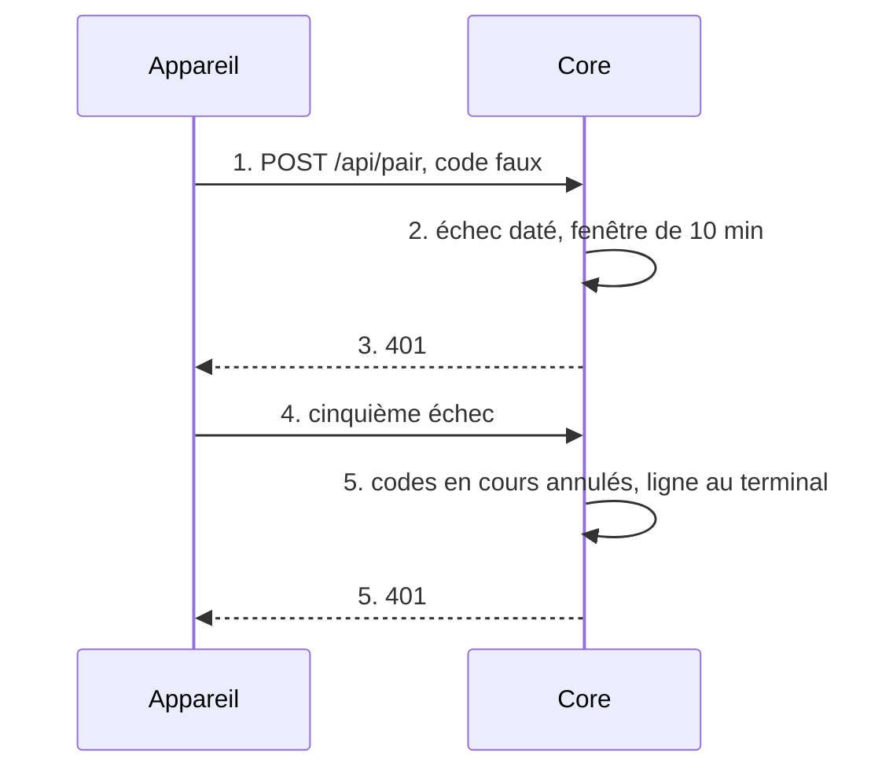

| # | De → vers | Par quoi | Ce qui circule | Retour |
|---|---|---|---|---|
| 1 | Appareil → core | `POST /api/pair` (Lun'Luxuria, `src/core.ts:66-70`) | `code`, `client` | — |
| 2 | Core (code) | compte | l'échec est daté ; seuls ceux de moins de 10 minutes restent | — |
| 3 | Core → appareil | réponse | — | `401` « Code d'appairage invalide, déjà utilisé ou expiré » ; le panneau dit « Code incorrect ou expiré. Demander un nouveau code. » |
| 4 | Appareil → core | cinquième échec | — | — |
| 5 | Core (code) | verrou | tous les codes non utilisés sont supprimés ; la liste d'échecs est vidée ; une ligne dit comment en obtenir un nouveau | `401` ; **aucun** code n'est créé |

- **Ce que CrOliX voit, et où** : l'erreur sous le champ du code, dans le panneau comme dans Lun'Luxuria ; le terminal
  du core (une ligne « Attention : 5 tentatives d'appairage échouées en 10 min… ») ; après le verrou, un nouveau code :
  « Nouveau code » dans l'écran de l'appli ouverte sur la machine qui héberge (tant qu'aucun appareil n'est reconnu), ou
  depuis un appareil reconnu (S12.5), ou la commande du terminal (annexe).
- **Ce qui s'écrit** : la liste des échecs récents (un réglage du core) ; la suppression des codes.
- **Qui décide** : le code du core.
- **Erreurs et cas limites** :
  - un corps sans `code` ou sans `client` : 400, **non compté** ; un nom de client de plus de 100 signes : 400 ;
  - les échecs comptent pour **tous** les codes, pas pour un code : cinq codes différents ou cinq fois le même ;
  - la liste d'échecs est un réglage ordinaire du core (pas une transaction à part comme chez les satellites).
- **Écart avec les décisions** : aucun connu.
- **Non vérifié** : rien.

---

### S12.8 · Chaque appel, authentifié

- **Déclencheur** : tout appel entre deux parties de l'écosystème, hors les routes publiques : côté satellite, `pair`,
  `authorize`, la route du premier code, et chez Lun'Acedia le retour de Google ; côté core, la page d'accueil, ses
  polices, les fichiers du panneau eux-mêmes (l'appli servie par le core), l'échange de code et le code du premier
  appareil. Tout le reste de l'interface du core passe par le jeton d'appareil.
- **Acteurs** : le panneau, Lun'Luxuria, le core, un poste.
- **Avant** : un jeton obtenu par un des appairages ci-dessus.

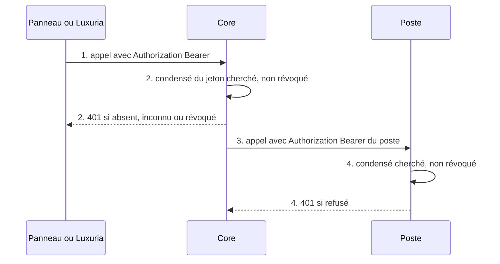

| # | De → vers | Par quoi | Ce qui circule | Retour |
|---|---|---|---|---|
| 1 | Panneau ou Luxuria → core | tout appel de l'interface | `Authorization: Bearer <jeton d'appareil>` | — |
| 2 | Core (code) | contrôle | le condensé du jeton est cherché parmi les appareils non révoqués ; la dernière activité est écrite si elle date de plus d'une minute | `401` « Jeton absent, invalide ou révoqué » |
| 3 | Core → poste | tout appel du contrat : `health`, `cards`, `events`, `costs`, `agent`, `actions`, `pause`, `resume` | `Authorization: Bearer <jeton du poste>`, déchiffré au moment de l'appel | — |
| 4 | Poste (code) | contrôle | le condensé est cherché parmi les clients non révoqués (Lun'Acedia, `server/src/contract/auth.ts:131-138`) | `401` « Jeton absent, invalide ou révoqué » |

- **Ce que CrOliX voit, et où** : un 401 du core : le panneau efface son jeton, vide son état et ouvre l'écran «
  appareil révoqué » ; Lun'Luxuria efface son jeton, recharge son arrivée et dit « Ce poste n'est plus reconnu par le
  serveur : entre un nouveau code d'appairage » (Lun'Luxuria, `src/session.svelte.ts:32`, `:266-277`). Un 401 d'un poste
  : voir S12.10.
- **Ce qui s'écrit** : côté core, la dernière activité de l'appareil ; côté poste, rien.
- **Qui décide** : le code, à chaque appel ; rien ne dépend de CrOliX ou d'un modèle.
- **Erreurs et cas limites** :
  - seul le **condensé** du jeton est gardé, côté core comme côté satellite ; le jeton d'un poste est gardé **chiffré**
    par le core (il doit le renvoyer) ;
  - Lun'Luxuria ne réagit à un 401 que si elle portait un jeton ; un code refusé à l'appairage n'en porte pas
    (Lun'Luxuria, `src/core.ts:42-44`) ;
  - aucun satellite n'appelle le core : à la lecture, le code de Lun'Acedia et de Lun'Avaritia n'a aucun appel sortant
    vers lui ; tout vient du core, y compris l'écoute des événements ;
  - un jeton d'**application** (le core relié par autorisation) n'atteint que `/lun/v1` ; un jeton d'**appareil**
    atteint aussi `/api` (Lun'Acedia, `server/src/contract/auth.ts:152-161`, réponse 403) ;
  - un flux (événements du poste, flux du serveur) n'est contrôlé qu'à son ouverture ; rien dans le code lu ne le coupe
    à la révocation.
- **Écart avec les décisions** : aucun connu.
- **Non vérifié** : que le flux ouvert survive à la révocation (déduit : le contrôle est avant la route, aucune
  fermeture n'a été lue).

---

### S12.9 · Révoquer un appareil

- **Déclencheur** : CrOliX, dans « Appareils reconnus » (ou par la commande de révocation du terminal), révoque un
  appareil.
- **Acteurs** : CrOliX, le panneau, le core, l'appareil révoqué.
- **Avant** : l'appareil est inscrit et non révoqué.

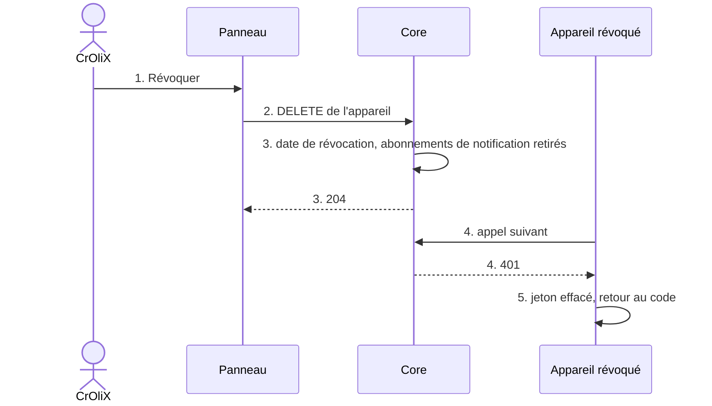

| # | De → vers | Par quoi | Ce qui circule | Retour |
|---|---|---|---|---|
| 1 | CrOliX → panneau | clic | — | — |
| 2 | Panneau → core | suppression de l'appareil par son numéro | un entier | `204` ; `400` si ce n'est pas un entier ; `404` « Appareil inconnu » |
| 3 | Core (code) | révocation douce | la date de révocation (gardée si déjà révoqué) ; les abonnements aux notifications de l'appareil sont supprimés | — |
| 4 | Appareil → core | tout appel | l'ancien jeton | `401` |
| 5 | Appareil (code) | oubli | le panneau efface le jeton, vide l'état et la file et ouvre l'écran « appareil révoqué » ; Lun'Luxuria efface le jeton et recharge son arrivée | un nouveau code est demandé (S12.5) |

- **Ce que CrOliX voit, et où** : « <nom> révoqué. » (toast) ; la ligne disparaît de la liste « Appareils reconnus » :
  le panneau n'affiche jamais un appareil révoqué. Le core le garde, avec sa date de révocation, mais l'écran ne le
  montre pas. Sur l'appareil révoqué, au prochain appel (le panneau relit l'état toutes les 30 secondes, voir S12.16) :
  l'écran de code. Le poste de bureau Lun'Luxuria redevient « à relier » dans la Constellation quand tous ses appareils
  nommés « luxuria » sont révoqués (sa présence est la famille 8).
- **Ce qui s'écrit** : la date de révocation ; les abonnements retirés. Le core n'efface jamais l'appareil ; le panneau
  ne le liste plus.
- **Qui décide** : CrOliX.
- **Erreurs et cas limites** :
  - le panneau ne propose pas « Révoquer » sur l'appareil qu'il tient : il y montre le badge « Cet appareil » à la
    place. Le core, lui, accepterait la révocation (sa route ne vérifie pas qui l'appelle) ; seule la commande du
    terminal y mène ;
  - révoquer le dernier appareil : le code du premier appareil revient (S12.4) ;
  - les notifications du téléphone révoqué cessent avec la suppression de son abonnement (détail : famille 9) ;
  - une révocation déjà faite est sans effet (la date reste) et répond tout de même 204 (les satellites répondent 404
    dans ce cas : S12.10).
- **Écart avec les décisions** : aucun connu.
- **Non vérifié** : l'effet sur un flux déjà ouvert (S12.8) ; le détail de l'écran « appareil révoqué ».

---

### S12.10 · Le satellite retire le core : « Liaison à refaire »

- **Déclencheur** : CrOliX retire l'application ou l'appareil « Lun'Anima » (ou « lun-anima ») dans les réglages du
  satellite ; ou le satellite perd ses clients (base remplacée) ; au prochain appel du core, son jeton est refusé.
- **Acteurs** : CrOliX, le satellite, le core, le panneau.
- **Avant** : le poste est relié et lu.

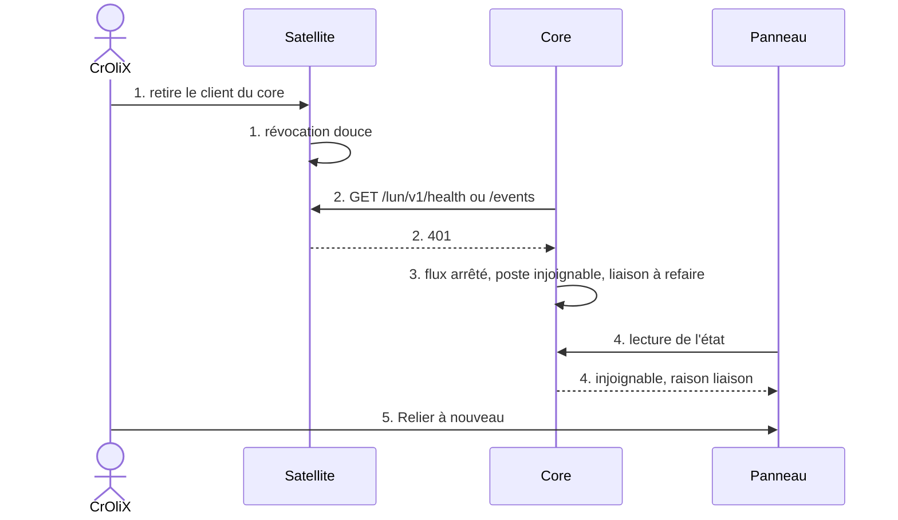

| # | De → vers | Par quoi | Ce qui circule | Retour |
|---|---|---|---|---|
| 1 | CrOliX → satellite | ses réglages, `DELETE /api/clients/:id` (jeton d'appareil) | le numéro du client | `204` ; `404` « Client inconnu », aussi pour un client déjà révoqué (Lun'Acedia, `server/src/app.ts:109-114`) |
| 2 | Core → satellite | le prochain appel (santé à la lecture suivante, au plus 2 minutes ; ou la reconnexion du flux) | le jeton | `401` |
| 3 | Core (code) | déduction | l'écoute des événements s'arrête pour de bon (elle ne repart qu'avec un nouveau jeton) ; la lecture note l'échec « Le satellite refuse le jeton du core, il faut le réappairer » | — |
| 4 | Panneau ← core | lecture de l'état | le poste : `injoignable`, raison `liaison` | — |
| 5 | CrOliX → panneau | « Relier à nouveau » | voir S12.2 | — |

- **Ce que CrOliX voit, et où** : dans la Constellation, le poste « Liaison à refaire » avec un bouton « Relier à
  nouveau » (à la place de « Réessayer ») ; la bande « <poste> ne répond pas » (sauf pause) ; ses cartes en lecture
  seule ; une erreur 502 « Le satellite refuse le jeton du core, il faut le réappairer » sur toute action relayée ;
  Natsume ne lui confie plus rien (famille 2, S2.14).
- **Ce qui s'écrit** : côté satellite, la date de révocation du client ; côté core, l'échec de lecture (raison, date) ;
  rien d'autre. La ligne du poste, son jeton refusé et ses événements restent.
- **Qui décide** : CrOliX (il retire le client) ; le code du core (il ne retente pas la liaison seul).
- **Erreurs et cas limites** :
  - le core relit la santé toutes les 2 minutes et récolte le même refus ; il ne se « répare » jamais seul ; redémarrer
    le core refait un écouteur qui reçoit le même 401 ;
  - un poste lié par code (S12.2) a été inscrit comme appareil : il se retire de la même liste, au nom « lun-anima » ;
    par autorisation (S12.1), au nom « Lun'Anima » ;
  - relier à nouveau remplace le jeton : l'écoute repart (S12.25) ;
  - retirer un client déjà révoqué : 404 « Client inconnu » chez Lun'Acedia (`server/src/contract/auth.ts:117-123`,
    `server/src/app.ts:109-114`) et chez Lun'Avaritia (`server/src/app.ts:117-121`) : l'écart avec le core, qui répond
    204 pour un appareil déjà révoqué (S12.9).
- **Écart avec les décisions** : aucun connu.
- **Non vérifié** : le texte exact de la liste « Appareils et applications » du satellite (Lun'Acedia,
  `views/src/lib/settings/`, non relu pour cette liste).

---

### S12.11 · Délier un poste

- **Déclencheur** : CrOliX, dans l'Atelier › Postes, clique « Délier <poste> » puis confirme.
- **Acteurs** : CrOliX, le panneau, le core.
- **Avant** : le poste est lié ; le core est joignable.

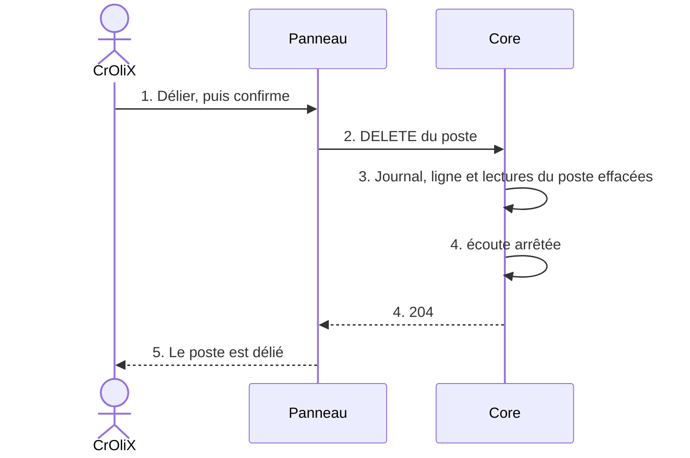

| # | De → vers | Par quoi | Ce qui circule | Retour |
|---|---|---|---|---|
| 1 | CrOliX → panneau | boîte de confirmation | le texte dit : « Plus rien ne lui est confié, et ses cartes et urgences n'arrivent plus ici. <nom> garde ses données (et ses N cartes à trancher). Pour le relier à nouveau, il faudra un nouveau code. » | — |
| 2 | Panneau → core | suppression du poste par son identifiant | l'identifiant | `204` ; `404` « Poste inconnu : <id> » |
| 3 | Core (code) | une transaction | une ligne du Journal « <nom> délié. » ; la ligne du poste (donc son jeton) ; ses cartes lues ; son état de lecture ; ses coûts en cache ; pour Lun'Avaritia ses échéances, pour Lun'Acedia son agenda | **les événements reçus restent** (historique) |
| 4 | Core (code) | arrêt | les lectures en cours du poste s'arrêtent sans rien écrire ; le gestionnaire relit la liste des postes et arrête l'écoute | — |

- **Ce que CrOliX voit, et où** : « <nom> est délié. » ; le poste repasse en « à relier » ; ses cartes disparaissent de
  À trancher ; une ligne « <nom> délié. » au Journal ; la file se recalcule sans lui.
- **Ce qui s'écrit** : une ligne du Journal ; des suppressions (liste ci-dessus).
- **Qui décide** : CrOliX.
- **Erreurs et cas limites** :
  - **le satellite n'est pas prévenu** : aucun appel ne part ; son client « lun-anima » ou « Lun'Anima » reste valable
    et listé chez lui, à retirer à la main (S12.10) ;
  - un poste délié puis relié se relit « inconnu » jusqu'à sa première lecture ;
  - le bouton est inactif quand le core est injoignable ; le poste de bureau (Lun'Luxuria) n'a pas de « Délier » : il se
    révoque dans « Appareils » (S12.9) ;
  - un événement du poste en route au moment du déliement ne s'écrit pas : l'écriture exige que la ligne du poste existe
    encore avec le même jeton.
- **Écart avec les décisions** : aucun connu.
- **Non vérifié** : rien (le déroulé est lu de bout en bout ; l'effet sur le Journal du panneau vient de la ligne de
  liaison du Journal).

---

### S12.12 · Ouvrir le flux d'événements d'un poste

- **Déclencheur** : le gestionnaire de postes du core relit la liste des postes et trouve un poste sans écouteur : au
  démarrage, au rythme de 15 secondes, à chaque appel du panneau qui liste ou relaie un poste, et juste après un
  appairage par le panneau.
- **Acteurs** : le core, le poste.
- **Avant** : un poste dont le jeton se déchiffre.

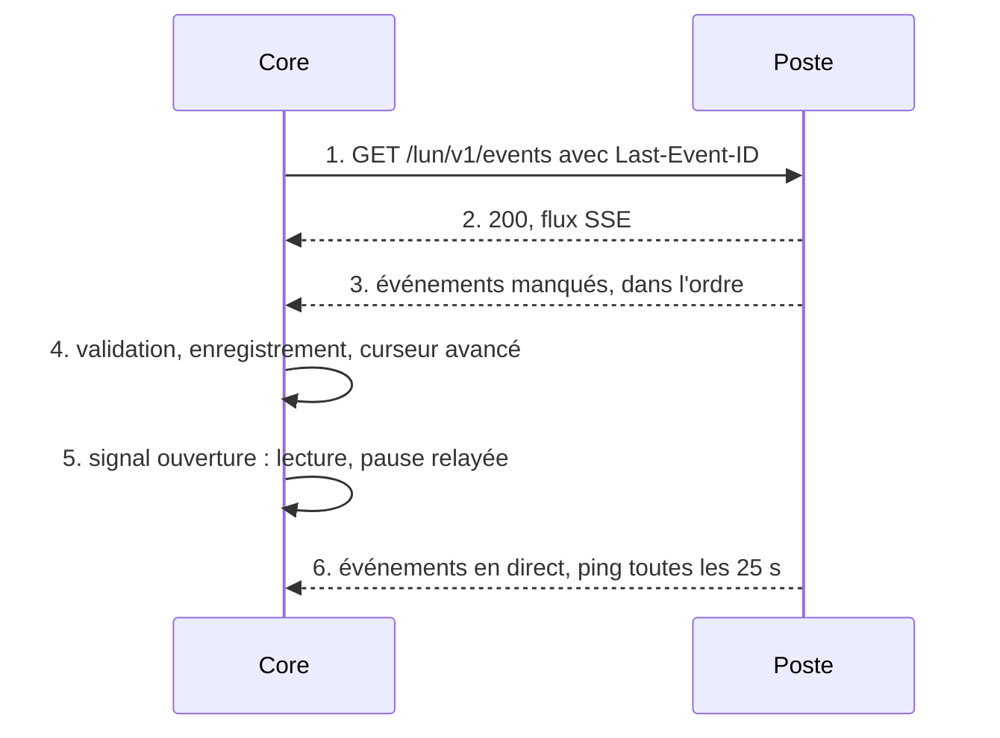

| # | De → vers | Par quoi | Ce qui circule | Retour |
|---|---|---|---|---|
| 1 | Core → poste | `GET /lun/v1/events` | `Authorization`, `Accept: text/event-stream`, `Last-Event-ID` (le curseur du dernier événement gardé, s'il existe) | — |
| 2 | Poste → core | flux (Lun'Acedia, `server/src/contract/routes.ts:282-314`) | — | 200 ; autre statut : « Flux d'événements refusé (code) » (S12.13) ; 401 : S12.10 |
| 3 | Poste → core | rattrapage | tous les événements d'identifiant plus grand que le curseur, dans l'ordre : `id`, `type`, `importance`, `at`, `title`, et selon le cas `data`, `link`, `lines` ; les événements issus d'un mail sont masqués | l'`id` du flux est celui de l'événement |
| 4 | Core (code) | validation puis enregistrement | une trame sans `id`, `type`, `importance` connue (`urgent`, `normal`, `low`, `info`, `log`), `at` ou `title` texte est ignorée sans bruit ; un `link` n'est gardé que s'il est un chemin du front (jamais une adresse) | un événement déjà gardé (même poste, même `id`, même date) n'est pas réenregistré : pas de décision de la porte d'attention, pas de ligne au Journal, pas d'annonce ; mais le curseur de reprise avance quand même, et le signal « événement » part : contact noté, lecture du poste 50 ms plus tard, et pour une urgence la file est relue |
| 5 | Core (code) | signal « ouvert » | — | lecture du poste dans les 50 ms qui suivent (S12.14) ; si le core est en pause, la pause est renvoyée au poste ; sinon, si un poste n'avait pas accusé la reprise, elle lui est renvoyée (famille 10) |
| 6 | Poste → core | direct | chaque événement nouveau ; un commentaire `: ping` toutes les 25 secondes | — |

- **Ce que CrOliX voit, et où** : rien d'abord ; puis, pour un événement **nouveau** que la porte d'attention retient :
  une ligne au Journal (« Reçu. » ou « Reçue. » pour une urgence) ; pour une urgence neuve, Natsume la dit ou l'écrit
  (famille 8) ; le compteur de la file, vite relu pour une urgence. Un événement vu seulement au rattrapage est jugé
  avec son âge (famille 4 pour les mails).
- **Ce qui s'écrit** : l'événement et le curseur, **dans une même transaction** : un arrêt brutal ne saute jamais un
  événement. Les deux écritures n'ont lieu que si le jeton de l'écouteur est encore celui du poste (un écouteur d'un
  ancien appairage ne peut rien déplacer).
- **Qui décide** : le code ; la porte d'attention décide ensuite du sort de chaque événement neuf (famille 4).
- **Erreurs et cas limites** :
  - le poste garde ses événements 7 jours (Lun'Acedia, `server/src/contract/events.ts:10`) : un core arrêté plus
    longtemps perd ce qui a été purgé entre-temps ;
  - le curseur est un entier croissant côté poste ; `Number(id) > Number(dernier)` est le filtre du direct ;
  - un événement dont le jeton n'est plus celui du poste est ignoré, le curseur aussi ;
  - la trame mal formée ne coupe pas le flux ; une trame incomplète en fin de flux est abandonnée.
- **Écart avec les décisions** : aucun connu. T26 (un événement non urgent reçu au bureau n'a que sa ligne au Journal)
  relève de la porte d'attention : voir la famille 4.
- **Non vérifié** : le rattrapage d'un poste dont la base a été remise à zéro (ses identifiants repartent de 1 : ceux
  plus petits que le curseur seraient ignorés ; déduit du filtre, non testé).

---

### S12.13 · Flux coupé, puis repris

- **Déclencheur** : le flux d'un poste se ferme ou ne s'ouvre pas : réseau, poste arrêté ou redémarré, statut refusé.
- **Acteurs** : le core, le poste, le panneau.
- **Avant** : le flux était ouvert (S12.12).

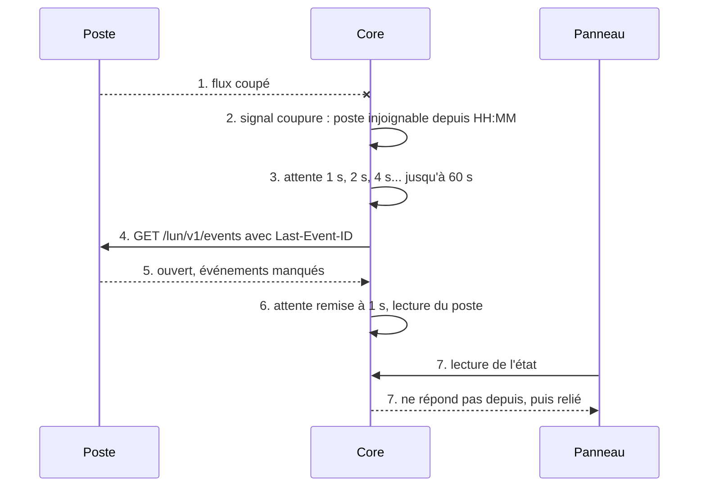

| # | De → vers | Par quoi | Ce qui circule | Retour |
|---|---|---|---|---|
| 1 | Poste → core | fermeture (ou erreur réseau) | — | une fermeture sans erreur dit « Flux d'événements fermé » |
| 2 | Core (code) | signal « coupé » | la raison | l'échec est noté : l'heure de début de la panne (gardée si elle existait), la raison ; la santé gardée est effacée ; le lien passe à `unreachable` |
| 3 | Core (code) | attente | 1 seconde au départ, doublée à chaque échec, plafonnée à 60 secondes : des valeurs fixes du serveur, pas un réglage de l'instance | un nouvel échec de **même message** n'est écrit qu'une fois dans le journal du core |
| 4 | Core → poste | `GET /lun/v1/events` | le curseur du dernier événement gardé | — |
| 5 | Poste → core | ouverture | les événements d'identifiant plus grand | — |
| 6 | Core (code) | signal « ouvert » | — | l'attente repart à 1 seconde ; la lecture du poste (S12.14) efface l'heure de panne quand elle réussit |

- **Ce que CrOliX voit, et où** : la bande « <poste> ne répond pas depuis HH:MM. Ses cartes sont en lecture seule ;
  nouvel essai automatique » (sauf si le core est en pause : la bande de pause passe devant) ; l'étoile du poste dans la
  Constellation « Ne répond pas depuis HH:MM » ; au retour, le core efface l'heure de panne à la première lecture
  réussie (lancée 50 ms après l'ouverture).
- **Ce qui s'écrit** : l'échec (heure, raison) ; les événements rattrapés, comme en S12.12 ; la ligne du journal du
  core.
- **Qui décide** : le code ; CrOliX n'a rien à faire.
- **Erreurs et cas limites** :
  - **jeton refusé (401)** : pas de nouvel essai, S12.10 ;
  - **le core ne peut pas enregistrer un événement** (sa propre base) : le lien du poste est gardé, le core retente avec
    la même attente doublée, depuis le dernier événement gardé ; une raison française est déposée dans la santé du core
    (« Les événements du satellite <id> ne peuvent pas être enregistrés (…) ») jusqu'au premier événement enregistré
    (S12.20). Le signal de coupure part tout de même vers la lecture des postes, qui note alors une panne : le poste
    peut donc se montrer « ne répond pas » jusqu'à la lecture suivante (déduit du code, non observé) ;
  - un poste qui se tait sans fermer la connexion n'est pas vu comme coupé par le flux : le `: ping` est lu mais aucun
    délai de silence n'existe côté core ; la lecture de santé toutes les 2 minutes (S12.14) le rattrape ;
  - un événement `at` illisible : l'heure de réception tient lieu de date ; il est jugé « vieux » pour la parole ;
  - arrêt du core : l'écoute se ferme, l'attente est annulée.
- **Écart avec les décisions** : aucun connu.
- **Non vérifié** : le comportement avec un poste qui accepte la connexion et n'envoie plus rien (déduit de l'absence de
  délai, non observé). Combien de temps la bande reste-t-elle après le retour ? Le panneau ne relit l'état que toutes
  les 30 secondes (S12.16) : elle peut rester jusqu'à 30 secondes, sauf s'il existe un rafraîchissement par le flux live
  du core, non lu.

---

### S12.14 · La santé d'un poste et ce que le core en déduit

- **Déclencheur** : une lecture du poste par le core : au démarrage, toutes les 2 minutes, 50 ms après le dernier signal
  d'ouverture ou d'événement du flux, à la demande (S12.15). Une coupure ne lance pas de lecture : elle note seulement
  la panne (heure de début, raison, santé effacée). Une seule lecture à la fois par poste ; toute demande pendant l'une
  en fait relancer une.
- **Acteurs** : le core, le poste.
- **Avant** : le poste est lié et son jeton se déchiffre.

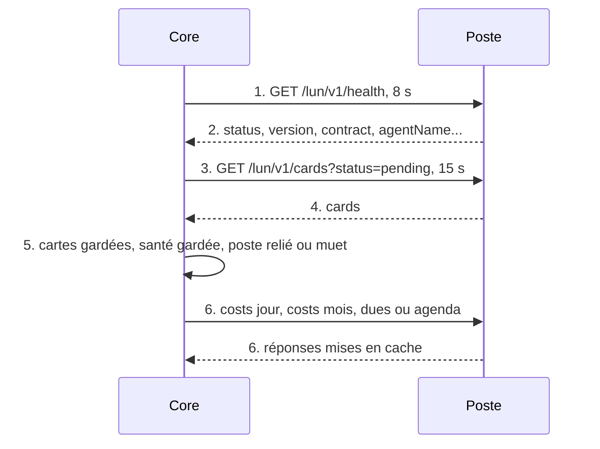

| # | De → vers | Par quoi | Ce qui circule | Retour |
|---|---|---|---|---|
| 1 | Core → poste | `GET /lun/v1/health` | jeton | **8 s** au plus ; échec : le poste est noté injoignable, la lecture s'arrête |
| 2 | Poste → core | réponse (Lun'Acedia, `server/src/contract/routes.ts:232-247`) | `status` (`ok`, `paused`, `degraded`), `reason` (si dégradé : les raisons, séparées par une virgule), `paused: true` (dégradé et en pause), `pausedBy` (`local` ou `core`), `version`, `contract`, `agent: true`, `agentName` (si réglé) | — |
| 3 | Core → poste | `GET /lun/v1/cards?status=pending` | jeton | **15 s** au plus |
| 4 | Poste → core | cartes en attente | `id`, `action`, `effect`, `title`, `lines`, `status`, `at` et, selon le cas, `kind`, `reason`, `sends`, `options`, `importance`, `bulk`, `fields`, `link`, `error` | — |
| 5 | Core (code) | enregistrement | les cartes (et leurs lignes au Journal), la santé, le compte, l'heure du succès ; l'heure de panne est effacée | — |
| 6 | Core ↔ poste | lectures annexes | `costs` du jour et du mois ; en plus `brain.due` (Lun'Avaritia) ou `agenda.list` (Lun'Acedia) par le catalogue d'actions | gardés pour les écrans ; une lecture annexe en échec est écrite une fois dans le journal du core |

**Ce que le core en déduit** (l'état vient de la copie gardée : seule la liste des postes de l'Atelier demande la santé
en direct, voir plus bas) :

| Condition | État du poste | Ce qu'en dit le panneau |
|---|---|---|
| ligne du poste absente | « à relier » | « Pas encore relié » |
| aucune lecture finie depuis le démarrage du core | « inconnu » | « Inconnu » |
| jeton refusé, ou illisible | injoignable, raison `liaison` | « Liaison à refaire » |
| flux non connecté, ou santé absente (échec) | injoignable (depuis l'heure de panne) | « Ne répond pas depuis HH:MM » |
| `pausedBy` vaut `local` | muet, raison `pause-locale` | « En pause dans ses réglages » |
| `contract` absent, illisible ou inférieur à 1.4 | muet, raison `contrat` | « À mettre à jour » |
| sinon | relié | ses cartes et ses urgences comptent |

- **Ce que CrOliX voit, et où** : dans la Constellation, l'état et un « Diagnostic » nourri par la lecture : nom de
  l'agent (40 signes au plus), raison, contrat, dernier contact, dernier succès (heure et nombre de cartes), dernière
  erreur, heure de lecture, lecture « périmée » ou non ; la bande (S12.16). Le poste de **bureau** (Lun'Luxuria) n'est
  pas lu : son état vient de sa présence (« présente », « occupée », « sourdine », « absente » ; famille 8).
- **Ce qui s'écrit** : côté core, l'état de lecture de chaque poste (dernier contact, dernier succès, nombre de cartes,
  dernière erreur, heure de panne, santé reçue), les cartes lues, les caches de coûts et d'échéances.
- **Qui décide** : le code : seuls `pausedBy`, `contract`, `agentName` servent à l'état. `status`, `reason`, `version`,
  `agent` et `paused` sont gardés et relayés, mais **ne changent aucun état** ni aucune bande au core.
- **Erreurs et cas limites** :
  - santé en échec : poste injoignable à la lecture ; cartes **illisibles** (une seule carte mal formée fait échouer
    toute la liste) : l'échec est noté sans heure de panne, la santé précédente reste, et la lecture des cartes est «
    périmée » (lecture seule) ; une lecture de plus de 5 minutes l'est aussi ;
  - un appel de plus de 15 s : « pas de réponse à temps » ;
  - la liste des postes du panneau demande aussi la santé **en direct** à chaque poste dont le flux est ouvert (8 s) ;
    en échec, la santé manque dans la liste, sans erreur ;
  - un poste qui a perdu son jeton (clé changée) : pas de lecture du tout (S12.19) ;
  - le poste en pause du **core** (`pausedBy: core`) reste « relié » : la pause est celle du core.
- **Écart avec les décisions** : T23 est en partie démenti par le code : un compte Google **déconnecté** ou un jeton
  **illisible** ne touche ni la santé ni les événements, mais un refus de renouvellement par Google rend la santé de
  Lun'Acedia « dégradée » et émet un événement (S12.23). Voir aussi S12.23 : la santé « dégradée » ne change pas l'état
  du poste au core.
- **Non vérifié** : la santé de Lun'Avaritia dégradée par « crédit » est lue (Lun'Avaritia,
  `server/src/brain/process.ts:68`) mais non rejouée. Quels libellés le Diagnostic donne-t-il, et dit-il « Nouvel essai
  : automatique » ? (La route renvoie les champs ci-dessus ; les libellés de l'écran du poste n'ont pas été relus.)

---

### S12.15 · Vérifier un poste maintenant

- **Déclencheur** : CrOliX clique « Vérifier maintenant » (ou « Réessayer ») dans le panneau d'un poste, ou lance un
  nouvel essai depuis le panneau pour un poste qui ne répond pas.
- **Acteurs** : CrOliX, le panneau, le core, le poste.
- **Avant** : le poste est lié.

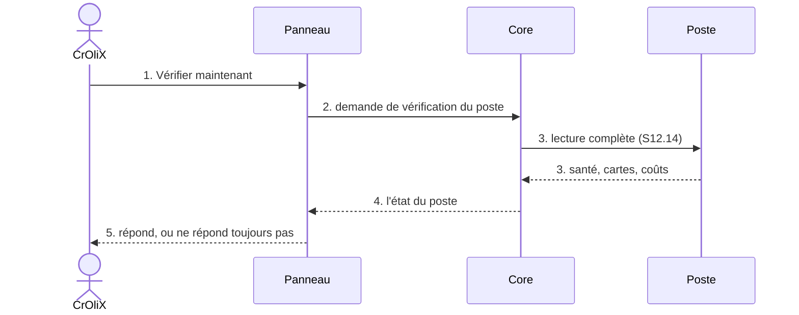

| # | De → vers | Par quoi | Ce qui circule | Retour |
|---|---|---|---|---|
| 1 | CrOliX → panneau | clic | — | le bouton passe à « Essai en cours » |
| 2 | Panneau → core | vérification d'un poste | l'identifiant | `404` « Poste inconnu » si le poste n'est pas lié ou si c'est le poste de bureau |
| 3 | Core ↔ poste | une lecture complète | S12.14 ; si une lecture est déjà en cours, le core attend qu'elle finisse, puis en fait une autre | — |
| 4 | Core → panneau | réponse | l'état, la raison, l'agent, le contrat, le dernier contact, le dernier succès, la dernière erreur, l'heure de lecture, « périmée » ou non, les confiés du jour et le coût du jour | — |

- **Ce que CrOliX voit, et où** : le panneau du poste se met à jour ; la bande dit par un toast « <poste> répond. »
  (état « relié ») ou « <poste> ne répond toujours pas. » (tout autre état ou erreur).
- **Ce qui s'écrit** : comme S12.14.
- **Qui décide** : CrOliX (il lance) ; le code (il juge).
- **Erreurs et cas limites** : la réponse est donnée même si la lecture échoue : c'est l'état « injoignable » qui
  revient, non une erreur ; le toast dit « relié » seulement pour l'état relié (un poste muet donne « ne répond toujours
  pas ») ; l'appel lui-même en erreur (core injoignable) : même toast.
- **Écart avec les décisions** : aucun connu.
- **Non vérifié** : rien.

---

### S12.16 · Ce que le panneau montre de la liaison

- **Déclencheur** : le panneau ouvert lit l'état du core toutes les 30 secondes tant que la page est visible, et à
  chaque retour de visibilité.
- **Acteurs** : le panneau, le core.
- **Avant** : un appareil relié.

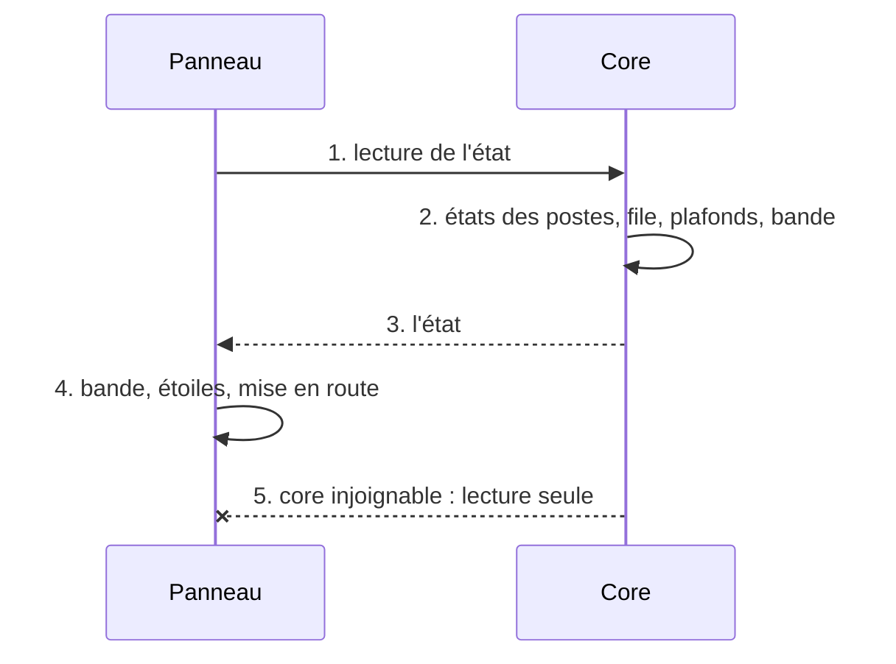

| # | De → vers | Par quoi | Ce qui circule | Retour |
|---|---|---|---|---|
| 1 | Panneau → core | lecture de l'état | jeton | **aucun appel aux postes** : l'état est bâti de la copie du core |
| 2 | Core (code) | calcul | l'état de chaque poste (S12.14), la file, les plafonds, la clé du modèle, la pause | — |
| 3 | Core → panneau | réponse | `posts[]` (identifiant, état, depuis, raison, agent), `queue`, `band`, `route` (liste de mise en route) | — |
| 4 | Panneau | affichage | — | — |
| 5 | Panneau ↔ core | la lecture échoue | — | le panneau note l'heure de début, ne vide rien, passe en lecture seule |

La **bande** montre une seule ligne, la première de cet ordre : clé refusée, plafond atteint, pause manuelle, poste
injoignable (le plus ancien en panne), poste muet, mise en route. Pendant une pause du core, les bandes « poste
injoignable » et « poste muet » ne s'affichent pas. Un poste de bureau absent, occupé ou en sourdine ne donne pas de
bande (« la journée de CrOliX, non une panne »). La liste « mise en route » compte : un appareil, la clé, les plafonds
choisis, un premier poste lié, un second appareil, les notifications.

- **Ce que CrOliX voit, et où** : la bande en haut du panneau ; l'étoile de chaque poste dans la Constellation (libellé
  d'état ci-dessus) ; l'état « Injoignable depuis HH:MM » du core lui-même quand la lecture échoue (S12.18 pour son
  démarrage) ; le panneau passe en lecture seule (boutons inactifs) tant que le core est injoignable.
- **Ce qui s'écrit** : rien.
- **Qui décide** : le code, par l'ordre fixe des bandes.
- **Erreurs et cas limites** :
  - core injoignable : le panneau note l'heure de début et ne vide rien ; un 401 n'est pas une panne, c'est S12.9 ;
  - la liste des postes pour l'Atelier est une lecture à part (liste avec santé en direct, S12.14).
- **Écart avec les décisions** : aucun connu.
- **Non vérifié** : le détail de chaque libellé de la bande et de la liste de mise en route (lu en partie).

---

### S12.17 · La version annoncée et la compatibilité

- **Déclencheur** : un appairage (la version est donnée), puis chaque lecture de santé (la version du contrat est lue).
- **Acteurs** : le poste, le core.
- **Avant** : un poste lié.

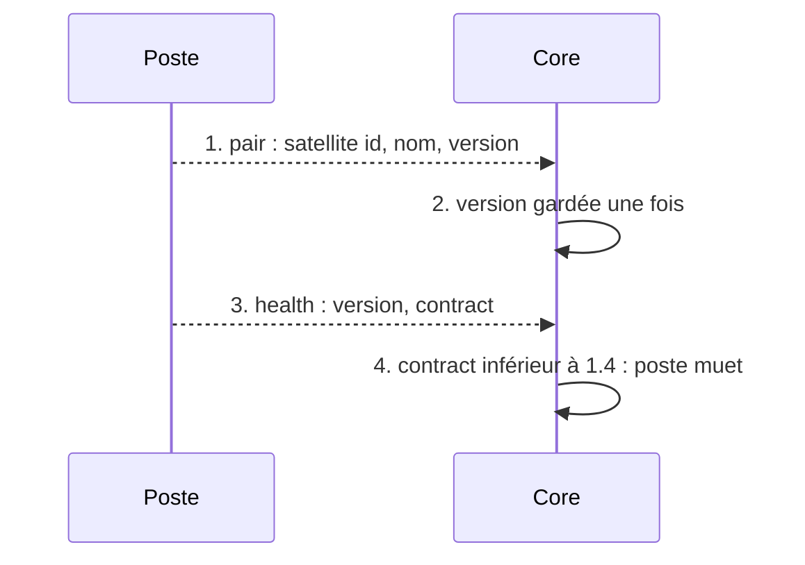

| # | De → vers | Par quoi | Ce qui circule | Retour |
|---|---|---|---|---|
| 1 | Poste → core | réponse de `POST /lun/v1/pair` | `satellite.version` (la version du logiciel du poste) | — |
| 2 | Core (code) | enregistrement | la version est gardée **à l'appairage seulement** ; elle n'est jamais remise à jour | la liste des postes la rend telle quelle |
| 3 | Poste → core | réponse de `GET /lun/v1/health` | `version` (logiciel), `contract` (version du contrat, `1.5` chez Lun'Acedia, `1.4` chez Lun'Avaritia : Lun'Acedia, `server/src/identity.ts:2`, Lun'Avaritia, `server/src/identity.ts:5`) | gardée avec la santé |
| 4 | Core (code) | décision | `contract` lu comme `majeur.mineur` : 1.4 ou plus passe ; absent, illisible ou plus ancien : poste **muet** | raison `contrat`, « À mettre à jour » |

- **Ce que CrOliX voit, et où** : un poste trop ancien : « À mettre à jour » dans la Constellation et la bande « <poste>
  doit être mis à jour pour que ses cartes arrivent ici » ; ses cartes en lecture seule, sans geste groupé ; la liste
  des postes porte la version gardée à l'appairage et la santé en direct (avec sa version actuelle). La page d'accueil
  du core dit sa propre version (« En ligne, version X »).
- **Ce qui s'écrit** : la version à l'appairage ; le contrat avec la santé gardée.
- **Qui décide** : le code, sur la seule version du contrat ; la version du logiciel du poste n'est comparée à rien.
- **Erreurs et cas limites** :
  - le core lit les cartes de tout poste, quel que soit son contrat ; pour un poste muet elles restent listées en
    lecture seule, et les gestes groupés exigent le contrat 1.4 ou plus ;
  - pour décider de l'état du poste, un contrat 1.5 ne change rien par rapport à 1.4.
- **Écart avec les décisions** : le contrat (v1.5) dit « un poste qui ne déclare pas `contract` 1.4 ou plus est muet » :
  c'est ce que fait le core. Le contrat ajoute que `/cards` est servi « toujours » à partir de 1.5 ; le core ne s'en
  sert pas pour décider (il appelle `/cards` partout).
- **Non vérifié** : les effets d'un contrat 1.5 sur les cartes à champs (famille 3).

---

### S12.18 · Démarrer le core

- **Déclencheur** : le core démarre (machine, redémarrage de maintenance ou de mise à jour, coupure).
- **Acteurs** : le core, ses postes, CrOliX (terminal et panneau).
- **Avant** : un fichier de configuration lu à la racine du core ; une base (créée et migrée si elle manque).

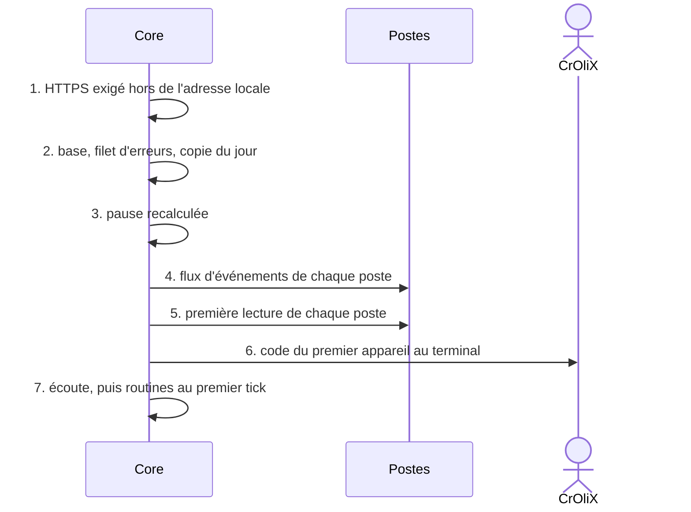

| # | De → vers | Par quoi | Ce qui circule | Retour |
|---|---|---|---|---|
| 1 | Core (code) | contrôle | hors de l'adresse locale, le certificat et sa clé sont exigés | sinon « Démarrage refusé : … » et arrêt (code 1) |
| 2 | Core (code) | préparation | la base ; le filet qui écrit une erreur imprévue puis arrête le core (le lanceur le relance) ; la copie du jour de la base, puis toutes les heures | — |
| 3 | Core (code) | pause | si la clé de chiffrement est lisible : la pause est recalculée avant la première lecture (pause manuelle, plafond du jour ou du mois) | une pause périmée (le plafond de la veille, par exemple) est levée tout de suite et n'atteint jamais les postes ; une pause encore voulue est gardée |
| 4 | Core → postes | S12.12 | un écouteur par poste | rattrapage des événements manqués |
| 5 | Core → postes | S12.14 | lecture immédiate de chaque poste | tant qu'elle n'est pas finie, le poste est « inconnu » ; une lecture qui échoue donne « injoignable », pas « inconnu » |
| 6 | Core → terminal | ligne | le code du premier appareil, s'il n'y en a aucun (S12.4) | — |
| 7 | Core → réseau | écoute | — | « Lun'Anima écoute sur http(s)://adresse:port » ; les routines (nuit à 5 h, lettre à 7 h 30, heure de Paris) ne sont rattrapées qu'au premier tick d'une minute, **après** le rattrapage des événements |

- **Ce que CrOliX voit, et où** : le terminal ; la page d'accueil publique ; dans le panneau, les postes « Inconnu »
  puis leur état réel en quelques secondes ; la bande « Mise en route » tant que la liste de mise en route n'est pas
  faite.
- **Ce qui s'écrit** : la copie du jour de la base ; les lectures de chaque poste (S12.14) ; les événements rattrapés.
- **Qui décide** : le code.
- **Erreurs et cas limites** :
  - **clé de chiffrement illisible** : le core démarre sans poste (S12.19) ;
  - **un poste ajouté par la commande de liaison** (autre processus) est repris par le core au plus 15 secondes après
    (le gestionnaire relit la liste des postes toutes les 15 secondes) ;
  - arrêt (SIGINT, SIGTERM) : l'écoute et les lectures s'arrêtent, les réponses en cours sont finies (10 secondes au
    plus), la base se ferme ; un second arrêt sort tout de suite ;
  - une erreur imprévue : écrite, dite une fois par jour, arrêt du core.
- **Écart avec les décisions** : aucun connu.
- **Non vérifié** : la durée réelle de la première lecture (elle dépend des postes : 8 secondes pour la santé, 15 pour
  les cartes, 15 par lecture annexe, au plus).

---

### S12.19 · Jetons illisibles : la clé de chiffrement manque ou a changé

- **Déclencheur** : le core démarre (ou relit la liste des postes) sans sa clé de chiffrement, ou avec une autre que
  celle qui a chiffré les jetons de ses postes.
- **Acteurs** : le core, le panneau.
- **Avant** : des postes sont déjà liés, ou CrOliX tente d'en lier un.

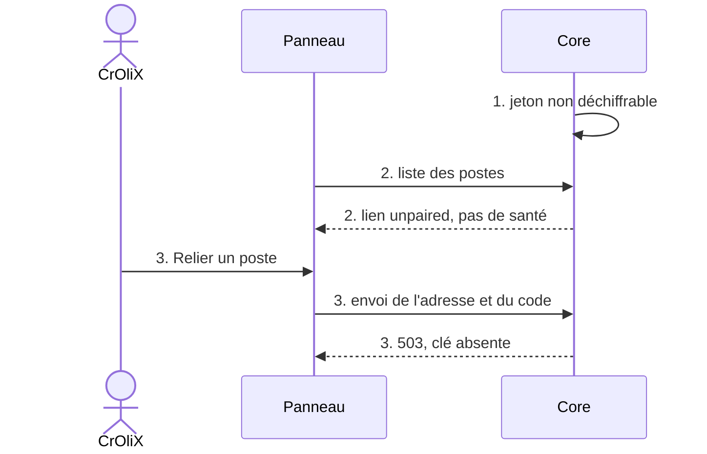

| # | De → vers | Par quoi | Ce qui circule | Retour |
|---|---|---|---|---|
| 1 | Core (code) | démarrage ou relecture | **clé absente ou de mauvaise taille** : une raison est déposée dans la santé du core (« Clé … absente ou invalide : satellites désactivés »), aucun poste n'est écouté ni lu ; **clé lisible mais autre** : la ligne du poste est gardée sans client, sans écoute | — |
| 2 | Panneau → core | liste des postes | — | le lien est `unpaired` dans la liste de l'Atelier, dans les deux cas ci-dessous ; toute action relayée : `502` « Jeton du satellite illisible … il faut le réappairer » |
| 2a | Core (code) | clé lisible mais autre | — | la lecture tourne et échoue : le poste est « injoignable, Liaison à refaire » (S12.14) |
| 2b | Core (code) | clé absente ou de mauvaise taille | — | la boucle de lecture n'est pas lancée : les postes restent « Inconnu » jusqu'à ce que CrOliX clique « Vérifier maintenant » ; la lecture échoue alors aussitôt, sans appel au poste, et le poste passe à « Liaison à refaire » |
| 3 | Panneau → core | relier un poste | l'adresse, le code | `503` si la clé est absente ; avec la bonne clé, S12.2 remplace le jeton |

- **Ce que CrOliX voit, et où** : le terminal du core ; les postes « Liaison à refaire » (« Inconnu » d'abord si la clé
  manque, voir 2b) ; un message 502 sur une action relayée ; aucune bande de « clé » (la bande de clé du panneau
  concerne le modèle, non cette clé).
- **Ce qui s'écrit** : une raison dans la santé du core ; rien d'autre.
- **Qui décide** : le code.
- **Erreurs et cas limites** : remettre l'ancienne clé et redémarrer rend les postes ; sans elle, chaque poste se relie
  de nouveau (S12.2, S12.25) ; le poste de bureau n'est pas touché (son jeton est un jeton d'appareil, gardé en
  condensé) ; les routines et la conversation tournent sans les postes.
- **Écart avec les décisions** : aucun connu.
- **Non vérifié** : si le panneau dit la raison de la santé du core quelque part (aucune lecture de la route de santé du
  core par le panneau n'a été trouvée ; voir S12.20).

---

### S12.20 · La santé du core lui-même

- **Déclencheur** : une partie du core se dégrade (conversation sans clé, événements d'un poste non enregistrables,
  copie de la base en échec, clé de chiffrement absente) ; ou une lecture de la route de santé du core.
- **Acteurs** : le core, un appelant muni d'un jeton d'appareil.
- **Avant** : l'appelant est relié.

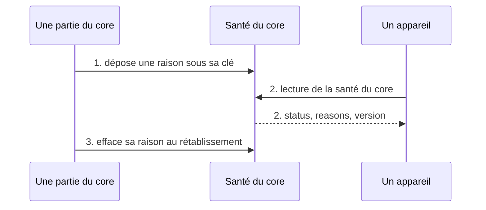

| # | De → vers | Par quoi | Ce qui circule | Retour |
|---|---|---|---|---|
| 1 | Partie du core → santé | dépôt | une phrase française sous une clé (chat, satellites, événements d'un poste, copie) | — |
| 2 | Appareil → core | lecture de la santé (jeton d'appareil) | rien | `{ status: ok ou degraded, reasons[], version }` |
| 3 | Partie du core → santé | effacement | la clé | la santé revient à `ok` quand il ne reste aucune raison |

- **Ce que CrOliX voit, et où** : au terminal, les raisons de la conversation au démarrage ; la page d'accueil publique
  ne dit que la version. À la lecture de ce travail, ni le panneau ni Lun'Luxuria n'appellent la route de santé du core.
- **Ce qui s'écrit** : les raisons vivent en mémoire seulement. Certaines parties qui en déposent une écrivent aussi une
  trace durable : la conversation émet un événement du core à chaque changement d'état (gardé d'un démarrage à l'autre),
  une copie ratée émet un événement une fois par jour.
- **Qui décide** : le code ; chaque partie pose et retire sa raison.
- **Erreurs et cas limites** : une raison reste tant que sa partie ne l'a pas effacée ; au redémarrage du core, la santé
  repart vide.
- **Écart avec les décisions** : aucun connu. Remarque : le contrat `/lun/v1` ne définit pas la santé du core ; elle est
  propre au core.
- **Non vérifié** : qui, hors du code lu, appelle cette route (un lanceur ou une supervision éventuels).

---

### S12.21 · Connecter le compte Google de Lun'Acedia

- **Déclencheur** : CrOliX, dans les réglages de Lun'Acedia (« Compte Google »), clique « Connecter un compte Google ».
- **Acteurs** : CrOliX, le front de Lun'Acedia, Lun'Acedia, Google.
- **Avant** : Google est configuré sur le serveur de Lun'Acedia (identifiant, secret, clé de chiffrement lisible) ;
  l'appareil de CrOliX est relié à Lun'Acedia.

```mermaid
sequenceDiagram
    actor C as CrOliX
    participant F as Front de Lun'Acedia
    participant A as Lun'Acedia
    participant G as Google
    C->>F: 1. Connecter un compte Google
    F->>A: 2. GET /api/google/auth-url
    A-->>F: 2. url avec state
    F->>G: 3. page de consentement, dans un onglet
    C->>G: 4. choisit le compte et accepte
    G->>A: 5. GET /oauth/callback, code et state
    A->>G: 6. échange du code contre les jetons
    A->>G: 7. lecture du profil Gmail
    A->>A: 8. jetons chiffrés, adresse gardée
    A-->>F: 9. redirection /?google=connected
```

| # | De → vers | Par quoi | Ce qui circule | Retour |
|---|---|---|---|---|
| 1 | CrOliX → front | clic | — | le front demande l'adresse de consentement |
| 2 | Front → Lun'Acedia | `GET /api/google/auth-url` (jeton d'appareil) | rien | `{ url }` : l'adresse de Google avec `client_id`, `redirect_uri`, `response_type=code`, cinq portées, `access_type=offline`, `prompt=consent`, `include_granted_scopes=true`, `state` (24 octets au hasard, gardé avec l'heure) (Lun'Acedia, `server/src/google/oauth.ts:123-130`, `:35-48`) |
| 3 | Front → Google | un nouvel onglet | l'adresse ci-dessus | la page de consentement de Google |
| 4 | CrOliX → Google | choix du compte, consentement | — | Google renvoie le navigateur vers le retour de Lun'Acedia |
| 5 | Google → Lun'Acedia | `GET /oauth/callback` (public) | `code`, `state` (ou `error`) | — |
| 6 | Lun'Acedia → Google | `POST` à l'adresse des jetons | `code`, `client_id`, `client_secret`, `redirect_uri`, `grant_type=authorization_code` | jeton d'accès, jeton de renouvellement, durée |
| 7 | Lun'Acedia → Google | profil Gmail avec le jeton d'accès | — | l'adresse du compte |
| 8 | Lun'Acedia (code) | enregistrement | les deux jetons chiffrés, l'échéance, l'adresse ; la raison « google-reauth » est retirée de la santé | — |
| 9 | Lun'Acedia → navigateur | redirection | — | `/?google=connected` |

Les cinq portées : Gmail (lecture, modification), envoi Gmail, réglages Gmail de base (adresses d'envoi), Agenda, Tâches
(Lun'Acedia, `server/src/google/oauth.ts:20-26`).

- **Ce que CrOliX voit, et où** : la page de consentement de Google (un onglet à côté) ; en revenant, la carte « Compte
  Google » (« Connecté », l'adresse, les autorisations : Gmail, Agenda, Tâches). Le retour porte un code
  (`/?google=connected`, `expired`, `refused`, `failed`, voir ci-dessous) ; les textes que le front en tire et la
  relecture de l'état au retour dans la fenêtre sont en « Non vérifié ».
- **Ce qui s'écrit** : côté Lun'Acedia, les jetons chiffrés et l'adresse du compte ; le `state` est effacé dès qu'il est
  lu. Rien au core.
- **Qui décide** : CrOliX (choix du compte, consentement) ; Google (accepte, émet) ; le code (rien n'est gardé avant que
  le profil ait été lu avec le jeton reçu).
- **Erreurs et cas limites** :
  - retour sans `state` valide, ou plus vieux de 10 minutes : `/?google=expired`, rien n'a changé ; le `state` est
    détruit dans tous les cas ;
  - CrOliX refuse chez Google (`access_denied`) : `/?google=refused`, rien n'a changé ;
  - retour sans code, échange refusé, profil refusé, ou jetons non enregistrés : `/?google=failed`, rien n'a changé ; la
    raison courte (un mot de Google, jamais sa description) va au journal du serveur ; un compte déjà connecté reste
    connecté, ses jetons intacts ;
  - **un autre compte** que celui déjà connecté : tout ce qui appartient à l'ancien compte est effacé (mails en cache,
    étiquettes, règles, propositions, exemples, journal, agenda, tâches, rappels envoyés), pas les réglages, les
    appareils ni les événements ;
  - Google non configuré sur le serveur : `GET /api/google/status` répond `connected: false`, toute autre route
    `/api/google` répond 503 « Google n'est pas configuré sur ce serveur » ;
  - jeton stocké qu'une autre clé ne déchiffre plus : le compte est dit illisible côté serveur (le texte d'aide du front
    est en « Non vérifié »).
- **Écart avec les décisions** : aucun connu. Voir T23 en S12.14.
- **Non vérifié** : le premier tour de synchronisation après la connexion (une boucle périodique, non rejouée) ; l'écran
  d'avertissement de Google « app non validée » (hors code). Le front relit-il l'état au retour dans la fenêtre (focus)
  ? Quels textes montre-t-il pour `expired` (« Ce retour de Google n'est plus valable » ?), `refused`, `failed`, et pour
  un compte illisible (« Compte illisible » ?) ? Côté serveur, les codes de retour sont lus (Lun'Acedia,
  `server/src/google/oauth.ts:147-213`) ; le front des réglages ne l'est pas.

---

### S12.22 · Déconnecter le compte Google

- **Déclencheur** : CrOliX clique « Déconnecter » et confirme, dans la carte « Compte Google » de Lun'Acedia.
- **Acteurs** : CrOliX, le front, Lun'Acedia, Google.
- **Avant** : un compte est connecté.

```mermaid
sequenceDiagram
    actor C as CrOliX
    participant F as Front de Lun'Acedia
    participant A as Lun'Acedia
    participant G as Google
    C->>F: 1. Déconnecter, confirme
    F->>A: 2. POST /api/google/disconnect
    A->>G: 3. révocation du jeton de renouvellement
    A->>A: 4. jetons oubliés
    A-->>F: 4. connected false
```

| # | De → vers | Par quoi | Ce qui circule | Retour |
|---|---|---|---|---|
| 1 | CrOliX → front | clic Déconnecter, confirmation | — | le front lance la déconnexion |
| 2 | Front → Lun'Acedia | `POST /api/google/disconnect` | rien | `{ connected: false }` |
| 3 | Lun'Acedia → Google | appel de révocation (au mieux) | le jeton de renouvellement | une erreur est ignorée |
| 4 | Lun'Acedia (code) | oubli | la ligne des jetons est supprimée ; la raison « google-reauth » est retirée | — |

- **Ce que CrOliX voit, et où** : la carte repasse à « Non connecté », « Aucun compte », le bouton « Connecter un compte
  Google ».
- **Ce qui s'écrit** : les jetons disparaissent ; **les données du compte restent** (mails en cache, agenda, tâches) :
  elles ne s'effacent que si un autre compte se connecte ensuite (S12.21).
- **Qui décide** : CrOliX.
- **Erreurs et cas limites** : la révocation chez Google qui échoue n'empêche pas l'oubli local ; plus de compte : les
  appels vers Google lèvent « Aucun compte Google branché » : ce n'est pas une raison de santé (S12.14).
- **Écart avec les décisions** : T23 (un compte déconnecté ne remonte ni santé ni événement) est confirmé ici.
- **Non vérifié** : l'effet de la déconnexion sur les boucles de synchronisation (elles lèvent l'erreur « non connecté »
  et l'ignorent, lu dans `server/src/main.ts:99-105`). Que dit le texte de confirmation de la déconnexion ? Annonce-t-il
  que le tri et la synchronisation s'arrêtent jusqu'à une reconnexion ? (Texte du front de Lun'Acedia, non lu.)

---

### S12.23 · L'autorisation Google est à renouveler

- **Déclencheur** : Lun'Acedia veut renouveler son jeton d'accès et Google refuse (`invalid_grant`, ou statut 400 ou
  401).
- **Acteurs** : Lun'Acedia, Google, le core, CrOliX.
- **Avant** : un compte est connecté, le jeton d'accès est expiré ou refusé.

```mermaid
sequenceDiagram
    participant A as Lun'Acedia
    participant G as Google
    participant N as Core
    actor C as CrOliX
    A->>G: 1. renouvellement du jeton
    G-->>A: 1. invalid_grant
    A->>A: 2. santé dégradée google-reauth, un événement
    N->>A: 3. flux et lecture de santé
    A-->>N: 3. google.reauth, status degraded
    C->>A: 4. reconnecte le compte (S12.21)
    A->>A: 5. raison retirée
```

| # | De → vers | Par quoi | Ce qui circule | Retour |
|---|---|---|---|---|
| 1 | Lun'Acedia → Google | renouvellement | le jeton de renouvellement, `client_id`, `client_secret` | refus : `invalid_grant`, 400 ou 401 (Lun'Acedia, `server/src/google/client.ts:126-148`) |
| 2 | Lun'Acedia (code) | marque | la raison `google-reauth` ajoutée à la santé ; **un seul** événement `google.reauth`, importance `normal`, titre « Autorisation Google à renouveler » (émis seulement si la raison n'y était pas déjà) | — |
| 3 | Lun'Acedia → core | flux et santé | l'événement au flux ; `status: degraded`, `reason: google-reauth` à la santé | traitement du core : S12.12 et S12.14 |
| 4 | CrOliX → Lun'Acedia | reconnexion du compte | S12.21 | — |
| 5 | Lun'Acedia (code) | retrait | la raison s'efface à la reconnexion ou à l'oubli des jetons | — |

- **Ce que CrOliX voit, et où** : au core, la ligne du Journal de l'événement (si la porte d'attention la retient) ; la
  santé « dégradée » n'est montrée **nulle part** au core (S12.14) : le poste reste « relié ». Dans Lun'Acedia, toute
  action qui passe par Google échoue avec « Autorisation Google à renouveler » jusqu'à la reconnexion.
- **Ce qui s'écrit** : la raison dans la santé de Lun'Acedia ; l'événement.
- **Qui décide** : Google (il refuse) ; le code de Lun'Acedia (il marque) ; CrOliX (il reconnecte).
- **Erreurs et cas limites** : tant que la raison dure, chaque appel à Google refuse tout de suite, sans nouvel appel à
  Google ni nouvel événement ; un renouvellement refusé pour une autre cause (statut ≥ 500 par exemple) est une erreur
  de l'API Google, sans marque.
- **Écart avec les décisions** : T23 est **partiellement faux** : il dit qu'un compte Google déconnecté ou un jeton
  illisible ne donne « ni santé ni événement » ; c'est vrai de ces deux cas, mais pas d'un refus de renouvellement
  (santé dégradée et un événement). Voir aussi : le core ne montre pas la dégradation de santé d'un poste.
- **Non vérifié** : la décision de la porte d'attention pour cet événement `normal` (famille 4).

---

### S12.24 · Le flux du serveur côté Lun'Luxuria

- **Déclencheur** : Lun'Luxuria, reliée à un serveur, entre dans sa fenêtre et ouvre le flux de ce que fait le serveur.
- **Acteurs** : Lun'Luxuria, le core.
- **Avant** : un jeton (S12.6).

```mermaid
sequenceDiagram
    participant L as Lun'Luxuria
    participant N as Core
    L->>N: 1. GET /api/live
    N-->>L: 2. flux, ping toutes les 25 s
    N--xL: 3. flux coupé
    L->>L: 4. serveur injoignable, attente 3 s
    L->>N: 5. GET /api/live
    N-->>L: 5. 401, jeton refusé
    L->>L: 6. jeton oublié, retour au code
```

| # | De → vers | Par quoi | Ce qui circule | Retour |
|---|---|---|---|---|
| 1 | Luxuria → core | `GET /api/live` (Lun'Luxuria, `src/core.ts:124-142`) | `Authorization: Bearer` | — |
| 2 | Core → Luxuria | flux d'événements du core | des événements `message`, `card`, `queue`, `speech`, `speech-end` ; un commentaire `: ping` toutes les 25 secondes | « le serveur répond » : le lien passe à vrai |
| 3 | — | coupure ou réponse hors 200 | — | le lien passe à faux (Lun'Luxuria, `src/core.ts:124-142`) |
| 4 | Luxuria (code) | attente | 3 secondes, fixes | puis nouvel essai (aucun doublement) |
| 5 | Luxuria → core | nouvel essai | — | si le jeton est refusé : plus aucun essai |
| 6 | Luxuria (code) | oubli du jeton | — | l'arrivée revient, avec « Ce poste n'est plus reconnu par le serveur » (S12.9) |

- **Ce que CrOliX voit, et où** : le message « serveur » à l'écran de Lun'Luxuria quand le lien tombe ; il s'efface
  quand le flux revient ou quand une présence est reprise (famille 8).
- **Ce qui s'écrit** : rien de durable.
- **Qui décide** : le code ; CrOliX n'a rien à faire.
- **Erreurs et cas limites** :
  - **pas de rattrapage** : le flux du core ne garde rien ni n'accepte de curseur ; ce qui a été dit pendant la coupure
    n'est pas rejoué ; Lun'Luxuria relit le fil du jour (famille 1) ;
  - le flux ne dit pas lui-même qu'il est vivant autrement que par `: ping` : Lun'Luxuria n'a pas de délai de silence
    (déduit, non observé) ;
  - en mode « seul », le cerveau n'est pas le core (famille 13) : ce flux n'est pas celui de ce scénario.
- **Écart avec les décisions** : aucun connu.
- **Non vérifié** : la reprise du flux après la mise en veille de la machine ; le rôle exact de chaque événement du flux
  (famille 8 et 1). Que fait la session de Lun'Luxuria quand le lien passe à faux, puis à vrai ? La parole en cours
  s'arrête-t-elle, la réflexion aussi, et Lun'Luxuria annonce-t-elle de nouveau sa présence au retour du flux ? (Le code
  lu, `src/core.ts:124-142`, ne fait qu'appeler `link(false)` ou `link(true)`.)

---

### S12.25 · Relier à nouveau un poste déjà lié

- **Déclencheur** : CrOliX relie un poste dont l'identifiant est déjà dans le core (jeton refusé, jeton perdu, adresse
  changée), par le panneau (S12.2) ou le terminal (S12.1 ou S12.26).
- **Acteurs** : CrOliX, le core, le poste.
- **Avant** : une ligne du poste existe.

```mermaid
sequenceDiagram
    actor C as CrOliX
    participant N as Core
    participant A as Poste
    C->>N: 1. relie le poste (S12.1, S12.2 ou S12.26)
    N->>A: 2. POST /lun/v1/pair
    A-->>N: 2. nouveau token
    N->>N: 3. ligne remplacée, curseur vidé, Journal
    N->>N: 4. ancien écouteur arrêté, nouveau lancé
    N->>A: 5. GET /lun/v1/events sans curseur
    A-->>N: 5. tous les événements gardés (7 jours)
```

| # | De → vers | Par quoi | Ce qui circule | Retour |
|---|---|---|---|---|
| 1 | CrOliX → core | relier le poste | l'adresse, et le code s'il y en a un (S12.1, S12.2 ou S12.26) | — |
| 2 | Core → poste | `POST /lun/v1/pair` | comme S12.1, S12.2 ou S12.26 | nouveau jeton |
| 3 | Core (code) | remplacement | nom, version, adresse, jeton chiffré, date : remplacés ; le curseur de reprise est **vidé** ; une ligne « <nom> relié. » | — |
| 4 | Core (code) | gestionnaire | le jeton a changé : l'écouteur précédent est arrêté, un autre démarre (au plus 15 s après, ou aussitôt si c'est le panneau) | — |
| 5 | Core → poste | flux sans `Last-Event-ID` | — | tout ce que le poste garde ; ce qui est déjà connu du core est ignoré (même poste, même `id`, même date), sans nouvelle ligne au Journal ni annonce |

- **Ce que CrOliX voit, et où** : le poste passe de « Liaison à refaire » à l'état réel ; le poste affiche « inconnu »
  jusqu'à sa première lecture ; une seconde ligne « <nom> relié. » au Journal.
- **Ce qui s'écrit** : comme S12.1 ; **les anciens clients du poste ne sont pas retirés** : chaque liaison en ajoute un.
- **Qui décide** : CrOliX.
- **Erreurs et cas limites** : un événement tardif de l'ancien écouteur ne s'écrit pas (son jeton n'est plus celui du
  poste) ; des événements que le core n'avait jamais vus et que le poste garde encore sont jugés comme neufs, avec leur
  âge.
- **Écart avec les décisions** : aucun connu.
- **Non vérifié** : rien.

---

### S12.26 · Relier un satellite par un code, depuis le terminal du core

- **Déclencheur** : CrOliX lance la commande de liaison du terminal avec l'adresse du satellite ET le code à six
  chiffres que le satellite affiche (« 482 917 » est accepté, avec ou sans guillemets : tout ce qui suit l'adresse est
  recollé, espaces retirés).
- **Acteurs** : CrOliX, le terminal du core, le satellite.
- **Avant** : le satellite répond à son adresse ; CrOliX a demandé un code dans ses réglages (« Relier un appareil ») ;
  la clé de chiffrement du core est lisible (32 octets).

```mermaid
sequenceDiagram
    actor C as CrOliX
    participant T as Terminal du core
    participant A as Satellite
    C->>T: 1. commande avec l'adresse et le code
    T->>T: 2. adresse, code et clé vérifiés
    T->>A: 3. POST /lun/v1/pair
    A-->>T: 4. token, satellite
    T->>T: 5. poste enregistré, Journal
    T-->>C: 5. Satellite branché
```

| # | De → vers | Par quoi | Ce qui circule | Retour |
|---|---|---|---|---|
| 1 | CrOliX → terminal | la commande | l'adresse, puis le code (les mots après l'adresse sont recollés) | — |
| 2 | Terminal (code) | contrôles | adresse `http://` ou `https://` ; code de six chiffres exactement ; clé de 32 octets, **avant** tout appel (le code à usage unique n'est pas gâché) | sinon un message au terminal, sortie 1 : pour le code, « Code illisible : … (attendu 6 chiffres, par exemple 482 917) » |
| 3 | Core → satellite | `POST /lun/v1/pair`, sans sonde de santé avant | `code`, `client` (« lun-anima ») | — |
| 4 | Satellite (code) | échange, comme S12.2 | — | `{ token, satellite: { id, nom, version } }` ; client créé de type **appareil**, nommé « lun-anima » |
| 5 | Core (code) | enregistrement | comme S12.1 étape 10 ; une ligne « <nom> relié. » au Journal | « Satellite branché : <nom> (<id>, version <v>) », sortie 0 |

- **Ce que CrOliX voit, et où** : le terminal seulement (la ligne finale ou le message d'erreur) ; au panneau, la ligne
  « <nom> relié. » au Journal, et le poste dans la Constellation à la lecture suivante de l'état (30 secondes au plus),
  d'abord « Inconnu ». Le core en cours d'exécution ne voit le poste qu'à sa relecture de la liste des postes (15
  secondes au plus), car la commande tourne dans un autre processus.
- **Ce qui s'écrit** : comme S12.1. Côté satellite, un client de type appareil nommé « lun-anima » (comme S12.2).
- **Qui décide** : CrOliX (il relie) ; le code du terminal (les contrôles) ; le code du satellite (il accepte ou refuse
  le code).
- **Erreurs et cas limites** :
  - les erreurs de S12.2 (code refusé, satellite injoignable, « Ce n'est pas un poste Lun' à cette adresse »,
    identifiant `core` réservé, statut inattendu) s'écrivent au terminal, sortie 1 ; un code refusé compte dans le
    verrou du satellite (S12.3) ;
  - une adresse absente : le terminal rappelle la forme de la commande, sortie 1 ;
  - ce chemin ne vérifie pas que le satellite répond avant d'envoyer le code : seule la commande sans code (S12.1) sonde
    la santé d'abord.
- **Écart avec les décisions** : aucun connu. Même remarque que S12.2 : le satellite range le core parmi ses appareils.
- **Non vérifié** : rien.

---

### S12.27 · Donner au core l'adresse du front d'un poste

- **Déclencheur** : CrOliX, dans l'Atelier › Postes, saisit (ou vide) l'adresse du front d'un poste.
- **Acteurs** : CrOliX, le panneau, le core.
- **Avant** : le poste est lié ; le core est joignable.

```mermaid
sequenceDiagram
    actor C as CrOliX
    participant P as Panneau
    participant N as Core
    C->>P: 1. saisit l'adresse du front
    P->>N: 2. envoi de l'adresse, ou null
    N->>N: 3. origine gardée, ou effacée
    N-->>P: 3. 204
    P->>N: 4. relecture de la liste des postes
    N-->>P: 4. poste avec son champ front
```

| # | De → vers | Par quoi | Ce qui circule | Retour |
|---|---|---|---|---|
| 1 | CrOliX → panneau | champ de l'Atelier | une adresse, ou rien pour l'effacer | — |
| 2 | Panneau → core | mise à jour du poste | `url` : l'adresse, ou `null` | `404` « Satellite inconnu : <id> » si le poste n'est pas lié ; `400` « Adresse illisible (http ou https attendu) » ; sinon `204` |
| 3 | Core (code) | réglage | l'origine seule de l'adresse (schéma, hôte, port), gardée comme réglage du core ; `null` l'efface | — |
| 4 | Panneau → core | relecture de la liste des postes | — | le champ `front` de chaque poste qui en a une |

- **Ce que CrOliX voit, et où** : l'adresse dans le champ ; ensuite les liens vers l'écran du satellite (panneau du
  poste, file À trancher, Journal) qui ouvrent le front dans un nouvel onglet, au bon endroit quand la carte ou
  l'événement porte un chemin du front.
- **Ce qui s'écrit** : un réglage du core, rangé par poste. Il n'est **pas** effacé quand on délie le poste : seuls la
  ligne du poste, ses lectures, coûts, échéances ou agenda le sont (S12.11).
- **Qui décide** : CrOliX (l'adresse) ; le code du core (il ne garde que l'origine, en `http` ou `https`).
- **Erreurs et cas limites** :
  - une adresse illisible ou d'un autre schéma : 400, rien n'est changé ;
  - une adresse relue plus tard pour un poste délié puis relié : le réglage ancien est repris tel quel.
- **Écart avec les décisions** : aucun connu. C'est une donnée de liaison gardée côté core, d'où sa place ici.
- **Non vérifié** : la forme exacte du champ dans l'Atelier (libellé, aide) ; quels liens du panneau l'emploient tous.
