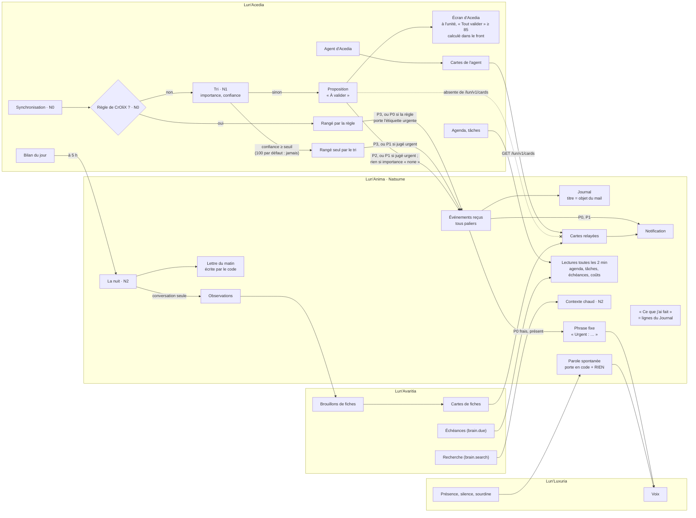
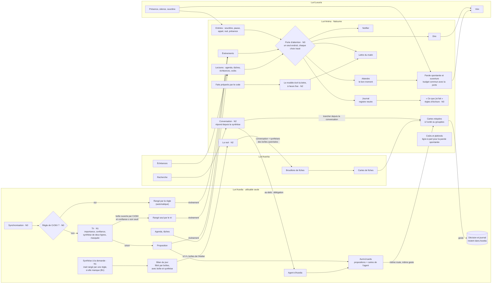
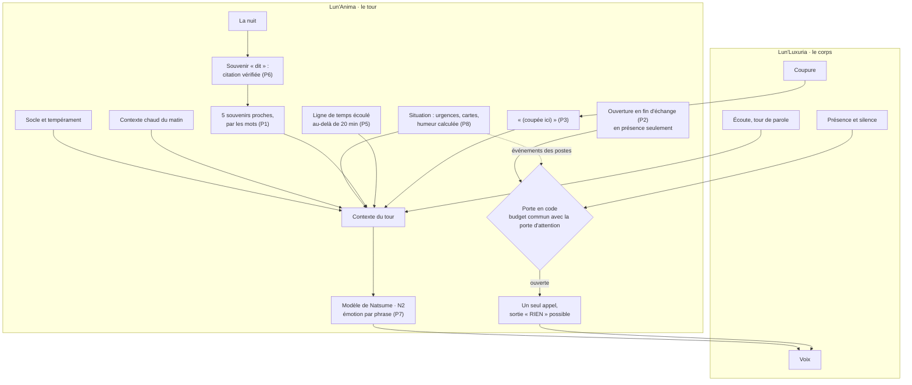

# La carte des flux de l'écosystème, avec la présence de Natsume

> Spec de cadrage du 25/11, après le recadrage demandé par CrOliX le même jour : « on recadre », tout mettre en pause et
> revoir proprement les flux de données et leurs étapes, schématisés. La base est le schéma cible du 05/11 (une
> recherche de la veille, jamais validée), choisi par CrOliX le 25/11 et corrigé ici décision par décision. Toutes les
> décisions de ce texte sont de CrOliX, prises une à une le 25/11 ; elles sont citées par leur numéro (D1 à D16, B1, P1
> à P8 pour la présence). Ce texte n'en ajoute aucune. Ce qui est marqué **[lecture du rédacteur]** est une lecture,
> à contester ; ce qui reste ouvert est au § 10, sans réponse tranchée. D6 a été révisé par CrOliX le même jour, et
> les règles d'écriture du core (§ 5.5) ont été validées par lui.
>
> Il cadre Lun-Ecosystem/lun-anima#135 (ce qui remonte d'Acedia au core). Ce n'est pas un plan : aucun chantier de code
> ne part avant sa validation. Les références au code privé du core sont dans une annexe privée, postée sur
> lun-anima#135 ; ce texte décrit le core par ses comportements et par le contrat.

## 1. Le pourquoi

**L'image** (rappelée par CrOliX le 24/11) : CrOliX est le CEO, Natsume est la manageuse, les satellites sont ses
agents. Le CEO n'échange qu'avec la manageuse. Il ne doit jamais passer par l'écran d'un satellite pour décider.

**Le but**, dans ses mots : coupler Anima aux satellites pour « automatiser la remontée de l'info et son
traitement », avec une validation et des seuils de confiance.

- **Les satellites** traitent l'information de leur domaine, avec leur garde-fou de validation. Ils restent
  utilisables seuls : rien de ce texte ne leur fait connaître le core.
- **Le core** relaie entre CrOliX et les satellites, dans les deux sens. Il remonte les propositions d'Acedia pour
  validation ou correction. Il tire les données de la journée, les trie, les formate et les envoie à Avaritia, qui
  propose des fiches nouvelles ou corrigées.
- **La présence** est liée aux flux par le contexte et la conscience du système : ce qu'elle sait de ce qui se passe,
  et la voix de l'écriture (« je fais », « je suis »).

**Ce qui a déclenché le recadrage** : les chantiers enchaînés avaient perdu la vue d'ensemble. Le retour en prod du
24/11 en donne deux exemples (lun-anima#135). Les propositions de tri d'Acedia ne remontent pas au core : il faut
aller dans Acedia pour les traiter. Le Journal et « Ce que j'ai fait » montrent l'objet du mail, pas ce qui a été
fait.

## 2. Les étages et les mots

Le schéma du 05/11 range chaque traitement par étage de coût. Ce texte en garde trois :

| Étage | Qui travaille | Exemples |
|---|---|---|
| **N0, règle** | du code, sans modèle | la synchronisation, les règles de CrOliX, la porte d'attention, l'annonce d'une urgence, l'humeur |
| **N1, petit modèle** | le modèle bon marché d'un satellite | le tri d'Acedia, la synthèse d'un mail |
| **N2, modèle de Natsume** | le modèle du core | la conversation, la nuit, la parole spontanée, la lettre du matin |

Le quatrième étage du 05/11 (un modèle fort, à la demande) n'apparaît dans aucun flux de ce texte.

**La validation** prend quatre formes : la **carte** tranchée à l'unité, la **validation groupée** (un geste pour
plusieurs cartes ; D5 dit « par lot »), le **seuil** (le satellite agit seul au-dessus d'une confiance que CrOliX a
ouverte) et l'**automatique** (une règle écrite par CrOliX).

**La porte d'attention** a cinq sorties (D2) : **dire** (à voix haute au bureau), **notifier** (sur le téléphone),
**attendre** le bon moment, la **lettre du matin**, le **Journal**.

**La voix** : un texte est soit écrit par le modèle, à la première personne (« je »), soit écrit par le code, dans le
**registre neutre**, qui dit « tu » ou nomme, sans « je » (D6, P4).

**Les mots nouveaux** sont ajoutés au [dictionnaire](../../standards/dictionnaire.md) dans la même PR, comme il le
demande : la porte d'attention, le registre neutre, la synthèse, le seuil par boîte, la validation groupée et le
seuil de validation groupée. « Le lot » y désigne déjà le traitement quotidien de la bibliothèque : il ne sert pas
ici. L'entrée « une carte » s'élargit : une carte est préparée par un agent, ou par le tri d'un poste.

## 3. L'existant

Relu le 25/11 sur `main` (Acedia, Avaritia, Luxuria) et sur le core par ses comportements.

Ce que le code fait aujourd'hui :

- **Le tri d'Acedia** : une règle range le mail et émet un événement P3, ou P0 si la règle porte l'étiquette urgente
  (`lun-acedia/server/src/triage/pipeline.ts:212-258`). C'est le seul chemin vers P0. Sans règle, le tri propose
  une boîte, une importance et une confiance. Au-dessus du seuil (`DEFAULT_THRESHOLD = 100`, ligne 59), il range
  seul ; à 100, tout attend (lignes 275-285).
- **Ce que le tri émet** (lignes 296-310) : rien quand le tri juge l'importance `none` (ligne 296). Sinon, un mail
  rangé seul par le tri donne P3, une proposition en attente P2, et l'un comme l'autre P1 si le tri le juge urgent
  (ligne 301) ; jamais P0. **Le core n'entend donc pas parler de la plupart des propositions**, ce qui renforce D1.
- **Le seuil est un seul nombre pour toutes les boîtes.** « Tout valider » prend les propositions au-dessus d'un
  second seuil, 85 par défaut, jamais au-dessus du premier (`pipeline.ts:64`, `triage/routes.ts:43-44`). Ce geste se
  calcule dans le front d'Acedia (`views/src/lib/mail/Pending.svelte:82`, `:121`, `:453`) : aucune route serveur ne
  borne une validation groupée.
- **Les cartes du contrat** ne lisent que les cartes de l'agent d'Acedia (`server/src/contract/routes.ts:193-201`) :
  une proposition de tri n'y est pas. Les gestes sur une proposition existent dans le catalogue, `mail.validate`,
  `mail.correct` et `mail.refuse` (`server/src/contract/catalog.ts:140-155`), mais le core n'a aucun écran qui les
  appelle. Acedia ne masque aucun secret dans ce qu'elle écrit d'un mail.
- **Le bilan du jour** (`day.digest`) prend une période `{ since, until }` et rend les mails reçus, ce qui a été
  fait et le nombre en attente, chaque élément sous la forme `{ type, title, at, ref }`, par l'objet du mail
  (`catalog.ts:418-481`). Il ne prend aucun filtre de boîte et ne porte ni boîte ni synthèse.
- **Le core** garde chaque événement reçu, quel que soit son palier, et en écrit une ligne au Journal (sauf P4) dont
  le titre est celui de l'événement, donc l'objet du mail. Une urgence fraîche est dite au bureau par une phrase
  fixe, neutre (« Urgent : … », « Rappel : … »). Les P0, les P1 et les cartes en attente partent en notification ; la
  nuit, une urgence part sans son.
- **Les lectures du core** : toutes les 2 min, il lit l'agenda et les tâches d'Acedia, les échéances d'Avaritia
  (`brain.due`) et les coûts de chaque poste (`/lun/v1/costs`). Une tâche due aujourd'hui est P2, en tête de la
  lettre du matin. Le contexte chaud du matin cherche des fiches dans la bibliothèque (`brain.search`).
- **La nuit** lit la conversation et le bilan d'Acedia, écrit souvenirs et récit, et n'envoie à la bibliothèque que
  les observations tirées des messages de CrOliX (décision du 24/11). **La lettre du matin** est composée par le code
  depuis des comptes, sans modèle. **« Ce que j'ai fait »**, au Bureau, reprend les lignes du Journal.
- **La parole spontanée** : Luxuria annonce la présence et le silence ; à chaque signe de présence, une porte en code
  du core (présence, sourdine, appel, silence, plafond par jour, deux paroles sans réponse au plus) peut ouvrir un
  seul appel du modèle, qui peut répondre « RIEN ». Luxuria dit la phrase.
- **Les entrées qui règlent déjà le rendu** : la sourdine, annoncée par Luxuria ; la pause ; un appel en cours au
  bureau ; la plage de nuit. Elles sont lues à plusieurs endroits du core.
- **Les coûts** : chaque poste compte ses appels et les sert au core ; le core tient un plafond par jour et par
  mois. CrOliX dispose d'environ 100 $ d'API par mois. La parole spontanée n'a pas de ligne de coût à part.
- **La présence dans le tour** : le socle, le contexte chaud du matin et un bloc de situation (urgences, cartes,
  humeur, présence, absence). Les souvenirs ne reviennent que par le contexte chaud du matin. Une réponse coupée
  revient au modèle comme si elle s'était arrêtée là, sans marque.
- **Le socle** dit : « Tu tiens à lui sans le retenir : quand il part ou s'absente, tu le laisses aller, et tu ne
  relances pas une conversation pour la faire durer » ([étape 1, l'être](../plans/2026-11-05-natsume-etape-1-etre.md),
  ligne 71). Quatre phrases fixes du code disent « je » : un poste injoignable, une carte qu'il n'a pas pu relire,
  une journée qu'il n'a pas pu relire, un geste non tranché.
- **L'émotion** : le modèle écrit une émotion d'une liste plate, donnée d'instance, devant chaque phrase ; Luxuria la
  transporte jusqu'à la voix (`lun-luxuria/src/conversation.ts:178`), mais rien ne la consomme encore. **L'humeur**
  est calculée par le code depuis les urgences et les cartes en attente, jamais stockée.

## 4. La cible

Les changements, par rapport à l'existant :

1. **Une proposition de tri devient une carte du contrat** (D1). Elle sort par la même route, `GET /lun/v1/cards`, et
   se tranche par le même geste. La décision et son journal restent dans Acedia. Acedia garde son écran
   « À valider », qui ne change pas.
2. **Le core rend tout par une seule porte** (D2), en code, sans modèle, avec ses cinq sorties. Chaque choix est
   tracé.
3. **L'autonomie d'Acedia se gagne boîte par boîte** (D3) : d'abord la mesure, puis un seuil par boîte que CrOliX
   ouvre lui-même. Tout reste dans Acedia.
4. **La validation groupée entre au core** (D5), bornée aux propositions sans envoi ni options, au-dessus du seuil de
   validation groupée d'Acedia.
5. **Une seule voix** (D6, P4) : le « je » est au modèle, qui écrit surtout la lettre du matin ; le Journal et
   « Ce que j'ai fait » suivent des règles d'écriture appliquées par le code, dans le registre neutre (§ 5.5).
6. **La proposition porte une synthèse** (D9) ; le corps du mail ne quitte jamais Acedia.
7. **Des mails entrent dans la bibliothèque, filtrés** (la nuit vers Avaritia, rouvert en partie, et B1), par un
   réglage du core passé en paramètre au bilan d'Acedia.
8. **La présence s'imbrique dans les flux** (P1 à P8, § 6).

## 5. Flux par flux

État : **fait** (le code le fait déjà), **à faire** (avant le rodage), **après le rodage**.

| # | Flux | Source | Déclencheur | Étage | Validation | Rendu par la porte | Voix | État | Décision |
|---|---|---|---|---|---|---|---|---|---|
| 1 | Mail rangé par une règle | Acedia | la synchronisation | N0 | automatique | Journal, lettre du matin | neutre | fait (porte unique : à faire) | D2, D8 |
| 2 | Mail urgent par une règle | Acedia | la synchronisation | N0 | automatique | dire si présent, notifier sinon | neutre, phrase fixe | fait (porte unique : à faire) | D2, D6, D8 |
| 3 | Urgence la nuit | Acedia, l'agenda | l'événement P0 | N0 | aucune | notifier, sans son | neutre | fait | D11 |
| 4 | Rappel d'agenda | Acedia | l'heure du rendez-vous | N0 | aucune | dire si présent, notifier sinon | neutre, phrase fixe | fait | D6 |
| 5 | Proposition de tri | Acedia | un mail sans règle | N1 | carte | à fixer par la porte (§ 10, question 1) | neutre au Journal | à faire | D1, D2, D8 |
| 6 | Synthèse de la proposition | Acedia | l'appel de tri existant | N1 | portée par la carte | lignes de la carte | neutre (texte du satellite) | à faire | D9 |
| 7 | Synthèse d'un mail rangé par une règle | Acedia | le bilan appelé avec le filtre de boîtes, synthèse absente | N1 | aucune | aucun (part au bilan) | neutre | à faire | B1 |
| 8 | Validation groupée | le core | un geste de CrOliX | N0 | validation groupée, au-dessus du seuil | Journal | neutre | à faire | D5 |
| 9 | Correction d'une proposition | le core | un geste de CrOliX, groupe ouvert ou carte | N0 | carte | Journal | neutre | à faire | D1, D5 |
| 10 | Trancher une proposition depuis la conversation | CrOliX | sa phrase | N2 | carte (le groupe : § 10, question 6) | conversation, Journal | « je », modèle | à faire | D1, D5 |
| 11 | Rangement seul au-dessus du seuil | Acedia | un mail sans règle | N1 | seuil par boîte, ouvert par CrOliX | Journal, lettre du matin | neutre | à faire : mesurer d'abord | D3 |
| 12 | Question sur un mail | CrOliX | sa phrase | N2 | aucune | conversation | « je », modèle | à faire (la synthèse manque) | D9 |
| 13 | Délégation à l'agent d'Acedia | le core | la question dépasse la synthèse, ou une demande | N2 et l'agent du poste | carte à l'unité (envoi, options) | conversation, puis carte | « je », modèle | fait | D5, D9 |
| 14 | Agenda et tâches | Acedia | la lecture du core, toutes les 2 min | N0 | aucune | tâche due : P2, en tête de la lettre | neutre | fait (porte unique : à faire) | D2 |
| 15 | Échéances de la bibliothèque | Avaritia (`brain.due`) | la lecture du core | N0 | aucune | lettre du matin, Bureau | neutre | fait | D2 |
| 16 | Fiches dans le contexte chaud | Avaritia (`brain.search`) | le matin | N2 | aucune | contexte du tour | donnée | fait | |
| 17 | Coûts et plafonds | chaque poste (`/lun/v1/costs`), le core | la lecture du core, chaque appel | N0 | plafond par jour et par mois | notifier au plafond | neutre | fait ; ligne de la parole spontanée à faire | P2 |
| 18 | Entrées de la porte : sourdine, pause, appel, nuit | Luxuria, CrOliX, l'heure | leur changement | N0 | aucune | règlent les cinq sorties | aucune | fait, à réunir dans la porte | D2, D11 |
| 19 | Événement de contrôle (poste, plafond, routine) | le core, un poste | l'incident | N0 | aucune | notifier | neutre | fait (porte unique : à faire) | D2, D6 |
| 20 | Lettre du matin | le core | l'heure fixe | N2 (aujourd'hui N0) | aucune | lettre du matin | « je », modèle, écrit une fois, sous le plafond | à faire | D6 |
| 21 | « Ce que j'ai fait » | le core | chaque action, au fil de l'eau | N0 | aucune | Bureau, depuis le Journal | registre neutre, règles d'écriture | à faire | D6 révisé, § 5.5 |
| 22 | Journal | le core | chaque action et chaque choix de la porte, à l'instant | N0 | aucune | Journal | registre neutre, règles d'écriture | fait ; écriture à revoir, à mettre d'accord avec D2 | D2, D6 révisé, § 5.5 |
| 23 | La nuit, depuis la conversation | le core | 5 h | N2 | carte de fiche | cartes de fiches | « je » au récit, neutre aux observations | fait | décision du 24/11 |
| 24 | La nuit, depuis les mails | Acedia, par le bilan | 5 h | N0 (filtre), N2 (la nuit) | carte de fiche | cartes de fiches | neutre | à faire | Nuit vers Avaritia, B1 |
| 25 | Rappel des souvenirs au tour | le core | chaque tour | N0 | aucune | contexte du tour | donnée | à faire | P1 |
| 26 | Parole spontanée | Luxuria (présence et silence) | le silence, au bureau | N0 puis N2 | aucune | dire, ou rien | « je », modèle | fait | P2 |
| 27 | Ouverture en fin d'échange | le core, en présence seulement | la fin d'un échange | N2 | aucune | dire, ou rien | « je », modèle | à faire | P2 |
| 28 | Budget de parole commun | le core | chaque parole spontanée et chaque attente | N0 | aucune | attendre, ou rien | aucune | à faire | P2 |
| 29 | Réponse coupée | Luxuria | CrOliX parle par-dessus | N0 | aucune | contexte du tour | marque « (coupée ici) » | à faire (la coupure est faite) | P3 |
| 30 | Temps écoulé | le core | deux messages à plus de 20 min | N0 | aucune | contexte du tour | donnée | à faire | P5 |
| 31 | Souvenir « dit » | la nuit | l'écriture d'un souvenir | N2 puis N0 | vérification par le code | souvenirs | « je », modèle | à faire | P6 |
| 32 | Émotion par phrase | le modèle | chaque phrase | N2 | aucune | voix (sans consommateur) | donnée | fait, liste plate | P7 |
| 33 | Humeur | le core | chaque tour | N0 | aucune | contexte du tour | « tu », donnée | fait | P8 |
| 34 | Lettre qui propose des brouillons | le core | l'heure fixe | N2 | carte | lettre du matin | « je », modèle | après le rodage | D13, D14, D16 |
| 35 | Gmail par poussée | Acedia | Google | N0 | aucune | aucun | aucune | après le rodage | D13, D14, D16 |
| 36 | La nuit en traitement différé (batch) | le core | 5 h | N2 | aucune | aucun | aucune | après le rodage | D13, D14, D16 |
| 37 | Point du soir | le core | l'heure fixe | N2 | aucune | à fixer | « je », modèle | après le rodage | D13, D14, D16 |

### 5.1 Ce que dit chaque décision du flux d'Acedia

- **D1.** Les propositions de tri deviennent des cartes du contrat : même route `GET /lun/v1/cards`, même geste. La
  décision et son journal restent dans Acedia.
- **D3.** Avant tout seuil, Acedia mesure, par boîte et par étiquette, la part de propositions validées sans
  correction. Ensuite, un seuil par boîte, que CrOliX ouvre lui-même. Tout reste dans Acedia : mesure, seuil, réglage
  et écran.
- **D5.** La validation groupée (« par lot » dans la décision) entre au core. Elle ne couvre que les propositions sans
  envoi ni options, au-dessus du seuil de validation groupée d'Acedia (85 par défaut). On peut ouvrir le groupe pour
  corriger une proposition. Le reste se valide à l'unité. Le contrat le disait déjà : « une carte qui a `sends` ou
  `options` ne se valide jamais en lot ».
- **D8.** Un satellite n'écrit pas la phrase dite : pas de champ `speak` dans le contrat (proposé le 05/11, écarté).
  Il donne un titre, des lignes et une importance. La carte du contrat n'a pas de champ d'importance aujourd'hui :
  voir la question 1 du § 10.
- **D9.** La proposition porte une synthèse de deux lignes, écrite par le tri dans son appel existant (pas d'appel de
  plus), et masquée des secrets. Natsume répond depuis son contexte ; au-delà, elle délègue à l'agent d'Acedia. Le
  corps du mail ne quitte jamais Acedia. La lecture directe d'un mail par le core est écartée : la séparation des
  responsabilités l'emporte.
  - **Portée.** Aujourd'hui, Natsume n'a aucun outil qui lit le corps d'un mail ; le catalogue d'Acedia garde
    `mail.read`. On ne retire rien.
  - **Le masquage vit dans Acedia**, qui n'en a aucun aujourd'hui : la synthèse sort par les cartes et par le bilan,
    donc avant le core.

### 5.2 La porte d'attention (D2, D11)

Une seule porte dans le core, en code, sans modèle. Elle choisit une sortie parmi cinq : dire, notifier, attendre le
bon moment, la lettre du matin, le Journal. Chaque choix est tracé.

**[lecture du rédacteur]** D2 ne dit pas ce que la porte reçoit. Aujourd'hui, ces choix existent mais sont répartis :
l'annonce d'une urgence, la file des notifications, la ligne du Journal et la parole spontanée décident chacune de
leur côté, et lisent chacune la sourdine, la pause, l'appel et la nuit (flux 18). La lecture : la porte reçoit les
événements, les cartes et les échéances, et ces entrées. D2 ne dit pas non plus s'il touche au
[standard des notifications](../../standards/notifications.md) (le satellite fixe le palier, le core fixe le rendu).

**D11.** Une urgence la nuit reste une notification sans son. C'est déjà le comportement du core.

### 5.3 Une seule voix (D6, P4)

La règle vient d'une crainte de CrOliX : une Natsume froide côté code et émotive côté modèle.

- Le « je » est réservé au modèle. Le code prépare les faits : des comptes, des regroupements.
- **D6, révisé par CrOliX le 25/11.** Le modèle sert surtout à la lettre du matin : il l'écrit une fois, à heure
  fixe, depuis les faits préparés par le code, et l'affichage relit ce texte.
- « Ce que j'ai fait » n'est **pas** écrit par le modèle.
- Le Journal est la preuve horodatée des actions. Il reste synchrone : une ligne s'écrit quand l'action a lieu, jamais
  d'un coup à un moment donné.
- Le Journal et « Ce que j'ai fait » suivent des règles d'écriture appliquées par le code, dans le registre neutre
  d'un assistant : un entre-deux entre le froid et le personnel (§ 5.5). Ni l'un ni l'autre ne dit « je ».
- L'annonce d'une urgence reste une phrase fixe sans « je ».
- **P4.** La règle « le code dit tu ou nomme, seul le modèle dit je » s'écrit dans un standard. Les quatre phrases fixes
  du code en « je » deviennent neutres.

### 5.4 La nuit vers Avaritia (et B1)

Rouvert en partie, dès le VIP.

- Un mail entre dans la bibliothèque seulement s'il remplit deux conditions : il est dans une boîte autorisée, et il y
  a été rangé avec l'accord de CrOliX (une règle, ou une proposition validée).
- Ce qui part est la synthèse (D9), jamais le corps.
- **La liste des boîtes autorisées** est un réglage du core, dans l'Atelier, pas d'Acedia (correction de CrOliX : le
  risque d'exposer le core dans un satellite public). Travail n'est qu'un départ : CrOliX change ou ajoute des boîtes
  librement, dans ce réglage. Le core la passe en paramètre de filtre au bilan du jour d'Acedia. Acedia filtre sans
  rien savoir du core ni de la bibliothèque, et son écran ne change pas.
- **B1.** Un mail rangé par une règle n'a pas de synthèse, puisque le tri ne l'a pas lu. S'il est dans une boîte qui
  nourrit la bibliothèque, il en reçoit une par un petit appel (N1), pour ces boîtes seulement. Acedia ne sait pas
  quelles boîtes sont partagées : la synthèse se calcule donc à la demande, quand le bilan est appelé avec le filtre
  de boîtes, et seulement si elle manque.
- Le bilan change donc de type : chaque mail porte sa boîte et sa synthèse (§ 10, question 9).
- Le reste de la conversation continue d'entrer comme le 24/11.

### 5.5 L'écriture du core

Validée par CrOliX le 25/11, depuis un inventaire de tout ce que le core écrit : le Journal, le détail d'une ligne, le
Bureau, les notifications, la voix fixe, les compteurs.

**Le constat**

- Aucun texte rendu n'est écrit par un modèle : le Journal, les titres d'événements et les notifications viennent tous
  du code.
- La donnée existe mais n'est pas montrée : les éléments de la lettre du matin, la période couverte par la nuit, ses
  souvenirs et ses observations, la réponse d'un poste à une délégation et sa durée, le montant d'un plafond, le poste
  d'origine dans une notification.
- Le détail d'une ligne du Journal est vide la plupart du temps : il ne montre que le titre, le poste, l'issue, et
  parfois le coût et la durée. Les références et le lien vers la conversation ne sont jamais remplis.
- La nuit laisse cinq traces séparées : l'envoi des observations, le passage de la nuit, la lettre du matin (une ligne
  de plus à chaque relance), l'annonce « Le point du matin est posté », et une correction de la lettre hors Journal.
  Aucune ne dit ce que la nuit a couvert ni ce que la lettre a dit.
- On compte quinze incohérences entre surfaces : un même fait écrit de plusieurs façons (le plafond, l'échec d'une
  routine, un rappel), quatre formes de titre, deux apostrophes, des pluriels en « (s) », « point du matin » contre
  « lettre du matin », une notification d'échec sans sa raison, des champs du détail qui ne s'affichent jamais.

**Les huit règles**

1. **Une ligne dit le fait, pas l'état du système.** On écrit « Lettre du matin : 3 cartes, 1 échéance, 2 mails
   rangés », pas « Le point du matin est posté ».
2. **Un fait, une ligne.** Une action en plusieurs étapes reste une seule ligne ; ses étapes vont dans le détail. La
   nuit fait une seule ligne : « Nuit du 24/11 : 2 souvenirs, 1 observation envoyée, lettre écrite ».
3. **Le détail n'est jamais vide** : ce qui a été couvert, le résultat, la raison d'un échec, le coût et la durée, les
   références, le lien vers la conversation ou le mail.
4. **Une seule forme par fait**, au Journal, en notification et à la voix. La notification reprend le titre de la
   ligne ; son corps est la première ligne du détail.
5. **Le registre neutre d'un assistant** : présent ou passé composé, sans « je » ni sujet inutile. On écrit « Rangé
   dans Facture par une règle ».
6. **Le satellite donne le fait, le core le complète** avec ce qu'il sait : l'expéditeur, la boîte, la synthèse,
   l'échéance.
7. **Un échec dit toujours sa raison**, en une ligne, partout.
8. **Le même vocabulaire partout**, celui du dictionnaire : « lettre du matin », une seule apostrophe, des pluriels
   écrits en entier.

**Par famille**

| Famille | Ligne du Journal | Détail | Notification |
|---|---|---|---|
| Mail reçu | « Facture EDF, de edf.fr : proposé en Facture » | la synthèse, la boîte, les étiquettes, la confiance, un lien vers la carte | seulement si P1 ou plus, avec l'expéditeur |
| Mail rangé par une règle | « Rangé en Jeux vidéo par une règle : Steam » | la règle | aucune |
| Carte ou proposition | « À trancher : … » | ce qu'elle propose, le poste, Valider ou Corriger | regroupée, selon la porte |
| Geste | « Validé : … (depuis le téléphone) » | le résultat du poste, ou « Échec : raison » | aucune |
| Délégation | la demande | la réponse du poste, sa durée, le lien vers la conversation | aucune |
| La nuit | une seule ligne, « Nuit du 24/11 : … » | la période, les souvenirs, les observations, les fiches proposées, le coût et la durée | seulement en cas d'échec, avec la raison |
| Lettre du matin | « Lettre du matin : … » | ses éléments en entier | le titre et le premier élément |
| Coûts et plafonds | une seule ligne, « Plafond du jour atteint : 0,50 $ » | ce qui a été mis en pause | oui |
| Santé (clé, sauvegarde, satellite injoignable) | le fait et sa raison | l'action à faire | selon l'importance |

Le mot « veille » de ce tableau est celui de la décision. Le dictionnaire nomme cette routine « la nuit » : voir la
question 16 du § 10.

## 6. La présence, et où elle entre dans les flux

OpenAmika reste la référence principale de la présence (décision du 23/11). La confrontation du 25/11 a été lue sur
le code des deux côtés. D7, D10, D12 et D15 (parole spontanée, phrase d'attente, humeur, relances) sont sortis de la
confrontation avec le schéma du 05/11 : la présence se cadre d'abord depuis OpenAmika, puis on voit comment elle
s'imbrique dans les flux.

**Qui fait quoi pour la parole spontanée** (confirmé par CrOliX) : Luxuria déclenche, par la présence et le silence.
Le core décide, compte et fait parler Natsume, par une seule porte. Luxuria dit la phrase.

- **P1, les souvenirs à chaque tour.** À chaque tour, le code rappelle les 5 souvenirs les plus proches des mots de
  CrOliX, par une recherche de mots en base, sans modèle. Ils entrent sous la consigne d'OpenAmika : répondre depuis
  ceci, ou dire qu'elle ne s'en souvient pas. La recherche par le sens est gardée pour plus tard
  (Lun-Ecosystem/lun-anima#146). Le flux nourri : la nuit écrit les souvenirs, le tour les relit.
- **P2, la parole spontanée et l'ouverture.** On garde la porte en code puis un seul appel du modèle, avec la sortie
  « RIEN ». On ajoute l'ouverture d'OpenAmika : une réflexion en fin d'échange, qui peut relancer. L'ouverture est
  une parole spontanée : elle ne part qu'en présence.
  - La règle du socle « tu ne relances pas » s'assouplit en règle de fluidité, qui garde le « sans le retenir ». La
    décision dit « à formuler depuis 表层.txt », le fichier du premier jet d'OpenAmika ; ce fichier ne parle ni de
    relance ni d'ouverture, qui vivent dans `brain/defaults/思考.txt` et dans sa boucle d'inactivité. Le plan en
    écrira un brouillon, dont CrOliX validera le texte.
  - Les garde-fous de dépense s'assouplissent sans cesser de compter : le plafond est relevé, le coût de la parole
    spontanée a sa ligne à part, et le budget de parole est commun avec la porte d'attention (la sortie « attendre »
    et la parole spontanée se comptent ensemble).
- **P3, la coupure.** Une réponse coupée reçoit seulement la marque « (coupée ici) », sans le non-dit : elle ne doit
  pas croire avoir dit ce qu'elle n'a pas dit. La coupure elle-même, côté Luxuria et côté core, est déjà faite.
- **P4, une seule voix.** Voir § 5.3.
- **P5, le temps écoulé.** Une ligne de temps écoulé s'insère dans l'historique quand deux messages sont à plus de
  20 min, en code.
- **P6, la citation.** Un souvenir marqué « dit » doit citer mot pour mot, et le code vérifie la citation. Sinon, il
  est refusé ou passe en « déduit ».
- **P7, l'émotion.** La liste plate d'émotions, donnée d'instance, est gardée. Les registres d'OpenAmika sont reportés
  en inbox (Lun-Ecosystem/lun-luxuria#110) : l'émotion n'a encore aucun consommateur.
- **P8, l'humeur.** L'humeur calculée par le code est gardée. Pas de scènes de journée tirées au sort.

**Ce qui tient les flux et la présence ensemble** : la porte d'attention et la parole spontanée partagent un budget
(P2, D2) ; les événements des postes nourrissent la situation lue à chaque tour et l'humeur ; la synthèse d'une
proposition (D9) est ce que Natsume sait d'un mail quand CrOliX lui en parle ; la nuit écrit les souvenirs que le tour
rappelle (P1, P6).

## 7. La pile

Décidée par CrOliX le 25/11 :

- **La logique et l'interface** en TypeScript.
- **L'inférence locale** en Python, sous forme de services locaux derrière HTTP sur `127.0.0.1`, comme le service de
  voix de Luxuria (`lun-luxuria/voix/service.py`). Un service Python n'arrive que si un modèle local l'exige.
- **Le système** en Rust, via Tauri (`lun-luxuria/src-tauri`).

| Axe | Aujourd'hui | Selon la règle |
|---|---|---|
| Le cerveau du core | TypeScript ; le modèle par l'API d'un fournisseur | inchangé : aucun modèle local |
| L'inférence locale | le service de voix de Luxuria, en Python : transcription, synthèse, conversion de voix | un service local par besoin de modèle, derrière HTTP sur `127.0.0.1` |
| Le tour de parole | TypeScript dans Luxuria, détection de voix comprise (`src/listen/`) ; transcription par le service de voix | la logique reste en TypeScript ; un modèle de fin de phrase qui l'exigerait passe par un service local |
| La recherche par le sens (lun-anima#146) | rien : recherche par les mots | si les vecteurs se calculent en local, un service local ; la logique en TypeScript |
| L'avatar | rien (après le VIP) | l'affichage en TypeScript ; un service local seulement si un modèle l'exige |
| La vision (voir l'écran) | rien (après le VIP) | la capture côté système en Rust ; un modèle local en service Python |

## 8. Le mur de la scène (D4)

Écrite ici en texte seul ; aucun code ne la sert avant le stream, qui vient après le VIP.

> Quand Natsume est en scène, devant un public, elle n'a ni outil ni lecture vers le privé : ni Acedia, ni Avaritia,
> ni les souvenirs de la relation. Une urgence privée pendant la scène part sur le téléphone de CrOliX, jamais à
> l'antenne. La scène a sa propre mémoire ; ce qu'elle garde ne rejoint la relation qu'après la scène, par la nuit,
> en carte.

## 9. Écarté, reporté, rouvert

**Écarté**

- La lecture directe d'un mail par le core (D9). Rien n'est retiré du catalogue.
- Le champ `speak` du contrat (D8).
- Les scènes de journée tirées au sort d'OpenAmika (P8), les registres d'émotion pour l'instant (P7), le non-dit d'une
  réponse coupée (P3).

**Reporté après le rodage** (D13, D14, D16) : la lettre qui propose des brouillons, Gmail par poussée, la nuit en
traitement différé, le point du soir.

**Reporté en issue**

- La recherche par le sens pour le rappel des souvenirs : Lun-Ecosystem/lun-anima#146.
- Les registres d'émotion : Lun-Ecosystem/lun-luxuria#110.

**Cadré par ce texte** : Lun-Ecosystem/lun-anima#135, que le recadrage du 24/11 plaçait « après le VIP ».

**Ce que ce texte rouvre**

- **Le 24/11, décision 1** : « pour le VIP, la bibliothèque n'est nourrie que par la conversation »
  ([recadrage du 24/11](2026-11-24-recadrage-premiere-nuit.md), § 5). Rouvert en partie : les mails des boîtes
  autorisées, rangés avec l'accord de CrOliX, y entrent par leur synthèse (§ 5.4). La conversation continue d'entrer
  comme le 24/11.
- **Le socle, « tu ne relances pas »** ([étape 1, l'être](../plans/2026-11-05-natsume-etape-1-etre.md), ligne 71) :
  assoupli en règle de fluidité, qui garde « sans le retenir » (P2).
- **Le contrat satellite** dit encore « le core ne retient du flux que `urgent` et les événements de contrôle »
  ([contrat](../../standards/contrat-satellite.md), ligne 116), comme la
  [liaison du 27/10](2026-10-27-liaison-core-satellites-design.md) (§ 4). Le core retient déjà tout ; la porte (D2)
  rend ce choix explicite. Le contrat sert aussi `/cards` seulement si `health.agent` vaut true (lignes 108 et 134) ;
  les propositions dépendent du tri, pas de l'agent. La version suivante du contrat doit reprendre les deux.
- **Le retour du 24/11** demandait un Journal et « Ce que j'ai fait » à la première personne, par la voix de Natsume.
  D6 révisé tranche autrement : les deux restent écrits par le code, dans le registre neutre d'un assistant, selon
  les règles du § 5.5 ; ils disent l'action ou la proposition, plus l'objet brut du mail.

## 10. Laissé au plan

Les questions sont ouvertes. Pour certaines, la contestation du 25/11 a jugé une réponse tranchable : elle est
écrite comme une **piste**, à valider par CrOliX.

1. Le palier d'une proposition de tri devenue carte, et sa sortie à la porte : le standard classe « tri à valider » en
   P2 (pas de notification), alors que les cartes en attente partent aujourd'hui en notification. Piste : un champ
   d'importance sur la carte, dans la version 1.5 du contrat.
2. Comment le core sait qu'une proposition entre dans la validation groupée (D5), puisque aucune route d'Acedia ne
   borne le groupe aujourd'hui. Pistes : un booléen « éligible à la validation groupée » posé par Acedia sur la carte,
   calculé contre `min(seuil de validation groupée, seuil de la boîte)` ; ou une action de validation groupée côté
   Acedia.
3. Comment une correction (choisir une autre boîte, d'autres étiquettes) passe par le geste du contrat. Piste : un
   mécanisme générique du contrat, plutôt qu'un champ propre à Acedia.
4. La forme de la mesure par boîte et par étiquette (D3), et où CrOliX la lit.
5. Ce que « Ce que j'ai fait » retient des lignes du Journal (les actions de Natsume seulement, ou aussi les gestes
   et les réglages de CrOliX), et sous quel intitulé, puisqu'il ne dit pas « je ».
6. Si la validation groupée passe aussi par Natsume, depuis la conversation (flux 10).
7. La forme exacte de chaque ligne du Journal, famille par famille, depuis le tableau du § 5.5.
8. Le nom et la forme du paramètre de filtre du bilan du jour, et la manière dont Acedia sait qu'un mail a été rangé
   avec l'accord de CrOliX.
9. Le nouveau type d'un élément du bilan : la boîte et la synthèse par mail, à côté de `{ type, title, at, ref }`.
10. Le contenu de la version 1.5 du contrat : D1, le champ d'importance, l'éligibilité, le filtre et le type du bilan,
    `/cards` sans `health.agent`, la ligne 116.
11. La règle de fluidité (P2) : le brouillon que le plan écrit, à faire valider par CrOliX.
12. Le nouveau plafond de la parole spontanée, et la forme du budget commun.
13. Le standard où s'écrit la règle de la voix (P4).
14. Le repli quand le modèle n'a pas pu écrire la lettre du matin.
15. L'ordre des chantiers : voir le § 11.

## 11. Découpage proposé

Une proposition, non tranchée, pour environ six PR :

1. **Les textes d'abord** : le dictionnaire (déjà dans cette PR), le contrat 1.5, le standard de la voix, le standard
   des notifications.
2. **En parallèle, tout de suite** : les quatre phrases neutres, P1, P3, P5 et P6. Elles ne touchent aucun flux.
3. **Ensuite Acedia** : la synthèse et son masquage, les propositions dans `/cards`, la mesure par boîte, le bilan
   filtré et son nouveau type, la synthèse à la demande (B1).
4. **La porte d'attention au core**, le chantier critique.
5. **Les propositions au core** : les cartes de tri, la validation groupée, la correction.
6. **La voix du modèle** : la lettre du matin, avec un repli neutre.
7. **L'écriture du core**, un chantier du core : les huit règles du § 5.5 appliquées au Journal, au détail d'une
   ligne, à « Ce que j'ai fait », aux notifications et à la voix fixe ; la nuit en une seule ligne.
8. **P2** : l'ouverture, la règle de fluidité, le budget commun, la ligne de coût.
9. **La nuit vers Avaritia** : le réglage des boîtes dans l'Atelier, le filtre au bilan.
10. **Le seuil par boîte**, pendant le rodage, quand la mesure le permet.

## 12. Preuve

Chaque flux du § 5 marqué « à faire » aura, dans le plan, son critère vérifiable : un test, un rejeu ou une mesure
qui montre le comportement, sans dépendre du NAS.

Pour l'écriture du core (§ 5.5), la preuve porte sur chaque famille du tableau : un test fixe le texte de sa ligne,
vérifie que son détail n'est jamais vide, et que la notification reprend le titre de la ligne et la première ligne du
détail. Un rejeu d'une nuit montre une seule ligne de veille au Journal.

## 13. Ce qui n'a pas été vérifié

- La nuit du 24 au 25/11 : la lettre du matin dit « rien à trancher », plausible, mais la prod n'a pas été lue.
- Le code d'OpenAmika n'a pas tourné, et seule une partie de son écoute a été lue (rapport de confrontation du 25/11).
- Les numéros D13, D14 et D16 couvrent quatre sujets reportés : leur répartition un à un n'est pas écrite.
