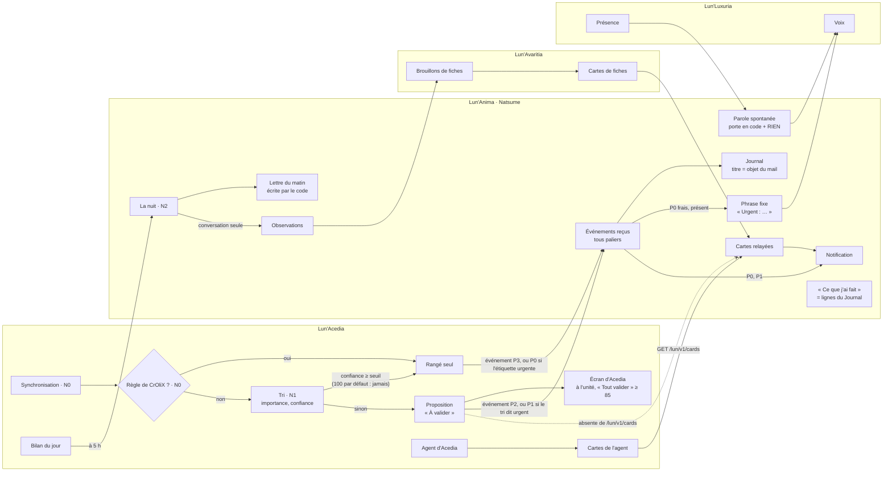
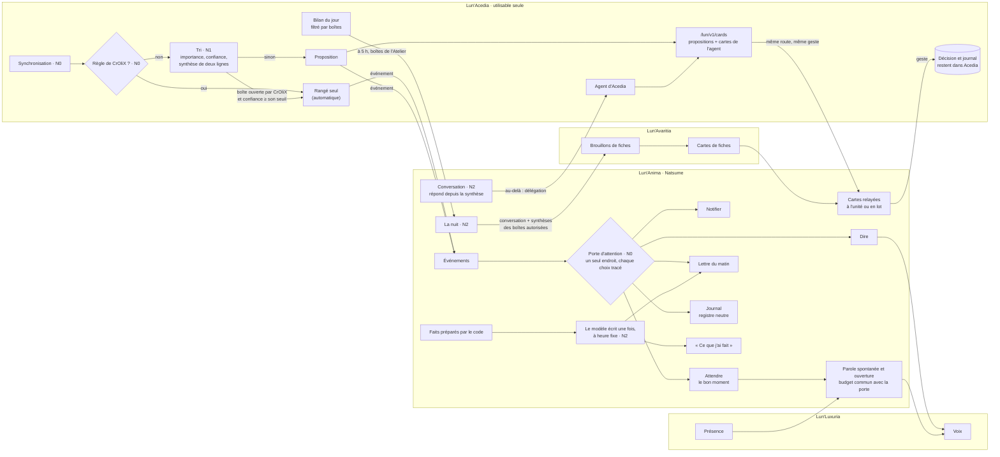
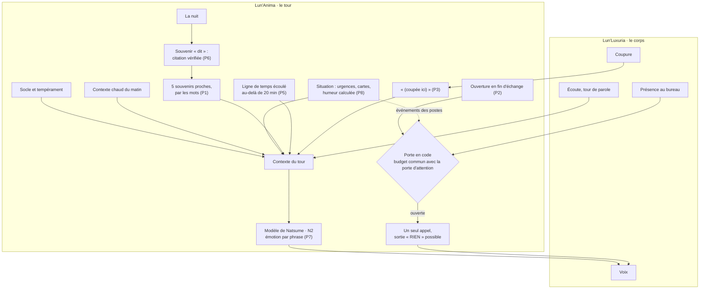

# La carte des flux de l'écosystème, avec la présence de Natsume

> Spec de cadrage du 25/11, après le recadrage demandé par CrOliX le même jour : « on recadre », tout mettre en pause et
> revoir proprement les flux de données et leurs étapes, schématisés. La base est le schéma cible du 05/11 (une
> recherche de la veille, jamais validée), choisi par CrOliX le 25/11 et corrigé ici décision par décision. Toutes les
> décisions de ce texte sont de CrOliX, prises une à une le 25/11 ; elles sont citées par leur numéro (D1 à D16, P1 à
> P8 pour la présence). Ce texte n'en ajoute aucune : ce qui reste ouvert est au § 9, sans réponse.
>
> Il cadre Lun-Ecosystem/lun-anima#135 (ce qui remonte d'Acedia au core). Ce n'est pas un plan : aucun chantier de code
> ne part avant sa validation. Les références au code privé du core sont dans une annexe privée, postée sur
> lun-anima#135 ; ce texte décrit le core par ses comportements et par le contrat.

## 1. Le pourquoi

**L'image** (rappelée par CrOliX le 24/11) : CrOliX est le CEO, Natsume est la manageuse, les satellites sont ses
agents. Le CEO n'échange qu'avec la manageuse. Il ne doit jamais passer par l'écran d'un satellite pour décider.

**Le but** : coupler le core aux satellites pour automatiser la remontée de l'information et assister son
traitement, avec une validation et des seuils de confiance.

- **Les satellites** traitent l'information de leur domaine, avec leur garde-fou de validation. Ils restent
  utilisables seuls : rien de ce texte ne leur fait connaître le core.
- **Le core** relaie entre CrOliX et les satellites, dans les deux sens. Il remonte les propositions d'Acedia pour
  validation ou correction. Il tire les données de la journée, les trie, les formate et les envoie à Avaritia, qui
  propose des fiches nouvelles ou corrigées.
- **La présence** est liée aux flux par le contexte et la conscience du système : ce qu'elle sait de ce qui se passe,
  et la voix de l'écriture (« je fais », « je suis »).

**Ce qui a déclenché le recadrage** : les chantiers enchaînés avaient perdu la vue d'ensemble. Le retour en prod du
24/11 en donne deux exemples (lun-anima#135). Les propositions de tri d'Acedia ne remontent pas au core : il faut
aller dans Acedia pour les traiter. Le Journal et « Ce que j'ai fait » montrent l'objet du mail, pas ce qui a été
fait.

## 2. Les étages et les mots

Le schéma du 05/11 range chaque traitement par étage de coût. Ce texte en garde trois :

| Étage | Qui travaille | Exemples |
|---|---|---|
| **N0, règle** | du code, sans modèle | la synchronisation, les règles de CrOliX, la porte d'attention, l'annonce d'une urgence, l'humeur |
| **N1, petit modèle** | le modèle bon marché d'un satellite | le tri d'Acedia, sa synthèse en deux lignes |
| **N2, modèle de Natsume** | le modèle du core | la conversation, la nuit, la parole spontanée, la lettre du matin |

Le quatrième étage du 05/11 (un modèle fort, à la demande) n'apparaît dans aucun flux de ce texte.

**La validation** prend quatre formes : la **carte** tranchée à l'unité, le **lot** (un geste pour plusieurs cartes),
le **seuil** (le satellite agit seul au-dessus d'une confiance que CrOliX a ouverte) et l'**automatique** (une règle
écrite par CrOliX).

**La porte d'attention** a cinq sorties (D2) : **dire** (à voix haute au bureau), **notifier** (sur le téléphone),
**attendre** le bon moment, la **lettre du matin**, le **Journal**.

**La voix** : un texte est soit écrit par le modèle, à la première personne (« je »), soit écrit par le code, dans un
**registre neutre** qui dit « tu » ou nomme, sans « je » (D6, P4).

## 3. L'existant

Relu le 25/11 sur `main` (Acedia, Avaritia, Luxuria) et sur le core par ses comportements.

Ce que le code fait aujourd'hui :

- **Le tri d'Acedia** : une règle range le mail et émet un événement P3, ou P0 si la règle porte l'étiquette urgente
  (`lun-acedia/server/src/triage/pipeline.ts:212-258`). Sans règle, le tri propose une boîte, une importance et une
  confiance. Au-dessus du seuil (`DEFAULT_THRESHOLD = 100`, ligne 59), il range seul ; à 100, tout attend
  (lignes 275-285). La proposition en attente émet un événement P2, P1 si le tri la juge urgente : jamais P0
  (lignes 296-310).
- **Le seuil est un seul nombre pour toutes les boîtes**, et « Tout valider » valide les propositions au-dessus d'un
  second seuil, 85 par défaut, jamais au-dessus du premier (`pipeline.ts:64`, `triage/routes.ts:43-44`). Ce geste
  par lot n'existe que dans l'écran d'Acedia (`views/src/lib/mail/Pending.svelte:453`).
- **Les cartes du contrat** ne lisent que les cartes de l'agent d'Acedia (`server/src/contract/routes.ts:193-201`) :
  une proposition de tri n'y est pas. Les gestes sur une proposition existent dans le catalogue, `mail.validate`,
  `mail.correct` et `mail.refuse` (`server/src/contract/catalog.ts:140-155`), mais le core n'a aucun écran qui les
  appelle.
- **Le bilan du jour** (`day.digest`) prend une période `{ since, until }` et rend les mails reçus, ce qui a été
  fait et le nombre en attente, par leurs objets (`catalog.ts:418-481`). Il ne prend aucun filtre de boîte.
- **Le core** garde chaque événement reçu, quel que soit son palier, et en écrit une ligne au Journal (sauf P4) dont
  le titre est celui de l'événement, donc l'objet du mail. Une urgence fraîche est dite au bureau par une phrase
  fixe, neutre (« Urgent : … », « Rappel : … »). Les P0 et P1 et les cartes en attente partent en notification ; la
  nuit, une urgence part sans son.
- **La nuit** lit la conversation et le bilan d'Acedia, écrit souvenirs et récit, et n'envoie à la bibliothèque que
  les observations tirées des messages de CrOliX (décision du 24/11). **La lettre du matin** est composée par le code
  depuis des comptes, sans modèle. **« Ce que j'ai fait »**, au Bureau, reprend les lignes du Journal.
- **La parole spontanée** : à chaque signe de présence venu de Luxuria, une porte en code (présence, sourdine, appel,
  silence, plafond par jour, deux paroles sans réponse au plus) peut ouvrir un seul appel du modèle, qui peut
  répondre « RIEN ».
- **La présence dans le tour** : le socle, le contexte chaud du matin et un bloc de situation (urgences, cartes,
  humeur, présence, absence). Les souvenirs ne reviennent que par le contexte chaud du matin. Une réponse coupée
  revient au modèle comme si elle s'était arrêtée là, sans marque.
- **Le socle** dit « tu ne relances pas une conversation pour la faire durer ». Quatre phrases fixes du code disent
  « je » (un poste injoignable, une carte qu'il n'a pas pu relire, une journée qu'il n'a pas pu relire, un geste non
  tranché).
- **L'émotion** : le modèle écrit une émotion d'une liste plate, donnée d'instance, devant chaque phrase ; Luxuria la
  transporte jusqu'à la voix (`lun-luxuria/src/conversation.ts:178`), mais rien ne la consomme encore. **L'humeur**
  est calculée par le code depuis les urgences et les cartes en attente, jamais stockée.

## 4. La cible

Les changements, par rapport à l'existant :

1. **Une proposition de tri devient une carte du contrat** (D1). Elle sort par la même route, `GET /lun/v1/cards`, et
   se tranche par le même geste. La décision et son journal restent dans Acedia. Acedia garde son écran
   « À valider », qui ne change pas.
2. **Le core rend tout par une seule porte** (D2), en code, sans modèle, avec ses cinq sorties. Chaque choix est
   tracé.
3. **L'autonomie d'Acedia se gagne boîte par boîte** (D3) : d'abord la mesure, puis un seuil par boîte que CrOliX
   ouvre lui-même. Tout reste dans Acedia.
4. **Le lot entre au core** (D5), borné aux propositions sans envoi ni options, au-dessus du seuil de lot d'Acedia.
5. **Une seule voix** (D6, P4) : le « je » est au modèle, qui écrit une fois à heure fixe ; le reste est neutre.
6. **La proposition porte une synthèse** (D9) ; le corps du mail ne quitte jamais Acedia.
7. **Des mails entrent dans la bibliothèque, filtrés** (la nuit vers Avaritia, rouvert en partie), par un réglage du
   core passé en paramètre au bilan d'Acedia.
8. **La présence s'imbrique dans les flux** (P1 à P8, § 6).

## 5. Flux par flux

État : **fait** (le code le fait déjà), **à faire** (avant le rodage), **après le rodage**.

| # | Flux | Source | Déclencheur | Étage | Validation | Rendu par la porte | Voix | État | Décision |
|---|---|---|---|---|---|---|---|---|---|
| 1 | Mail rangé par une règle | Acedia | la synchronisation | N0 | automatique | Journal, lettre du matin | neutre | fait (porte unique : à faire) | D2, D8 |
| 2 | Mail urgent par une règle | Acedia | la synchronisation | N0 | automatique | dire si présent, notifier sinon | neutre, phrase fixe | fait (porte unique : à faire) | D2, D6, D8 |
| 3 | Urgence la nuit | Acedia, l'agenda | l'événement P0 | N0 | aucune | notifier, sans son | neutre | fait | D11 |
| 4 | Rappel d'agenda | Acedia | l'heure du rendez-vous | N0 | aucune | dire si présent, notifier sinon | neutre, phrase fixe | fait | D6 |
| 5 | Proposition de tri | Acedia | un mail sans règle | N1 | carte | à fixer par la porte (§ 9) | neutre au Journal | à faire | D1, D2, D8 |
| 6 | Synthèse de la proposition | Acedia | l'appel de tri existant | N1 | portée par la carte | lignes de la carte | neutre (texte du satellite) | à faire | D9 |
| 7 | Validation par lot | le core | un geste de CrOliX | N0 | lot, au-dessus du seuil de lot | Journal | neutre | à faire | D5 |
| 8 | Correction d'une proposition | le core | un geste de CrOliX, lot ouvert ou carte | N0 | carte | Journal | neutre | à faire | D1, D5 |
| 9 | Rangement seul au-dessus du seuil | Acedia | un mail sans règle | N1 | seuil par boîte, ouvert par CrOliX | Journal, lettre du matin | neutre | à faire : mesurer d'abord | D3 |
| 10 | Question sur un mail | CrOliX | sa phrase | N2 | aucune | conversation | « je », modèle | à faire (la synthèse manque) | D9 |
| 11 | Délégation à l'agent d'Acedia | le core | la question dépasse la synthèse, ou une demande | N2 et l'agent du poste | carte à l'unité (envoi, options) | conversation, puis carte | « je », modèle | fait | D5, D9 |
| 12 | Événement de contrôle (poste, plafond, routine) | le core, un poste | l'incident | N0 | aucune | notifier | neutre | fait (porte unique : à faire) | D2, D6 |
| 13 | Lettre du matin | le core | l'heure fixe | N2 (aujourd'hui N0) | aucune | lettre du matin | « je », modèle, écrit une fois | à faire | D6 |
| 14 | « Ce que j'ai fait » | le core | un moment fixe (§ 9) | N2 | aucune | Bureau, relu de ce texte | « je », modèle, écrit une fois | à faire | D6 |
| 15 | Journal | le core | chaque choix de la porte | N0 | aucune | Journal | neutre, sans « je » | fait, à mettre d'accord avec D2 | D2, D6 |
| 16 | La nuit, depuis la conversation | le core | 5 h | N2 | carte de fiche | cartes de fiches | « je » au récit, neutre aux observations | fait | décision du 24/11 |
| 17 | La nuit, depuis les mails | Acedia, par le bilan | 5 h | N0 (filtre), N2 (la nuit) | carte de fiche | cartes de fiches | neutre | à faire | Nuit vers Avaritia |
| 18 | Rappel des souvenirs au tour | le core | chaque tour | N0 | aucune | contexte du tour | donnée | à faire | P1 |
| 19 | Parole spontanée | Luxuria (la présence) | le silence, au bureau | N0 puis N2 | aucune | dire, ou rien | « je », modèle | fait | P2 |
| 20 | Ouverture en fin d'échange | le core | la fin d'un échange | N2 | aucune | dire, ou rien | « je », modèle | à faire | P2 |
| 21 | Budget de parole commun | le core | chaque parole spontanée et chaque attente | N0 | aucune | attendre, ou rien | aucune | à faire | P2 |
| 22 | Réponse coupée | Luxuria | CrOliX parle par-dessus | N0 | aucune | contexte du tour | marque « (coupée ici) » | à faire (la coupure est faite) | P3 |
| 23 | Temps écoulé | le core | deux messages à plus de 20 min | N0 | aucune | contexte du tour | donnée | à faire | P5 |
| 24 | Souvenir « dit » | la nuit | l'écriture d'un souvenir | N2 puis N0 | vérification par le code | souvenirs | « je », modèle | à faire | P6 |
| 25 | Émotion par phrase | le modèle | chaque phrase | N2 | aucune | voix (sans consommateur) | donnée | fait, liste plate | P7 |
| 26 | Humeur | le core | chaque tour | N0 | aucune | contexte du tour | « tu », donnée | fait | P8 |
| 27 | Lettre qui propose des brouillons | le core | l'heure fixe | N2 | carte | lettre du matin | « je », modèle | après le rodage | D13, D14, D16 |
| 28 | Gmail par poussée | Acedia | Google | N0 | aucune | aucun | aucune | après le rodage | D13, D14, D16 |
| 29 | La nuit en lot différé (batch) | le core | 5 h | N2 | aucune | aucun | aucune | après le rodage | D13, D14, D16 |
| 30 | Point du soir | le core | l'heure fixe | N2 | aucune | à fixer | « je », modèle | après le rodage | D13, D14, D16 |

### 5.1 Ce que dit chaque décision du flux d'Acedia

- **D1.** Les propositions de tri deviennent des cartes du contrat : même route `GET /lun/v1/cards`, même geste. La
  décision et son journal restent dans Acedia.
- **D3.** Avant tout seuil, Acedia mesure, par boîte et par étiquette, la part de propositions validées sans
  correction. Ensuite, un seuil par boîte, que CrOliX ouvre lui-même. Tout reste dans Acedia : mesure, seuil, réglage
  et écran.
- **D5.** La validation par lot entre au core. Elle ne couvre que les propositions sans envoi ni options, au-dessus du
  seuil de lot d'Acedia (85 par défaut). On peut ouvrir le lot pour corriger une proposition. Le reste se valide à
  l'unité. Le contrat le disait déjà : « une carte qui a `sends` ou `options` ne se valide jamais en lot ».
- **D8.** Un satellite n'écrit pas la phrase dite : pas de champ `speak` dans le contrat (proposé le 05/11, écarté).
  Il donne un titre, des lignes et une importance. Le core décide de ce qui est dit, quand, et comment.
- **D9.** La proposition porte une synthèse de deux lignes, écrite par le tri dans son appel existant (pas d'appel de
  plus), et masquée des secrets. Natsume répond depuis son contexte ; au-delà, elle délègue à l'agent d'Acedia. Le
  corps du mail ne quitte jamais Acedia. La lecture directe d'un mail par le core est écartée : la séparation des
  responsabilités l'emporte.

### 5.2 La porte d'attention (D2, D11)

Une seule porte dans le core, en code, sans modèle. Elle reçoit les événements, les cartes et les échéances, et choisit
une sortie parmi cinq : dire, notifier, attendre le bon moment, la lettre du matin, le Journal. Chaque choix est tracé.

Aujourd'hui, ces choix existent mais sont répartis : l'annonce d'une urgence, la file des notifications, la ligne du
Journal et la parole spontanée décident chacune de leur côté. La porte les réunit ; elle ne change pas le
[standard des notifications](../../standards/notifications.md) : le satellite fixe le palier, le core fixe le rendu.

**D11.** Une urgence la nuit reste une notification sans son. C'est déjà le comportement du core.

### 5.3 Une seule voix (D6, P4)

La règle vient d'une crainte de CrOliX : une Natsume froide côté code et émotive côté modèle.

- Le « je » est réservé au modèle. Le code prépare les faits : des comptes, des regroupements.
- Le modèle écrit une fois, à un moment fixe : la lettre du matin, « Ce que j'ai fait ». L'affichage relit ce texte ;
  il ne le recompose pas.
- Le Journal reste un registre neutre, sans « je ».
- L'annonce d'une urgence reste une phrase fixe sans « je ».
- **P4.** La règle « le code dit tu ou nomme, seul le modèle dit je » s'écrit dans un standard. Les quatre phrases fixes
  du code en « je » deviennent neutres.

### 5.4 La nuit vers Avaritia

Rouvert en partie, dès le VIP.

- Un mail entre dans la bibliothèque seulement s'il remplit deux conditions : il est dans une boîte autorisée, et il y
  a été rangé avec l'accord de CrOliX (une règle, ou une proposition validée).
- Ce qui part est la synthèse (D9), jamais le corps.
- La liste des boîtes autorisées commence par Travail seule ; elle s'élargira.
- **Correction de CrOliX** (le risque d'exposer le core dans un satellite public) : cette liste est un réglage du core,
  dans l'Atelier, pas d'Acedia. Le core la passe en paramètre de filtre au bilan du jour d'Acedia. Acedia filtre sans
  rien savoir du core ni de la bibliothèque, et son écran ne change pas.
- Le reste de la conversation continue d'entrer comme le 24/11.

## 6. La présence, et où elle entre dans les flux

OpenAmika reste la référence principale de la présence (décision du 23/11). La confrontation du 25/11 a été lue sur
le code des deux côtés. D7, D10, D12 et D15 (parole spontanée, phrase d'attente, humeur, relances) sont sortis de la
confrontation avec le schéma du 05/11 : la présence se cadre d'abord depuis OpenAmika, puis on voit comment elle
s'imbrique dans les flux. Correction de CrOliX : « la parole spontanée vient de Luxuria ».

- **P1, la mémoire à chaque tour.** À chaque tour, le code rappelle les 5 souvenirs les plus proches des mots de
  CrOliX, par une recherche de mots en base, sans modèle. Ils entrent sous la consigne d'OpenAmika : répondre depuis
  ceci, ou dire qu'elle ne s'en souvient pas. La recherche par le sens est gardée pour plus tard
  (Lun-Ecosystem/lun-anima#146). Le flux nourri : la nuit écrit les souvenirs, le tour les relit.
- **P2, la parole spontanée et l'ouverture.** On garde la porte en code puis un seul appel du modèle, avec la sortie
  « RIEN ». On ajoute l'ouverture d'OpenAmika : une réflexion en fin d'échange, qui peut relancer.
  - La règle du socle « tu ne relances pas » s'assouplit en règle de fluidité, à formuler depuis le fichier du premier
    jet d'OpenAmika (`brain/defaults/表层.txt`).
  - Les garde-fous de dépense s'assouplissent sans cesser de compter : le plafond est relevé, le coût de la parole
    spontanée a sa ligne à part, et le budget de parole est commun avec la porte d'attention (la sortie « attendre »
    et la parole spontanée se comptent ensemble).
- **P3, la coupure.** Une réponse coupée reçoit seulement la marque « (coupée ici) », sans le non-dit : elle ne doit
  pas croire avoir dit ce qu'elle n'a pas dit. La coupure elle-même, côté Luxuria et côté core, est déjà faite.
- **P4, une seule voix.** Voir § 5.3.
- **P5, le temps écoulé.** Une ligne de temps écoulé s'insère dans l'historique quand deux messages sont à plus de
  20 min, en code.
- **P6, la citation.** Un souvenir marqué « dit » doit citer mot pour mot, et le code vérifie la citation. Sinon, il
  est refusé ou passe en « déduit ».
- **P7, l'émotion.** La liste plate d'émotions, donnée d'instance, est gardée. Les registres d'OpenAmika sont reportés
  en inbox (Lun-Ecosystem/lun-luxuria#110) : l'émotion n'a encore aucun consommateur.
- **P8, l'humeur.** L'humeur calculée par le code est gardée. Pas de scènes de journée tirées au sort.

**Ce qui tient les flux et la présence ensemble** : la porte d'attention et la parole spontanée partagent un budget
(P2, D2) ; les événements des postes nourrissent la situation lue à chaque tour et l'humeur ; la synthèse d'une
proposition (D9) est ce que Natsume sait d'un mail quand CrOliX lui en parle ; la nuit écrit les souvenirs que le tour
rappelle (P1, P6).

## 7. Le mur de la scène (D4)

Écrite ici en texte seul ; aucun code ne la sert avant le stream, qui vient après le VIP.

> Quand Natsume est en scène, devant un public, elle n'a ni outil ni lecture vers le privé : ni Acedia, ni Avaritia,
> ni les souvenirs de la relation. Une urgence privée pendant la scène part sur le téléphone de CrOliX, jamais à
> l'antenne. La scène a sa propre mémoire ; ce qu'elle garde ne rejoint la relation qu'après la scène, par la nuit,
> en carte.

## 8. Écarté, reporté, rouvert

**Écarté**

- La lecture directe d'un mail par le core (D9).
- Le champ `speak` du contrat (D8).
- Les scènes de journée tirées au sort d'OpenAmika (P8), les registres d'émotion pour l'instant (P7), le non-dit d'une
  réponse coupée (P3).

**Reporté après le rodage** (D13, D14, D16) : la lettre qui propose des brouillons, Gmail par poussée, la nuit en lot
différé, le point du soir.

**Reporté en issue**

- La recherche par le sens pour le rappel des souvenirs : Lun-Ecosystem/lun-anima#146.
- Les registres d'émotion : Lun-Ecosystem/lun-luxuria#110.

**Cadré par ce texte** : Lun-Ecosystem/lun-anima#135, que le recadrage du 24/11 plaçait « après le VIP ».

**Ce que ce texte rouvre**

- **Le 24/11, décision 1** : « pour le VIP, la bibliothèque n'est nourrie que par la conversation »
  ([recadrage du 24/11](2026-11-24-recadrage-premiere-nuit.md), § 5). Rouvert en partie : les mails des boîtes
  autorisées, rangés avec l'accord de CrOliX, y entrent par leur synthèse (§ 5.4). La conversation continue d'entrer
  comme le 24/11.
- **Le socle, « tu ne relances pas »** ([être présent](2026-11-05-natsume-etre-presence-design.md)) : assoupli en
  règle de fluidité (P2).
- **La liaison du 27/10** ([liaison](2026-10-27-liaison-core-satellites-design.md), § 4) disait que le core ne retient
  du flux que les urgences et le contrôle. Le core retient déjà tout ; la porte d'attention (D2) rend ce choix
  explicite.
- **Le retour du 24/11** demandait un Journal à la première personne. D6 tranche : le Journal reste neutre ; c'est
  « Ce que j'ai fait » qui parle à la première personne, écrit par le modèle.

## 9. Laissé au plan

Sans les trancher :

1. Le palier d'une proposition de tri devenue carte, et sa sortie à la porte : le standard classe « tri à valider » en
   P2 (pas de notification), alors que les cartes en attente partent aujourd'hui en notification.
2. Comment le core connaît la confiance d'une proposition pour le lot (D5) : un champ de la carte, ou un lot déjà
   borné par Acedia.
3. Comment une correction (choisir une autre boîte, d'autres étiquettes) passe par le geste du contrat : l'`input` de
   « Modifier », ou autre chose.
4. La forme de la mesure par boîte et par étiquette (D3), et où CrOliX la lit.
5. Le moment fixe où le modèle écrit « Ce que j'ai fait », et ce qu'il relit des faits préparés.
6. Ce que nomme une ligne neutre du Journal : l'action, la proposition, l'objet du mail.
7. Le nom et la forme du paramètre de filtre du bilan du jour, et la manière dont Acedia sait qu'un mail a été rangé
   avec l'accord de CrOliX.
8. La version du contrat qu'apportent D1 et le filtre du bilan.
9. La règle de fluidité (P2), à formuler depuis le fichier du premier jet d'OpenAmika.
10. Le nouveau plafond de la parole spontanée, et la forme du budget commun.
11. Le standard où s'écrit la règle de la voix (P4).
12. L'ordre des chantiers, et ce qui part en parallèle.

## 10. Ce qui n'a pas été vérifié

- La nuit du 24 au 25/11 : la lettre du matin dit « rien à trancher », plausible, mais la prod n'a pas été lue.
- Le code d'OpenAmika n'a pas tourné, et seule une partie de son écoute a été lue (rapport de confrontation du 25/11).
- Les numéros D13, D14 et D16 couvrent quatre sujets reportés : leur répartition un à un n'est pas écrite.
