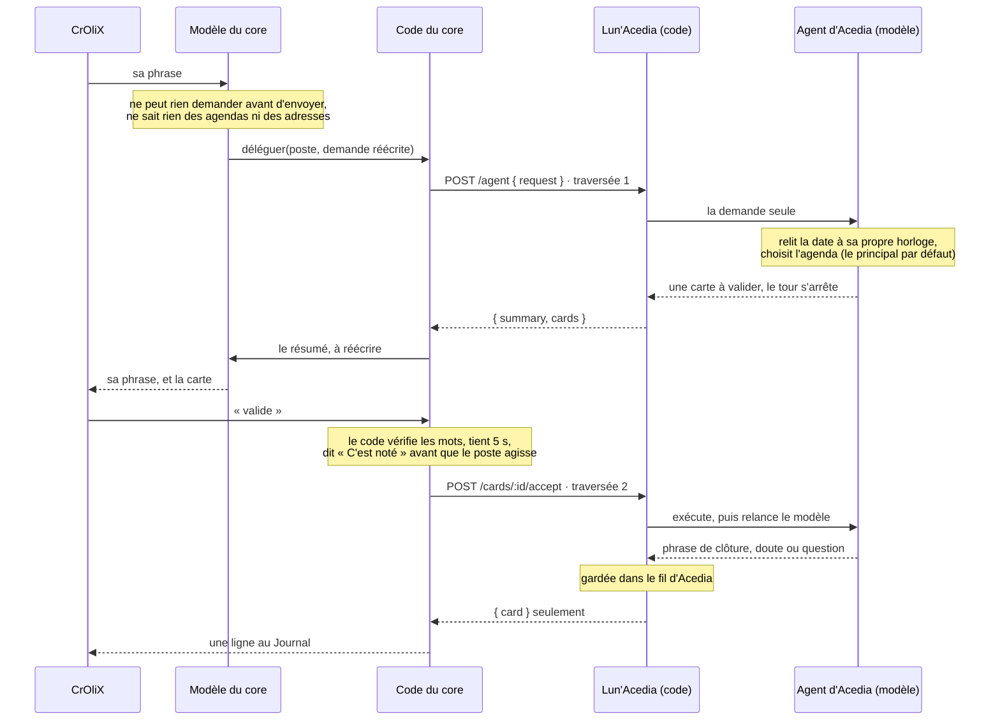
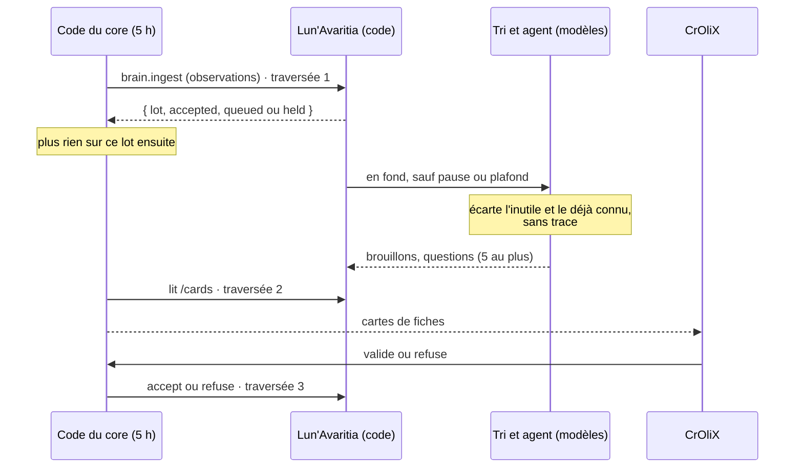
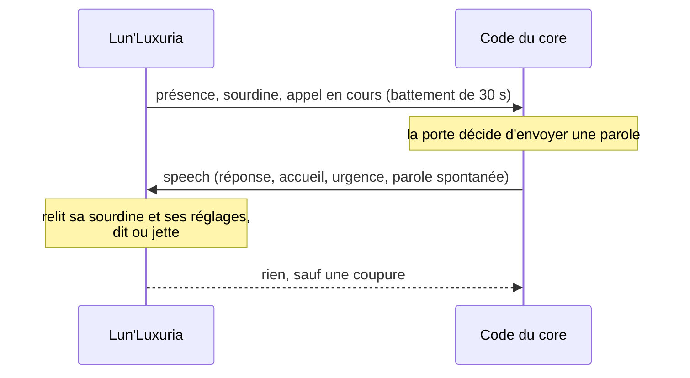

# La carte des flux, relevée source par source : les chaînes de décision

> Relevé du 27/11, demandé par CrOliX le même jour (Lun-Ecosystem/lun-docs#236) : refaire la cartographie des flux,
> une source après l'autre, et relever les allers-retours entre le core et les satellites dans la prise de décision.
> Ce texte complète la [carte du 25/11](2026-11-25-carte-des-flux-design.md) ; il ne remplace aucune de ses
> décisions (D1 à D16, B1, P1 à P8).
>
> **Le relevé (§ 1 à § 7) ne tranche rien.** Il dit ce que le code fait, où une information se perd et où une
> décision se joue deux fois. Les questions du § 8 sont à CrOliX ; ses réponses du 27/11 sont au § 9 (F1 à F7).
> Aucun correctif ne part avant un plan.
>
> Les références au code privé du core sont dans une annexe privée (Lun-Ecosystem/lun-anima#135) ; ici le core est
> décrit par ses comportements.

## 1. Pourquoi une seconde carte

La carte du 25/11 range 37 flux par nature : la source, le déclencheur, le rendu. Elle ne suit aucune décision de
bout en bout. On n'y voit donc ni le nombre de fois où une décision passe la frontière entre le core et un
satellite, ni ce que devient une question posée en chemin.

Son § 3, « L'existant », date d'avant les chantiers qu'elle a lancés. Relu le 27/11, il est faux sur ces points :

| La carte du 25/11 dit | Le code fait, le 27/11 |
| --- | --- |
| Une proposition de tri est absente de `GET /lun/v1/cards` | Lun'Acedia la sert comme carte, avec ses champs à corriger |
| La carte du contrat n'a pas de champ d'importance | Elle a `importance` et `bulk` (contrat 1.5) |
| Une proposition émet un événement P2 | Elle n'émet qu'un signal de palier `log`, en fin de passe |
| Lun'Acedia ne masque aucun secret | Elle masque ce qui sort par les cartes et les événements |
| Le bilan du jour n'a ni filtre de boîte ni synthèse | Il a les deux |
| Rappel des souvenirs, temps écoulé, marque de coupure : à faire | Faits dans le core |
| Une tâche due aujourd'hui est en tête de la lettre | La lettre ne contient aucune tâche |
| Lun'Luxuria annonce la présence et le silence | Elle annonce la présence ; aucun signal de silence ne part |

## 2. La méthode

Cinq relevés, chacun par un agent de lecture, sur `main` : le core en deux parts (ce qui entre et ce qui sort hors
conversation ; la conversation et la délégation), Lun'Acedia (`40c293f`), Lun'Avaritia (`bd6f7cf`), Lun'Luxuria
(`8afe402`). Le core est lu à sa version 0.4.1, celle du NAS. Chaque relevé part des frontières : les appels
sortants, les routes entrantes, les minuteries, les notifications.

Relu ensuite à la source, sans agent : ce que le core envoie à un poste ; ce que rend `POST /lun/v1/agent` ; la
reprise du modèle de Lun'Acedia après une carte tranchée ; le signal d'une proposition ; la phrase de la lettre du
matin ; les trois définitions de « valider ensemble » ; qui lit le résumé d'une délégation. Le reste est le relevé
des agents, non rejoué ; le § 7 dit ce qui manque.

**Les mots.** Une **traversée** est un appel entre le core et un satellite. Une **chaîne** est la suite des étapes
d'une décision, de la phrase ou du geste de CrOliX jusqu'à ce qu'il en voit le résultat.

## 3. Ce qui traverse chaque frontière

Trois moyens seulement : un satellite **pousse** un événement ; le core **lit** un satellite, toutes les 2 minutes
et après chaque signal ; le core **demande** (une action, l'agent du poste, une décision de carte).

| Frontière | Poussé vers le core | Lu par le core | Demandé par le core |
| --- | --- | --- | --- |
| Lun'Acedia | mail rangé (P3), urgent par règle (P0), jugé urgent et rangé seul (P1), rappel d'agenda, clé, crédit, signal `log` | santé, cartes en attente, coûts, agenda et tâches, bilan du jour (la nuit) | l'agent, une décision de carte, la pause |
| Lun'Avaritia | copie échouée, clé qui expire, clé refusée, clé rétablie | santé, cartes en attente (15 au plus), coûts, échéances, recherche | `brain.ingest` (la nuit), l'agent, une décision de carte, la pause |
| Lun'Luxuria | présence (début, battement toutes les 30 s, fin), sourdine, appel en cours, la phrase de CrOliX, une coupure | rien | rien : le core lui envoie des paroles (`speech`) sur un flux ouvert par elle |

Ce que ce tableau montre déjà :

- **Lun'Avaritia ne pousse rien de son travail.** Ses quatre événements parlent de sa clé et de sa copie. Un lot
  traité, une carte née, une décision prise dans son écran : le core ne l'apprend qu'en venant lire.
- **Lun'Acedia ne pousse rien d'une décision prise dans son écran**, ni la naissance d'une carte de son agent, ni un
  brouillon créé (`server/src/triage/routes.ts:92-113`).
- **Lun'Luxuria ne rend aucun accusé.** Le core lui envoie une parole ; il n'apprend que la coupure, jamais « dit ».
- **Le core n'envoie à un poste qu'une phrase.** Le contrat de `POST /lun/v1/agent` accepte un `context`
  (`server/src/contract/routes.ts:43-46` chez Lun'Acedia) ; le core ne l'envoie pas.

## 4. Les chaînes de décision

Qui tient la main : **CrOliX**, le **modèle du core** (Natsume), le **code du core**, le **code du satellite**, le
**modèle du satellite** (son agent, ou son tri).

### 4.1 Demander une action à un poste, puis valider la carte

L'exemple du 27/11 : un créneau d'agenda demandé à Natsume.

- **Traversées** : 2 pour décider, plus 5 lectures de resynchronisation après le geste. Par la voix, en passant par
  la lecture de la carte, 11 appels au poste.
- **Appels de modèle** : 2 au core (choisir et écrire la demande, puis réécrire le résumé), 2 au moins chez le
  poste (préparer la carte, puis reprendre après la décision).
- **Deux modèles décident de la même chose.** Celui du core fixe la date, les mots et le poste. Celui du poste
  redécide la date et l'agenda. Seul le premier a entendu CrOliX ; seul le second voit les agendas.
- **Ce qui part** : une phrase réécrite. Ni la phrase de CrOliX, ni la date du core, ni l'agenda ou l'adresse visés.
- **Ce qui revient** : le dernier message du tour de l'agent et les cartes
  (`server/src/contract/routes.ts:381-398`). Le résumé est réécrit par le modèle du core, dont la consigne parle
  de noms, de dates et de montants, pas d'une question. Le résumé d'origine est gardé en base ; aucun écran ne le lit.
- **Après la validation**, le poste relance son modèle (`server/src/pina/agent.ts:196`, `resume`). Ce qu'il écrit
  alors reste chez le poste : la réponse au core ne porte que la carte.

### 4.2 La question ou le doute d'un poste

Il n'y a pas de canal. Trois cas :

1. **La question est posée sans carte** : elle est dans le résumé. Le modèle du core la relaie, ou non. CrOliX
   répond ; le modèle du core écrit une nouvelle demande « complète et autonome » ; le poste la reçoit. Lun'Acedia
   garde le fil du jour, donc elle retrouve sa question ; Lun'Avaritia ne garde rien d'un appel à l'autre.
   Deux allers-retours, quatre appels du modèle du core, deux tours de CrOliX.
2. **La question est écrite avec la carte**, dans le même message : elle est dans le résumé, sous la même réserve.
3. **La question vient après la validation ou le refus** de la carte : elle n'existe que dans le fil du poste.
   Aucun événement ne dit qu'une réponse est attendue.

Dans l'autre sens, la consigne du modèle du core lui interdit de demander une confirmation avant d'envoyer. Une
ambiguïté de CrOliX (quel jour, quel agenda, quelle adresse) est donc tranchée par un modèle, jamais renvoyée à
CrOliX.

### 4.3 Une proposition de tri

- **Depuis le core** : le core lit la carte, CrOliX tranche, le core appelle `accept` ou `refuse` avec les valeurs
  corrigées, Lun'Acedia exécute et renvoie un signal `log`. Trois traversées.
- **Depuis l'écran de Lun'Acedia** : rien ne part. Le core garde la carte « en attente » jusqu'à sa lecture
  suivante, 2 minutes au plus.
- **Deux lieux de décision.** Le second reçoit « Cette carte n'est plus en attente ». Les données restent justes ;
  c'est l'information du core qui retarde.
- **Une proposition jugée urgente par le tri** devient une carte d'importance normale, sans événement
  (`server/src/contract/routes.ts:109`). Seule une règle de CrOliX donne une urgence (P0).

### 4.4 Valider ensemble

- **Pas de route de groupe** : N cartes, N appels, l'un après l'autre. Après le premier silence du poste, ses
  autres cartes sont marquées échouées sans être tentées.
- **Trois définitions de ce qui entre dans le groupe**, toutes dans le core : la porte d'attention regarde `bulk`
  (personne ne lit son résultat) ; la file ne regarde pas `bulk` (écriture, sans envoi, sans options) ; le composant
  d'écran regarde `bulk`. Le seuil de 85 de Lun'Acedia n'est borné par aucune route : accepter une carte sans
  `bulk` passe aussi.

### 4.5 La nuit, vers la bibliothèque

- **Un envoi sans accusé de traitement.** Le core apprend que le lot est reçu, jamais qu'il est traité, retenu ou
  en échec.
- **Pendant une pause**, le lot est dit « en file » et rien ne tourne (`server/src/brain/ingest.ts:60`).
- **Ce qui est écarté ne laisse aucune trace** : une observation jugée sans intérêt, un fait déjà connu, une
  question déjà posée.
- **Un refus n'est pas retenu** : une observation semblable peut redonner la même carte (déduit).
- **La nuit se dit « faite » même incomplète** : un bilan de Lun'Acedia manquant ou une bibliothèque au plafond ne
  changent ni son état ni la ligne du Journal.

### 4.6 « C'est fait » sur une échéance

CrOliX dit « c'est fait » ; le core le confie à l'agent de Lun'Avaritia ; l'agent prépare une carte ; CrOliX doit la
valider. **La même décision se prend deux fois.** L'échéance est cachée 24 heures côté core dès le premier geste,
même si la carte n'est jamais validée.

### 4.7 Un brouillon de mail

L'agent de Lun'Acedia prépare le brouillon ; aucun événement ne le signale ; l'envoi n'existe que dans l'écran de
Lun'Acedia. **C'est la seule chaîne qui oblige CrOliX à quitter Natsume.** La carte d'une réponse porte « envoie un
mail » (`sends`) alors que la valider ne fait que créer le brouillon (`server/src/contract/routes.ts:61`).

### 4.8 Une urgence

Un événement arrive ; la porte du core décide de dire, de notifier, d'écrire au Journal. CrOliX n'a qu'un geste,
« Vu », que le poste n'apprend pas. Aucun geste ne reporte, ne délègue ni ne répond.

### 4.9 Qui peut parler

- **La décision se prend des deux côtés.** Le core décide d'envoyer, d'après la présence et la sourdine reçues.
  Lun'Luxuria décide de dire, d'après sa sourdine du moment et un réglage par motif que le core ne connaît pas
  (`src/conversation.ts:172-177`).
- **Une parole jetée ou perdue n'est signalée à personne** : sourdine, réglage local, motif inconnu, voix en panne,
  flux coupé. Le core tient l'urgence pour dite.
- **Un « oui » à la voix part comme une phrase**, sans l'identifiant de la carte visée. Le core retrouve la carte.

### 4.10 La pause

Deux pauses coexistent chez un satellite : celle du core et la sienne. Chez Lun'Acedia, la sienne est la plus forte :
elle coupe aussi le tri, et son agent répond « en pause » par une réponse normale, que le core trace « faite ».
`POST /pause` sans auteur pose la pause locale (`server/src/contract/routes.ts:267`).

### 4.11 Le compte

| Chaîne | Qui décide | Traversées | Où cela se perd |
| --- | --- | --- | --- |
| Demander une action | deux modèles, l'un après l'autre | 1 | la phrase de CrOliX, la date, l'agenda |
| Valider la carte (écran) | CrOliX, le code | 1 + 5 lectures | l'issue du geste, la phrase de clôture |
| Valider la carte (voix) | CrOliX, le code | 11 | idem, et « c'est noté » dit avant l'effet |
| Question d'un poste | personne | 2 allers-retours | la question, si elle vient après la carte |
| Proposition de tri | CrOliX, à deux endroits | 3, ou 0 | la décision prise dans l'écran du poste |
| Valider ensemble | CrOliX, le code | N + 5 | la borne du groupe |
| La nuit vers la bibliothèque | les modèles du poste | 3 | le sort du lot, ce qui est écarté |
| « C'est fait » | CrOliX, deux fois | 2 | la première décision ne fait rien |
| Brouillon à envoyer | CrOliX, hors de Natsume | 1 | l'existence du brouillon |
| Qui peut parler | le core et Luxuria | 1 | ce qui a été dit |

## 5. Les trous, par famille

Chaque trou porte un repère (T1 à T31) pour les issues à venir.

### A. Le retour qui manque

- **T1.** La phrase de l'agent d'un poste après une carte tranchée reste chez le poste (§ 4.1).
- **T2.** L'issue d'un geste ne revient pas dans la conversation. « C'est noté » est dit avant l'effet ; un échec
  n'apparaît qu'au tour suivant ou à l'écran, et sur le seul appareil qui a cliqué.
- **T3.** Le core ne sait pas ce qu'un lot de la nuit est devenu (§ 4.5).
- **T4.** Le core ne sait pas ce que Lun'Luxuria a dit (§ 4.9).
- **T5.** Une décision prise dans l'écran d'un satellite n'est poussée nulle part (§ 4.3, § 4.5).
- **T6.** « Rien n'a été fait » peut être faux : le délai du core (120 s pour une demande, 15 s pour un geste)
  coupe son attente, pas le travail du poste (déduit). Une relance peut alors faire un doublon.

### B. Ce que le poste ne reçoit pas

- **T7.** Le poste ne reçoit qu'une phrase réécrite ; le champ `context` du contrat reste vide (§ 3).
- **T8.** Le modèle du core ne sait rien des agendas, des listes, des adresses ni des boîtes d'un poste : il n'en
  connaît qu'un rôle en une ligne.
- **T9.** L'agent de Lun'Acedia ne peut pas choisir l'expéditeur d'un nouveau mail, et sa consigne ne dit rien du
  choix de l'agenda (Lun-Ecosystem/lun-acedia#122).

### C. Deux endroits décident

- **T10.** La date et l'agenda : deux modèles (§ 4.1).
- **T11.** Qui peut parler : le core et Lun'Luxuria (§ 4.9) ; la sourdine est lue aux deux endroits.
- **T12.** Ce qui se valide ensemble : trois définitions (§ 4.4).
- **T13.** La pause : deux pauses, de force inégale (§ 4.10).
- **T14.** Le plafond de coût : celui du core et celui de Lun'Avaritia sont indépendants.
- **T15.** « C'est fait » : deux décisions pour une (§ 4.6).

### D. Un état vrai d'un seul côté

- **T16.** « Vu » sur une urgence et « Plus tard » sur une échéance ne vivent que dans le core.
- **T17.** Une carte est cachée côté core dès le geste, pendant 5 secondes à 24 heures, qu'elle soit tranchée ou
  non chez le poste.
- **T18.** Une carte tout juste préparée n'est pas encore connue du core : « valide » dit trop tôt peut répondre
  « déjà tranchée » (déduit).
- **T19.** Un poste en pause locale est offert au modèle comme un poste en service.

### E. Produit, lu par personne

- **T20.** La porte d'attention calcule « attendre » (P2), « lettre du matin » (P3) et « groupable ». Aucun n'est
  exécuté : un P2 n'attend rien, un P3 n'entre pas dans la lettre.
- **T21.** Le résumé d'origine d'une délégation, la phrase du jour, le point du matin, les références d'une ligne
  du Journal, la route des événements non urgents.
- **T22.** L'émotion par phrase arrive au sous-titre de Lun'Luxuria, pas à la voix.

### F. Ce qui ne remonte jamais

- **T23.** Un compte Google déconnecté ou un jeton illisible : ni santé ni événement
  (`server/src/main.ts:99-105` chez Lun'Acedia).
- **T24.** Le plafond de Lun'Avaritia atteint : sa santé reste bonne, aucun événement.
- **T25.** Lun'Luxuria sourde ou sans voix (micro, transcription, synthèse) : rien ne part.
- **T26.** Un événement non urgent reçu quand CrOliX est au bureau n'a que sa ligne au Journal : ni voix, ni
  compteur, et la notification n'est pas rejouée à son départ. De même pendant une pause.
- **T27.** Une seule carte illisible d'un poste arrête la lecture de toutes ses cartes.
- **T28.** Les cartes de Lun'Avaritia au-delà de 15 ne sont visibles que dans son écran.

### G. Les comptes et les mots

- **T29.** Quatre comptes de « cartes », quatre périmètres : la file (cartes, piles pour une, échéances), la lettre
  (le même nombre, écrit « propose N cartes »), la notification (cartes urgentes seulement), l'état des postes.
- **T30.** Deux « jours » dans le core : la date dite au modèle suit le calendrier ; le fil, les comptes et la
  situation suivent le jour de 5 h. Ils diffèrent entre minuit et 5 h. « Cette nuit », dans la lettre, compte la
  veille entière, rappels d'agenda compris.
- **T31.** « Ce que j'ai fait » montre les 3 dernières lignes du Journal : la ligne de la veille de nuit en sort
  dès le matin.

## 6. Les constats de prod du 27/11

| Constat | Cause lue dans le code |
| --- | --- |
| La lettre annonce « 3 cartes » pour trois promotions | La lettre écrit le nombre de la file, sans lire l'importance. Lun'Acedia sert pourtant ces cartes en importance basse (T29). |
| La lettre ne dit rien de la veille de nuit | Elle n'en parle que si la nuit a échoué ou tourne encore ; une nuit incomplète reste « faite » (§ 4.5). |
| Le doute de Lun'Acedia sur la date n'est pas remonté | Pas de canal (§ 4.2). Soit le modèle du core ne l'a pas repris du résumé, soit il est venu après la validation (T1). **Non départagé** : la trace de la délégation, sur le NAS, le dira. |
| « Demain » écrit pour aujourd'hui | **Non expliqué.** Le modèle reçoit la date et l'heure en toutes lettres. Pistes non prouvées : les deux « jours » (T30), des événements à venir donnés sans leur jour. |
| Le créneau part dans l'agenda principal | T8 et T9 : personne, dans la chaîne, ne sait ni ne choisit. |

## 7. Ce qui n'a pas été vérifié

- Rien n'est rejoué : ni serveur, ni test, ni donnée du NAS. Les délais et leurs effets (T6, T18) sont déduits.
- Le texte exact du résumé et de la demande du 27/11 n'est pas lu.
- Les écrans des satellites ne sont lus que par leurs routes et leurs tests ; ceux du core, en partie.
- Chaque relevé a lu sa source ; les points de contact entre deux sources sont recoupés, pas tous relus (§ 2).
- Lun'Luxuria n'est pas en service continu : ses trous sont lus dans le code, jamais vus en prod.

## 8. Ce qui reste à trancher

Les questions telles que posées avant les réponses ; celles-ci sont au § 9. L'ordre part de ce que CrOliX a vu
le 27/11.

1. **La question d'un poste.** Faut-il un canal du contrat pour une question ou une réserve, et où CrOliX la lit-il
   (T1, § 4.2) ?
2. **Avant d'envoyer.** Natsume peut-elle demander une précision à CrOliX quand la demande est ambiguë, ou
   doit-elle toujours envoyer (§ 4.2) ?
3. **Ce que le poste reçoit.** La phrase de CrOliX, la date du core, l'agenda ou l'adresse visés : lesquels partent
   avec la demande (T7, T8, T10) ?
4. **Le retour d'un geste.** L'issue d'une carte tranchée revient-elle dans la conversation, et la phrase de
   clôture du poste avec elle (T1, T2) ?
5. **La lettre du matin.** Que compte-t-elle, et dit-elle la nuit quand tout s'est bien passé (T29, § 4.5) ?
6. **Les sorties de la porte.** « Attendre » et « lettre » doivent-elles être exécutées, ou sorties du standard
   (T20, T26) ?
7. **La nuit vers la bibliothèque.** Le core doit-il apprendre le sort d'un lot (T3) ?
8. **Une décision prise dans l'écran d'un satellite** : doit-elle être poussée au core (T5) ?
9. **Qui peut parler.** Un seul endroit décide-t-il, et Lun'Luxuria rend-elle un accusé (T4, T11) ?
10. **Le brouillon.** L'envoi reste-t-il dans l'écran de Lun'Acedia (§ 4.7) ?
11. **Le reste** (T12 à T19, T21 à T28, T30, T31) : à trier après, en issues.

## 9. Les décisions de CrOliX, le 27/11

Prises une à une sur les questions du § 8, et citées dans ses mots sur Lun-Ecosystem/lun-docs#236. Elles
s'appellent F1 à F7, pour ne pas se mêler aux décisions de la carte du 25/11.

- **F1. L'entrée unique** (question 4, reformulée par lui en « le suivi de l'action »). Le suivi d'une action vit
  dans une seule entrée du Journal, de sa demande à son résultat. La chaîne dit chaque étape avec son vrai lieu :
  demandé (voix ou conversation), confié au poste, proposé, validé (depuis le Bureau, la conversation ou la voix),
  puis fait, ou échec avec son motif. La pastille porte l'état. La conversation ne reçoit que l'échec. Son constat
  de départ : une chaîne fausse, « Tranchée dans Lun'Acedia » pour une carte validée depuis le Bureau du core.
- **F2. La lettre du matin** (question 5). Écrite par le modèle, elle résume « le traitement d'Avaritia durant la
  nuit, ce qui m'attend pour la journée et ce qui demande mon attention ». La nuit ne retraite ni les mails ni leurs
  propositions de rangement, qui remontent déjà en cartes dans la journée. Elle vérifie l'urgent resté sans
  suite : les mails encore non lus portant certaines étiquettes. La liste des étiquettes est un réglage (ses
  exemples : urgent, à répondre, échéance).
- **F3. La lecture à l'heure de la lettre** (question 7). En écrivant la lettre, le core lit chez Lun'Avaritia un
  bilan du lot de la nuit : observations reçues, fiches proposées, questions posées, ce qui a été écarté et
  pourquoi, et l'état du lot. Pas d'événement poussé. Lun'Avaritia garde donc la trace de ce qu'elle écarte.
- **F4. Le rattrapage** (question 6). Une information « à prévenir » (P1) reçue quand CrOliX est au bureau, ou
  pendant une pause, allume une pastille sur le panneau de Natsume ; s'il part sans l'avoir vue, la notification
  part sur son téléphone. La voix « au bon moment » reste pour après, avec la parole spontanée. Proposé avec, non
  contredit : la lettre reçoit le nombre de mails rangés seuls, sans les lister.
- **F5. Le signal** (question 8). Un satellite émet un signal discret quand une carte est tranchée dans son écran.
  Le core relit aussitôt et écrit au Journal le vrai résultat et le vrai lieu.
- **F6. L'envoi depuis Natsume** (question 10). Un brouillon prêt donne une carte d'envoi dans le core, que CrOliX
  seul valide, à la main ou par le mot « envoie ». Aucun modèle n'envoie seul. La carte de création cesse
  d'annoncer un envoi. Sa raison : sans cela, « on casse ma volonté de pouvoir tout piloter depuis le core ».
- **F7. Les droits.** « En standalone, chaque satellite gère ses droits (lire, écrire, brouillon, action directe).
  Relié au core, ce sont les droits de Natsume qui prennent le contrôle sur les agents, comme un principe de droit
  global d'organisation supérieur aux droits d'un projet. » Sa remarque : quand on dit à Natsume qu'elle peut
  valider et envoyer le brouillon, c'est Lun'Acedia qui doit avoir le droit sur l'action.

**Ce que F6 et F7 rencontrent dans le code** (relevé, sans décision) :

- L'envoi n'est pas dans le catalogue de Lun'Acedia : il n'existe que dans son écran.
- Pour toute demande venue du core, Lun'Acedia force aujourd'hui « à valider », en dur
  (`server/src/contract/routes.ts:390`), quel que soit son propre réglage. Avec F7, ce droit vient du core.
- `POST /lun/v1/actions/:name` exécute déjà tout de suite, suppressions comprises (relevé de Lun'Acedia).

**Retenu, pas encore validé** (questions 1 à 3) : la direction de CrOliX sur les demandes confiées à un poste.
Natsume demande ce qui manque avant de lancer, au lieu de le déduire ; chaque action a ses prérequis ; un
prérequis manquant ouvre une question à CrOliX, jamais une erreur. Ses mots sont sur #236.

**Ouvert** : la question 9 (qui peut parler), à trancher sur le document complet des échanges, Lun'Luxuria
comprise ; la question 11 (le tri du reste en issues).
